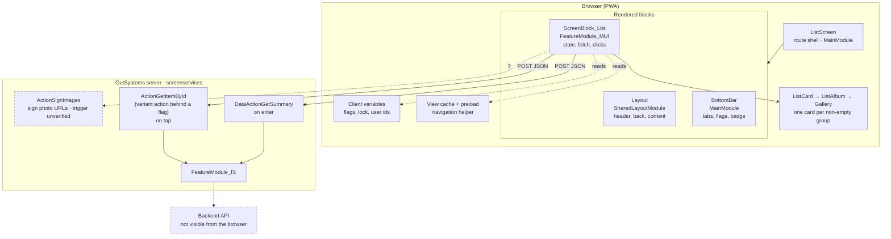
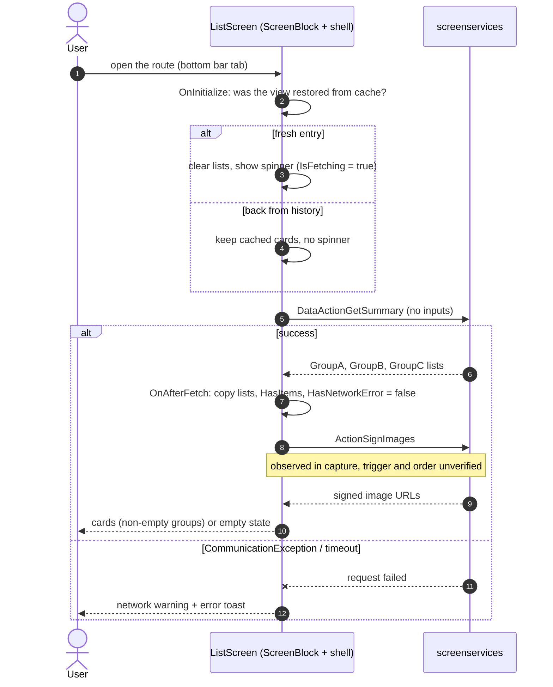
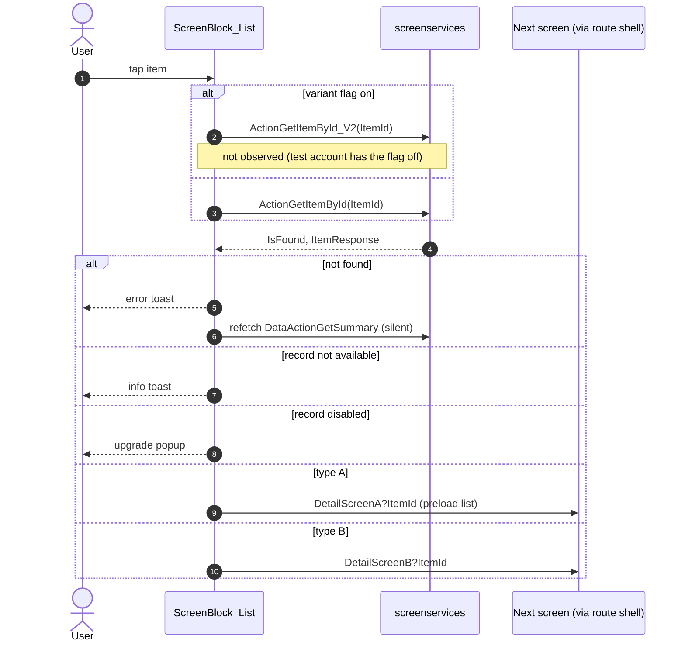
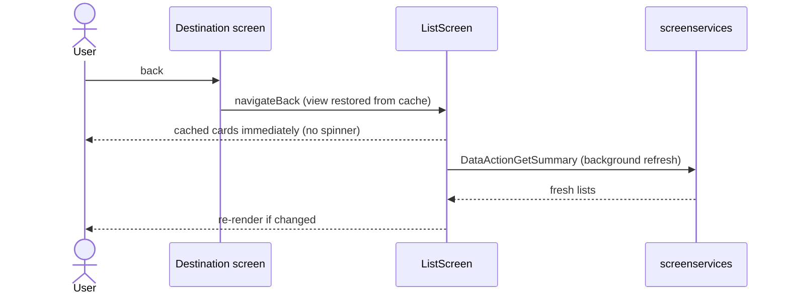

# Example: diagrams for spec sections 2a and 10

A worked pattern for the architecture diagram and the sequence diagrams of one screen. Every name below is a neutral placeholder (`ListScreen`, `ScreenBlock_List`, `DataActionGetSummary`, ...): replace each with the real OutSystems name read from the capture and the compiled code. Copy the conventions, not the content.

Pattern illustrated: a list screen whose content block fetches a summary on enter, signs image URLs, opens an item on tap through a server action, and restores from the view cache on back.

## 2a. Architecture

## 10. Sequences

### 10.1 Enter the screen (fresh vs back)

### 10.2 Tap an item

### 10.3 Back from a destination

