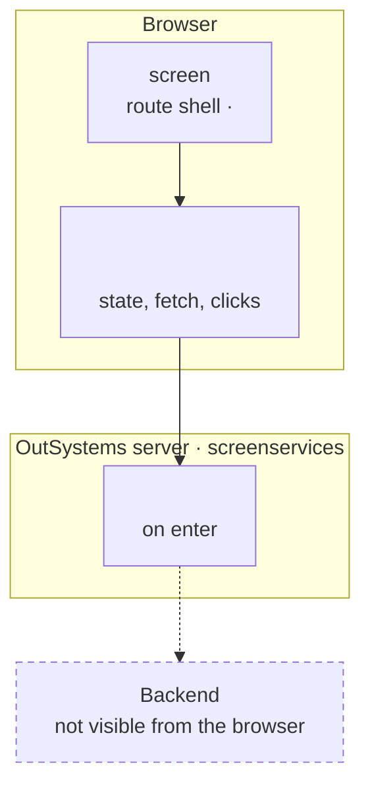
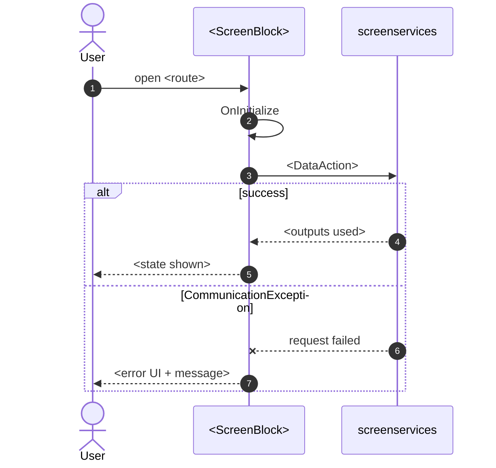

<!--
Full-tier spec template (screens with new blocks, server writes or multi-step flows; lite routes use route-spec-template.md. Saved as migration/screens/<Screen>/route-spec.md).
Start from the screen's pack.md; open analysis files only for what the pack does not hold.
Spec template. Replace every <...>. Keep section numbers so builder agents can reference them.
Every statement must be traceable: add the source in brackets, e.g. [dom/default.html], [ScreenBlock_X.mvc.js: onReady],
[calls.md #3], [OutSystems MCP: Module/Action], [css-relevant.md: .<class>]. Unclear points go to section 14 with a question id (route.py ask), never into the body as guesses.
-->
# Screen spec: <ScreenName>

## 0. Summary
<Two or three sentences: what the screen does, for whom, the main data it shows, the main actions.>

| Item | Value |
|---|---|
| Route (old) | `<path>` with inputs `<params or none>` |
| Screen file | `<Module.Flow.Screen.mvc.js>` |
| Content block | `<Module › Flow › Block>` |
| Captured | `<date>`, env `<dev/tst>`, viewport `<w×h>`, account type `<description, no personal data>` |
| Variant | <which version of the screen this is, and how other variants are reached (flags)> |
| OutSystems UI version | <e.g. OutSystemsUI_2_23> |
| Sources | `analysis/<Screen>/` (digest, calls, types, css, dom, coverage) |

## 1. Entry and routing
- How users reach the screen (menus, bottom bar, deep links) and the conditions that choose this screen over its variants. [file: handler]
- Input parameters, types, defaults.
- Layout used, root page or not, active bottom-bar/menu item.

## 2. Component tree
Exact rendered tree with OutSystems block names. Mark each node: **render** (rebuild), **shell** (app layout shared by many screens), **invisible** (logic only, renders nothing), **not captured**.

```
<ScreenShell>                                   [render]
└─ <Module › Flow.ScreenBlock_X>                 [render]
   ├─ Layout.Layout › BaseLayout                 [shell]
   │  ├─ header: MenuIcon, title "<text>"
   │  ├─ content: ...
   │  └─ footer: BottomBarMenu (active = <item>)
   └─ ...
```

For each **render** block, a short table:

| Block | Inputs (name: type = example) | Events raised | Placeholders | Notes |
|---|---|---|---|---|

## 2a. Architecture diagram
Required. One Mermaid `flowchart TB`, starting from the draft in `analysis/diagrams.md`, completed by hand. Conventions (see `assets/example-diagrams.md`):
- Three zones as subgraphs: `Browser` (route shell, rendered blocks, client state: view cache, client variables), `OutSystems server` (every data action, aggregate and server action the screen uses, plus integration modules such as `*_IS`), and `Backend` outside both.
- Node label = OutSystems name + owning module + 2–4 word role, joined with `<br/>`. Use the real names; never rename to React names here.
- Solid arrow = observed in the capture. Dashed arrow (`-.->`) or `classDef unknown` = declared but not observed, inferred, or not visible from the browser (backend). Put `?` on arrows whose trigger is unverified.
- Leave out invisible infrastructure blocks (one collapsed node at most) and pure markup blocks that add nothing to the data flow.
- Every server node must appear in section 6, every rendered block in section 2.



## 3. DOM and markup contract
The builder must reproduce class names and wrapper elements exactly, because the original CSS targets them.

- Root wrappers required for CSS scoping (e.g. a legacy wrapper such as `.backwards-compatibility.<theme-class>`, `.layout.layout-native`, `.screen-container.active-screen`).
- `<body>` class: `<captured>`; `<body>` style variables: `<captured>`; `<html>` class: `<captured>`.
- Per block: the markup skeleton with classes, in a fenced HTML block copied from `dom/default.html` (masked text left as `•••`, annotated with the field it shows).
- Dynamic classes and attributes with their expressions (e.g. a base class plus a modifier class added when a field has a given value). [Block.mvc.js: X.Style]
- Inline style variables (e.g. gallery `--grid-*`) and how they are computed.

## 4. Visual specification
Global styles, fonts, tokens and stylesheet order belong to the shell spec; reference it. List here only rules that are specific to this screen's own blocks.
- Stylesheets in load order (from `css-relevant.md`), and the instruction to embed them unchanged.
- Fonts and icon fonts used, with the classes that use them.
- Design tokens actually used on this screen (custom properties with resolved values in this theme scope).
- Key rules per component (copy the relevant rules from `css-relevant.md`, not the whole bundle): layout, spacing, colors, typography, radius, shadows, image sizing.
- Images: static assets used (captured or not), placeholder logic.
- Responsive behaviour: device classes and media queries that change this screen.
- Motion: transitions/animations present (screen transitions, slider, skeletons).

## 5. Data model
TypeScript types for every response the screen uses (from `types.ts`, trimmed to used fields), plus:
- The empty-value conventions (`""`, `0`, `1900-01-01`, Long as string) and the mapper the React code needs.
- Static entities / enums with their record names and meaning.
- Client variables and session/site values the screen reads.

## 6. API calls
One row per call the screen makes or can make.

| # | Old call (screenservices path) | Kind | Trigger | Inputs | Output used | Server side (MCP) | React replacement |
|---|---|---|---|---|---|---|---|
| 1 | `<path>` | Data action / Aggregate / Server action | on enter / on click X / after Y | `<inputs>` | `<fields actually used>` | <what it queries/calls, from OutSystems MCP, or "unknown"> | `<proposed endpoint or 'TBD'>` |

Notes: screen variables auto-sent by OutSystems (`screenData`) are not inputs. Mark calls observed in the capture vs only declared in code.

## 7. State and lifecycle
| State variable | Type | Initial | Set by | Read by |
|---|---|---|---|---|

Lifecycle, step by step: OnInitialize → data fetch → OnAfterFetch → OnReady → OnRender → OnDestroy, with what each does. Include back-navigation / view-cache behaviour.

## 8. Render logic
Pseudo-code of every `$if`/visibility rule, in the order they are evaluated:

```
if (<cond>) → <state A: what is shown>
else if (<cond>) → <state B>
else → <default>
```
For each state: captured (dom/<label>.html) or not captured.

## 9. Interactions and navigation
Use `analysis/call-sites.md` to fill the "Calls" column: every chain rooted in a UI event of this screen must appear in this table.

| Element | Event | Logic (step by step) | Calls | Navigates to (params) | Feedback |
|---|---|---|---|---|---|

Include keyboard/focus behaviour present in the markup (role, tabindex, aria-*).

## 10. Sequence diagrams
Required. Mermaid `sequenceDiagram`, starting from the drafts in `analysis/diagrams.md`, with every TODO resolved from the handlers in `sources/pretty/` (worked example: `assets/example-diagrams.md`). At minimum:

| # | Sequence | Must show |
|---|---|---|
| 10.1 | Enter the screen | lifecycle (OnInitialize/OnReady/OnAfterFetch), fresh vs back-from-history as `alt`, every call made on enter in order, success vs error as `alt` |
| 10.2… | One per user action that calls the server | the triggering element, variant selection (`alt` on flags/entitlements), the call with its inputs, every result branch as `alt` (toasts, popups, refresh, navigation with parameters) |
| 10.x | Back navigation | what is shown immediately and what is refreshed |
| 10.x | Error paths | each exception handled (CommunicationException, timeout, NotRegistered…) and its UI |

Conventions:
- Participants: `actor U as User`, the screen/block that owns the logic, `screenservices`, and `Next screen` when the flow navigates. Add the shell only when it takes part (e.g. route shell handles navigation events).
- Messages use real action names (`DataActionX`, `ActionY(Input)`); return arrows (`-->>`) list the output fields actually used; failed calls use `--x`.
- Triggers come from `analysis/call-sites.md`: the first message of each sequence is the root of the chain (UI event, lifecycle handler, block event), and the intermediate client actions are the chain. A chain marked "chain stops" ends in a callback or JavaScript node: read it in `sources/pretty/` and complete the diagram, or keep an `unverified` note and list it in section 14.
- Steps not proven by the capture keep a `Note over A,B: unverified …` (e.g. the order of a call whose trigger is unknown). Branches never exercised keep `Note: not observed`.
- One diagram per sequence; keep each under ~20 messages and split when longer.



## 11. Error handling and feedback
| Situation | Detection (exception / flag) | UI response | Message text |
|---|---|---|---|

## 12. Strings
Every static string on the screen, in order of appearance, plus messages from logic (toasts, dialogs). Mark the ones that come from data.

## 13. Accessibility, platform and security notes
Roles, labels, focus, native-only branches excluded from web, PWA/service worker behaviour, offline behaviour.
Security (from `security.md`, names only): client variables this screen reads that decide access (permissions, entitlements, flags), the server actions it calls and whether each enforces authorization server-side (OutSystems MCP, or open question), any token or identifier it reads from client storage.

## 13a. Feature flags
Required when `flags.py route <Screen>` lists flags: per flag, what the OutSystems MCP said (values per environment), the user's decision, the branches built and the mock toggle with its default.

## 14. Unclear points
Every item not proven by the capture, the compiled code, the knowledge cache or an answer, each with its question id (route.py ask). Include every item from `coverage.md` that is still open.

| # | What is unclear | Why (not captured / server-side / unreadable) | Question | Status |
|---|---|---|---|---|

## 15. Acceptance criteria
Numbered, testable statements the React screen must satisfy, each tied to a section above (states, calls, navigation, visuals at the captured viewport).

## 16. Decisions to confirm
Every choice the build made that the user has not explicitly confirmed: answers applied, divergences, mock semantics for unobserved branches, NotCaptured gaps, change requests. One bullet each; route.py ready turns them into the post-build confirmation.
- <decision> (<evidence or Q id>)

## 17. Patterns used
Accepted patterns from migration/patterns/ this route follows, one line each with where it applies. Needs not covered by a pattern are decision questions for the user.
- P-<ID>: <where>

## 18. Builder notes
- Diagrams: sections 2a and 10 render on GitHub/GitLab and in most Markdown viewers; keep them valid Mermaid (check with any Mermaid live editor).
- Prototype recipe: `scripts/build_prototype.py` with the analysis folder; per-screen code follows `references/prototype-guide.md`.
- Reproduce markup and classes exactly; embed the original CSS bundle in an isolated document (iframe) so global OutSystems rules apply without leaking.
- Mock data: same counts and field shapes as the capture, fictional values, OutSystems wire shape mapped through the mapper in section 5.
- Not captured → dashed "Not captured" marker, never an invented design.
