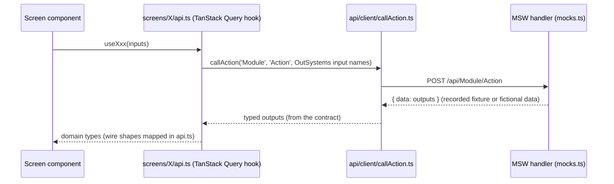

# Architecture overview

UBTConnect React replaces the OutSystems 11 mobile app UBTConnect. The UI and its behaviour match the original 1:1
(nothing invented). Until a backend exists, the app runs on mock data that the browser serves. The app calls the API
exactly as the original app calls its server: same actions, same moments, same inputs and outputs.

Reference pages that scripts generate from the migration data: [stack and ADRs](../reference/stack.md),
[screens](../reference/screens.md), [flags](../reference/flags.md), [shared blocks](../reference/shared-blocks.md),
[API](../reference/api.md).

## Quality attributes, in priority order

| #   | Attribute                 | What it means here                                                                               | How it is enforced                                                                                        |
| --- | ------------------------- | ------------------------------------------------------------------------------------------------ | --------------------------------------------------------------------------------------------------------- |
| 1   | Fidelity                  | Same DOM, class names and CSS as the original; same routes and parameters; same calls and states | original CSS files unchanged, per screen (`public/UBTConnect/css/`); parity check per captured state      |
| 2   | Maintainability           | Clean, typed, readable code; one way to do each recurring thing                                  | TypeScript strict, ESLint strict (type-checked), Prettier, patterns with reference code, ADRs for changes |
| 3   | Ready for production      | Backend, identity, flags and monitoring can be swapped in without touching screens               | API contract + typed client, providers in `src/platform` (config, log, flags, auth later)                 |
| 4   | Consistency and isolation | Each screen lives in its own folder; shared code is built once and frozen                        | folder rules, `consistency_check`, change requests for shared code                                        |
| 5   | Documentation             | Architecture and references stay current                                                         | these pages; reference pages generated from data                                                          |
| 6   | Testability               | Every branch and state can be reached without a backend                                          | MSW scenarios, flag panel, mock store, Vitest, Storybook                                                  |

Deliberately not goals: a new design system, behaviour or performance beyond the original, server rendering.

## Context (C4 level 1)


## Containers and layers (C4 level 2–3)

```mermaid
flowchart TB
  subgraph Browser
    direction TB
    platform[src/platform<br/>error handling, auth provider, PIN,<br/>navigation guard, view cache, toasts,<br/>local entities IndexedDB]
    pages[src/pages/&lt;Route&gt;<br/>&lt;Route&gt;Page.tsx · hooks · inputs.ts · mocks.ts]
    containers[src/containers<br/>a container only by the criterion of the page template,<br/>with its hooks and mocks]
    comps[src/components/&lt;domain&gt;<br/>props-only components with stories and tests]
    domain[src/api/&lt;domain&gt;<br/>types · mapper · repository · keys · hooks]
    screens[src/screens/&lt;Screen&gt;<br/>screens not yet moved: index.tsx · api.ts · mocks.ts · types.ts]
    widgets[src/components<br/>platform widgets in components/ui/os:<br/>validation, popup, list, radio group]
    vendor[src/vendor and osui vendor folders<br/>third-party scripts copied from the original]
    shared[src/shared<br/>one component per OutSystems block<br/>src/shared/osui for OutSystems UI patterns]
    lib[src/api/client · src/platform/{config, log, flags, device}<br/>src/legacy/os: os-wire, os-exceptions, os-assets]
    mocks[src/mocks<br/>MSW handlers · recorded fixtures · mock store]
    css[public/UBTConnect/css<br/>original OutSystems CSS per screen]
  end
  contract[src/api/openapi.yaml<br/>API contract]
  pages --> containers
  pages --> comps
  pages --> domain
  containers --> comps
  containers --> domain
  domain --> lib
  screens --> shared
  screens --> lib
  screens --> widgets
  shared --> widgets
  shared --> vendor
  platform --> lib
  shared --> lib
  lib -- callAction --> mocks
  contract -. types .-> lib
  contract -. validates .-> mocks
```

Rules that keep it this way (`consistency_check.py` checks them before a screen is finished):

- A page (`src/pages`) never imports another page, and a component (`src/components`) imports no `api/`, `platform/`, `containers/` or `pages/` (ESLint, `app/eslint.config.js`). Only `pages/<Route>/` imports `pages/<Route>/`, and `src/shared` imports no `src/screens` or `src/app`. Inside `src/shared`, `UBTConnectLibrary` imports neither `UBTConnect_Utils` nor `UBTConnect`, and `UBTConnect_Utils` does not import `UBTConnect`.
- Also in `src/shared`: `shared/osui` imports no other app module in `shared/` (only `shared/lib`), `Connect2_LegacyShared` does not import `UBTConnect`, and `Connect2_MyBookmarks_MUI` does not import `Connect2_Assemble_MUI` (dependency-cruiser warnings, `app/.dependency-cruiser.cjs`). The import graph of `src/` has no cycle (`no-circular` is an error). The recipe is the [page template](../guides/page-template.md). Only HouseholdDetails is a page so far.
- Story and test files are outside the cycle rule and these folder rules (decision Q11, P3-2; the P3-3 rules use the same exception). A story renders the real blocks of the captured screen, so it may import across the three modules.
- A screen imports only from its own folder and from `src/shared`, `src/platform`, `src/api`, `src/legacy`, `src/components`, `src/mocks`.
- A screen has no `fetch`, browser storage, route CSS, inline visual styles, raw HTML or `console.log`.
- Packages come only from the pinned allow-list ([stack](../reference/stack.md)). A new package needs an ADR.

## Data flow of one server call



- Types of inputs and outputs come from the contract (`npm run gen:api`). An action that is not in the contract does
  not compile.
- Mock data: reference, place and organisation data are recorded from TST and anonymised. Data about a person is
  fictional, with the recorded structure and counts.
- `src/api/client/apiError.ts` has `ApiError` (`kind`: timeout, network, server, security, viewChanged; `cause`: the OutSystems exception). `src/legacy/os/os-exceptions.ts` maps both ways. `callAction` still raises the OutSystems exceptions.
- `src/api/client/queryClient.ts` has the one QueryClient of the app. `src/api/client/cache.ts` keeps the memory cache as queries of this client. The time to live of an entry is its `staleTime`. The entries are in `src/api/<domain>/keys.ts`. `clearMemoryCache` at logout raises a session epoch that is part of every key.
- `signedOutRemotely()` (`src/platform/session/auth.ts`) is the single entry point for "the server ended the session". Today only the forced-logout branch of `src/platform/feedback/exceptionMessages.ts` calls it. The 401 and SecurityException triggers wait for the BFF.
- Later, the backend implements the same contract. Only the `src/api/client/callAction.ts` configuration and the mappers in `api.ts`
  can change. The screens do not change.

## Runtime pieces worth knowing

| Piece                 | Where                                                                                                                                 | Guide                                            |
| --------------------- | ------------------------------------------------------------------------------------------------------------------------------------- | ------------------------------------------------ |
| Request timeouts      | `SERVER_REQUEST_TIMEOUT` in `src/api/client/callAction.ts` (20 s for `UBTConnect`, 10 s for other modules)                            | [API and mock data](../guides/api-and-mocks.md)  |
| Navigation guard      | `src/platform/navigation/navigationGate.ts`: `dx-before-navigation`, prevent / resume                                                 | [Shell](../guides/shell.md)                      |
| Platform validation   | `src/components/ui/os/OSValidation`                                                                                                   | [Platform widgets](../guides/os-widgets.md)      |
| Popups                | `src/components/ui/os/OSPopup/usePopupWidget.ts`                                                                                      | [Platform widgets](../guides/os-widgets.md)      |
| Session status        | `src/platform/session/machine.ts` (7 statuses, pure `transition`; selectors in `session.ts`)                                          | [Shell](../guides/shell.md)                      |
| Route meta, guard     | `src/app/routes.ts` (`meta.access`, `meta.lock`, `meta.flagRedirect`, `NO_ROUTE_META`), `src/app/RouteGuard.tsx` (one redirect table) | [Shell](../guides/shell.md)                      |
| Auth provider         | `src/platform/auth` (`AuthProvider`, `mockAuth` behind `MOCKS_BUILT`, `authProvider()`)                                               | [Shell](../guides/shell.md)                      |
| App start             | `src/platform/bootstrap/appStartSteps.ts` (8 named steps, with `fetchFlags`), `postLogin.ts`                                          | [Shell](../guides/shell.md)                      |
| Feature flags         | `src/platform/flags` (21-flag registry, `resolve`, `store`, `overrides`, `server`, `useFlag`; `FLAG_OVERRIDES_BUILT`)                 | [Shell](../guides/shell.md)                      |
| Settings store        | `src/platform/settings` (11 typed server settings from `synchAppContext`; adapter `src/legacy/os/clientVarNames.ts`)                  | [Shell](../guides/shell.md)                      |
| Local entities        | `src/platform/storage/localEntities` (IndexedDB; bookmark sync in one transaction, ADR-8)                                             | [Shell](../guides/shell.md)                      |
| Vendored scripts      | `src/vendor/panzoom` (ADR-7), `src/shared/osui/DropdownSearch/vendor` (ADR-5)                                                         | [Shared code](../guides/shared-code.md)          |
| Mock scenarios, store | `src/mocks`, `?mock=`, `?mocksession=`                                                                                                | [API and mock data](../guides/api-and-mocks.md)  |
| Known original bugs   | B1-B13                                                                                                                                | [Known original bugs](../known-original-bugs.md) |

## Where decisions live

- Stack, pinned versions and ADRs: [reference/stack.md](../reference/stack.md) (source `migration/stack.json`).
- Target architecture of the refactor: ADR-15 in `migration/stack.json` (accepted at the gate of P0-5), the full text in
  [refactor-plan-v2.md](refactor-plan-v2.md), and the plan for each block in [move-map.csv](../refactor/move-map.csv).
  Phases 1 and 2 moved the code to `platform/`, `legacy/os/`, `api/<domain>/`, `pages/`, `containers/` and `components/`.
  Phase 4 added the typed settings, the session state machine, the auth provider, the route meta and the flag registry in `platform/`. Phase 3 removed the import cycles and added the folder-direction rules; its numbers are in
  [reports/P3.md](../refactor/reports/P3.md). The other screens stay in `src/screens/` and the other blocks in `src/shared/` until their phase.
- Implementation patterns with reference code: `migration/patterns/P-*.md`.
- Feature flag decisions: [reference/flags.md](../reference/flags.md).
- Per screen: `migration/screens/<Screen>/route-spec.md`.
