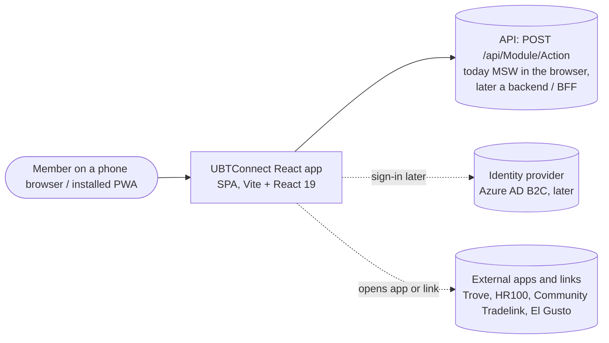
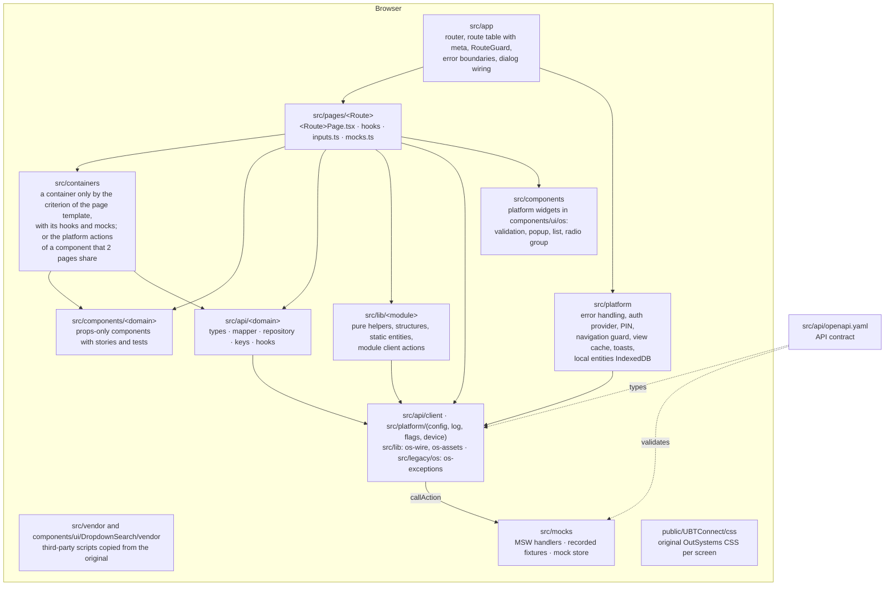
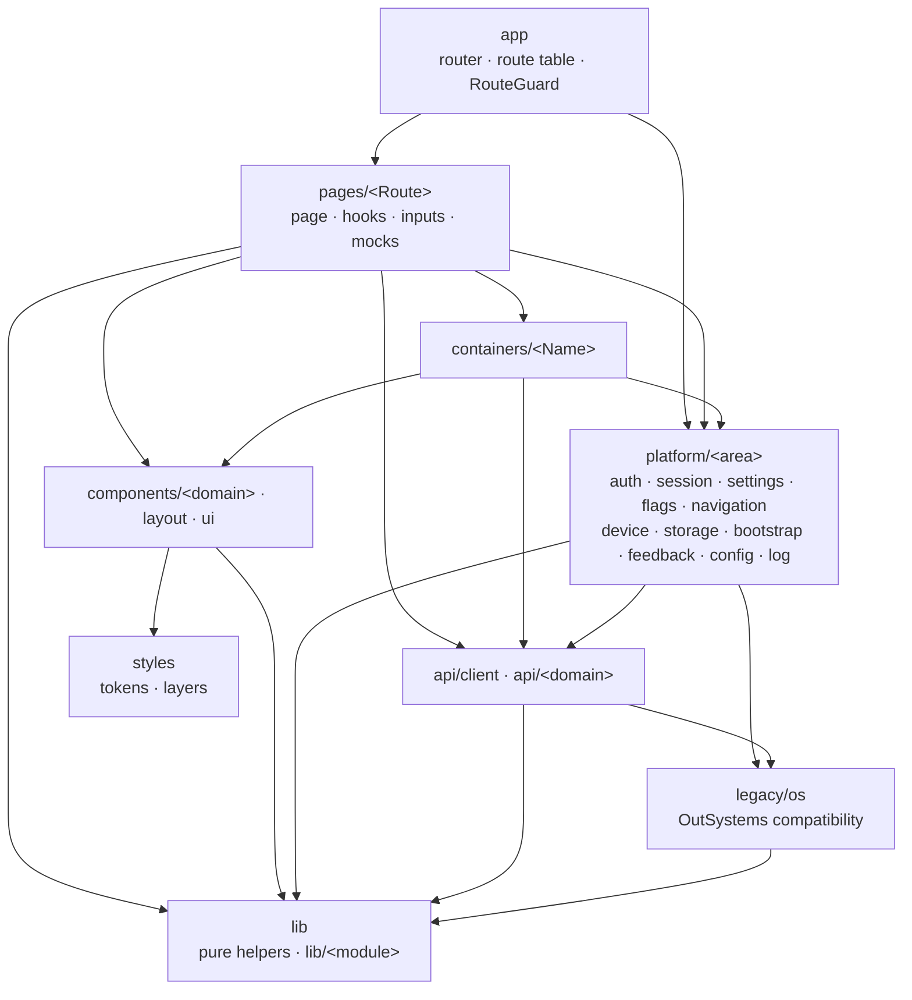

# Architecture overview

UBTConnect React replaces the OutSystems 11 mobile app UBTConnect. The UI and its behaviour match the original 1:1
(nothing invented). Until a backend exists, the app runs on mock data that the browser serves. The app calls the API
exactly as the original app calls its server: same actions, same moments, same inputs and outputs.

Reference pages that scripts generate from the migration data: [stack and ADRs](../reference/stack.md),
[screens](../reference/screens.md), [flags](../reference/flags.md), [shared blocks](../reference/shared-blocks.md),
[API](../reference/api.md).

## Quality attributes, in priority order

| #   | Attribute                 | What it means here                                                                               | How it is enforced                                                                                        |
| --- | ------------------------- | ------------------------------------------------------------------------------------------------ | --------------------------------------------------------------------------------------------------------- |
| 1   | Fidelity                  | Same DOM, class names and CSS as the original; same routes and parameters; same calls and states | original CSS files unchanged, per screen (`public/UBTConnect/css/`); parity check per captured state      |
| 2   | Maintainability           | Clean, typed, readable code; one way to do each recurring thing                                  | TypeScript strict, ESLint strict (type-checked), Prettier, patterns with reference code, ADRs for changes |
| 3   | Ready for production      | Backend, identity, flags and monitoring can be swapped in without touching screens               | API contract + typed client, providers in `src/platform` (config, log, flags, auth later)                 |
| 4   | Consistency and isolation | Each screen lives in its own folder; shared code is built once and frozen                        | folder rules, `consistency_check`, change requests for shared code                                        |
| 5   | Documentation             | Architecture and references stay current                                                         | these pages; reference pages generated from data                                                          |
| 6   | Testability               | Every branch and state can be reached without a backend                                          | MSW scenarios, flag panel, mock store, Vitest, Storybook                                                  |

Deliberately not goals: a new design system, behaviour or performance beyond the original, server rendering.

## Context (C4 level 1)



## Containers and layers (C4 level 2–3)



## Folders of `src/` and the import direction

Each arrow means "may import". A page is the top of the graph, and `lib/` is the bottom. Rule numbers are those of plan v2
section 2.4. The checks are in [quality checks](../guides/quality.md).



- A page imports no other page (rule 3); only `pages/<Route>/` imports `pages/<Route>/`.
- `components/` imports no `api/`, `platform/`, `containers/`, `pages/` or `app/` (rule 4). `components/ui/` imports only `components/ui/`, `lib/` and `styles/` (rule 5).
- `lib/` imports only `lib/` (rule 6). `api/<domain>/` imports only `api/client/`, `lib/` and `legacy/os/` (rule 7).
- `platform/` imports no `pages/`, `components/`, `containers/` or `app/` (rule 8).
- Only `platform/`, `api/` and `app/` import `legacy/os/` (rule 9).
- `mocks/` and `styles/` are outside the graph: `mocks/` serves the contract at run time, and `styles/` holds the tokens and the layer order that `components/ui/` may read.
- The remaining violations are frozen in baselines that only shrink ([Architecture baselines](../guides/quality.md#architecture-baselines-p9-1)).

Rules that keep it this way (`consistency_check.py` checks them before a screen is finished):

- A page (`src/pages`) never imports another page, and a component (`src/components`) imports no `api/`, `platform/`, `containers/` or `pages/` (dependency-cruiser and ESLint, `app/eslint.config.js`). Only `pages/<Route>/` imports `pages/<Route>/`, and `lib/` imports only `lib/` (rule 6). The module client actions in `src/lib/<module>/actions.ts` still break rule 6 (50 rows in the baseline, follow-up F35).
- The folder rules are errors in `app/.dependency-cruiser.cjs`, and so is `no-circular`: the import graph of `src/` has no cycle. The violations that existed at P9-1 are frozen in shrink-only baselines (dependency-cruiser 142 rows, ESLint 72, knip 1,130), and a new one fails `npm run ci`. The recipe for a page is the [page template](../guides/page-template.md); all 64 routes are pages in `src/pages/`.
- `src/components/ui/Dialog` and `src/platform/feedback/dialogs` may not import each other. `src/app/dialogs.ts` (`connectDialogs()`, called by `main.tsx`) joins them. The dialogs get `confirmAction` and the back-navigation queue. The platform dialogs get the `Dialog` markup. See `src/components/ui/Dialog/Dialog.README.md`.
- Story and test files are outside the cycle rule and these folder rules (decision Q11, P3-2; the P3-3 rules use the same exception). A story renders the real blocks of the captured screen, so it may import across the three modules.
- A page imports only from its own folder and from `src/lib`, `src/platform`, `src/api`, `src/legacy`, `src/components`, `src/containers`, `src/mocks`.
- A page has no `fetch`, browser storage, route CSS, inline visual styles, raw HTML or `console.log`.
- Only pages, hooks and containers read feature flags. `npm run flags` (`app/build/check-flags.mjs`) checks the registry against the readers.
- Packages come only from the pinned allow-list ([stack](../reference/stack.md)). A new package needs an ADR.

## Data flow of one server call

```mermaid
sequenceDiagram
  participant C as Page component
  participant A as domain hook in api/&lt;domain&gt;/hooks.ts (TanStack Query)
  participant L as api/client/callAction.ts
  participant M as MSW handler (mocks.ts)
  C->>A: useXxx(inputs)
  A->>L: callAction('Module', 'Action', OutSystems input names)
  L->>M: POST /api/Module/Action
  M-->>L: { data: outputs } (recorded fixture or fictional data)
  L-->>A: typed outputs (from the contract)
  A-->>C: domain types (wire shapes mapped in api/&lt;domain&gt;/mapper.ts)
```

- Types of inputs and outputs come from the contract (`npm run gen:api`). An action that is not in the contract does
  not compile.
- Mock data: reference, place and organisation data are recorded from TST and anonymised. Data about a person is
  fictional, with the recorded structure and counts.
- `src/api/client/apiError.ts` has `ApiError` (`kind`: timeout, network, server, security, viewChanged; `cause`: the OutSystems exception). `src/legacy/os/os-exceptions.ts` maps both ways. `callAction` still raises the OutSystems exceptions.
- `src/api/client/queryClient.ts` has the one QueryClient of the app. `src/api/client/cache.ts` keeps the memory cache as queries of this client. The time to live of an entry is its `staleTime`. The entries are in `src/api/<domain>/keys.ts`. `clearMemoryCache` at logout raises a session epoch that is part of every key.
- `signedOutRemotely()` (`src/platform/session/auth.ts`) is the single entry point for "the server ended the session". The forced-logout branch of `src/platform/feedback/exceptionMessages.ts` calls it. A SecurityException reaches that branch through `raiseToFlowHandler` (`src/legacy/os/exceptions.ts`) for a signed-in user. For an anonymous user, the app goes to `/UBTConnect/Login?In_IsFromInvalidPermissions=True` through `osNavigateTo` (`src/platform/navigation/osNavigate.ts`). The 401 trigger waits for the BFF.
- Later, the backend implements the same contract. Only the `src/api/client/callAction.ts` configuration and the mappers in `api.ts`
  can change. The screens do not change.

## Runtime pieces worth knowing

| Piece                 | Where                                                                                                                                 | Guide                                            |
| --------------------- | ------------------------------------------------------------------------------------------------------------------------------------- | ------------------------------------------------ |
| Request timeouts      | `SERVER_REQUEST_TIMEOUT` in `src/api/client/callAction.ts` (20 s for `UBTConnect`, 10 s for other modules)                            | [API and mock data](../guides/api-and-mocks.md)  |
| Navigation guard      | `src/platform/navigation/navigationGate.ts`: `dx-before-navigation`, prevent / resume                                                 | [Shell](../guides/shell.md)                      |
| Platform validation   | `src/components/ui/os/OSValidation`                                                                                                   | [Platform widgets](../guides/os-widgets.md)      |
| Popups                | `src/components/ui/os/OSPopup/usePopupWidget.ts`                                                                                      | [Platform widgets](../guides/os-widgets.md)      |
| Session status        | `src/platform/session/machine.ts` (7 statuses, pure `transition`; selectors in `session.ts`)                                          | [Shell](../guides/shell.md)                      |
| Route meta, guard     | `src/app/routes.ts` (`meta.access`, `meta.lock`, `meta.flagRedirect`, `NO_ROUTE_META`), `src/app/RouteGuard.tsx` (one redirect table) | [Shell](../guides/shell.md)                      |
| Auth provider         | `src/platform/auth` (`AuthProvider`, `mockAuth` behind `MOCKS_BUILT`, `authProvider()`)                                               | [Shell](../guides/shell.md)                      |
| App start             | `src/platform/bootstrap/appStartSteps.ts` (8 named steps, with `fetchFlags`), `postLogin.ts`                                          | [Shell](../guides/shell.md)                      |
| Feature flags         | `src/platform/flags` (21-flag registry, `resolve`, `store`, `overrides`, `server`, `useFlag`; `FLAG_OVERRIDES_BUILT`)                 | [Shell](../guides/shell.md)                      |
| Settings store        | `src/platform/settings` (11 typed server settings from `synchAppContext`; adapter `src/legacy/os/clientVarNames.ts`)                  | [Shell](../guides/shell.md)                      |
| Local entities        | `src/platform/storage/localEntities` (IndexedDB; bookmark sync in one transaction, ADR-8)                                             | [Shell](../guides/shell.md)                      |
| Vendored scripts      | `src/vendor/panzoom` (ADR-7), `src/components/ui/DropdownSearch/vendor` (ADR-5)                                                       | [Shared code](../guides/shared-code.md)          |
| Mock scenarios, store | `src/mocks`, `?mock=`, `?mocksession=`                                                                                                | [API and mock data](../guides/api-and-mocks.md)  |
| Known original bugs   | B1-B13                                                                                                                                | [Known original bugs](../known-original-bugs.md) |

## Where decisions live

- Stack, pinned versions and ADRs: [reference/stack.md](../reference/stack.md) (source `migration/stack.json`).
- Target architecture of the refactor: ADR-15 in `migration/stack.json` (accepted at the gate of P0-5), the full text in
  [refactor-plan-v2.md](refactor-plan-v2.md), and the plan for each block in [move-map.csv](../refactor/move-map.csv).
  Phases 1 and 2 moved the code to `platform/`, `legacy/os/`, `api/<domain>/`, `pages/`, `containers/` and `components/`.
  Phase 4 added the typed settings, the session state machine, the auth provider, the route meta and the flag registry in `platform/`. Phase 3 removed the import cycles and added the folder-direction rules; its numbers are in
  [reports/P3.md](../refactor/reports/P3.md).
- Phase 8 added `src/styles/` (design tokens, CSS layers) and loads the original stylesheets into `@layer legacy`. Phase 9 turned the folder rules into errors with frozen baselines and added the flag check; see [quality checks](../guides/quality.md).
- Phase 6 moved every route to `src/pages/` and deleted `src/screens/` ([P6-end](../refactor/reports/P6-end.md)). Step P7-0 moved 67 blocks from `src/shared/` to `src/components/ui/` ([move map](../refactor/move-map.csv)); P7-6 (decision W32) emptied and deleted `src/shared/`. Block components went to `components/<domain>/`, `containers/DetailLayout`, `platform/session/UserInfoCache` and `legacy/os/cache/`. Module helpers went to `lib/<module>/`, MSW files to `mocks/modules/`, and test helpers to `src/test/`. Its debt is in [followups](../../../migration/refactor/followups.md) F35 to F38.
- Implementation patterns with reference code: `migration/patterns/P-*.md`.
- Feature flag decisions: [reference/flags.md](../reference/flags.md).
- Per screen: `migration/screens/<Screen>/route-spec.md`.
