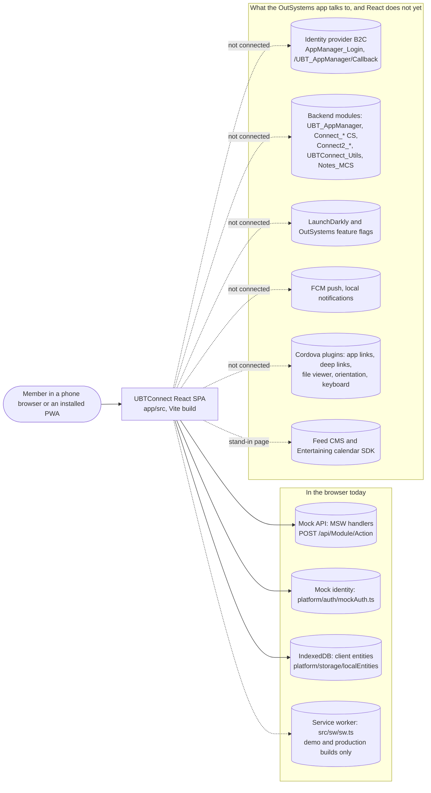
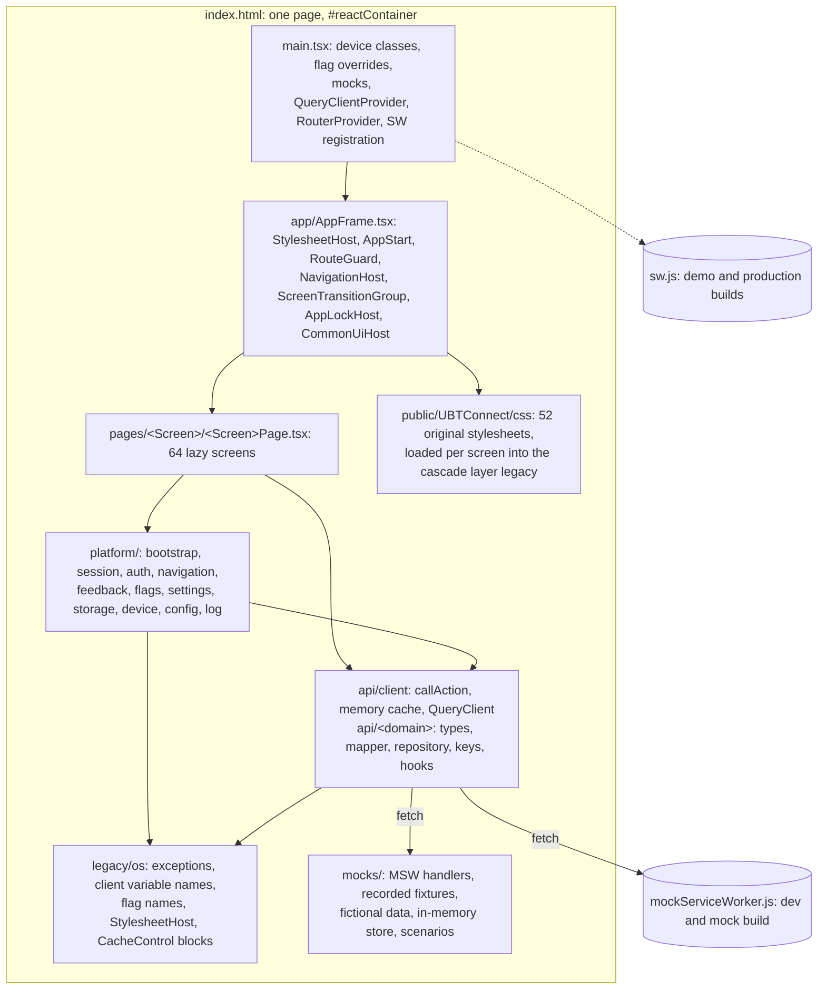
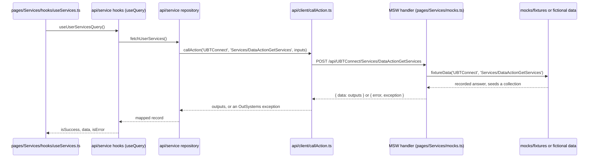

# Architecture of the React front end as built (clarify-screens P2)

Status: draft (Fable, 2026-10-27). Input of `infra-gaps.md`. Style: `migration/english-docs/style-rules.md`.

## 1. Scope and sources

This document describes the React front end in `app/` as it is on the branch `clarify-screens` at the last commit
(`d78909c8`, 2026-10-27). "Current" means that commit: the code, the dependencies and the build modes of that tree.
The facts come from the code (`file:line`) and from the 45 flow reports of `migration/clarify/flows/<Flow>/report.md`.
A row id such as `App_Common-027` is a row of that flow's `checklist.json`. The old migration documents
(`app/docs/architecture/overview.md`, `app/docs/reference/stack.md`, `app/src/platform/README.md`,
`app/src/api/README.md`) gave the orientation only.

The numbers of the reports are the ones of `INDEX.md` after the follow-up pass of 2026-10-27. The 45 reports hold
5332 rows: match 4212, partial 137, missing 166, differs 93, mock-only 157, n/a 556, unclear 11. They record 112
findings: 3 blocker, 25 major, 55 minor, 29 info. A fact that this pass did not verify carries the mark
"not verified", with the file that verifies it.

## 2. C4 context and containers

### 2.1 Context: what runs today, and what the OutSystems app talks to

Evidence: the identity provider of the build is `mockAuth` in mock builds and `null` in a production build
(`app/src/platform/auth/authProvider.ts:8-10`). The API client posts to `/api/<Module>/<Action>`
(`app/src/api/client/callAction.ts:12-17`), and MSW or an in-page fetch wrapper answers (`app/src/main.tsx:36-46`).
The flags come from the registry defaults without a call (`app/src/platform/flags/server.ts:12-17`). Push, Firebase
and the native plugins have no React code: rows `_shared-097`, `_shared-098`, `_shared-179`, `_shared-180`,
`_shared-189`, `_shared-190` (all `n/a`, decisions U12, U14, U17). The Feed CMS and the Entertaining calendar are
stand-ins: rows `Home-049` (differs, D8(b)) and `Calendar-029` (differs).

### 2.2 Containers: the parts of the browser build

Evidence: `app/index.html:16-17`, `app/src/main.tsx:19-62`, `app/src/app/AppFrame.tsx:20-34`,
`app/src/app/screens.ts:14`, `app/src/pwa/bootPlan.ts:7-11`, `app/src/legacy/os/StylesheetHost.tsx:7-20`.

### 2.3 Build modes

| Mode | Mocks | App service worker | Identity | Source |
|---|---|---|---|---|
| dev, plain mock build (default) | MSW worker `mockServiceWorker.js` | none | mockAuth | `bootPlan.ts:26-28`, `main.tsx:38-40` |
| demo (`VITE_DEMO=true`) | in-page fetch wrapper, same handlers | yes, scope `/` | mockAuth | `bootPlan.ts:27`, `mocks/inProcess.ts:4-11` |
| production (`VITE_USE_MOCKS=false`) | none; mock code dropped | yes, scope `/UBTConnect/` | none: sign-in throws | `bootPlan.ts:26`, `config.ts:22`, `session/auth.ts:34-35` |

`MOCKS_BUILT` is a build-time constant: every mock import sits behind it, and `build/mockFree.ts` fails a production
build that still bundles mock code (`app/src/platform/config/config.ts:18-22`).

## 3. Folders of `app/src/` and the import direction

File counts come from `find <folder> -type f` on 2026-10-27 (tests, stories, README and captures included).

| Folder | Files | Content | Evidence |
|---|---|---|---|
| `app/` | 16 | router, generated route table, route meta and flag redirects, RouteGuard, AppFrame, ErrorBoundary, dialog wiring | `app/src/app/router.tsx`, `routes.ts`, `RouteGuard.tsx`, `dialogs.ts` |
| `pages/` | 845 | 64 screen folders: `<Screen>Page.tsx`, `hooks/` (61 folders), `components/`, `mocks.ts` (55 files), `inputs.ts`, `staticEntities.ts` | `app/src/app/screens.ts:14`; `ls app/src/pages` |
| `containers/` | 74 | 8 containers shared by 2 or more pages: AssembleSummaryCard, DetailLayout, EntityDetailsActions, FilterSheet, HouseholdDetails, NoteListActions, ShareSheet, SupperMeetingDetails | `ls app/src/containers` |
| `components/` | 1581 | props-only components by domain (assemble 55, auth 55, bookmark 12, contact 68, directory 142, feed 38, filter 32, household 61, layout 142, menu 10, note 33, notification 14, orbit 102, search 6, share 23, version 32) and `ui/` (756 files, 93 entries) | `find` per folder |
| `api/` | 168 | `client/` (callAction, cache, queryClient, apiError), 19 domain folders, `openapi.yaml` (165 paths), generated `schema.d.ts` | `ls app/src/api`; `grep '/api/' openapi.yaml` |
| `platform/` | 228 | auth 6, bootstrap 10, config 1, device 17, feedback 41, flags 13, log 2, navigation 63, session 55, settings 4, storage 15 | `find` per subfolder |
| `legacy/os/` | 46 | OutSystems exception classes, flow handler, client variable and flag names, StylesheetHost, body theme, review markers, 5 CacheControl blocks | `ls app/src/legacy/os` |
| `lib/` | 46 | pure helpers (`os-wire`, `os-assets`, `osDateTime`, `sanitizeHtml`, `jsUtils`) and one folder per OutSystems module: assemble, geography, leaflet, legacyShared, orbit, ubtConnect, ubtConnectLibrary, ubtConnectUtils | `ls app/src/lib` |
| `mocks/` | 57 | `browser.ts`, `handlers.ts`, `inProcess.ts`, `contract.ts`, `fixtures.ts`, `store.ts`, `scenario.ts`, 27 recorded fixture files, 6 fictional data files, 6 module mock folders | `ls app/src/mocks` |
| `pwa/` | 10 | boot plan, SW registration, SW route rules, network-first helper, persistent storage, manifest | `ls app/src/pwa` |
| `sw/` | 2 | the app service worker and its tsconfig | `ls app/src/sw` |
| `styles/` | 4 | cascade layers, tokens, review CSS | `app/src/main.tsx:8-10` |
| `vendor/` | 10 | TST scripts copied as-is: `barcodeplugin/` (ADR-11), `panzoom/` (ADR-7), each with `SOURCE.md` | `app/src/vendor/README.md` |
| `test/` | 9 | Vitest setup with the MSW node server | `app/src/test/setup.ts:8-9` |

The import direction is a set of dependency-cruiser rules, all errors (`app/.dependency-cruiser.cjs:23-86`):

| Rule | From | May not import | Line |
|---|---|---|---|
| no-circular | any | a cycle | :23-27 |
| rule 3 | `pages/<A>/` | `pages/<B>/` | :30-34 |
| pages-imported-by-own-route-only | outside `pages/` | `pages/` | :37-44 |
| rule 4 | `components/` | `api/`, `platform/`, `containers/`, `pages/`, `app/` | :47-51 |
| rule 5 | `components/ui/` | anything but `components/ui/`, `lib/`, `styles/` | :54-58 |
| rule 6 | `lib/` | anything but `lib/` | :61-65 |
| rule 7 | `api/<domain>/` | anything but `api/client/`, `lib/`, `legacy/os/`, `api/<domain>/` | :68-72 |
| rule 8 | `platform/` | `pages/`, `components/`, `containers/`, `app/` | :75-79 |
| rule 9 | outside `platform/`, `api/`, `app/`, `legacy/os/` | `legacy/os/` | :82-86 |

So the graph is: `app` → `pages` → `containers` → `components` → `lib`; `pages` and `containers` → `platform` → `api`
→ `legacy/os` → `lib`. ESLint adds `no-restricted-imports` for relative parent imports and rule 4
(`app/eslint.config.js:61-73`). The two dialog folders (`components/ui/Dialog`, `platform/feedback/dialogs`) never
import each other: `app/dialogs.ts:14-17` joins them once before the first render.

## 4. The request path

### 4.1 From the page to the fixture

Evidence:

- `app/src/pages/Services/hooks/useServices.ts:1-2, 44-52`
- `app/src/api/household/hooks.ts:12-24` (the hook shape of every domain)
- `app/src/api/household/repository.ts:1`
- `app/src/api/client/callAction.ts:93-126`
- `app/src/pages/Services/mocks.ts:15-39`
- `app/src/mocks/fixtures.ts:1-15`

### 4.2 How an OutSystems action maps to an endpoint

| OutSystems element | Endpoint | `callAction` call | Evidence |
|---|---|---|---|
| server action, service action | `POST /api/<Module>/<Action>` | `callAction('Module', 'ActionName', inputs)` | `callAction.ts:12-14` |
| screen or block data action, aggregate | `POST /api/<Module>/<Owner>/<Action>` | `callAction('Module', 'Owner/DataActionName', inputs)` | `callAction.ts:15-16` |

The body is the inputs with their OutSystems names; the answer is `{ data: <outputs> }` (`callAction.ts:13`). The
contract `app/src/api/openapi.yaml` (17498 lines) has 165 paths: Connect2_OrbitMobile_MUI 46, UBTConnect 56,
Connect2_LegacyShared 30, UBTConnect_Utils 15, Connect2_Assemble_MUI 6, Connect2_MyBookmarks_MUI 6,
UBTConnect_EmbedMyEntertaining 2, UBT_AppManager 2, UBTConnect_EmbedFeed 1, UBTConnect_Notes_MCS 1. `npm run gen:api`
generates `schema.d.ts` (14986 lines), and an action that is not in the contract does not compile
(`callAction.ts:26-42`).

Each module has the TST server request timeout (10 s, UBTConnect 20 s): the call aborts and raises
`CommunicationException 'The connection has timed out'` (`callAction.ts:53-64, 135-158`). A non-ok answer raises one
of three exceptions (`callAction.ts:162-167`):

1. the server's own exception, from the error answer `{ error, exception, specificType }`;
2. `ViewHasChangedException` on a 404 without an exception;
3. `CommunicationException 'Request failed with status N'` for any other status.

Every call goes to the log `window.__osCalls` for the call-parity check (`callAction.ts:98-108`).

### 4.3 Mock handlers

| Handler kind | File | What it does | Evidence |
|---|---|---|---|
| recorded | `mocks/fixtures.ts` | answers with the TST recording whose inputs match; 27 fixture files under `mocks/fixtures/` | `fixtures.ts:1-15, 36-48` |
| contract | `mocks/contract.ts` | fictional data typed by the contract; a thrown OutSystems exception becomes the error answer with HTTP 500 | `contract.ts:6-14` |
| stateful | `mocks/store.ts` | in-memory collections for mutations; live as long as the page; `?mock-reset=1` reseeds | `store.ts:4-18` |

Handler order: page mocks, containers, `mocks/modules/**`, components, then the platform mocks as the fallback
(`mocks/handlers.ts:5-29`). Scenarios: `?mock=real|empty|error|loading` and `?latency=<ms>`, kept in sessionStorage
for the tab (`mocks/scenarioParams.ts:1-17`). Tests run the same handlers on the MSW node server
(`app/src/test/setup.ts:8-11`).

### 4.4 The two caches on TanStack Query

The app has one `QueryClient` with `retry: false` and `refetchOnWindowFocus: false`; its `QueryCache.onError` only
logs `meta.errorLog` (`app/src/api/client/queryClient.ts:4-18`). Two kinds of entry live in it.

| Kind | Key | staleTime | gcTime | Other | Evidence |
|---|---|---|---|---|---|
| domain query (a data action) | `[domain, name, inputs]`, e.g. `householdKeys.detail(inputs)` | 0 | 0 | `retry: false`; "each fetch calls the server, as OutSystems does" | `api/household/keys.ts:5-9`, `hooks.ts:10-24` |
| memory cache (MemoryClientCache) | `['memoryCache', sessionEpoch, type, key]` | the TTL that the writer stored | Infinity | `networkMode 'always'`, `structuralSharing false`; one call per miss shared by the readers; cleared at logout (epoch + 1) | `api/client/cache.ts:4-25, 44-56, 94-116` |

Three query groups do not follow the "no cache" rule, and a report row names each one:

- `usePendingPoliciesQuery` keeps the library defaults (`App_Policies` F2, `api/policy/hooks.ts:13-19`);
- the HomeFeed services and updates queries keep gcTime 5 min and `refetchOnReconnect` (`Home` F2,
  `api/service/hooks.ts:21-33`, `api/update/hooks.ts:10-16`);
- the Entertaining config and the user services use `staleTime: Infinity` (`api/README.md`, `entertaining/`,
  `service/`).

The map objects of the app start go to the memory cache with a TTL of 7200 s
(`platform/bootstrap/appStartSteps.ts:73-100`; row `_shared-123`, match). Bulk entries (signed image URLs) collect
the misses of one type for a window and fetch them in one call (`cache.ts:60-75`).

The view cache (U19) is the third store: one saved view per history entry key
(`platform/navigation/viewCache.ts:3-8, 17-22, 65-72`). A saved view holds the scroll offsets, the dehydrated queries
that had an observer, and the `useViewState` values. A back navigation hydrates the queries before the router shows
the entry, so the screen renders with data (`viewCache.ts:74-80`). `ScreenFrame` restores the scroll before the first
paint (`platform/navigation/ScreenFrame.tsx:7-19`). The exit dialog's OnReady empties the cache on HomeFeed and Login
(`platform/navigation/exitConfirmation.ts:27`).

Four findings record the gaps of this cache:

- `App_Menu` F1: Menu keeps no view state;
- `Directory_Household_Blocks` F1 and `Directory_CommonBlocks` F1: OnReady runs again after Back;
- `Directory_Updates` F2: the view cache offsets replace the scroll anchor.

## 5. App start and session

### 5.1 The app start against the TST OnApplicationReady chain

React runs the app start once per page load as a list of named steps (`platform/bootstrap/appStartSteps.ts:134-172,
174-208`). The table follows the TST order of `_shared/report.md` §2.2 (rows 176-194).

| Row | Step (TST order, `UC:15262-15425`) | TST | React | Status |
|---|---|---|---|---|
| 176-177 | four client variables = False | IsNavigateToHomeOnBack, Bookmarks/Notifications/Notes_IsSynched | `appStartSteps.ts:180-183` | match |
| 178-180 | GetCallbacksJS, FRD_UserCallback_Set, FCM_*Callback_Set | five callbacks (Firebase, network, push) | only the network pair (`platform/feedback/networkStatus.ts:25-39`) | differs (U12, U17) |
| 181 | NetworkDetetion_DefineCallbacks | start the detector with the two callbacks | `startNetworkDetection` from `CommonUiHost` (`networkStatus.ts:28-38`) | match |
| 182 | AppManager_Mobile_OnAppReady | SynchAppContext, InitializeWebComponents, AfterInitialize when CheckDeviceOnReady and signed in | steps `synchAppContext`, `initializeWebComponents` (`appStartSteps.ts:60-71, 134-142`; `startup.ts:32-58`) | match |
| (React only) | fetchFlags | each flag is a server check where it is read | step `fetchFlags` = registry defaults (`flags/server.ts:12-28`) | differs (row 194) |
| 183 | CheckKeyboardPlugin | native keyboard plugin | none | n/a (U18) |
| 184 | OnApplicationReady_BottomBarSlider | UBTConnectLibrary | step `bottomBarSlider` (`appStartSteps.ts:144-149`) | match |
| 185 | OnApplicationReady_MobileKeyboardVisible | only with `window.cordova` | none | n/a (U18) |
| (React only) | waitForFirstScreen | not in OnApplicationReady | signed in: wait for `dx-navigation-transition-end` of the first screen (`appStartSteps.ts:102-128, 150`) | differs (row 194, CR-Search-3) |
| 186 | Sync_Info_Main(false) | right after MobileKeyboardVisible | step `syncInfoMain` after the first screen (`appStartSteps.ts:151-156`; `startup.ts:75-86`) | differs |
| 187 | AddCustomHeadersJS(MyEntertainingURL, FeedURL) | `preconnect` and `dns-prefetch` links | none; the two URLs are not read (`api/app/types.ts:81`) | missing (F2 info) |
| 188-190 | ListenForLandscapeScreens, InitAndroidAppLinksPlugin, InitializeEventfulDeeplinks, SetLNCallbackJS | native plugins | placeholders only (`navigation/OpenLinkOnResume/OpenLinkOnResume.tsx:10-19`; `session/resume.ts:15-17`) | n/a (U12, U14, U18) |
| 191-192 | Is User Logged? → Connect_SetLoggedContext, then the two map caches | signed in only; map calls not awaited | steps `setLoggedContext`, `cacheableMapData` (`appStartSteps.ts:157-171, 78-100`; `postLogin.ts:25-48`) | match |
| 193 | AllExceptions → ScreenController_RaiseError | the App_Common handler (toast) | `log.error` only (`appStartSteps.ts:192-196`) | unclear (Q1 of `_shared`) |
| (React only) | loadOrbitStaticEntities, markAppReady | runtime `initializeDatabase`; no session machine | `appStartSteps.ts:175-179, 199` | differs (row 194) |

`synchAppContext` writes 11 server settings into the typed settings store (`startup.ts:43-56`); a communication error
keeps the stored settings and gives the empty config (`startup.ts:34-40`). `connectSetLoggedContext` reads the user
information through the memory cache, replaces the three local-entity copies, and counts the unread messages
(`postLogin.ts:25-48`; rows `_shared-028` to `_shared-030`, match). Signed-in readers of the user information wait for
that step (`session/userInfo.ts:6-33`).

### 5.2 The session machine

The status lives in memory and starts at `starting` on every page load (`platform/session/machine.ts:1-3, 25-32`).

| From | Event | To | Sent by | Evidence |
|---|---|---|---|---|
| starting | appStartDone | signedOut, needPinRegister, locked or unlocked, from the stored session | `appStartSteps.ts:199` (`markAppReady`) | `machine.ts:70-82` |
| signedOut | signIn | signingIn | `session/auth.ts:37` | `machine.ts:83-84` |
| signingIn | postLoginDone | needPinRegister (no local PIN) or unlocked | `auth.ts:40-42` | `machine.ts:85-89` |
| needPinRegister | pinRegistered | unlocked | `session/pin.ts:25-32` | `machine.ts:90-91` |
| unlocked | inactivityTimeout | locked (with `returnTo`) | `pin.ts:61-64` through `LockHost` | `machine.ts:92-93` |
| locked | pinVerified | unlocked | `pin.ts:40-53` | `machine.ts:94-95` |
| signed in | signOut, signedOutRemotely | signedOut | `auth.ts:67-79` | `machine.ts:96-98` |
| not starting, not signingIn | userChanged | the status of the new stored user | `session.ts` (mock store) | `machine.ts:99-102` |

`policiesPending` is a declared status that no event reaches: the pending policies stay in the client variable
`UBTConnect.App_Policies_HasPolicyToAccept` (`machine.ts:18-19`). The policy gate is the block `PolicyChecker` inside
`CommonUiLayout`: when the variable is True, it navigates to `AcceptPendingPolicies` once
(`session/PolicyChecker/PolicyChecker.tsx:14-28`; `App_Common-078`, `App_Common-090`, match).

### 5.3 PIN, lock screen and inactivity

| Part | React | Evidence | Report rows |
|---|---|---|---|
| PIN_Check | with `PIN_Use`: a local PIN means unlock, none means register | `pin.ts:15-20` | `App_Common-089` match |
| PIN store (U5) | hashed with SHA-256 and a random salt, in `localStorage` under `ubtc-mock:pin`; never in clear text | `pin.ts:10-13, 25-32`; `session.ts:60-63`; `storage/storage.ts:1-3` | `App_PIN-074` (U5) |
| PIN_HasUnlocked | `sessionStorage`: a new tab starts locked, a reload keeps the unlock | `session/clientVars.ts:3-5, 71-73` | shell-observed U3 |
| inactivity timer | activity listeners, a check every 10 s, timeout `PIN_SessionInactivity_Seconds`; `?locksecs=` override; app-wide, the next Start destroys it | `session/inactivity.ts:6-9, 33-65, 67-89` | CR-Services-1 |
| lock in place | `LockHost` renders `BlockPinUnlock` unless signed out, route `lock: 'ignore'`, or PIN_Use without a local PIN; prevents Back at priority 100000 | `navigation/LockHost.tsx:10-39`; `AppLockHost.tsx:3-13` | `App_Common-077`, `App_Common-089` match |
| full page load on timeout | with `PIN_SessionInactivity_Navigate`: `window.location.assign(PINUnlock)` | `inactivity.ts:100-111` | `App_Common-083` |
| fingerprint | none on the web | `_shared` §2; `App_PIN-108` | n/a (U13) |

### 5.4 Route guard and route meta

`RouteGuard` runs after `appReady` at each route change and gives at most one redirect (`app/src/app/RouteGuard.tsx:10-23,
60-76`).

| Session status | Route meta | Check | Redirect |
|---|---|---|---|
| starting | any | any | none |
| signedOut | `access: 'member'` | any | Login with `In_IsFromInvalidPermissions=True`, callback = the path |
| signedOut | `access: 'anonymous'` | any | none |
| locked | `lock: 'enforce'` | the first one | PINUnlock, `LastURL` = path and query |
| locked | `lock: 'enforce'` | a later one | none (the lock shows in place) |
| locked | `lock: 'ignore'` | any | none |
| signingIn, needPinRegister, unlocked, policiesPending | any | any | none |

The meta of a route is `MEMBER_ROUTE` (`member`, `enforce`) unless `ROUTE_META` lists it: Login, PINUnlock, PINRegister
and Splash ignore the lock; InvalidPermissions, PINBiometricsMenu, ContactUsMenu, ContactUsDetails, Locality_Details,
MessageList and MessageDetail are anonymous (`app/src/app/routes.ts:39-57`). A path without a screen gets `anonymous`
and `enforce` (`routes.ts:59-61`). The route table itself is generated from the survey (`routes.generated.ts:1`): 64
routes with path, screen, title and typed inputs.

### 5.5 What is mock today in the session

| Item | Today | Evidence | Report rows |
|---|---|---|---|
| sign-in | no page, no token: `completeSignIn` stores the mock user id at once and writes the AppManager cached user record | `auth/mockAuth.ts:6-22` | `App_Common-027` mock-only; `App_Common-030`, `-032` differs (U4) |
| session user | `localStorage` key `ubtc-mock:session` | `session.ts:59-61, 68-72` | U5 |
| callback routing | PINRegister without a PIN, else the resume link, else `OutSystems_LastURL`, else HomeFeed | `auth.ts:40-47` | `App_Common-030` |
| sign-out | memory cache and every local entity cleared, provider signOut (no call), client variables cleared except `*_IsPersistent`, PIN deleted, device UUID kept, SynchAppContext again | `auth.ts:60-96`; `clientVars.ts:75-76` | `App_Common-153` (ADR-10) |
| forced logout by the server | `signedOutRemotely` from the `forceLogout` rules of ShowExceptionMessage; a 401 does not trigger it yet | `auth.ts:71-79`; `feedback/exceptionMessages.ts:42-98` | G1 of `migration/refactor/followups.md` |
| device id | `WEB_<uuid>` in the client variable `DeviceInfo_UUID`; the policy acceptance makes a new id per page load | `device/deviceContext.ts:6-13`; `pages/AcceptPendingPolicies/actions.ts:50-66` | `App_Policies-063` missing (F4, decision Q2 (a)) |
| "Forgot Password?" | runs the built-in validation only | `pages/Login/hooks/useLogin.ts:97-99` | `App_Common-025` differs (F2, Q1 (a)) |
| device awareness dialog | never opens: the constant differs from the TST value | `useLogin.ts:10-12, 84-87` | `App_Common-033`, `-043` missing (F3, Q3 (a)) |

## 6. Navigation and screen lifecycle

| Part | React | Evidence |
|---|---|---|
| router | `createBrowserRouter`: `/` redirects to HomeFeed, one route per generated row, `/UBTConnect` shows HomeFeed, `*` shows `NotMigrated` | `app/src/app/router.tsx:13-44` |
| screen code | one lazy chunk per `pages/<Screen>/<Screen>Page.tsx`; only the first screen of the page suspends; later screens load before their transition | `app/src/app/screens.ts:5-10, 40-61` |
| screen containers | `ScreenTransitionGroup` renders `.active-screen.screen-container` per history entry, as the runtime Root; 300 ms transition | `navigation/ScreenTransitionGroup.tsx:25-35, 107`; `screenTransition.ts:43` |
| navigation helper | `osNavigateTo(path, params, { replace, transition })`: original paths, params formatted `True`/`False`, DateTimes as the runtime does | `navigation/osNavigate.ts:14-26, 28-49, 99-123` |
| navigation gate | the router's only blocker: back queue, `dx-before-navigation` (cancelable), save or restore the view, `dx-navigation` | `navigation/NavigationHost.tsx:14-16`; `navigationGate.ts:7-15` |
| NavigationHandler port | the block listens to `dx-before-navigation` on window; Splash holds every navigation with it | `navigation/NavigationHandler/NavigationHandler.tsx:14-31`; `App_Common-057`, `-058` match |
| back queue | priorities lockScreen 100000, modal 10000, drawer 1000, exitDialog -1, commonUi -10000; handlers run by descending priority until one prevents | `navigation/backQueue.ts:3-20`; `BackNavigationHandler.tsx:16-27` |
| history position | the entry index per `location.key`, read from `history.state.idx` for unseen entries | `navigation/historyStack.ts:3-6` |
| Back on the first entry | CommonUI: PreventNavigation then HomeFeed; the exit dialog on HomeFeed and Login: Yes = `navigator.app.exitApp()` or `window.close()` | `App_Common-085`, `-092` match; `navigation/exitConfirmation.ts:9-14, 22-36` (U15) |
| ReplaceOnUpcomingNavigation | the next navigation away from the marked entry replaces it | `osNavigate.ts:64-78` |
| flag redirects | 6 routes: Notifications → MessageList, Bookmarks → MyBookmarks, MyBookmarks → New_MyBookmarks, LDM_MyEvents_V2 → LDM_MyEvents, HouseholdCarousel → HouseholdDetails, SupperMeeting_Carousel → SupperMeeting_Details; applied in `useOsNavigate` only, not on a direct URL | `app/src/app/routes.ts:63-95, 115-129` |
| view cache restore | §4.4 | `viewCache.ts:74-92`; `ScreenFrame.tsx:14-19` |
| external links | `http(s)` URLs: `window.open(url, '_blank', 'noopener')`; else a new tab or a page redirect; the external apps come from `VITE_ORBIT_URL`, `VITE_ASSEMBLE_URL`, `VITE_LDM_URL` | `lib/ubtConnectUtils/actions.ts:166-174`; `platform/config/config.ts:12-13, 34-38` |
| deep links on the web (U14) | the cold-start link is always `''`; the two plugin blocks render nothing; a plain URL opens its route; a signed-out user is sent to Login with the callback | `session/resume.ts:12-17`; `OpenLinkOnResume.tsx:10-19`; `RouteGuard.tsx:45-55`; rows `Legacy_Share-082` to `-088` n/a |
| document title | never set; the tab shows "UBTConnect" on every screen | `app/index.html:6`; `App_Services` F5, `Bookmarks` F2, `Calendar` F3, `Directory_OneSchoolGlobal` F1, `Legacy_LDMEventsFlow` F1, `Legacy_OrbitQRCodeFlow` F1 |
| original stylesheets | `StylesheetHost` keeps the screen's original CSS files in `<head>` in the cascade layer `legacy`, and holds the first render until they load | `legacy/os/StylesheetHost.tsx:7-20, 23` |
| device classes | `phone portrait osx` and the OS token from the user agent, as OutSystems UI; `--viewport-height` kept in sync | `platform/device/device.ts:1-16`; `main.tsx:19-30` |

The page lifecycle of a screen is one hook per screen: `useFlowState` keeps the state, OnReady and OnParametersChanged
of a flow and restores a view from the view cache (`navigation/flowState.ts:4-30`). A flow error goes to
`raiseToFlowHandler` (`flowState.ts:2`).

## 7. Feedback and errors

### 7.1 Toasts and dialogs

| Part | React | Evidence |
|---|---|---|
| platform feedback message | one message in a store, rendered by a portal into `#feedbackMessageContainer` before `#reactContainer` | `feedback/FeedbackMessageHost.tsx:13-24`; `feedbackStore.ts:22, 42` |
| FeedbackMessage_AutoClose | title, message, type, HTML switch, delay, 5 s debounce (`lastTimeMessageFired`) | `feedback/feedbackMessageAutoClose.ts:3-6, 38-50, 77` |
| ShowCommunicationExceptionMessage | "Service Interruption" (info) when `App_NetworkStatus_IsOnline_IsPersistent`, else "No internet connection…" (error) | `feedback/exceptionMessages.ts:10-23` |
| ShowExceptionMessage | 13 text rules in the TST order; `forceLogout` rules call `signedOutRemotely` then a full page load of Login | `exceptionMessages.ts:33-98, 100-120` |
| delayed message | shown once on Login OnReady; nothing writes it on the web (Firebase logout only) | `feedback/delayedMessage.ts:4-7, 14`; `App_Common-034` match |
| ConfirmAction | `dx-show` to the dialog's event hub; `false` at once when there is no dialog | `feedback/dialogs/confirmAction.ts:1-20` |
| CommonUI per screen | `CommonUiHost` mounts the message host, the network callbacks, and per screen the back handler and `DialogAccessRestrictedAction` when the screen renders no CommonUI | `feedback/dialogs/CommonUiHost.tsx:7-30` |
| subscription dialog | `showUpgradePopUp` opens the dialog whose id is in `App_SubscriptionPopUp`; `navigateToUpgrade` opens the manage link | `feedback/dialogs/subscription.ts:9-27`; `_libraries` F1 (two call sites do nothing) |
| NotCaptured marker | a visible marker in review mode; renders nothing in a built app | `feedback/NotCaptured.tsx:7-8`; `App_Notifications` F1, `Directory_Updates` F1 |
| network status | ping `/UBTConnect/status/network-ping.txt` every 30 s while visible, browser `online`/`offline` events, server-call observer only without mocks; the callbacks set one client variable | `feedback/networkDetection.ts:3-29, 31`; `networkStatus.ts:6-14, 25-41` |

### 7.2 The flow exception handler port

`raiseToFlowHandler` is the App_Common OnException (`legacy/os/exceptions.ts:54-84`). Its branches, in order:

1. a `CommunicationException` shows the communication toast;
2. a `SecurityException` with a user calls `showExceptionMessage(message, true)`;
3. a `SecurityException` without a user opens Login with the callback;
4. any other error shows `showExceptionMessage(message, false)`.

The bubble handlers of a screen wrap the error first (`platform/feedback/bubbleErrors.ts:16-34`): NotRegistered as is,
Communication → `UBTConnect.BubbleCommunicationException`, other non-system → `UBTConnect.BubbleGenericException`.

### 7.3 Known gaps

| Gap | What happens | Rows | React location |
|---|---|---|---|
| no BubbleCommunicationException branch (App_Common F1, major) | the bubbled error falls to the last branch, so a non-ok answer shows "Request failed with status N" as an error toast; TST shows "Service Interruption"; screens: CountryList, Profile, Search, Services, EntityDetailsActions | `App_Common-166` | `exceptions.ts:69-84`; `bubbleErrors.ts:25-27` |
| a failed data fetch reaches no flow handler (App_Services F2, major) | the runtime calls the screen `handleError` after a failed fetch, and the flow shows the toast; the React query only sets a class or keeps the skeleton; `QueryCache.onError` logs | Services, CountryDetails | `pages/Services/hooks/useServices.ts:46-52`; `api/client/queryClient.ts:4-18` |
| the same pattern in other flows | Calendar F1 (DataActionGetEntertainingConfig) and F2 (Action_RefreshToken, warning only); Directory_SupperMeetings F1 (GetSubdivision, GetSubdivisionHouseholds); App_Policies F3 (no catch, unhandled rejection); Legacy_OrbitEventsFlow F5 (GetGmpMilestoneHost, skeleton stays) | see `INDEX.md` §2 | `api/entertaining/hooks.ts:12-20`; `containers/SupperMeetingDetails/hooks/useSupperMeetingDetails.ts:88-104`; `pages/AcceptPendingPolicies/hooks/usePendingPoliciesForm.ts:84-87, 129`; `useMilestoneWrapper.ts:42-59` |
| isLoading stays True after a failed save (App_Services F1, major) | TST resets `isLoading` in the handlers; React keeps the spinner until the user leaves | `App_Services` F1 | `useServices.ts:80-81, 98-100` |
| app-start failure (row 193, unclear) | TST passes the message to the App_Common handler; React logs only | `_shared-193` | `appStartSteps.ts:192-196` |
| ViewHasChangedException | the client raises it on a 404 without an exception; `reloadForContractChange` exists but nothing calls it (no backend) | — | `callAction.ts:162-167`; `pwa/register.ts:99-104` |

## 8. Flags and settings

### 8.1 The flag registry

The registry has 21 flags, each with description, kind, source (`server` or `build`), default, owner, removeBy and the
routes that read it (`platform/flags/registry.ts:1-26, 73`). The defaults are the user's decisions exported by
`flags.py export` (`registry.ts:1-5`). The resolved value is default < server < override (`flags/resolve.ts:14-27`).
The server values come from `loadFlags`; in the mock phase it returns the registry defaults without a call
(`flags/server.ts:7-17`).

Overrides (`?ff=Key:on,Other:off`, the flag panel `?ffpanel=1`) live in sessionStorage; a build compiles them only
when `FLAG_OVERRIDES_BUILT` is true (`flags/overrides.ts:6-9`; `config.ts:24-27`). Pages, hooks and containers read a
flag with `useFlag`; code outside React uses `flagValue` (`flags/store.ts:23-24`; `flags/index.ts:4-5`).
`npm run flags` checks the registry against the readers (`package.json:31`).

### 8.2 The OutSystems side

`legacy/os/flagNames.ts:7-30` gives the OutSystems source of each flag:

- 16 are `UBTConnect_Utils` helper actions (`action:getHas…`), a server permission check per user;
- 4 are LaunchDarkly records: `launchDarkly_FF.mobileDirectoryBookmarkNote`, `mobileOrbitEventBooklet`,
  `mobileStudentInformation`, `mobileDirectoryLocalityContacts`;
- 1 is an OutSystems record: `outSystems_FF.c2EnableSearchByBirthday`.

React has no LaunchDarkly client and no permission call: every value is a registry default today. The TST values file
is `migration/knowledge/flag-values-tst.json`: 21 values probed on 2026-10-14. It records one change on 2026-10-21
(`getHasNewBookmarks`), kept at MyBookmarks by decision Bookmarks Q1 (a).

The flags that decide a branch in the checked rows, with the row count (`review/aggregate.md` §4):

| Flag | Rows | Flag | Rows |
|---|---|---|---|
| C2EnableCarousel | 21 | C2EnableMaps | 6 |
| getHasExtendedShare | 15 | getHasNewNotifications | 5 |
| mobileOrbitAccess | 12 | C2EnablePersonalEvents | 5 |
| getHasCarouselEnabled | 11 | getHasBookmarNote | 4 |
| C2NewBookmarks | 10 | mobilePhotobook | 3 |
| mobileDirectoryBookmarkNote | 9 | C2EnableSearchByBirthday | 3 |
| getHasNewBookmarks | 6 | getHasOrbitAccess | 3 |
| C2NewNotifications | 6 | mobileOrbitHostSurvey | 3 |

Six of them also drive the route redirects of §6 (`routes.ts:67-89`).

### 8.3 Settings (site properties of the client)

The typed settings store holds the 11 values of `AppManager_ClientCache` (`platform/settings/store.ts:11-34`):
`pin.enabled`, `pin.inactivity.enabled`, `pin.inactivity.seconds`, `pin.inactivity.navigate`, `pin.enforceOnReady`,
`pin.fingerprint`, `app.environment`, `app.minNativeVersion`, `app.minWebViewChrome`, `app.minWebViewSafari`,
`insights.enabled`. They persist in `localStorage` as the client variables do, and a logout resets them
(`store.ts:7-9`). `getClientVar('UBT_AppManager.PIN_Use')` reaches them through the adapter
`legacy/os/clientVarNames.ts:9-21`.

The mock answer of `AppManager_SynchAppContext` is in `platform/bootstrap/mocks.ts` (row `_shared-182`, match). The
TST values of the settings are not in this document (not verified: `migration/knowledge/shell-facts.md` U2). The
version checks read the minimum versions but return constants (`lib/ubtConnect/unsupportedVersion.ts:17-27`; row
`App_Common-172` differs, U16, U2): `App` and `WebView` false, `Browser` only in the mock scenario
`unsupported-browser`.

The other client variables of the shell (32 names with their compiled defaults) are in
`platform/session/clientVars.ts:13-54`. They live under `ubtc-mock:cv:<Module>.<Name>` in `localStorage`
(`session.ts:64-66`); `PIN_HasUnlocked` lives in `sessionStorage` (`clientVars.ts:71-73`).

## 9. Local storage and offline

### 9.1 IndexedDB client entities

React keeps the OutSystems client entities in one IndexedDB database, named as the runtime names it (environment key
+ `-Users`) (`platform/storage/localEntities/entities.ts:59-61`). The database has one object store per entity table,
keyed by the primary-key column, with one index per column (`database.ts:1-9`). Tests and browsers without IndexedDB
use `memoryDatabase` (`database.ts:77-78`).

| Entity (module) | Table | Who writes | Evidence |
|---|---|---|---|
| LocalNote (UBTConnect_Notes_MCS) | `OSUSR_18U_LOCALNOTE` | SyncNotes at app start and sign-in; NotesSheet add, NoteListActions edit and delete | `entities.ts:32-49`; `localNotes.ts:5-17` |
| LocalBookmark C2 (UBTConnect_Bookmarks_MCS), legacy LocalBookmark (Connect2_LegacyShared) | two stores | SynchBookmarks and SynchBookmarksC2 replace the whole copy; ToggleBookmarkItem_C2 and the Assemble toggle | `localBookmarks.ts:5-26, 28, 45, 203, 301`; ADR-8 |
| ConnectSearch_RecentSearchTerm, ConnectSearch_RecentClickedResults (UBTConnect) | two stores | the Search block | `recentSearch.ts:5-13, 19, 35` |
| LocalSearchHistory (Connect2_LegacyShared) | `OSUSR_B3N_LOCALSEARCHHISTORY` | MessageList search history | `localSearchHistory.ts:5-13, 17` |
| 12 Orbit static entities (Connect2_OrbitMobile_MUI): SurveyStatus, MilestoneType, EventType, HostSurveyStep, BedSize, GenderPreference, HouseFloor, VehicleOwner, VehicleType, HelperStatus, MealType, HelperRole | 12 stores | `syncAllOrbitStaticEntities` from `Sync_Info_Main(false)` at app start; read through an in-page mirror | `orbitStaticEntities.ts:16-24, 53-205, 584`; `startup.ts:75-81` |
| OSSYS_ENTITY (runtime metadata) | `OSSYS_ENTITY` | last auto-number id per entity | `entities.ts:51-57` |

A logout empties every store, the metadata rows included; this is not in the original (ADR-10;
`clearLocalEntities.ts:9-22`). When the app is installed, the shell asks for persistent storage once per page load
(`pwa/persistStorage.ts:3-8, 29-45`). After an eviction the next transaction opens a new, empty database and the app
start re-syncs it (`database.ts:26-28`). No personal note text is stored: LocalNote only knows which notes exist
(`entities.ts:32-33`).

### 9.2 Browser storage of the mock session

| Area | Keys (prefix `ubtc-mock:`) | Content | Evidence |
|---|---|---|---|
| localStorage | `session`, `pin`, `cv:<Module>.<Name>`, `settings` | the mock user id, the hashed PIN, the client variables, the 11 settings | `storage/storage.ts:1-3`; `session.ts:59-66`; `settings/store.ts:54` |
| sessionStorage | `cv:UBT_AppManager.PIN_HasUnlocked`, `param:<name>`, `ff:overrides`, `mock:<name>`, `device:scanner` | the tab unlock flag, `?locksecs=`, the flag overrides, `?mock=` and `?latency=`, `?scanner=` | `clientVars.ts:71-73`; `storage.ts:57-62`; `overrides.ts:11`; `scenarioParams.ts:6-10`; `device/barcodePlugin.ts:17-18` |

Tokens, identity secrets and person data are never in browser storage (ADR-10; `storage.ts:1-2`).

### 9.3 Service worker (ADR-9, ADR-10, ADR-11)

| Rule | Service worker behaviour | Evidence |
|---|---|---|
| precache | hashed bundles, `index.html`, the original per-screen CSS, fonts; the demo precaches every file | `sw/sw.ts:4-6, 47` |
| navigations | network-first with a 4 s timeout, then the precached `index.html` (or the demo's mock Feed page) | `sw.ts:49-52`; `pwa/networkFirst.ts:1-8`; `swRoutes.ts:72-87` |
| network ping | network-only with `cache: 'no-store'`, routed before the precache, never precached | `sw.ts:41-45`; `swRoutes.ts:23-26, 113-120` |
| original images | cache-first, 30 days, 300 entries; other fonts cache-first, 60 entries | `sw.ts:58-79`; `swRoutes.ts:18-21` |
| never cached | `POST` (the API), other origins, `/api/`, `/bff/`, `/UBT_AppManager/`, `network-ping.txt`, signed URLs (`sig`, `signature`, `x-amz-signature`, `token`, `se`, `expires`) | `swRoutes.ts:28-58` |
| update | silent: a new version waits for the next cold start; `SKIP_WAITING` only for a contract change, not wired | `sw.ts:12-14, 81-87`; `pwa/register.ts:71-74, 99-104` |
| registration | only in a built app with a plan that asks for one; stale workers of the other mode are removed first | `register.ts:41-67, 71-89` |

The production worker URL of ADR-14 (`/UBTConnect/pwaServiceWorker.js`) is not verified in this pass: `swRoutes.ts:9`
sets `SW_URL = '/sw.js'`, and `app/build/pwa.ts` decides the served path (not read).

### 9.4 What TST syncs, and what React does with it

| TST | React | Rows |
|---|---|---|
| `Sync_Info_Main(false)` in OnApplicationReady: `Sync_Info_GetMain`, the Orbit static entities, `Embedd_B2CTenant`, `Directory_Updates_MonthsToShow`, the three local-entity lists | `syncInfoMain` after the first screen; errors swallowed, empty lists | `startup.ts:68-86`; `_shared-186` differs |
| `Connect_SetLoggedContext`: GetUserInformation, SynchBookmarks, SynchBookmarksC2, SyncNotes, GetNumberUnreadMessages | the same order in `connectSetLoggedContext` | `postLogin.ts:21-48`; `_shared-191` match |
| OSUI OfflineDataSync engine: OnConfigure (SyncOnOnline, SyncOnLogin, SyncOnResume, 30 s), OnSync = the empty `OfflineDataSync` action | the block renders `OfflineDataSyncCore` and raises no event; the engine is not ported | `device/OfflineDataSync/OfflineDataSync.tsx:17-28`; `_shared-040` match, `_shared-041` n/a (U11); `App_Common-123` to `-126` |
| `TriggerOfflineDataSync` after login | not called | `App_Common-029` note, `App_Common-041` differs |
| `FetchData_CacheableMapEntities`, `FetchData_CacheableHouseholds` | called, not awaited; the mock answers empty lists | `appStartSteps.ts:78-100`; `_shared-077`, `_shared-078` mock-only |

## 10. Shared components and libraries

### 10.1 How the OutSystems blocks map to React

| OutSystems block (module) | React | Evidence |
|---|---|---|
| Layout_DetailPage, Layout_MainPages, Layout_MainPages_FixedTitle, Layout_LoginFlow (UBTConnectLibrary) | `components/layout/DetailLayout`, `MainLayout`, `MainLayoutFixedTitle`, `LoginLayout` | `_libraries` §2.1 (rows 026-034, 218-225, 130-138, 205-210) |
| LayoutBlank, CommonUI_InsideLayout, BottomBarMenu, BottomBarContent (UBTConnect App_Common) | `components/layout/BlankLayout`, `CommonUiLayout` + `platform/navigation/LockHost`, `BottomBar`, `BottomBarContent` | `App_Common-050`, §3.1 rows 072-092, §3.2 rows 093-113 |
| Input, StaticInput, HorizontalTagList, SelectionOption_List, SkeletonSection, EmptyList, CustomContainer, Icon, CustomText, IconText, Columns_Two/Three, CircleButton, ButtonLoading, FixedFooter | `components/ui/Input`, `StaticInput`, `HorizontalTagList`, `SelectionOptionList`, `Skeleton`, `EmptyState`, `CustomContainer`, `Icon`, `CustomText`, `IconText`, `ColumnsTwo`, `ColumnsThree`, `CircleButton`, `ButtonLoading`, `FixedFooter` | `_libraries` §2.2 and the pattern rows (lines 81-129, 171, 391-470) |
| UBT_LazyImage, ImageCard_LazyLoading, ImageCard__Content (UBTConnect_Utils CW_Image) | `components/ui/EntityLazyImage`, `ImageCard`, `ImageCardContent` | `_libraries` lines 300-333 |
| SearchResult_Item, ShareSheet, NotesSheet, NoteListActions, ShareableObject_Generic (UBTConnect_Utils) | `components/search/SearchResultItem`, `containers/ShareSheet`, `components/note/NotesSheet`, `containers/NoteListActions`, `components/share/ShareableObject` | `_libraries` lines 142, 207, 237, 252, 334 |
| AddressPopup_Wrapper, ContactPopup_ByPhone | `components/contact/AddressPopupWrapper`, `ContactPopupByPhone` | `_libraries` lines 275-299 |
| Gallery, Carousel (OutSystemsUI) | `components/ui/Gallery`, `Carousel` (Splide, ADR-3) | `_libraries` lines 343-365 |
| BackNavigationHandler, PreventBackNavigation, NavigationHandler, ScrollAnchor (NavigationHandler, OSUI) | `platform/navigation/BackNavigationHandler`, `PreventBackNavigation`, `NavigationHandler`, `ScrollAnchor` | `_libraries` lines 366-390 |
| OfflineDataSyncEvents, HandleOnResumeOpenLink, Policy_Checker, InactivityTimer, UserInfoCache, CacheControl_* | `platform/device/OfflineDataSync`, `platform/navigation/OpenLinkOnResume`, `platform/session/PolicyChecker`, `InactivityTimer`, `UserInfoCache`, `legacy/os/cache/*CacheControl` | `App_Common` §3.4; `ls` of the folders |
| platform widgets (validation, popup, list, radio group, link, block marker) | `components/ui/os/OSValidation`, `OSPopup`, `OSList`, `OSRadioGroup`, `OSLink`, `OSBlock` | `ls app/src/components/ui/os` |

Each ported block carries `@origin <Module>.<Flow>.<Block>` in its header (for example
`NavigationHandler.tsx:1-2`). The `OSBlock` wrapper keeps the block name in the DOM for the parity check.

### 10.2 Module code in `lib/<module>/`

Each OutSystems module with client logic has one folder: `ubtConnect`, `ubtConnectUtils`, `ubtConnectLibrary`,
`legacyShared`, `orbit`, `assemble`, `leaflet`, `geography` (`ls app/src/lib/*`). A folder holds `actions.ts` (the
client actions ported 1:1), `structures.ts` (the record types) and `staticEntities.ts` (the static entity values).
`_shared` §2.1 (rows 001-059) checks the 33 shared client actions of UBTConnect: 27 match, 2 partial or differ
(`017` GetShareType_FromEntity order, `032` Get_IsUnsupportedVersion), the rest `n/a` as native only or dead.

### 10.3 Third-party and vendored code

| Need | Package or vendored file | Version | ADR |
|---|---|---|---|
| UI | react, react-dom | 19.2.8 | ADR-2 |
| router | react-router | 7.18.2 | ADR-2 |
| queries and caches | @tanstack/react-query | 5.101.4 | ADR-2 |
| typed fetch | openapi-fetch; openapi-typescript (dev) | 0.15.2; 7.13.0 | ADR-4 |
| mocks | msw (dev) | 2.15.0 | ADR-4 |
| maps | leaflet, leaflet.markercluster | 1.9.4, 1.5.3 | ADR-3 |
| drag and drop (Services) | sortablejs | 1.15.7 | ADR-3 |
| carousel | @splidejs/splide | 4.1.3 | ADR-3 |
| HTML sanitizer | dompurify | 3.4.17 | ADR-3 |
| Splash animation | gsap | 3.13.0 | ADR-6 |
| service worker | workbox-core, -expiration, -precaching, -routing, -strategies, -window | 7.4.1 | ADR-9 |
| QR scanner | `vendor/barcodeplugin/BarcodePlugin.OSBarcodePlugin.js` (TST file) behind `platform/device/barcodePlugin.ts` | TST copy | ADR-11 |
| Photobook zoom | `vendor/panzoom/PanZoom.anvaka_panzoom_js.js` (TST file) | TST copy | ADR-7 |
| DropdownSearch | Virtual Select 1.3.0 copied from OutSystems UI 2.23 under `components/ui/DropdownSearch/vendor` | TST copy | ADR-5 |

Evidence: `app/package.json:34-80`; `app/src/vendor/README.md`; `app/docs/reference/stack.md:129-211`. Node
`>=24.15.0 <25` (`package.json:6-8`).

`app/public/UBTConnect/` serves the original CSS (52 files) and 10 original images. `lib/os-assets.ts:5-11` resolves an
OutSystems image reference to the captured file, or to a visible "not captured" marker.

## 11. Quality and tooling

TypeScript runs with `strict` and `noUncheckedIndexedAccess`, target ES2022, and a second project for the service worker
(`app/tsconfig.json:3-9`; `package.json:14`). ESLint 10.8.1 with `eslint-plugin-react-hooks` 7.1.1 enforces the
relative-import and rule-4 patterns (`eslint.config.js:61-73`); Prettier 3.9.6 formats (`package.json:20-21`).

The architecture checks (`package.json:25-32`; `app/knip.json`; `app/.jscpd.json`):

- dependency-cruiser 17.4.3 with the rules of §3;
- shrink-only baselines: `build/check-arch-baselines.mjs` and `migration/tools/refactor/arch_baseline.py check --strict`;
- knip 5.88.1 for unused files and exports;
- jscpd 4.3.0 with a 0.57 % threshold;
- `build/check-flags.mjs` for the flag readers.

`npm run ci` runs gen:api, typecheck, lint, arch, baselines, dup, unused, flags, format check, test and the Vite build
in that order (`package.json:28`).

Tests are Vitest with jsdom and the MSW node server: 638 `*.test.ts(x)` files under `src/`, the same handlers as the
browser, review markers on (`vite.config.ts:32`; `src/test/setup.ts:1-26`; `find` count). Storybook 10.6.3 renders 238
`*.stories.tsx` files, one story per captured state, with `public/` as the static folder (`.storybook/main.ts:3-9`).

The PWA has a Playwright e2e suite (`build/e2e/pwa.e2e.ts`, playwright 1.62.1) and a Lighthouse run with budgets
(`build/lighthouse/`, lighthouse 13.4.1; ADR-12, ADR-13).

Parity tools: `parity_check.cjs` of the skill compares DOM, classes, attributes, text, styles, positions, pixels and
server calls against the TST captures. `migration/tools/refactor_parity.py` runs it at the `strict` or `visual`
level against the OutSystems capture and a self-recorded reference (`refactor_parity.py:1-30`). The call parity reads
`window.__osCalls` (`callAction.ts:98-108`). The parity reports of the routes stay frozen under
`migration/screens/<Route>/parity/` (not read in this pass).

The clarify tools (`migration/clarify/tools/`):

- `flow_pack.py` writes one pack per UI flow from the DEV dump;
- `app_index.py` lists the React files of each screen, `kb_index.py` the KB pages;
- `tst_source.py` reads the TST compiled code;
- `answers.py` and `decisions_index.py` collect the user answers and the decisions;
- `aggregate.py` builds `review/aggregate.md`, `collect.py` builds `INDEX.md`, `agent_cost.py` the ledger.

The style lint is `migration/tools/ste_lint.py`.

## 12. What is real, what is mock, what is missing

| Capability | Status today | Proof (report rows) | React location |
|---|---|---|---|
| identity (B2C login, callback, session) | mock: the mock user signs in at once; no token; production build has no provider | `App_Common-027` mock-only; `App_Common-030`, `-032` differs; `App_Common-025` differs (reset password) | `platform/auth/mockAuth.ts:12-32`; `authProvider.ts:8-10` |
| data (server, service and data actions) | mock: 153 server-side rows need a backend (`aggregate.md` §1); the contract has 165 endpoints; the MSW handlers answer | `aggregate.md` §1, for example `Home-050`, `App_Policies-046`, `Legacy_MyNotificationsFlow-149` to `-152` | `api/openapi.yaml`; `mocks/handlers.ts` |
| settings and site properties | mock answer of SynchAppContext; the 11 settings persist in localStorage | `_shared-182` match; `App_Common-142` mock-only (Get_RuntimeVersion) | `bootstrap/startup.ts:32-58`; `settings/store.ts` |
| feature flags | registry defaults; no LaunchDarkly and no permission call | `aggregate.md` §4; `Legacy_OrbitAdminFlow` F1 (GetMilestoneScanFF differs from TST) | `flags/server.ts:12-17`; `legacy/os/flagNames.ts` |
| files and images | signed image URLs mock; documents of Orbit events mock; the download opens a new tab, the native file viewer is not ported | `Legacy_OrbitQRCodeFlow-036`, `_libraries-245` mock-only; `Legacy_OrbitEventsFlow-A155`, `-J007` mock-only; `-A161`, `-J013` n/a | `api/image/`; `device/handleDownload.ts:1-5`; `lib/ubtConnectUtils/actions.ts:285-288` |
| push notifications | missing: no FCM token, no callbacks, no local notification | `_shared-097`, `-098`, `-180`, `-190` n/a (U12); `_shared-166` to `-169` | `device/deviceContext.ts:25-39` (`FCMToken: ''`) |
| deep links and app links | plain URLs only; the cold-start link is empty; the plugin blocks render nothing | `_shared-027`, `App_Common-160`, `Legacy_Share-085` to `-087` n/a (U14) | `session/resume.ts:12-17`; `OpenLinkOnResume.tsx` |
| share | the ShareSheet is built against mock services; the native share (share to others) is not offered | `_libraries-242`, `Legacy_Share-094` mock-only; `Legacy_Share-082` to `-084`, `Bookmarks-112`, `Directory_CommonBlocks-123` n/a | `containers/ShareSheet/`; `_libraries` F1 (upgrade taps do nothing) |
| camera and scanner | the TST web scanner is vendored and ported 1:1; dev and demo install a fictional scanner; the QR answer is mock | `Legacy_OrbitAdminFlow-103` differs (ADR-11); `-108` mock-only | `device/barcodePlugin.ts:1-7, 39-46`; `device/webBarcodeScanner.ts` |
| telemetry (Firebase, audit events, Application Insights) | missing: no sink but the console; the audit calls are not ported | `_shared-099`, `-179` n/a; `ContactFlow-045`, `-046`, `Bookmarks-076` (U17) | `platform/log/log.ts:3-5, 23-30`; `settings` `insights.enabled` unread |
| e-mail | mock: every send goes to a handler or a collection | `ContactFlow-047`, `-073`, `-091`, `-109`, `-126`; `App_Menu_ContactUs-041`; `Legacy_OrbitEventsFlow-B049`; `Legacy_LDMEventsFlow-064`; `Legacy_LDMEventsFlow_V2-197` mock-only | `api/message/`; `pages/EmailContact/mocks.ts` |
| maps | real Leaflet in the browser with the TST tile URLs; the app-start map caches are mock and empty; the Map screen is skipped (C2EnableMaps off on TST) | `Directory_Locality-028` to `-032`, `-057` to `-061` match; `_shared-077`, `-078` mock-only; `Map` flow 21 n/a | `lib/leaflet/`; `pages/BrowseDirectory/` |
| embeds (Feed CMS, Entertaining calendar) | stand-in pages and mock configs; the real SDK and the B2C tenant are not connected | `Home-049`, `Calendar-029` differs (D8(b)); `Home-050`, `Calendar-058` mock-only | `components/feed/FeedCms/`; `api/feed/`; `api/entertaining/` |
| offline (sync engine, local entities, service worker) | local entities real in IndexedDB; the OSUI sync engine is a no-op; the service worker runs only in demo and production builds; network detection real (ping) | `_shared-040` match, `-041` n/a (U11); `App_Common-123` to `-126`; `App_Policies` F2 (reconnect refetch) | `storage/localEntities/`; `sw/sw.ts`; `feedback/networkDetection.ts` |
| PIN and biometrics | PIN real on the device (hashed), mock of the plugin; no fingerprint | `App_PIN-074` (U5); `App_PIN-108`, `App_Menu-060` n/a (U13) | `session/pin.ts` |
| version and device checks | constants; the stored minimum versions are not compared; the device-awareness dialog never opens | `App_Common-172` differs (U16, U2); `App_Common-033`, `-043` missing | `lib/ubtConnect/unsupportedVersion.ts:17-27`; `useLogin.ts:10-12` |
| orientation and keyboard | missing on the web (Cordova only) | `_shared-142`, `-143`, `-146`, `-155`, `-183`, `-185` n/a (U18) | — |
