# App shell: server calls and user actions in OutSystems and React

The app shell is the part of the app that many routes share.
It has the layout `CommonUI_InsideLayout` and its blocks, the app start, the bottom bar, the PIN lock and the shared dialogs. The route files leave it out.
The tool `migration/tools/route_actions/check_route.py` merges it from the checked routes on 2026-11-04: [HomeFeed](HomeFeed.md), [Login](Login.md), [Menu](Menu.md), [Splash](Splash.md).

## 1. Result

| Check | Result |
|---|---|
| App shell server calls on TST | 9: React makes 8, **1 missing** |
| App shell user actions | 14 diagrams (one per action and option) |
| React app shell calls that TST does not make on a route | 3 |

## 2. Diagram

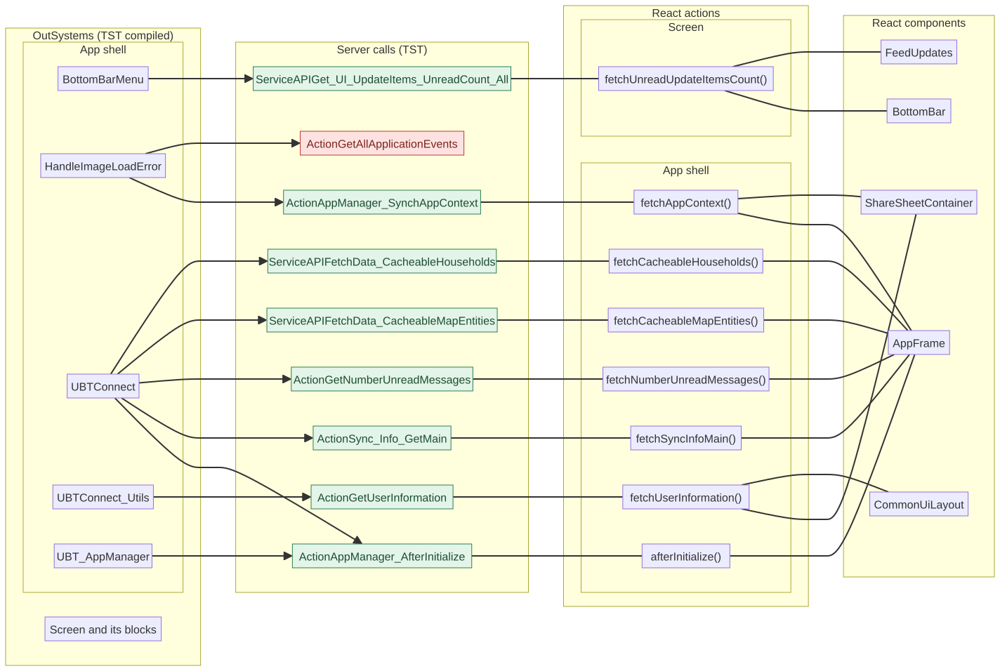

Mermaid source

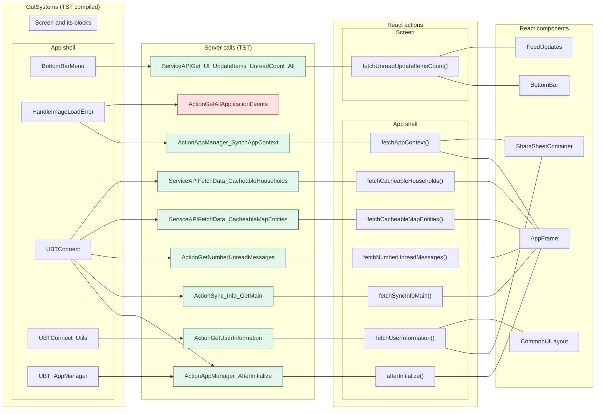

## 3. User actions

Each user action (click, change, submit) has two sequence diagrams: OutSystems (TST code) and React.

- **OutSystems:** the participant is the OutSystems block. The action is its screen action on TST.
- **React:** the participant is the React function that ports the action. The tool finds it by its comment (the OutSystems name), its name, or the `@origin` tag of its file.
- When the handler has branches (a menu option, for example), each branch has its own diagrams. The name of a branch comes from its condition. `other` is the last `else` or `default`.
- The effects are server calls, navigation (`Navigation`), external links, messages and confirm dialogs.
- An arrow to the server gives the inputs of the call. The return arrow gives the outputs (contract `app/src/api/openapi.yaml`).
- **Red in the OutSystems diagram:** an effect that the React handler of the action does not have.
- **Red in the React diagram:** an effect that OutSystems does not have, and a note with the effects that React does not have.

| # | Block (OutSystems) | User action | Handler | Option (branch) | Effects (OutSystems) | React handler | React |
|---|---|---|---|---|---|---|---|
| [1](#31-dialog_accessrestrictedaction-click-upgrade) | `Dialog_AccessRestrictedAction` | click | `upgrade` | – | opens an external link | – | **no React handler found** |
| [2](#32-bottombarmenu-click-event_bottombar_clicked-home) | `BottomBarMenu` | click | `event_BottomBar_Clicked` | `home` | goes to HomeFeed | `event_BottomBar_Clicked()` [`components/layout/BottomBar/BottomBar.tsx:95`](../../app/src/components/layout/BottomBar/BottomBar.tsx#L95) | same |
| [3](#33-bottombarmenu-click-event_bottombar_clicked-directory) | `BottomBarMenu` | click | `event_BottomBar_Clicked` | `directory` | goes to CountryList, Locality_Details | `event_BottomBar_Clicked()` [`components/layout/BottomBar/BottomBar.tsx:95`](../../app/src/components/layout/BottomBar/BottomBar.tsx#L95) | same |
| [4](#34-bottombarmenu-click-event_bottombar_clicked-updates) | `BottomBarMenu` | click | `event_BottomBar_Clicked` | `updates` | goes to Updates_SingleList | `event_BottomBar_Clicked()` [`components/layout/BottomBar/BottomBar.tsx:95`](../../app/src/components/layout/BottomBar/BottomBar.tsx#L95) | same |
| [5](#35-bottombarmenu-click-event_bottombar_clicked-bookmarks) | `BottomBarMenu` | click | `event_BottomBar_Clicked` | `bookmarks` | goes to Bookmarks | `event_BottomBar_Clicked()` [`components/layout/BottomBar/BottomBar.tsx:95`](../../app/src/components/layout/BottomBar/BottomBar.tsx#L95) | same |
| [6](#36-bottombarmenu-click-event_bottombar_clicked-menu) | `BottomBarMenu` | click | `event_BottomBar_Clicked` | `menu` | goes to Menu | `event_BottomBar_Clicked()` [`components/layout/BottomBar/BottomBar.tsx:95`](../../app/src/components/layout/BottomBar/BottomBar.tsx#L95) | same |
| [7](#37-block_pinunlock_contentwrapper-click-onclick_forgotpin) | `Block_PINUnlock_ContentWrapper` | click | `onClick_ForgotPIN` | – | goes to Login | `onForgotPin()` [`platform/session/usePinUnlockContent.ts:95`](../../app/src/platform/session/usePinUnlockContent.ts#L95) | same |

### 3.1 Dialog_AccessRestrictedAction: click upgrade

Result: no React handler found.

**OutSystems (TST)**

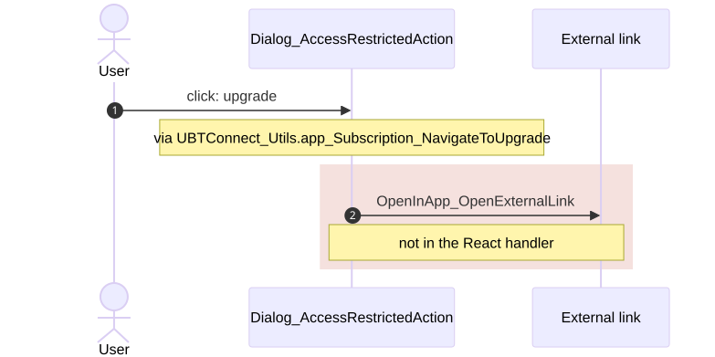

**React**: no React handler found

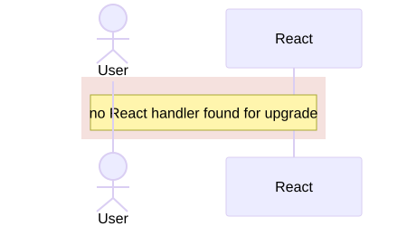

Mermaid source

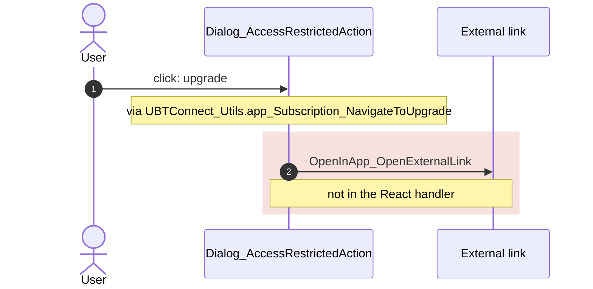

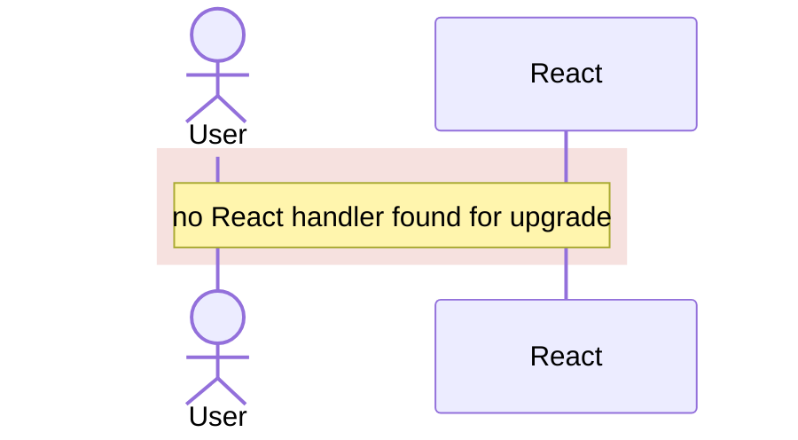

### 3.2 BottomBarMenu: click event_BottomBar_Clicked (home)

Result: same.

**OutSystems (TST)**

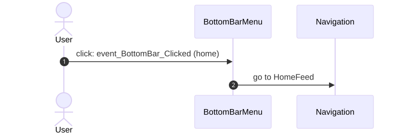

**React**: `event_BottomBar_Clicked()` in [`components/layout/BottomBar/BottomBar.tsx:95`](../../app/src/components/layout/BottomBar/BottomBar.tsx#L95)

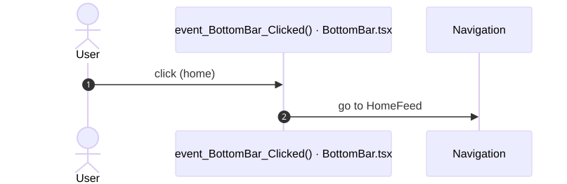

Mermaid source

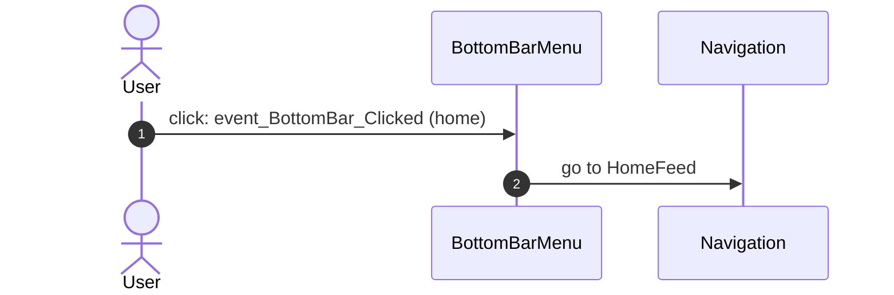

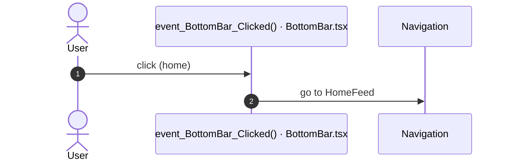

### 3.3 BottomBarMenu: click event_BottomBar_Clicked (directory)

Result: same.

**OutSystems (TST)**

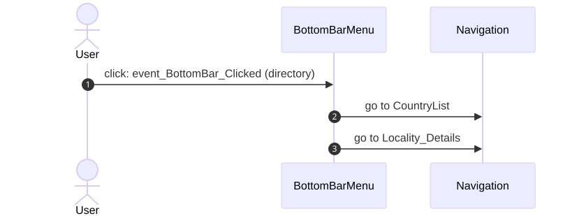

**React**: `event_BottomBar_Clicked()` in [`components/layout/BottomBar/BottomBar.tsx:95`](../../app/src/components/layout/BottomBar/BottomBar.tsx#L95)

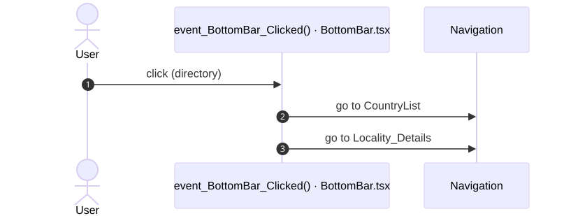

Mermaid source

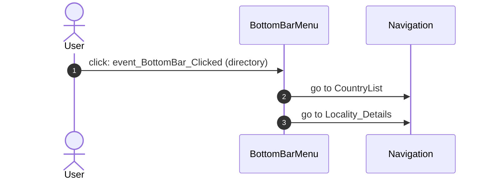

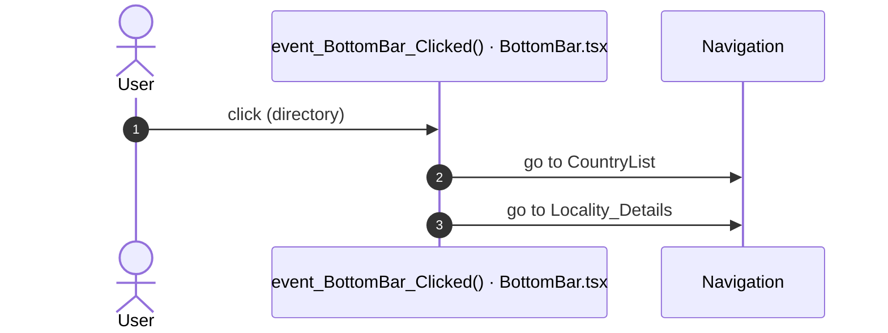

### 3.4 BottomBarMenu: click event_BottomBar_Clicked (updates)

Result: same.

**OutSystems (TST)**

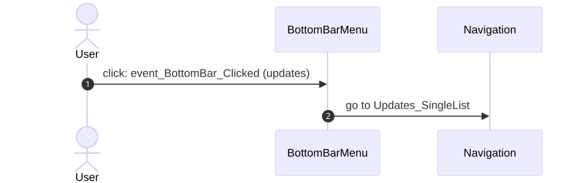

**React**: `event_BottomBar_Clicked()` in [`components/layout/BottomBar/BottomBar.tsx:95`](../../app/src/components/layout/BottomBar/BottomBar.tsx#L95)

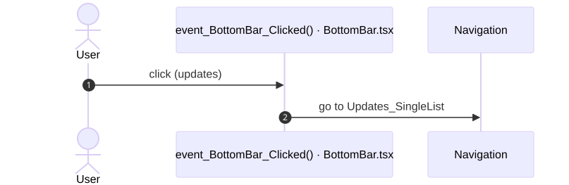

Mermaid source

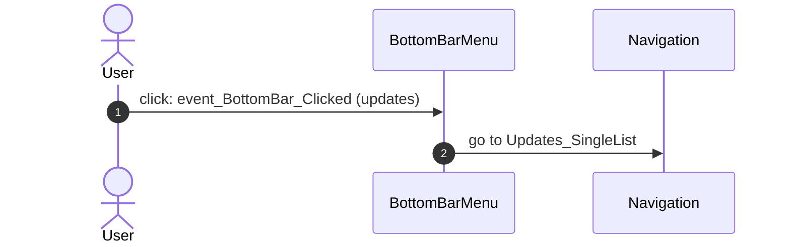

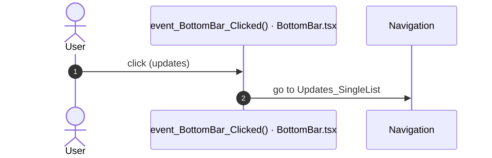

### 3.5 BottomBarMenu: click event_BottomBar_Clicked (bookmarks)

Result: same.

**OutSystems (TST)**

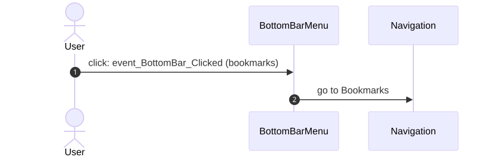

**React**: `event_BottomBar_Clicked()` in [`components/layout/BottomBar/BottomBar.tsx:95`](../../app/src/components/layout/BottomBar/BottomBar.tsx#L95)

Mermaid source

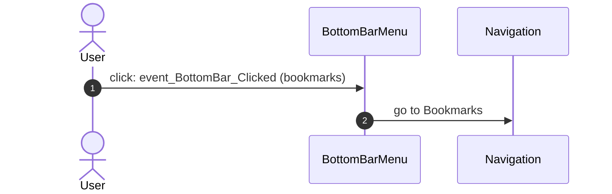

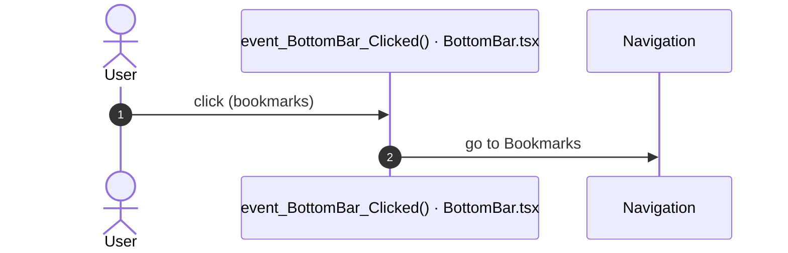

### 3.6 BottomBarMenu: click event_BottomBar_Clicked (menu)

Result: same.

**OutSystems (TST)**

**React**: `event_BottomBar_Clicked()` in [`components/layout/BottomBar/BottomBar.tsx:95`](../../app/src/components/layout/BottomBar/BottomBar.tsx#L95)

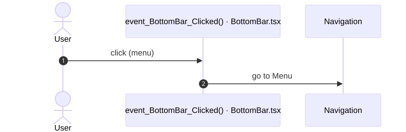

Mermaid source

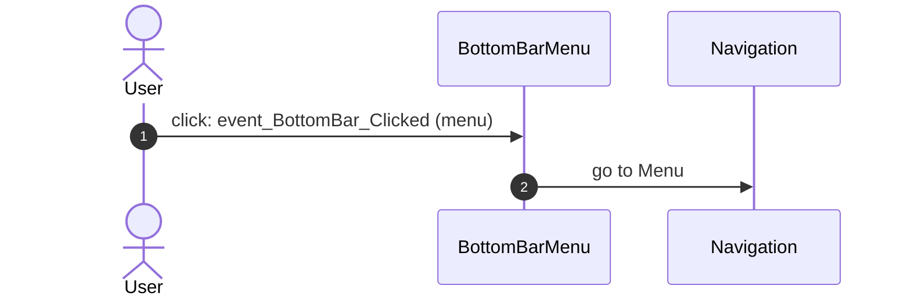

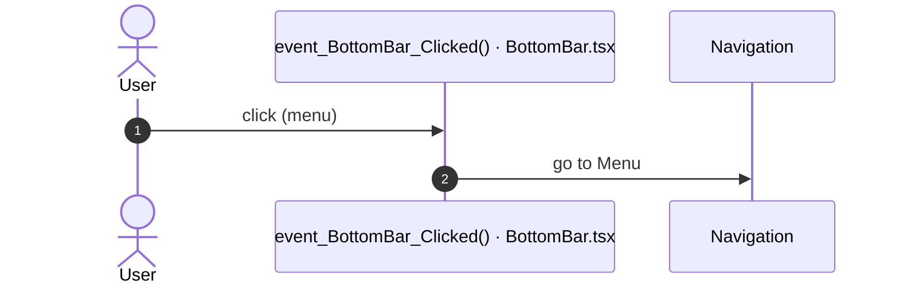

### 3.7 Block_PINUnlock_ContentWrapper: click onClick_ForgotPIN

Result: same.

**OutSystems (TST)**

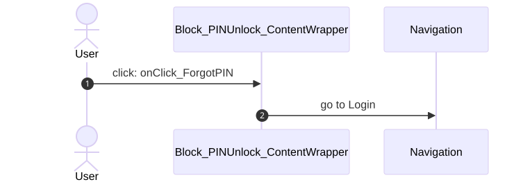

**React**: `onForgotPin()` in [`platform/session/usePinUnlockContent.ts:95`](../../app/src/platform/session/usePinUnlockContent.ts#L95)

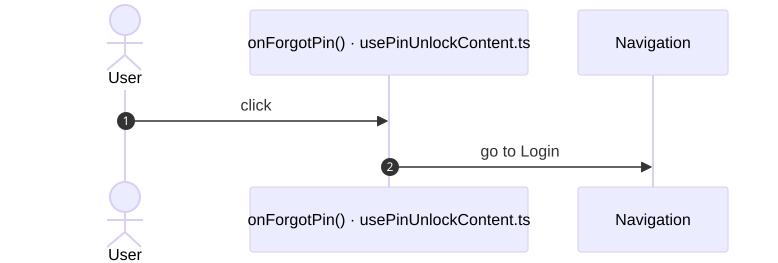

Mermaid source

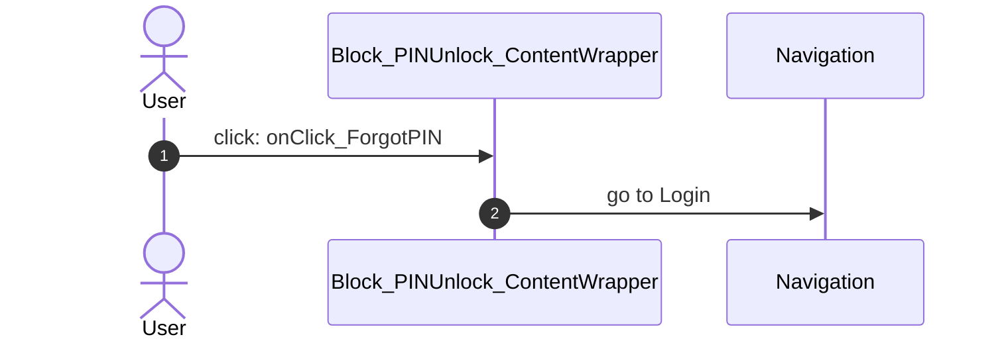

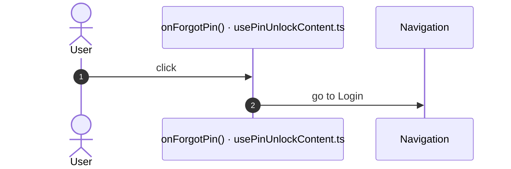

## 4. Server calls

The column **Routes** gives the checked routes where the app shell makes the call.

- **Called from (OutSystems):** the block or the app-level module whose own client action makes the call.
- **Made by (TST):** for each block in "Called from", its chain of client actions from the block to the call.
- **Trigger:** when the call runs, from the start of the chain on TST.
- **Seen on TST:** `yes` when TST made the call in the capture. Many calls run only after a click.
- **React action:** the React function that makes the same call, and the part that loads it: `shell`, `page` or both.
- **React caller:** the nearest React component that uses the React action, and the hooks between them. At most 2 chains, the shortest first.

| # | Call (TST) | Kind | Called from (OutSystems) | Trigger | Made by (TST) | Seen on TST | React action | React caller | Status | Routes |
|---|---|---|---|---|---|---|---|---|---|---|
| 1 | `UBTConnect/ServiceAPIGet_UI_UpdateItems_UnreadCount_All` | service action | `BottomBarMenu` | ready | BottomBarMenu.OnReady → BottomBarMenu.onReady → UBTConnect.directory_Updates_RefreshBottomBarCount → server Get_UI_UpdateItems_UnreadCount_All | no | `fetchUnreadUpdateItemsCount()` [`api/update/repository.ts:73`](../../app/src/api/update/repository.ts#L73) (page) | `BottomBar → directory_Updates_RefreshBottomBarCount → fetchUnreadUpdateItemsCount` [`components/layout/BottomBar/BottomBar.tsx`](../../app/src/components/layout/BottomBar/BottomBar.tsx) `FeedUpdates → useFeedUpdates → directory_Updates_RefreshBottomBarCount → fetchUnreadUpdateItemsCount` [`pages/HomeFeed/HomeFeedPage.tsx`](../../app/src/pages/HomeFeed/HomeFeedPage.tsx) | implemented | [HomeFeed](HomeFeed.md), [Menu](Menu.md) |
| 2 | `Connect2_LegacyShared/ActionGetAllApplicationEvents` | server action | `HandleImageLoadError` | image load error | HandleImageLoadError.applicationEvent_ImageError → Connect2_LegacyShared.zOnApplicationEvent_Wrapper → … → server GetAllApplicationEvents | no | – | – | **missing** | [HomeFeed](HomeFeed.md), [Login](Login.md), [Menu](Menu.md) |
| 3 | `UBT_AppManager/ActionAppManager_SynchAppContext` | server action | `HandleImageLoadError` | image load error | HandleImageLoadError.applicationEvent_ImageError → Connect2_LegacyShared.zOnApplicationEvent_Wrapper → … → server AppManager_SynchAppContext | yes | `fetchAppContext()` [`api/app/repository.ts:23`](../../app/src/api/app/repository.ts#L23) (shell + page) | `AppFrame → AppStart → … → fetchAppContext` [`app/AppFrame.tsx`](../../app/src/app/AppFrame.tsx) `ShareSheetContainer → useShareSheet → … → fetchAppContext` [`containers/ShareSheet/ShareSheetContainer.tsx`](../../app/src/containers/ShareSheet/ShareSheetContainer.tsx) | implemented | [HomeFeed](HomeFeed.md), [Login](Login.md), [Menu](Menu.md), [Splash](Splash.md) |
| 4 | `Connect2_LegacyShared/ActionGetNumberUnreadMessages` | server action | `UBTConnect` | app start | UBTConnect.onApplicationReady → UBTConnect.connect_SetLoggedContext → Connect2_LegacyShared.synchronizeNumberUnreadMessages → server GetNumberUnreadMessages (+1 more chains) | yes | `fetchNumberUnreadMessages()` [`api/message/unreadMessages.ts:22`](../../app/src/api/message/unreadMessages.ts#L22) (shell) | `AppFrame → AppStart → … → fetchNumberUnreadMessages` [`app/AppFrame.tsx`](../../app/src/app/AppFrame.tsx) | implemented | [HomeFeed](HomeFeed.md), [Menu](Menu.md), [Splash](Splash.md) |
| 5 | `UBTConnect/ActionSync_Info_GetMain` | server action | `UBTConnect` | app start | UBTConnect.onApplicationReady → UBTConnect.connect_SetLoggedContext → UBTConnect.sync_Info_Main → server Sync_Info_GetMain (+1 more chains) | yes | `fetchSyncInfoMain()` [`api/app/repository.ts:36`](../../app/src/api/app/repository.ts#L36) (shell) | `AppFrame → AppStart → … → fetchSyncInfoMain` [`app/AppFrame.tsx`](../../app/src/app/AppFrame.tsx) | implemented | [HomeFeed](HomeFeed.md), [Menu](Menu.md), [Splash](Splash.md) |
| 6 | `UBTConnect/ServiceAPIFetchData_CacheableHouseholds` | service action | `UBTConnect` | module action `get_Cacheable_MapHouseholds` (the TST graph has no caller) | UBTConnect.get_Cacheable_MapHouseholds → server FetchData_CacheableHouseholds | yes | `fetchCacheableHouseholds()` [`api/app/repository.ts:48`](../../app/src/api/app/repository.ts#L48) (shell) | `AppFrame → AppStart → … → fetchCacheableHouseholds` [`app/AppFrame.tsx`](../../app/src/app/AppFrame.tsx) | implemented | [HomeFeed](HomeFeed.md), [Menu](Menu.md), [Splash](Splash.md) |
| 7 | `UBTConnect/ServiceAPIFetchData_CacheableMapEntities` | service action | `UBTConnect` | module action `get_Cacheable_MapEntities` (the TST graph has no caller) | UBTConnect.get_Cacheable_MapEntities → server FetchData_CacheableMapEntities | yes | `fetchCacheableMapEntities()` [`api/app/repository.ts:42`](../../app/src/api/app/repository.ts#L42) (shell) | `AppFrame → AppStart → … → fetchCacheableMapEntities` [`app/AppFrame.tsx`](../../app/src/app/AppFrame.tsx) | implemented | [HomeFeed](HomeFeed.md), [Menu](Menu.md), [Splash](Splash.md) |
| 8 | `UBT_AppManager/ActionAppManager_AfterInitialize` | server action | `UBTConnect` `UBT_AppManager` | app start app start | UBTConnect.onApplicationReady → UBT_AppManager_Mobile.appManager_Mobile_OnAppReady → … → server AppManager_AfterInitialize UBT_AppManager.appManager_OnAppReady_Web → UBT_AppManager.appManager_InitializeWebComponents → UBT_AppManager.appManager_AfterInitialize → server AppManager_AfterInitialize | yes | `afterInitialize()` [`api/app/repository.ts:30`](../../app/src/api/app/repository.ts#L30) (shell) | `AppFrame → AppStart → … → afterInitialize` [`app/AppFrame.tsx`](../../app/src/app/AppFrame.tsx) | implemented | [HomeFeed](HomeFeed.md), [Menu](Menu.md), [Splash](Splash.md) |
| 9 | `UBTConnect_Utils/ActionGetUserInformation` | server action | `UBTConnect_Utils` | module action `cache_UserInfo_GetCallback` (the TST graph has no caller) | UBTConnect_Utils.cache_UserInfo_GetCallback → server GetUserInformation | yes | `fetchUserInformation()` [`api/member/userInformation.ts:6`](../../app/src/api/member/userInformation.ts#L6) (shell + page) | `ShareSheetContainer → useShareSheet → … → fetchUserInformation` [`containers/ShareSheet/ShareSheetContainer.tsx`](../../app/src/containers/ShareSheet/ShareSheetContainer.tsx) `CommonUiLayout → DialogAccessRestrictedAction → … → fetchUserInformation` [`components/layout/CommonUiLayout/CommonUiLayout.tsx`](../../app/src/components/layout/CommonUiLayout/CommonUiLayout.tsx) | implemented | [HomeFeed](HomeFeed.md), [Splash](Splash.md) |

## 5. Missing in React

- Call `Connect2_LegacyShared/ActionGetAllApplicationEvents`. Chain on TST: HandleImageLoadError.applicationEvent_ImageError → Connect2_LegacyShared.zOnApplicationEvent_Wrapper → Connect2_LegacyShared.getAppEventName → Connect2_LegacyShared.cacheLocalApplicationEvents → server GetAllApplicationEvents.
  - No React code makes this call.

## 6. Questions

1. React calls `/api/UBTConnect/ServiceAPIFetchData_CacheableHouseholds` from `fetchCacheableHouseholds()` [`api/app/repository.ts:48`](../../app/src/api/app/repository.ts#L48) in the app shell. TST has no chain to this call on Login. Does the app shell make this call on these routes?
2. React calls `/api/UBTConnect/ServiceAPIFetchData_CacheableMapEntities` from `fetchCacheableMapEntities()` [`api/app/repository.ts:42`](../../app/src/api/app/repository.ts#L42) in the app shell. TST has no chain to this call on Login. Does the app shell make this call on these routes?
3. React calls `/api/UBT_AppManager/ActionAppManager_AfterInitialize` from `afterInitialize()` [`api/app/repository.ts:30`](../../app/src/api/app/repository.ts#L30) in the app shell. TST has no chain to this call on Login. Does the app shell make this call on these routes?
