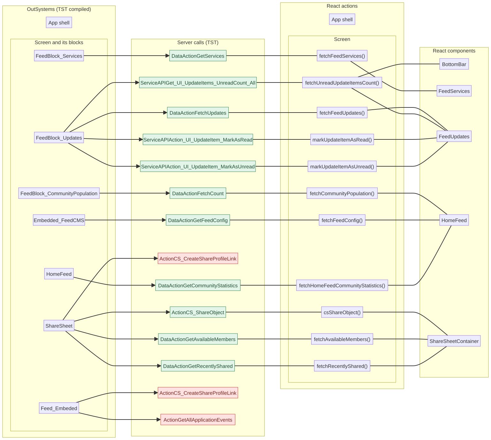
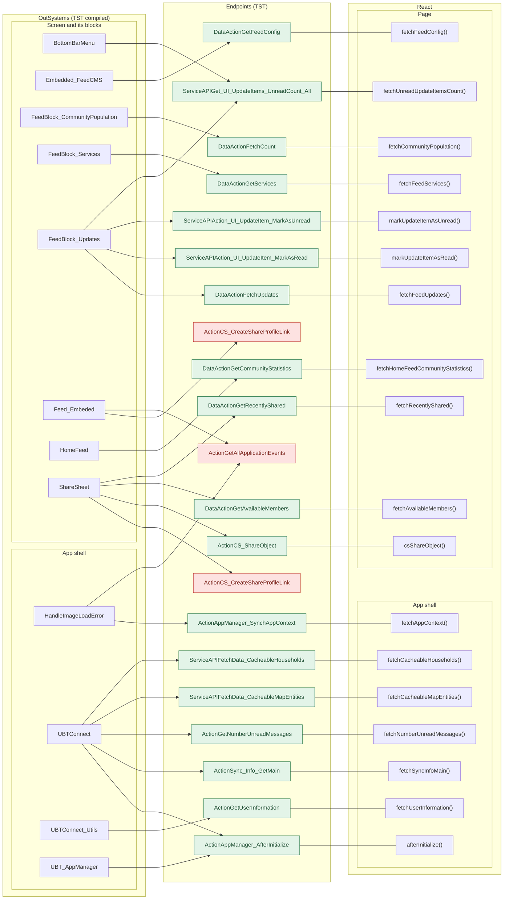

# HomeFeed: server calls in OutSystems and React

This file compares the server calls of the route `/UBTConnect/HomeFeed` in OutSystems (TST) with the calls of the React app.
The tool `migration/tools/route_actions/check_route.py` wrote this file on 2026-11-04.
The tool reads the code. It does not run the app.

## 1. Route

| Item | Value | Source |
|---|---|---|
| Route | `/UBTConnect/HomeFeed` | `app/src/app/routes.generated.ts` |
| OutSystems screen | `UBTConnect.Home.HomeFeed` | TST compiled code |
| UI flow | `Home` | MCP `getScreenNames` (DEV) |
| React screen | [`pages/HomeFeed/HomeFeedPage.tsx`](../../app/src/pages/HomeFeed/HomeFeedPage.tsx) | `app/src/pages/` |
| React route rules | access `member`, lock `enforce`, flag redirect none | `app/src/app/routes.ts` |
| Code read | OutSystems: 65 screen and block files. React: 159 app shell files and 228 screen files | TST `facts.json`, `react_calls.mjs` |

## 2. Result

| Check | Result |
|---|---|
| Server calls on TST | 21: React makes 18, **3 missing** |
| React calls that TST does not make on this route | 2 (see [questions](#6-questions)) |
| Screen and blocks with a React port | 65 of 65 |
| Navigation targets found in React | 23 of 23 |
| Modules that MCP did not read | 0 |

## 3. Diagram

- A box on the left is the OutSystems block or app action that makes the call.
- A line connects each call to the React function that makes the same call.
- A red box is a call that React does not make.

Mermaid source

## 4. Server calls

- **Called from (OutSystems):** the block or the app-level module whose own client action makes the call. `app shell` = the layout and the app start; `screen` = the screen and its blocks.
- **Made by (TST):** for each block in "Called from", its chain of client actions from the block to the call.
- **Seen on TST:** `yes` when TST made the call in the capture. Many calls run only after a click.

| # | Call (TST) | Kind | Called from (OutSystems) | Made by (TST) | Seen on TST | React action | Status |
|---|---|---|---|---|---|---|---|
| 1 | `UBT_AppManager/ActionAppManager_SynchAppContext` | server action | `HandleImageLoadError` (app shell) | HandleImageLoadError.applicationEvent_ImageError → Connect2_LegacyShared.zOnApplicationEvent_Wrapper → … → server AppManager_SynchAppContext | yes | `fetchAppContext()` [`api/app/repository.ts:23`](../../app/src/api/app/repository.ts#L23) (shell + page) | implemented |
| 2 | `Connect2_LegacyShared/ActionGetNumberUnreadMessages` | server action | `UBTConnect` (app shell) | UBTConnect.onApplicationReady → UBTConnect.connect_SetLoggedContext → Connect2_LegacyShared.synchronizeNumberUnreadMessages → server GetNumberUnreadMessages (+1 more chains) | yes | `fetchNumberUnreadMessages()` [`api/message/unreadMessages.ts:22`](../../app/src/api/message/unreadMessages.ts#L22) (shell) | implemented |
| 3 | `UBTConnect/ActionSync_Info_GetMain` | server action | `UBTConnect` (app shell) | UBTConnect.onApplicationReady → UBTConnect.connect_SetLoggedContext → UBTConnect.sync_Info_Main → server Sync_Info_GetMain (+1 more chains) | yes | `fetchSyncInfoMain()` [`api/app/repository.ts:36`](../../app/src/api/app/repository.ts#L36) (shell) | implemented |
| 4 | `UBTConnect/ServiceAPIFetchData_CacheableHouseholds` | service action | `UBTConnect` (app shell) | UBTConnect.get_Cacheable_MapHouseholds → server FetchData_CacheableHouseholds | yes | `fetchCacheableHouseholds()` [`api/app/repository.ts:48`](../../app/src/api/app/repository.ts#L48) (shell) | implemented |
| 5 | `UBTConnect/ServiceAPIFetchData_CacheableMapEntities` | service action | `UBTConnect` (app shell) | UBTConnect.get_Cacheable_MapEntities → server FetchData_CacheableMapEntities | yes | `fetchCacheableMapEntities()` [`api/app/repository.ts:42`](../../app/src/api/app/repository.ts#L42) (shell) | implemented |
| 6 | `UBT_AppManager/ActionAppManager_AfterInitialize` | server action | `UBTConnect` (app shell) `UBT_AppManager` (app shell) | UBTConnect.onApplicationReady → UBT_AppManager_Mobile.appManager_Mobile_OnAppReady → … → server AppManager_AfterInitialize UBT_AppManager.appManager_OnAppReady_Web → UBT_AppManager.appManager_InitializeWebComponents → UBT_AppManager.appManager_AfterInitialize → server AppManager_AfterInitialize | yes | `afterInitialize()` [`api/app/repository.ts:30`](../../app/src/api/app/repository.ts#L30) (shell) | implemented |
| 7 | `UBTConnect_Utils/ActionGetUserInformation` | server action | `UBTConnect_Utils` (app shell) | UBTConnect_Utils.cache_UserInfo_GetCallback → server GetUserInformation | yes | `fetchUserInformation()` [`api/member/userInformation.ts:6`](../../app/src/api/member/userInformation.ts#L6) (shell + page) | implemented |
| 8 | `UBTConnect/ServiceAPIGet_UI_UpdateItems_UnreadCount_All` | service action | `BottomBarMenu` (screen) `FeedBlock_Updates` (screen) | BottomBarMenu.OnReady → BottomBarMenu.onReady → UBTConnect.directory_Updates_RefreshBottomBarCount → server Get_UI_UpdateItems_UnreadCount_All FeedBlock_Updates.event_MarkAsRead → UBTConnect.directory_Updates_RefreshBottomBarCount → server Get_UI_UpdateItems_UnreadCount_All (+1 more chains) | no | `fetchUnreadUpdateItemsCount()` [`api/update/repository.ts:73`](../../app/src/api/update/repository.ts#L73) (page) | implemented |
| 9 | `UBTConnect_EmbedFeed/Blocks/Embedded_FeedCMS/DataActionGetFeedConfig` | data action | `Embedded_FeedCMS` (screen) | Embedded_FeedCMS fetch at start → Embedded_FeedCMS.DataActionGetFeedConfig | yes | `fetchFeedConfig()` [`api/feed/repository.ts:9`](../../app/src/api/feed/repository.ts#L9) (page) | implemented |
| 10 | `UBTConnect/Home/FeedBlock_CommunityPopulation/DataActionFetchCount` | data action | `FeedBlock_CommunityPopulation` (screen) | FeedBlock_CommunityPopulation fetch at start → FeedBlock_CommunityPopulation.DataActionFetchCount | yes | `fetchCommunityPopulation()` [`api/member/repository.ts:25`](../../app/src/api/member/repository.ts#L25) (page) | implemented |
| 11 | `UBTConnect/Home/FeedBlock_Services/DataActionGetServices` | data action | `FeedBlock_Services` (screen) | FeedBlock_Services fetch at start → FeedBlock_Services.DataActionGetServices | yes | `fetchFeedServices()` [`api/service/repository.ts:34`](../../app/src/api/service/repository.ts#L34) (page) | implemented |
| 12 | `UBTConnect/Home/FeedBlock_Updates/DataActionFetchUpdates` | data action | `FeedBlock_Updates` (screen) | FeedBlock_Updates fetch at start → FeedBlock_Updates.DataActionFetchUpdates | yes | `fetchFeedUpdates()` [`api/update/repository.ts:22`](../../app/src/api/update/repository.ts#L22) (page) | implemented |
| 13 | `UBTConnect/Home/FeedBlock_Updates/ServiceAPIAction_UI_UpdateItem_MarkAsRead` | service action | `FeedBlock_Updates` (screen) | FeedBlock_Updates.event_ListItemOnClick → server Action_UI_UpdateItem_MarkAsRead (+1 more chains) | no | `markUpdateItemAsRead()` [`api/update/repository.ts:47`](../../app/src/api/update/repository.ts#L47) (page) | implemented |
| 14 | `UBTConnect/Home/FeedBlock_Updates/ServiceAPIAction_UI_UpdateItem_MarkAsUnread` | service action | `FeedBlock_Updates` (screen) | FeedBlock_Updates.event_MarkAsUnread → server Action_UI_UpdateItem_MarkAsUnread | no | `markUpdateItemAsUnread()` [`api/update/repository.ts:52`](../../app/src/api/update/repository.ts#L52) (page) | implemented |
| 15 | `Connect2_LegacyShared/ActionGetAllApplicationEvents` | server action | `Feed_Embeded` (screen) `HandleImageLoadError` (app shell) | Feed_Embeded.handle_Share_Others → UBTConnect_Utils.shareEntity_ByURL → … → server GetAllApplicationEvents HandleImageLoadError.applicationEvent_ImageError → Connect2_LegacyShared.zOnApplicationEvent_Wrapper → … → server GetAllApplicationEvents | no | – | **missing** |
| 16 | `UBTConnect_Utils/ActionCS_CreateShareProfileLink` | server action | `Feed_Embeded` (screen) | Feed_Embeded.handle_Share_Others → UBTConnect_Utils.shareEntity_ByURL → server CS_CreateShareProfileLink | no | – | **missing** |
| 17 | `UBTConnect/Home/HomeFeed/DataActionGetCommunityStatistics` | data action | `HomeFeed` (screen) | HomeFeed.OnReady → HomeFeed.screenEvent_OnReady → HomeFeed.DataActionGetCommunityStatistics (+1 more chains) | yes | `fetchHomeFeedCommunityStatistics()` [`api/country/repository.ts:49`](../../app/src/api/country/repository.ts#L49) (page) | implemented |
| 18 | `UBTConnect_Utils/CW_Share/ShareSheet/ActionCS_CreateShareProfileLink` | server action | `ShareSheet` (screen) | ShareSheet.handler_OnClickExternalOption → server CS_CreateShareProfileLink | no | – | **missing** |
| 19 | `UBTConnect_Utils/CW_Share/ShareSheet/ActionCS_ShareObject` | server action | `ShareSheet` (screen) | ShareSheet.handler_OnClickRecentMember → ShareSheet.action_SubmitShare → server CS_ShareObject (+1 more chains) | no | `csShareObject()` [`api/share/shareSheet.ts:25`](../../app/src/api/share/shareSheet.ts#L25) (page) | implemented |
| 20 | `UBTConnect_Utils/CW_Share/ShareSheet/DataActionGetAvailableMembers` | data action | `ShareSheet` (screen) | ShareSheet.handler_InputEventSubmit → ShareSheet.DataActionGetAvailableMembers (+1 more chains) | no | `fetchAvailableMembers()` [`api/member/repository.ts:12`](../../app/src/api/member/repository.ts#L12) (page) | implemented |
| 21 | `UBTConnect_Utils/CW_Share/ShareSheet/DataActionGetRecentlyShared` | data action | `ShareSheet` (screen) | ShareSheet.OnParametersChanged → ShareSheet.screenEvent_OnParametersChanged → ShareSheet.DataActionGetRecentlyShared (+1 more chains) | no | `fetchRecentlyShared()` [`api/share/shareSheet.ts:14`](../../app/src/api/share/shareSheet.ts#L14) (page) | implemented |

### What each call does on the server (MCP, DEV)

| # | Call | Inside the call |
|---|---|---|
| 1 | `ActionAppManager_SynchAppContext` | `UBT_AppManager_CS.AppManager_SynchAppContext (server, producer module)` |
| 2 | `ActionGetNumberUnreadMessages` | `Connect2_LegacyShared.GetNumberPublicUnreadMessages (server)`, `Connect2_LegacyShared.GetNumberPrivateUnreadMessages (server)` |
| 3 | `ActionSync_Info_GetMain` | `UBTConnect_EmbedMyEntertaining.Get_MyEntertainingBaseURL (server)`, `UBTConnect_EmbedFeed.Get_FeedBaseURL (server)`, `Connect2_OrbitMobile_MUI.SyncAllOrbitEntities (server)`, `UBTConnect.Sync_LocalEntities_GetApp (server)`, `UBTConnect_ServerConfigs.UpdateFeed_MonthsToShow (server)` |
| 4 | `ServiceAPIFetchData_CacheableHouseholds` | `Connect_Map_CS.FetchData_CacheableHouseholds (service, producer module)` |
| 5 | `ServiceAPIFetchData_CacheableMapEntities` | `Connect_Map_CS.FetchData_CacheableMapEntities (service, producer module)` |
| 6 | `ActionAppManager_AfterInitialize` | `UBT_AppManager_CS.AppManager_AfterInitialize (server, producer module)` |
| 7 | `ActionGetUserInformation` | `UBT_AppManager_CS.AppManager_Get_UserToken (server)`, `APIDomain_Directory_IS.API_Directory_User_Current_GET (server)`, `ApplicationPolicies.HasPoliciesToAccept (server)` |
| 8 | `ServiceAPIGet_UI_UpdateItems_UnreadCount_All` | `Connect_Updates_CS.Get_UI_UpdateItems_UnreadCount_All (service, producer module)` |
| 9 | `DataActionGetFeedConfig` | `UBT_AppManager_CS.AppManager_Get_UserIdToken (server)`, `UBT_AppManager_CS.AppManager_GetConfig (server)`, `UBT_AppManager_CS.AppManager_Get_UserToken (server)` |
| 10 | `DataActionFetchCount` | `Connect_Geography_CS.Get_UI_MembersStatistics (service)` |
| 11 | `DataActionGetServices` | `UBTConnect_ServerConfigs.GetExternalLinks_ElGusto (server)`, `UBTConnect_ServerConfigs.GetExternalPackages_CommunityTradelink (server)`, `UBTConnect_ServerConfigs.GetExternalPackages_HR100 (server)`, `UBTConnect_ServerConfigs.GetExternalPackages_Trove (server)`, `Connect_Services_CS.Service_ConnectServices_GetByUser (service)` |
| 12 | `DataActionFetchUpdates` | `Connect_Updates_CS.Get_UI_UpdateItemsForHomePage (service)` |
| 13 | `ServiceAPIAction_UI_UpdateItem_MarkAsRead` | `Connect_Updates_CS.Action_UI_UpdateItem_MarkAsRead (service, producer module)` |
| 14 | `ServiceAPIAction_UI_UpdateItem_MarkAsUnread` | `Connect_Updates_CS.Action_UI_UpdateItem_MarkAsUnread (service, producer module)` |
| 15 | `ActionGetAllApplicationEvents` | `aggregates on ApplicationEvents_Alpha, ApplicationEvents_Directory, ApplicationEvents_LDM, ApplicationEvents_Orbit` |
| 16 | `ActionCS_CreateShareProfileLink` | `Connect2_Sharing_CS.CS_CreateShareProfileLink (server, producer module)` |
| 17 | `DataActionGetCommunityStatistics` | `Connect_Geography_CS.Get_UI_CommunityNumbers (service)` |
| 18 | `ActionCS_CreateShareProfileLink` | `Connect2_Sharing_CS.CS_CreateShareProfileLink (server, producer module)` |
| 19 | `ActionCS_ShareObject` | `Connect2_Sharing_CS.CS_ShareObject (server, producer module)` |
| 20 | `DataActionGetAvailableMembers` | `Connect2_Sharing_CS.GetAvailableUsersToShareGrouped (server)` |
| 21 | `DataActionGetRecentlyShared` | `Connect2_Sharing_CS.GetAvailableUsersToShareGrouped (server)` |

## 5. Missing in React

- Call `UBTConnect_Utils/CW_Share/ShareSheet/ActionCS_CreateShareProfileLink`. Chain on TST: onClick in CircleButton_WithLabel → CircleButton_WithLabel.action_OnClick → event onClick of CircleButton_WithLabel → ShareSheet.handler_OnClickExternalOption → server CS_CreateShareProfileLink.
  - React has the function, but this route does not use it: `csCreateShareProfileLink()` [`api/share/shareSheet.ts:39`](../../app/src/api/share/shareSheet.ts#L39).
  - Note in [`components/feed/EmbeddedFeed/README.md:66`](../../app/src/components/feed/EmbeddedFeed/README.md#L66): "is not wired: ShareEntity_ByURL (UBTConnect_Utils) is not ported (SocialSharing plugin + CS_CreateShareProfileLink),"
  - Note in [`containers/ShareSheet/README.md:94`](../../app/src/containers/ShareSheet/README.md#L94): "- In the original app, a click on an option (Handler_OnClickExternalOption) calls CS_CreateShareProfileLink"
- Call `UBTConnect_Utils/ActionCS_CreateShareProfileLink`. Chain on TST: event event_Clicked of ContactPopup → SharePopup.onClick_CallButton → event event_ShareToOthers of SharePopup → Feed_Embeded.handle_Share_Others → UBTConnect_Utils.shareEntity_ByURL → server CS_CreateShareProfileLink.
  - No React code makes this call.
  - Note in [`components/feed/EmbeddedFeed/README.md:66`](../../app/src/components/feed/EmbeddedFeed/README.md#L66): "is not wired: ShareEntity_ByURL (UBTConnect_Utils) is not ported (SocialSharing plugin + CS_CreateShareProfileLink),"
  - Note in [`containers/ShareSheet/README.md:94`](../../app/src/containers/ShareSheet/README.md#L94): "- In the original app, a click on an option (Handler_OnClickExternalOption) calls CS_CreateShareProfileLink"
- Call `Connect2_LegacyShared/ActionGetAllApplicationEvents`. Chain on TST: HandleImageLoadError.applicationEvent_ImageError → Connect2_LegacyShared.zOnApplicationEvent_Wrapper → Connect2_LegacyShared.getAppEventName → Connect2_LegacyShared.cacheLocalApplicationEvents → server GetAllApplicationEvents.
  - No React code makes this call.

## 6. Questions

1. React calls `/api/UBTConnect_Utils/ActionGetSignedImagesInBulk` from `cache_SignedImageURL_GetCallback()` [`lib/ubtConnectUtils/actions.ts:124`](../../app/src/lib/ubtConnectUtils/actions.ts#L124) (page). TST HomeFeed has no chain to this call. Does the call belong to this route?
2. React calls `/api/UBTConnect_Utils/CacheControl_Policies/DataActionGetCacheInfo` from `fetchPolicies()` [`api/app/repository.ts:54`](../../app/src/api/app/repository.ts#L54) (shell + page). TST HomeFeed has no chain to this call. Does the call belong to this route?

## 7. Modules to open in Service Studio

None. MCP read all the modules of this route.

## 8. Method

1. **OutSystems (TST).** The tool reads `facts.json` of `migration/screens/HomeFeed/analysis/`:
   - the screen and block files that TST renders;
   - each server call, and the chain of client actions that makes the call;
   - the calls that TST made in the capture (`calls.json`).
2. **Part.** `app shell` is `CommonUI_InsideLayout`, its blocks and the app-level actions. `screen` is the screen and its other blocks.
3. **MCP (DEV).** The tool reads the UI flow and the inside of each call with `getScreen`, `getWebBlock`, `getServerAction` and `getServiceAction`. TST wins when DEV is different.
4. **React.** `react_calls.mjs` reads the app shell from `app/src/main.tsx` and the screen from its `<Route>Page.tsx`. It counts only the code that the app uses.
5. **Match.** `callAction(M, A)` gives `/api/M/A`. The `x-os-paths` of `app/src/api/openapi.yaml` give the TST call. The status is `implemented` when the TST call is the same. Else the status is `missing`.

Limit: a name or a call match does not prove the same behaviour. The parity checks of the migration compare the behaviour.
