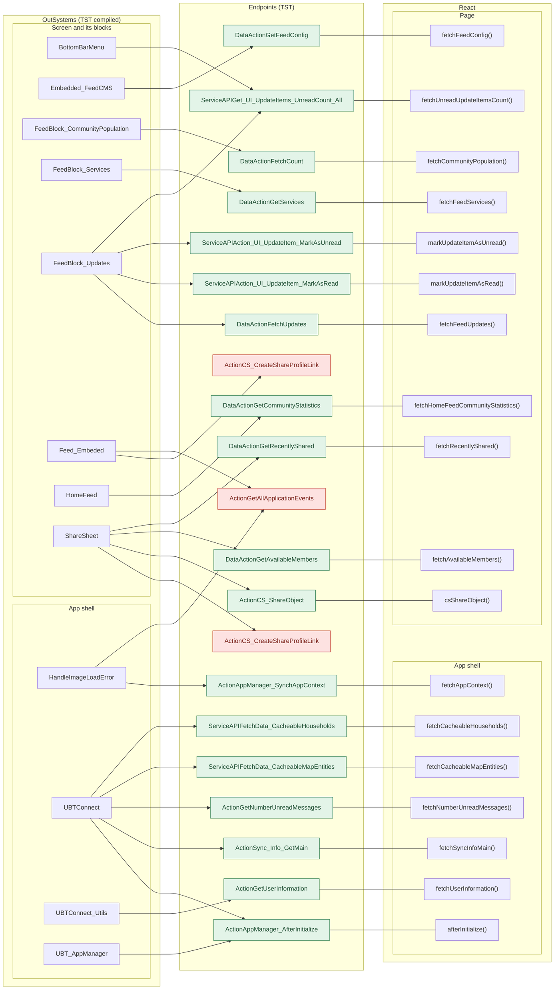

# HomeFeed: OutSystems actions against React

Generated by `migration/tools/route_actions/check_route.py` on 2026-11-04. The tool reads the sources below. It does not run the app.

| Item | Value | Source |
|---|---|---|
| Route | `/UBTConnect/HomeFeed` | `app/src/app/routes.generated.ts` |
| OutSystems screen | `UBTConnect.Home.HomeFeed` | TST compiled code (`migration/survey/screens.json`) |
| UI flow | `Home` | MCP `getScreenNames` (DEV); TST flow `Home` |
| React page | [`pages/HomeFeed/HomeFeedPage.tsx`](../../app/src/pages/HomeFeed/HomeFeedPage.tsx) | `app/src/pages/` |
| React route meta | access `member`, lock `enforce`, flag redirect none | `app/src/app/routes.ts` |
| TST runtime capture | 12 calls observed | `migration/screens/HomeFeed/analysis/calls.json` |
| Code read | OutSystems: 65 rendered screen and block files. React: 159 app shell files, 228 page files | facts.json, react_calls.mjs |

## 1. Result

| Check | Result |
|---|---|
| Endpoints (server calls) | 21 on TST: 18 implemented, **3 missing** |
| React calls with no TST endpoint on this route | 2 |
| Screen and block client actions | 298: dev-only 3, in ported block 121, matched 134, matched (effects) 4, missing 2, platform 34 |
| Module client actions reached | 273: matched 51, matched (effects) 12, missing 5, no effect 92, platform 113 |
| Rendered blocks with a React port (`@origin`) | 65 of 65 |
| Navigation targets | 23 on TST, 0 not found in React |

Statuses: [legend](#8-method-and-legend).

## 2. Diagram

Each OutSystems root (block or app-level action) leads to the endpoints it calls. Each endpoint is joined to the React function that calls it. Red = missing in React.

Mermaid source

## 3. Endpoints (server calls)

| # | Endpoint (TST) | Kind | Where (OS) | First chain (TST compiled) | TST runtime | Inside the endpoint (MCP, DEV) | React call | Where (React) | Status |
|---|---|---|---|---|---|---|---|---|---|
| 1 | `Connect2_LegacyShared/ActionGetAllApplicationEvents` | server action | screen | Connect2_LegacyShared.zOnApplicationEvent_Wrapper → Connect2_LegacyShared.getAppEventName → Connect2_LegacyShared.cacheLocalApplicationEvents → server GetAllApplicationEvents | not observed | – | no React code | – | **missing** |
| 2 | `UBTConnect/Home/FeedBlock_CommunityPopulation/DataActionFetchCount` | data action | screen | FeedBlock_CommunityPopulation fetch at start → FeedBlock_CommunityPopulation.DataActionFetchCount | observed | `Connect_Geography_CS.Get_UI_MembersStatistics (service)` | `fetchCommunityPopulation()` [`api/member/repository.ts:25`](../../app/src/api/member/repository.ts#L25) | page | implemented |
| 3 | `UBTConnect/Home/FeedBlock_Services/DataActionGetServices` | data action | screen | FeedBlock_Services fetch at start → FeedBlock_Services.DataActionGetServices | observed | `UBTConnect_ServerConfigs.GetExternalLinks_ElGusto (server)`, `UBTConnect_ServerConfigs.GetExternalPackages_CommunityTradelink (server)`, `UBTConnect_ServerConfigs.GetExternalPackages_HR100 (server)`, `UBTConnect_ServerConfigs.GetExternalPackages_Trove (server)`, `Connect_Services_CS.Service_ConnectServices_GetByUser (service)` | `fetchFeedServices()` [`api/service/repository.ts:34`](../../app/src/api/service/repository.ts#L34) | page | implemented |
| 4 | `UBTConnect/Home/FeedBlock_Updates/DataActionFetchUpdates` | data action | screen | FeedBlock_Updates fetch at start → FeedBlock_Updates.DataActionFetchUpdates | observed | `Connect_Updates_CS.Get_UI_UpdateItemsForHomePage (service)` | `fetchFeedUpdates()` [`api/update/repository.ts:22`](../../app/src/api/update/repository.ts#L22) | page | implemented |
| 5 | `UBTConnect/Home/FeedBlock_Updates/ServiceAPIAction_UI_UpdateItem_MarkAsRead` | service action | screen | event clicked of CustomContainer → event onClick of Update_ListItem → FeedBlock_Updates.event_ListItemOnClick → server Action_UI_UpdateItem_MarkAsRead | not observed | – | `markUpdateItemAsRead()` [`api/update/repository.ts:47`](../../app/src/api/update/repository.ts#L47) | page | implemented |
| 6 | `UBTConnect/Home/FeedBlock_Updates/ServiceAPIAction_UI_UpdateItem_MarkAsUnread` | service action | screen | event event_MarkAsUnread of ContextMenu → event event_MarkAsUnread of Update_ListItem → FeedBlock_Updates.event_MarkAsUnread → server Action_UI_UpdateItem_MarkAsUnread | not observed | – | `markUpdateItemAsUnread()` [`api/update/repository.ts:52`](../../app/src/api/update/repository.ts#L52) | page | implemented |
| 7 | `UBTConnect/Home/HomeFeed/DataActionGetCommunityStatistics` | data action | screen | HomeFeed.OnReady → HomeFeed.screenEvent_OnReady → HomeFeed.DataActionGetCommunityStatistics | observed | `Connect_Geography_CS.Get_UI_CommunityNumbers (service)` | `fetchHomeFeedCommunityStatistics()` [`api/country/repository.ts:49`](../../app/src/api/country/repository.ts#L49) | page | implemented |
| 8 | `UBTConnect/ServiceAPIGet_UI_UpdateItems_UnreadCount_All` | service action | screen | BottomBarMenu.OnReady → BottomBarMenu.onReady → UBTConnect.directory_Updates_RefreshBottomBarCount → server Get_UI_UpdateItems_UnreadCount_All | not observed | – | `fetchUnreadUpdateItemsCount()` [`api/update/repository.ts:73`](../../app/src/api/update/repository.ts#L73) | page | implemented |
| 9 | `UBTConnect_EmbedFeed/Blocks/Embedded_FeedCMS/DataActionGetFeedConfig` | data action | screen | Embedded_FeedCMS fetch at start → Embedded_FeedCMS.DataActionGetFeedConfig | observed | not read: module `UBTConnect_EmbedFeed` is not readable by MCP now | `fetchFeedConfig()` [`api/feed/repository.ts:9`](../../app/src/api/feed/repository.ts#L9) | page | implemented |
| 10 | `UBTConnect_Utils/ActionCS_CreateShareProfileLink` | server action | screen | event event_ShareToOthers of SharePopup → Feed_Embeded.handle_Share_Others → UBTConnect_Utils.shareEntity_ByURL → server CS_CreateShareProfileLink | not observed | – | no React code | – | **missing** |
| 11 | `UBTConnect_Utils/CW_Share/ShareSheet/ActionCS_CreateShareProfileLink` | server action | screen | CircleButton_WithLabel.action_OnClick → event onClick of CircleButton_WithLabel → ShareSheet.handler_OnClickExternalOption → server CS_CreateShareProfileLink | not observed | – | not reached: `csCreateShareProfileLink()` [`api/share/shareSheet.ts:39`](../../app/src/api/share/shareSheet.ts#L39) | – | **missing** |
| 12 | `UBTConnect_Utils/CW_Share/ShareSheet/ActionCS_ShareObject` | server action | screen | event onClick of CircleButton_WithLabel → ShareSheet.handler_OnClickRecentMember → ShareSheet.action_SubmitShare → server CS_ShareObject | not observed | – | `csShareObject()` [`api/share/shareSheet.ts:25`](../../app/src/api/share/shareSheet.ts#L25) | page | implemented |
| 13 | `UBTConnect_Utils/CW_Share/ShareSheet/DataActionGetAvailableMembers` | data action | screen | ShareSheet.handler_InputEventSubmit → ShareSheet.DataActionGetAvailableMembers | not observed | not read: module `UBTConnect_Utils` is not readable by MCP now | `fetchAvailableMembers()` [`api/member/repository.ts:12`](../../app/src/api/member/repository.ts#L12) | page | implemented |
| 14 | `UBTConnect_Utils/CW_Share/ShareSheet/DataActionGetRecentlyShared` | data action | screen | ShareSheet.OnParametersChanged → ShareSheet.screenEvent_OnParametersChanged → ShareSheet.DataActionGetRecentlyShared | not observed | not read: module `UBTConnect_Utils` is not readable by MCP now | `fetchRecentlyShared()` [`api/share/shareSheet.ts:14`](../../app/src/api/share/shareSheet.ts#L14) | page | implemented |
| 15 | `Connect2_LegacyShared/ActionGetNumberUnreadMessages` | server action | shell | UBTConnect.onApplicationReady → UBTConnect.connect_SetLoggedContext → Connect2_LegacyShared.synchronizeNumberUnreadMessages → server GetNumberUnreadMessages | observed | – | `fetchNumberUnreadMessages()` [`api/message/unreadMessages.ts:22`](../../app/src/api/message/unreadMessages.ts#L22) | shell | implemented |
| 16 | `UBTConnect/ActionSync_Info_GetMain` | server action | shell | UBTConnect.onApplicationReady → UBTConnect.connect_SetLoggedContext → UBTConnect.sync_Info_Main → server Sync_Info_GetMain | observed | – | `fetchSyncInfoMain()` [`api/app/repository.ts:36`](../../app/src/api/app/repository.ts#L36) | shell | implemented |
| 17 | `UBTConnect/ServiceAPIFetchData_CacheableHouseholds` | service action | shell | UBTConnect.get_Cacheable_MapHouseholds → server FetchData_CacheableHouseholds | observed | – | `fetchCacheableHouseholds()` [`api/app/repository.ts:48`](../../app/src/api/app/repository.ts#L48) | shell | implemented |
| 18 | `UBTConnect/ServiceAPIFetchData_CacheableMapEntities` | service action | shell | UBTConnect.get_Cacheable_MapEntities → server FetchData_CacheableMapEntities | observed | – | `fetchCacheableMapEntities()` [`api/app/repository.ts:42`](../../app/src/api/app/repository.ts#L42) | shell | implemented |
| 19 | `UBTConnect_Utils/ActionGetUserInformation` | server action | shell | UBTConnect_Utils.cache_UserInfo_GetCallback → server GetUserInformation | observed | – | `fetchUserInformation()` [`api/member/userInformation.ts:6`](../../app/src/api/member/userInformation.ts#L6) | shell + page | implemented |
| 20 | `UBT_AppManager/ActionAppManager_AfterInitialize` | server action | shell | UBT_AppManager.appManager_OnAppReady_Web → UBT_AppManager.appManager_InitializeWebComponents → UBT_AppManager.appManager_AfterInitialize → server AppManager_AfterInitialize | observed | – | `afterInitialize()` [`api/app/repository.ts:30`](../../app/src/api/app/repository.ts#L30) | shell | implemented |
| 21 | `UBT_AppManager/ActionAppManager_SynchAppContext` | server action | shell | UBT_AppManager.appManager_GetConfiguration → UBT_AppManager.appManager_SynchAppContext → UBT_AppManager.appManager_SynchAppContextInternal → server AppManager_SynchAppContext | observed | – | `fetchAppContext()` [`api/app/repository.ts:23`](../../app/src/api/app/repository.ts#L23) | shell + page | implemented |

### React calls with no TST endpoint on this route

| React call | Where | Contract `x-os-paths` | Note |
|---|---|---|---|
| `cache_SignedImageURL_GetCallback()` → `/api/UBTConnect_Utils/ActionGetSignedImagesInBulk` [`lib/ubtConnectUtils/actions.ts:124`](../../app/src/lib/ubtConnectUtils/actions.ts#L124) | page | `screenservices/UBTConnect_Utils/ActionGetSignedImagesInBulk` | unclear: see section 7 |
| `fetchPolicies()` → `/api/UBTConnect_Utils/CacheControl_Policies/DataActionGetCacheInfo` [`api/app/repository.ts:54`](../../app/src/api/app/repository.ts#L54) | shell + page | `screenservices/UBTConnect_Utils/CacheControl/CacheControl_Policies/DataActionGetCacheInfo` | unclear: see section 7 |

## 4. Client actions of the screen and its blocks

Source: TST compiled code (`facts.json` → `js[file].clientActions`, call graph of `analyze_capture.py`). KB column: the actions that the action calls in the DEV model (`contracts/ui.json` of the KB).

<code>FileTransferPlugin.FileTransfer.HandleDownload</code> (screen): 9 actions; in ported block 6, matched 3

React port: [`components/feed/EmbeddedFeed/EmbeddedFeed.tsx`](../../app/src/components/feed/EmbeddedFeed/EmbeddedFeed.tsx), [`lib/ubtConnectUtils/actions.ts`](../../app/src/lib/ubtConnectUtils/actions.ts) (block name in the file, no tag)

| Action | Calls (KB, DEV) | Endpoints reached (TST) | React match | Status |
|---|---|---|---|---|
| `downloadComplete` | not in KB | – | – | in ported block |
| `downloadError` | not in KB | – | – | in ported block |
| `downloadProgress` | not in KB | – | – | in ported block |
| `onDestroy` | not in KB | – | `destroy` [`components/layout/HomeLayout/HomeLayout.tsx`](../../app/src/components/layout/HomeLayout/HomeLayout.tsx) | matched |
| `onDownloadComplete` | not in KB | – | – | in ported block |
| `onDownloadError` | not in KB | – | – | in ported block |
| `onDownloadProgress` | not in KB | – | – | in ported block |
| `onInitialize` | not in KB | – | `onInitialize` [`components/ui/EntityLazyImage/onInitialize.ts`](../../app/src/components/ui/EntityLazyImage/onInitialize.ts) | matched |
| `onReady` | not in KB | – | `onReady` [`components/feed/FeedCms/FeedCms.tsx`](../../app/src/components/feed/FeedCms/FeedCms.tsx) | matched |

<code>NavigationHandler.ConfirmationDialogs.ExitConfirmationDialog</code> (screen): 6 actions; matched 2, platform 4

React port: [`platform/navigation/DialogExitConfirmation.tsx`](../../app/src/platform/navigation/DialogExitConfirmation.tsx)

| Action | Calls (KB, DEV) | Endpoints reached (TST) | React match | Status |
|---|---|---|---|---|
| `no` | not in KB | – | – | platform |
| `onBackNavigationExit` | not in KB | – | – | platform |
| `onInitialize` | not in KB | – | `onInitialize` [`components/ui/EntityLazyImage/onInitialize.ts`](../../app/src/components/ui/EntityLazyImage/onInitialize.ts) | matched |
| `onReady` | not in KB | – | `onReady` [`components/feed/FeedCms/FeedCms.tsx`](../../app/src/components/feed/FeedCms/FeedCms.tsx) | matched |
| `popupComponentDidUpdate` | not in KB | – | – | platform |
| `yes` | not in KB | – | – | platform |

<code>OutSystemsUI_2_23.Adaptive.Gallery</code> (screen): 7 actions; matched 4, platform 3

React port: [`components/ui/Gallery/Gallery.tsx`](../../app/src/components/ui/Gallery/Gallery.tsx)

| Action | Calls (KB, DEV) | Endpoints reached (TST) | React match | Status |
|---|---|---|---|---|
| `initialized` | not in KB | – | `initialized` [`components/ui/Gallery/Gallery.tsx`](../../app/src/components/ui/Gallery/Gallery.tsx) | matched |
| `initializedHandler` | not in KB | – | – | platform |
| `onDestroy` | not in KB | – | `destroy` [`components/layout/HomeLayout/HomeLayout.tsx`](../../app/src/components/layout/HomeLayout/HomeLayout.tsx) | matched |
| `onInitialize` | not in KB | – | `onInitialize` [`components/ui/EntityLazyImage/onInitialize.ts`](../../app/src/components/ui/EntityLazyImage/onInitialize.ts) | matched |
| `onParametersChanged` | not in KB | – | – | platform |
| `onReady` | not in KB | – | `onReady` [`components/feed/FeedCms/FeedCms.tsx`](../../app/src/components/feed/FeedCms/FeedCms.tsx) | matched |
| `registerCallbacks` | not in KB | – | – | platform |

<code>OutSystemsUI_2_23.Interaction.Carousel</code> (screen): 10 actions; matched 6, platform 4

React port: [`components/ui/Carousel/Carousel.tsx`](../../app/src/components/ui/Carousel/Carousel.tsx)

| Action | Calls (KB, DEV) | Endpoints reached (TST) | React match | Status |
|---|---|---|---|---|
| `initializeHandler` | not in KB | – | – | platform |
| `initialized` | not in KB | – | `onInitialized` [`components/ui/Carousel/Carousel.tsx`](../../app/src/components/ui/Carousel/Carousel.tsx) | matched |
| `onDestroy` | not in KB | – | `destroy` [`components/layout/HomeLayout/HomeLayout.tsx`](../../app/src/components/layout/HomeLayout/HomeLayout.tsx) | matched |
| `onInitialize` | not in KB | – | `onInitialize` [`components/ui/EntityLazyImage/onInitialize.ts`](../../app/src/components/ui/EntityLazyImage/onInitialize.ts) | matched |
| `onParametersChanged` | not in KB | – | – | platform |
| `onReady` | not in KB | – | `onReady` [`components/feed/FeedCms/FeedCms.tsx`](../../app/src/components/feed/FeedCms/FeedCms.tsx) | matched |
| `onRender` | not in KB | – | `render` [`app/ErrorBoundary.tsx`](../../app/src/app/ErrorBoundary.tsx) | matched |
| `onSlideMoved` | not in KB | – | `onSlideMoved` [`components/ui/Carousel/Carousel.tsx`](../../app/src/components/ui/Carousel/Carousel.tsx) | matched |
| `onSlideMovedHandler` | not in KB | – | – | platform |
| `registerCallbacks` | not in KB | – | – | platform |

<code>UBTConnect.App_Common.BottomBarMenu</code> (screen): 5 actions; in ported block 1, matched 4

React port: [`components/layout/BottomBar/BottomBar.tsx`](../../app/src/components/layout/BottomBar/BottomBar.tsx)

| Action | Calls (KB, DEV) | Endpoints reached (TST) | React match | Status |
|---|---|---|---|---|
| `bottomBar_Clicked` | – | – | `event_BottomBar_Clicked` [`components/layout/BottomBar/BottomBar.tsx`](../../app/src/components/layout/BottomBar/BottomBar.tsx) | matched |
| `event_BottomBar_Clicked` | `-> Bookmarks`, `-> Bookmarks`, `-> CountryList`, `-> HomeFeed`, `-> Locality_Details`, `-> Menu`, `-> MyBookmarks`, `-> New_MyBookmarks`, `-> Notes`, `-> Notes`, `-> Updates_SingleList`, `ScrollTop`, `ScrollTop`, `UBTConnect_Utils/Connect_LaunchDarkly_PermissionCheck`, `UBTConnect_Utils/GetHasNewBookmarks`, `UBTConnect_Utils/GetHasNewBookmarks` | – | `event_BottomBar_Clicked` [`components/layout/BottomBar/BottomBar.tsx`](../../app/src/components/layout/BottomBar/BottomBar.tsx) | matched |
| `onInitialize` | `UBTConnect_Utils/BottomBar_GetList` | – | `onInitialize` [`components/ui/EntityLazyImage/onInitialize.ts`](../../app/src/components/ui/EntityLazyImage/onInitialize.ts) | matched |
| `onParametersChanged` | `(System)/ListIndexOf`, `UBTConnectLibrary/BottomBarSlider_ForceRefresh` | – | – | in ported block |
| `onReady` | `Directory_Updates_RefreshBottomBarCount`, `OutSystemsUI_2_23/SetBottomBarActiveElement` | `ServiceAPIGet_UI_UpdateItems_UnreadCount_All` | `onReady` [`components/feed/FeedCms/FeedCms.tsx`](../../app/src/components/feed/FeedCms/FeedCms.tsx) | matched |

<code>UBTConnect.App_Common_Blocks.App_IconBadge</code> (screen): 2 actions; matched 2

React port: [`components/layout/BottomBarIconBadge/BottomBarIconBadge.tsx`](../../app/src/components/layout/BottomBarIconBadge/BottomBarIconBadge.tsx)

| Action | Calls (KB, DEV) | Endpoints reached (TST) | React match | Status |
|---|---|---|---|---|
| `iconClick` | – | – | `iconClick` [`components/layout/BottomBarIconBadge/BottomBarIconBadge.tsx`](../../app/src/components/layout/BottomBarIconBadge/BottomBarIconBadge.tsx) | matched |
| `onClick` | – | – | `click` [`components/layout/BottomBar/BottomBar.tsx`](../../app/src/components/layout/BottomBar/BottomBar.tsx) | matched |

<code>UBTConnect.App_Common_Blocks.App_NotificationIcon</code> (screen): 3 actions; in ported block 1, matched 2

React port: [`components/notification/NotificationIcon/NotificationIcon.tsx`](../../app/src/components/notification/NotificationIcon/NotificationIcon.tsx), [`platform/session/useNotificationIcon.ts`](../../app/src/platform/session/useNotificationIcon.ts)

| Action | Calls (KB, DEV) | Endpoints reached (TST) | React match | Status |
|---|---|---|---|---|
| `app_NotificationRefreshUpdated` | – | – | – | in ported block |
| `iconClick` | `-> MessageList`, `-> Notifications`, `UBTConnect_Utils/GetHasNewNotifications` | – | `onIconClick` [`platform/session/useNotificationIcon.ts`](../../app/src/platform/session/useNotificationIcon.ts) | matched |
| `onReady` | `Connect2_LegacyShared/GetUnreadNotificationNumber` | – | `onReady` [`components/feed/FeedCms/FeedCms.tsx`](../../app/src/components/feed/FeedCms/FeedCms.tsx) | matched |

<code>UBTConnect.App_Common_Blocks.App_NotificationRefresh</code> (screen): 2 actions; in ported block 2

React port: [`components/notification/NotificationRefresh/NotificationRefresh.tsx`](../../app/src/components/notification/NotificationRefresh/NotificationRefresh.tsx)

| Action | Calls (KB, DEV) | Endpoints reached (TST) | React match | Status |
|---|---|---|---|---|
| `onParametersChanged` | – | – | – | in ported block |
| `updated` | – | – | – | in ported block |

<code>UBTConnect.Home.FeedBlock_CommunityPopulation</code> (screen): 1 actions; in ported block 1

React port: [`components/feed/CommunityPopulation/CommunityPopulation.tsx`](../../app/src/components/feed/CommunityPopulation/CommunityPopulation.tsx)

| Action | Calls (KB, DEV) | Endpoints reached (TST) | React match | Status |
|---|---|---|---|---|
| `onClick_Block` | `-> Updates_SingleList` | – | – | in ported block |

<code>UBTConnect.Home.FeedBlock_Services</code> (screen): 5 actions; in ported block 2, matched 3

React port: [`pages/HomeFeed/components/FeedBlock_Services.tsx`](../../app/src/pages/HomeFeed/components/FeedBlock_Services.tsx), [`pages/HomeFeed/hooks/feedServicesState.ts`](../../app/src/pages/HomeFeed/hooks/feedServicesState.ts), [`pages/HomeFeed/hooks/useFeedServices.ts`](../../app/src/pages/HomeFeed/hooks/useFeedServices.ts)

| Action | Calls (KB, DEV) | Endpoints reached (TST) | React match | Status |
|---|---|---|---|---|
| `handler_Dialog_ExternalAppPopUpReady` | – | – | – | in ported block |
| `onAfterFetch_GetServices` | `(System)/ListAppend`, `(System)/ListAppend`, `(System)/ListAppend`, `(System)/ListClear` | – | – | in ported block |
| `onClick_Service` | `-> AssembleEvents`, `-> LDM_MyEvents`, `-> LDM_MyEvents_V2`, `-> MyEntertaining`, `-> OrbitAdminLanding`, `-> OrbitLanding`, `NavigationHandler/ConfirmAction`, `UBTConnect_Utils/GetHasNewLDM`, `UBTConnect_Utils/OpenInApp_OpenExternalLink`, `UBTJavaScriptUtils/FeedbackMessage_AutoClose` | – | `clickService` [`pages/HomeFeed/hooks/useFeedServices.ts`](../../app/src/pages/HomeFeed/hooks/useFeedServices.ts) | matched |
| `onClick_ServiceSettings` | `-> Services` | – | `onClickServiceSettings` [`pages/HomeFeed/hooks/useFeedServices.ts`](../../app/src/pages/HomeFeed/hooks/useFeedServices.ts) | matched |
| `onInitialize` | `(System)/ListAppend` | – | `onInitialize` [`components/ui/EntityLazyImage/onInitialize.ts`](../../app/src/components/ui/EntityLazyImage/onInitialize.ts) | matched |

<code>UBTConnect.Home.FeedBlock_Updates</code> (screen): 11 actions; in ported block 2, matched 8, matched (effects) 1

React port: [`pages/HomeFeed/components/FeedBlock_Updates.tsx`](../../app/src/pages/HomeFeed/components/FeedBlock_Updates.tsx), [`pages/HomeFeed/hooks/feedUpdatesState.ts`](../../app/src/pages/HomeFeed/hooks/feedUpdatesState.ts), [`pages/HomeFeed/hooks/useFeedUpdates.ts`](../../app/src/pages/HomeFeed/hooks/useFeedUpdates.ts)

| Action | Calls (KB, DEV) | Endpoints reached (TST) | React match | Status |
|---|---|---|---|---|
| `event_ListItemOnClick` | `(System)/ListFilter`, `-> HouseholdCarousel`, `-> HouseholdDetails`, `Connect_Updates_CS/Action_UI_UpdateItem_MarkAsRead`, `Directory_Updates_GetCarouselPreloadedHouseholds`, `NavigationHandler/SetPreloadObject`, `UBTConnect_Utils/GetHasCarouselEnabled`, `UBTJavaScriptUtils/ScreenModel_Flush` | `ServiceAPIAction_UI_UpdateItem_MarkAsRead` | – | matched (effects) |
| `event_MarkAsRead` | `Connect_Updates_CS/Action_UI_UpdateItem_MarkAsRead` | `ServiceAPIAction_UI_UpdateItem_MarkAsRead` `ServiceAPIGet_UI_UpdateItems_UnreadCount_All` | `onMarkAsRead` [`pages/HomeFeed/hooks/useFeedUpdates.ts`](../../app/src/pages/HomeFeed/hooks/useFeedUpdates.ts) | matched |
| `event_MarkAsUnread` | `Connect_Updates_CS/Action_UI_UpdateItem_MarkAsUnread` | `ServiceAPIAction_UI_UpdateItem_MarkAsUnread` `ServiceAPIGet_UI_UpdateItems_UnreadCount_All` | `onMarkAsUnread` [`pages/HomeFeed/hooks/useFeedUpdates.ts`](../../app/src/pages/HomeFeed/hooks/useFeedUpdates.ts) | matched |
| `event_NoUpdates` | – | – | `onNoUpdates` [`pages/HomeFeed/HomeFeedPage.tsx`](../../app/src/pages/HomeFeed/HomeFeedPage.tsx) | matched |
| `event_SendGift` | – | – | `onSendGift` [`pages/HomeFeed/hooks/useFeedUpdates.ts`](../../app/src/pages/HomeFeed/hooks/useFeedUpdates.ts) | matched |
| `event_Share` | – | – | `onShare` [`pages/HomeFeed/hooks/useFeedUpdates.ts`](../../app/src/pages/HomeFeed/hooks/useFeedUpdates.ts) | matched |
| `fetchUpdatesOnAfterFetch` | – | – | – | in ported block |
| `handler__Share` | `UBTConnect_Utils/ShowComingSoonMessage` | – | `onShare` [`pages/HomeFeed/hooks/useFeedUpdates.ts`](../../app/src/pages/HomeFeed/hooks/useFeedUpdates.ts) | matched |
| `onClick_SubscriptionUpgrade` | `UBTConnect_Utils/App_Subscription_ShowUpgradePopUp` | – | – | in ported block |
| `onInitialize` | `(System)/ListAny`, `NavigationHandler/AssignFromObject`, `NavigationHandler/GetPreloadObject` | – | `onInitialize` [`components/ui/EntityLazyImage/onInitialize.ts`](../../app/src/components/ui/EntityLazyImage/onInitialize.ts) | matched |
| `onReady` | `(System)/ListAppend` | – | `onReady` [`components/feed/FeedCms/FeedCms.tsx`](../../app/src/components/feed/FeedCms/FeedCms.tsx) | matched |

<code>UBTConnect.Home.Feed_Embeded</code> (screen): 9 actions; in ported block 3, matched 5, missing 1

React port: [`components/feed/EmbeddedFeed/EmbeddedFeed.tsx`](../../app/src/components/feed/EmbeddedFeed/EmbeddedFeed.tsx), [`platform/session/useEmbeddedFeed.ts`](../../app/src/platform/session/useEmbeddedFeed.ts)

| Action | Calls (KB, DEV) | Endpoints reached (TST) | React match | Status |
|---|---|---|---|---|
| `embedded_FeedCMSOnShare` | `UBTJavaScriptUtils/JSUtils_Console_Log` | – | `embedded_FeedCMSOnShare` [`components/feed/EmbeddedFeed/EmbeddedFeed.tsx`](../../app/src/components/feed/EmbeddedFeed/EmbeddedFeed.tsx) | matched |
| `event_Share` | – | – | `handle_Share` [`components/feed/EmbeddedFeed/EmbeddedFeed.tsx`](../../app/src/components/feed/EmbeddedFeed/EmbeddedFeed.tsx) | matched |
| `handleDownloadOnDownloadComplete` | `Connect2_MediaScannerPlugin/CheckMediaScanner_Plugin`, `Connect2_MediaScannerPlugin/MediaScannerPlugin_ForceScan`, `FileViewerPlugin/OpenDocumentFromLocalPath` | – | – | in ported block |
| `handleDownloadOnDownloadError` | `UBTJavaScriptUtils/FeedbackMessage_AutoClose` | – | – | in ported block |
| `handleDownloadOnDownloadProgress` | – | – | – | in ported block |
| `handle_Download` | `UBTConnect_Utils/OpenInApp_TryOpenFileInApp` | – | `onDownload` [`components/feed/FeedCms/FeedCms.tsx`](../../app/src/components/feed/FeedCms/FeedCms.tsx) | matched |
| `handle_Share` | – | – | `handle_Share` [`components/feed/EmbeddedFeed/EmbeddedFeed.tsx`](../../app/src/components/feed/EmbeddedFeed/EmbeddedFeed.tsx) | matched |
| `handle_Share_Connect` | `-> LegacyShareObject` | – | `handle_Share_Connect` [`components/feed/EmbeddedFeed/EmbeddedFeed.tsx`](../../app/src/components/feed/EmbeddedFeed/EmbeddedFeed.tsx) | matched |
| `handle_Share_Others` | `UBTConnect_Utils/ShareEntity_ByURL` | `ActionGetAllApplicationEvents` `ActionCS_CreateShareProfileLink` `ActionAppManager_SynchAppContext` | – | **missing** |

<code>UBTConnect.Home.HomeFeed</code> (screen): 9 actions; dev-only 1, in ported block 3, matched 5

React port: [`pages/HomeFeed/HomeFeedPage.tsx`](../../app/src/pages/HomeFeed/HomeFeedPage.tsx), [`pages/HomeFeed/hooks/useHomeFeedReady.ts`](../../app/src/pages/HomeFeed/hooks/useHomeFeedReady.ts)

| Action | Calls (KB, DEV) | Endpoints reached (TST) | React match | Status |
|---|---|---|---|---|
| `buttonOnClick` | `UBTConnect_Utils/TestDownload` | – | – | dev-only |
| `handler_CloseShareSheet` | – | – | – | in ported block |
| `handler_NoUpdates` | – | – | `onNoUpdates` [`pages/HomeFeed/HomeFeedPage.tsx`](../../app/src/pages/HomeFeed/HomeFeedPage.tsx) | matched |
| `handler_ShareFeed` | – | – | `onShareFeed` [`pages/HomeFeed/HomeFeedPage.tsx`](../../app/src/pages/HomeFeed/HomeFeedPage.tsx) | matched |
| `handler_ShareUpdate` | – | – | `onShareUpdate` [`pages/HomeFeed/HomeFeedPage.tsx`](../../app/src/pages/HomeFeed/HomeFeedPage.tsx) | matched |
| `onClick_Search` | `-> Search` | – | – | in ported block |
| `screenEvent_OnInitialize` | – | – | `onInitialize` [`components/ui/EntityLazyImage/onInitialize.ts`](../../app/src/components/ui/EntityLazyImage/onInitialize.ts) | matched |
| `screenEvent_OnReady` | – | `DataActionGetCommunityStatistics` | `onReady` [`components/feed/FeedCms/FeedCms.tsx`](../../app/src/components/feed/FeedCms/FeedCms.tsx) | matched |
| `section_UpdatesOnClick_ViewAll` | `-> Updates_SingleList` | – | – | in ported block |

<code>UBTConnect.Home.Section_FeedWrapper</code> (screen): 2 actions; in ported block 2

React port: [`pages/HomeFeed/components/Section_FeedWrapper.tsx`](../../app/src/pages/HomeFeed/components/Section_FeedWrapper.tsx)

| Action | Calls (KB, DEV) | Endpoints reached (TST) | React match | Status |
|---|---|---|---|---|
| `onClick_ViewAll` | – | – | – | in ported block |
| `onClick_ViewAll2` | – | – | – | in ported block |

<code>UBTConnectLibrary.ConnectCorePatterns.ContextMenu</code> (screen): 6 actions; in ported block 1, matched 5

React port: [`components/ui/ContextMenu/ContextMenu.tsx`](../../app/src/components/ui/ContextMenu/ContextMenu.tsx)

| Action | Calls (KB, DEV) | Endpoints reached (TST) | React match | Status |
|---|---|---|---|---|
| `event_Delete` | not in KB | – | `delete` [`platform/storage/localEntities/database.ts`](../../app/src/platform/storage/localEntities/database.ts) | matched |
| `event_Edit` | not in KB | – | – | in ported block |
| `event_MarkAsRead` | not in KB | – | `onMarkAsRead` [`pages/HomeFeed/hooks/useFeedUpdates.ts`](../../app/src/pages/HomeFeed/hooks/useFeedUpdates.ts) | matched |
| `event_MarkAsUnread` | not in KB | – | `onMarkAsUnread` [`pages/HomeFeed/hooks/useFeedUpdates.ts`](../../app/src/pages/HomeFeed/hooks/useFeedUpdates.ts) | matched |
| `event_SendGift` | not in KB | – | `onSendGift` [`pages/HomeFeed/hooks/useFeedUpdates.ts`](../../app/src/pages/HomeFeed/hooks/useFeedUpdates.ts) | matched |
| `event_Share` | not in KB | – | `handle_Share` [`components/feed/EmbeddedFeed/EmbeddedFeed.tsx`](../../app/src/components/feed/EmbeddedFeed/EmbeddedFeed.tsx) | matched |

<code>UBTConnectLibrary.ConnectCorePatterns.Update_ListItem</code> (screen): 5 actions; matched 5

React port: [`components/feed/UpdateListItem/UpdateListItem.tsx`](../../app/src/components/feed/UpdateListItem/UpdateListItem.tsx)

| Action | Calls (KB, DEV) | Endpoints reached (TST) | React match | Status |
|---|---|---|---|---|
| `event_MarkAsRead` | not in KB | – | `onMarkAsRead` [`pages/HomeFeed/hooks/useFeedUpdates.ts`](../../app/src/pages/HomeFeed/hooks/useFeedUpdates.ts) | matched |
| `event_MarkAsUnread` | not in KB | – | `onMarkAsUnread` [`pages/HomeFeed/hooks/useFeedUpdates.ts`](../../app/src/pages/HomeFeed/hooks/useFeedUpdates.ts) | matched |
| `event_SendGift` | not in KB | – | `onSendGift` [`pages/HomeFeed/hooks/useFeedUpdates.ts`](../../app/src/pages/HomeFeed/hooks/useFeedUpdates.ts) | matched |
| `event_Share` | not in KB | – | `handle_Share` [`components/feed/EmbeddedFeed/EmbeddedFeed.tsx`](../../app/src/components/feed/EmbeddedFeed/EmbeddedFeed.tsx) | matched |
| `onClick` | not in KB | – | `click` [`components/layout/BottomBar/BottomBar.tsx`](../../app/src/components/layout/BottomBar/BottomBar.tsx) | matched |

<code>UBTConnectLibrary.ConnectPatterns.CircleButton</code> (screen): 2 actions; in ported block 1, matched 1

React port: [`components/ui/CircleButton/CircleButton.tsx`](../../app/src/components/ui/CircleButton/CircleButton.tsx)

| Action | Calls (KB, DEV) | Endpoints reached (TST) | React match | Status |
|---|---|---|---|---|
| `action_OnClick` | not in KB | – | – | in ported block |
| `onClick` | not in KB | – | `click` [`components/layout/BottomBar/BottomBar.tsx`](../../app/src/components/layout/BottomBar/BottomBar.tsx) | matched |

<code>UBTConnectLibrary.ConnectPatterns.CircleButton_WithLabel</code> (screen): 2 actions; in ported block 1, matched 1

React port: [`components/ui/CircleButtonWithLabel/CircleButtonWithLabel.tsx`](../../app/src/components/ui/CircleButtonWithLabel/CircleButtonWithLabel.tsx)

| Action | Calls (KB, DEV) | Endpoints reached (TST) | React match | Status |
|---|---|---|---|---|
| `action_OnClick` | not in KB | – | – | in ported block |
| `onClick` | not in KB | – | `click` [`components/layout/BottomBar/BottomBar.tsx`](../../app/src/components/layout/BottomBar/BottomBar.tsx) | matched |

<code>UBTConnectLibrary.ConnectPatterns.IconText</code> (screen): 1 actions; in ported block 1

React port: [`components/ui/IconText/IconText.tsx`](../../app/src/components/ui/IconText/IconText.tsx)

| Action | Calls (KB, DEV) | Endpoints reached (TST) | React match | Status |
|---|---|---|---|---|
| `clicked` | not in KB | – | – | in ported block |

<code>UBTConnectLibrary.ConnectPatterns.PopupMenu</code> (screen): 8 actions; in ported block 4, matched 4

React port: [`components/ui/PopupMenu/PopupMenu.tsx`](../../app/src/components/ui/PopupMenu/PopupMenu.tsx)

| Action | Calls (KB, DEV) | Endpoints reached (TST) | React match | Status |
|---|---|---|---|---|
| `onClose` | not in KB | – | `close` [`components/ui/BottomSheet/BottomSheet.tsx`](../../app/src/components/ui/BottomSheet/BottomSheet.tsx) | matched |
| `onDestroy` | not in KB | – | `destroy` [`components/layout/HomeLayout/HomeLayout.tsx`](../../app/src/components/layout/HomeLayout/HomeLayout.tsx) | matched |
| `onInitialize` | not in KB | – | `onInitialize` [`components/ui/EntityLazyImage/onInitialize.ts`](../../app/src/components/ui/EntityLazyImage/onInitialize.ts) | matched |
| `onOpen` | not in KB | – | – | in ported block |
| `onParametersChanged` | not in KB | – | – | in ported block |
| `onReady` | not in KB | – | `onReady` [`components/feed/FeedCms/FeedCms.tsx`](../../app/src/components/feed/FeedCms/FeedCms.tsx) | matched |
| `triggerOnClose` | not in KB | – | – | in ported block |
| `triggerOnOpen` | not in KB | – | – | in ported block |

<code>UBTConnectLibrary.ConnectPatterns.StaticInput</code> (screen): 1 actions; in ported block 1

React port: [`components/ui/StaticInput/StaticInput.tsx`](../../app/src/components/ui/StaticInput/StaticInput.tsx)

| Action | Calls (KB, DEV) | Endpoints reached (TST) | React match | Status |
|---|---|---|---|---|
| `click_Input` | not in KB | – | – | in ported block |

<code>UBTConnectLibrary.ConnectPatterns.TagContent</code> (screen): 1 actions; in ported block 1

React port: [`components/ui/TagContent/TagContent.tsx`](../../app/src/components/ui/TagContent/TagContent.tsx)

| Action | Calls (KB, DEV) | Endpoints reached (TST) | React match | Status |
|---|---|---|---|---|
| `clicked` | not in KB | – | – | in ported block |

<code>UBTConnectLibrary.Layouts.Layout_HomePage</code> (screen): 12 actions; in ported block 9, matched 3

React port: [`components/layout/HomeLayout/HomeLayout.tsx`](../../app/src/components/layout/HomeLayout/HomeLayout.tsx)

| Action | Calls (KB, DEV) | Endpoints reached (TST) | React match | Status |
|---|---|---|---|---|
| `onDestroy` | not in KB | – | `destroy` [`components/layout/HomeLayout/HomeLayout.tsx`](../../app/src/components/layout/HomeLayout/HomeLayout.tsx) | matched |
| `onHandle_OnPullToRefreshTrigger` | not in KB | – | – | in ported block |
| `onHandle_OnSVGScrolledTrigger` | not in KB | – | – | in ported block |
| `onHandle_OnSearchInputScrolledTrigger` | not in KB | – | – | in ported block |
| `onPullToRefresh` | not in KB | – | `PullToRefresh` [`components/ui/PullToRefresh/PullToRefresh.tsx`](../../app/src/components/ui/PullToRefresh/PullToRefresh.tsx) | matched |
| `onReady` | not in KB | – | `onReady` [`components/feed/FeedCms/FeedCms.tsx`](../../app/src/components/feed/FeedCms/FeedCms.tsx) | matched |
| `onReadyEvent` | not in KB | – | – | in ported block |
| `onSVGScrolled` | not in KB | – | – | in ported block |
| `onSearchClick` | not in KB | – | – | in ported block |
| `onSearchInputScrolled` | not in KB | – | – | in ported block |
| `setScrollEvents` | not in KB | – | – | in ported block |
| `skipToContentOnClick` | not in KB | – | – | in ported block |

<code>UBTConnectLibrary.Layouts.SubLayout_HomePageSearch</code> (screen): 1 actions; in ported block 1

React port: [`components/layout/HomeSearchSection/HomeSearchSection.tsx`](../../app/src/components/layout/HomeSearchSection/HomeSearchSection.tsx)

| Action | Calls (KB, DEV) | Endpoints reached (TST) | React match | Status |
|---|---|---|---|---|
| `clicked_Search` | not in KB | – | – | in ported block |

<code>UBTConnect_EmbedFeed.Blocks.Embedded_FeedCMS</code> (screen): 12 actions; in ported block 6, matched 6

React port: [`components/feed/FeedCms/FeedCms.tsx`](../../app/src/components/feed/FeedCms/FeedCms.tsx)

| Action | Calls (KB, DEV) | Endpoints reached (TST) | React match | Status |
|---|---|---|---|---|
| `action_OnFeedComplete` | – | – | – | in ported block |
| `action_OnFeedDownload` | – | – | – | in ported block |
| `action_OnFeedReady` | – | – | – | in ported block |
| `action_OnFeedShare` | – | – | – | in ported block |
| `action_SetListenerScroll` | – | – | – | in ported block |
| `onAfterFetch_GetFeedConfig` | – | – | – | in ported block |
| `onDownloaded` | – | – | `onDownloaded` [`platform/session/useEmbeddedFeed.ts`](../../app/src/platform/session/useEmbeddedFeed.ts) | matched |
| `onLoaded` | – | – | `loaded` [`components/feed/FeedCms/FeedCms.tsx`](../../app/src/components/feed/FeedCms/FeedCms.tsx) | matched |
| `onShare` | – | – | `onShare` [`components/feed/FeedCms/FeedCms.tsx`](../../app/src/components/feed/FeedCms/FeedCms.tsx) | matched |
| `screenEvent_OnDestroy` | – | – | `destroy` [`components/layout/HomeLayout/HomeLayout.tsx`](../../app/src/components/layout/HomeLayout/HomeLayout.tsx) | matched |
| `screenEvent_OnInitialize` | `(System)/ListAppend` | – | `onInitialize` [`components/ui/EntityLazyImage/onInitialize.ts`](../../app/src/components/ui/EntityLazyImage/onInitialize.ts) | matched |
| `screenEvent_OnReady` | – | – | `onReady` [`components/feed/FeedCms/FeedCms.tsx`](../../app/src/components/feed/FeedCms/FeedCms.tsx) | matched |

<code>UBTConnect_Utils.CW_App_Common_Blocks_PopupDialogs.Dialog_GoExternalApp</code> (screen): 3 actions; matched 3

React port: [`pages/HomeFeed/components/Dialog_GoExternalApp.tsx`](../../app/src/pages/HomeFeed/components/Dialog_GoExternalApp.tsx), [`pages/HomeFeed/hooks/goToExternalApp.ts`](../../app/src/pages/HomeFeed/hooks/goToExternalApp.ts)

| Action | Calls (KB, DEV) | Endpoints reached (TST) | React match | Status |
|---|---|---|---|---|
| `goToExternalApp` | `-> externalLink`, `Connect2_AppLauncherPlugin/CanLaunchWithData`, `Connect2_AppLauncherPlugin/CheckAppLauncherPlugin`, `Connect2_AppLauncherPlugin/LaunchWithData`, `OpenInApp_OpenApp`, `UBTConnect_ServerConfigs/GetExternalPackages_Trove`, `UBTJavaScriptUtils/FeedbackMessage_AutoClose`, `UBTJavaScriptUtils/FeedbackMessage_AutoClose` | – | `goToExternalApp` [`pages/HomeFeed/hooks/goToExternalApp.ts`](../../app/src/pages/HomeFeed/hooks/goToExternalApp.ts) | matched |
| `onPopUpReady` | – | – | `onPopUpReady` [`pages/HomeFeed/hooks/useFeedServices.ts`](../../app/src/pages/HomeFeed/hooks/useFeedServices.ts) | matched |
| `onReady` | – | – | `onReady` [`components/feed/FeedCms/FeedCms.tsx`](../../app/src/components/feed/FeedCms/FeedCms.tsx) | matched |

<code>UBTConnect_Utils.CW_CTA_PopUps.ContactPopup</code> (screen): 5 actions; in ported block 3, matched 2

React port: [`components/contact/ContactPopup/ContactPopup.tsx`](../../app/src/components/contact/ContactPopup/ContactPopup.tsx)

| Action | Calls (KB, DEV) | Endpoints reached (TST) | React match | Status |
|---|---|---|---|---|
| `action_UpdateTargetTimeLabel` | – | – | – | in ported block |
| `event_Cancel` | – | – | `cancel` [`components/contact/ContactPopup/ContactPopup.tsx`](../../app/src/components/contact/ContactPopup/ContactPopup.tsx) | matched |
| `event_Clicked` | – | – | – | in ported block |
| `screenEvent_OnInitialize` | `(System)/ListAppendAll` | – | `onInitialize` [`components/ui/EntityLazyImage/onInitialize.ts`](../../app/src/components/ui/EntityLazyImage/onInitialize.ts) | matched |
| `screenEvent_OnParametersChanged` | – | – | – | in ported block |

<code>UBTConnect_Utils.CW_CTA_PopUps.SharePopup</code> (screen): 7 actions; in ported block 2, matched 5

React port: [`components/share/SharePopup/SharePopup.tsx`](../../app/src/components/share/SharePopup/SharePopup.tsx)

| Action | Calls (KB, DEV) | Endpoints reached (TST) | React match | Status |
|---|---|---|---|---|
| `action_SetSharePopupButtons` | `(System)/ListAppendAll`, `(System)/ListAppendAll`, `UBT_AppManager/AppManager_GetIsNative` | – | `action_SetSharePopupButtons` [`components/share/SharePopup/SharePopup.tsx`](../../app/src/components/share/SharePopup/SharePopup.tsx) | matched |
| `event_Cancel` | – | – | `cancel` [`components/contact/ContactPopup/ContactPopup.tsx`](../../app/src/components/contact/ContactPopup/ContactPopup.tsx) | matched |
| `event_ShareToConnect` | – | – | `onShareToConnect` [`platform/session/useEmbeddedFeed.ts`](../../app/src/platform/session/useEmbeddedFeed.ts) | matched |
| `event_ShareToOthers` | – | – | – | in ported block |
| `onClick_CallButton` | – | – | `onClickCallButton` [`components/share/SharePopup/SharePopup.tsx`](../../app/src/components/share/SharePopup/SharePopup.tsx) | matched |
| `screeenEvent_OnParametersChanged` | `GetHasExtendedShare`, `ShowComingSoonMessage` | – | – | in ported block |
| `screenEvent_OnInitialize` | – | – | `onInitialize` [`components/ui/EntityLazyImage/onInitialize.ts`](../../app/src/components/ui/EntityLazyImage/onInitialize.ts) | matched |

<code>UBTConnect_Utils.CW_Share.ShareSheet</code> (screen): 26 actions; dev-only 2, in ported block 17, matched 3, matched (effects) 3, missing 1

React port: [`containers/ShareSheet/ShareSheetContainer.tsx`](../../app/src/containers/ShareSheet/ShareSheetContainer.tsx), [`containers/ShareSheet/components/ShareSheetFirstStep.tsx`](../../app/src/containers/ShareSheet/components/ShareSheetFirstStep.tsx), [`containers/ShareSheet/components/ShareSheetSearchStep.tsx`](../../app/src/containers/ShareSheet/components/ShareSheetSearchStep.tsx), [`containers/ShareSheet/shareSheetState.ts`](../../app/src/containers/ShareSheet/shareSheetState.ts), [`containers/ShareSheet/useShareSheet.ts`](../../app/src/containers/ShareSheet/useShareSheet.ts)

| Action | Calls (KB, DEV) | Endpoints reached (TST) | React match | Status |
|---|---|---|---|---|
| `action_CreateSkeletonList` | `(System)/ListAppend` | – | – | in ported block |
| `action_ResetAndCloseSheetState` | `(System)/ListClear`, `(System)/ListClear` | – | – | in ported block |
| `action_ResetLocalVariables` | – | – | – | in ported block |
| `action_ScrollTop` | `UBTJavaScriptUtils/JSUtils_Element_Operations_GetElementById` | – | – | in ported block |
| `action_SetExternalShareOptions` | `(System)/ListAppend`, `(System)/ListAppend`, `(System)/ListAppend`, `(System)/ListAppend`, `(System)/ListAppend`, `Connect2_AppLauncherPlugin/CanLaunchWithData`, `Connect2_AppLauncherPlugin/CanLaunchWithData`, `Connect2_AppLauncherPlugin/CanLaunchWithData` | – | – | in ported block |
| `action_SetLocalIsOpen` | – | – | – | in ported block |
| `action_SubmitShare` | `Cache_UserInfo_Get`, `Connect2_Sharing_CS/CS_ShareObject` | `ActionCS_ShareObject` | – | matched (effects) |
| `event_ClosedShareSheet` | – | – | – | in ported block |
| `handler_BottomSheetInitialized` | – | – | – | in ported block |
| `handler_BottomSheetOnToggle` | – | – | – | in ported block |
| `handler_InputEventClearString` | – | – | – | in ported block |
| `handler_InputEventSubmit` | `(System)/ListFilter` | `DataActionGetAvailableMembers` | – | matched (effects) |
| `handler_OnBack` | `(System)/ListClear` | – | – | in ported block |
| `handler_OnClickExternalOption` | `Connect2_Sharing_CS/CS_CreateShareProfileLink` | `ActionCS_CreateShareProfileLink` | – | **missing** |
| `handler_OnClickRecentMember` | `App_Subscription_ShowUpgradePopUp` | `ActionCS_ShareObject` | `onClickRecentMember` [`containers/ShareSheet/useShareSheet.ts`](../../app/src/containers/ShareSheet/useShareSheet.ts) | matched |
| `handler_OnClickSend` | `(System)/ListAppendAll`, `(System)/ListDistinct`, `(System)/ListFilter`, `(System)/ListFilter` | `ActionCS_ShareObject` | `onClickSend` [`containers/ShareSheet/useShareSheet.ts`](../../app/src/containers/ShareSheet/useShareSheet.ts) | matched |
| `handler_SearchOnFocus` | `(System)/ListAppendAll`, `(System)/ListClear`, `(System)/ListFilter`, `(System)/ListFilter` | – | – | in ported block |
| `handler_SearchResultItemOnClick` | – | – | – | in ported block |
| `handler_SearchResultItemOnSelect` | – | – | – | in ported block |
| `handler_SelectedListItemOnClick` | – | – | – | in ported block |
| `handler_SelectedOnChange` | `(System)/ListAppend`, `(System)/ListIndexOf`, `(System)/ListRemove` | – | – | dev-only |
| `onAfterFetch_GetAvailableMembers` | – | – | – | in ported block |
| `onAfterFetch_GetAvailableUsers` | `(System)/ListAppend`, `(System)/ListClear`, `(System)/ListIndexOf` | – | – | dev-only |
| `onAfterFetch_GetRecentlyShared` | – | – | – | in ported block |
| `screenEvent_OnInitialize` | – | – | `onInitialize` [`components/ui/EntityLazyImage/onInitialize.ts`](../../app/src/components/ui/EntityLazyImage/onInitialize.ts) | matched |
| `screenEvent_OnParametersChanged` | `OutSystemsUI_2_23/BottomSheetClose`, `OutSystemsUI_2_23/BottomSheetOpen`, `UBTJavaScriptUtils/ScreenModel_Flush` | `DataActionGetRecentlyShared` | – | matched (effects) |

<code>Connect2_AndroidAppLinksPlugin.AndroidAppLinks.AndroidAppLinkOnResumeHandler</code> (shell): 4 actions; in ported block 2, matched 2

React port: [`platform/navigation/OpenLinkOnResume/OpenLinkOnResume.tsx`](../../app/src/platform/navigation/OpenLinkOnResume/OpenLinkOnResume.tsx) (block name in the file, no tag)

| Action | Calls (KB, DEV) | Endpoints reached (TST) | React match | Status |
|---|---|---|---|---|
| `onDestroy` | not in KB | – | `destroy` [`components/layout/HomeLayout/HomeLayout.tsx`](../../app/src/components/layout/HomeLayout/HomeLayout.tsx) | matched |
| `onReady` | not in KB | – | `onReady` [`components/feed/FeedCms/FeedCms.tsx`](../../app/src/components/feed/FeedCms/FeedCms.tsx) | matched |
| `resumeNavigation` | not in KB | – | – | in ported block |
| `resumeNavigationHandler` | not in KB | – | – | in ported block |

<code>Connect2_LegacyShared.Utility.HandleImageLoadError</code> (shell): 3 actions; matched 3

React port: [`components/ui/ImageLoadErrorHandler/ImageLoadErrorHandler.tsx`](../../app/src/components/ui/ImageLoadErrorHandler/ImageLoadErrorHandler.tsx)

| Action | Calls (KB, DEV) | Endpoints reached (TST) | React match | Status |
|---|---|---|---|---|
| `applicationEvent_ImageError` | `zOnApplicationEvent_Wrapper` | `ActionGetAllApplicationEvents` `ActionAppManager_SynchAppContext` | `applicationEvent_ImageError` [`components/ui/ImageLoadErrorHandler/ImageLoadErrorHandler.tsx`](../../app/src/components/ui/ImageLoadErrorHandler/ImageLoadErrorHandler.tsx) | matched |
| `onDestroy` | – | – | `destroy` [`components/layout/HomeLayout/HomeLayout.tsx`](../../app/src/components/layout/HomeLayout/HomeLayout.tsx) | matched |
| `onReady` | – | – | `onReady` [`components/feed/FeedCms/FeedCms.tsx`](../../app/src/components/feed/FeedCms/FeedCms.tsx) | matched |

<code>EventfulDeeplinksPlugin.EventfulDeeplinksPlugin.DeeplinkHandlerCentral</code> (shell): 4 actions; in ported block 2, matched 2

React port: [`platform/navigation/OpenLinkOnResume/OpenLinkOnResume.tsx`](../../app/src/platform/navigation/OpenLinkOnResume/OpenLinkOnResume.tsx) (block name in the file, no tag)

| Action | Calls (KB, DEV) | Endpoints reached (TST) | React match | Status |
|---|---|---|---|---|
| `handleOpenUrl` | not in KB | – | – | in ported block |
| `onDeeplinkOpen` | not in KB | – | – | in ported block |
| `onDestroy` | not in KB | – | `destroy` [`components/layout/HomeLayout/HomeLayout.tsx`](../../app/src/components/layout/HomeLayout/HomeLayout.tsx) | matched |
| `onReady` | not in KB | – | `onReady` [`components/feed/FeedCms/FeedCms.tsx`](../../app/src/components/feed/FeedCms/FeedCms.tsx) | matched |

<code>NavigationHandler.ConfirmationDialogs.ActionConfirmationDialog</code> (shell): 8 actions; matched 2, platform 6

React port: [`components/ui/Dialog/ConfirmDialog.tsx`](../../app/src/components/ui/Dialog/ConfirmDialog.tsx)

| Action | Calls (KB, DEV) | Endpoints reached (TST) | React match | Status |
|---|---|---|---|---|
| `confirmed` | not in KB | – | – | platform |
| `no` | not in KB | – | – | platform |
| `onInitialize` | not in KB | – | `onInitialize` [`components/ui/EntityLazyImage/onInitialize.ts`](../../app/src/components/ui/EntityLazyImage/onInitialize.ts) | matched |
| `onReady` | not in KB | – | `onReady` [`components/feed/FeedCms/FeedCms.tsx`](../../app/src/components/feed/FeedCms/FeedCms.tsx) | matched |
| `popupComponentDidUpdate` | not in KB | – | – | platform |
| `resolve` | not in KB | – | – | platform |
| `show` | not in KB | – | – | platform |
| `yes` | not in KB | – | – | platform |

<code>NavigationHandler.LayoutRuntime_NavigationHandler.LayoutRuntime_Top</code> (shell): 2 actions; matched 2

React port: [`components/layout/LayoutRuntimeTop/LayoutRuntimeTop.tsx`](../../app/src/components/layout/LayoutRuntimeTop/LayoutRuntimeTop.tsx)

| Action | Calls (KB, DEV) | Endpoints reached (TST) | React match | Status |
|---|---|---|---|---|
| `onDestroy` | not in KB | – | `destroy` [`components/layout/HomeLayout/HomeLayout.tsx`](../../app/src/components/layout/HomeLayout/HomeLayout.tsx) | matched |
| `onInitialize` | not in KB | – | `onInitialize` [`components/ui/EntityLazyImage/onInitialize.ts`](../../app/src/components/ui/EntityLazyImage/onInitialize.ts) | matched |

<code>NavigationHandler.NavigationHandler.BackNavigationHandler</code> (shell): 4 actions; matched 2, platform 2

React port: [`platform/navigation/BackNavigationHandler/BackNavigationHandler.tsx`](../../app/src/platform/navigation/BackNavigationHandler/BackNavigationHandler.tsx)

| Action | Calls (KB, DEV) | Endpoints reached (TST) | React match | Status |
|---|---|---|---|---|
| `backNavigation` | not in KB | – | – | platform |
| `onDestroy` | not in KB | – | `destroy` [`components/layout/HomeLayout/HomeLayout.tsx`](../../app/src/components/layout/HomeLayout/HomeLayout.tsx) | matched |
| `onInitialize` | not in KB | – | `onInitialize` [`components/ui/EntityLazyImage/onInitialize.ts`](../../app/src/components/ui/EntityLazyImage/onInitialize.ts) | matched |
| `triggerBackNavigation` | not in KB | – | – | platform |

<code>OutSystemsUI_2_23.Private.NetworkStatusChanged</code> (shell): 7 actions; matched 4, platform 3

React port: [`components/ui/NetworkStatusChanged/NetworkStatusChanged.tsx`](../../app/src/components/ui/NetworkStatusChanged/NetworkStatusChanged.tsx)

| Action | Calls (KB, DEV) | Endpoints reached (TST) | React match | Status |
|---|---|---|---|---|
| `deviceReady` | not in KB | – | – | platform |
| `init` | not in KB | – | – | platform |
| `networkStatusChanged` | not in KB | – | `NetworkStatusChanged` [`components/ui/NetworkStatusChanged/NetworkStatusChanged.tsx`](../../app/src/components/ui/NetworkStatusChanged/NetworkStatusChanged.tsx) | matched |
| `offline` | not in KB | – | `offline` [`components/ui/NetworkStatusChanged/NetworkStatusChanged.tsx`](../../app/src/components/ui/NetworkStatusChanged/NetworkStatusChanged.tsx) | matched |
| `onDestroy` | not in KB | – | `destroy` [`components/layout/HomeLayout/HomeLayout.tsx`](../../app/src/components/layout/HomeLayout/HomeLayout.tsx) | matched |
| `onReady` | not in KB | – | `onReady` [`components/feed/FeedCms/FeedCms.tsx`](../../app/src/components/feed/FeedCms/FeedCms.tsx) | matched |
| `online` | not in KB | – | – | platform |

<code>OutSystemsUI_2_23.Private.OfflineDataSyncCore</code> (shell): 14 actions; matched 5, platform 9

React port: [`components/ui/OfflineDataSyncCore/OfflineDataSyncCore.tsx`](../../app/src/components/ui/OfflineDataSyncCore/OfflineDataSyncCore.tsx)

| Action | Calls (KB, DEV) | Endpoints reached (TST) | React match | Status |
|---|---|---|---|---|
| `init` | not in KB | – | – | platform |
| `onConfigure` | not in KB | – | `configure` [`components/feed/FeedCms/connect2Feed.ts`](../../app/src/components/feed/FeedCms/connect2Feed.ts) | matched |
| `onDestroy` | not in KB | – | `destroy` [`components/layout/HomeLayout/HomeLayout.tsx`](../../app/src/components/layout/HomeLayout/HomeLayout.tsx) | matched |
| `onInitialize` | not in KB | – | `onInitialize` [`components/ui/EntityLazyImage/onInitialize.ts`](../../app/src/components/ui/EntityLazyImage/onInitialize.ts) | matched |
| `onNetworkStatusChanged` | not in KB | – | `NetworkStatusChanged` [`components/ui/NetworkStatusChanged/NetworkStatusChanged.tsx`](../../app/src/components/ui/NetworkStatusChanged/NetworkStatusChanged.tsx) | matched |
| `onResume` | not in KB | – | `resume` [`platform/navigation/navigationGate.ts`](../../app/src/platform/navigation/navigationGate.ts) | matched |
| `onSync` | not in KB | – | – | platform |
| `onSyncComplete` | not in KB | – | – | platform |
| `onSyncError` | not in KB | – | – | platform |
| `onSyncStart` | not in KB | – | – | platform |
| `syncWrapper` | not in KB | – | – | platform |
| `triggerOnSyncComplete` | not in KB | – | – | platform |
| `triggerOnSyncError` | not in KB | – | – | platform |
| `triggerOnSyncStart` | not in KB | – | – | platform |

<code>OutSystemsUI_2_23.Utilities.InlineSVG</code> (shell): 7 actions; matched 4, platform 3

React port: [`components/ui/InlineSVG/InlineSVG.tsx`](../../app/src/components/ui/InlineSVG/InlineSVG.tsx)

| Action | Calls (KB, DEV) | Endpoints reached (TST) | React match | Status |
|---|---|---|---|---|
| `initialized` | not in KB | – | `initialized` [`components/ui/Gallery/Gallery.tsx`](../../app/src/components/ui/Gallery/Gallery.tsx) | matched |
| `initializedHandler` | not in KB | – | – | platform |
| `onDestroy` | not in KB | – | `destroy` [`components/layout/HomeLayout/HomeLayout.tsx`](../../app/src/components/layout/HomeLayout/HomeLayout.tsx) | matched |
| `onInitialize` | not in KB | – | `onInitialize` [`components/ui/EntityLazyImage/onInitialize.ts`](../../app/src/components/ui/EntityLazyImage/onInitialize.ts) | matched |
| `onParametersChanged` | not in KB | – | – | platform |
| `onReady` | not in KB | – | `onReady` [`components/feed/FeedCms/FeedCms.tsx`](../../app/src/components/feed/FeedCms/FeedCms.tsx) | matched |
| `registerCallbacks` | not in KB | – | – | platform |

<code>UBTConnect.App_Common.CommonUI_InsideLayout</code> (shell): 7 actions; in ported block 5, matched 2

React port: [`components/layout/CommonUiLayout/CommonUiLayout.tsx`](../../app/src/components/layout/CommonUiLayout/CommonUiLayout.tsx)

| Action | Calls (KB, DEV) | Endpoints reached (TST) | React match | Status |
|---|---|---|---|---|
| `action_RedirectHome` | `-> HomeFeed` | – | `actionRedirectHome` [`components/layout/CommonUiLayout/CommonUiLayout.tsx`](../../app/src/components/layout/CommonUiLayout/CommonUiLayout.tsx) | matched |
| `event_OnScreenLocked` | – | – | – | in ported block |
| `event_OnScreenUnlocked` | – | – | – | in ported block |
| `onBackNavigation_MaybeRedirectHome` | `NavigationHandler/PreventNavigation` | – | – | in ported block |
| `onBackNavigation_RedirectHome` | `-> HomeFeed` | – | – | in ported block |
| `onPinUnlock_HideLockScreen` | – | – | – | in ported block |
| `screenEvent_OnInitialize` | `UBT_AppManager/PIN_Check` | – | `onInitialize` [`components/ui/EntityLazyImage/onInitialize.ts`](../../app/src/components/ui/EntityLazyImage/onInitialize.ts) | matched |

<code>UBTConnect.App_Common.OfflineDataSyncEvents</code> (shell): 8 actions; in ported block 7, matched 1

React port: [`platform/device/OfflineDataSync/OfflineDataSync.tsx`](../../app/src/platform/device/OfflineDataSync/OfflineDataSync.tsx)

| Action | Calls (KB, DEV) | Endpoints reached (TST) | React match | Status |
|---|---|---|---|---|
| `actionHandler_OnSyncCompleteTrigger` | – | – | – | in ported block |
| `actionHandler_OnSyncErrorTrigger` | – | – | – | in ported block |
| `actionHandler_OnSyncStartTrigger` | – | – | – | in ported block |
| `onConfigure` | `OfflineDataSyncConfiguration`, `OutSystemsUI_2_23/ConfigureOfflineDataSync` | – | `configure` [`components/feed/FeedCms/connect2Feed.ts`](../../app/src/components/feed/FeedCms/connect2Feed.ts) | matched |
| `onSync` | `OfflineDataSync`, `OutSystemsUI_2_23/EndOfflineDataSync`, `OutSystemsUI_2_23/EndOfflineDataSync`, `OutSystemsUI_2_23/EndOfflineDataSync` | – | – | in ported block |
| `onSyncComplete` | – | – | – | in ported block |
| `onSyncError` | – | – | – | in ported block |
| `onSyncStart` | – | – | – | in ported block |

<code>UBTConnect.App_PIN.Block_PINUnlock</code> (shell): 3 actions; in ported block 1, matched 2

React port: [`platform/feedback/dialogs/BlockPinUnlock.tsx`](../../app/src/platform/feedback/dialogs/BlockPinUnlock.tsx)

| Action | Calls (KB, DEV) | Endpoints reached (TST) | React match | Status |
|---|---|---|---|---|
| `block_PINUnlock_ContentWrapperNavigateTo_PINRegist` | `-> PINRegister` | – | – | in ported block |
| `screenEvent_OnInitialize` | `Get_IsUnsupportedSystem` | – | `onInitialize` [`components/ui/EntityLazyImage/onInitialize.ts`](../../app/src/components/ui/EntityLazyImage/onInitialize.ts) | matched |
| `unlock` | – | – | `unlock` [`platform/feedback/dialogs/PinUnlockContentContainer.tsx`](../../app/src/platform/feedback/dialogs/PinUnlockContentContainer.tsx) | matched |

<code>UBTConnect.App_PIN.Block_PINUnlock_ContentWrapper</code> (shell): 9 actions; in ported block 7, matched 2

React port: [`components/auth/PinUnlockContent/PinUnlockContent.tsx`](../../app/src/components/auth/PinUnlockContent/PinUnlockContent.tsx), [`platform/feedback/dialogs/PinUnlockContentContainer.tsx`](../../app/src/platform/feedback/dialogs/PinUnlockContentContainer.tsx), [`platform/session/usePinUnlockContent.ts`](../../app/src/platform/session/usePinUnlockContent.ts)

| Action | Calls (KB, DEV) | Endpoints reached (TST) | React match | Status |
|---|---|---|---|---|
| `cacheControl_PoliciesResult` | – | – | – | in ported block |
| `event_Pincode_PinUnlockError` | `UBTJavaScriptUtils/FeedbackMessage_AutoClose`, `UBTJavaScriptUtils/FeedbackMessage_AutoClose` | – | – | in ported block |
| `event_Pincode_PinUnlockSuccess` | – | – | – | in ported block |
| `navigateTo_PINRegister` | – | – | – | in ported block |
| `onClick_ForgotPIN` | `-> Login`, `UBT_AppManager/AppManager_Logout` | – | – | in ported block |
| `onClick_PrivacyPolicy` | `UBTConnect_Utils/OpenPolicy` | – | – | in ported block |
| `onClick_TermsAndCondition` | `UBTConnect_Utils/OpenPolicy` | – | – | in ported block |
| `screenEvent_OnInitialize` | – | – | `onInitialize` [`components/ui/EntityLazyImage/onInitialize.ts`](../../app/src/components/ui/EntityLazyImage/onInitialize.ts) | matched |
| `unlock` | – | – | `unlock` [`platform/feedback/dialogs/PinUnlockContentContainer.tsx`](../../app/src/platform/feedback/dialogs/PinUnlockContentContainer.tsx) | matched |

<code>UBTConnect.Legacy_Share.HandleOnResumeOpenLink</code> (shell): 3 actions; in ported block 3

React port: [`platform/navigation/OpenLinkOnResume/OpenLinkOnResume.tsx`](../../app/src/platform/navigation/OpenLinkOnResume/OpenLinkOnResume.tsx)

| Action | Calls (KB, DEV) | Endpoints reached (TST) | React match | Status |
|---|---|---|---|---|
| `action_ProcessURL` | `-> redirectToURL`, `SetResumeLoginLink`, `UBT_AppManager/AppManager_GetPIN_HasUnlocked`, `UBT_AppManager/AppManager_GetPIN_IsLocked`, `UBT_AppManager/AppManager_GetPIN_IsRegistering`, `UBT_AppManager/AppManager_OnReadyChecker`, `UBT_AppManager/PIN_Check` | – | – | in ported block |
| `androidAppLinkOnResumeHandlerResumeNavigation` | `GetURLFromEventDataURL` | – | – | in ported block |
| `deeplinkHandlerCentralOnDeeplinkOpen` | `GetURLFromEventDataURL` | – | – | in ported block |

<code>UBTConnectLibrary.BasePatterns.Columns_Two</code> (shell): 1 actions; matched 1

React port: [`components/ui/ColumnsTwo/ColumnsTwo.tsx`](../../app/src/components/ui/ColumnsTwo/ColumnsTwo.tsx)

| Action | Calls (KB, DEV) | Endpoints reached (TST) | React match | Status |
|---|---|---|---|---|
| `onReady` | not in KB | – | `onReady` [`components/feed/FeedCms/FeedCms.tsx`](../../app/src/components/feed/FeedCms/FeedCms.tsx) | matched |

<code>UBTConnectLibrary.BasePatterns.CustomContainer</code> (shell): 3 actions; in ported block 2, matched 1

React port: [`components/ui/CustomContainer/CustomContainer.tsx`](../../app/src/components/ui/CustomContainer/CustomContainer.tsx)

| Action | Calls (KB, DEV) | Endpoints reached (TST) | React match | Status |
|---|---|---|---|---|
| `clicked` | not in KB | – | – | in ported block |
| `onParametersChanged` | not in KB | – | – | in ported block |
| `onReady` | not in KB | – | `onReady` [`components/feed/FeedCms/FeedCms.tsx`](../../app/src/components/feed/FeedCms/FeedCms.tsx) | matched |

<code>UBTConnectLibrary.BasePatterns.CustomText</code> (shell): 1 actions; in ported block 1

React port: [`components/ui/CustomText/CustomText.tsx`](../../app/src/components/ui/CustomText/CustomText.tsx)

| Action | Calls (KB, DEV) | Endpoints reached (TST) | React match | Status |
|---|---|---|---|---|
| `clicked` | not in KB | – | – | in ported block |

<code>UBTConnectLibrary.ConnectPatterns.Icon</code> (shell): 1 actions; matched 1

React port: [`components/ui/Icon/Icon.tsx`](../../app/src/components/ui/Icon/Icon.tsx)

| Action | Calls (KB, DEV) | Endpoints reached (TST) | React match | Status |
|---|---|---|---|---|
| `click` | not in KB | – | `click` [`components/layout/BottomBar/BottomBar.tsx`](../../app/src/components/layout/BottomBar/BottomBar.tsx) | matched |

<code>UBTConnectLibrary.ConnectPatterns.SkeletonSection</code> (shell): 2 actions; in ported block 1, matched 1

React port: [`components/ui/Skeleton/Skeleton.tsx`](../../app/src/components/ui/Skeleton/Skeleton.tsx)

| Action | Calls (KB, DEV) | Endpoints reached (TST) | React match | Status |
|---|---|---|---|---|
| `onReady` | not in KB | – | `onReady` [`components/feed/FeedCms/FeedCms.tsx`](../../app/src/components/feed/FeedCms/FeedCms.tsx) | matched |
| `screenEvent_OnParametersChanged` | not in KB | – | – | in ported block |

<code>UBTConnectLibrary.Layouts.Layout_LoginFlow</code> (shell): 3 actions; in ported block 2, matched 1

React port: [`platform/feedback/dialogs/BlockPinUnlock.tsx`](../../app/src/platform/feedback/dialogs/BlockPinUnlock.tsx) (block name in the file, no tag)

| Action | Calls (KB, DEV) | Endpoints reached (TST) | React match | Status |
|---|---|---|---|---|
| `onPathCalculated` | not in KB | – | – | in ported block |
| `onReady` | not in KB | – | `onReady` [`components/feed/FeedCms/FeedCms.tsx`](../../app/src/components/feed/FeedCms/FeedCms.tsx) | matched |
| `onReady2` | not in KB | – | – | in ported block |

<code>UBTConnectLibrary.Layouts.SVG_Background_Custom</code> (shell): 5 actions; in ported block 3, matched 2

React port: [`components/ui/SvgBackground/SvgBackground.tsx`](../../app/src/components/ui/SvgBackground/SvgBackground.tsx)

| Action | Calls (KB, DEV) | Endpoints reached (TST) | React match | Status |
|---|---|---|---|---|
| `calculatePath` | not in KB | – | – | in ported block |
| `onInitialize` | not in KB | – | `onInitialize` [`components/ui/EntityLazyImage/onInitialize.ts`](../../app/src/components/ui/EntityLazyImage/onInitialize.ts) | matched |
| `onParametersChanged` | not in KB | – | – | in ported block |
| `onPathCalculated` | not in KB | – | – | in ported block |
| `onReady` | not in KB | – | `onReady` [`components/feed/FeedCms/FeedCms.tsx`](../../app/src/components/feed/FeedCms/FeedCms.tsx) | matched |

<code>UBTConnectLibrary.Layouts.SVG_Background_LoginWrapper</code> (shell): 1 actions; in ported block 1

React port: [`components/ui/SvgBackgroundLogin/SvgBackgroundLogin.tsx`](../../app/src/components/ui/SvgBackgroundLogin/SvgBackgroundLogin.tsx)

| Action | Calls (KB, DEV) | Endpoints reached (TST) | React match | Status |
|---|---|---|---|---|
| `onPathCalculated` | not in KB | – | – | in ported block |

<code>UBTConnect_Utils.CW_App_Common_Blocks_PopupDialogs.Dialog_AccessRestrictedAction</code> (shell): 2 actions; in ported block 1, matched 1

React port: [`platform/feedback/dialogs/DialogAccessRestrictedAction.tsx`](../../app/src/platform/feedback/dialogs/DialogAccessRestrictedAction.tsx)

| Action | Calls (KB, DEV) | Endpoints reached (TST) | React match | Status |
|---|---|---|---|---|
| `onReady` | – | – | `onReady` [`components/feed/FeedCms/FeedCms.tsx`](../../app/src/components/feed/FeedCms/FeedCms.tsx) | matched |
| `upgrade` | `App_Subscription_NavigateToUpgrade` | – | – | in ported block |

<code>UBT_AppManager.PIN.InactivityTimer</code> (shell): 4 actions; matched 4

React port: [`platform/session/InactivityTimer/InactivityTimer.tsx`](../../app/src/platform/session/InactivityTimer/InactivityTimer.tsx)

| Action | Calls (KB, DEV) | Endpoints reached (TST) | React match | Status |
|---|---|---|---|---|
| `onDestroy` | – | – | `destroy` [`components/layout/HomeLayout/HomeLayout.tsx`](../../app/src/components/layout/HomeLayout/HomeLayout.tsx) | matched |
| `onInitialize` | `AppManager_JSUtils_CustomEvents_RegisterHandler`, `PIN_SessionInactivity_Start` | – | `onInitialize` [`components/ui/EntityLazyImage/onInitialize.ts`](../../app/src/components/ui/EntityLazyImage/onInitialize.ts) | matched |
| `onTimeout` | – | – | `onTimeout` [`platform/session/usePinCodeUnlock.ts`](../../app/src/platform/session/usePinCodeUnlock.ts) | matched |
| `timeout` | – | – | `onTimeout` [`platform/session/usePinCodeUnlock.ts`](../../app/src/platform/session/usePinCodeUnlock.ts) | matched |

<code>UBT_AppManager.PIN.Pincode_Unlock</code> (shell): 13 actions; in ported block 8, matched 5

React port: [`components/auth/PinCodeUnlock/PinCodeUnlock.tsx`](../../app/src/components/auth/PinCodeUnlock/PinCodeUnlock.tsx), [`platform/session/usePinCodeUnlock.ts`](../../app/src/platform/session/usePinCodeUnlock.ts)

| Action | Calls (KB, DEV) | Endpoints reached (TST) | React match | Status |
|---|---|---|---|---|
| `action_HandleForceVisible` | `AppManager_SetPIN_IsLocked` | – | – | in ported block |
| `keyPressed` | – | – | – | in ported block |
| `onInitialize` | `AppManager_GetAppId`, `AppManager_JSUtils_ElementCache_SetObjProperty`, `PIN_Get` | – | `onInitialize` [`components/ui/EntityLazyImage/onInitialize.ts`](../../app/src/components/ui/EntityLazyImage/onInitialize.ts) | matched |
| `onParametersChanged` | – | – | – | in ported block |
| `onSetPin` | `PIN_Get` | – | `onSetPin` [`platform/session/usePinCodeUnlock.ts`](../../app/src/platform/session/usePinCodeUnlock.ts) | matched |
| `onTimeout` | `AppManager_SetPIN_IsLocked` | – | `onTimeout` [`platform/session/usePinCodeUnlock.ts`](../../app/src/platform/session/usePinCodeUnlock.ts) | matched |
| `onUnlockSuccess` | `AppManager_SetPIN_HasUnlocked`, `AppManager_SetPIN_IsLocked` | – | – | in ported block |
| `pinCodeKeyPressed` | – | – | – | in ported block |
| `pinUnlockError` | – | – | `onPinUnlockError` [`platform/session/usePinUnlockContent.ts`](../../app/src/platform/session/usePinUnlockContent.ts) | matched |
| `pinUnlockSuccess` | – | – | – | in ported block |
| `pincodeChange` | – | – | – | in ported block |
| `timeout` | – | – | `onTimeout` [`platform/session/usePinCodeUnlock.ts`](../../app/src/platform/session/usePinCodeUnlock.ts) | matched |
| `userLoggedOut` | – | – | – | in ported block |

<code>UBT_AppManager_Mobile.Fingerprint.PinUnlock_MobileWrapper</code> (shell): 6 actions; in ported block 4, matched 2

React port: [`components/auth/PinUnlockMobile/PinUnlockMobile.tsx`](../../app/src/components/auth/PinUnlockMobile/PinUnlockMobile.tsx)

| Action | Calls (KB, DEV) | Endpoints reached (TST) | React match | Status |
|---|---|---|---|---|
| `keyPressed` | – | – | – | in ported block |
| `pinUnlockError` | – | – | `onPinUnlockError` [`platform/session/usePinUnlockContent.ts`](../../app/src/platform/session/usePinUnlockContent.ts) | matched |
| `pinUnlockSuccess` | – | – | – | in ported block |
| `pincodeChange` | – | – | – | in ported block |
| `timeout` | – | – | `onTimeout` [`platform/session/usePinCodeUnlock.ts`](../../app/src/platform/session/usePinCodeUnlock.ts) | matched |
| `userLoggedOut` | – | – | – | in ported block |

## 5. Module client actions reached

The module actions that the screen, its blocks or the app-level roots (`onApplicationReady` and similar) reach in the TST call graph.

<code>AppInsightsConnector_Mobile</code>: 1 actions; no effect 1

| Action | Reached from | Endpoints reached | React match | Status |
|---|---|---|---|---|
| `setupApplicationInsights_Mobile` | shell | – | – | no effect |

<code>AppVersionPlugin</code>: 1 actions; platform 1

| Action | Reached from | Endpoints reached | React match | Status |
|---|---|---|---|---|
| `getVersionNumber` | shell | – | – | platform |

<code>ApplicationInsightsConnector</code>: 3 actions; no effect 3

| Action | Reached from | Endpoints reached | React match | Status |
|---|---|---|---|---|
| `create_InsightsCustomEvent` | screen | – | – | no effect |
| `setupApplicationInsights` | shell | – | – | no effect |
| `updateApplicationInsightsContext` | shell | – | – | no effect |

<code>ApplicationPolicies_CW</code>: 2 actions; matched 1, no effect 1

| Action | Reached from | Endpoints reached | React match | Status |
|---|---|---|---|---|
| `canOpenApplicationPolicyDirectlyViaUrl` | screen | – | `canOpenApplicationPolicyDirectlyViaUrl` [`lib/ubtConnectUtils/actions.ts`](../../app/src/lib/ubtConnectUtils/actions.ts) | matched |
| `openApplicationPolicy` | screen | – | – | no effect |

<code>CommonPlugin</code>: 4 actions; matched 2, platform 2

| Action | Reached from | Endpoints reached | React match | Status |
|---|---|---|---|---|
| `consoleLog` | screen | – | – | platform |
| `getDeviceID` | shell | – | – | platform |
| `getOperatingSystem` | screen | – | `getOperatingSystem` [`lib/ubtConnectUtils/actions.ts`](../../app/src/lib/ubtConnectUtils/actions.ts) | matched |
| `isCordovaDefined` | screen | – | `isCordovaDefined` [`lib/ubtConnectUtils/actions.ts`](../../app/src/lib/ubtConnectUtils/actions.ts) | matched |

<code>Connect2_AndroidAppLinksPlugin</code>: 7 actions; platform 7

| Action | Reached from | Endpoints reached | React match | Status |
|---|---|---|---|---|
| `checkTemplate_Plugin` | shell | – | – | platform |
| `getAndroidAppLinkData` | shell | – | – | platform |
| `handleOnApplicationResumeAndroidAppLinks` | shell (app root) | – | – | platform |
| `initAndroidAppLinksPlugin` | shell | – | – | platform |
| `resetAndroidAppLinkData` | shell | – | – | platform |
| `subscribeEvent` | shell | – | – | platform |
| `triggerOnResumeNavigationEvent` | shell | – | – | platform |

<code>Connect2_AppLauncherPlugin</code>: 3 actions; platform 3

| Action | Reached from | Endpoints reached | React match | Status |
|---|---|---|---|---|
| `canLaunchWithData` | screen | – | – | platform |
| `checkAppLauncherPlugin` | screen | – | – | platform |
| `launchWithData` | screen | – | – | platform |

<code>Connect2_LegacyShared</code>: 9 actions; matched 3, missing 4, no effect 2

| Action | Reached from | Endpoints reached | React match | Status |
|---|---|---|---|---|
| `auditShareEvent` | screen | `ActionGetAllApplicationEvents` `ActionAppManager_SynchAppContext` | – | **missing** |
| `cacheLocalApplicationEvents` | screen | `ActionGetAllApplicationEvents` | – | **missing** |
| `createOrUpdate_SomeApplicationEvents` | screen | – | – | no effect |
| `getAppEventName` | screen | `ActionGetAllApplicationEvents` | – | **missing** |
| `getUnreadNotificationNumber` | screen | – | `getUnreadNotificationNumber` [`platform/session/useNotificationIcon.ts`](../../app/src/platform/session/useNotificationIcon.ts) | matched |
| `storeNumberUnreadMessages` | shell | – | – | no effect |
| `synchBookmarks` | shell | – | `synchBookmarks` [`platform/storage/localEntities/localBookmarks.ts`](../../app/src/platform/storage/localEntities/localBookmarks.ts) | matched |
| `synchronizeNumberUnreadMessages` | shell | `ActionGetNumberUnreadMessages` | `synchronizeNumberUnreadMessages` [`platform/bootstrap/startup.ts`](../../app/src/platform/bootstrap/startup.ts) | matched |
| `zOnApplicationEvent_Wrapper` | screen | `ActionGetAllApplicationEvents` `ActionAppManager_SynchAppContext` | – | **missing** |

<code>Connect2_LocalNotificationPlugin</code>: 1 actions; platform 1

| Action | Reached from | Endpoints reached | React match | Status |
|---|---|---|---|---|
| `triggerForegroundNotification` | shell | – | – | platform |

<code>Connect2_MediaScannerPlugin</code>: 2 actions; platform 2

| Action | Reached from | Endpoints reached | React match | Status |
|---|---|---|---|---|
| `checkMediaScanner_Plugin` | screen | – | – | platform |
| `mediaScannerPlugin_ForceScan` | screen | – | – | platform |

<code>Connect2_OrbitMobile_MUI</code>: 1 actions; matched 1

| Action | Reached from | Endpoints reached | React match | Status |
|---|---|---|---|---|
| `syncAllOrbitStaticEntities` | shell | – | `syncAllOrbitStaticEntities` [`platform/storage/localEntities/orbitStaticEntities.ts`](../../app/src/platform/storage/localEntities/orbitStaticEntities.ts) | matched |

<code>ContentProviderPlugin</code>: 2 actions; platform 2

| Action | Reached from | Endpoints reached | React match | Status |
|---|---|---|---|---|
| `checkContentProviderPlugin` | shell | – | – | platform |
| `queryJSONFromContentProvider` | shell | – | – | platform |

<code>EventfulDeeplinksPlugin</code>: 2 actions; platform 2

| Action | Reached from | Endpoints reached | React match | Status |
|---|---|---|---|---|
| `checkEventfulDeekplinksPlugin` | screen | – | – | platform |
| `initializeEventfulDeeplinks` | shell | – | – | platform |

<code>FilePlugin</code>: 4 actions; platform 4

| Action | Reached from | Endpoints reached | React match | Status |
|---|---|---|---|---|
| `checkFilePlugin` | screen | – | – | platform |
| `createDirectory` | screen | – | – | platform |
| `dEPRECATED_CheckFilePlugin` | screen | – | – | platform |
| `getMetadata` | screen | – | – | platform |

<code>FileTransferPlugin</code>: 4 actions; platform 4

| Action | Reached from | Endpoints reached | React match | Status |
|---|---|---|---|---|
| `checkFileTransferPlugin` | screen | – | – | platform |
| `dEPRECATED_CheckFileTransferPlugin` | screen | – | – | platform |
| `downloadFile` | screen | – | – | platform |
| `pluginIsLoaded` | screen | – | – | platform |

<code>FileViewerPlugin</code>: 2 actions; platform 2

| Action | Reached from | Endpoints reached | React match | Status |
|---|---|---|---|---|
| `checkFileViewerPlugin` | screen | – | – | platform |
| `openDocumentFromLocalPath` | screen | – | – | platform |

<code>Firebase</code>: 1 actions; no effect 1

| Action | Reached from | Endpoints reached | React match | Status |
|---|---|---|---|---|
| `initFirebaseListener` | shell | – | – | no effect |

<code>FirebaseCloudMessagingPlugin</code>: 3 actions; platform 3

| Action | Reached from | Endpoints reached | React match | Status |
|---|---|---|---|---|
| `checkCloudMessagingPlugin` | shell | – | – | platform |
| `getToken` | shell | – | – | platform |
| `registerDevice` | shell | – | – | platform |

<code>FirebaseCrashlyticsPlugin</code>: 2 actions; platform 2

| Action | Reached from | Endpoints reached | React match | Status |
|---|---|---|---|---|
| `checkCrashlyticsPlugin` | shell | – | – | platform |
| `setUserId` | shell | – | – | platform |

<code>InAppBrowserPlugin</code>: 2 actions; platform 2

| Action | Reached from | Endpoints reached | React match | Status |
|---|---|---|---|---|
| `checkInAppBrowserPlugin` | screen | – | – | platform |
| `open` | screen | – | – | platform |

<code>KeyboardPlugin</code>: 1 actions; platform 1

| Action | Reached from | Endpoints reached | React match | Status |
|---|---|---|---|---|
| `checkKeyboardPlugin` | shell | – | – | platform |

<code>MemoryClientCache</code>: 2 actions; matched 1, no effect 1

| Action | Reached from | Endpoints reached | React match | Status |
|---|---|---|---|---|
| `getCacheableObject` | screen | – | `getCacheableObject` [`api/client/cache.ts`](../../app/src/api/client/cache.ts) | matched |
| `removeCacheableObject_ByType` | screen | – | – | no effect |

<code>NavigationHandler</code>: 9 actions; matched 3, platform 6

| Action | Reached from | Endpoints reached | React match | Status |
|---|---|---|---|---|
| `addDefaultBackNavigationHandlers` | screen | – | – | platform |
| `assignFromObject` | screen | – | – | platform |
| `confirmAction` | screen | – | `confirmAction` [`platform/feedback/dialogs/confirmAction.ts`](../../app/src/platform/feedback/dialogs/confirmAction.ts) | matched |
| `copyClassesAcrossPortal` | screen | – | – | platform |
| `getPreloadObject` | screen | – | `getPreloadObject` [`platform/navigation/preload.ts`](../../app/src/platform/navigation/preload.ts) | matched |
| `modalBackNavigationPriority` | screen | – | – | platform |
| `onApplicationReady_NavigationHandler` | shell | – | – | platform |
| `preventNavigation` | screen | – | – | platform |
| `setPreloadObject` | screen | – | `setPreloadObject` [`platform/navigation/preload.ts`](../../app/src/platform/navigation/preload.ts) | matched |

<code>NetworkDetection</code>: 2 actions; no effect 2

| Action | Reached from | Endpoints reached | React match | Status |
|---|---|---|---|---|
| `checkNetworkCommunication` | shell | – | – | no effect |
| `networkDetection_OnApplicationReady` | shell | – | – | no effect |

<code>OutSystemsUI_2_23</code>: 48 actions; matched 2, platform 46

| Action | Reached from | Endpoints reached | React match | Status |
|---|---|---|---|---|
| `addFavicon` | screen | – | – | platform |
| `addFavicon_Legacy` | screen | – | – | platform |
| `bottomSheetClose` | screen | – | `bottomSheetClose` [`components/ui/lib/actions.ts`](../../app/src/components/ui/lib/actions.ts) | matched |
| `bottomSheetOpen` | screen | – | `bottomSheetOpen` [`components/ui/lib/actions.ts`](../../app/src/components/ui/lib/actions.ts) | matched |
| `carouselChangeBooleanProperty` | screen | – | – | platform |
| `carouselChangeIntegerProp` | screen | – | – | platform |
| `carouselChangeTextProperty` | screen | – | – | platform |
| `carouselCreate` | screen | – | – | platform |
| `carouselDestroy` | screen | – | – | platform |
| `carouselInitialize` | screen | – | – | platform |
| `carouselRegisterCallback` | screen | – | – | platform |
| `carouselUpdateOnRender` | screen | – | – | platform |
| `checkOutSystemsUIScript` | screen | – | – | platform |
| `configureOfflineDataSync` | screen | – | – | platform |
| `endOfflineDataSync` | screen | – | – | platform |
| `fixInputs` | screen | – | – | platform |
| `galleryChangeTextProperty` | screen | – | – | platform |
| `galleryCreate` | screen | – | – | platform |
| `galleryDestroy` | screen | – | – | platform |
| `galleryInitialize` | screen | – | – | platform |
| `galleryRegisterCallback` | screen | – | – | platform |
| `generateUniqueId` | screen | – | – | platform |
| `getBrowser` | shell | – | – | platform |
| `getBrowser_Legacy` | shell | – | – | platform |
| `getNetworkStatus` | screen | – | – | platform |
| `getNetworkStatus_Legacy` | screen | – | – | platform |
| `getOS` | shell | – | – | platform |
| `getOS_Legacy` | shell | – | – | platform |
| `inlineSVGChangeTextProperty` | screen | – | – | platform |
| `inlineSVGCreate` | screen | – | – | platform |
| `inlineSVGDestroy` | screen | – | – | platform |
| `inlineSVGInitialize` | screen | – | – | platform |
| `inlineSVGRegisterCallback` | screen | – | – | platform |
| `isRunningAsPWA` | screen | – | – | platform |
| `isRunningAsPWA_Legacy` | screen | – | – | platform |
| `isWebApp` | screen | – | – | platform |
| `isWebApp_Legacy` | screen | – | – | platform |
| `layoutDestroy` | screen | – | – | platform |
| `layoutReady` | screen | – | – | platform |
| `loadOutSystemsUIScript` | screen | – | – | platform |
| `logEvent` | screen | – | – | platform |
| `noOutSystemsUIScriptMessage` | screen | – | – | platform |
| `setBottomBarActiveElement` | screen | – | – | platform |
| `setLang` | screen | – | – | platform |
| `setLang_Legacy` | screen | – | – | platform |
| `skipToContent` | screen | – | – | platform |
| `skipToContent_Legacy` | screen | – | – | platform |
| `startOfflineDataSync` | screen | – | – | platform |

<code>PrivacyScreenPlugin</code>: 3 actions; platform 3

| Action | Reached from | Endpoints reached | React match | Status |
|---|---|---|---|---|
| `checkPrivacyScreenPlugin` | shell | – | – | platform |
| `disablePrivacyScreen` | shell | – | – | platform |
| `enablePrivacyScreen` | shell | – | – | platform |

<code>SocialSharingPlugin</code>: 1 actions; platform 1

| Action | Reached from | Endpoints reached | React match | Status |
|---|---|---|---|---|
| `socialSharing` | screen | – | – | platform |

<code>TouchIdPlugin</code>: 1 actions; platform 1

| Action | Reached from | Endpoints reached | React match | Status |
|---|---|---|---|---|
| `checkTouchIdPlugin` | shell | – | – | platform |

<code>UBTConnect</code>: 21 actions; matched 9, matched (effects) 2, no effect 10

| Action | Reached from | Endpoints reached | React match | Status |
|---|---|---|---|---|
| `connect_SetLoggedContext` | shell | `ActionGetNumberUnreadMessages` `ActionSync_Info_GetMain` | `connectSetLoggedContext` [`platform/bootstrap/postLogin.ts`](../../app/src/platform/bootstrap/postLogin.ts) | matched |
| `directory_Updates_GetCarouselPreloadedHouseholds` | screen | – | `directory_Updates_GetCarouselPreloadedHouseholds` [`lib/ubtConnect/actions.ts`](../../app/src/lib/ubtConnect/actions.ts) | matched |
| `directory_Updates_RefreshBottomBarCount` | screen | `ServiceAPIGet_UI_UpdateItems_UnreadCount_All` | `directory_Updates_RefreshBottomBarCount` [`lib/ubtConnect/actions.ts`](../../app/src/lib/ubtConnect/actions.ts) | matched |
| `fCM_DeeplinkCallback` | shell (app root) | – | – | no effect |
| `fCM_NotificationCallback` | shell (app root) | `ActionGetNumberUnreadMessages` | – | matched (effects) |
| `getURLFromEventDataURL` | screen | – | – | no effect |
| `getUserInformation_Wrapper` | shell | – | `getUserInformation_Wrapper` [`platform/session/userInfo.ts`](../../app/src/platform/session/userInfo.ts) | matched |
| `getUserInformation_Wrapper_Assign` | shell | – | – | no effect |
| `get_IsUnsupportedSystem` | screen | – | `get_IsUnsupportedSystem` [`lib/ubtConnect/unsupportedVersion.ts`](../../app/src/lib/ubtConnect/unsupportedVersion.ts) | matched |
| `get_IsUnsupportedVersion` | screen | – | `get_IsUnsupportedVersion` [`lib/ubtConnect/unsupportedVersion.ts`](../../app/src/lib/ubtConnect/unsupportedVersion.ts) | matched |
| `lN_MaybeTriggerLocalNotification` | shell | – | – | no effect |
| `offlineDataSync` | screen | – | `OfflineDataSync` [`platform/device/OfflineDataSync/OfflineDataSync.tsx`](../../app/src/platform/device/OfflineDataSync/OfflineDataSync.tsx) | matched |
| `offlineDataSyncConfiguration` | screen | – | – | no effect |
| `onApplicationReady` | shell (app root) | `ActionGetNumberUnreadMessages` `ActionSync_Info_GetMain` `ActionAppManager_AfterInitialize` `ActionAppManager_SynchAppContext` | – | matched (effects) |
| `onApplicationReady_ListenForLandscapeScreens` | shell | – | – | no effect |
| `scrollTop` | screen | – | `scrollTop` [`lib/ubtConnect/actions.ts`](../../app/src/lib/ubtConnect/actions.ts) | matched |
| `setResumeLoginLink` | screen | – | – | no effect |
| `sync_Info_Main` | shell | `ActionSync_Info_GetMain` | `syncInfoMain` [`platform/bootstrap/startup.ts`](../../app/src/platform/bootstrap/startup.ts) | matched |
| `sync_SetSiteProperties` | shell | – | – | no effect |
| `sync_UserInfo_TriggerCache` | shell | – | – | no effect |
| `try_GetIsSupportedVersion` | screen | – | – | no effect |

<code>UBTConnectLibrary</code>: 18 actions; matched 11, no effect 7

| Action | Reached from | Endpoints reached | React match | Status |
|---|---|---|---|---|
| `bottomBarSlider_ForceRefresh` | screen | – | `bottomBarSlider_ForceRefresh` [`lib/ubtConnectLibrary/actions.ts`](../../app/src/lib/ubtConnectLibrary/actions.ts) | matched |
| `formatConnectTime` | screen | – | – | no effect |
| `formatStyles` | screen | – | `formatStyles` [`lib/ubtConnectLibrary/actions.ts`](../../app/src/lib/ubtConnectLibrary/actions.ts) | matched |
| `getConnectTimeFormat` | screen | – | – | no effect |
| `getConnectWeekdayLabel_ByDate` | screen | – | `getConnectWeekdayLabel_ByDate` [`lib/ubtConnectLibrary/actions.ts`](../../app/src/lib/ubtConnectLibrary/actions.ts) | matched |
| `getConnectWeekdayLabel_ByDayOfWeek` | screen | – | `getConnectWeekdayLabel_ByDayOfWeek` [`lib/ubtConnectLibrary/actions.ts`](../../app/src/lib/ubtConnectLibrary/actions.ts) | matched |
| `getLocalVariable_ColumnSize` | screen | – | `getLocalVariable_ColumnSize` [`lib/ubtConnectLibrary/actions.ts`](../../app/src/lib/ubtConnectLibrary/actions.ts) | matched |
| `getStyle_BackgroundImage` | screen | – | `getStyle_BackgroundImage` [`lib/ubtConnectLibrary/actions.ts`](../../app/src/lib/ubtConnectLibrary/actions.ts) | matched |
| `getStyle_Opacity` | screen | – | `getStyle_Opacity` [`lib/ubtConnectLibrary/actions.ts`](../../app/src/lib/ubtConnectLibrary/actions.ts) | matched |
| `getStyle_SizeOptions` | screen | – | `getStyle_SizeOptions` [`lib/ubtConnectLibrary/actions.ts`](../../app/src/lib/ubtConnectLibrary/actions.ts) | matched |
| `getTargetTimeLabel` | screen | – | – | no effect |
| `initialize_SvgScroll` | screen | – | `initialize_SvgScroll` [`lib/ubtConnectLibrary/actions.ts`](../../app/src/lib/ubtConnectLibrary/actions.ts) | matched |
| `onApplicationReady_BottomBarSlider` | shell | – | `onApplicationReady_BottomBarSlider` [`lib/ubtConnectLibrary/actions.ts`](../../app/src/lib/ubtConnectLibrary/actions.ts) | matched |
| `onApplicationReady_MobileKeyboardVisible` | shell | – | – | no effect |
| `sVGHeader_GetPath` | screen | – | `sVGHeader_GetPath` [`lib/ubtConnectLibrary/actions.ts`](../../app/src/lib/ubtConnectLibrary/actions.ts) | matched |
| `sVGHeader_SpecificHeight_GetPath` | screen | – | – | no effect |
| `setLocalVariable_ColumnSize` | screen | – | – | no effect |
| `setStyle` | screen | – | – | no effect |

<code>UBTConnect_Bookmarks_MCS</code>: 1 actions; matched 1

| Action | Reached from | Endpoints reached | React match | Status |
|---|---|---|---|---|
| `synchBookmarksC2` | shell | – | `synchBookmarksC2` [`platform/storage/localEntities/localBookmarks.ts`](../../app/src/platform/storage/localEntities/localBookmarks.ts) | matched |

<code>UBTConnect_Notes_MCS</code>: 1 actions; matched 1

| Action | Reached from | Endpoints reached | React match | Status |
|---|---|---|---|---|
| `syncNotes` | shell | – | `syncNotes` [`platform/storage/localEntities/localNotes.ts`](../../app/src/platform/storage/localEntities/localNotes.ts) | matched |

<code>UBTConnect_Utils</code>: 20 actions; matched 10, missing 1, no effect 9

| Action | Reached from | Endpoints reached | React match | Status |
|---|---|---|---|---|
| `app_Subscription_NavigateToUpgrade` | screen | – | – | no effect |
| `app_Subscription_ShowUpgradePopUp` | screen | – | – | no effect |
| `bottomBar_GetList` | screen | – | `bottomBar_GetList` [`lib/ubtConnectUtils/actions.ts`](../../app/src/lib/ubtConnectUtils/actions.ts) | matched |
| `cache_UserInfo_Get` | screen | – | – | no effect |
| `cache_UserInfo_Invalidate` | screen | – | – | no effect |
| `connect_OutSystems_PermissionCheck` | screen | – | – | no effect |
| `getComingSoonMessage` | screen | – | `getComingSoonMessage` [`lib/ubtConnectUtils/actions.ts`](../../app/src/lib/ubtConnectUtils/actions.ts) | matched |
| `getHasC1DirectoryView` | screen | – | `getHasC1DirectoryView` [`lib/ubtConnectUtils/actions.ts`](../../app/src/lib/ubtConnectUtils/actions.ts) | matched |
| `getHasCarouselEnabled` | screen | – | – | no effect |
| `getHasExtendedShare` | screen | – | `getHasExtendedShare` [`lib/ubtConnectUtils/actions.ts`](../../app/src/lib/ubtConnectUtils/actions.ts) | matched |
| `getHasNewLDM` | screen | – | – | no effect |
| `getHasNewNotifications` | screen | – | – | no effect |
| `openInApp_AddExtensionToFile` | screen | – | – | no effect |
| `openInApp_OpenApp` | screen | – | `openInApp_OpenApp` [`lib/ubtConnectUtils/actions.ts`](../../app/src/lib/ubtConnectUtils/actions.ts) | matched |
| `openInApp_OpenExternalLink` | screen | – | `openInApp_OpenExternalLink` [`lib/ubtConnectUtils/actions.ts`](../../app/src/lib/ubtConnectUtils/actions.ts) | matched |
| `openInApp_TryOpenFileInApp` | screen | – | `openInApp_TryOpenFileInApp` [`lib/ubtConnectUtils/actions.ts`](../../app/src/lib/ubtConnectUtils/actions.ts) | matched |
| `openInApp_ViewFile_Fallback` | screen | – | `openInApp_ViewFile_Fallback` [`lib/ubtConnectUtils/actions.ts`](../../app/src/lib/ubtConnectUtils/actions.ts) | matched |
| `openPolicy` | screen | – | `openPolicy` [`lib/ubtConnectUtils/actions.ts`](../../app/src/lib/ubtConnectUtils/actions.ts) | matched |
| `shareEntity_ByURL` | screen | `ActionGetAllApplicationEvents` `ActionCS_CreateShareProfileLink` `ActionAppManager_SynchAppContext` | – | **missing** |
| `showComingSoonMessage` | screen | – | `showComingSoonMessage` [`lib/ubtConnectUtils/actions.ts`](../../app/src/lib/ubtConnectUtils/actions.ts) | matched |

<code>UBTJavaScriptUtils</code>: 21 actions; matched 3, platform 18

| Action | Reached from | Endpoints reached | React match | Status |
|---|---|---|---|---|
| `checkIOsPlatform` | shell | – | – | platform |
| `feedbackMessage_AutoClose` | screen | – | `feedbackMessageAutoClose` [`platform/feedback/feedbackMessageAutoClose.ts`](../../app/src/platform/feedback/feedbackMessageAutoClose.ts) | matched |
| `jSUtils_BuildAbsoluteURL` | shell | – | – | platform |
| `jSUtils_Console_Log` | screen | – | – | platform |
| `jSUtils_CustomEvent_RegisterHandler` | screen | – | – | platform |
| `jSUtils_ElementCache_GetObjProperty` | screen | – | – | platform |
| `jSUtils_ElementCache_GetTextProperty` | screen | – | – | platform |
| `jSUtils_ElementCache_SetObjProperty` | screen | – | – | platform |
| `jSUtils_ElementCache_SetTextProperty` | shell | – | – | platform |
| `jSUtils_Element_Operations_GetElementById` | screen | – | – | platform |
| `jSUtils_Element_Operations_ToggleAttribute` | screen | – | – | platform |
| `jSUtils_GenerateGuid` | shell | – | – | platform |
| `jSUtils_LocalStorage_GetItem` | screen | – | – | platform |
| `jSUtils_PageOpenInNewTab` | screen | – | `jSUtils_PageOpenInNewTab` [`lib/jsUtils.ts`](../../app/src/lib/jsUtils.ts) | matched |
| `jSUtils_PageRedirect` | screen | – | – | platform |
| `jSUtils_RunFunc` | screen | – | – | platform |
| `jSUtils_RunFunc_Sync_WithTextResult` | shell | – | – | platform |
| `jSUtils_SetStyleProperty` | screen | – | `jSUtils_SetStyleProperty` [`lib/jsUtils.ts`](../../app/src/lib/jsUtils.ts) | matched |
| `screenController_NavigateToPage` | shell | – | – | platform |
| `screenController_RaiseError` | shell | – | – | platform |
| `screenModel_Flush` | screen | – | – | platform |

<code>UBT_AppManager</code>: 57 actions; matched 3, matched (effects) 8, no effect 46

| Action | Reached from | Endpoints reached | React match | Status |
|---|---|---|---|---|
| `appManager_AfterInitialize` | shell | `ActionAppManager_AfterInitialize` | – | matched (effects) |
| `appManager_CheckAppContext` | screen | `ActionAppManager_SynchAppContext` | – | matched (effects) |
| `appManager_GetAppId` | screen | – | – | no effect |
| `appManager_GetConfiguration` | screen | `ActionAppManager_SynchAppContext` | – | matched (effects) |
| `appManager_GetDeviceContext` | shell | – | – | no effect |
| `appManager_GetDeviceInfo_IsNative` | screen | – | – | no effect |
| `appManager_GetDeviceInfo_MobileVersion` | screen | – | – | no effect |
| `appManager_GetIsNative` | screen | – | `appManager_GetIsNative` [`components/share/SharePopup/SharePopup.tsx`](../../app/src/components/share/SharePopup/SharePopup.tsx) | matched |
| `appManager_GetIsSupportedNativeVersion` | screen | – | – | no effect |
| `appManager_GetIsSupportedWebviewVersion` | screen | – | – | no effect |
| `appManager_GetMemberId` | screen | – | – | no effect |
| `appManager_GetPIN_HasUnlocked` | screen | – | – | no effect |
| `appManager_GetPIN_IsLocked` | screen | – | – | no effect |
| `appManager_GetPIN_IsRegistering` | screen | – | – | no effect |
| `appManager_GetUserContext` | shell | – | – | no effect |
| `appManager_InitializeWebComponents` | shell | `ActionAppManager_AfterInitialize` | – | matched (effects) |
| `appManager_InitializeWebComponents_Priority` | shell | – | – | no effect |
| `appManager_JSUtils_CustomEvents_RegisterHandler` | screen | – | – | no effect |
| `appManager_JSUtils_ElementCache_GetObjProperty` | screen | – | – | no effect |
| `appManager_JSUtils_ElementCache_GetTextProperty` | screen | – | – | no effect |
| `appManager_JSUtils_ElementCache_SetObjProperty` | screen | – | – | no effect |
| `appManager_JSUtils_ElementCache_SetTextProperty` | shell | – | – | no effect |
| `appManager_JSUtils_LocalStorage_GetItem` | screen | – | – | no effect |
| `appManager_OnAppReady_Web` | shell (app root) | `ActionAppManager_AfterInitialize` `ActionAppManager_SynchAppContext` | – | matched (effects) |
| `appManager_OnReadyChecker` | screen | – | – | no effect |
| `appManager_OnReadyChecker_Set` | shell | – | – | no effect |
| `appManager_OutSystemsFixes` | shell | – | – | no effect |
| `appManager_SetAppCallback_CurrentLocation` | shell | – | – | no effect |
| `appManager_SetAppId` | screen | – | – | no effect |
| `appManager_SetDeviceContext` | shell | – | – | no effect |
| `appManager_SetFunction_MobileAfterLogin` | shell | – | – | no effect |
| `appManager_SetOAuthEndpoint` | screen | – | – | no effect |
| `appManager_SetPIN_FingerprintReaderAvailable` | shell | – | – | no effect |
| `appManager_SetPIN_HasUnlocked` | screen | – | – | no effect |
| `appManager_SetPIN_IsLocked` | screen | – | – | no effect |
| `appManager_SetStreamlineTOTPCallback` | shell | – | – | no effect |
| `appManager_SynchAppContext` | screen | `ActionAppManager_SynchAppContext` | – | matched (effects) |
| `appManager_SynchAppContextInternal` | screen | `ActionAppManager_SynchAppContext` | – | matched (effects) |
| `azureInsights_CreateCustomEvent` | screen | `ActionAppManager_SynchAppContext` | – | matched (effects) |
| `azureInsights_UpdateContext` | shell | – | – | no effect |
| `delayedMessage_Show` | shell | – | – | no effect |
| `fCM_DeeplinkCallback_Get` | shell (app root) | – | – | no effect |
| `fCM_DeeplinkCallback_Set` | shell (app root) | – | – | no effect |
| `fCM_NotificationCallback_Get` | shell (app root) | – | – | no effect |
| `fCM_NotificationCallback_Set` | shell (app root) | – | – | no effect |
| `fRD_Initialize` | shell | – | – | no effect |
| `fRD_IsInitialized` | shell | – | – | no effect |
| `fRD_UserCallback_Set` | shell | – | – | no effect |
| `networkDetection_Initialize` | shell | – | – | no effect |
| `networkDetetion_DefineCallbacks` | shell | – | – | no effect |
| `onApplicationReady` | shell (app root) | – | – | no effect |
| `pIN_Check` | screen | – | – | no effect |
| `pIN_Get` | screen | – | – | no effect |
| `pIN_SessionInactivity_Destroy` | screen | – | `pinSessionInactivityDestroy` [`platform/session/inactivity.ts`](../../app/src/platform/session/inactivity.ts) | matched |
| `pIN_SessionInactivity_Start` | screen | – | `pinSessionInactivityStart` [`platform/session/inactivity.ts`](../../app/src/platform/session/inactivity.ts) | matched |
| `permissions_Check` | screen | – | – | no effect |
| `permissions_Set` | screen | – | – | no effect |

<code>UBT_AppManager_Mobile</code>: 11 actions; matched (effects) 2, no effect 9

| Action | Reached from | Endpoints reached | React match | Status |
|---|---|---|---|---|
| `appManager_Mobile_OnAfterLogin` | shell | – | – | no effect |
| `appManager_Mobile_OnAppReady` | shell | `ActionAppManager_AfterInitialize` `ActionAppManager_SynchAppContext` | – | matched (effects) |
| `deviceInfo_GetFCMToken` | shell | – | – | no effect |
| `deviceInfo_GetStreamlineInfo` | shell | – | – | no effect |
| `deviceInfo_GetUUID` | shell | – | – | no effect |
| `fCM_HandleEvent` | shell (app root) | `ActionAppManager_SynchAppContext` | – | matched (effects) |
| `fCM_Initialize` | shell (app root) | – | – | no effect |
| `fCM_ParseObject` | shell (app root) | – | – | no effect |
| `fingerprint_FingerprintAvailable` | shell | – | – | no effect |
| `firebase_CrashAnalytics_SetUser` | shell | – | – | no effect |
| `streamline_GetSerialNumber` | shell | – | – | no effect |

## 6. Rendered screen and blocks

| Screen or block | Where | React port (`@origin`) | KB page and rules (DEV) |
|---|---|---|---|
| `FileTransferPlugin.FileTransfer.HandleDownload` | screen | [`components/feed/EmbeddedFeed/EmbeddedFeed.tsx`](../../app/src/components/feed/EmbeddedFeed/EmbeddedFeed.tsx) [`lib/ubtConnectUtils/actions.ts`](../../app/src/lib/ubtConnectUtils/actions.ts) (block name in the file, no tag) | module not in KB |
| `NavigationHandler.ConfirmationDialogs.ExitConfirmationDialog` | screen | [`platform/navigation/DialogExitConfirmation.tsx`](../../app/src/platform/navigation/DialogExitConfirmation.tsx) | module not in KB |
| `OutSystemsUI_2_23.Adaptive.Gallery` | screen | [`components/ui/Gallery/Gallery.tsx`](../../app/src/components/ui/Gallery/Gallery.tsx) | module not in KB |
| `OutSystemsUI_2_23.Interaction.Carousel` | screen | [`components/ui/Carousel/Carousel.tsx`](../../app/src/components/ui/Carousel/Carousel.tsx) | module not in KB |
| `OutSystemsUI_2_23.Navigation.BottomBarItem` | screen | [`components/ui/BottomBarItem/BottomBarItem.tsx`](../../app/src/components/ui/BottomBarItem/BottomBarItem.tsx) | module not in KB |
| `UBTConnect.App_Common.AppLogo_White` | screen | [`pages/HomeFeed/components/AppLogo_White.tsx`](../../app/src/pages/HomeFeed/components/AppLogo_White.tsx) | in KB (`contracts/ui.json`) |
| `UBTConnect.App_Common.BottomBarContent` | screen | [`components/layout/BottomBarContent/BottomBarContent.tsx`](../../app/src/components/layout/BottomBarContent/BottomBarContent.tsx) | in KB (`contracts/ui.json`) |
| `UBTConnect.App_Common.BottomBarMenu` | screen | [`components/layout/BottomBar/BottomBar.tsx`](../../app/src/components/layout/BottomBar/BottomBar.tsx) | in KB (`contracts/ui.json`) |
| `UBTConnect.App_Common_Blocks.App_IconBadge` | screen | [`components/layout/BottomBarIconBadge/BottomBarIconBadge.tsx`](../../app/src/components/layout/BottomBarIconBadge/BottomBarIconBadge.tsx) | in KB (`contracts/ui.json`) |
| `UBTConnect.App_Common_Blocks.App_NotificationIcon` | screen | [`components/notification/NotificationIcon/NotificationIcon.tsx`](../../app/src/components/notification/NotificationIcon/NotificationIcon.tsx) [`platform/session/useNotificationIcon.ts`](../../app/src/platform/session/useNotificationIcon.ts) | in KB (`contracts/ui.json`) |
| `UBTConnect.App_Common_Blocks.App_NotificationRefresh` | screen | [`components/notification/NotificationRefresh/NotificationRefresh.tsx`](../../app/src/components/notification/NotificationRefresh/NotificationRefresh.tsx) | in KB (`contracts/ui.json`) |
| `UBTConnect.App_Common_Blocks.Section` | screen | [`pages/HomeFeed/components/Section.tsx`](../../app/src/pages/HomeFeed/components/Section.tsx) | in KB (`contracts/ui.json`) |
| `UBTConnect.App_Common_Blocks_PopupDialogs.Dialog_ExitConfirmation` | screen | [`platform/navigation/DialogExitConfirmation.tsx`](../../app/src/platform/navigation/DialogExitConfirmation.tsx) | in KB (`contracts/ui.json`) |
| `UBTConnect.Home.FeedBlock_CommunityPopulation` | screen | [`components/feed/CommunityPopulation/CommunityPopulation.tsx`](../../app/src/components/feed/CommunityPopulation/CommunityPopulation.tsx) | `ubt_sharing_kb/connect/outsystems/apps/ubtconnect/modules/UBTConnect/ui/home-feed.md` |
| `UBTConnect.Home.FeedBlock_Services` | screen | [`pages/HomeFeed/components/FeedBlock_Services.tsx`](../../app/src/pages/HomeFeed/components/FeedBlock_Services.tsx) [`pages/HomeFeed/hooks/feedServicesState.ts`](../../app/src/pages/HomeFeed/hooks/feedServicesState.ts) [`pages/HomeFeed/hooks/useFeedServices.ts`](../../app/src/pages/HomeFeed/hooks/useFeedServices.ts) | `ubt_sharing_kb/connect/outsystems/apps/ubtconnect/modules/UBTConnect/ui/home-feed.md`: BR-UBTCON-053, BR-UBTCON-054, BR-UBTCON-055, BR-UBTCON-056, BR-UBTCON-057 |
| `UBTConnect.Home.FeedBlock_Updates` | screen | [`pages/HomeFeed/components/FeedBlock_Updates.tsx`](../../app/src/pages/HomeFeed/components/FeedBlock_Updates.tsx) [`pages/HomeFeed/hooks/feedUpdatesState.ts`](../../app/src/pages/HomeFeed/hooks/feedUpdatesState.ts) [`pages/HomeFeed/hooks/useFeedUpdates.ts`](../../app/src/pages/HomeFeed/hooks/useFeedUpdates.ts) | `ubt_sharing_kb/connect/outsystems/apps/ubtconnect/modules/UBTConnect/ui/home-feed.md`: BR-UBTCON-058, BR-UBTCON-059, BR-UBTCON-172, BR-UBTCON-060, BR-UBTCON-061, BR-UBTCON-062, BR-UBTCON-063 |
| `UBTConnect.Home.Feed_Embeded` | screen | [`components/feed/EmbeddedFeed/EmbeddedFeed.tsx`](../../app/src/components/feed/EmbeddedFeed/EmbeddedFeed.tsx) [`platform/session/useEmbeddedFeed.ts`](../../app/src/platform/session/useEmbeddedFeed.ts) | `ubt_sharing_kb/connect/outsystems/apps/ubtconnect/modules/UBTConnect/ui/home-feed.md`: BR-UBTCON-064, BR-UBTCON-065, BR-UBTCON-066 |
| `UBTConnect.Home.HomeFeed` | screen | [`pages/HomeFeed/HomeFeedPage.tsx`](../../app/src/pages/HomeFeed/HomeFeedPage.tsx) [`pages/HomeFeed/hooks/useHomeFeedReady.ts`](../../app/src/pages/HomeFeed/hooks/useHomeFeedReady.ts) | `ubt_sharing_kb/connect/outsystems/apps/ubtconnect/modules/UBTConnect/ui/home-feed.md`: BR-UBTCON-051, BR-UBTCON-052 |
| `UBTConnect.Home.Section_FeedWrapper` | screen | [`pages/HomeFeed/components/Section_FeedWrapper.tsx`](../../app/src/pages/HomeFeed/components/Section_FeedWrapper.tsx) | `ubt_sharing_kb/connect/outsystems/apps/ubtconnect/modules/UBTConnect/ui/home-feed.md` |
| `UBTConnectLibrary.ConnectCorePatterns.ContextMenu` | screen | [`components/ui/ContextMenu/ContextMenu.tsx`](../../app/src/components/ui/ContextMenu/ContextMenu.tsx) | module not in KB |
| `UBTConnectLibrary.ConnectCorePatterns.Update_ListItem` | screen | [`components/feed/UpdateListItem/UpdateListItem.tsx`](../../app/src/components/feed/UpdateListItem/UpdateListItem.tsx) | module not in KB |
| `UBTConnectLibrary.ConnectPatterns.CircleButton` | screen | [`components/ui/CircleButton/CircleButton.tsx`](../../app/src/components/ui/CircleButton/CircleButton.tsx) | module not in KB |
| `UBTConnectLibrary.ConnectPatterns.CircleButton_WithLabel` | screen | [`components/ui/CircleButtonWithLabel/CircleButtonWithLabel.tsx`](../../app/src/components/ui/CircleButtonWithLabel/CircleButtonWithLabel.tsx) | module not in KB |
| `UBTConnectLibrary.ConnectPatterns.IconText` | screen | [`components/ui/IconText/IconText.tsx`](../../app/src/components/ui/IconText/IconText.tsx) | module not in KB |
| `UBTConnectLibrary.ConnectPatterns.PopupMenu` | screen | [`components/ui/PopupMenu/PopupMenu.tsx`](../../app/src/components/ui/PopupMenu/PopupMenu.tsx) | module not in KB |
| `UBTConnectLibrary.ConnectPatterns.StaticInput` | screen | [`components/ui/StaticInput/StaticInput.tsx`](../../app/src/components/ui/StaticInput/StaticInput.tsx) | module not in KB |
| `UBTConnectLibrary.ConnectPatterns.TagContent` | screen | [`components/ui/TagContent/TagContent.tsx`](../../app/src/components/ui/TagContent/TagContent.tsx) | module not in KB |
| `UBTConnectLibrary.ConnectPatterns.TextEllipsis` | screen | [`components/ui/TextEllipsis/TextEllipsis.tsx`](../../app/src/components/ui/TextEllipsis/TextEllipsis.tsx) | module not in KB |
| `UBTConnectLibrary.Layouts.Layout_HomePage` | screen | [`components/layout/HomeLayout/HomeLayout.tsx`](../../app/src/components/layout/HomeLayout/HomeLayout.tsx) | module not in KB |
| `UBTConnectLibrary.Layouts.SubLayout_HomePageSearch` | screen | [`components/layout/HomeSearchSection/HomeSearchSection.tsx`](../../app/src/components/layout/HomeSearchSection/HomeSearchSection.tsx) | module not in KB |
| `UBTConnectLibrary.OutSystemsUIOverrides.Badge` | screen | [`components/ui/Badge/Badge.tsx`](../../app/src/components/ui/Badge/Badge.tsx) | module not in KB |
| `UBTConnectLibrary.OutSystemsUIOverrides.IconBadge` | screen | [`components/ui/IconBadge/IconBadge.tsx`](../../app/src/components/ui/IconBadge/IconBadge.tsx) | module not in KB |
| `UBTConnect_EmbedFeed.Blocks.Embedded_FeedCMS` | screen | [`components/feed/FeedCms/FeedCms.tsx`](../../app/src/components/feed/FeedCms/FeedCms.tsx) | in KB (`contracts/ui.json`) |
| `UBTConnect_Utils.CW_App_Common_Blocks_PopupDialogs.Dialog_GoExternalApp` | screen | [`pages/HomeFeed/components/Dialog_GoExternalApp.tsx`](../../app/src/pages/HomeFeed/components/Dialog_GoExternalApp.tsx) [`pages/HomeFeed/hooks/goToExternalApp.ts`](../../app/src/pages/HomeFeed/hooks/goToExternalApp.ts) | `ubt_sharing_kb/connect/outsystems/apps/connect2-utilities/modules/UBTConnect_Utils/ui/dialogs.md`: BR-C2UTL-322, BR-C2UTL-354 |
| `UBTConnect_Utils.CW_CTA_PopUps.ContactPopup` | screen | [`components/contact/ContactPopup/ContactPopup.tsx`](../../app/src/components/contact/ContactPopup/ContactPopup.tsx) | `ubt_sharing_kb/connect/outsystems/apps/connect2-utilities/modules/UBTConnect_Utils/ui/contact-popups.md`: BR-C2UTL-318, BR-C2UTL-316, BR-C2UTL-317 |
| `UBTConnect_Utils.CW_CTA_PopUps.SharePopup` | screen | [`components/share/SharePopup/SharePopup.tsx`](../../app/src/components/share/SharePopup/SharePopup.tsx) | `ubt_sharing_kb/connect/outsystems/apps/connect2-utilities/modules/UBTConnect_Utils/ui/contact-popups.md` |
| `UBTConnect_Utils.CW_Share.ShareSheet` | screen | [`containers/ShareSheet/ShareSheetContainer.tsx`](../../app/src/containers/ShareSheet/ShareSheetContainer.tsx) [`containers/ShareSheet/components/ShareSheetFirstStep.tsx`](../../app/src/containers/ShareSheet/components/ShareSheetFirstStep.tsx) [`containers/ShareSheet/components/ShareSheetSearchStep.tsx`](../../app/src/containers/ShareSheet/components/ShareSheetSearchStep.tsx) [`containers/ShareSheet/shareSheetState.ts`](../../app/src/containers/ShareSheet/shareSheetState.ts) [`containers/ShareSheet/useShareSheet.ts`](../../app/src/containers/ShareSheet/useShareSheet.ts) | `ubt_sharing_kb/connect/outsystems/apps/connect2-utilities/modules/UBTConnect_Utils/ui/share-sheet.md`: BR-C2UTL-327, BR-C2UTL-338, BR-C2UTL-339, BR-C2UTL-340, BR-C2UTL-341, BR-C2UTL-346, BR-C2UTL-342, BR-C2UTL-343, BR-C2UTL-344, BR-C2UTL-345, BR-C2UTL-347, BR-C2UTL-348, BR-C2UTL-329, BR-C2UTL-333 |
| `Connect2_AndroidAppLinksPlugin.AndroidAppLinks.AndroidAppLinkOnResumeHandler` | shell | [`platform/navigation/OpenLinkOnResume/OpenLinkOnResume.tsx`](../../app/src/platform/navigation/OpenLinkOnResume/OpenLinkOnResume.tsx) (block name in the file, no tag) | module not in KB |
| `Connect2_LegacyShared.Utility.HandleImageLoadError` | shell | [`components/ui/ImageLoadErrorHandler/ImageLoadErrorHandler.tsx`](../../app/src/components/ui/ImageLoadErrorHandler/ImageLoadErrorHandler.tsx) | in KB (`contracts/ui.json`) |
| `EventfulDeeplinksPlugin.EventfulDeeplinksPlugin.DeeplinkHandlerCentral` | shell | [`platform/navigation/OpenLinkOnResume/OpenLinkOnResume.tsx`](../../app/src/platform/navigation/OpenLinkOnResume/OpenLinkOnResume.tsx) (block name in the file, no tag) | module not in KB |
| `NavigationHandler.ConfirmationDialogs.ActionConfirmationDialog` | shell | [`components/ui/Dialog/ConfirmDialog.tsx`](../../app/src/components/ui/Dialog/ConfirmDialog.tsx) | module not in KB |
| `NavigationHandler.LayoutRuntime_NavigationHandler.LayoutRuntime_Top` | shell | [`components/layout/LayoutRuntimeTop/LayoutRuntimeTop.tsx`](../../app/src/components/layout/LayoutRuntimeTop/LayoutRuntimeTop.tsx) | module not in KB |
| `NavigationHandler.NavigationHandler.BackNavigationHandler` | shell | [`platform/navigation/BackNavigationHandler/BackNavigationHandler.tsx`](../../app/src/platform/navigation/BackNavigationHandler/BackNavigationHandler.tsx) | module not in KB |
| `OutSystemsUI_2_23.Adaptive.Columns2` | shell | [`components/ui/Columns2/Columns2.tsx`](../../app/src/components/ui/Columns2/Columns2.tsx) | module not in KB |
| `OutSystemsUI_2_23.Private.NetworkStatusChanged` | shell | [`components/ui/NetworkStatusChanged/NetworkStatusChanged.tsx`](../../app/src/components/ui/NetworkStatusChanged/NetworkStatusChanged.tsx) | module not in KB |
| `OutSystemsUI_2_23.Private.OfflineDataSyncCore` | shell | [`components/ui/OfflineDataSyncCore/OfflineDataSyncCore.tsx`](../../app/src/components/ui/OfflineDataSyncCore/OfflineDataSyncCore.tsx) | module not in KB |
| `OutSystemsUI_2_23.Utilities.InlineSVG` | shell | [`components/ui/InlineSVG/InlineSVG.tsx`](../../app/src/components/ui/InlineSVG/InlineSVG.tsx) | module not in KB |
| `UBTConnect.App_Common.CommonUI_InsideLayout` | shell | [`components/layout/CommonUiLayout/CommonUiLayout.tsx`](../../app/src/components/layout/CommonUiLayout/CommonUiLayout.tsx) | `ubt_sharing_kb/connect/outsystems/apps/ubtconnect/modules/UBTConnect/ui/app-shell.md`: BR-C2UTL-107, BR-UBTCON-310, BR-UBTCON-311, BR-UBTCON-530, BR-UBTCON-312, BR-UBTCON-313 |
| `UBTConnect.App_Common.OfflineDataSyncEvents` | shell | [`platform/device/OfflineDataSync/OfflineDataSync.tsx`](../../app/src/platform/device/OfflineDataSync/OfflineDataSync.tsx) | in KB (`contracts/ui.json`) |
| `UBTConnect.App_PIN.Block_PINUnlock` | shell | [`platform/feedback/dialogs/BlockPinUnlock.tsx`](../../app/src/platform/feedback/dialogs/BlockPinUnlock.tsx) | in KB (`contracts/ui.json`) |
| `UBTConnect.App_PIN.Block_PINUnlock_ContentWrapper` | shell | [`components/auth/PinUnlockContent/PinUnlockContent.tsx`](../../app/src/components/auth/PinUnlockContent/PinUnlockContent.tsx) [`platform/feedback/dialogs/PinUnlockContentContainer.tsx`](../../app/src/platform/feedback/dialogs/PinUnlockContentContainer.tsx) [`platform/session/usePinUnlockContent.ts`](../../app/src/platform/session/usePinUnlockContent.ts) | `ubt_sharing_kb/connect/outsystems/apps/ubtconnect/modules/UBTConnect/ui/pin.md`: BR-UBTCON-949, BR-UBTCON-948, BR-UBTCON-950, BR-UBTCON-951 |
| `UBTConnect.Legacy_Share.HandleOnResumeOpenLink` | shell | [`platform/navigation/OpenLinkOnResume/OpenLinkOnResume.tsx`](../../app/src/platform/navigation/OpenLinkOnResume/OpenLinkOnResume.tsx) | `ubt_sharing_kb/connect/outsystems/apps/ubtconnect/modules/UBTConnect/ui/legacy-share.md`: BR-UBTCON-515, BR-UBTCON-633, BR-UBTCON-632 |
| `UBTConnectLibrary.BasePatterns.Columns_Two` | shell | [`components/ui/ColumnsTwo/ColumnsTwo.tsx`](../../app/src/components/ui/ColumnsTwo/ColumnsTwo.tsx) | module not in KB |
| `UBTConnectLibrary.BasePatterns.CustomContainer` | shell | [`components/ui/CustomContainer/CustomContainer.tsx`](../../app/src/components/ui/CustomContainer/CustomContainer.tsx) | module not in KB |
| `UBTConnectLibrary.BasePatterns.CustomText` | shell | [`components/ui/CustomText/CustomText.tsx`](../../app/src/components/ui/CustomText/CustomText.tsx) | module not in KB |
| `UBTConnectLibrary.ConnectPatterns.Icon` | shell | [`components/ui/Icon/Icon.tsx`](../../app/src/components/ui/Icon/Icon.tsx) | module not in KB |
| `UBTConnectLibrary.ConnectPatterns.IconInline_Internal` | shell | [`components/ui/IconInline/IconInline.tsx`](../../app/src/components/ui/IconInline/IconInline.tsx) | module not in KB |
| `UBTConnectLibrary.ConnectPatterns.SkeletonSection` | shell | [`components/ui/Skeleton/Skeleton.tsx`](../../app/src/components/ui/Skeleton/Skeleton.tsx) | module not in KB |
| `UBTConnectLibrary.Layouts.Layout_LoginFlow` | shell | [`platform/feedback/dialogs/BlockPinUnlock.tsx`](../../app/src/platform/feedback/dialogs/BlockPinUnlock.tsx) (block name in the file, no tag) | module not in KB |
| `UBTConnectLibrary.Layouts.SVG_Background_Custom` | shell | [`components/ui/SvgBackground/SvgBackground.tsx`](../../app/src/components/ui/SvgBackground/SvgBackground.tsx) | module not in KB |
| `UBTConnectLibrary.Layouts.SVG_Background_LoginWrapper` | shell | [`components/ui/SvgBackgroundLogin/SvgBackgroundLogin.tsx`](../../app/src/components/ui/SvgBackgroundLogin/SvgBackgroundLogin.tsx) | module not in KB |
| `UBTConnect_Utils.CW_App_Common_Blocks_PopupDialogs.Dialog_AccessRestrictedAction` | shell | [`platform/feedback/dialogs/DialogAccessRestrictedAction.tsx`](../../app/src/platform/feedback/dialogs/DialogAccessRestrictedAction.tsx) | `ubt_sharing_kb/connect/outsystems/apps/connect2-utilities/modules/UBTConnect_Utils/ui/dialogs.md`: BR-C2UTL-321 |
| `UBT_AppManager.PIN.InactivityTimer` | shell | [`platform/session/InactivityTimer/InactivityTimer.tsx`](../../app/src/platform/session/InactivityTimer/InactivityTimer.tsx) | in KB (`contracts/ui.json`) |
| `UBT_AppManager.PIN.Pincode_Unlock` | shell | [`components/auth/PinCodeUnlock/PinCodeUnlock.tsx`](../../app/src/components/auth/PinCodeUnlock/PinCodeUnlock.tsx) [`platform/session/usePinCodeUnlock.ts`](../../app/src/platform/session/usePinCodeUnlock.ts) | in KB (`contracts/ui.json`) |
| `UBT_AppManager_Mobile.Fingerprint.PinUnlock_MobileWrapper` | shell | [`components/auth/PinUnlockMobile/PinUnlockMobile.tsx`](../../app/src/components/auth/PinUnlockMobile/PinUnlockMobile.tsx) | in KB (`contracts/ui.json`) |

### Navigation targets

| Target | From (TST) | React |
|---|---|---|
| `AssembleEvents` | `FeedBlock_Services` | `pages/HomeFeed/hooks/useFeedServices.ts:97` |
| `Bookmarks` | `BottomBarMenu` | `components/layout/BottomBar/BottomBar.tsx:106` |
| `ContactUsMenu` | `Block_PINUnlock_ContentWrapper` | `components/auth/PinUnlockContent/PinUnlockContent.tsx:181` |
| `CountryList` | `BottomBarMenu` | `components/layout/BottomBar/BottomBar.tsx:101` |
| `HomeFeed` | `BottomBarMenu`, `CommonUI_InsideLayout` | `components/layout/BottomBar/BottomBar.tsx:99` |
| `HouseholdCarousel` | `FeedBlock_Updates` | `pages/HomeFeed/hooks/useFeedUpdates.ts:114` |
| `HouseholdDetails` | `FeedBlock_Updates` | `app/routes.ts:76` |
| `LDM_MyEvents` | `FeedBlock_Services` | `app/routes.ts:71` |
| `LDM_MyEvents_V2` | `FeedBlock_Services` | `pages/HomeFeed/hooks/useFeedServices.ts:89` |
| `LegacyShareObject` | `Feed_Embeded` | `platform/session/useEmbeddedFeed.ts:51` |
| `Locality_Details` | `BottomBarMenu` | `components/layout/BottomBar/BottomBar.tsx:101` |
| `Login` | `Block_PINUnlock_ContentWrapper` | `platform/navigation/paths.ts:11` `platform/navigation/paths.ts:13` |
| `Menu` | `BottomBarMenu` | `components/layout/BottomBar/BottomBar.tsx:108` |
| `MessageList` | `App_NotificationIcon` | `app/routes.ts:69` `platform/session/useNotificationIcon.ts:41` |
| `MyEntertaining` | `FeedBlock_Services` | `pages/HomeFeed/hooks/useFeedServices.ts:93` |
| `Notes` | `FeedBlock_Services` | `pages/HomeFeed/hooks/useFeedServices.ts:105` |
| `Notifications` | `App_NotificationIcon` | `platform/session/useNotificationIcon.ts:41` |
| `OrbitAdminLanding` | `FeedBlock_Services` | `pages/HomeFeed/hooks/useFeedServices.ts:101` |
| `OrbitLanding` | `FeedBlock_Services` | `pages/HomeFeed/hooks/useFeedServices.ts:84` |
| `PINRegister` | `Block_PINUnlock` | `platform/navigation/paths.ts:14` |
| `Search` | `HomeFeed` | `pages/HomeFeed/HomeFeedPage.tsx:129` |
| `Services` | `FeedBlock_Services` | `pages/HomeFeed/components/FeedBlock_Services.tsx:101` `pages/HomeFeed/hooks/useFeedServices.ts:150` |
| `Updates_SingleList` | `BottomBarMenu`, `FeedBlock_CommunityPopulation`, `HomeFeed` | `components/layout/BottomBar/BottomBar.tsx:103` `pages/HomeFeed/HomeFeedPage.tsx:157` `pages/HomeFeed/HomeFeedPage.tsx:171` |

React targets with no TST navigation in the rendered code: `AcceptPendingPolicies`, `PINUnlock`, `SupperMeeting_Details`. The app shell (bottom bar, menu, guards) has most of them.

## 7. Missing and unclear

### Missing

- Endpoint `UBTConnect_Utils/CW_Share/ShareSheet/ActionCS_CreateShareProfileLink` (server action, TST runtime: not observed). Chain: onClick in CircleButton_WithLabel → CircleButton_WithLabel.action_OnClick → event onClick of CircleButton_WithLabel → ShareSheet.handler_OnClickExternalOption → server CS_CreateShareProfileLink.
  - React code exists, but this route does not reach it: `csCreateShareProfileLink()` [`api/share/shareSheet.ts:39`](../../app/src/api/share/shareSheet.ts#L39).
  - Note in [`components/feed/EmbeddedFeed/README.md:66`](../../app/src/components/feed/EmbeddedFeed/README.md#L66): "is not wired: ShareEntity_ByURL (UBTConnect_Utils) is not ported (SocialSharing plugin + CS_CreateShareProfileLink),"
  - Note in [`containers/ShareSheet/README.md:94`](../../app/src/containers/ShareSheet/README.md#L94): "- In the original app, a click on an option (Handler_OnClickExternalOption) calls CS_CreateShareProfileLink"
- Endpoint `UBTConnect_Utils/ActionCS_CreateShareProfileLink` (server action, TST runtime: not observed). Chain: event event_Clicked of ContactPopup → SharePopup.onClick_CallButton → event event_ShareToOthers of SharePopup → Feed_Embeded.handle_Share_Others → UBTConnect_Utils.shareEntity_ByURL → server CS_CreateShareProfileLink.
  - No React code calls this endpoint.
  - Note in [`components/feed/EmbeddedFeed/README.md:66`](../../app/src/components/feed/EmbeddedFeed/README.md#L66): "is not wired: ShareEntity_ByURL (UBTConnect_Utils) is not ported (SocialSharing plugin + CS_CreateShareProfileLink),"
  - Note in [`containers/ShareSheet/README.md:94`](../../app/src/containers/ShareSheet/README.md#L94): "- In the original app, a click on an option (Handler_OnClickExternalOption) calls CS_CreateShareProfileLink"
- Endpoint `Connect2_LegacyShared/ActionGetAllApplicationEvents` (server action, TST runtime: not observed). Chain: HandleImageLoadError.applicationEvent_ImageError → Connect2_LegacyShared.zOnApplicationEvent_Wrapper → Connect2_LegacyShared.getAppEventName → Connect2_LegacyShared.cacheLocalApplicationEvents → server GetAllApplicationEvents.
  - No React code calls this endpoint.
- Client action `UBTConnect.Home.Feed_Embeded.handle_Share_Others`: it reaches `ActionGetAllApplicationEvents`, `ActionCS_CreateShareProfileLink`, which React does not call on this route.
- Client action `UBTConnect_Utils.CW_Share.ShareSheet.handler_OnClickExternalOption`: it reaches `ActionCS_CreateShareProfileLink`, which React does not call on this route.
- Client action `Connect2_LegacyShared.auditShareEvent`: it reaches `ActionGetAllApplicationEvents`, which React does not call on this route.
- Client action `Connect2_LegacyShared.cacheLocalApplicationEvents`: it reaches `ActionGetAllApplicationEvents`, which React does not call on this route.
- Client action `Connect2_LegacyShared.getAppEventName`: it reaches `ActionGetAllApplicationEvents`, which React does not call on this route.
- Client action `Connect2_LegacyShared.zOnApplicationEvent_Wrapper`: it reaches `ActionGetAllApplicationEvents`, which React does not call on this route.
- Client action `UBTConnect_Utils.shareEntity_ByURL`: it reaches `ActionGetAllApplicationEvents`, `ActionCS_CreateShareProfileLink`, which React does not call on this route.

### Unclear (questions)

1. React calls `/api/UBTConnect_Utils/ActionGetSignedImagesInBulk` from `cache_SignedImageURL_GetCallback()` (page), but TST HomeFeed has no chain to it. Is the call right on this route, or does it belong to another route?
2. React calls `/api/UBTConnect_Utils/CacheControl_Policies/DataActionGetCacheInfo` from `fetchPolicies()` (shell + page), but TST HomeFeed has no chain to it. Is the call right on this route, or does it belong to another route?

### DEV and TST differences

- `UBTConnect.Home.HomeFeed.buttonOnClick` is in the KB (DEV, 2026-10-05) but not in the TST compiled code. TST wins: not counted.
- `UBTConnect_Utils.CW_Share.ShareSheet.onAfterFetch_GetAvailableUsers` is in the KB (DEV, 2026-10-05) but not in the TST compiled code. TST wins: not counted.
- `UBTConnect_Utils.CW_Share.ShareSheet.handler_SelectedOnChange` is in the KB (DEV, 2026-10-05) but not in the TST compiled code. TST wins: not counted.

## 8. Method and legend

1. **OutSystems, TST.**
   - Rendered files come from `facts.json` `renderedFiles`.
   - Client actions and endpoints come from `facts.json` (`js`, `callSites`) and from the call graph of `analyze_capture.py` over `migration/screens/HomeFeed/analysis/sources/raw/`.
   - Group `shell` holds `CommonUI_InsideLayout`, the blocks inside it, and the chains that start at an app-level action. Group `screen` holds the screen and its other blocks.
2. **KB, DEV design time.** `contracts/ui.json` (the actions each action calls) and the `ui/*.md` pages (business rules `BR-*`) of `~/Projects/ubt_sharing_kb/connect/outsystems`.
3. **MCP, DEV.** UI flow, and the server or service actions inside each data action of the UBTConnect screen and blocks (`getScreen`, `getWebBlock`, read only).
4. **React.** `react_calls.mjs` reads two closures with the TypeScript type checker: the app shell from `app/src/main.tsx` (router, `AppFrame`, `AppStart`, `RouteGuard`, hosts) and the page from its `<Route>Page.tsx`. Only declarations that the code uses are counted. Endpoint match: `callAction(M, A)` → `/api/M/A` → `x-os-paths` of `app/src/api/openapi.yaml` = the TST URL.

| Status | Meaning |
|---|---|
| implemented | A React call reaches the same TST endpoint. |
| missing | TST has it on this route; React has no match. For a client action: it reaches an endpoint that React does not call. |
| matched | A React function with the same name (prefixes `on`, `handle`, `handler`, `event`, `screenEvent` and `_` ignored). |
| matched (effects) | No name match, but React calls every endpoint that the action reaches. |
| in ported block | The block has a React port (`@origin`). The action calls no endpoint, so there is nothing more to compare. |
| no effect | A module action that calls no endpoint and has no name match. It is not compared. |
| platform | OutSystems UI, NavigationHandler, JavaScript utilities and plugins. React has platform code for them; compared by name only. |
| dev-only | In the KB (DEV) but not in the TST compiled code. Not counted. |
| unclear | The tool cannot decide. A question is in section 7. |

Limits: static reading only. A client action is "reached" when the TST call graph links it; JavaScript nodes and widget events that the graph does not parse can hide callers. A name match is not proof of the same behaviour. The parity checks of the migration cover the behaviour.
