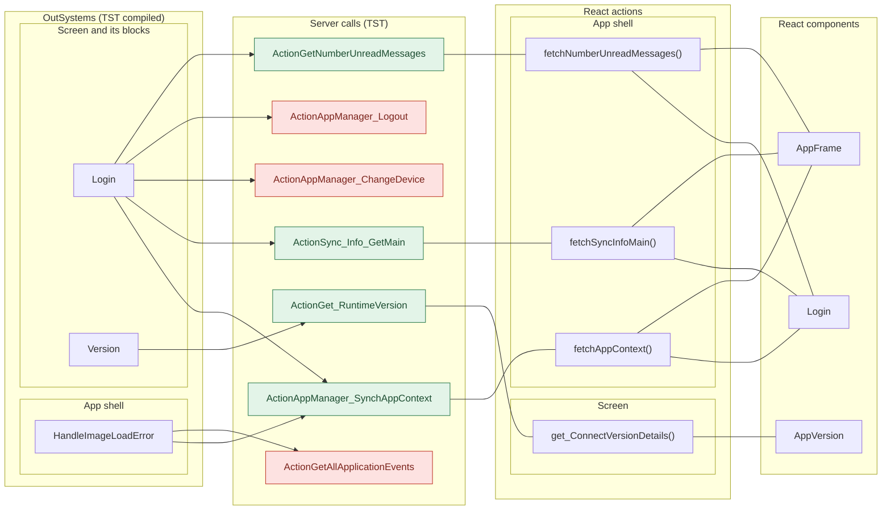
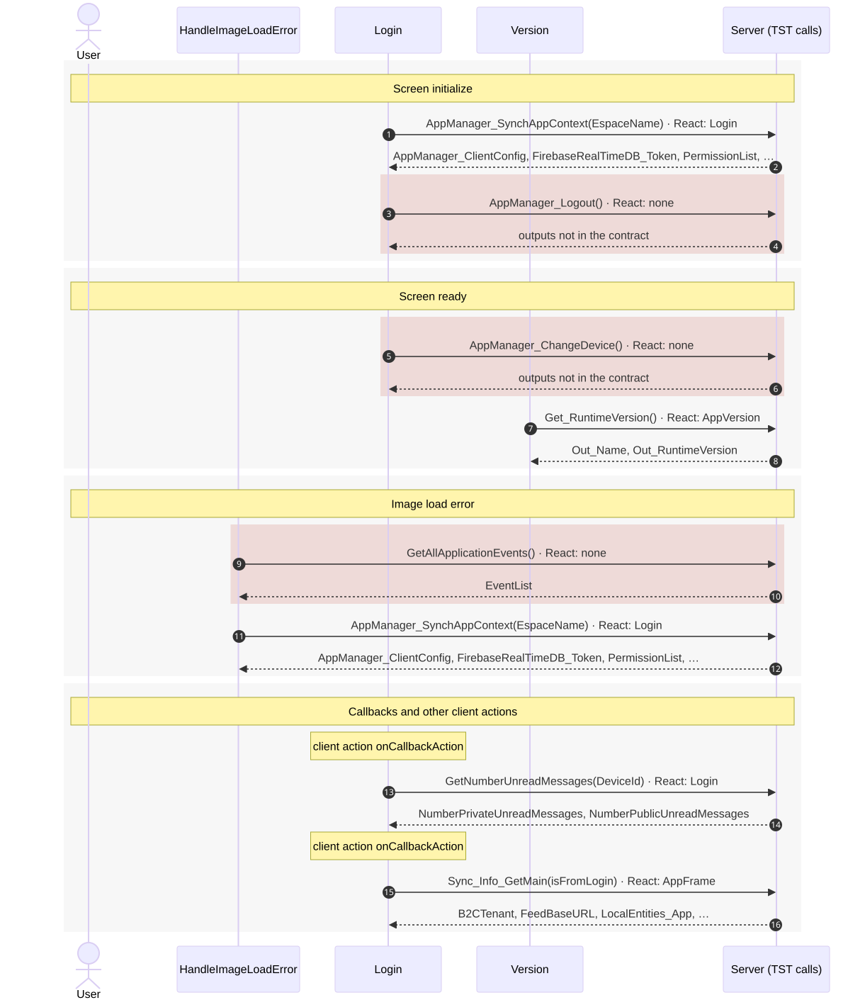
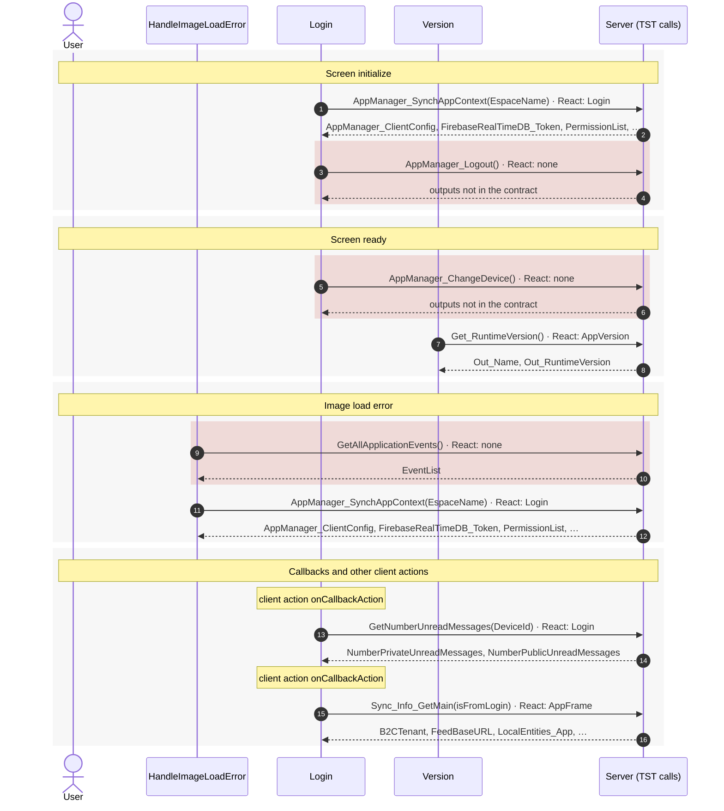

# Login: server calls in OutSystems and React

This file compares the server calls of the route `/UBTConnect/Login` in OutSystems (TST) with the calls of the React app.
The tool `migration/tools/route_actions/check_route.py` wrote this file on 2026-11-04.
The tool reads the code. It does not run the app.

## 1. Route

| Item | Value | Source |
|---|---|---|
| Route | `/UBTConnect/Login` | `app/src/app/routes.generated.ts` |
| OutSystems screen | `UBTConnect.App_Common.Login` | TST compiled code |
| UI flow | `App_Common` | MCP `getScreenNames` (DEV) |
| React screen | [`pages/Login/LoginPage.tsx`](../../app/src/pages/Login/LoginPage.tsx) | `app/src/pages/` |
| React route rules | access `anonymous`, lock `ignore`, flag redirect none | `app/src/app/routes.ts` |
| Code read | OutSystems: 28 screen and block files. React: 159 app shell files and 139 screen files | TST `facts.json`, `react_calls.mjs` |

## 2. Result

| Check | Result |
|---|---|
| Server calls on TST | 7: React makes 4, **3 missing** |
| React calls that TST does not make on this route | 5 (see [questions](#7-questions)) |
| Screen and blocks with a React port | 28 of 28 |
| Navigation targets found in React | 3 of 3 |

## 3. Diagram

- A box on the left is the OutSystems block or app action that makes the call.
- A line connects each call to the React action that makes the same call.
- The right column shows the React components that use each React action.
- A red box is a call that React does not make.

Mermaid source

## 4. Data flow

- The diagram shows the server calls in the order of the phases: app start, screen load, screen ready, then the user actions.
- Each participant is an OutSystems block or module that makes calls.
- An arrow from the user is a click, a submit or an event. A note over a block gives a callback or another client action.
- Each call arrow ends with the nearest React component that makes the same call (`React: …`).
- An arrow to the server gives the inputs of the call. The return arrow gives the outputs. The names come from the contract `app/src/api/openapi.yaml`.
- A red area is a call that React does not make.

Mermaid source

## 5. Server calls

- **Called from (OutSystems):** the block or the app-level module whose own client action makes the call. `app shell` = the layout and the app start; `screen` = the screen and its blocks.
- **Made by (TST):** for each block in "Called from", its chain of client actions from the block to the call.
- **Trigger:** when the call runs, from the start of the chain on TST.
- **Seen on TST:** `yes` when TST made the call in the capture. Many calls run only after a click. A call that TST made but that has no static chain in the TST code is in the table too; its trigger says so.
- **React action:** the React function that makes the same call, and the part that loads it: `shell`, `page` or both.
- **React caller:** the nearest React component that uses the React action, and the hooks between them. At most 2 chains, the shortest first.

| # | Call (TST) | Kind | Called from (OutSystems) | Trigger | Made by (TST) | Seen on TST | React action | React caller | Status |
|---|---|---|---|---|---|---|---|---|---|
| 1 | `Connect2_LegacyShared/ActionGetAllApplicationEvents` | server action | `HandleImageLoadError` (app shell) | image load error | HandleImageLoadError.applicationEvent_ImageError → Connect2_LegacyShared.zOnApplicationEvent_Wrapper → … → server GetAllApplicationEvents | no | – | – | **missing** |
| 2 | `UBT_AppManager/ActionAppManager_SynchAppContext` | server action | `HandleImageLoadError` (app shell) `Login` (screen) | image load error initialize | HandleImageLoadError.applicationEvent_ImageError → Connect2_LegacyShared.zOnApplicationEvent_Wrapper → … → server AppManager_SynchAppContext Login.OnInitialize → Login.onInitialize → … → server AppManager_SynchAppContext (+2 more chains) | yes | `fetchAppContext()` [`api/app/repository.ts:23`](../../app/src/api/app/repository.ts#L23) (shell + page) | `Login → useLogin → … → fetchAppContext` [`pages/Login/LoginPage.tsx`](../../app/src/pages/Login/LoginPage.tsx) `AppFrame → AppStart → … → fetchAppContext` [`app/AppFrame.tsx`](../../app/src/app/AppFrame.tsx) | implemented |
| 3 | `Connect2_LegacyShared/ActionGetNumberUnreadMessages` | server action | `Login` (screen) | client action `onCallbackAction` | Login.appManager_Callback → UBTConnect.connect_SetLoggedContext → Connect2_LegacyShared.synchronizeNumberUnreadMessages → server GetNumberUnreadMessages | no | `fetchNumberUnreadMessages()` [`api/message/unreadMessages.ts:22`](../../app/src/api/message/unreadMessages.ts#L22) (shell + page) | `Login → useLogin → … → fetchNumberUnreadMessages` [`pages/Login/LoginPage.tsx`](../../app/src/pages/Login/LoginPage.tsx) `AppFrame → AppStart → … → fetchNumberUnreadMessages` [`app/AppFrame.tsx`](../../app/src/app/AppFrame.tsx) | implemented |
| 4 | `UBTConnect/ActionSync_Info_GetMain` | server action | `Login` (screen) | client action `onCallbackAction` | Login.appManager_Callback → UBTConnect.connect_SetLoggedContext → UBTConnect.sync_Info_Main → server Sync_Info_GetMain | yes | `fetchSyncInfoMain()` [`api/app/repository.ts:36`](../../app/src/api/app/repository.ts#L36) (shell + page) | `AppFrame → AppStart → … → fetchSyncInfoMain` [`app/AppFrame.tsx`](../../app/src/app/AppFrame.tsx) `Login → useLogin → … → fetchSyncInfoMain` [`pages/Login/LoginPage.tsx`](../../app/src/pages/Login/LoginPage.tsx) | implemented |
| 5 | `UBT_AppManager/ActionAppManager_ChangeDevice` | server action | `Login` (screen) | ready | Login.OnReady → Login.onReady → UBT_AppManager.appManager_HandleDeviceAwarenessPopUp → server AppManager_ChangeDevice | no | – | – | **missing** |
| 6 | `UBT_AppManager/ActionAppManager_Logout` | server action | `Login` (screen) | initialize | Login.OnInitialize → Login.onInitialize → UBT_AppManager.appManager_Logout → server AppManager_Logout (+2 more chains) | no | – | – | **missing** |
| 7 | `UBTConnect_Utils/ActionGet_RuntimeVersion` | server action | `Version` (screen) | ready | Version.OnReady → Version.screenEvent_OnReady → UBTConnect_Utils.get_ConnectVersionDetails → server Get_RuntimeVersion | yes | `get_ConnectVersionDetails()` [`lib/ubtConnectUtils/actions.ts:36`](../../app/src/lib/ubtConnectUtils/actions.ts#L36) (page) | `AppVersion → loadVersionDetails → get_ConnectVersionDetails` [`components/version/AppVersion/AppVersion.tsx`](../../app/src/components/version/AppVersion/AppVersion.tsx) | implemented |

## 6. Missing in React

- Call `UBT_AppManager/ActionAppManager_ChangeDevice`. Chain on TST: Login.OnReady → Login.onReady → UBT_AppManager.appManager_HandleDeviceAwarenessPopUp → server AppManager_ChangeDevice.
  - No React code makes this call.
  - Note in [`pages/Login/hooks/useLogin.ts:110`](../../app/src/pages/Login/hooks/useLogin.ts#L110): "// OnReady: CallbackType = DeviceAwareness_InvalidDevice → AppManager_HandleDeviceAwarenessPopUp (not built, Q3);"
- Call `UBT_AppManager/ActionAppManager_Logout`. Chain on TST: Login.OnInitialize → Login.onInitialize → UBT_AppManager.appManager_Logout → server AppManager_Logout.
  - No React code makes this call.
  - Note in [`pages/Login/hooks/useLogin.ts:43`](../../app/src/pages/Login/hooks/useLogin.ts#L43): "// `signOutFirst` (In_IsFromResetPIN, Q2): AppManager_Logout (session and local PIN) before the mock sign-in."
  - Note in [`pages/Login/inputs.ts:8`](../../app/src/pages/Login/inputs.ts#L8): "/** True: OnInitialize runs AppManager_Logout, then the mock sign-in (Q2), unless the view cache restored Login. */"
  - Note in [`platform/auth/mockAuth.ts:24`](../../app/src/platform/auth/mockAuth.ts#L24): "/** The server logout of AppManager_Logout: no call (app-shell spec 10). */"
- Call `Connect2_LegacyShared/ActionGetAllApplicationEvents`. Chain on TST: HandleImageLoadError.applicationEvent_ImageError → Connect2_LegacyShared.zOnApplicationEvent_Wrapper → Connect2_LegacyShared.getAppEventName → Connect2_LegacyShared.cacheLocalApplicationEvents → server GetAllApplicationEvents.
  - No React code makes this call.

## 7. Questions

1. React calls `/api/UBTConnect_Utils/ActionGetUserInformation` from `fetchUserInformation()` [`api/member/userInformation.ts:6`](../../app/src/api/member/userInformation.ts#L6) (shell + page). TST Login has no chain to this call. Does the call belong to this route?
2. React calls `/api/UBTConnect_Utils/CacheControl_Policies/DataActionGetCacheInfo` from `fetchPolicies()` [`api/app/repository.ts:54`](../../app/src/api/app/repository.ts#L54) (shell + page). TST Login has no chain to this call. Does the call belong to this route?
3. React calls `/api/UBTConnect/ServiceAPIFetchData_CacheableHouseholds` from `fetchCacheableHouseholds()` [`api/app/repository.ts:48`](../../app/src/api/app/repository.ts#L48) (shell). TST Login has no chain to this call. Does the call belong to this route?
4. React calls `/api/UBTConnect/ServiceAPIFetchData_CacheableMapEntities` from `fetchCacheableMapEntities()` [`api/app/repository.ts:42`](../../app/src/api/app/repository.ts#L42) (shell). TST Login has no chain to this call. Does the call belong to this route?
5. React calls `/api/UBT_AppManager/ActionAppManager_AfterInitialize` from `afterInitialize()` [`api/app/repository.ts:30`](../../app/src/api/app/repository.ts#L30) (shell). TST Login has no chain to this call. Does the call belong to this route?

## 8. Method

1. **OutSystems (TST).** The tool reads `facts.json` of `migration/screens/Login/analysis/`:
   - the screen and block files that TST renders;
   - each server call, and the chain of client actions that makes the call;
   - the calls that TST made in the capture (`calls.json`).
2. **App shell and screen.** `app shell` is `CommonUI_InsideLayout`, its blocks and the app-level actions. `screen` is the screen and its other blocks.
3. **MCP (DEV).** The tool reads the UI flow with `getScreenNames`. TST wins when DEV is different.
4. **React.** `react_calls.mjs` reads the app shell from `app/src/main.tsx` and the screen from its `<Route>Page.tsx`. It counts only the code that the app uses.
5. **Match.** `callAction(M, A)` gives `/api/M/A`. The `x-os-paths` of `app/src/api/openapi.yaml` give the TST call. The status is `implemented` when the TST call is the same. Else the status is `missing`.

Limit: a name or a call match does not prove the same behaviour. The parity checks of the migration compare the behaviour.
