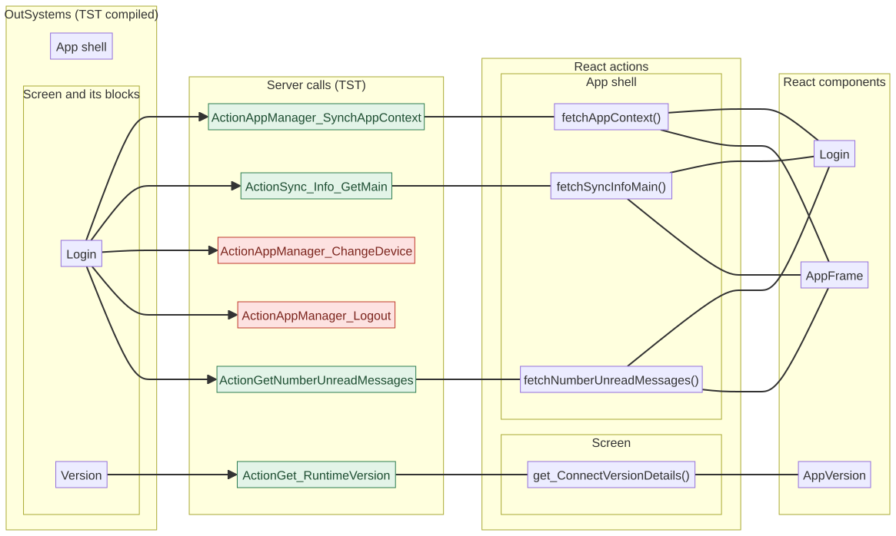
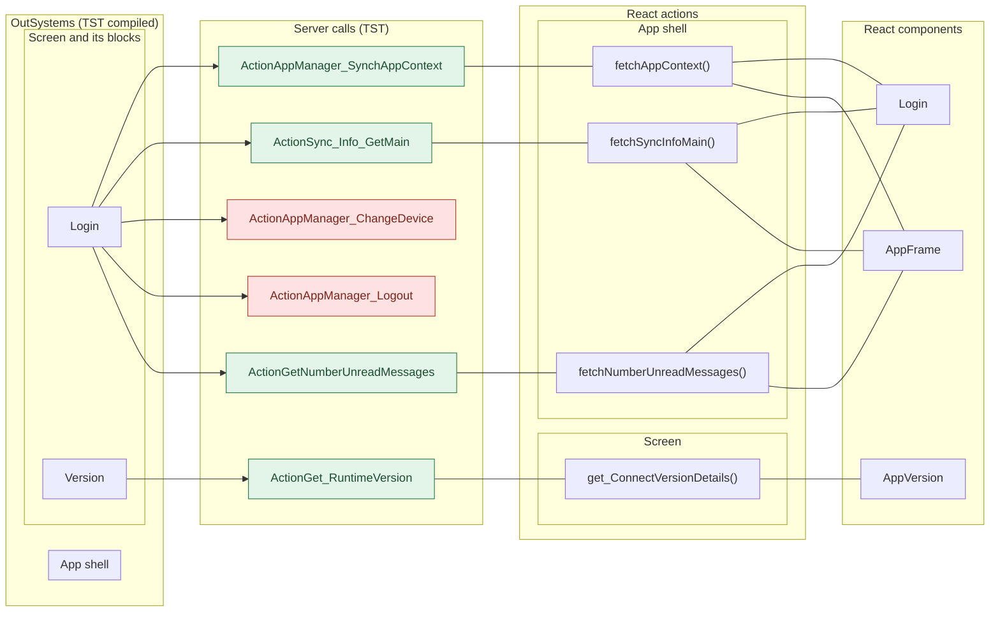
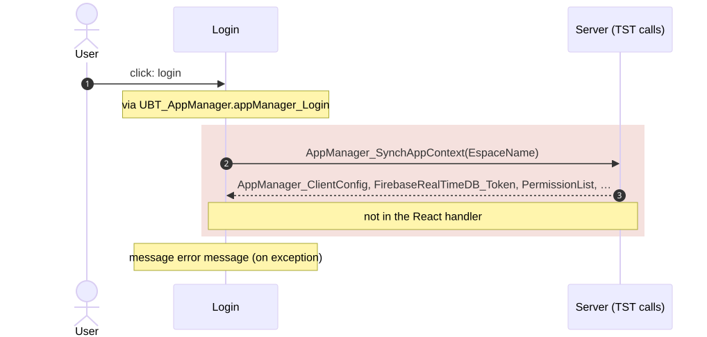
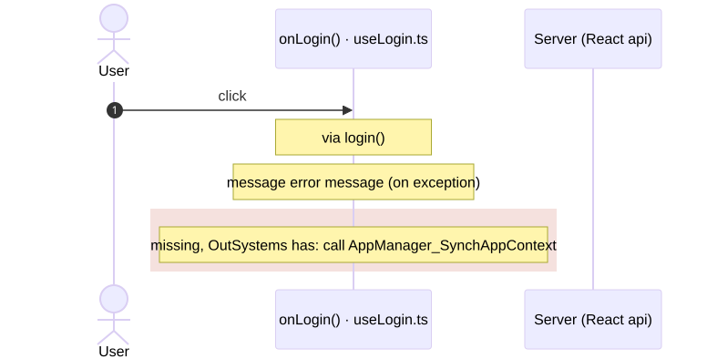
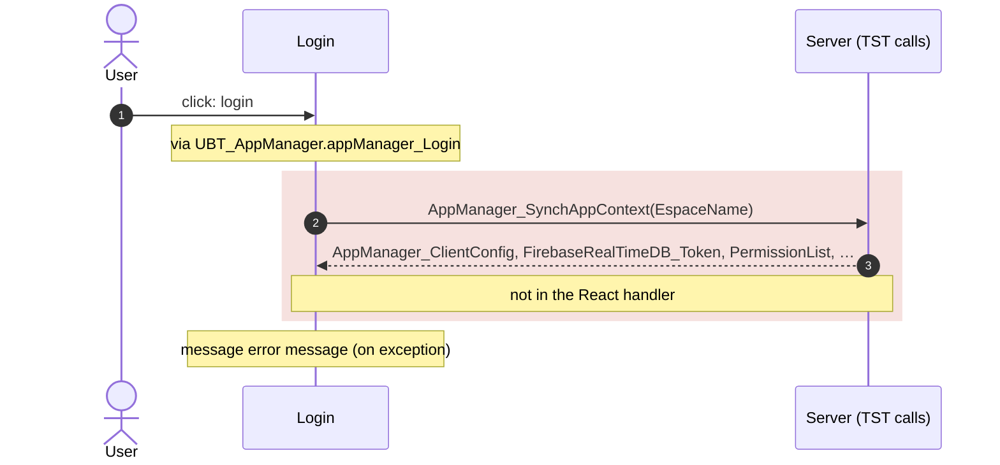
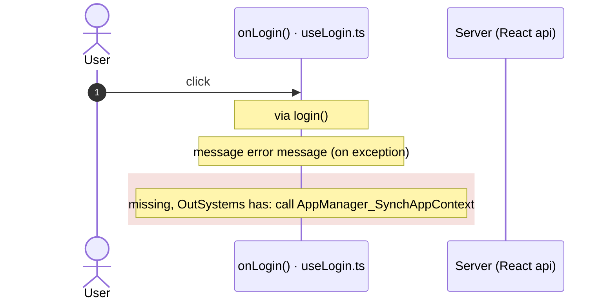

# Login: server calls and user actions in OutSystems and React

This file compares the route `/UBTConnect/Login` in OutSystems (TST) with the React app.
The tool `migration/tools/route_actions/check_route.py` wrote this file on 2026-11-04.
The tool reads the code. It does not run the app.

The app shell is the same on many routes: layout, app start, bottom bar, PIN lock and shared dialogs.
[APP_SHELL.md](APP_SHELL.md) has it. This file does not.

## 1. Route

| Item | Value | Source |
|---|---|---|
| Route | `/UBTConnect/Login` | `app/src/app/routes.generated.ts` |
| OutSystems screen | `UBTConnect.App_Common.Login` | TST compiled code |
| UI flow | `App_Common` | MCP `getScreenNames` (DEV) |
| React screen | [`pages/Login/LoginPage.tsx`](../../app/src/pages/Login/LoginPage.tsx) | `app/src/pages/` |
| React route rules | access `anonymous`, lock `ignore`, flag redirect none | `app/src/app/routes.ts` |
| Code read | OutSystems: 14 screen and block files of the route, 14 app shell files. React: 139 screen files | TST `facts.json`, `react_calls.mjs` |

## 2. Result

| Check | Result |
|---|---|
| Server calls of the route on TST | 6: React makes 4, **2 missing** |
| User actions of the route | 2 diagrams (one per action and option) |
| React calls of the screen that TST does not make | 2 (see [questions](#8-questions)) |
| Screen and blocks with a React port | 14 of 14 |
| Navigation targets found in React | 3 of 3 |
| App shell on this route | 2 calls, 1 user actions: see [APP_SHELL.md](APP_SHELL.md) |

## 3. Screenshots

The screenshots come from the last parity run (`route.py parity`). The TST capture hides personal text with dots. The React build shows fictional mock data.

| State | TST (expected) | React (build) | Difference |
|---|---|---|---|
| `default` 390x844, mock `real` 2026-10-29 pixel difference 0.0% |  |  |  |
| `loading` 390x844, mock `loading` 2026-10-29 pixel difference 0.0% |  |  |  |
| `offline` 390x844, mock `error` 2026-10-29 pixel difference 0.0% |  |  |  |

## 4. Diagram

- A box on the left is the OutSystems block of the route that makes the call.
- A line connects each call to the React action that makes the same call.
- The right column shows the React components that use each React action.
- A red box is a call that React does not make.

Mermaid source

## 5. User actions

Each user action (click, change, submit) has two sequence diagrams: OutSystems (TST code) and React.

- **OutSystems:** the participant is the OutSystems block. The action is its screen action on TST.
- **React:** the participant is the React function that ports the action. The tool finds it by its comment (the OutSystems name), its name, or the `@origin` tag of its file.
- When the handler has branches (a menu option, for example), each branch has its own diagrams. The name of a branch comes from its condition. `other` is the last `else` or `default`.
- The effects are server calls, navigation (`Navigation`), external links, messages and confirm dialogs.
- An arrow to the server gives the inputs of the call. The return arrow gives the outputs (contract `app/src/api/openapi.yaml`).
- **Red in the OutSystems diagram:** an effect that the React handler of the action does not have.
- **Red in the React diagram:** an effect that OutSystems does not have, and a note with the effects that React does not have.

| # | Block (OutSystems) | User action | Handler | Option (branch) | Effects (OutSystems) | React handler | React |
|---|---|---|---|---|---|---|---|
| [1](#51-login-click-login) | `Login` | click | `login` | – | calls AppManager_SynchAppContext; shows a message | `onLogin()` [`pages/Login/hooks/useLogin.ts:121`](../../app/src/pages/Login/hooks/useLogin.ts#L121) | **differs: 1 missing** |

### 5.1 Login: click login

Result: differs: 1 missing.

**OutSystems (TST)**

**React**: `onLogin()` in [`pages/Login/hooks/useLogin.ts:121`](../../app/src/pages/Login/hooks/useLogin.ts#L121)

Mermaid source

## 6. Server calls

- **Called from (OutSystems):** the block or the app-level module whose own client action makes the call.
- **Made by (TST):** for each block in "Called from", its chain of client actions from the block to the call.
- **Trigger:** when the call runs, from the start of the chain on TST.
- **Seen on TST:** `yes` when TST made the call in the capture. Many calls run only after a click.
- **React action:** the React function that makes the same call, and the part that loads it: `shell`, `page` or both.
- **React caller:** the nearest React component that uses the React action, and the hooks between them. At most 2 chains, the shortest first.

| # | Call (TST) | Kind | Called from (OutSystems) | Trigger | Made by (TST) | Seen on TST | React action | React caller | Status |
|---|---|---|---|---|---|---|---|---|---|
| 1 | `Connect2_LegacyShared/ActionGetNumberUnreadMessages` | server action | `Login` | client action `onCallbackAction` | Login.appManager_Callback → UBTConnect.connect_SetLoggedContext → Connect2_LegacyShared.synchronizeNumberUnreadMessages → server GetNumberUnreadMessages | no | `fetchNumberUnreadMessages()` [`api/message/unreadMessages.ts:22`](../../app/src/api/message/unreadMessages.ts#L22) (shell + page) | `Login → useLogin → … → fetchNumberUnreadMessages` [`pages/Login/LoginPage.tsx`](../../app/src/pages/Login/LoginPage.tsx) `AppFrame → AppStart → … → fetchNumberUnreadMessages` [`app/AppFrame.tsx`](../../app/src/app/AppFrame.tsx) | implemented |
| 2 | `UBTConnect/ActionSync_Info_GetMain` | server action | `Login` | client action `onCallbackAction` | Login.appManager_Callback → UBTConnect.connect_SetLoggedContext → UBTConnect.sync_Info_Main → server Sync_Info_GetMain | yes | `fetchSyncInfoMain()` [`api/app/repository.ts:36`](../../app/src/api/app/repository.ts#L36) (shell + page) | `AppFrame → AppStart → … → fetchSyncInfoMain` [`app/AppFrame.tsx`](../../app/src/app/AppFrame.tsx) `Login → useLogin → … → fetchSyncInfoMain` [`pages/Login/LoginPage.tsx`](../../app/src/pages/Login/LoginPage.tsx) | implemented |
| 3 | `UBT_AppManager/ActionAppManager_ChangeDevice` | server action | `Login` | ready | Login.OnReady → Login.onReady → UBT_AppManager.appManager_HandleDeviceAwarenessPopUp → server AppManager_ChangeDevice | no | – | – | **missing** |
| 4 | `UBT_AppManager/ActionAppManager_Logout` | server action | `Login` | initialize | Login.OnInitialize → Login.onInitialize → UBT_AppManager.appManager_Logout → server AppManager_Logout (+2 more chains) | no | – | – | **missing** |
| 5 | `UBT_AppManager/ActionAppManager_SynchAppContext` | server action | `Login` | initialize | Login.OnInitialize → Login.onInitialize → … → server AppManager_SynchAppContext (+2 more chains) | yes | `fetchAppContext()` [`api/app/repository.ts:23`](../../app/src/api/app/repository.ts#L23) (shell + page) | `Login → useLogin → … → fetchAppContext` [`pages/Login/LoginPage.tsx`](../../app/src/pages/Login/LoginPage.tsx) `AppFrame → AppStart → … → fetchAppContext` [`app/AppFrame.tsx`](../../app/src/app/AppFrame.tsx) | implemented |
| 6 | `UBTConnect_Utils/ActionGet_RuntimeVersion` | server action | `Version` | ready | Version.OnReady → Version.screenEvent_OnReady → UBTConnect_Utils.get_ConnectVersionDetails → server Get_RuntimeVersion | yes | `get_ConnectVersionDetails()` [`lib/ubtConnectUtils/actions.ts:36`](../../app/src/lib/ubtConnectUtils/actions.ts#L36) (page) | `AppVersion → loadVersionDetails → get_ConnectVersionDetails` [`components/version/AppVersion/AppVersion.tsx`](../../app/src/components/version/AppVersion/AppVersion.tsx) | implemented |

## 7. Missing in React

- Call `UBT_AppManager/ActionAppManager_ChangeDevice`. Chain on TST: Login.OnReady → Login.onReady → UBT_AppManager.appManager_HandleDeviceAwarenessPopUp → server AppManager_ChangeDevice.
  - No React code makes this call.
  - Note in [`pages/Login/hooks/useLogin.ts:110`](../../app/src/pages/Login/hooks/useLogin.ts#L110): "// OnReady: CallbackType = DeviceAwareness_InvalidDevice → AppManager_HandleDeviceAwarenessPopUp (not built, Q3);"
- Call `UBT_AppManager/ActionAppManager_Logout`. Chain on TST: Login.OnInitialize → Login.onInitialize → UBT_AppManager.appManager_Logout → server AppManager_Logout.
  - No React code makes this call.
  - Note in [`pages/Login/hooks/useLogin.ts:43`](../../app/src/pages/Login/hooks/useLogin.ts#L43): "// `signOutFirst` (In_IsFromResetPIN, Q2): AppManager_Logout (session and local PIN) before the mock sign-in."
  - Note in [`pages/Login/inputs.ts:8`](../../app/src/pages/Login/inputs.ts#L8): "/** True: OnInitialize runs AppManager_Logout, then the mock sign-in (Q2), unless the view cache restored Login. */"
  - Note in [`platform/auth/mockAuth.ts:24`](../../app/src/platform/auth/mockAuth.ts#L24): "/** The server logout of AppManager_Logout: no call (app-shell spec 10). */"

## 8. Questions

1. React calls `/api/UBTConnect_Utils/ActionGetUserInformation` from `fetchUserInformation()` [`api/member/userInformation.ts:6`](../../app/src/api/member/userInformation.ts#L6) (shell + page). TST Login has no chain to this call. Does the call belong to this route?
2. React calls `/api/UBTConnect_Utils/CacheControl_Policies/DataActionGetCacheInfo` from `fetchPolicies()` [`api/app/repository.ts:54`](../../app/src/api/app/repository.ts#L54) (shell + page). TST Login has no chain to this call. Does the call belong to this route?

## 9. Method

1. **OutSystems (TST).** The tool reads `facts.json` and the compiled code of `migration/screens/Login/analysis/`:
   - the rendered files;
   - each server call with its chain of client actions, and the calls that TST made in the capture;
   - the effects of each user action.
2. **Route and app shell.** The app shell has these parts:
   - `CommonUI_InsideLayout` with its blocks, and the app-level actions;
   - the business blocks that at least 40% of the captured routes render, for example the bottom bar.
   This file shows only the other blocks.
3. **MCP (DEV).** The tool reads the UI flow with `getScreenNames`. TST wins when DEV is different.
4. **React.** `react_calls.mjs` reads the app shell from `app/src/main.tsx` and the screen from its `<Route>Page.tsx`. It counts only the code that the app uses.
5. **Match.** `callAction(M, A)` gives `/api/M/A`. The `x-os-paths` of `app/src/api/openapi.yaml` give the TST call. The status is `implemented` when the TST call is the same. Else the status is `missing`.

Limit: a name or a call match does not prove the same behaviour. The parity checks of the migration compare the behaviour.
