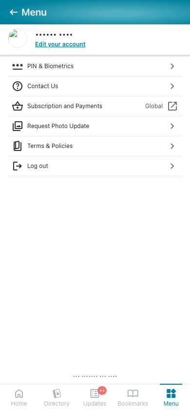
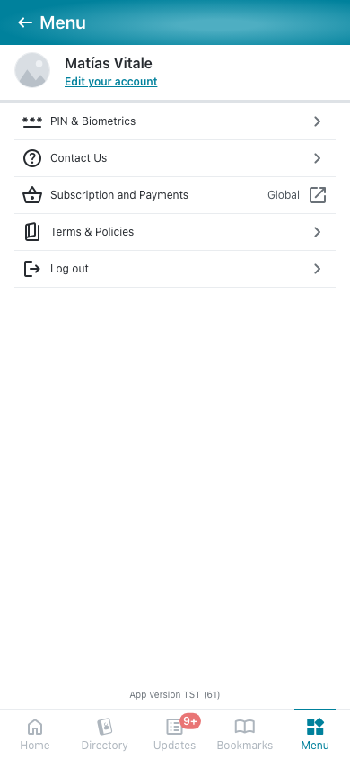
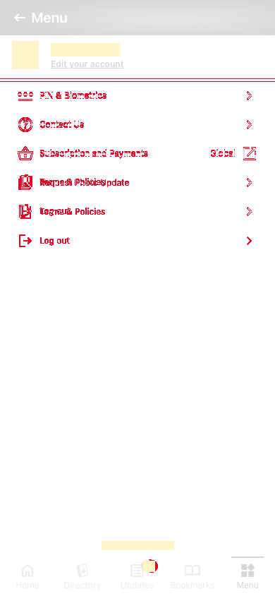
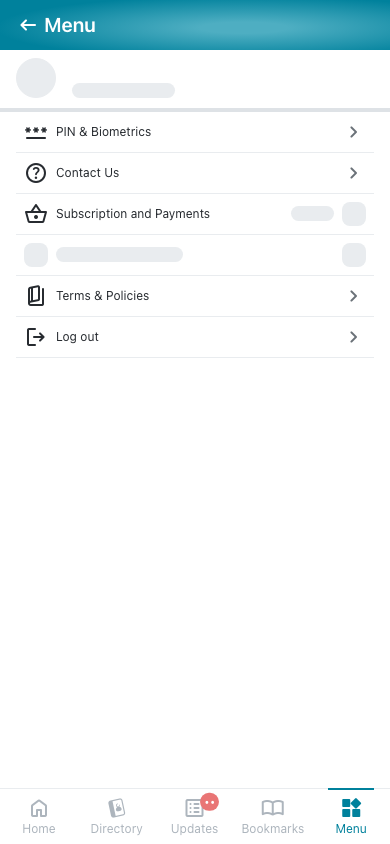
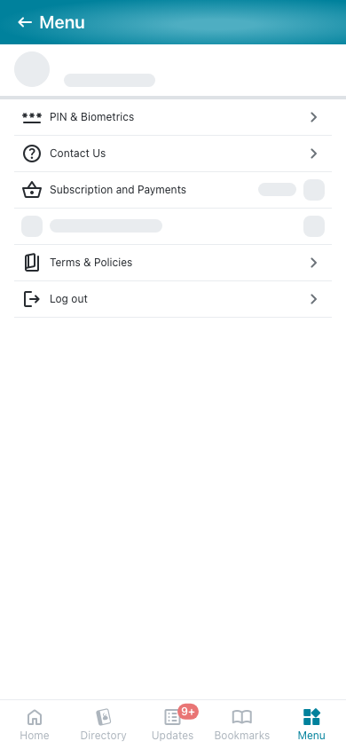
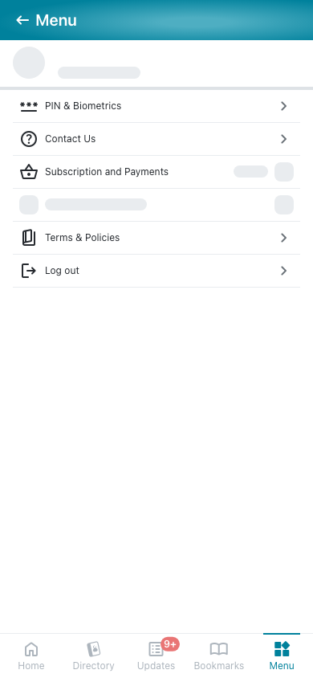
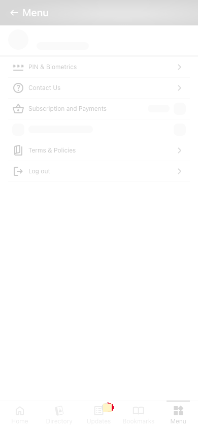
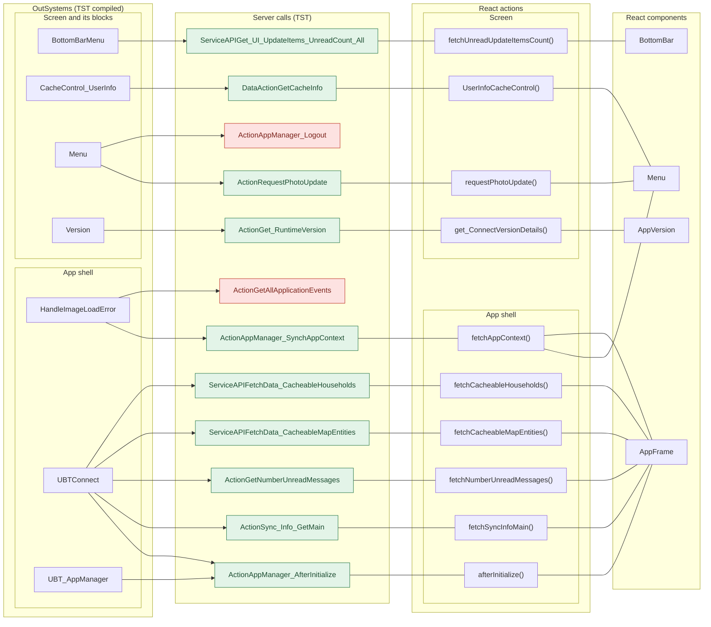
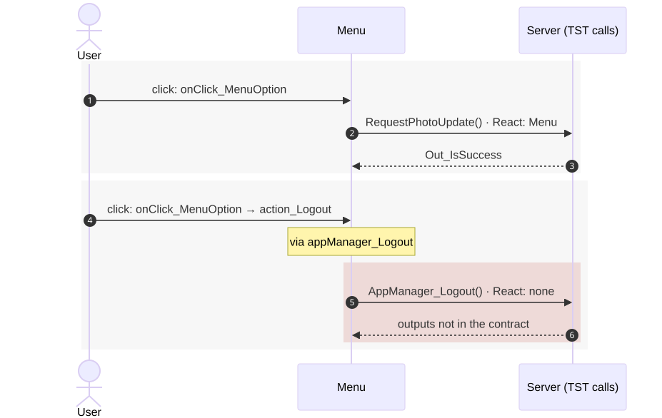
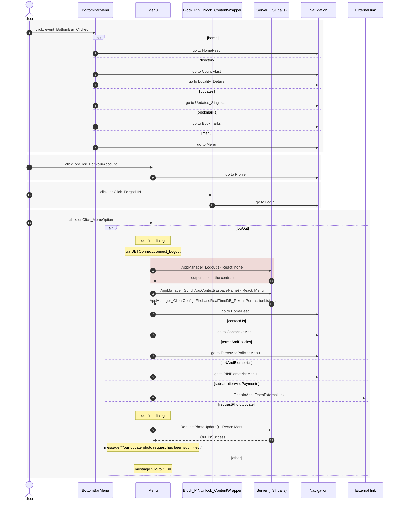

# Menu: server calls in OutSystems and React

This file compares the server calls of the route `/UBTConnect/Menu` in OutSystems (TST) with the calls of the React app.
The tool `migration/tools/route_actions/check_route.py` wrote this file on 2026-11-04.
The tool reads the code. It does not run the app.

## 1. Route

| Item | Value | Source |
|---|---|---|
| Route | `/UBTConnect/Menu` | `app/src/app/routes.generated.ts` |
| OutSystems screen | `UBTConnect.App_Menu.Menu` | TST compiled code |
| UI flow | `App_Menu` | MCP `getScreenNames` (DEV) |
| React screen | [`pages/Menu/MenuPage.tsx`](../../app/src/pages/Menu/MenuPage.tsx) | `app/src/pages/` |
| React route rules | access `member`, lock `enforce`, flag redirect none | `app/src/app/routes.ts` |
| Code read | OutSystems: 48 screen and block files. React: 159 app shell files and 152 screen files | TST `facts.json`, `react_calls.mjs` |

## 2. Result

| Check | Result |
|---|---|
| Server calls on TST | 12: React makes 10, **2 missing** |
| React calls that TST does not make on this route | 3 (see [questions](#8-questions)) |
| Screen and blocks with a React port | 48 of 48 |
| Navigation targets found in React | 12 of 12 |

## 3. Screenshots

The screenshots come from the last parity run (`route.py parity`). The TST capture hides personal text with dots. The React build shows fictional mock data.

| State | TST (expected) | React (build) | Difference |
|---|---|---|---|
| `default` 390x844, mock `member` 2026-10-29 pixel difference 1.1% |  |  |  |
| `loading` 390x844, mock `loading` 2026-10-29 pixel difference 0.0% |  |  |  |
| `offline` 390x844, mock `error` 2026-10-29 pixel difference 0.0% |  |  |  |

## 4. Diagram

- A box on the left is the OutSystems block or app action that makes the call.
- A line connects each call to the React action that makes the same call.
- The right column shows the React components that use each React action.
- A red box is a call that React does not make.

Mermaid source

## 5. Data flow (user actions)

- The diagram shows each user action of the route (click, change, submit) and its effects.
- The effects are server calls, navigation (`Navigation`), external links, messages and confirm dialogs.
- Each group starts with the user action on an OutSystems block and its handler.
- When the handler has branches, `alt` / `else` shows them. The name of a branch comes from its condition in the TST compiled code. `other` is the last `else`.
- A note `via …` gives the module action that makes the next calls.
- An arrow to the server gives the inputs of the call. The return arrow gives the outputs. The names come from the contract `app/src/api/openapi.yaml`.
- Each call arrow ends with the nearest React component that makes the same call (`React: …`). A red area is a call that React does not make.
- The calls of the app start, the screen load and the callbacks are in section 6, not here. A user action that only changes the screen state is not in the diagram.

Mermaid source

## 6. Server calls

- **Called from (OutSystems):** the block or the app-level module whose own client action makes the call. `app shell` = the layout and the app start; `screen` = the screen and its blocks.
- **Made by (TST):** for each block in "Called from", its chain of client actions from the block to the call.
- **Trigger:** when the call runs, from the start of the chain on TST.
- **Seen on TST:** `yes` when TST made the call in the capture. Many calls run only after a click. A call that TST made but that has no static chain in the TST code is in the table too; its trigger says so.
- **React action:** the React function that makes the same call, and the part that loads it: `shell`, `page` or both.
- **React caller:** the nearest React component that uses the React action, and the hooks between them. At most 2 chains, the shortest first.

| # | Call (TST) | Kind | Called from (OutSystems) | Trigger | Made by (TST) | Seen on TST | React action | React caller | Status |
|---|---|---|---|---|---|---|---|---|---|
| 1 | `Connect2_LegacyShared/ActionGetAllApplicationEvents` | server action | `HandleImageLoadError` (app shell) | image load error | HandleImageLoadError.applicationEvent_ImageError → Connect2_LegacyShared.zOnApplicationEvent_Wrapper → … → server GetAllApplicationEvents | no | – | – | **missing** |
| 2 | `UBT_AppManager/ActionAppManager_SynchAppContext` | server action | `HandleImageLoadError` (app shell) | image load error | HandleImageLoadError.applicationEvent_ImageError → Connect2_LegacyShared.zOnApplicationEvent_Wrapper → … → server AppManager_SynchAppContext | yes | `fetchAppContext()` [`api/app/repository.ts:23`](../../app/src/api/app/repository.ts#L23) (shell + page) | `Menu → useMenu → … → fetchAppContext` [`pages/Menu/MenuPage.tsx`](../../app/src/pages/Menu/MenuPage.tsx) `AppFrame → AppStart → … → fetchAppContext` [`app/AppFrame.tsx`](../../app/src/app/AppFrame.tsx) | implemented |
| 3 | `Connect2_LegacyShared/ActionGetNumberUnreadMessages` | server action | `UBTConnect` (app shell) | app start | UBTConnect.onApplicationReady → UBTConnect.connect_SetLoggedContext → Connect2_LegacyShared.synchronizeNumberUnreadMessages → server GetNumberUnreadMessages (+1 more chains) | yes | `fetchNumberUnreadMessages()` [`api/message/unreadMessages.ts:22`](../../app/src/api/message/unreadMessages.ts#L22) (shell) | `AppFrame → AppStart → … → fetchNumberUnreadMessages` [`app/AppFrame.tsx`](../../app/src/app/AppFrame.tsx) | implemented |
| 4 | `UBTConnect/ActionSync_Info_GetMain` | server action | `UBTConnect` (app shell) | app start | UBTConnect.onApplicationReady → UBTConnect.connect_SetLoggedContext → UBTConnect.sync_Info_Main → server Sync_Info_GetMain (+1 more chains) | yes | `fetchSyncInfoMain()` [`api/app/repository.ts:36`](../../app/src/api/app/repository.ts#L36) (shell) | `AppFrame → AppStart → … → fetchSyncInfoMain` [`app/AppFrame.tsx`](../../app/src/app/AppFrame.tsx) | implemented |
| 5 | `UBTConnect/ServiceAPIFetchData_CacheableHouseholds` | service action | `UBTConnect` (app shell) | module action `get_Cacheable_MapHouseholds` (the TST graph has no caller) | UBTConnect.get_Cacheable_MapHouseholds → server FetchData_CacheableHouseholds | yes | `fetchCacheableHouseholds()` [`api/app/repository.ts:48`](../../app/src/api/app/repository.ts#L48) (shell) | `AppFrame → AppStart → … → fetchCacheableHouseholds` [`app/AppFrame.tsx`](../../app/src/app/AppFrame.tsx) | implemented |
| 6 | `UBTConnect/ServiceAPIFetchData_CacheableMapEntities` | service action | `UBTConnect` (app shell) | module action `get_Cacheable_MapEntities` (the TST graph has no caller) | UBTConnect.get_Cacheable_MapEntities → server FetchData_CacheableMapEntities | yes | `fetchCacheableMapEntities()` [`api/app/repository.ts:42`](../../app/src/api/app/repository.ts#L42) (shell) | `AppFrame → AppStart → … → fetchCacheableMapEntities` [`app/AppFrame.tsx`](../../app/src/app/AppFrame.tsx) | implemented |
| 7 | `UBT_AppManager/ActionAppManager_AfterInitialize` | server action | `UBTConnect` (app shell) `UBT_AppManager` (app shell) | app start app start | UBTConnect.onApplicationReady → UBT_AppManager_Mobile.appManager_Mobile_OnAppReady → … → server AppManager_AfterInitialize UBT_AppManager.appManager_OnAppReady_Web → UBT_AppManager.appManager_InitializeWebComponents → UBT_AppManager.appManager_AfterInitialize → server AppManager_AfterInitialize | yes | `afterInitialize()` [`api/app/repository.ts:30`](../../app/src/api/app/repository.ts#L30) (shell) | `AppFrame → AppStart → … → afterInitialize` [`app/AppFrame.tsx`](../../app/src/app/AppFrame.tsx) | implemented |
| 8 | `UBTConnect/ServiceAPIGet_UI_UpdateItems_UnreadCount_All` | service action | `BottomBarMenu` (screen) | ready | BottomBarMenu.OnReady → BottomBarMenu.onReady → UBTConnect.directory_Updates_RefreshBottomBarCount → server Get_UI_UpdateItems_UnreadCount_All | no | `fetchUnreadUpdateItemsCount()` [`api/update/repository.ts:73`](../../app/src/api/update/repository.ts#L73) (page) | `BottomBar → directory_Updates_RefreshBottomBarCount → fetchUnreadUpdateItemsCount` [`components/layout/BottomBar/BottomBar.tsx`](../../app/src/components/layout/BottomBar/BottomBar.tsx) | implemented |
| 9 | `UBTConnect_Utils/CacheControl/CacheControl_UserInfo/DataActionGetCacheInfo` | data action | `CacheControl_UserInfo` (screen) | initialize | CacheControl_UserInfo.cacheControlOnNonCacheHit → CacheControl_UserInfo.DataActionGetCacheInfo (+1 more chains) | yes | `UserInfoCacheControl()` [`legacy/os/cache/UserInfoCacheControl/UserInfoCacheControl.tsx:37`](../../app/src/legacy/os/cache/UserInfoCacheControl/UserInfoCacheControl.tsx#L37) (page) | `Menu → UserInfoCache → UserInfoCacheControl` [`pages/Menu/MenuPage.tsx`](../../app/src/pages/Menu/MenuPage.tsx) | implemented |
| 10 | `UBTConnect/App_Menu/Menu/ActionRequestPhotoUpdate` | server action | `Menu` (screen) | click | Menu.onClick_MenuOption → server RequestPhotoUpdate | no | `requestPhotoUpdate()` [`api/member/repository.ts:46`](../../app/src/api/member/repository.ts#L46) (page) | `Menu → useMenu → requestPhotoUpdate` [`pages/Menu/MenuPage.tsx`](../../app/src/pages/Menu/MenuPage.tsx) | implemented |
| 11 | `UBT_AppManager/ActionAppManager_Logout` | server action | `Menu` (screen) | click | Menu.onClick_MenuOption → Menu.action_Logout → … → server AppManager_Logout | no | – | – | **missing** |
| 12 | `UBTConnect_Utils/ActionGet_RuntimeVersion` | server action | `Version` (screen) | ready | Version.OnReady → Version.screenEvent_OnReady → UBTConnect_Utils.get_ConnectVersionDetails → server Get_RuntimeVersion | yes | `get_ConnectVersionDetails()` [`lib/ubtConnectUtils/actions.ts:36`](../../app/src/lib/ubtConnectUtils/actions.ts#L36) (page) | `AppVersion → loadVersionDetails → get_ConnectVersionDetails` [`components/version/AppVersion/AppVersion.tsx`](../../app/src/components/version/AppVersion/AppVersion.tsx) | implemented |

## 7. Missing in React

- Call `UBT_AppManager/ActionAppManager_Logout`. Chain on TST: onClick in CustomContainer → event clicked of CustomContainer → event onClick_MenuOption of Menu_List → Menu.onClick_MenuOption → Menu.action_Logout → UBTConnect.connect_Logout → UBT_AppManager.appManager_Logout → server AppManager_Logout.
  - No React code makes this call.
  - Note in [`platform/auth/mockAuth.ts:24`](../../app/src/platform/auth/mockAuth.ts#L24): "/** The server logout of AppManager_Logout: no call (app-shell spec 10). */"
  - Note in [`platform/session/auth.ts:84`](../../app/src/platform/session/auth.ts#L84): "/** Connect_Logout (UC:1062-1066): Cache_InvalidateEverything, then AppManager_Logout (AM:3649-3720): server logout"
  - Note in [`platform/session/pin.ts:66`](../../app/src/platform/session/pin.ts#L66): "/** PIN_Delete(UserId, AppName), part of AppManager_Logout (AM:3712). */"
- Call `Connect2_LegacyShared/ActionGetAllApplicationEvents`. Chain on TST: HandleImageLoadError.applicationEvent_ImageError → Connect2_LegacyShared.zOnApplicationEvent_Wrapper → Connect2_LegacyShared.getAppEventName → Connect2_LegacyShared.cacheLocalApplicationEvents → server GetAllApplicationEvents.
  - No React code makes this call.

## 8. Questions

1. React calls `/api/UBTConnect_Utils/ActionGetUserInformation` from `fetchUserInformation()` [`api/member/userInformation.ts:6`](../../app/src/api/member/userInformation.ts#L6) (shell + page). TST Menu has no chain to this call. Does the call belong to this route?
2. React calls `/api/UBTConnect_Utils/CacheControl_Policies/DataActionGetCacheInfo` from `fetchPolicies()` [`api/app/repository.ts:54`](../../app/src/api/app/repository.ts#L54) (shell + page). TST Menu has no chain to this call. Does the call belong to this route?
3. React calls `/api/UBTConnect_Utils/ActionGetSignedImagesInBulk` from `cache_SignedImageURL_GetCallback()` [`lib/ubtConnectUtils/actions.ts:124`](../../app/src/lib/ubtConnectUtils/actions.ts#L124) (page). TST Menu has no chain to this call. Does the call belong to this route?

## 9. Method

1. **OutSystems (TST).** The tool reads `facts.json` of `migration/screens/Menu/analysis/`:
   - the screen and block files that TST renders;
   - each server call, and the chain of client actions that makes the call;
   - the calls that TST made in the capture (`calls.json`).
2. **App shell and screen.** `app shell` is `CommonUI_InsideLayout`, its blocks and the app-level actions. `screen` is the screen and its other blocks.
3. **MCP (DEV).** The tool reads the UI flow with `getScreenNames`. TST wins when DEV is different.
4. **React.** `react_calls.mjs` reads the app shell from `app/src/main.tsx` and the screen from its `<Route>Page.tsx`. It counts only the code that the app uses.
5. **Match.** `callAction(M, A)` gives `/api/M/A`. The `x-os-paths` of `app/src/api/openapi.yaml` give the TST call. The status is `implemented` when the TST call is the same. Else the status is `missing`.

Limit: a name or a call match does not prove the same behaviour. The parity checks of the migration compare the behaviour.
