# Menu: server calls and user actions in OutSystems and React

This file compares the route `/UBTConnect/Menu` in OutSystems (TST) with the React app.
The tool `migration/tools/route_actions/check_route.py` wrote this file on 2026-11-04.
The tool reads the code. It does not run the app.

The app shell is the same on many routes: layout, app start, bottom bar, PIN lock and shared dialogs.
[APP_SHELL.md](APP_SHELL.md) has it. This file does not.

## 1. Route

| Item | Value | Source |
|---|---|---|
| Route | `/UBTConnect/Menu` | `app/src/app/routes.generated.ts` |
| OutSystems screen | `UBTConnect.App_Menu.Menu` | TST compiled code |
| UI flow | `App_Menu` | MCP `getScreenNames` (DEV) |
| React screen | [`pages/Menu/MenuPage.tsx`](../../app/src/pages/Menu/MenuPage.tsx) | `app/src/pages/` |
| React route rules | access `member`, lock `enforce`, flag redirect none | `app/src/app/routes.ts` |
| Code read | OutSystems: 14 screen and block files of the route, 34 app shell files. React: 152 screen files | TST `facts.json`, `react_calls.mjs` |

## 2. Result

| Check | Result |
|---|---|
| Server calls of the route on TST | 4: React makes 3, **1 missing** |
| User actions of the route | 8 diagrams (one per action and option) |
| React calls of the screen that TST does not make | 3 (see [questions](#8-questions)) |
| Screen and blocks with a React port | 14 of 14 |
| Navigation targets found in React | 5 of 5 |
| App shell on this route | 8 calls, 3 user actions: see [APP_SHELL.md](APP_SHELL.md) |

## 3. Screenshots

The screenshots come from the last parity run (`route.py parity`). The TST capture hides personal text with dots. The React build shows fictional mock data.

| State | TST (expected) | React (build) | Difference |
|---|---|---|---|
| `default` 390x844, mock `member` 2026-10-29 pixel difference 1.1% |  |  |  |
| `loading` 390x844, mock `loading` 2026-10-29 pixel difference 0.0% |  |  |  |
| `offline` 390x844, mock `error` 2026-10-29 pixel difference 0.0% |  |  |  |

## 4. Diagram

- A box on the left is the OutSystems block of the route that makes the call.
- A line connects each call to the React action that makes the same call.
- The right column shows the React components that use each React action.
- A red box is a call that React does not make.

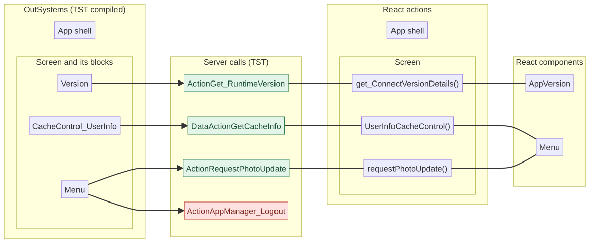

Mermaid source

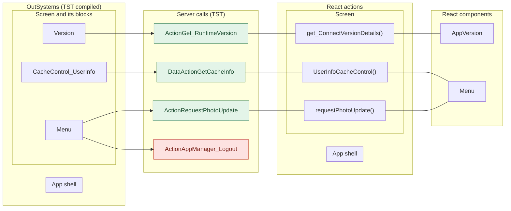

## 5. User actions

Each user action (click, change, submit) has its own sequence diagram below.
The diagrams follow the OutSystems code on TST. The participant is the OutSystems block. The action is its screen action.

- The effects are server calls, navigation (`Navigation`), external links, messages and confirm dialogs.
- When the handler has branches (a menu option, for example), each branch has its own diagram.
- The name of a branch comes from its condition in the TST code. `other` is the last `else`.
- A note `via …` gives the module action that makes the next calls.
- An arrow to the server gives the inputs of the call. The return arrow gives the outputs. The names come from the contract `app/src/api/openapi.yaml`.
- Each call arrow ends with the nearest React component that makes the same call (`React: …`). A red area is a call that React does not make.

| # | Block (OutSystems) | User action | Handler | Option (branch) | Effects |
|---|---|---|---|---|---|
| [1](#51-menu-click-onclick_edityouraccount) | `Menu` | click | `onClick_EditYourAccount` | – | goes to Profile |
| [2](#52-menu-click-onclick_menuoption-logout) | `Menu` | click | `onClick_MenuOption` | `logOut` | calls **AppManager_Logout (missing)**, AppManager_SynchAppContext; goes to HomeFeed; asks for a confirmation |
| [3](#53-menu-click-onclick_menuoption-contactus) | `Menu` | click | `onClick_MenuOption` | `contactUs` | goes to ContactUsMenu |
| [4](#54-menu-click-onclick_menuoption-termsandpolicies) | `Menu` | click | `onClick_MenuOption` | `termsAndPolicies` | goes to TermsAndPoliciesMenu |
| [5](#55-menu-click-onclick_menuoption-pinandbiometrics) | `Menu` | click | `onClick_MenuOption` | `pINAndBiometrics` | goes to PINBiometricsMenu |
| [6](#56-menu-click-onclick_menuoption-subscriptionandpayments) | `Menu` | click | `onClick_MenuOption` | `subscriptionAndPayments` | opens an external link |
| [7](#57-menu-click-onclick_menuoption-requestphotoupdate) | `Menu` | click | `onClick_MenuOption` | `requestPhotoUpdate` | calls RequestPhotoUpdate; shows a message; asks for a confirmation |
| [8](#58-menu-click-onclick_menuoption-other) | `Menu` | click | `onClick_MenuOption` | `other` | shows a message |

### 5.1 Menu: click onClick_EditYourAccount

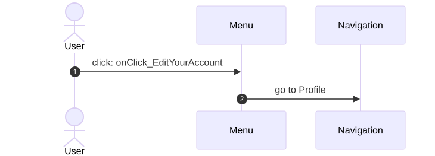

Mermaid source

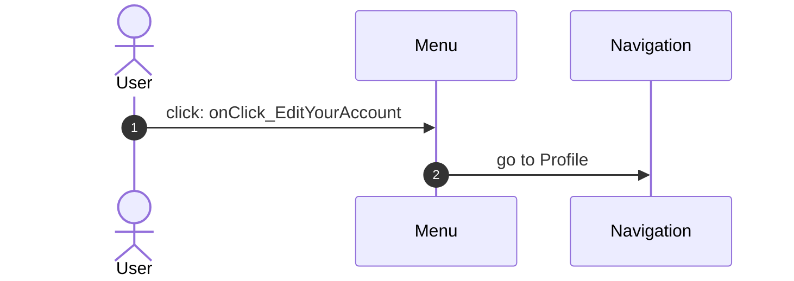

### 5.2 Menu: click onClick_MenuOption (logOut)

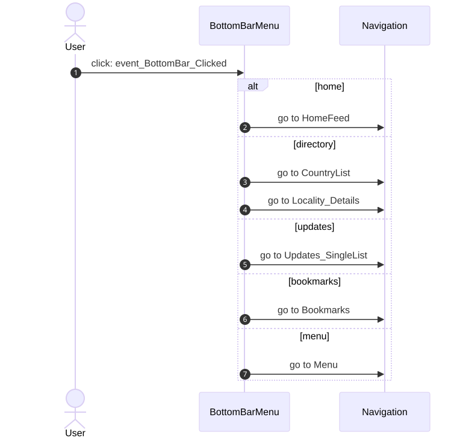

Mermaid source

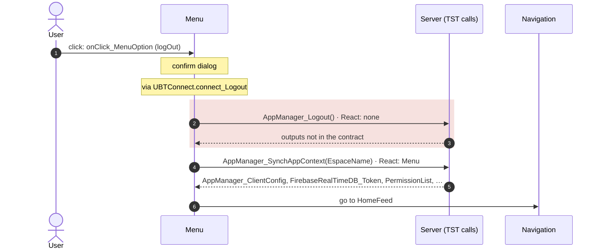

### 5.3 Menu: click onClick_MenuOption (contactUs)

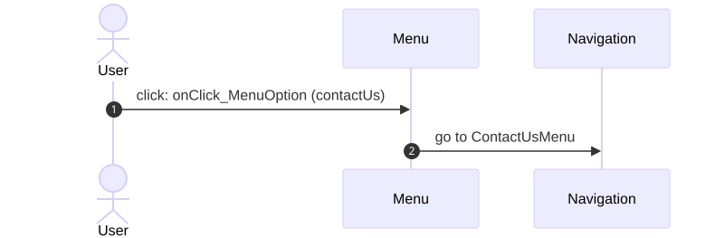

Mermaid source

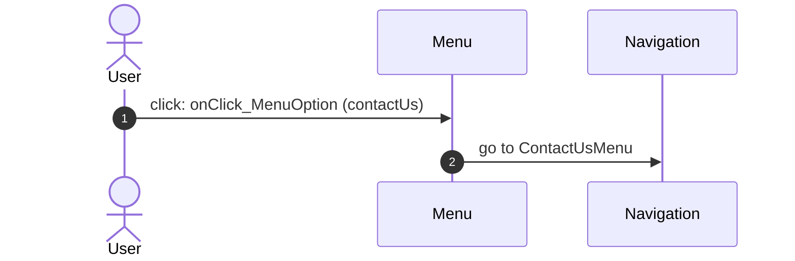

### 5.4 Menu: click onClick_MenuOption (termsAndPolicies)

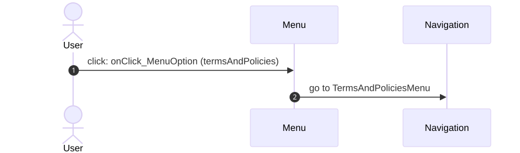

Mermaid source

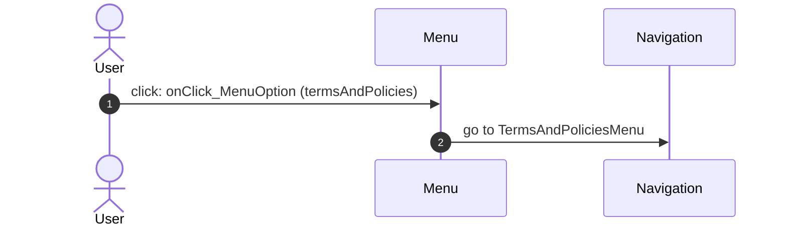

### 5.5 Menu: click onClick_MenuOption (pINAndBiometrics)

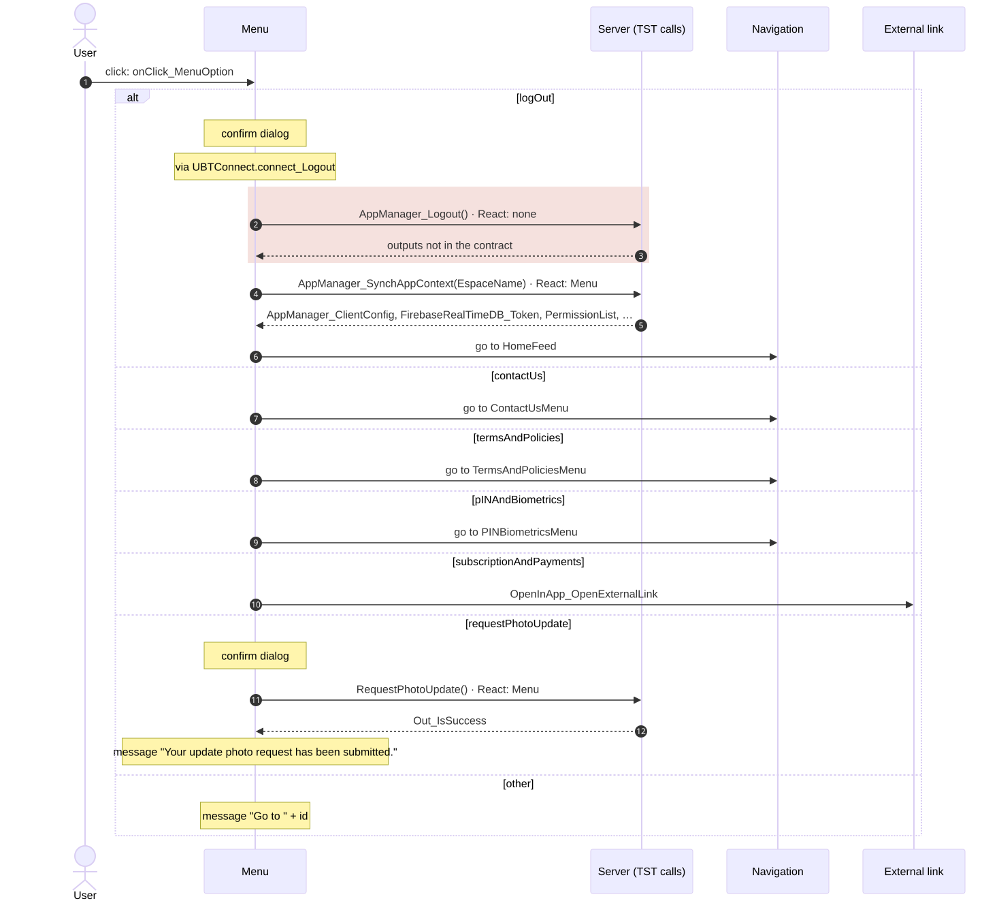

Mermaid source

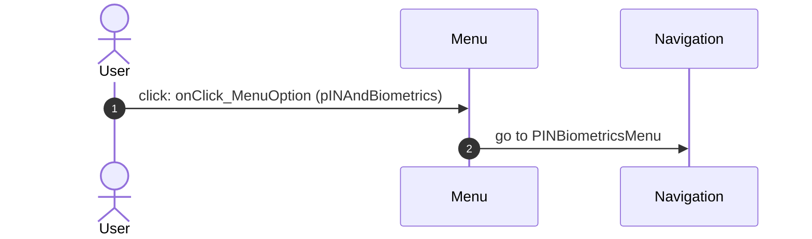

### 5.6 Menu: click onClick_MenuOption (subscriptionAndPayments)

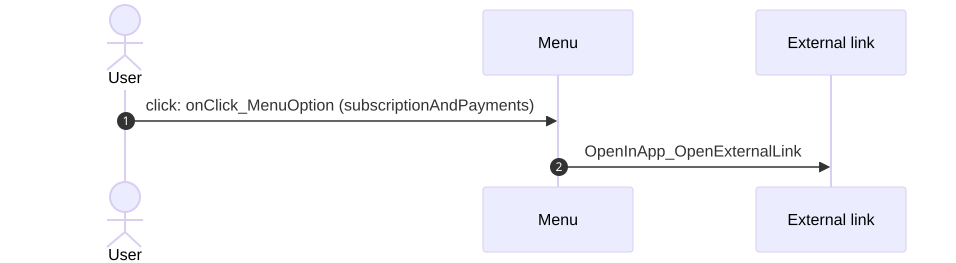

Mermaid source

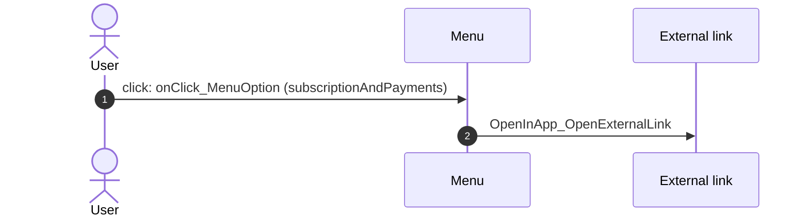

### 5.7 Menu: click onClick_MenuOption (requestPhotoUpdate)

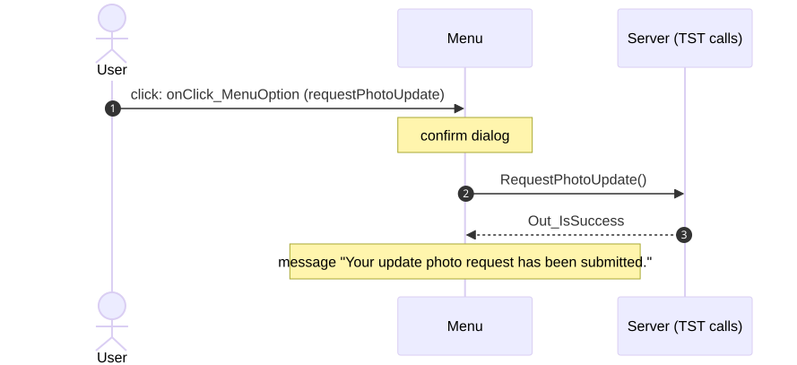

Mermaid source

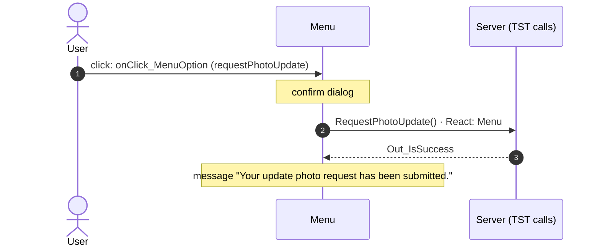

### 5.8 Menu: click onClick_MenuOption (other)

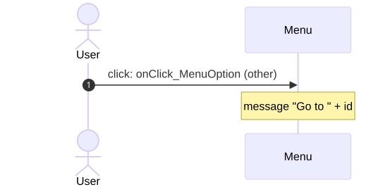

Mermaid source

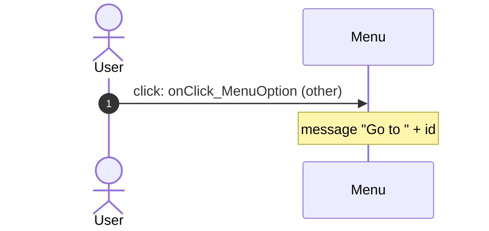

## 6. Server calls

- **Called from (OutSystems):** the block or the app-level module whose own client action makes the call.
- **Made by (TST):** for each block in "Called from", its chain of client actions from the block to the call.
- **Trigger:** when the call runs, from the start of the chain on TST.
- **Seen on TST:** `yes` when TST made the call in the capture. Many calls run only after a click.
- **React action:** the React function that makes the same call, and the part that loads it: `shell`, `page` or both.
- **React caller:** the nearest React component that uses the React action, and the hooks between them. At most 2 chains, the shortest first.

| # | Call (TST) | Kind | Called from (OutSystems) | Trigger | Made by (TST) | Seen on TST | React action | React caller | Status |
|---|---|---|---|---|---|---|---|---|---|
| 1 | `UBTConnect_Utils/CacheControl/CacheControl_UserInfo/DataActionGetCacheInfo` | data action | `CacheControl_UserInfo` | initialize | CacheControl_UserInfo.cacheControlOnNonCacheHit → CacheControl_UserInfo.DataActionGetCacheInfo (+1 more chains) | yes | `UserInfoCacheControl()` [`legacy/os/cache/UserInfoCacheControl/UserInfoCacheControl.tsx:37`](../../app/src/legacy/os/cache/UserInfoCacheControl/UserInfoCacheControl.tsx#L37) (page) | `Menu → UserInfoCache → UserInfoCacheControl` [`pages/Menu/MenuPage.tsx`](../../app/src/pages/Menu/MenuPage.tsx) | implemented |
| 2 | `UBTConnect/App_Menu/Menu/ActionRequestPhotoUpdate` | server action | `Menu` | click | Menu.onClick_MenuOption → server RequestPhotoUpdate | no | `requestPhotoUpdate()` [`api/member/repository.ts:46`](../../app/src/api/member/repository.ts#L46) (page) | `Menu → useMenu → requestPhotoUpdate` [`pages/Menu/MenuPage.tsx`](../../app/src/pages/Menu/MenuPage.tsx) | implemented |
| 3 | `UBT_AppManager/ActionAppManager_Logout` | server action | `Menu` | click | Menu.onClick_MenuOption → Menu.action_Logout → … → server AppManager_Logout | no | – | – | **missing** |
| 4 | `UBTConnect_Utils/ActionGet_RuntimeVersion` | server action | `Version` | ready | Version.OnReady → Version.screenEvent_OnReady → UBTConnect_Utils.get_ConnectVersionDetails → server Get_RuntimeVersion | yes | `get_ConnectVersionDetails()` [`lib/ubtConnectUtils/actions.ts:36`](../../app/src/lib/ubtConnectUtils/actions.ts#L36) (page) | `AppVersion → loadVersionDetails → get_ConnectVersionDetails` [`components/version/AppVersion/AppVersion.tsx`](../../app/src/components/version/AppVersion/AppVersion.tsx) | implemented |

## 7. Missing in React

- Call `UBT_AppManager/ActionAppManager_Logout`. Chain on TST: onClick in CustomContainer → event clicked of CustomContainer → event onClick_MenuOption of Menu_List → Menu.onClick_MenuOption → Menu.action_Logout → UBTConnect.connect_Logout → UBT_AppManager.appManager_Logout → server AppManager_Logout.
  - No React code makes this call.
  - Note in [`platform/auth/mockAuth.ts:24`](../../app/src/platform/auth/mockAuth.ts#L24): "/** The server logout of AppManager_Logout: no call (app-shell spec 10). */"
  - Note in [`platform/session/auth.ts:84`](../../app/src/platform/session/auth.ts#L84): "/** Connect_Logout (UC:1062-1066): Cache_InvalidateEverything, then AppManager_Logout (AM:3649-3720): server logout"
  - Note in [`platform/session/pin.ts:66`](../../app/src/platform/session/pin.ts#L66): "/** PIN_Delete(UserId, AppName), part of AppManager_Logout (AM:3712). */"

## 8. Questions

1. React calls `/api/UBTConnect_Utils/ActionGetUserInformation` from `fetchUserInformation()` [`api/member/userInformation.ts:6`](../../app/src/api/member/userInformation.ts#L6) (shell + page). TST Menu has no chain to this call. Does the call belong to this route?
2. React calls `/api/UBTConnect_Utils/CacheControl_Policies/DataActionGetCacheInfo` from `fetchPolicies()` [`api/app/repository.ts:54`](../../app/src/api/app/repository.ts#L54) (shell + page). TST Menu has no chain to this call. Does the call belong to this route?
3. React calls `/api/UBTConnect_Utils/ActionGetSignedImagesInBulk` from `cache_SignedImageURL_GetCallback()` [`lib/ubtConnectUtils/actions.ts:124`](../../app/src/lib/ubtConnectUtils/actions.ts#L124) (page). TST Menu has no chain to this call. Does the call belong to this route?

## 9. Method

1. **OutSystems (TST).** The tool reads `facts.json` and the compiled code of `migration/screens/Menu/analysis/`:
   - the rendered files;
   - each server call with its chain of client actions, and the calls that TST made in the capture;
   - the effects of each user action.
2. **Route and app shell.** The app shell has these parts:
   - `CommonUI_InsideLayout` with its blocks, and the app-level actions;
   - the business blocks that at least 40% of the captured routes render, for example the bottom bar.
   This file shows only the other blocks.
3. **MCP (DEV).** The tool reads the UI flow with `getScreenNames`. TST wins when DEV is different.
4. **React.** `react_calls.mjs` reads the app shell from `app/src/main.tsx` and the screen from its `<Route>Page.tsx`. It counts only the code that the app uses.
5. **Match.** `callAction(M, A)` gives `/api/M/A`. The `x-os-paths` of `app/src/api/openapi.yaml` give the TST call. The status is `implemented` when the TST call is the same. Else the status is `missing`.

Limit: a name or a call match does not prove the same behaviour. The parity checks of the migration compare the behaviour.
