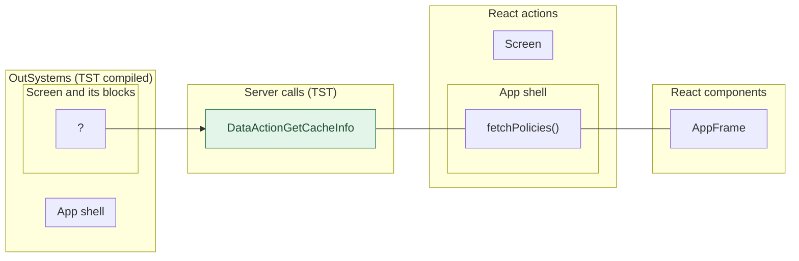

# Splash: server calls and user actions in OutSystems and React

This file compares the route `/UBTConnect/Splash` in OutSystems (TST) with the React app.
The tool `migration/tools/route_actions/check_route.py` wrote this file on 2026-11-04.
The tool reads the code. It does not run the app.

The app shell is the same on many routes: layout, app start, bottom bar, PIN lock and shared dialogs.
[APP_SHELL.md](APP_SHELL.md) has it. This file does not.

## 1. Route

| Item | Value | Source |
|---|---|---|
| Route | `/UBTConnect/Splash` | `app/src/app/routes.generated.ts` |
| OutSystems screen | `UBTConnect.App_Common.Splash` | TST compiled code |
| UI flow | `App_Common` | MCP `getScreenNames` (DEV) |
| React screen | [`pages/Splash/SplashPage.tsx`](../../app/src/pages/Splash/SplashPage.tsx) | `app/src/pages/` |
| React route rules | access `anonymous`, lock `ignore`, flag redirect none | `app/src/app/routes.ts` |
| Code read | OutSystems: 10 screen and block files of the route, 6 app shell files. React: 48 screen files | TST `facts.json`, `react_calls.mjs` |

## 2. Result

| Check | Result |
|---|---|
| Server calls of the route on TST | 1: React makes 1, **0 missing** |
| User actions of the route | 0 diagrams (one per action and option) |
| React calls of the screen that TST does not make | 0 (see [questions](#8-questions)) |
| Screen and blocks with a React port | 10 of 10 |
| Navigation targets found in React | 2 of 2 |
| App shell on this route | 7 calls, 0 user actions: see [APP_SHELL.md](APP_SHELL.md) |

## 3. Screenshots

The screenshots come from the last parity run (`route.py parity`). The TST capture hides personal text with dots. The React build shows fictional mock data.

| State | TST (expected) | React (build) | Difference |
|---|---|---|---|
| `default` 390x844, mock `real` 2026-10-29 pixel difference 0.0% |  |  |  |

## 4. Diagram

- A box on the left is the OutSystems block of the route that makes the call.
- A line connects each call to the React action that makes the same call.
- The right column shows the React components that use each React action.
- A red box is a call that React does not make.

## 5. User actions

No user action here makes a server call, a navigation, an external link or a message.

## 6. Server calls

- **Called from (OutSystems):** the block or the app-level module whose own client action makes the call.
- **Made by (TST):** for each block in "Called from", its chain of client actions from the block to the call.
- **Trigger:** when the call runs, from the start of the chain on TST.
- **Seen on TST:** `yes` when TST made the call in the capture. Many calls run only after a click.
- **React action:** the React function that makes the same call, and the part that loads it: `shell`, `page` or both.
- **React caller:** the nearest React component that uses the React action, and the hooks between them. At most 2 chains, the shortest first.

| # | Call (TST) | Kind | Called from (OutSystems) | Trigger | Made by (TST) | Seen on TST | React action | React caller | Status |
|---|---|---|---|---|---|---|---|---|---|
| 1 | `UBTConnect_Utils/CacheControl/CacheControl_Policies/DataActionGetCacheInfo` | data action | `CacheControl_Policies` | seen on TST, no static chain | no static chain in the TST code | yes | `fetchPolicies()` [`api/app/repository.ts:54`](../../app/src/api/app/repository.ts#L54) (shell) | `AppFrame → AppLockHost → … → fetchPolicies` [`app/AppFrame.tsx`](../../app/src/app/AppFrame.tsx) | implemented |

## 7. Missing in React

None.

## 8. Questions

None.

## 9. Method

1. **OutSystems (TST).** The tool reads `facts.json` and the compiled code of `migration/screens/Splash/analysis/`:
   - the rendered files;
   - each server call with its chain of client actions, and the calls that TST made in the capture;
   - the effects of each user action.
2. **Route and app shell.** The app shell has these parts:
   - `CommonUI_InsideLayout` with its blocks, and the app-level actions;
   - the business blocks that at least 40% of the captured routes render, for example the bottom bar.
   This file shows only the other blocks.
3. **MCP (DEV).** The tool reads the UI flow with `getScreenNames`. TST wins when DEV is different.
4. **React.** `react_calls.mjs` reads the app shell from `app/src/main.tsx` and the screen from its `<Route>Page.tsx`. It counts only the code that the app uses.
5. **Match.** `callAction(M, A)` gives `/api/M/A`. The `x-os-paths` of `app/src/api/openapi.yaml` give the TST call. The status is `implemented` when the TST call is the same. Else the status is `missing`.

Limit: a name or a call match does not prove the same behaviour. The parity checks of the migration compare the behaviour.
