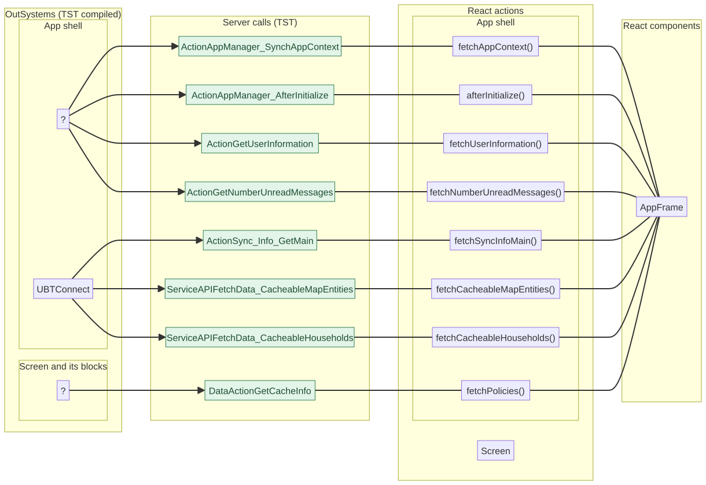
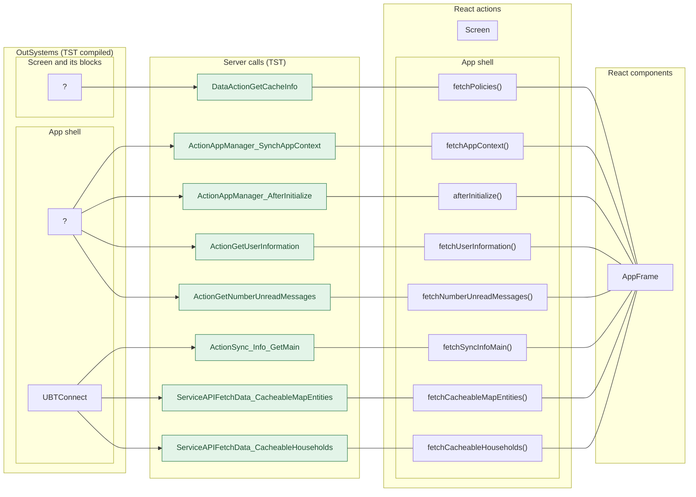
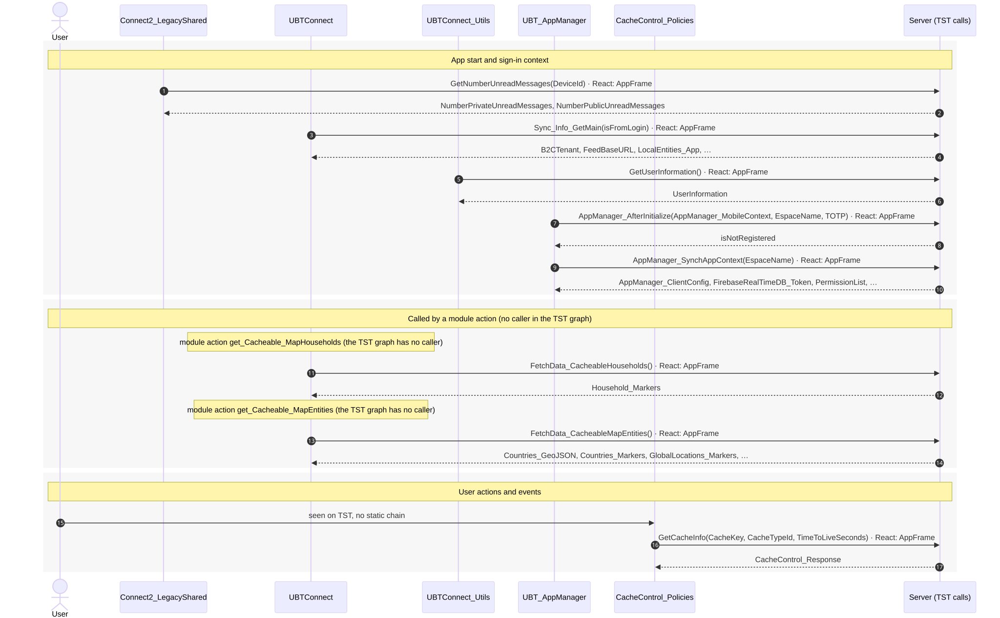
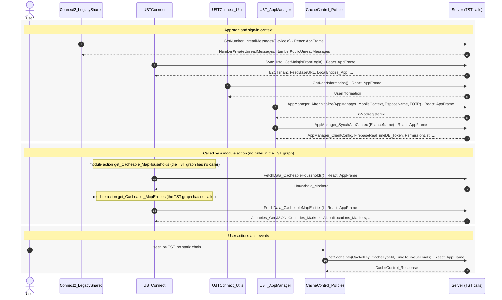

# Splash: server calls in OutSystems and React

This file compares the server calls of the route `/UBTConnect/Splash` in OutSystems (TST) with the calls of the React app.
The tool `migration/tools/route_actions/check_route.py` wrote this file on 2026-11-04.
The tool reads the code. It does not run the app.

## 1. Route

| Item | Value | Source |
|---|---|---|
| Route | `/UBTConnect/Splash` | `app/src/app/routes.generated.ts` |
| OutSystems screen | `UBTConnect.App_Common.Splash` | TST compiled code |
| UI flow | `App_Common` | MCP `getScreenNames` (DEV) |
| React screen | [`pages/Splash/SplashPage.tsx`](../../app/src/pages/Splash/SplashPage.tsx) | `app/src/pages/` |
| React route rules | access `anonymous`, lock `ignore`, flag redirect none | `app/src/app/routes.ts` |
| Code read | OutSystems: 16 screen and block files. React: 159 app shell files and 48 screen files | TST `facts.json`, `react_calls.mjs` |

## 2. Result

| Check | Result |
|---|---|
| Server calls on TST | 8: React makes 8, **0 missing** |
| React calls that TST does not make on this route | 0 (see [questions](#8-questions)) |
| Screen and blocks with a React port | 16 of 16 |
| Navigation targets found in React | 2 of 2 |

## 3. Screenshots

The screenshots come from the last parity run (`route.py parity`). The TST capture hides personal text with dots. The React build shows fictional mock data.

| State | TST (expected) | React (build) | Difference |
|---|---|---|---|
| `default` 390x844, mock `real` 2026-10-29 pixel difference 0.0% |  |  |  |

## 4. Diagram

- A box on the left is the OutSystems block or app action that makes the call.
- A line connects each call to the React action that makes the same call.
- The right column shows the React components that use each React action.
- A red box is a call that React does not make.

Mermaid source

## 5. Data flow

- The diagram shows the server calls in the order of the phases: app start, screen load, screen ready, then the user actions.
- Each participant is an OutSystems block or module that makes calls.
- An arrow from the user is a click, a submit or an event. A note over a block gives a callback or another client action.
- Each call arrow ends with the nearest React component that makes the same call (`React: …`).
- An arrow to the server gives the inputs of the call. The return arrow gives the outputs. The names come from the contract `app/src/api/openapi.yaml`.
- A red area is a call that React does not make.

Mermaid source

## 6. Server calls

- **Called from (OutSystems):** the block or the app-level module whose own client action makes the call. `app shell` = the layout and the app start; `screen` = the screen and its blocks.
- **Made by (TST):** for each block in "Called from", its chain of client actions from the block to the call.
- **Trigger:** when the call runs, from the start of the chain on TST.
- **Seen on TST:** `yes` when TST made the call in the capture. Many calls run only after a click. A call that TST made but that has no static chain in the TST code is in the table too; its trigger says so.
- **React action:** the React function that makes the same call, and the part that loads it: `shell`, `page` or both.
- **React caller:** the nearest React component that uses the React action, and the hooks between them. At most 2 chains, the shortest first.

| # | Call (TST) | Kind | Called from (OutSystems) | Trigger | Made by (TST) | Seen on TST | React action | React caller | Status |
|---|---|---|---|---|---|---|---|---|---|
| 1 | `Connect2_LegacyShared/ActionGetNumberUnreadMessages` | server action | `Connect2_LegacyShared` (app shell) | app start (seen on TST, no static chain) | no static chain in the TST code | yes | `fetchNumberUnreadMessages()` [`api/message/unreadMessages.ts:22`](../../app/src/api/message/unreadMessages.ts#L22) (shell) | `AppFrame → AppStart → … → fetchNumberUnreadMessages` [`app/AppFrame.tsx`](../../app/src/app/AppFrame.tsx) | implemented |
| 2 | `UBTConnect/ActionSync_Info_GetMain` | server action | `UBTConnect` (app shell) | app start | UBTConnect.onApplicationReady → UBTConnect.connect_SetLoggedContext → UBTConnect.sync_Info_Main → server Sync_Info_GetMain (+1 more chains) | yes | `fetchSyncInfoMain()` [`api/app/repository.ts:36`](../../app/src/api/app/repository.ts#L36) (shell) | `AppFrame → AppStart → … → fetchSyncInfoMain` [`app/AppFrame.tsx`](../../app/src/app/AppFrame.tsx) | implemented |
| 3 | `UBTConnect/ServiceAPIFetchData_CacheableHouseholds` | service action | `UBTConnect` (app shell) | module action `get_Cacheable_MapHouseholds` (the TST graph has no caller) | UBTConnect.get_Cacheable_MapHouseholds → server FetchData_CacheableHouseholds | yes | `fetchCacheableHouseholds()` [`api/app/repository.ts:48`](../../app/src/api/app/repository.ts#L48) (shell) | `AppFrame → AppStart → … → fetchCacheableHouseholds` [`app/AppFrame.tsx`](../../app/src/app/AppFrame.tsx) | implemented |
| 4 | `UBTConnect/ServiceAPIFetchData_CacheableMapEntities` | service action | `UBTConnect` (app shell) | module action `get_Cacheable_MapEntities` (the TST graph has no caller) | UBTConnect.get_Cacheable_MapEntities → server FetchData_CacheableMapEntities | yes | `fetchCacheableMapEntities()` [`api/app/repository.ts:42`](../../app/src/api/app/repository.ts#L42) (shell) | `AppFrame → AppStart → … → fetchCacheableMapEntities` [`app/AppFrame.tsx`](../../app/src/app/AppFrame.tsx) | implemented |
| 5 | `UBTConnect_Utils/ActionGetUserInformation` | server action | `UBTConnect_Utils` (app shell) | app start (seen on TST, no static chain) | no static chain in the TST code | yes | `fetchUserInformation()` [`api/member/userInformation.ts:6`](../../app/src/api/member/userInformation.ts#L6) (shell) | `AppFrame → CommonUiHost → … → fetchUserInformation` [`app/AppFrame.tsx`](../../app/src/app/AppFrame.tsx) | implemented |
| 6 | `UBT_AppManager/ActionAppManager_AfterInitialize` | server action | `UBT_AppManager` (app shell) | app start (seen on TST, no static chain) | no static chain in the TST code | yes | `afterInitialize()` [`api/app/repository.ts:30`](../../app/src/api/app/repository.ts#L30) (shell) | `AppFrame → AppStart → … → afterInitialize` [`app/AppFrame.tsx`](../../app/src/app/AppFrame.tsx) | implemented |
| 7 | `UBT_AppManager/ActionAppManager_SynchAppContext` | server action | `UBT_AppManager` (app shell) | app start (seen on TST, no static chain) | no static chain in the TST code | yes | `fetchAppContext()` [`api/app/repository.ts:23`](../../app/src/api/app/repository.ts#L23) (shell) | `AppFrame → AppStart → … → fetchAppContext` [`app/AppFrame.tsx`](../../app/src/app/AppFrame.tsx) | implemented |
| 8 | `UBTConnect_Utils/CacheControl/CacheControl_Policies/DataActionGetCacheInfo` | data action | `CacheControl_Policies` (screen) | seen on TST, no static chain | no static chain in the TST code | yes | `fetchPolicies()` [`api/app/repository.ts:54`](../../app/src/api/app/repository.ts#L54) (shell) | `AppFrame → AppLockHost → … → fetchPolicies` [`app/AppFrame.tsx`](../../app/src/app/AppFrame.tsx) | implemented |

## 7. Missing in React

None.

## 8. Questions

None.

## 9. Method

1. **OutSystems (TST).** The tool reads `facts.json` of `migration/screens/Splash/analysis/`:
   - the screen and block files that TST renders;
   - each server call, and the chain of client actions that makes the call;
   - the calls that TST made in the capture (`calls.json`).
2. **App shell and screen.** `app shell` is `CommonUI_InsideLayout`, its blocks and the app-level actions. `screen` is the screen and its other blocks.
3. **MCP (DEV).** The tool reads the UI flow with `getScreenNames`. TST wins when DEV is different.
4. **React.** `react_calls.mjs` reads the app shell from `app/src/main.tsx` and the screen from its `<Route>Page.tsx`. It counts only the code that the app uses.
5. **Match.** `callAction(M, A)` gives `/api/M/A`. The `x-os-paths` of `app/src/api/openapi.yaml` give the TST call. The status is `implemented` when the TST call is the same. Else the status is `missing`.

Limit: a name or a call match does not prove the same behaviour. The parity checks of the migration compare the behaviour.
