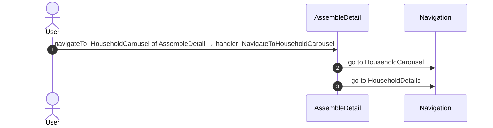
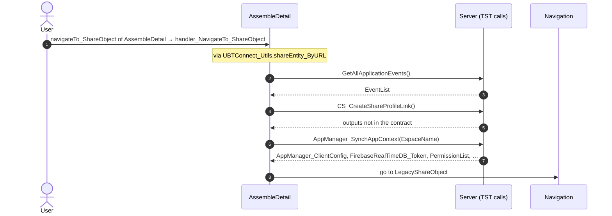
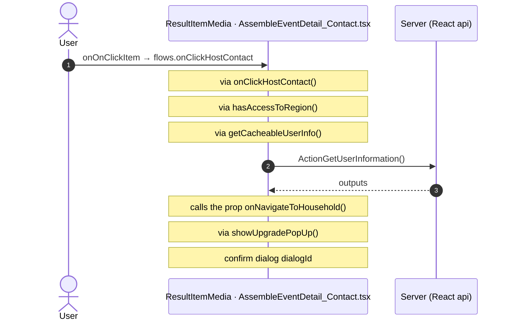
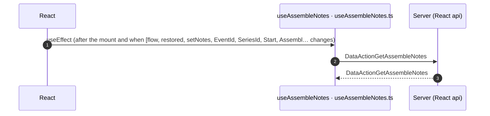

# AssembleDetail: OutSystems (TST) and React

The route `/UBTConnect/AssembleDetail`, read from the TST compiled code and from the React code by `tools/route-check/check_route.py` on 2026-11-06. Facts only, each with its place. The method is in [README.md](../README.md).

Scope of this file: the screen and the blocks of its UI flow (OutSystems), the files of `app/src/pages/AssembleDetail/` (React). The app shell is in [APP_SHELL.md](../APP_SHELL.md). The shared blocks and components that the route uses are in the last section.

**Live code.** TST changed 32 compiled files of this route after the capture (`migration/knowledge/tst-drift-2026-11-05.md`). The tool read the live copies in `migration/sources/runtime/` for: `AssembleCommon_VirtualMeetingURL`, `AssembleEventDetail`, `AssembleEventDetail_LocalitiesList`, `AssembleEventDetail_LocalitySubdivisionList`, `AssembleEventDetail_Section`, `AssembleSummaryCard`, `AssembleSummaryCard__Header`, `AssembleSummary_Card_Row`, `ScreenBlock_AssembleDetail`, `Connect2_Assemble_MUI`, `js`, `NC_Card_Item_Visual`, `NC_Result_Item_Badge`, `NC_Result_Item__Card`, `NC_Result_Item__Image`, `Connect2_LegacyShared`, `js`, `FocusScrollAnchorOnBack`, `NavigationHandler`, `OutSystemsUI_2_23`, `js`, `AssembleDetail`, `UBTConnect`, `js`, `js`, `UBTConnectLibrary`, `js`, `ShareSheet`, `UBTConnect_Utils`, `js`, `UBT_AppManager`, `UBT_AppManager_Mobile`. The observed calls come from the capture.

## 1. Route

| Item | Value | Source |
|---|---|---|
| Route | `/UBTConnect/AssembleDetail` | `app/src/app/routes.generated.ts` |
| OutSystems screen | `UBTConnect.Legacy_AssembleFlow.AssembleDetail` | TST compiled code |
| UI flow | `Legacy_AssembleFlow` | MCP `getScreenNames` (DEV) |
| React screen | [`pages/AssembleDetail/AssembleDetailPage.tsx`](../../../app/src/pages/AssembleDetail/AssembleDetailPage.tsx) | `app/src/pages/` |
| React route rules | access `member`, lock `enforce`, flag redirect none | `app/src/app/routes.ts` |
| Screenshots | [`migration/screens/AssembleDetail/parity`](../../screens/AssembleDetail/parity) | `route.py parity` |
| Code read | OutSystems: 1 files of the UI flow, 31 shared blocks, 28 app shell files. React: 272 files in the closure of the page | TST `facts.json`, `react_calls.mjs` |

## 2. Result

| Check | Result |
|---|---|
| Server calls of the route on TST | 12: React makes 9, **0 missing**, 3 not a gap of the web app |
| Differences found | **0** (+ 3 not a gap of the web app) (see [section 3](#3-differences-found)) |
| Questions | 0 (+ 6 declared on TST outside the call graph) (see [section 4](#4-questions)) |
| React calls reached only through shared code | 1: see the last section |
| User actions of the route (own code) | OutSystems: 4. React: 3 |
| Screen and blocks of the UI flow with a React port | 1 of 1 |
| Navigation targets found in React | 10 of 10 |
| Shared blocks and components on the route | OutSystems 31, React 9 with user actions: see the last section |
| App shell on this route | 2 calls: see [APP_SHELL.md](../APP_SHELL.md) |

## 3. Differences found

Each line is a fact of both sides: a TST call, navigation or variable, and the React code that has it or not. The tool does not judge the behaviour.

None.

### Not a gap of the web app

Missing TST calls that a rule of `route-check/config.json` (`notApplicable`, user 2026-11-05) sets aside. The rule names the fact and its evidence; the chain is the one of the TST code.

**Native only.** TST offers the external share options only when AppManager_GetIsNative is true; the React app is never native. Evidence: ShareSheet Action_SetExternalShareOptions appends Share via, Copy link, WhatsApp, Signal and Outlook inside `if (AppManager_GetIsNative)` (UBTConnect_Utils.CW_Share.ShareSheet.mvc.js:2418-2475); SharePopup appends "Share to other apps" after AppManager_GetIsNative (UBTConnect_Utils.CW_CTA_PopUps.SharePopup.mvc.js:274-288); ShareEntity_ByURL calls the SocialSharing plugin (UBTConnect_Utils.controller.js:5319+); app/src/platform/session/clientVars.ts:40 (DeviceInfo_IsNative false).

- `UBTConnect_Utils/CW_Share/ShareSheet/ActionCS_CreateShareProfileLink`. Chain on TST: ShareSheet.handler_OnClickExternalOption → server CS_CreateShareProfileLink.
- `UBTConnect_Utils/ActionCS_CreateShareProfileLink`. Chain on TST: event navigateTo_ShareObject of AssembleEventDetail_LocalitySubdivisionList → event navigateTo_ShareObject of AssembleEventDetail_LocalitiesList → … → UBTConnect_Utils.shareEntity_ByURL → server CS_CreateShareProfileLink.

**Telemetry (decision U17).** The call belongs to the application-event pipeline (zOnApplicationEvent_Wrapper → getAppEventName → cacheLocalApplicationEvents). Telemetry is not wired in the mock phase (decision U17). Evidence: Connect2_LegacyShared.controller.js:989-1240 (CacheLocalApplicationEvents); migration/app-shell.spec.md:349,384 (U17: no telemetry in the mock phase); app/src/lib/orbit/actions.ts:318-321.

- `Connect2_LegacyShared/ActionGetAllApplicationEvents`. Chain on TST: event navigateTo_ShareObject of AssembleEventDetail → event navigateTo_ShareObject of ScreenBlock_AssembleDetail → … → Connect2_LegacyShared.cacheLocalApplicationEvents → server GetAllApplicationEvents.

## 4. Questions

None.

### Calls that TST declares outside the static call graph

React calls of the screen without a TST chain in the code of the route. TST makes them: the contract (`x-os-screens`, from the compiled closure) or `migration/contract/extra-actions.json` records each. The reasons: a block that the capture did not render, a module client action, a JavaScript callback. Not questions (user 2026-11-05).

| Call | React action | How TST declares it | Evidence |
|---|---|---|---|
| `/api/Connect2_LegacyShared/ActionGetSignedPhotosInBulk` | `getSignedPhotosInBulk()` [`lib/legacyShared/actions.ts:45`](../../../app/src/lib/legacyShared/actions.ts#L45) | extra-actions | Connect2_LegacyShared.controller.js:7865-7880 (ServerAction.GetSignedPhotosInBulk), :2983-3035 (GetBulkSignedPhotosURL), :3947-4115 (GetCacheableSignedPhotoURL), called by Connect2_LegacyShared.Utility.Result_Item_Image (LoadPhotoAsync, .mvc.js:702-770); CR-W3Y-1; 2026-11-05 (route-actions questions |
| `/api/Connect2_LegacyShared/ActionGetUserInformation` | `getCacheableUserInfo()` [`lib/legacyShared/actions.ts:298`](../../../app/src/lib/legacyShared/actions.ts#L298) | extra-actions | Connect2_LegacyShared.controller.js (migration/sources/runtime/, fetched read-only from TST): ServerAction.GetUserInformation :7917-7935 (no input, output UserInformation), called by client action GetUserInformation :5620-5667, the miss callback of GetCacheableUserInfo :4391-4520; reached by Assembl |
| `/api/Connect2_LegacyShared/ActionGetMemberContactByCacheKey` | `fetchMemberContacts()` [`api/message/repository.ts:301`](../../../app/src/api/message/repository.ts#L301) | extra-actions | Connect2_LegacyShared.controller.js (migration/sources/runtime/): ServerAction.GetMemberContactByCacheKey :7780-7800, called by client action GetMemberContactList :5210-5260, the miss callback of GetCacheableMemberContactList :3414-3545 (memory cache DirectoryCacheType.MemberContact, key BuildMember |
| `/api/UBTConnect_Utils/ServiceAPIDeleteBookmarkByBookmarkId2` | `deleteC2Bookmark()` [`api/bookmark/repository.ts:27`](../../../app/src/api/bookmark/repository.ts#L27) | extra-actions | live UBTConnect_Utils.controller.js (2026-11-05, migration/sources/runtime/): ServerAction.AddBookmark2 (In_BookmarkCategoryId, In_ItemId Text; Success, Bookmark_Added) and DeleteBookmarkByBookmarkId2 (BookmarkId; Success) called by UBTConnect_Utils.ToggleBookmarkItem_C2; the October copies sat in U |
| `/api/UBTConnect_Utils/ServiceAPIAddBookmark2` | `addC2Bookmark()` [`api/bookmark/repository.ts:16`](../../../app/src/api/bookmark/repository.ts#L16) | extra-actions | live UBTConnect_Utils.controller.js (2026-11-05, migration/sources/runtime/): ServerAction.AddBookmark2 (In_BookmarkCategoryId, In_ItemId Text; Success, Bookmark_Added) and DeleteBookmarkByBookmarkId2 (BookmarkId; Success) called by UBTConnect_Utils.ToggleBookmarkItem_C2; the October copies sat in U |
| `/api/Connect2_LegacyShared/ActionGetBulkSubdivisions_V2` | `fetchBulkSubdivisions()` [`api/locality/repository.ts:181`](../../../app/src/api/locality/repository.ts#L181) | extra-actions | Connect2_LegacyShared.controller.js (migration/sources/runtime/, fetched read-only from TST): ServerAction.GetBulkSubdivisions_V2 :7691-7704 (input CacheKeys RecordList, output Results CacheableSubdivisionInformationTextTextRecordList), called by client action GetBulkSubdivision_V2 :3070-3110, the b |

React reaches 1 more call without a TST chain on this route only through shared containers, components or app code. The last section lists it, not this one.

## 5. Server calls

All columns come from the code, without interpretation:

- **Direct caller (TST):** the block or module of the action that calls the server (the step before the server call in the chain).
- **Chain (TST):** the chains of client actions in the TST compiled code, from their start to the call.
  A long chain shows its first 2 steps, …, and its last 2 steps.
- **Seen on TST:** `yes` when TST made the call in the capture.
- **React action:** the React function with the `callAction` of the same call (`file:line`), and the code that loads it: `shell` (from `main.tsx`), `page` (from the screen), or both.
- **Used by (React references):** the functions and components that reference the React action, up to the nearest component. A reference is not always a call.
- **Status:** `implemented` when the contract path of the React call gives the same TST URL. It does not prove the same behaviour.

| # | Call (TST) | Kind | Direct caller (TST) | Chain (TST) | Seen on TST | React action | Used by (React references) | Status |
|---|---|---|---|---|---|---|---|---|
| 1 | `UBTConnect/Legacy_AssembleFlow/AssembleDetail/DataActionGetAssembleNotes` | data action | `AssembleDetail` | AssembleDetail fetch at start → AssembleDetail.DataActionGetAssembleNotes | yes | `fetchAssembleNotes()` [`api/event/repository.ts:101`](../../../app/src/api/event/repository.ts#L101) (page) | `AssembleDetail → useAssembleNotes → fetchAssembleNotes` [`pages/AssembleDetail/AssembleDetailPage.tsx`](../../../app/src/pages/AssembleDetail/AssembleDetailPage.tsx) | implemented |
| 2 | `Connect2_Assemble_MUI/Assemble/AssembleEventDetail/DataActionGetAssembleEvent` | data action | `AssembleEventDetail` | AssembleEventDetail.OnReady → AssembleEventDetail.onReady → AssembleEventDetail.DataActionGetAssembleEvent AssembleEventDetail fetch at start → AssembleEventDetail.DataActionGetAssembleEvent | yes | `fetchAssembleEvent()` [`api/event/repository.ts:107`](../../../app/src/api/event/repository.ts#L107) (page) | `AssembleEventDetail → useAssembleEventDetail → fetchAssembleEvent` [`pages/AssembleDetail/components/AssembleEventDetail.tsx`](../../../app/src/pages/AssembleDetail/components/AssembleEventDetail.tsx) | implemented |
| 3 | `Connect2_LegacyShared/ActionGetAllApplicationEvents` | server action | `Connect2_LegacyShared` | event navigateTo_ShareObject of AssembleEventDetail → event navigateTo_ShareObject of ScreenBlock_AssembleDetail → … → Connect2_LegacyShared.cacheLocalApplicationEvents → server GetAllApplicationEvents | no | – | – | not applicable (telemetry) |
| 4 | `UBTConnect_Utils/CW_Notes/NoteListActions/ServiceAPIDeleteNoteByNoteId` | service action | `NoteListActions` | Note_Item_List.deleteButton_OnClick → event onDeleteRequested of Note_Item_List → NoteListActions.handler_OnDeleteNoteRequested → server DeleteNoteByNoteId | no | `deleteNote()` [`api/note/repository.ts:73`](../../../app/src/api/note/repository.ts#L73) (page) | `NoteListActionsContainer → deleteNote` [`containers/NoteListActions/NoteListActionsContainer.tsx`](../../../app/src/containers/NoteListActions/NoteListActionsContainer.tsx) | implemented |
| 5 | `UBTConnect_Utils/CW_Notes/NoteListActions/ServiceAPIUpdateNote` | service action | `NoteListActions` | event onSaveEditedNote of Note_Item_List → NoteListActions.handler_OnSaveEditedNote → server UpdateNote | no | `updateNote()` [`api/note/repository.ts:66`](../../../app/src/api/note/repository.ts#L66) (page) | `NoteListActionsContainer → updateNote` [`containers/NoteListActions/NoteListActionsContainer.tsx`](../../../app/src/containers/NoteListActions/NoteListActionsContainer.tsx) | implemented |
| 6 | `UBTConnect_Utils/CW_Notes/NotesSheet/ServiceAPIAddNote` | service action | `NotesSheet` | NotesSheet.handler_OnSubmitNote → server AddNote | no | `addNote()` [`api/note/repository.ts:54`](../../../app/src/api/note/repository.ts#L54) (page) | `NotesSheet → addNote` [`components/note/NotesSheet/NotesSheet.tsx`](../../../app/src/components/note/NotesSheet/NotesSheet.tsx) | implemented |
| 7 | `UBTConnect_Utils/CW_Share/ShareSheet/ActionCS_CreateShareProfileLink` | server action | `ShareSheet` | ShareSheet.handler_OnClickExternalOption → server CS_CreateShareProfileLink | no | – | – | not applicable (nativeOnly) |
| 8 | `UBTConnect_Utils/CW_Share/ShareSheet/ActionCS_ShareObject` | server action | `ShareSheet` | ShareSheet.handler_OnClickRecentMember → ShareSheet.action_SubmitShare → server CS_ShareObject ShareSheet.handler_OnClickSend → ShareSheet.action_SubmitShare → server CS_ShareObject | no | `csShareObject()` [`api/share/shareSheet.ts:25`](../../../app/src/api/share/shareSheet.ts#L25) (page) | `ShareSheetContainer → useShareSheet → csShareObject` [`containers/ShareSheet/ShareSheetContainer.tsx`](../../../app/src/containers/ShareSheet/ShareSheetContainer.tsx) | implemented |
| 9 | `UBTConnect_Utils/CW_Share/ShareSheet/DataActionGetAvailableMembers` | data action | `ShareSheet` | ShareSheet.handler_InputEventSubmit → ShareSheet.DataActionGetAvailableMembers ShareSheet fetch at start → ShareSheet.DataActionGetAvailableMembers | no | `fetchAvailableMembers()` [`api/member/repository.ts:12`](../../../app/src/api/member/repository.ts#L12) (page) | `ShareSheetContainer → useShareSheet → useAvailableMembersQuery → fetchAvailableMembers` [`containers/ShareSheet/ShareSheetContainer.tsx`](../../../app/src/containers/ShareSheet/ShareSheetContainer.tsx) | implemented |
| 10 | `UBTConnect_Utils/CW_Share/ShareSheet/DataActionGetRecentlyShared` | data action | `ShareSheet` | ShareSheet.OnParametersChanged → ShareSheet.screenEvent_OnParametersChanged → ShareSheet.DataActionGetRecentlyShared ShareSheet fetch at start → ShareSheet.DataActionGetRecentlyShared | no | `fetchRecentlyShared()` [`api/share/shareSheet.ts:14`](../../../app/src/api/share/shareSheet.ts#L14) (page) | `ShareSheetContainer → useShareSheet → useRecentlySharedQuery → fetchRecentlyShared` [`containers/ShareSheet/ShareSheetContainer.tsx`](../../../app/src/containers/ShareSheet/ShareSheetContainer.tsx) | implemented |
| 11 | `UBTConnect/ServiceAPIGet_UI_UpdateItems_UnreadCount_All` | service action | `UBTConnect` | BottomBarMenu.OnReady → BottomBarMenu.onReady → UBTConnect.directory_Updates_RefreshBottomBarCount → server Get_UI_UpdateItems_UnreadCount_All | no | `fetchUnreadUpdateItemsCount()` [`api/update/repository.ts:73`](../../../app/src/api/update/repository.ts#L73) (page) | `BottomBar → directory_Updates_RefreshBottomBarCount → fetchUnreadUpdateItemsCount` [`components/layout/BottomBar/BottomBar.tsx`](../../../app/src/components/layout/BottomBar/BottomBar.tsx) | implemented |
| 12 | `UBTConnect_Utils/ActionCS_CreateShareProfileLink` | server action | `UBTConnect_Utils` | event navigateTo_ShareObject of AssembleEventDetail_LocalitySubdivisionList → event navigateTo_ShareObject of AssembleEventDetail_LocalitiesList → … → UBTConnect_Utils.shareEntity_ByURL → server CS_CreateShareProfileLink | no | – | – | not applicable (nativeOnly) |

## 6. User actions

Two independent lists: the event bindings of the TST views, and the JSX event bindings of the React files. The effects come from the handler and the functions it calls, 3 levels deep. No mapping.

### 6.1 OutSystems (TST)

| # | Block (OutSystems) | Event (TST view) | Handler | Branch | Effects |
|---|---|---|---|---|---|
| 1 | `AssembleDetail` | `navigateTo_Household of AssembleDetail` | `handler_NavigateToHousehold` | – | goes to HouseholdDetails |
| 2 | `AssembleDetail` | `navigateTo_EmailContact of AssembleDetail` | `handler_NavigateTo_EmailContact` | – | goes to ContactByEmailMember |
| [3](#613-assembledetail-handler_navigatetohouseholdcarousel) | `AssembleDetail` | `navigateTo_HouseholdCarousel of AssembleDetail` | `handler_NavigateToHouseholdCarousel` | – | goes to HouseholdCarousel, HouseholdDetails |
| [4](#614-assembledetail-handler_navigateto_shareobject) | `AssembleDetail` | `navigateTo_ShareObject of AssembleDetail` | `handler_NavigateTo_ShareObject` | – | calls GetAllApplicationEvents, CS_CreateShareProfileLink, AppManager_SynchAppContext; goes to LegacyShareObject |

2 diagrams (handlers with two or more effects)

#### 6.1.3 AssembleDetail: handler_NavigateToHouseholdCarousel

#### 6.1.4 AssembleDetail: handler_NavigateTo_ShareObject

### 6.2 React

| # | File | Element | Event prop | Handler | Branch | Effects |
|---|---|---|---|---|---|---|
| [1](#621-resultitemmedia-ononclickitem) | [`pages/AssembleDetail/components/AssembleEventDetail_Contact.tsx:48`](../../../app/src/pages/AssembleDetail/components/AssembleEventDetail_Contact.tsx#L48) | `<ResultItemMedia>` | `onOnClickItem` | `flows.onClickHostContact` | – | calls ActionGetUserInformation; asks for a confirmation; calls the prop onNavigateToHousehold() |
| 2 | [`pages/AssembleDetail/components/AssembleEventDetail_Contact.tsx:56`](../../../app/src/pages/AssembleDetail/components/AssembleEventDetail_Contact.tsx#L56) | `<PersonContactOptions>` | `onCallClicked` | `flows.onCallClicked` | – | shows a message |
| 3 | [`pages/AssembleDetail/components/AssembleEventDetail_Contact.tsx:73`](../../../app/src/pages/AssembleDetail/components/AssembleEventDetail_Contact.tsx#L73) | `<ContactByMessage>` | `onEventEmail` | `flows.onContactByEmail` | `UNAVAILABLE` | shows a message |
| 4 | [`pages/AssembleDetail/components/AssembleEventDetail_Contact.tsx:73`](../../../app/src/pages/AssembleDetail/components/AssembleEventDetail_Contact.tsx#L73) | `<ContactByMessage>` | `onEventEmail` | `flows.onContactByEmail` | `other` | calls the prop onEmailContact() |

1 diagrams (handlers with two or more effects)

#### 6.2.1 ResultItemMedia: onOnClickItem

## 7. Screen inputs and navigation parameters

The input parameters of the screen, the parameters that the route reads, and the parameters that the route gives when it opens another screen. A navigation without parameters is only in section 2.
The OutSystems files are in `migration/sources/raw/` (the route's `analysis/manifest.json` names them); the files that TST changed after the capture are read from `migration/sources/runtime/`.

### 7.1 OutSystems (TST)

| Input | Type | Mandatory | Place |
|---|---|---|---|
| `EventId` | Text | yes | [`UBTConnect.Legacy_AssembleFlow.AssembleDetail.mvc.js:112`](../../sources/runtime/UBTConnect.Legacy_AssembleFlow.AssembleDetail.mvc.js#L112) |
| `SeriesId` | Text | yes | [`UBTConnect.Legacy_AssembleFlow.AssembleDetail.mvc.js:116`](../../sources/runtime/UBTConnect.Legacy_AssembleFlow.AssembleDetail.mvc.js#L116) |
| `Start` | DateTime | yes | [`UBTConnect.Legacy_AssembleFlow.AssembleDetail.mvc.js:120`](../../sources/runtime/UBTConnect.Legacy_AssembleFlow.AssembleDetail.mvc.js#L120) |
| `AssembleEventTypeTile` | Text | yes | [`UBTConnect.Legacy_AssembleFlow.AssembleDetail.mvc.js:124`](../../sources/runtime/UBTConnect.Legacy_AssembleFlow.AssembleDetail.mvc.js#L124) |

| Block | Target | Parameters | Place |
|---|---|---|---|
| `AssembleDetail` | `LegacyShareObject` | `In_ShareObjectTypeId` = `shareObjectTypeId` `In_ObjectId` = `longIntegerToText(objectId)` | [`UBTConnect.Legacy_AssembleFlow.AssembleDetail.mvc.js:665`](../../sources/runtime/UBTConnect.Legacy_AssembleFlow.AssembleDetail.mvc.js#L665) |
| `AssembleDetail` | `HouseholdCarousel` | `In_StartingHouseholdId` = `selectedHouseholdId` | [`UBTConnect.Legacy_AssembleFlow.AssembleDetail.mvc.js:778`](../../sources/runtime/UBTConnect.Legacy_AssembleFlow.AssembleDetail.mvc.js#L778) |
| `AssembleDetail` | `ContactByEmailMember` | `In_EntityId` = `event_MemberId` `In_EntityType` = `UBTConnectModel.staticEntities.connect_Entity.member` `In_ContactName` = `getNameAndSurname_ByFullName.out_Name` `In_ContactLocality` = `event_ContactLocality` `In_AuditEventId` = `UBTConnectModel.staticEntities.applicationEvents_Directory.emailHousehold` `In_ContactCountry` = `event_ContactCountry` `In_EmailTo` = `event_EmailTo` `In_ContactSurname` = `getNameAndSurname_ByFullName.out_Surname` `In_AvatarURL` = `event_AvatarURL` | [`UBTConnect.Legacy_AssembleFlow.AssembleDetail.mvc.js:912`](../../sources/runtime/UBTConnect.Legacy_AssembleFlow.AssembleDetail.mvc.js#L912) |
| `AssembleDetail` | `HouseholdDetails` | `HouseholdId` = `householdId` | [`UBTConnect.Legacy_AssembleFlow.AssembleDetail.mvc.js:1058`](../../sources/runtime/UBTConnect.Legacy_AssembleFlow.AssembleDetail.mvc.js#L1058) |

### 7.2 React

Declared inputs of the route: `EventId: Text`, `SeriesId: Text`, `Start: DateTime`, `AssembleEventTypeTile: Text` (`app/src/app/routes.generated.ts`).

| Hook | Keys read | Place |
|---|---|---|
| `useSearchParams` | none | [`pages/AssembleDetail/AssembleDetailPage.tsx:53`](../../../app/src/pages/AssembleDetail/AssembleDetailPage.tsx#L53) |

| File | Target | Parameters | Place |
|---|---|---|---|
| `AssembleDetailPage.tsx` | `HouseholdDetails` | `HouseholdId` = `householdId` | [`pages/AssembleDetail/AssembleDetailPage.tsx:92`](../../../app/src/pages/AssembleDetail/AssembleDetailPage.tsx#L92) |
| `AssembleDetailPage.tsx` | `HouseholdCarousel` | `In_StartingHouseholdId` = `selectedHouseholdId` | [`pages/AssembleDetail/AssembleDetailPage.tsx:110`](../../../app/src/pages/AssembleDetail/AssembleDetailPage.tsx#L110) |
| `AssembleDetailPage.tsx` | `ContactByEmailMember` | `In_EntityId` = `a.memberId` `In_EntityType` = `CONNECT_ENTITY_MEMBER` `In_ContactName` = `split.Out_Name` `In_ContactLocality` = `a.contactLocality` `In_AuditEventId` = `AUDIT_EMAIL_HOUSEHOLD` `In_ContactCountry` = `a.contactCountry` `In_EmailTo` = `a.emailTo` `In_ContactSurname` = `split.Out_Surname` `In_AvatarURL` = `a.avatarURL` | [`pages/AssembleDetail/AssembleDetailPage.tsx:117`](../../../app/src/pages/AssembleDetail/AssembleDetailPage.tsx#L117) |
| `AssembleDetailPage.tsx` | `LegacyShareObject` | `In_ShareObjectTypeId` = `shareObjectTypeId` `In_ObjectId` = `objectId` | [`pages/AssembleDetail/AssembleDetailPage.tsx:131`](../../../app/src/pages/AssembleDetail/AssembleDetailPage.tsx#L131) |

## 8. Lifecycle

What runs when the screen and its blocks open and close, without a user action.

### 8.1 OutSystems (TST)

Event handlers. The steps are the node comments and the conditions of the compiled action.

None.

Data actions and aggregates. The tool reads `dataFetchDependenciesOriginal`: `0` is a fetch when the block opens, `-1` is a fetch only on demand (a `Refresh Query` step). `Read by` lists the child block inputs, conditions, text widgets and actions that read the result.

| Block | Data action | Fetch | Read by | Place |
|---|---|---|---|---|
| `AssembleDetail` | `GetAssembleNotes` | at start (`0`) | `NoteListActions.Notes` ([`UBTConnect.Legacy_AssembleFlow.AssembleDetail.mvc.js:315`](../../sources/runtime/UBTConnect.Legacy_AssembleFlow.AssembleDetail.mvc.js#L315)), `view` ([`UBTConnect.Legacy_AssembleFlow.AssembleDetail.mvc.js:316`](../../sources/runtime/UBTConnect.Legacy_AssembleFlow.AssembleDetail.mvc.js#L316)), `text` ([`UBTConnect.Legacy_AssembleFlow.AssembleDetail.mvc.js:451`](../../sources/runtime/UBTConnect.Legacy_AssembleFlow.AssembleDetail.mvc.js#L451)), `NotesSheet.In_Notes` ([`UBTConnect.Legacy_AssembleFlow.AssembleDetail.mvc.js:497`](../../sources/runtime/UBTConnect.Legacy_AssembleFlow.AssembleDetail.mvc.js#L497)), `action handler_OnNoteDeleted` ([`UBTConnect.Legacy_AssembleFlow.AssembleDetail.mvc.js:851`](../../sources/runtime/UBTConnect.Legacy_AssembleFlow.AssembleDetail.mvc.js#L851)), `action handler_OnNotesChanged` ([`UBTConnect.Legacy_AssembleFlow.AssembleDetail.mvc.js:997`](../../sources/runtime/UBTConnect.Legacy_AssembleFlow.AssembleDetail.mvc.js#L997)) | [`UBTConnect.Legacy_AssembleFlow.AssembleDetail.mvc.js:575`](../../sources/runtime/UBTConnect.Legacy_AssembleFlow.AssembleDetail.mvc.js#L575) |

### 8.2 React

Effects (`useEffect`, `useLayoutEffect`) of the screen files, and the effects of shared components that make a call, a navigation or a message.

| File | Hook (function) | Dependencies | Cleanup | Effects | Place |
|---|---|---|---|---|---|
| `useAssembleNotes.ts` | `useEffect` (`useAssembleNotes`) | `[flow, restored, setNotes, EventId, SeriesId, Start, Assembl…` | no | call `/api/UBTConnect/AssembleDetail/DataActionGetAssembleNotes` | [`pages/AssembleDetail/hooks/useAssembleNotes.ts:50`](../../../app/src/pages/AssembleDetail/hooks/useAssembleNotes.ts#L50) |

Sequence diagrams of the effects with a call, a navigation, a message or a refresh (1)

#### 8.2.1 useAssembleNotes: useEffect

Queries. A query fetches when its component mounts and when its key changes. `Read by` lists what reads the result in the same file.

None.

## 9. Client state

Client variables and browser storage that the route reads or writes. Other screens can read this state.

### 9.1 OutSystems (TST)

None.

### 9.2 React

None.

## 10. Access

Who can open the route, and the role checks in the screen and block code.

| Side | Rule | Place |
|---|---|---|
| OutSystems (TST) | registered users (`checkRegistered()`) | [`UBTConnect.Legacy_AssembleFlow.AssembleDetail.mvc.js:1196`](../../sources/runtime/UBTConnect.Legacy_AssembleFlow.AssembleDetail.mvc.js#L1196) |
| React | access `member`, lock `enforce`, flag redirect none | `app/src/app/routes.ts` |

Role checks in the TST screen and block actions (`RolesInfo`, `$roles`, `Check<Role>Role`): none.

## 11. Errors

What the route does when an action or a call fails.

### 11.1 OutSystems (TST)

The actions of the screen and its blocks have no `Handle Error` node.

An error without a handler goes to the `OnException` of the UI flow (`handleError`):

1. UI flow `Legacy_AssembleFlow` not in `migration/sources/shell/`. Handled errors: none.

### 11.2 React

| File | Kind | Function | Effects | Place |
|---|---|---|---|---|
| `useAssembleNotes.ts` | flow handler | `useAssembleNotes` | none | [`pages/AssembleDetail/hooks/useAssembleNotes.ts:69`](../../../app/src/pages/AssembleDetail/hooks/useAssembleNotes.ts#L69) |

`flow handler`: `raiseToFlowHandler` gives the error to the flow handler of the screen (`app/src/platform/feedback/flowErrors.ts`). The tool lists `.catch`, `try/catch` and `onError` that do not give the error to it.

## 12. Shared blocks and components on this route

Blocks of other UI flows and modules (OutSystems), and files outside `app/src/pages/` (React) that the route renders. Their facts belong to them, not to the route. This section gives their user actions once, without diagrams.

### OutSystems (TST)

| Block | Module | React port | User actions |
|---|---|---|---|
| `ScreenBlock_AssembleDetail` | `Connect2_Assemble_MUI` | [`pages/AssembleDetail/components/AssembleDetailView.tsx`](../../../app/src/pages/AssembleDetail/components/AssembleDetailView.tsx), [`pages/AssembleDetail/hooks/assembleDetailState.ts`](../../../app/src/pages/AssembleDetail/hooks/assembleDetailState.ts), [`pages/AssembleDetail/hooks/useAssembleDetail.ts`](../../../app/src/pages/AssembleDetail/hooks/useAssembleDetail.ts) | 0 |
| `Layout` | `Connect2_LegacyShared` | [`components/layout/LegacyLayout/LegacyLayout.tsx`](../../../app/src/components/layout/LegacyLayout/LegacyLayout.tsx) | 0 |
| `BaseLayout_UpdatedOSUI` | `Connect2_LegacyShared` | [`components/layout/BaseLayout/BaseLayout.tsx`](../../../app/src/components/layout/BaseLayout/BaseLayout.tsx) | 0 |
| `MenuIcon__UpdatedOSUI` | `Connect2_LegacyShared` | [`components/layout/MenuIcon/MenuIcon.tsx`](../../../app/src/components/layout/MenuIcon/MenuIcon.tsx) | 1 |
| `NewConnectContent` | `Connect2_LegacyShared` | [`components/ui/NewConnectContent/NewConnectContent.tsx`](../../../app/src/components/ui/NewConnectContent/NewConnectContent.tsx) | 0 |
| `AssembleEventDetail` | `Connect2_Assemble_MUI` | [`pages/AssembleDetail/components/AssembleEventDetail.tsx`](../../../app/src/pages/AssembleDetail/components/AssembleEventDetail.tsx), [`pages/AssembleDetail/hooks/assembleEventDetailState.ts`](../../../app/src/pages/AssembleDetail/hooks/assembleEventDetailState.ts), [`pages/AssembleDetail/hooks/useAssembleEventDetail.ts`](../../../app/src/pages/AssembleDetail/hooks/useAssembleEventDetail.ts) | 0 |
| `AssembleSummaryCard` | `Connect2_Assemble_MUI` | [`components/assemble/AssembleSummaryCard/AssembleSummaryCard.tsx`](../../../app/src/components/assemble/AssembleSummaryCard/AssembleSummaryCard.tsx), [`containers/AssembleSummaryCard/AssembleSummaryCardContainer.tsx`](../../../app/src/containers/AssembleSummaryCard/AssembleSummaryCardContainer.tsx) | 1 |
| `NC_Result_Item__Card` | `Connect2_LegacyShared` | [`components/ui/ResultItemCard/ResultItemCard.tsx`](../../../app/src/components/ui/ResultItemCard/ResultItemCard.tsx) | 0 |
| `NC_Card_Item_Visual` | `Connect2_LegacyShared` | [`components/ui/CardItemVisual/CardItemVisual.tsx`](../../../app/src/components/ui/CardItemVisual/CardItemVisual.tsx) | 0 |
| `AssembleSummaryCard__Header` | `Connect2_Assemble_MUI` | [`components/assemble/AssembleSummaryCardHeader/AssembleSummaryCardHeader.tsx`](../../../app/src/components/assemble/AssembleSummaryCardHeader/AssembleSummaryCardHeader.tsx) | 0 |
| `AssembleSummary_Card_Row` | `Connect2_Assemble_MUI` | [`components/assemble/AssembleSummaryCardRow/AssembleSummaryCardRow.tsx`](../../../app/src/components/assemble/AssembleSummaryCardRow/AssembleSummaryCardRow.tsx) | 0 |
| `AssembleCommon_VirtualMeetingURL` | `Connect2_Assemble_MUI` | [`components/assemble/VirtualMeetingUrl/VirtualMeetingUrl.tsx`](../../../app/src/components/assemble/VirtualMeetingUrl/VirtualMeetingUrl.tsx) | 1 |
| `NoteListActions` | `UBTConnect_Utils` | [`containers/NoteListActions/NoteListActionsContainer.tsx`](../../../app/src/containers/NoteListActions/NoteListActionsContainer.tsx) | 2 |
| `Note_Item_List` | `UBTConnectLibrary` | [`components/note/NoteList/NoteList.tsx`](../../../app/src/components/note/NoteList/NoteList.tsx) | 0 |
| `Popup` | `UBTConnectLibrary` | [`components/ui/Popup/Popup.tsx`](../../../app/src/components/ui/Popup/Popup.tsx) | 0 |
| `ItemCard_ActionBar` | `UBTConnectLibrary` | [`components/note/ItemCardActions/ItemCard_ActionBar.tsx`](../../../app/src/components/note/ItemCardActions/ItemCard_ActionBar.tsx) | 0 |
| `IconText` | `UBTConnectLibrary` | [`components/ui/IconText/IconText.tsx`](../../../app/src/components/ui/IconText/IconText.tsx) | 0 |
| `AssembleEventDetail_Section` | `Connect2_Assemble_MUI` | [`pages/AssembleDetail/components/AssembleEventDetail_Section.tsx`](../../../app/src/pages/AssembleDetail/components/AssembleEventDetail_Section.tsx) | 0 |
| `AssembleEventDetail_LocalitiesList` | `Connect2_Assemble_MUI` | [`pages/AssembleDetail/components/AssembleEventDetail_LocalitiesList.tsx`](../../../app/src/pages/AssembleDetail/components/AssembleEventDetail_LocalitiesList.tsx) | 0 |
| `AssembleEventDetail_LocalitySubdivisionList` | `Connect2_Assemble_MUI` | [`pages/AssembleDetail/components/AssembleEventDetail_LocalitySubdivisionList.tsx`](../../../app/src/pages/AssembleDetail/components/AssembleEventDetail_LocalitySubdivisionList.tsx), [`pages/AssembleDetail/hooks/useLocalitySubdivisionList.ts`](../../../app/src/pages/AssembleDetail/hooks/useLocalitySubdivisionList.ts) | 0 |
| `NC_Result_Item__Image` | `Connect2_LegacyShared` | [`components/ui/ResultItemMedia/ResultItemMedia.tsx`](../../../app/src/components/ui/ResultItemMedia/ResultItemMedia.tsx) | 0 |
| `NC_Result_Item_Badge` | `Connect2_LegacyShared` | [`components/ui/ResultItemBadge/ResultItemBadge.tsx`](../../../app/src/components/ui/ResultItemBadge/ResultItemBadge.tsx) | 0 |
| `FocusScrollAnchorOnBack` | `NavigationHandler` | [`pages/AssembleDetail/components/FocusScrollAnchorOnBack.tsx`](../../../app/src/pages/AssembleDetail/components/FocusScrollAnchorOnBack.tsx) | 0 |
| `BottomBarMenu` | `UBTConnect` | [`components/layout/BottomBar/BottomBar.tsx`](../../../app/src/components/layout/BottomBar/BottomBar.tsx) | 1 |
| `BottomBarContent` | `UBTConnect` | [`components/layout/BottomBarContent/BottomBarContent.tsx`](../../../app/src/components/layout/BottomBarContent/BottomBarContent.tsx) | 0 |
| `BottomBarItem` | `OutSystemsUI_2_23` | [`components/ui/BottomBarItem/BottomBarItem.tsx`](../../../app/src/components/ui/BottomBarItem/BottomBarItem.tsx) | 0 |
| `App_IconBadge` | `UBTConnect` | [`components/layout/BottomBarIconBadge/BottomBarIconBadge.tsx`](../../../app/src/components/layout/BottomBarIconBadge/BottomBarIconBadge.tsx) | 0 |
| `IconBadge` | `UBTConnectLibrary` | [`components/ui/IconBadge/IconBadge.tsx`](../../../app/src/components/ui/IconBadge/IconBadge.tsx) | 0 |
| `Badge` | `UBTConnectLibrary` | [`components/ui/Badge/Badge.tsx`](../../../app/src/components/ui/Badge/Badge.tsx) | 0 |
| `ShareSheet` | `UBTConnect_Utils` | [`containers/ShareSheet/ShareSheetContainer.tsx`](../../../app/src/containers/ShareSheet/ShareSheetContainer.tsx), [`containers/ShareSheet/components/ShareSheetFirstStep.tsx`](../../../app/src/containers/ShareSheet/components/ShareSheetFirstStep.tsx), [`containers/ShareSheet/components/ShareSheetSearchStep.tsx`](../../../app/src/containers/ShareSheet/components/ShareSheetSearchStep.tsx), [`containers/ShareSheet/shareSheetState.ts`](../../../app/src/containers/ShareSheet/shareSheetState.ts), [`containers/ShareSheet/useShareSheet.ts`](../../../app/src/containers/ShareSheet/useShareSheet.ts) | 4 |
| `NotesSheet` | `UBTConnect_Utils` | [`components/note/NotesSheet/NotesSheet.tsx`](../../../app/src/components/note/NotesSheet/NotesSheet.tsx) | 1 |

User actions of the shared blocks (15)

| # | Block (OutSystems) | Event (TST view) | Handler | Branch | Effects |
|---|---|---|---|---|---|
| 1 | `AssembleCommon_VirtualMeetingURL` | `onClick (HTML element)` | `meetingInfo_Toggle` | – | asks for a confirmation |
| 2 | `AssembleSummaryCard` | `onClick (HTML element)` | `linkAddressOnClick` | – | shows a message |
| 3 | `MenuIcon__UpdatedOSUI` | `onClick (HTML element)` | `onBack` | – | goes to previous screen |
| 4 | `BottomBarMenu` | `onClick (HTML element)` `onClick of IconBadge` | `event_BottomBar_Clicked` | `home` | goes to HomeFeed |
| 5 | `BottomBarMenu` | `onClick (HTML element)` `onClick of IconBadge` | `event_BottomBar_Clicked` | `directory` | goes to CountryList, Locality_Details |
| 6 | `BottomBarMenu` | `onClick (HTML element)` `onClick of IconBadge` | `event_BottomBar_Clicked` | `updates` | goes to Updates_SingleList |
| 7 | `BottomBarMenu` | `onClick (HTML element)` `onClick of IconBadge` | `event_BottomBar_Clicked` | `bookmarks` | goes to Bookmarks |
| 8 | `BottomBarMenu` | `onClick (HTML element)` `onClick of IconBadge` | `event_BottomBar_Clicked` | `menu` | goes to Menu |
| 9 | `NoteListActions` | `onDeleteRequested of List` | `handler_OnDeleteNoteRequested` | – | calls DeleteNoteByNoteId; shows a message |
| 10 | `NoteListActions` | `onSaveEditedNote of List` | `handler_OnSaveEditedNote` | – | calls UpdateNote; shows a message |
| 11 | `NotesSheet` | `onSubmitRequested of AddNote` | `handler_OnSubmitNote` | – | calls AddNote; shows a message |
| 12 | `ShareSheet` | `onClick of WithLabel` | `handler_OnClickRecentMember` | – | calls CS_ShareObject; shows a message; asks for a confirmation |
| 13 | `ShareSheet` | `onClick of WithLabel` | `handler_OnClickExternalOption` | – | calls CS_CreateShareProfileLink |
| 14 | `ShareSheet` | `click of Icon` | `handler_SearchResultItemOnSelect` | – | shows a message |
| 15 | `ShareSheet` | `buttonOnClick of Button` | `handler_OnClickSend` | – | calls CS_ShareObject; shows a message |

### React

| File | User actions |
|---|---|
| [`components/contact/ContactByMessage/ContactByMessage.tsx`](../../../app/src/components/contact/ContactByMessage/ContactByMessage.tsx) | 1 |
| [`components/contact/ContactPopupByPhone/ContactPopupByPhone.tsx`](../../../app/src/components/contact/ContactPopupByPhone/ContactPopupByPhone.tsx) | 1 |
| [`components/layout/BottomBar/BottomBar.tsx`](../../../app/src/components/layout/BottomBar/BottomBar.tsx) | 2 |
| [`components/layout/CommonUiLayout/CommonUiLayout.tsx`](../../../app/src/components/layout/CommonUiLayout/CommonUiLayout.tsx) | 2 |
| [`components/layout/MenuIcon/MenuIcon.tsx`](../../../app/src/components/layout/MenuIcon/MenuIcon.tsx) | 1 |
| [`components/note/NotesSheet/NotesSheet.tsx`](../../../app/src/components/note/NotesSheet/NotesSheet.tsx) | 1 |
| [`containers/AssembleSummaryCard/AssembleSummaryCardContainer.tsx`](../../../app/src/containers/AssembleSummaryCard/AssembleSummaryCardContainer.tsx) | 2 |
| [`containers/NoteListActions/NoteListActionsContainer.tsx`](../../../app/src/containers/NoteListActions/NoteListActionsContainer.tsx) | 2 |
| [`containers/ShareSheet/ShareSheetContainer.tsx`](../../../app/src/containers/ShareSheet/ShareSheetContainer.tsx) | 5 |

User actions of the shared components (31)

| # | File | Element | Event prop | Handler | Branch | Effects |
|---|---|---|---|---|---|---|
| 1 | [`components/note/NotesSheet/NotesSheet.tsx:175`](../../../app/src/components/note/NotesSheet/NotesSheet.tsx#L175) | `<AddNote>` | `onOnSubmitRequested` | `addNoteRequested` | – | calls ServiceAPIAddNote; shows a message; calls the prop onOnNotesChanged() |
| 2 | [`containers/NoteListActions/NoteListActionsContainer.tsx:157`](../../../app/src/containers/NoteListActions/NoteListActionsContainer.tsx#L157) | `<NoteList>` | `onOnDeleteRequested` | `inline` | – | calls ServiceAPIDeleteNoteByNoteId; shows a message; calls the prop onOnNoteDeleted() |
| 3 | [`containers/NoteListActions/NoteListActionsContainer.tsx:160`](../../../app/src/containers/NoteListActions/NoteListActionsContainer.tsx#L160) | `<NoteList>` | `onOnSaveEditRequested` | `inline` | – | calls ServiceAPIUpdateNote; shows a message; calls the prop onOnSaveEditNote(); calls the prop onOnEditingStateChanged(); calls the prop onOnSaveEditNote(); calls the prop onOnEditingStateChanged() |
| 4 | [`containers/ShareSheet/ShareSheetContainer.tsx:111`](../../../app/src/containers/ShareSheet/ShareSheetContainer.tsx#L111) | `<ShareSheetFirstStep>` | `onClickRecentMember` | `onClickRecentMember` | – | calls ActionCS_ShareObject; shows a message; asks for a confirmation |
| 5 | [`containers/ShareSheet/ShareSheetContainer.tsx:127`](../../../app/src/containers/ShareSheet/ShareSheetContainer.tsx#L127) | `<ShareSheetSearchStep>` | `onSubmit` | `onSubmit` | – | setSearchFetchId(): a query fetches again |
| 6 | [`containers/ShareSheet/ShareSheetContainer.tsx:129`](../../../app/src/containers/ShareSheet/ShareSheetContainer.tsx#L129) | `<ShareSheetSearchStep>` | `onSelect` | `onSelect` | – | shows a message |
| 7 | [`containers/ShareSheet/ShareSheetContainer.tsx:130`](../../../app/src/containers/ShareSheet/ShareSheetContainer.tsx#L130) | `<ShareSheetSearchStep>` | `onClickUpgradeSubscription` | `onClickUpgradeSubscription` | – | opens an external link |
| 8 | [`containers/ShareSheet/ShareSheetContainer.tsx:148`](../../../app/src/containers/ShareSheet/ShareSheetContainer.tsx#L148) | `<ActionButton>` | `onButtonOnClick` | `onClickSend` | – | calls ActionCS_ShareObject; shows a message |
| 9 | [`components/layout/BottomBar/BottomBar.tsx:130`](../../../app/src/components/layout/BottomBar/BottomBar.tsx#L130) | `<OSLink>` | `onClick` | `click` | `Home` | goes to HomeFeed |
| 10 | [`components/layout/BottomBar/BottomBar.tsx:130`](../../../app/src/components/layout/BottomBar/BottomBar.tsx#L130) | `<OSLink>` | `onClick` | `click` | `Directory` | goes to CountryList, Locality_Details |
| 11 | [`components/layout/BottomBar/BottomBar.tsx:130`](../../../app/src/components/layout/BottomBar/BottomBar.tsx#L130) | `<OSLink>` | `onClick` | `click` | `Updates` | goes to Updates_SingleList |
| 12 | [`components/layout/BottomBar/BottomBar.tsx:130`](../../../app/src/components/layout/BottomBar/BottomBar.tsx#L130) | `<OSLink>` | `onClick` | `click` | `Bookmarks` | goes to Bookmarks |
| 13 | [`components/layout/BottomBar/BottomBar.tsx:130`](../../../app/src/components/layout/BottomBar/BottomBar.tsx#L130) | `<OSLink>` | `onClick` | `click` | `Menu` | goes to Menu |
| 14 | [`components/layout/BottomBar/BottomBar.tsx:130`](../../../app/src/components/layout/BottomBar/BottomBar.tsx#L130) | `<OSLink>` | `onClick` | `click` | `other` | calls the prop onBottomBarClicked() |
| 15 | [`components/layout/BottomBar/BottomBar.tsx:140`](../../../app/src/components/layout/BottomBar/BottomBar.tsx#L140) | `<BottomBarIconBadge>` | `onOnClick` | `click` | `Home` | goes to HomeFeed |
| 16 | [`components/layout/BottomBar/BottomBar.tsx:140`](../../../app/src/components/layout/BottomBar/BottomBar.tsx#L140) | `<BottomBarIconBadge>` | `onOnClick` | `click` | `Directory` | goes to CountryList, Locality_Details |
| 17 | [`components/layout/BottomBar/BottomBar.tsx:140`](../../../app/src/components/layout/BottomBar/BottomBar.tsx#L140) | `<BottomBarIconBadge>` | `onOnClick` | `click` | `Updates` | goes to Updates_SingleList |
| 18 | [`components/layout/BottomBar/BottomBar.tsx:140`](../../../app/src/components/layout/BottomBar/BottomBar.tsx#L140) | `<BottomBarIconBadge>` | `onOnClick` | `click` | `Bookmarks` | goes to Bookmarks |
| 19 | [`components/layout/BottomBar/BottomBar.tsx:140`](../../../app/src/components/layout/BottomBar/BottomBar.tsx#L140) | `<BottomBarIconBadge>` | `onOnClick` | `click` | `Menu` | goes to Menu |
| 20 | [`components/layout/BottomBar/BottomBar.tsx:140`](../../../app/src/components/layout/BottomBar/BottomBar.tsx#L140) | `<BottomBarIconBadge>` | `onOnClick` | `click` | `other` | calls the prop onBottomBarClicked() |
| 21 | [`components/contact/ContactByMessage/ContactByMessage.tsx:64`](../../../app/src/components/contact/ContactByMessage/ContactByMessage.tsx#L64) | `<ContactPopupByMessage>` | `onEventSelectedMessageChannel` | `handlerSelectedMessageChannel` | `Email` | calls the prop onEventMessageChannel(); calls the prop onEventEmail() |
| 22 | [`components/contact/ContactByMessage/ContactByMessage.tsx:64`](../../../app/src/components/contact/ContactByMessage/ContactByMessage.tsx#L64) | `<ContactPopupByMessage>` | `onEventSelectedMessageChannel` | `handlerSelectedMessageChannel` | `Call` | opens an external link; calls the prop onEventMessageChannel(); calls the prop onEventCall() |
| 23 | [`components/contact/ContactPopupByPhone/ContactPopupByPhone.tsx:66`](../../../app/src/components/contact/ContactPopupByPhone/ContactPopupByPhone.tsx#L66) | `<ContactPopup>` | `onEventClicked` | `inline` | – | opens an external link; calls the prop onEventCall() |
| 24 | [`containers/AssembleSummaryCard/AssembleSummaryCardContainer.tsx:77`](../../../app/src/containers/AssembleSummaryCard/AssembleSummaryCardContainer.tsx#L77) | `<AssembleSummaryCard>` | `onAddressClick` | `linkAddressOnClick` | – | shows a message |
| 25 | [`containers/AssembleSummaryCard/AssembleSummaryCardContainer.tsx:77`](../../../app/src/containers/AssembleSummaryCard/AssembleSummaryCardContainer.tsx#L77) | `<AssembleSummaryCard>` | `onAddressClick` | `linkAddressOnClick` | `AndroidBrowser` | opens an external link; shows a message |
| 26 | [`containers/AssembleSummaryCard/AssembleSummaryCardContainer.tsx:77`](../../../app/src/containers/AssembleSummaryCard/AssembleSummaryCardContainer.tsx#L77) | `<AssembleSummaryCard>` | `onAddressClick` | `linkAddressOnClick` | `IPhoneBrowser` | opens an external link; shows a message |
| 27 | [`containers/AssembleSummaryCard/AssembleSummaryCardContainer.tsx:77`](../../../app/src/containers/AssembleSummaryCard/AssembleSummaryCardContainer.tsx#L77) | `<AssembleSummaryCard>` | `onAddressClick` | `linkAddressOnClick` | `other` | opens an external link; shows a message |
| 28 | [`containers/AssembleSummaryCard/AssembleSummaryCardContainer.tsx:78`](../../../app/src/containers/AssembleSummaryCard/AssembleSummaryCardContainer.tsx#L78) | `<AssembleSummaryCard>` | `onMeetingInfoToggle` | `meetingInfoToggle` | – | asks for a confirmation |
| 29 | [`components/layout/MenuIcon/MenuIcon.tsx:34`](../../../app/src/components/layout/MenuIcon/MenuIcon.tsx#L34) | `
` | `onClick` | `inline` | – | goes to previous screen |
| 30 | [`components/layout/CommonUiLayout/CommonUiLayout.tsx:80`](../../../app/src/components/layout/CommonUiLayout/CommonUiLayout.tsx#L80) | `<PreventBackNavigation>` | `onBackNavigationPrevented` | `redirectHome` | – | goes to HomeFeed |
| 31 | [`components/layout/CommonUiLayout/CommonUiLayout.tsx:82`](../../../app/src/components/layout/CommonUiLayout/CommonUiLayout.tsx#L82) | `<BackNavigationHandler>` | `onBackNavigation` | `maybeRedirectHome` | – | goes to HomeFeed |

### React calls reached only through shared code

Calls that React can make on this route, without a TST chain on this route. Every reference chain starts in a shared container, component or app code (`containers/`, `components/`, `platform/`, `legacy/`, `lib/`), not in the screen files. TST makes these calls on a user action of the shared block, which the capture did not record, or on another screen.

| Call | React action | Reached through |
|---|---|---|
| `/api/UBTConnect_Utils/ActionGetSignedImagesInBulk` | `cache_SignedImageURL_GetCallback()` [`lib/ubtConnectUtils/actions.ts:131`](../../../app/src/lib/ubtConnectUtils/actions.ts#L131) | `EntityLazyImage` [`components/ui/EntityLazyImage/EntityLazyImage.tsx`](../../../app/src/components/ui/EntityLazyImage/EntityLazyImage.tsx) |
