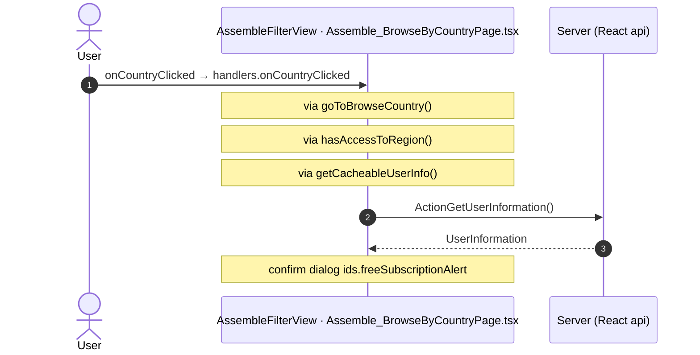

# Assemble_BrowseByCountry: OutSystems (TST) and React

The route `/UBTConnect/Assemble_BrowseByCountry`, read from the TST compiled code and from the React code by `tools/route-check/check_route.py` on 2026-11-06. Facts only, each with its place. The method is in [README.md](../README.md).

Scope of this file: the screen and the blocks of its UI flow (OutSystems), the files of `app/src/pages/Assemble_BrowseByCountry/` (React). The app shell is in [APP_SHELL.md](../APP_SHELL.md). The shared blocks and components that the route uses are in the last section.

**Live code.** TST changed 16 compiled files of this route after the capture (`migration/knowledge/tst-drift-2026-11-05.md`). The tool read the live copies in `migration/sources/runtime/` for: `Connect2_Assemble_MUI`, `js`, `Connect2_LegacyShared`, `js`, `NavigationHandler`, `OutSystemsUI_2_23`, `js`, `UBTConnect`, `js`, `js`, `UBTConnectLibrary`, `js`, `UBTConnect_Utils`, `js`, `UBT_AppManager`, `UBT_AppManager_Mobile`. The observed calls come from the capture.

## 1. Route

| Item | Value | Source |
|---|---|---|
| Route | `/UBTConnect/Assemble_BrowseByCountry` | `app/src/app/routes.generated.ts` |
| OutSystems screen | `UBTConnect.Legacy_AssembleFlow.Assemble_BrowseByCountry` | TST compiled code |
| UI flow | `Legacy_AssembleFlow` | MCP `getScreenNames` (DEV) |
| React screen | [`pages/Assemble_BrowseByCountry/Assemble_BrowseByCountryPage.tsx`](../../../app/src/pages/Assemble_BrowseByCountry/Assemble_BrowseByCountryPage.tsx) | `app/src/pages/` |
| React route rules | access `member`, lock `enforce`, flag redirect none | `app/src/app/routes.ts` |
| Screenshots | [`migration/screens/Assemble_BrowseByCountry/parity`](../../screens/Assemble_BrowseByCountry/parity) | `route.py parity` |
| Code read | OutSystems: 1 files of the UI flow, 7 shared blocks, 21 app shell files. React: 152 files in the closure of the page | TST `facts.json`, `react_calls.mjs` |

## 2. Result

| Check | Result |
|---|---|
| Server calls of the route on TST | 1: React makes 0, **0 missing**, 1 not a gap of the web app |
| Differences found | **0** (+ 1 not a gap of the web app) (see [section 3](#3-differences-found)) |
| Questions | 0 (see [section 4](#4-questions)) |
| React calls reached only through shared code | 2: see the last section |
| User actions of the route (own code) | OutSystems: 2. React: 4 |
| Screen and blocks of the UI flow with a React port | 1 of 1 |
| Navigation targets found in React | 1 of 1 |
| Shared blocks and components on the route | OutSystems 7, React 3 with user actions: see the last section |
| App shell on this route | 10 calls: see [APP_SHELL.md](../APP_SHELL.md) |

## 3. Differences found

Each line is a fact of both sides: a TST call, navigation or variable, and the React code that has it or not. The tool does not judge the behaviour.

None.

### Not a gap of the web app

Missing TST calls that a rule of `route-check/config.json` (`notApplicable`, user 2026-11-05) sets aside. The rule names the fact and its evidence; the chain is the one of the TST code.

**Declared, never run (navigation).** The navigation sits in a client action that no event, lifecycle step or action of the compiled code calls or binds (`tools/os_call_graph.py dead_client_actions`): TST cannot reach it.

- Navigation to `HomeFeed` in `CommonUI_InsideLayout.action_RedirectHome`, `CommonUI_InsideLayout.onBackNavigation_RedirectHome`.

**Telemetry (decision U17).** The call belongs to the application-event pipeline (zOnApplicationEvent_Wrapper → getAppEventName → cacheLocalApplicationEvents). Telemetry is not wired in the mock phase (decision U17). Evidence: Connect2_LegacyShared.controller.js:989-1240 (CacheLocalApplicationEvents); migration/app-shell.spec.md:349,384 (U17: no telemetry in the mock phase); app/src/lib/orbit/actions.ts:318-321.

- `Connect2_LegacyShared/ActionGetAllApplicationEvents`. Chain on TST: onClick in LocalityListDetail → event onClick_GoToBrowseCountry of LocalityListDetail → … → Connect2_LegacyShared.cacheLocalApplicationEvents → server GetAllApplicationEvents.

## 4. Questions

None.

React reaches 2 more calls without a TST chain on this route only through shared containers, components or app code. The last section lists them, not this one.

## 5. Server calls

All columns come from the code, without interpretation:

- **Direct caller (TST):** the block or module of the action that calls the server (the step before the server call in the chain).
- **Chain (TST):** the chains of client actions in the TST compiled code, from their start to the call.
  A long chain shows its first 2 steps, …, and its last 2 steps.
- **Seen on TST:** `yes` when TST made the call in the capture.
- **React action:** the React function with the `callAction` of the same call (`file:line`), and the code that loads it: `shell` (from `main.tsx`), `page` (from the screen), or both.
- **Used by (React references):** the functions and components that reference the React action, up to the nearest component. A reference is not always a call.
- **Status:** `implemented` when the contract path of the React call gives the same TST URL. It does not prove the same behaviour.

| # | Call (TST) | Kind | Direct caller (TST) | Chain (TST) | Seen on TST | React action | Used by (React references) | Status |
|---|---|---|---|---|---|---|---|---|
| 1 | `Connect2_LegacyShared/ActionGetAllApplicationEvents` | server action | `Connect2_LegacyShared` | onClick in LocalityListDetail → event onClick_GoToBrowseCountry of LocalityListDetail → … → Connect2_LegacyShared.cacheLocalApplicationEvents → server GetAllApplicationEvents | no | – | – | not applicable (telemetry) |

## 6. User actions

Two independent lists: the event bindings of the TST views, and the JSX event bindings of the React files. The effects come from the handler and the functions it calls, 3 levels deep. No mapping.

### 6.1 OutSystems (TST)

| # | Block (OutSystems) | Event (TST view) | Handler | Branch | Effects |
|---|---|---|---|---|---|
| 1 | `Assemble_BrowseByCountry` | `cancel of Filter` | `assemble_FilterCancel` | – | goes to previous screen |
| 2 | `Assemble_BrowseByCountry` | `navigateToSubdivision of Filter` | `assemble_FilterNavigateToLocality` | – | goes to AssembleEvents |

### 6.2 React

| # | File | Element | Event prop | Handler | Branch | Effects |
|---|---|---|---|---|---|---|
| [1](#621-assemblefilterview-oncountryclicked) | [`pages/Assemble_BrowseByCountry/Assemble_BrowseByCountryPage.tsx:47`](../../../app/src/pages/Assemble_BrowseByCountry/Assemble_BrowseByCountryPage.tsx#L47) | `<AssembleFilterView>` | `onCountryClicked` | `handlers.onCountryClicked` | – | calls ActionGetUserInformation; asks for a confirmation |
| 2 | [`pages/Assemble_BrowseByCountry/Assemble_BrowseByCountryPage.tsx:47`](../../../app/src/pages/Assemble_BrowseByCountry/Assemble_BrowseByCountryPage.tsx#L47) | `<AssembleFilterView>` | `onFreeSubscriptionAlert` | `handlers.onFreeSubscriptionAlert` | – | asks for a confirmation |
| 3 | [`pages/Assemble_BrowseByCountry/Assemble_BrowseByCountryPage.tsx:47`](../../../app/src/pages/Assemble_BrowseByCountry/Assemble_BrowseByCountryPage.tsx#L47) | `<AssembleFilterView>` | `onCancel` | `handlers.onCancel` | – | goes to previous screen |
| 4 | [`pages/Assemble_BrowseByCountry/Assemble_BrowseByCountryPage.tsx:47`](../../../app/src/pages/Assemble_BrowseByCountry/Assemble_BrowseByCountryPage.tsx#L47) | `<AssembleFilterView>` | `onApply` | `handlers.onApply` | – | goes to AssembleEvents |

1 diagrams (handlers with two or more effects)

#### 6.2.1 AssembleFilterView: onCountryClicked

## 7. Screen inputs and navigation parameters

The input parameters of the screen, the parameters that the route reads, and the parameters that the route gives when it opens another screen. A navigation without parameters is only in section 2.
The OutSystems files are in `migration/sources/raw/` (the route's `analysis/manifest.json` names them); the files that TST changed after the capture are read from `migration/sources/runtime/`.

### 7.1 OutSystems (TST)

Screen inputs: none. `setInputs` of `Assemble_BrowseByCountry` reads no input.

| Block | Target | Parameters | Place |
|---|---|---|---|
| `Assemble_BrowseByCountry` | `AssembleEvents` | `ShowBackNavigation` = `true` `SubdivisionId` = `inSubdivisionId` `IsUserSubdivision` = `isUserSubdivision` | [`UBTConnect.Legacy_AssembleFlow.Assemble_BrowseByCountry.mvc.js:234`](../../sources/raw/UBTConnect.Legacy_AssembleFlow.Assemble_BrowseByCountry.mvc.js#L234) |

### 7.2 React

Declared inputs of the route: none (`app/src/app/routes.generated.ts`).

Parameters read (`useSearchParams`, `useParams`): none.

| File | Target | Parameters | Place |
|---|---|---|---|
| `Assemble_BrowseByCountryPage.tsx` | `AssembleEvents` | `ShowBackNavigation` = `true` `SubdivisionId` = `subdivisionId` `IsUserSubdivision` = `isUserSubdivision` | [`pages/Assemble_BrowseByCountry/Assemble_BrowseByCountryPage.tsx:26`](../../../app/src/pages/Assemble_BrowseByCountry/Assemble_BrowseByCountryPage.tsx#L26) |

## 8. Lifecycle

What runs when the screen and its blocks open and close, without a user action.

### 8.1 OutSystems (TST)

Event handlers. The steps are the node comments and the conditions of the compiled action.

None.

Data actions and aggregates. The tool reads `dataFetchDependenciesOriginal`: `0` is a fetch when the block opens, `-1` is a fetch only on demand (a `Refresh Query` step). `Read by` lists the child block inputs, conditions, text widgets and actions that read the result.

None.

### 8.2 React

Effects (`useEffect`, `useLayoutEffect`) of the screen files, and the effects of shared components that make a call, a navigation or a message.

None.

Queries. A query fetches when its component mounts and when its key changes. `Read by` lists what reads the result in the same file.

None.

## 9. Client state

Client variables and browser storage that the route reads or writes. Other screens can read this state.

### 9.1 OutSystems (TST)

None.

### 9.2 React

None.

## 10. Access

Who can open the route, and the role checks in the screen and block code.

| Side | Rule | Place |
|---|---|---|
| OutSystems (TST) | registered users (`checkRegistered()`) | [`UBTConnect.Legacy_AssembleFlow.Assemble_BrowseByCountry.mvc.js:320`](../../sources/raw/UBTConnect.Legacy_AssembleFlow.Assemble_BrowseByCountry.mvc.js#L320) |
| React | access `member`, lock `enforce`, flag redirect none | `app/src/app/routes.ts` |

Role checks in the TST screen and block actions (`RolesInfo`, `$roles`, `Check<Role>Role`): none.

## 11. Errors

What the route does when an action or a call fails.

### 11.1 OutSystems (TST)

The actions of the screen and its blocks have no `Handle Error` node.

An error without a handler goes to the `OnException` of the UI flow (`handleError`):

1. UI flow `Legacy_AssembleFlow` not in `migration/sources/shell/`. Handled errors: none.

### 11.2 React

None.

`flow handler`: `raiseToFlowHandler` gives the error to the flow handler of the screen (`app/src/platform/feedback/flowErrors.ts`). The tool lists `.catch`, `try/catch` and `onError` that do not give the error to it.

## 12. Shared blocks and components on this route

Blocks of other UI flows and modules (OutSystems), and files outside `app/src/pages/` (React) that the route renders. Their facts belong to them, not to the route. This section gives their user actions once, without diagrams.

### OutSystems (TST)

| Block | Module | React port | User actions |
|---|---|---|---|
| `ScreenBlock_Assemble_Filter` | `Connect2_Assemble_MUI` | [`pages/Assemble_BrowseByCountry/components/AssembleFilterView.tsx`](../../../app/src/pages/Assemble_BrowseByCountry/components/AssembleFilterView.tsx), [`pages/Assemble_BrowseByCountry/hooks/assembleFilterState.ts`](../../../app/src/pages/Assemble_BrowseByCountry/hooks/assembleFilterState.ts), [`pages/Assemble_BrowseByCountry/hooks/useAssembleFilter.ts`](../../../app/src/pages/Assemble_BrowseByCountry/hooks/useAssembleFilter.ts) | 2 |
| `Layout` | `Connect2_LegacyShared` | [`components/layout/LegacyLayout/LegacyLayout.tsx`](../../../app/src/components/layout/LegacyLayout/LegacyLayout.tsx) | 0 |
| `BaseLayout_UpdatedOSUI` | `Connect2_LegacyShared` | [`components/layout/BaseLayout/BaseLayout.tsx`](../../../app/src/components/layout/BaseLayout/BaseLayout.tsx) | 0 |
| `MenuIcon__UpdatedOSUI` | `Connect2_LegacyShared` | [`components/layout/MenuIcon/MenuIcon.tsx`](../../../app/src/components/layout/MenuIcon/MenuIcon.tsx) | 1 |
| `InputWithIcon` | `OutSystemsUI_2_23` | [`components/ui/InputWithIcon/InputWithIcon.tsx`](../../../app/src/components/ui/InputWithIcon/InputWithIcon.tsx) | 0 |
| `LocalityListDetail` | `Connect2_LegacyShared` | [`components/assemble/LocalityListDetail/LocalityListDetail.tsx`](../../../app/src/components/assemble/LocalityListDetail/LocalityListDetail.tsx) | 0 |
| `Dialog_AccessRestrictedAction_Legacy` | `UBTConnect_Utils` | [`platform/feedback/dialogs/DialogAccessRestrictedActionLegacy.tsx`](../../../app/src/platform/feedback/dialogs/DialogAccessRestrictedActionLegacy.tsx) | 0 |

User actions of the shared blocks (3)

| # | Block (OutSystems) | Event (TST view) | Handler | Branch | Effects |
|---|---|---|---|---|---|
| 1 | `ScreenBlock_Assemble_Filter` | `onClick_GoToBrowseCountry of LocalityListDetail` | `handler_GoToBrowseCountry` | – | calls GetAllApplicationEvents, AppManager_SynchAppContext |
| 2 | `ScreenBlock_Assemble_Filter` | `freeSubscriptionAlert of FilterLocalityByCountry` | `handler_FreeSubscriptionAlert` | – | asks for a confirmation |
| 3 | `MenuIcon__UpdatedOSUI` | `onClick (HTML element)` | `onBack` | – | goes to previous screen |

### React

| File | User actions |
|---|---|
| [`components/assemble/AssembleLocalityFilter/AssembleLocalityFilter.tsx`](../../../app/src/components/assemble/AssembleLocalityFilter/AssembleLocalityFilter.tsx) | 1 |
| [`components/layout/CommonUiLayout/CommonUiLayout.tsx`](../../../app/src/components/layout/CommonUiLayout/CommonUiLayout.tsx) | 2 |
| [`components/layout/MenuIcon/MenuIcon.tsx`](../../../app/src/components/layout/MenuIcon/MenuIcon.tsx) | 1 |

User actions of the shared components (4)

| # | File | Element | Event prop | Handler | Branch | Effects |
|---|---|---|---|---|---|---|
| 1 | [`components/layout/MenuIcon/MenuIcon.tsx:34`](../../../app/src/components/layout/MenuIcon/MenuIcon.tsx#L34) | `
` | `onClick` | `inline` | – | goes to previous screen |
| 2 | [`components/assemble/AssembleLocalityFilter/AssembleLocalityFilter.tsx:159`](../../../app/src/components/assemble/AssembleLocalityFilter/AssembleLocalityFilter.tsx#L159) | `<OSListItem>` | `onClick` | `inline` | – | calls ActionGetUserInformation; calls the prop onFreeSubscriptionAlert(); calls the prop onSelectedSubdivision() |
| 3 | [`components/layout/CommonUiLayout/CommonUiLayout.tsx:80`](../../../app/src/components/layout/CommonUiLayout/CommonUiLayout.tsx#L80) | `<PreventBackNavigation>` | `onBackNavigationPrevented` | `redirectHome` | – | goes to HomeFeed |
| 4 | [`components/layout/CommonUiLayout/CommonUiLayout.tsx:82`](../../../app/src/components/layout/CommonUiLayout/CommonUiLayout.tsx#L82) | `<BackNavigationHandler>` | `onBackNavigation` | `maybeRedirectHome` | – | goes to HomeFeed |

### React calls reached only through shared code

Calls that React can make on this route, without a TST chain on this route. Every reference chain starts in a shared container, component or app code (`containers/`, `components/`, `platform/`, `legacy/`, `lib/`), not in the screen files. TST makes these calls on a user action of the shared block, which the capture did not record, or on another screen.

| Call | React action | Reached through |
|---|---|---|
| `/api/Connect2_LegacyShared/ActionGetLocalityInformation` | `fetchLocalityInformation()` [`api/locality/repository.ts:173`](../../../app/src/api/locality/repository.ts#L173) | `AssembleSubdivisionFilter` [`components/assemble/AssembleSubdivisionFilter/AssembleSubdivisionFilter.tsx`](../../../app/src/components/assemble/AssembleSubdivisionFilter/AssembleSubdivisionFilter.tsx) |
| `/api/Connect2_LegacyShared/ActionGetUserLocalitiesForCountryCodeWithGPS` | `fetchCountryLocalities()` [`api/country/repository.ts:74`](../../../app/src/api/country/repository.ts#L74) | `AssembleLocalityFilter` [`components/assemble/AssembleLocalityFilter/AssembleLocalityFilter.tsx`](../../../app/src/components/assemble/AssembleLocalityFilter/AssembleLocalityFilter.tsx) |
