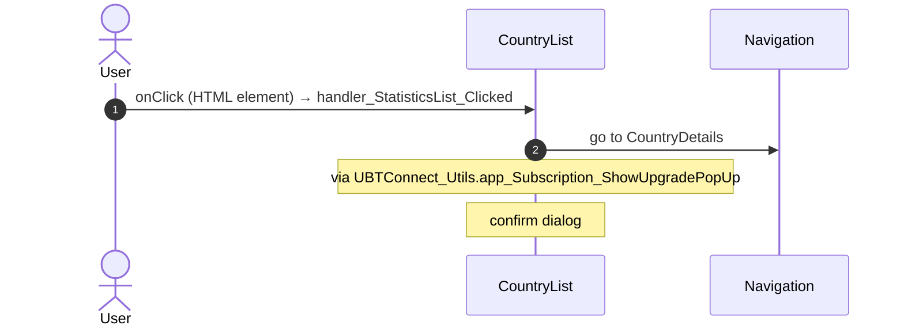
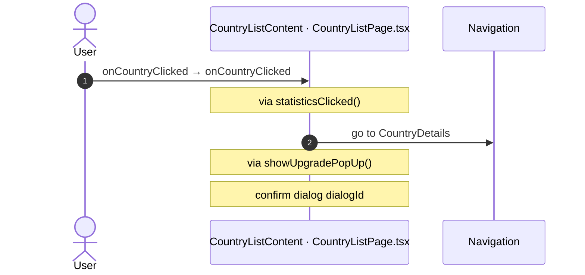
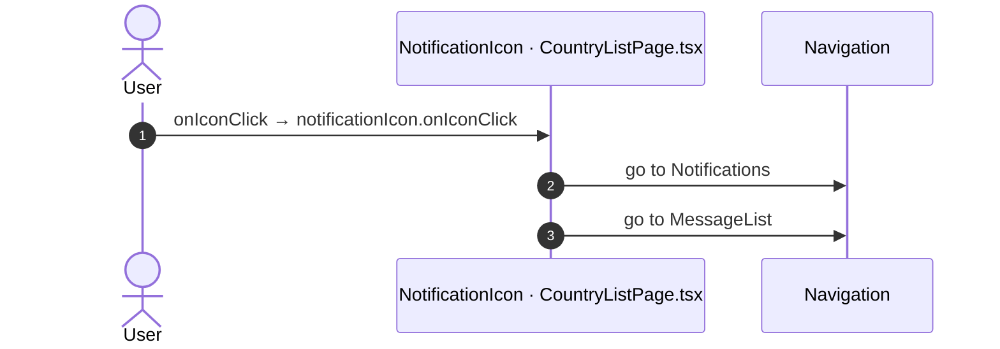
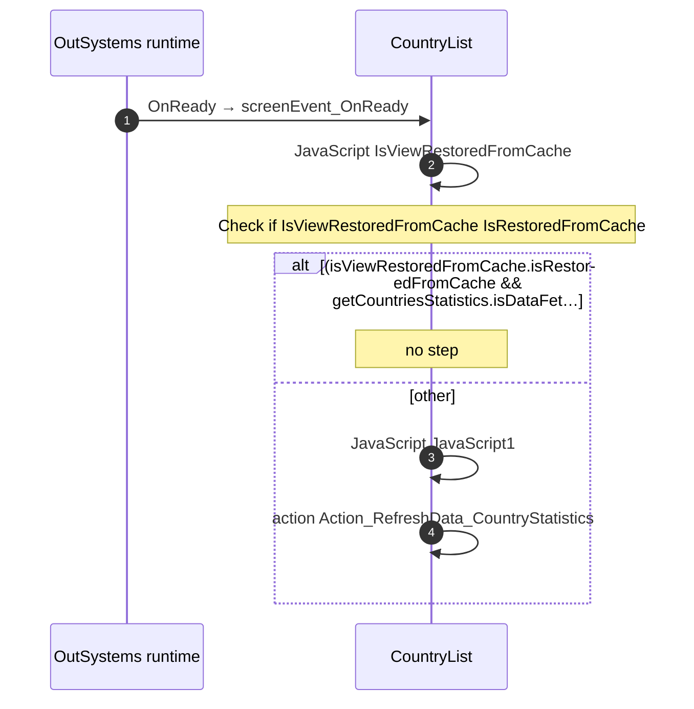

# CountryList: OutSystems (TST) and React

The route `/UBTConnect/CountryList`, read from the TST compiled code and from the React code by `tools/route-check/check_route.py` on 2026-11-06. Facts only, each with its place. The method is in [README.md](../README.md).

Scope of this file: the screen and the blocks of its UI flow (OutSystems), the files of `app/src/pages/CountryList/` (React). The app shell is in [APP_SHELL.md](../APP_SHELL.md). The shared blocks and components that the route uses are in the last section.

**Live code.** TST changed 16 compiled files of this route after the capture (`migration/knowledge/tst-drift-2026-11-05.md`). The tool read the live copies in `migration/sources/runtime/` for: `Connect2_LegacyShared`, `js`, `NavigationHandler`, `OutSystemsUI_2_23`, `js`, `CountryList`, `UBTConnect`, `js`, `js`, `UBTConnectLibrary`, `js`, `CacheControl_UserInfo`, `UBTConnect_Utils`, `js`, `UBT_AppManager`, `UBT_AppManager_Mobile`. The observed calls come from the capture.

## 1. Route

| Item | Value | Source |
|---|---|---|
| Route | `/UBTConnect/CountryList` | `app/src/app/routes.generated.ts` |
| OutSystems screen | `UBTConnect.Directory_Locality.CountryList` | TST compiled code |
| UI flow | `Directory_Locality` | MCP `getScreenNames` (DEV) |
| React screen | [`pages/CountryList/CountryListPage.tsx`](../../../app/src/pages/CountryList/CountryListPage.tsx) | `app/src/pages/` |
| React route rules | access `member`, lock `enforce`, flag redirect none | `app/src/app/routes.ts` |
| Screenshots | [`migration/screens/CountryList/parity`](../../screens/CountryList/parity) | `route.py parity` |
| Code read | OutSystems: 4 files of the UI flow, 22 shared blocks, 28 app shell files. React: 165 files in the closure of the page | TST `facts.json`, `react_calls.mjs` |

## 2. Result

| Check | Result |
|---|---|
| Server calls of the route on TST | 5: React makes 5, **0 missing** |
| Differences found | **0** (see [section 3](#3-differences-found)) |
| Questions | 0 (see [section 4](#4-questions)) |
| React calls reached only through shared code | 1: see the last section |
| User actions of the route (own code) | OutSystems: 4. React: 6 |
| Screen and blocks of the UI flow with a React port | 4 of 4 |
| Navigation targets found in React | 10 of 10 |
| Shared blocks and components on the route | OutSystems 22, React 3 with user actions: see the last section |
| App shell on this route | 7 calls: see [APP_SHELL.md](../APP_SHELL.md) |

## 3. Differences found

Each line is a fact of both sides: a TST call, navigation or variable, and the React code that has it or not. The tool does not judge the behaviour.

None.

## 4. Questions

None.

React reaches 1 more call without a TST chain on this route only through shared containers, components or app code. The last section lists it, not this one.

## 5. Server calls

All columns come from the code, without interpretation:

- **Direct caller (TST):** the block or module of the action that calls the server (the step before the server call in the chain).
- **Chain (TST):** the chains of client actions in the TST compiled code, from their start to the call.
  A long chain shows its first 2 steps, …, and its last 2 steps.
- **Seen on TST:** `yes` when TST made the call in the capture.
- **React action:** the React function with the `callAction` of the same call (`file:line`), and the code that loads it: `shell` (from `main.tsx`), `page` (from the screen), or both.
- **Used by (React references):** the functions and components that reference the React action, up to the nearest component. A reference is not always a call.
- **Status:** `implemented` when the contract path of the React call gives the same TST URL. It does not prove the same behaviour.

| # | Call (TST) | Kind | Direct caller (TST) | Chain (TST) | Seen on TST | React action | Used by (React references) | Status |
|---|---|---|---|---|---|---|---|---|
| 1 | `UBTConnect_Utils/CacheControl/CacheControl_UserInfo/DataActionGetCacheInfo` | data action | `CacheControl_UserInfo` | CacheControl.OnInitialize → CacheControl.onInitialize → event onNonCacheHit of CacheControl → CacheControl_UserInfo.cacheControlOnNonCacheHit → CacheControl_UserInfo.DataActionGetCacheInfo CacheControl_UserInfo fetch at start → CacheControl_UserInfo.DataActionGetCacheInfo | yes | `UserInfoCacheControl()` [`legacy/os/cache/UserInfoCacheControl/UserInfoCacheControl.tsx:37`](../../../app/src/legacy/os/cache/UserInfoCacheControl/UserInfoCacheControl.tsx#L37) (page) | `CountryList → UserInfoCache → UserInfoCacheControl` [`pages/CountryList/CountryListPage.tsx`](../../../app/src/pages/CountryList/CountryListPage.tsx) | implemented |
| 2 | `UBTConnect/Directory_Locality/CountryList/DataActionGetCommunityStatistics` | data action | `CountryList` | CountryList.action_RefreshData_CommunityStatistics → CountryList.DataActionGetCommunityStatistics CountryList fetch at start → CountryList.DataActionGetCommunityStatistics | yes | `fetchCountryListCommunityStatistics()` [`api/country/repository.ts:43`](../../../app/src/api/country/repository.ts#L43) (page) | `CountryList → useCountryList → fetchCountryListCommunityStatistics` [`pages/CountryList/CountryListPage.tsx`](../../../app/src/pages/CountryList/CountryListPage.tsx) | implemented |
| 3 | `UBTConnect/Directory_Locality/CountryList/DataActionGetCountriesStatistics` | data action | `CountryList` | CountryList.OnReady → CountryList.screenEvent_OnReady → CountryList.action_RefreshData_CountryStatistics → CountryList.DataActionGetCountriesStatistics CountryList fetch at start → CountryList.DataActionGetCountriesStatistics | yes | `fetchCountryListStatistics()` [`api/country/repository.ts:36`](../../../app/src/api/country/repository.ts#L36) (page) | `CountryList → useCountryList → fetchCountryListStatistics` [`pages/CountryList/CountryListPage.tsx`](../../../app/src/pages/CountryList/CountryListPage.tsx) | implemented |
| 4 | `UBTConnect/Home/FeedBlock_CommunityPopulation/DataActionFetchCount` | data action | `FeedBlock_CommunityPopulation` | FeedBlock_CommunityPopulation fetch at start → FeedBlock_CommunityPopulation.DataActionFetchCount | yes | `fetchCommunityPopulation()` [`api/member/repository.ts:25`](../../../app/src/api/member/repository.ts#L25) (page) | `CountryList → useCommunityPopulationQuery → fetchCommunityPopulation` [`pages/CountryList/CountryListPage.tsx`](../../../app/src/pages/CountryList/CountryListPage.tsx) | implemented |
| 5 | `UBTConnect/ServiceAPIGet_UI_UpdateItems_UnreadCount_All` | service action | `UBTConnect` | BottomBarMenu.OnReady → BottomBarMenu.onReady → UBTConnect.directory_Updates_RefreshBottomBarCount → server Get_UI_UpdateItems_UnreadCount_All | no | `fetchUnreadUpdateItemsCount()` [`api/update/repository.ts:73`](../../../app/src/api/update/repository.ts#L73) (page) | `BottomBar → directory_Updates_RefreshBottomBarCount → fetchUnreadUpdateItemsCount` [`components/layout/BottomBar/BottomBar.tsx`](../../../app/src/components/layout/BottomBar/BottomBar.tsx) | implemented |

## 6. User actions

Two independent lists: the event bindings of the TST views, and the JSX event bindings of the React files. The effects come from the handler and the functions it calls, 3 levels deep. No mapping.

### 6.1 OutSystems (TST)

| # | Block (OutSystems) | Event (TST view) | Handler | Branch | Effects |
|---|---|---|---|---|---|
| 1 | `CountryList` | `click_Input of StaticInput` | `staticInputClick_Input` | – | goes to Search |
| 2 | `CountryList` | `clicked of CustomContainer` | `onClick_MyLocality` | – | goes to Locality_Details |
| 3 | `CountryList` | `clicked of CustomContainer` | `onClick_MyCountry` | – | goes to CountryDetails |
| [4](#614-countrylist-handler_statisticslist_clicked) | `CountryList` | `onClick (HTML element)` | `handler_StatisticsList_Clicked` | – | goes to CountryDetails; asks for a confirmation |

1 diagrams (handlers with two or more effects)

#### 6.1.4 CountryList: handler_StatisticsList_Clicked

### 6.2 React

| # | File | Element | Event prop | Handler | Branch | Effects |
|---|---|---|---|---|---|---|
| 1 | [`pages/CountryList/CountryListPage.tsx:45`](../../../app/src/pages/CountryList/CountryListPage.tsx#L45) | `<StaticInput>` | `onClickInput` | `onSearchClicked` | – | goes to Search |
| 2 | [`pages/CountryList/CountryListPage.tsx:55`](../../../app/src/pages/CountryList/CountryListPage.tsx#L55) | `<CountryListContent>` | `onMyLocalityClicked` | `onMyLocalityClicked` | – | goes to Locality_Details |
| 3 | [`pages/CountryList/CountryListPage.tsx:56`](../../../app/src/pages/CountryList/CountryListPage.tsx#L56) | `<CountryListContent>` | `onMyCountryClicked` | `onMyCountryClicked` | – | goes to CountryDetails |
| 4 | [`pages/CountryList/CountryListPage.tsx:57`](../../../app/src/pages/CountryList/CountryListPage.tsx#L57) | `<CountryListContent>` | `onCommunityPopulationClicked` | `onCommunityPopulationClicked` | – | goes to Updates_SingleList |
| [5](#625-countrylistcontent-oncountryclicked) | [`pages/CountryList/CountryListPage.tsx:59`](../../../app/src/pages/CountryList/CountryListPage.tsx#L59) | `<CountryListContent>` | `onCountryClicked` | `onCountryClicked` | – | goes to CountryDetails; asks for a confirmation |
| [6](#626-notificationicon-oniconclick) | [`pages/CountryList/CountryListPage.tsx:43`](../../../app/src/pages/CountryList/CountryListPage.tsx#L43) | `<NotificationIcon>` | `onIconClick` | `notificationIcon.onIconClick` | – | goes to Notifications, MessageList |

2 diagrams (handlers with two or more effects)

#### 6.2.5 CountryListContent: onCountryClicked

#### 6.2.6 NotificationIcon: onIconClick

## 7. Screen inputs and navigation parameters

The input parameters of the screen, the parameters that the route reads, and the parameters that the route gives when it opens another screen. A navigation without parameters is only in section 2.
The OutSystems files are in `migration/sources/raw/` (the route's `analysis/manifest.json` names them); the files that TST changed after the capture are read from `migration/sources/runtime/`.

### 7.1 OutSystems (TST)

Screen inputs: none. `setInputs` of `CountryList` reads no input.

| Block | Target | Parameters | Place |
|---|---|---|---|
| `CountryList` | `CountryDetails` | `CountryCode` = `event_Id` | [`UBTConnect.Directory_Locality.CountryList.mvc.js:1371`](../../sources/runtime/UBTConnect.Directory_Locality.CountryList.mvc.js#L1371) |
| `CountryList` | `CountryDetails` | `CountryCode` = `localCacheControl_UserInformation.directory_UserCurrent.directory_UserCurrent_Geography.co…` | [`UBTConnect.Directory_Locality.CountryList.mvc.js:1518`](../../sources/runtime/UBTConnect.Directory_Locality.CountryList.mvc.js#L1518) |
| `CountryList` | `Locality_Details` | `LocalityId` = `localCacheControl_UserInformation.directory_UserCurrent.directory_UserCurrent_Geography.lo…` `PreloadedLocalityLabel` = `localCacheControl_UserInformation.directory_UserCurrent.directory_UserCurrent_Geography.lo…` | [`UBTConnect.Directory_Locality.CountryList.mvc.js:1543`](../../sources/runtime/UBTConnect.Directory_Locality.CountryList.mvc.js#L1543) |

### 7.2 React

Declared inputs of the route: none (`app/src/app/routes.generated.ts`).

Parameters read (`useSearchParams`, `useParams`): none.

| File | Target | Parameters | Place |
|---|---|---|---|
| `useCountryList.ts` | `CountryDetails` | `CountryCode` = `eventId` | [`pages/CountryList/hooks/useCountryList.ts:129`](../../../app/src/pages/CountryList/hooks/useCountryList.ts#L129) |
| `useCountryList.ts` | `Locality_Details` | `LocalityId` = `state.user.localityId` `PreloadedLocalityLabel` = `state.user.localityName` | [`pages/CountryList/hooks/useCountryList.ts:139`](../../../app/src/pages/CountryList/hooks/useCountryList.ts#L139) |
| `useCountryList.ts` | `CountryDetails` | `CountryCode` = `state.user.countryCode` | [`pages/CountryList/hooks/useCountryList.ts:145`](../../../app/src/pages/CountryList/hooks/useCountryList.ts#L145) |

## 8. Lifecycle

What runs when the screen and its blocks open and close, without a user action.

### 8.1 OutSystems (TST)

Event handlers. The steps are the node comments and the conditions of the compiled action.

| Block | Event | Action | Steps |
|---|---|---|---|
| `CountryList` | OnReady ([`UBTConnect.Directory_Locality.CountryList.mvc.js:1780`](../../sources/runtime/UBTConnect.Directory_Locality.CountryList.mvc.js#L1780)) | `screenEvent_OnReady` | 1. JavaScript: IsViewRestoredFromCache ([`L1296`](../../sources/runtime/UBTConnect.Directory_Locality.CountryList.mvc.js#L1296)) 2. Check if IsViewRestoredFromCache IsRestoredFromCache ([`L1303`](../../sources/runtime/UBTConnect.Directory_Locality.CountryList.mvc.js#L1303)) 3. If (isViewRestoredFromCache.isRestoredFromCache && getCountriesStatistics.isDataFetched) ([`L1305`](../../sources/runtime/UBTConnect.Directory_Locality.CountryList.mvc.js#L1305)) 4. Else ([`L1307`](../../sources/runtime/UBTConnect.Directory_Locality.CountryList.mvc.js#L1307)) 5. JavaScript: JavaScript1 ([`L1309`](../../sources/runtime/UBTConnect.Directory_Locality.CountryList.mvc.js#L1309)) 6. Execute Action: Action_RefreshData_CountryStatistics ([`L1314`](../../sources/runtime/UBTConnect.Directory_Locality.CountryList.mvc.js#L1314)) |

Sequence diagrams of the screen event handlers (1)

The diagram keeps the order of the steps in the compiled action. The code does not give the order of the handlers of different blocks.

#### 8.1.1 CountryList: OnReady

Data actions and aggregates. The tool reads `dataFetchDependenciesOriginal`: `0` is a fetch when the block opens, `-1` is a fetch only on demand (a `Refresh Query` step). `Read by` lists the child block inputs, conditions, text widgets and actions that read the result.

| Block | Data action | Fetch | Read by | Place |
|---|---|---|---|---|
| `CountryList` | `GetCommunityStatistics` | on demand (`-1`) | `CommunityNumbers.In_IsLoading` ([`UBTConnect.Directory_Locality.CountryList.mvc.js:776`](../../sources/runtime/UBTConnect.Directory_Locality.CountryList.mvc.js#L776)), `CommunityNumbers.In_CommunityStatistics` ([`UBTConnect.Directory_Locality.CountryList.mvc.js:777`](../../sources/runtime/UBTConnect.Directory_Locality.CountryList.mvc.js#L777)), `view` ([`UBTConnect.Directory_Locality.CountryList.mvc.js:778`](../../sources/runtime/UBTConnect.Directory_Locality.CountryList.mvc.js#L778)), `text` ([`UBTConnect.Directory_Locality.CountryList.mvc.js:798`](../../sources/runtime/UBTConnect.Directory_Locality.CountryList.mvc.js#L798)) | [`UBTConnect.Directory_Locality.CountryList.mvc.js:1174`](../../sources/runtime/UBTConnect.Directory_Locality.CountryList.mvc.js#L1174) |
| `CountryList` | `GetCountriesStatistics` | on demand (`-1`) | `SkeletonSection.In_IsLoading` ([`UBTConnect.Directory_Locality.CountryList.mvc.js:932`](../../sources/runtime/UBTConnect.Directory_Locality.CountryList.mvc.js#L932)), `SkeletonSection.source` ([`UBTConnect.Directory_Locality.CountryList.mvc.js:956`](../../sources/runtime/UBTConnect.Directory_Locality.CountryList.mvc.js#L956)), `view` ([`UBTConnect.Directory_Locality.CountryList.mvc.js:964`](../../sources/runtime/UBTConnect.Directory_Locality.CountryList.mvc.js#L964)), `text` ([`UBTConnect.Directory_Locality.CountryList.mvc.js:993`](../../sources/runtime/UBTConnect.Directory_Locality.CountryList.mvc.js#L993)), `Statistics_TypedItem.In_HasImage` ([`UBTConnect.Directory_Locality.CountryList.mvc.js:996`](../../sources/runtime/UBTConnect.Directory_Locality.CountryList.mvc.js#L996)), `action onAfterFetch_GetCountriesStatistics` ([`UBTConnect.Directory_Locality.CountryList.mvc.js:1254`](../../sources/runtime/UBTConnect.Directory_Locality.CountryList.mvc.js#L1254)), `action screenEvent_OnReady` ([`UBTConnect.Directory_Locality.CountryList.mvc.js:1305`](../../sources/runtime/UBTConnect.Directory_Locality.CountryList.mvc.js#L1305)), `action action_RefreshData_CountryStatistics` ([`UBTConnect.Directory_Locality.CountryList.mvc.js:1437`](../../sources/runtime/UBTConnect.Directory_Locality.CountryList.mvc.js#L1437)) | [`UBTConnect.Directory_Locality.CountryList.mvc.js:1175`](../../sources/runtime/UBTConnect.Directory_Locality.CountryList.mvc.js#L1175) |

### 8.2 React

Effects (`useEffect`, `useLayoutEffect`) of the screen files, and the effects of shared components that make a call, a navigation or a message.

None.

Queries. A query fetches when its component mounts and when its key changes. `Read by` lists what reads the result in the same file.

| File | Hook (function) | Calls | Read by | Place |
|---|---|---|---|---|
| `CountryListPage.tsx` | `useCommunityPopulationQuery` (`CountryList`) | `/api/UBTConnect/FeedBlock_CommunityPopulation/DataActionFetchCount` | `CountryListContent.isCommunityPopulationLoading` ([`L53`](../../../app/src/pages/CountryList/CountryListPage.tsx#L53)), `CountryListContent.communityPopulationTotal` ([`L54`](../../../app/src/pages/CountryList/CountryListPage.tsx#L54)) | [`pages/CountryList/CountryListPage.tsx:23`](../../../app/src/pages/CountryList/CountryListPage.tsx#L23) |

## 9. Client state

Client variables and browser storage that the route reads or writes. Other screens can read this state.

### 9.1 OutSystems (TST)

None.

### 9.2 React

None.

## 10. Access

Who can open the route, and the role checks in the screen and block code.

| Side | Rule | Place |
|---|---|---|
| OutSystems (TST) | registered users (`checkRegistered()`) | [`UBTConnect.Directory_Locality.CountryList.mvc.js:1804`](../../sources/runtime/UBTConnect.Directory_Locality.CountryList.mvc.js#L1804) |
| React | access `member`, lock `enforce`, flag redirect none | `app/src/app/routes.ts` |

Role checks in the TST screen and block actions (`RolesInfo`, `$roles`, `Check<Role>Role`): none.

## 11. Errors

What the route does when an action or a call fails.

### 11.1 OutSystems (TST)

| Block | Action | Error | Steps of the handler |
|---|---|---|---|
| `CountryList` | `action_RefreshData_CountryStatistics` | `CommunicationException` ([`UBTConnect.Directory_Locality.CountryList.mvc.js:1447`](../../sources/runtime/UBTConnect.Directory_Locality.CountryList.mvc.js#L1447)) | 1. Execute Action: ListClear2 ([`L1455`](../../sources/runtime/UBTConnect.Directory_Locality.CountryList.mvc.js#L1455)) 2. Raise Error: BubbleCommunicationException ([`L1458`](../../sources/runtime/UBTConnect.Directory_Locality.CountryList.mvc.js#L1458)) |
| `CountryList` | `action_RefreshData_CountryStatistics` | `NotRegistered` ([`UBTConnect.Directory_Locality.CountryList.mvc.js:1463`](../../sources/runtime/UBTConnect.Directory_Locality.CountryList.mvc.js#L1463)) | 1. Raise Error: NotRegistered ([`L1471`](../../sources/runtime/UBTConnect.Directory_Locality.CountryList.mvc.js#L1471)) |
| `CountryList` | `action_RefreshData_CountryStatistics` | `AllExceptions` ([`UBTConnect.Directory_Locality.CountryList.mvc.js:1476`](../../sources/runtime/UBTConnect.Directory_Locality.CountryList.mvc.js#L1476)) | 1. Execute Action: ListClear ([`L1484`](../../sources/runtime/UBTConnect.Directory_Locality.CountryList.mvc.js#L1484)) 2. Raise Error: BubbleGenericException ([`L1487`](../../sources/runtime/UBTConnect.Directory_Locality.CountryList.mvc.js#L1487)) |

An error without a handler goes to the `OnException` of the UI flow (`handleError`):

1. UI flow `Directory_Locality` not in `migration/sources/shell/`. Handled errors: none.

### 11.2 React

| File | Kind | Function | Effects | Place |
|---|---|---|---|---|
| `useCountryList.ts` | try/catch | `refreshData` | none | [`pages/CountryList/hooks/useCountryList.ts:84`](../../../app/src/pages/CountryList/hooks/useCountryList.ts#L84) |
| `useCountryList.ts` | try/catch | `refreshData` | none | [`pages/CountryList/hooks/useCountryList.ts:95`](../../../app/src/pages/CountryList/hooks/useCountryList.ts#L95) |

`flow handler`: `raiseToFlowHandler` gives the error to the flow handler of the screen (`app/src/platform/feedback/flowErrors.ts`). The tool lists `.catch`, `try/catch` and `onError` that do not give the error to it.

## 12. Shared blocks and components on this route

Blocks of other UI flows and modules (OutSystems), and files outside `app/src/pages/` (React) that the route renders. Their facts belong to them, not to the route. This section gives their user actions once, without diagrams.

### OutSystems (TST)

| Block | Module | React port | User actions |
|---|---|---|---|
| `Layout_MainPages` | `UBTConnectLibrary` | [`components/layout/MainLayout/MainLayout.tsx`](../../../app/src/components/layout/MainLayout/MainLayout.tsx) | 0 |
| `App_NotificationIcon` | `UBTConnect` | [`components/notification/NotificationIcon/NotificationIcon.tsx`](../../../app/src/components/notification/NotificationIcon/NotificationIcon.tsx), [`platform/session/useNotificationIcon.ts`](../../../app/src/platform/session/useNotificationIcon.ts) | 1 |
| `App_IconBadge` | `UBTConnect` | [`components/layout/BottomBarIconBadge/BottomBarIconBadge.tsx`](../../../app/src/components/layout/BottomBarIconBadge/BottomBarIconBadge.tsx) | 0 |
| `IconBadge` | `UBTConnectLibrary` | [`components/ui/IconBadge/IconBadge.tsx`](../../../app/src/components/ui/IconBadge/IconBadge.tsx) | 0 |
| `Badge` | `UBTConnectLibrary` | [`components/ui/Badge/Badge.tsx`](../../../app/src/components/ui/Badge/Badge.tsx) | 0 |
| `App_NotificationRefresh` | `UBTConnect` | [`components/notification/NotificationRefresh/NotificationRefresh.tsx`](../../../app/src/components/notification/NotificationRefresh/NotificationRefresh.tsx) | 0 |
| `StaticInput` | `UBTConnectLibrary` | [`components/ui/StaticInput/StaticInput.tsx`](../../../app/src/components/ui/StaticInput/StaticInput.tsx) | 0 |
| `TextEllipsis` | `UBTConnectLibrary` | [`components/ui/TextEllipsis/TextEllipsis.tsx`](../../../app/src/components/ui/TextEllipsis/TextEllipsis.tsx) | 0 |
| `UBT_LazyImage` | `UBTConnect_Utils` | [`components/ui/EntityLazyImage/EntityLazyImage.tsx`](../../../app/src/components/ui/EntityLazyImage/EntityLazyImage.tsx) | 0 |
| `LazyImage` | `UBTConnectLibrary` | [`components/ui/LazyImage/LazyImage.tsx`](../../../app/src/components/ui/LazyImage/LazyImage.tsx) | 0 |
| `FeedBlock_CommunityPopulation` | `UBTConnect` | [`components/feed/CommunityPopulation/CommunityPopulation.tsx`](../../../app/src/components/feed/CommunityPopulation/CommunityPopulation.tsx) | 1 |
| `Columns_Three` | `UBTConnectLibrary` | [`components/ui/ColumnsThree/ColumnsThree.tsx`](../../../app/src/components/ui/ColumnsThree/ColumnsThree.tsx) | 0 |
| `Columns3` | `OutSystemsUI_2_23` | [`components/ui/Columns3/Columns3.tsx`](../../../app/src/components/ui/Columns3/Columns3.tsx) | 0 |
| `IconText` | `UBTConnectLibrary` | [`components/ui/IconText/IconText.tsx`](../../../app/src/components/ui/IconText/IconText.tsx) | 0 |
| `BottomBarMenu` | `UBTConnect` | [`components/layout/BottomBar/BottomBar.tsx`](../../../app/src/components/layout/BottomBar/BottomBar.tsx) | 1 |
| `BottomBarContent` | `UBTConnect` | [`components/layout/BottomBarContent/BottomBarContent.tsx`](../../../app/src/components/layout/BottomBarContent/BottomBarContent.tsx) | 0 |
| `BottomBarItem` | `OutSystemsUI_2_23` | [`components/ui/BottomBarItem/BottomBarItem.tsx`](../../../app/src/components/ui/BottomBarItem/BottomBarItem.tsx) | 0 |
| `CacheControl_UserInfo_Wrapper` | `UBTConnect` | [`platform/session/UserInfoCache/UserInfoCache.tsx`](../../../app/src/platform/session/UserInfoCache/UserInfoCache.tsx) | 0 |
| `CacheControl_UserInfo` | `UBTConnect_Utils` | [`legacy/os/cache/UserInfoCacheControl/UserInfoCacheControl.tsx`](../../../app/src/legacy/os/cache/UserInfoCacheControl/UserInfoCacheControl.tsx) | 0 |
| `CacheControl` | `UBTConnect_Utils` | [`legacy/os/cache/CacheControl/CacheControl.tsx`](../../../app/src/legacy/os/cache/CacheControl/CacheControl.tsx) | 0 |
| `BottomSheet` | `UBTConnectLibrary` | [`components/ui/ConnectBottomSheet/ConnectBottomSheet.tsx`](../../../app/src/components/ui/ConnectBottomSheet/ConnectBottomSheet.tsx) | 0 |
| `BottomSheet` | `OutSystemsUI_2_23` | [`components/ui/BottomSheet/BottomSheet.tsx`](../../../app/src/components/ui/BottomSheet/BottomSheet.tsx) | 0 |

User actions of the shared blocks (7)

| # | Block (OutSystems) | Event (TST view) | Handler | Branch | Effects |
|---|---|---|---|---|---|
| 1 | `BottomBarMenu` | `onClick (HTML element)` `onClick of IconBadge` | `event_BottomBar_Clicked` | `home` | goes to HomeFeed |
| 2 | `BottomBarMenu` | `onClick (HTML element)` `onClick of IconBadge` | `event_BottomBar_Clicked` | `directory` | goes to CountryList, Locality_Details |
| 3 | `BottomBarMenu` | `onClick (HTML element)` `onClick of IconBadge` | `event_BottomBar_Clicked` | `updates` | goes to Updates_SingleList |
| 4 | `BottomBarMenu` | `onClick (HTML element)` `onClick of IconBadge` | `event_BottomBar_Clicked` | `bookmarks` | goes to Bookmarks |
| 5 | `BottomBarMenu` | `onClick (HTML element)` `onClick of IconBadge` | `event_BottomBar_Clicked` | `menu` | goes to Menu |
| 6 | `App_NotificationIcon` | `onClick of IconBadge` | `iconClick` | – | goes to Notifications, MessageList |
| 7 | `FeedBlock_CommunityPopulation` | `clicked of CustomContainer` | `onClick_Block` | – | goes to Updates_SingleList |

### React

| File | User actions |
|---|---|
| [`components/layout/BottomBar/BottomBar.tsx`](../../../app/src/components/layout/BottomBar/BottomBar.tsx) | 2 |
| [`components/layout/CommonUiLayout/CommonUiLayout.tsx`](../../../app/src/components/layout/CommonUiLayout/CommonUiLayout.tsx) | 2 |
| [`legacy/os/cache/UserInfoCacheControl/UserInfoCacheControl.tsx`](../../../app/src/legacy/os/cache/UserInfoCacheControl/UserInfoCacheControl.tsx) | 1 |

User actions of the shared components (15)

| # | File | Element | Event prop | Handler | Branch | Effects |
|---|---|---|---|---|---|---|
| 1 | [`legacy/os/cache/UserInfoCacheControl/UserInfoCacheControl.tsx:52`](../../../app/src/legacy/os/cache/UserInfoCacheControl/UserInfoCacheControl.tsx#L52) | `<CacheControl>` | `onNonCacheHit` | `onNonCacheHit` | – | calls DataActionGetCacheInfo |
| 2 | [`components/layout/CommonUiLayout/CommonUiLayout.tsx:80`](../../../app/src/components/layout/CommonUiLayout/CommonUiLayout.tsx#L80) | `<PreventBackNavigation>` | `onBackNavigationPrevented` | `redirectHome` | – | goes to HomeFeed |
| 3 | [`components/layout/CommonUiLayout/CommonUiLayout.tsx:82`](../../../app/src/components/layout/CommonUiLayout/CommonUiLayout.tsx#L82) | `<BackNavigationHandler>` | `onBackNavigation` | `maybeRedirectHome` | – | goes to HomeFeed |
| 4 | [`components/layout/BottomBar/BottomBar.tsx:130`](../../../app/src/components/layout/BottomBar/BottomBar.tsx#L130) | `<OSLink>` | `onClick` | `click` | `Home` | goes to HomeFeed |
| 5 | [`components/layout/BottomBar/BottomBar.tsx:130`](../../../app/src/components/layout/BottomBar/BottomBar.tsx#L130) | `<OSLink>` | `onClick` | `click` | `Directory` | goes to CountryList, Locality_Details |
| 6 | [`components/layout/BottomBar/BottomBar.tsx:130`](../../../app/src/components/layout/BottomBar/BottomBar.tsx#L130) | `<OSLink>` | `onClick` | `click` | `Updates` | goes to Updates_SingleList |
| 7 | [`components/layout/BottomBar/BottomBar.tsx:130`](../../../app/src/components/layout/BottomBar/BottomBar.tsx#L130) | `<OSLink>` | `onClick` | `click` | `Bookmarks` | goes to Bookmarks |
| 8 | [`components/layout/BottomBar/BottomBar.tsx:130`](../../../app/src/components/layout/BottomBar/BottomBar.tsx#L130) | `<OSLink>` | `onClick` | `click` | `Menu` | goes to Menu |
| 9 | [`components/layout/BottomBar/BottomBar.tsx:130`](../../../app/src/components/layout/BottomBar/BottomBar.tsx#L130) | `<OSLink>` | `onClick` | `click` | `other` | calls the prop onBottomBarClicked() |
| 10 | [`components/layout/BottomBar/BottomBar.tsx:140`](../../../app/src/components/layout/BottomBar/BottomBar.tsx#L140) | `<BottomBarIconBadge>` | `onOnClick` | `click` | `Home` | goes to HomeFeed |
| 11 | [`components/layout/BottomBar/BottomBar.tsx:140`](../../../app/src/components/layout/BottomBar/BottomBar.tsx#L140) | `<BottomBarIconBadge>` | `onOnClick` | `click` | `Directory` | goes to CountryList, Locality_Details |
| 12 | [`components/layout/BottomBar/BottomBar.tsx:140`](../../../app/src/components/layout/BottomBar/BottomBar.tsx#L140) | `<BottomBarIconBadge>` | `onOnClick` | `click` | `Updates` | goes to Updates_SingleList |
| 13 | [`components/layout/BottomBar/BottomBar.tsx:140`](../../../app/src/components/layout/BottomBar/BottomBar.tsx#L140) | `<BottomBarIconBadge>` | `onOnClick` | `click` | `Bookmarks` | goes to Bookmarks |
| 14 | [`components/layout/BottomBar/BottomBar.tsx:140`](../../../app/src/components/layout/BottomBar/BottomBar.tsx#L140) | `<BottomBarIconBadge>` | `onOnClick` | `click` | `Menu` | goes to Menu |
| 15 | [`components/layout/BottomBar/BottomBar.tsx:140`](../../../app/src/components/layout/BottomBar/BottomBar.tsx#L140) | `<BottomBarIconBadge>` | `onOnClick` | `click` | `other` | calls the prop onBottomBarClicked() |

### React calls reached only through shared code

Calls that React can make on this route, without a TST chain on this route. Every reference chain starts in a shared container, component or app code (`containers/`, `components/`, `platform/`, `legacy/`, `lib/`), not in the screen files. TST makes these calls on a user action of the shared block, which the capture did not record, or on another screen.

| Call | React action | Reached through |
|---|---|---|
| `/api/UBTConnect_Utils/ActionGetSignedImagesInBulk` | `cache_SignedImageURL_GetCallback()` [`lib/ubtConnectUtils/actions.ts:131`](../../../app/src/lib/ubtConnectUtils/actions.ts#L131) | `EntityLazyImage` [`components/ui/EntityLazyImage/EntityLazyImage.tsx`](../../../app/src/components/ui/EntityLazyImage/EntityLazyImage.tsx) |
