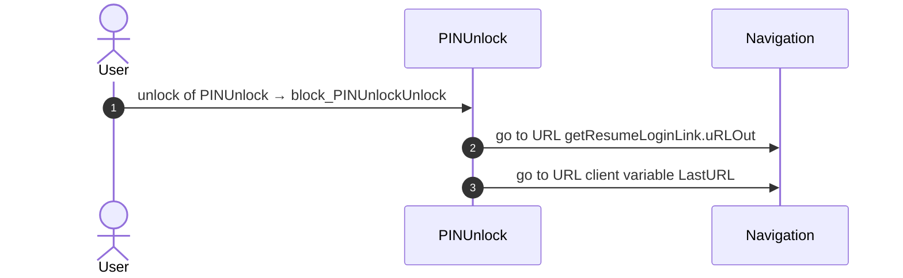
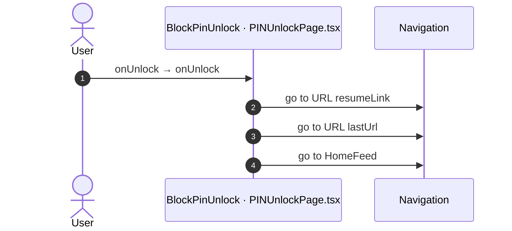

# PINUnlock: OutSystems (TST) and React

The route `/UBTConnect/PINUnlock`, read from the TST compiled code and from the React code by `tools/route-check/check_route.py` on 2026-11-06. Facts only, each with its place. The method is in [README.md](../README.md).

Scope of this file: the screen and the blocks of its UI flow (OutSystems), the files of `app/src/pages/PINUnlock/` (React). The app shell is in [APP_SHELL.md](../APP_SHELL.md). The shared blocks and components that the route uses are in the last section.

**Live code.** TST changed 14 compiled files of this route after the capture (`migration/knowledge/tst-drift-2026-11-05.md`). The tool read the live copies in `migration/sources/runtime/` for: `Connect2_LegacyShared`, `js`, `NavigationHandler`, `OutSystemsUI_2_23`, `js`, `UBTConnect`, `js`, `js`, `UBTConnectLibrary`, `js`, `UBTConnect_Utils`, `js`, `UBT_AppManager`, `UBT_AppManager_Mobile`. The observed calls come from the capture.

## 1. Route

| Item | Value | Source |
|---|---|---|
| Route | `/UBTConnect/PINUnlock` | `app/src/app/routes.generated.ts` |
| OutSystems screen | `UBTConnect.App_PIN.PINUnlock` | TST compiled code |
| UI flow | `App_PIN` | MCP `getScreenNames` (DEV) |
| React screen | [`pages/PINUnlock/PINUnlockPage.tsx`](../../../app/src/pages/PINUnlock/PINUnlockPage.tsx) | `app/src/pages/` |
| React route rules | access `member`, lock `ignore`, flag redirect none | `app/src/app/routes.ts` |
| Screenshots | [`migration/screens/PINUnlock/parity`](../../screens/PINUnlock/parity) | `route.py parity` |
| Code read | OutSystems: 1 files of the UI flow, 0 shared blocks, 31 app shell files. React: 97 files in the closure of the page | TST `facts.json`, `react_calls.mjs` |

## 2. Result

| Check | Result |
|---|---|
| Server calls of the route on TST | 0: React makes 0, **0 missing** |
| Differences found | **0** (see [section 3](#3-differences-found)) |
| Questions | 0 (see [section 4](#4-questions)) |
| React calls reached only through shared code | 0: see the last section |
| User actions of the route (own code) | OutSystems: 1. React: 1 |
| Screen and blocks of the UI flow with a React port | 1 of 1 |
| Navigation targets found in React | 0 of 0 |
| Shared blocks and components on the route | OutSystems 0, React 1 with user actions: see the last section |
| App shell on this route | 9 calls: see [APP_SHELL.md](../APP_SHELL.md) |

## 3. Differences found

Each line is a fact of both sides: a TST call, navigation or variable, and the React code that has it or not. The tool does not judge the behaviour.

None.

## 4. Questions

None.

## 5. Server calls

None.

## 6. User actions

Two independent lists: the event bindings of the TST views, and the JSX event bindings of the React files. The effects come from the handler and the functions it calls, 3 levels deep. No mapping.

### 6.1 OutSystems (TST)

| # | Block (OutSystems) | Event (TST view) | Handler | Branch | Effects |
|---|---|---|---|---|---|
| [1](#611-pinunlock-block_pinunlockunlock) | `PINUnlock` | `unlock of PINUnlock` | `block_PINUnlockUnlock` | – | goes to URL getResumeLoginLink.uRLOut, URL client variable LastURL |

1 diagrams (handlers with two or more effects)

#### 6.1.1 PINUnlock: block_PINUnlockUnlock

### 6.2 React

| # | File | Element | Event prop | Handler | Branch | Effects |
|---|---|---|---|---|---|---|
| [1](#621-blockpinunlock-onunlock) | [`pages/PINUnlock/PINUnlockPage.tsx:14`](../../../app/src/pages/PINUnlock/PINUnlockPage.tsx#L14) | `<BlockPinUnlock>` | `onUnlock` | `onUnlock` | – | goes to URL resumeLink, URL lastUrl, HomeFeed |

1 diagrams (handlers with two or more effects)

#### 6.2.1 BlockPinUnlock: onUnlock

## 7. Screen inputs and navigation parameters

The input parameters of the screen, the parameters that the route reads, and the parameters that the route gives when it opens another screen. A navigation without parameters is only in section 2.
The OutSystems files are in `migration/sources/raw/` (the route's `analysis/manifest.json` names them); the files that TST changed after the capture are read from `migration/sources/runtime/`.

### 7.1 OutSystems (TST)

Screen inputs: none. `setInputs` of `PINUnlock` reads no input.

Navigations with parameters: none.

### 7.2 React

Declared inputs of the route: none (`app/src/app/routes.generated.ts`).

Parameters read (`useSearchParams`, `useParams`): none.

Navigations with parameters: none.

## 8. Lifecycle

What runs when the screen and its blocks open and close, without a user action.

### 8.1 OutSystems (TST)

Event handlers. The steps are the node comments and the conditions of the compiled action.

None.

Data actions and aggregates. The tool reads `dataFetchDependenciesOriginal`: `0` is a fetch when the block opens, `-1` is a fetch only on demand (a `Refresh Query` step). `Read by` lists the child block inputs, conditions, text widgets and actions that read the result.

None.

### 8.2 React

Effects (`useEffect`, `useLayoutEffect`) of the screen files, and the effects of shared components that make a call, a navigation or a message.

None.

Queries. A query fetches when its component mounts and when its key changes. `Read by` lists what reads the result in the same file.

None.

## 9. Client state

Client variables and browser storage that the route reads or writes. Other screens can read this state.

### 9.1 OutSystems (TST)

| Block | Operation | Variable | Places |
|---|---|---|---|
| `PINUnlock` | get | `UBTConnect.LastURL` | [`UBTConnect.App_PIN.PINUnlock.mvc.js:243`](../../sources/raw/UBTConnect.App_PIN.PINUnlock.mvc.js#L243) |

### 9.2 React

| File | Operation | Variable or key | Place |
|---|---|---|---|
| `usePINUnlock.ts` | `clientVar.get` | `UBTConnect.LastURL` | [`pages/PINUnlock/hooks/usePINUnlock.ts:29`](../../../app/src/pages/PINUnlock/hooks/usePINUnlock.ts#L29) |

## 10. Access

Who can open the route, and the role checks in the screen and block code.

| Side | Rule | Place |
|---|---|---|
| OutSystems (TST) | registered users (`checkRegistered()`) | [`UBTConnect.App_PIN.PINUnlock.mvc.js:285`](../../sources/raw/UBTConnect.App_PIN.PINUnlock.mvc.js#L285) |
| React | access `member`, lock `ignore`, flag redirect none | `app/src/app/routes.ts` |

Role checks in the TST screen and block actions (`RolesInfo`, `$roles`, `Check<Role>Role`): none.

## 11. Errors

What the route does when an action or a call fails.

### 11.1 OutSystems (TST)

The actions of the screen and its blocks have no `Handle Error` node.

An error without a handler goes to the `OnException` of the UI flow (`handleError`):

1. UI flow `App_PIN` [`UBTConnect.App_PIN.controller.js:12`](../../sources/shell/UBTConnect.App_PIN.controller.js#L12). Handled errors: none, it goes to the next flow.
2. UI flow `App_Common` [`UBTConnect.App_Common.controller.js:12`](../../sources/shell/UBTConnect.App_Common.controller.js#L12). Handled errors: `BubbleCommunicationException` ([`UBTConnect.App_Common.controller.js:31`](../../sources/shell/UBTConnect.App_Common.controller.js#L31)), `CommunicationException` ([`UBTConnect.App_Common.controller.js:46`](../../sources/shell/UBTConnect.App_Common.controller.js#L46)), `SecurityException` ([`UBTConnect.App_Common.controller.js:61`](../../sources/shell/UBTConnect.App_Common.controller.js#L61)), `AllExceptions` ([`UBTConnect.App_Common.controller.js:91`](../../sources/shell/UBTConnect.App_Common.controller.js#L91)).

### 11.2 React

None.

`flow handler`: `raiseToFlowHandler` gives the error to the flow handler of the screen (`app/src/platform/feedback/flowErrors.ts`). The tool lists `.catch`, `try/catch` and `onError` that do not give the error to it.

## 12. Shared blocks and components on this route

Blocks of other UI flows and modules (OutSystems), and files outside `app/src/pages/` (React) that the route renders. Their facts belong to them, not to the route. This section gives their user actions once, without diagrams.

### OutSystems (TST)

None.

### React

| File | User actions |
|---|---|
| [`components/layout/CommonUiLayout/CommonUiLayout.tsx`](../../../app/src/components/layout/CommonUiLayout/CommonUiLayout.tsx) | 2 |

User actions of the shared components (2)

| # | File | Element | Event prop | Handler | Branch | Effects |
|---|---|---|---|---|---|---|
| 1 | [`components/layout/CommonUiLayout/CommonUiLayout.tsx:80`](../../../app/src/components/layout/CommonUiLayout/CommonUiLayout.tsx#L80) | `<PreventBackNavigation>` | `onBackNavigationPrevented` | `redirectHome` | – | goes to HomeFeed |
| 2 | [`components/layout/CommonUiLayout/CommonUiLayout.tsx:82`](../../../app/src/components/layout/CommonUiLayout/CommonUiLayout.tsx#L82) | `<BackNavigationHandler>` | `onBackNavigation` | `maybeRedirectHome` | – | goes to HomeFeed |

### React calls reached only through shared code

Calls that React can make on this route, without a TST chain on this route. Every reference chain starts in a shared container, component or app code (`containers/`, `components/`, `platform/`, `legacy/`, `lib/`), not in the screen files. TST makes these calls on a user action of the shared block, which the capture did not record, or on another screen.

None.
