# Search: OutSystems (TST) and React

The route `/UBTConnect/Search`, read from the TST compiled code and from the React code by `tools/route-check/check_route.py` on 2026-11-06. Facts only, each with its place. The method is in [README.md](../README.md).

Scope of this file: the screen and the blocks of its UI flow (OutSystems), the files of `app/src/pages/Search/` (React). The app shell is in [APP_SHELL.md](../APP_SHELL.md). The shared blocks and components that the route uses are in the last section.

**Live code.** TST changed 18 compiled files of this route after the capture (`migration/knowledge/tst-drift-2026-11-05.md`). The tool read the live copies in `migration/sources/runtime/` for: `Connect2_LegacyShared`, `js`, `NavigationHandler`, `OutSystemsUI_2_23`, `js`, `FilterSheet`, `ScreenBlock_Search`, `UBTConnect`, `js`, `js`, `HorizontalTagList`, `UBTConnectLibrary`, `js`, `CacheControl_UserInfo`, `UBTConnect_Utils`, `js`, `UBT_AppManager`, `UBT_AppManager_Mobile`. The observed calls come from the capture.

## 1. Route

| Item | Value | Source |
|---|---|---|
| Route | `/UBTConnect/Search` | `app/src/app/routes.generated.ts` |
| OutSystems screen | `UBTConnect.Directory_Search.Search` | TST compiled code |
| UI flow | `Directory_Search` | MCP `getScreenNames` (DEV) |
| React screen | [`pages/Search/SearchPage.tsx`](../../../app/src/pages/Search/SearchPage.tsx) | `app/src/pages/` |
| React route rules | access `member`, lock `enforce`, flag redirect none | `app/src/app/routes.ts` |
| Screenshots | [`migration/screens/Search/parity`](../../screens/Search/parity) | `route.py parity` |
| Code read | OutSystems: 2 files of the UI flow, 27 shared blocks, 28 app shell files. React: 190 files in the closure of the page | TST `facts.json`, `react_calls.mjs` |

## 2. Result

| Check | Result |
|---|---|
| Server calls of the route on TST | 6: React makes 6, **0 missing** |
| Differences found | **0** (see [section 3](#3-differences-found)) |
| Questions | 0 (see [section 4](#4-questions)) |
| React calls reached only through shared code | 2: see the last section |
| User actions of the route (own code) | OutSystems: 2. React: 7 |
| Screen and blocks of the UI flow with a React port | 2 of 2 |
| Navigation targets found in React | 11 of 11 |
| Shared blocks and components on the route | OutSystems 27, React 7 with user actions: see the last section |
| App shell on this route | 8 calls: see [APP_SHELL.md](../APP_SHELL.md) |

## 3. Differences found

Each line is a fact of both sides: a TST call, navigation or variable, and the React code that has it or not. The tool does not judge the behaviour.

None.

## 4. Questions

None.

React reaches 2 more calls without a TST chain on this route only through shared containers, components or app code. The last section lists them, not this one.

## 5. Server calls

All columns come from the code, without interpretation:

- **Direct caller (TST):** the block or module of the action that calls the server (the step before the server call in the chain).
- **Chain (TST):** the chains of client actions in the TST compiled code, from their start to the call.
  A long chain shows its first 2 steps, …, and its last 2 steps.
- **Seen on TST:** `yes` when TST made the call in the capture.
- **React action:** the React function with the `callAction` of the same call (`file:line`), and the code that loads it: `shell` (from `main.tsx`), `page` (from the screen), or both.
- **Used by (React references):** the functions and components that reference the React action, up to the nearest component. A reference is not always a call.
- **Status:** `implemented` when the contract path of the React call gives the same TST URL. It does not prove the same behaviour.

| # | Call (TST) | Kind | Direct caller (TST) | Chain (TST) | Seen on TST | React action | Used by (React references) | Status |
|---|---|---|---|---|---|---|---|---|
| 1 | `UBTConnect_Utils/CacheControl/CacheControl_AllCountries/DataActionGetCacheInfo` | data action | `CacheControl_AllCountries` | CacheControl.OnInitialize → CacheControl.onInitialize → event onNonCacheHit of CacheControl → CacheControl_AllCountries.cacheControlOnNonCacheHit → CacheControl_AllCountries.DataActionGetCacheInfo CacheControl_AllCountries fetch at start → CacheControl_AllCountries.DataActionGetCacheInfo | yes | `fetchAllCountries()` [`api/country/repository.ts:94`](../../../app/src/api/country/repository.ts#L94) (page) | `FilterSheetContainer → AllCountriesCacheControl → fetchAllCountries` [`containers/FilterSheet/FilterSheetContainer.tsx`](../../../app/src/containers/FilterSheet/FilterSheetContainer.tsx) | implemented |
| 2 | `UBTConnect_Utils/CacheControl/CacheControl_UserInfo/DataActionGetCacheInfo` | data action | `CacheControl_UserInfo` | CacheControl.OnInitialize → CacheControl.onInitialize → event onNonCacheHit of CacheControl → CacheControl_UserInfo.cacheControlOnNonCacheHit → CacheControl_UserInfo.DataActionGetCacheInfo CacheControl_UserInfo fetch at start → CacheControl_UserInfo.DataActionGetCacheInfo | yes | `UserInfoCacheControl()` [`legacy/os/cache/UserInfoCacheControl/UserInfoCacheControl.tsx:37`](../../../app/src/legacy/os/cache/UserInfoCacheControl/UserInfoCacheControl.tsx#L37) (page) | `FilterSheetContainer → UserInfoCache → UserInfoCacheControl` [`containers/FilterSheet/FilterSheetContainer.tsx`](../../../app/src/containers/FilterSheet/FilterSheetContainer.tsx) | implemented |
| 3 | `UBTConnect/Directory_Search/ScreenBlock_Search/DataActionFetchSearchResults` | data action | `ScreenBlock_Search` | onClick in Button → event event_OnClick of Button → … → ScreenBlock_Search.action_RefreshSearch → ScreenBlock_Search.DataActionFetchSearchResults onClick in Button → event event_OnClick of Button → … → ScreenBlock_Search.action_RefreshSearch → ScreenBlock_Search.DataActionFetchSearchResults ScreenBlock_Search.event_HorizontalTagListChanged → ScreenBlock_Search.action_RefreshSearch → ScreenBlock_Search.DataActionFetchSearchResults (+3 more chains) | no | `fetchSearchResults()` [`api/search/repository.ts:30`](../../../app/src/api/search/repository.ts#L30) (page) | `Search → useSearch → fetchSearchResults` [`pages/Search/SearchPage.tsx`](../../../app/src/pages/Search/SearchPage.tsx) | implemented |
| 4 | `UBTConnect/Directory_Search/ScreenBlock_Search/DataActionGet_FilteredRecentClickedResults` | data action | `ScreenBlock_Search` | FilterSheet.onClick_ClearFilters → FilterSheet.onClick_Apply → … → ScreenBlock_Search.get_RecentClickedResultsOnAfterFetch → ScreenBlock_Search.DataActionGet_FilteredRecentClickedResults event event_OnClick of Button → FilterSheet.onClick_Apply → … → ScreenBlock_Search.get_RecentClickedResultsOnAfterFetch → ScreenBlock_Search.DataActionGet_FilteredRecentClickedResults ScreenBlock_Search.event_HorizontalTagListChanged → ScreenBlock_Search.action_RefreshSearch → … → ScreenBlock_Search.get_RecentClickedResultsOnAfterFetch → ScreenBlock_Search.DataActionGet_FilteredRecentClickedResults (+2 more chains) | yes | `getFilteredRecentClickedResults()` [`api/search/repository.ts:59`](../../../app/src/api/search/repository.ts#L59) (page) | `Search → useSearch → getFilteredRecentClickedResults` [`pages/Search/SearchPage.tsx`](../../../app/src/pages/Search/SearchPage.tsx) | implemented |
| 5 | `UBTConnect/Directory_Search/ScreenBlock_Search/ScreenDataSetGet_SearchBirthdayOptions` | aggregate | `ScreenBlock_Search` | ScreenBlock_Search.OnReady → ScreenBlock_Search.screenEvent_OnReady → ScreenBlock_Search.ScreenDataSetGet_SearchBirthdayOptions ScreenBlock_Search fetch at start → ScreenBlock_Search.ScreenDataSetGet_SearchBirthdayOptions | yes | `fetchSearchBirthdayOptions()` [`api/search/repository.ts:41`](../../../app/src/api/search/repository.ts#L41) (page) | `Search → useSearch → useSearchBirthdayOptionsQuery → fetchSearchBirthdayOptions` [`pages/Search/SearchPage.tsx`](../../../app/src/pages/Search/SearchPage.tsx) | implemented |
| 6 | `UBTConnect/ServiceAPIGet_UI_UpdateItems_UnreadCount_All` | service action | `UBTConnect` | BottomBarMenu.OnReady → BottomBarMenu.onReady → UBTConnect.directory_Updates_RefreshBottomBarCount → server Get_UI_UpdateItems_UnreadCount_All | no | `fetchUnreadUpdateItemsCount()` [`api/update/repository.ts:73`](../../../app/src/api/update/repository.ts#L73) (page) | `BottomBar → directory_Updates_RefreshBottomBarCount → fetchUnreadUpdateItemsCount` [`components/layout/BottomBar/BottomBar.tsx`](../../../app/src/components/layout/BottomBar/BottomBar.tsx) | implemented |

## 6. User actions

Two independent lists: the event bindings of the TST views, and the JSX event bindings of the React files. The effects come from the handler and the functions it calls, 3 levels deep. No mapping.

### 6.1 OutSystems (TST)

| # | Block (OutSystems) | Event (TST view) | Handler | Branch | Effects |
|---|---|---|---|---|---|
| 1 | `ScreenBlock_Search` | `event_Submit of Input` | `inputEvent_Submit` | – | shows a message |
| [2](#612-screenblock_search-event_sectiononitemclick-locality) | `ScreenBlock_Search` | `onClick (HTML element)` `onItemClick of Section` | `event_SectionOnItemClick` | `locality` | goes to Locality_Details; asks for a confirmation |
| [3](#613-screenblock_search-event_sectiononitemclick-other) | `ScreenBlock_Search` | `onClick (HTML element)` `onItemClick of Section` | `event_SectionOnItemClick` | `other` | goes to OneSchoolGlobalDetails, HouseholdCarousel, HouseholdDetails; asks for a confirmation |
| [4](#614-screenblock_search-event_sectiononitemclick-assemble) | `ScreenBlock_Search` | `onClick (HTML element)` `onItemClick of Section` | `event_SectionOnItemClick` | `assemble` | goes to AssembleDetail; asks for a confirmation |
| [5](#615-screenblock_search-event_sectiononitemclick-ldm) | `ScreenBlock_Search` | `onClick (HTML element)` `onItemClick of Section` | `event_SectionOnItemClick` | `lDM` | goes to LDM_EventDetail_V2; asks for a confirmation |

4 diagrams (handlers with two or more effects)

#### 6.1.2 ScreenBlock_Search: event_SectionOnItemClick (locality)

#### 6.1.3 ScreenBlock_Search: event_SectionOnItemClick (other)

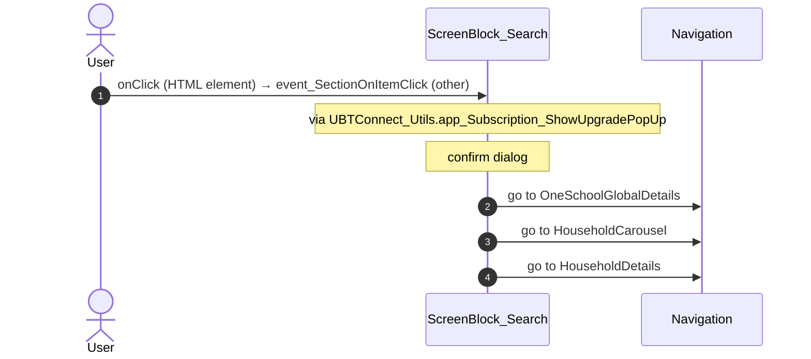

#### 6.1.4 ScreenBlock_Search: event_SectionOnItemClick (assemble)

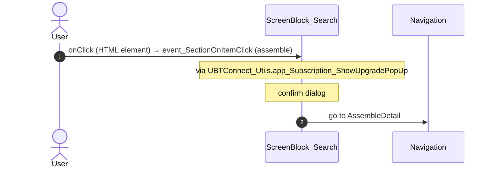

#### 6.1.5 ScreenBlock_Search: event_SectionOnItemClick (lDM)

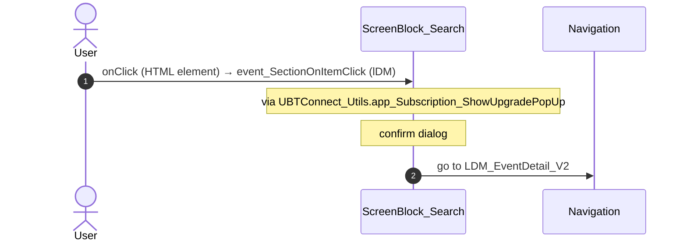

### 6.2 React

| # | File | Element | Event prop | Handler | Branch | Effects |
|---|---|---|---|---|---|---|
| [1](#621-searchview-onsubmit) | [`pages/Search/SearchPage.tsx:12`](../../../app/src/pages/Search/SearchPage.tsx#L12) | `<SearchView>` | `onSubmit` | `search.onSubmit` | – | calls DataActionFetchSearchResults; shows a message |
| [2](#622-searchview-ontaglistchanged) | [`pages/Search/SearchPage.tsx:12`](../../../app/src/pages/Search/SearchPage.tsx#L12) | `<SearchView>` | `onTagListChanged` | `search.onTagListChanged` | – | calls DataActionGet_FilteredRecentClickedResults, DataActionFetchSearchResults |
| 3 | [`pages/Search/SearchPage.tsx:12`](../../../app/src/pages/Search/SearchPage.tsx#L12) | `<SearchView>` | `onRecentSearchTerm` | `search.onRecentSearchTerm` | – | calls DataActionFetchSearchResults |
| [4](#624-searchview-onrecentresultclick-locality) | [`pages/Search/SearchPage.tsx:12`](../../../app/src/pages/Search/SearchPage.tsx#L12) | `<SearchView>` | `onRecentResultClick` | `search.onRecentResultClick` | `Locality` | goes to Locality_Details; asks for a confirmation; calls the prop onEventSearchResultClick() |
| [5](#625-searchview-onrecentresultclick-oneschoolglobal) | [`pages/Search/SearchPage.tsx:12`](../../../app/src/pages/Search/SearchPage.tsx#L12) | `<SearchView>` | `onRecentResultClick` | `search.onRecentResultClick` | `OneSchoolGlobal` | goes to OneSchoolGlobalDetails; asks for a confirmation; calls the prop onEventSearchResultClick() |
| [6](#626-searchview-onrecentresultclick-assemble) | [`pages/Search/SearchPage.tsx:12`](../../../app/src/pages/Search/SearchPage.tsx#L12) | `<SearchView>` | `onRecentResultClick` | `search.onRecentResultClick` | `Assemble` | goes to AssembleDetail; asks for a confirmation; calls the prop onEventSearchResultClick() |
| [7](#627-searchview-onrecentresultclick-ldm) | [`pages/Search/SearchPage.tsx:12`](../../../app/src/pages/Search/SearchPage.tsx#L12) | `<SearchView>` | `onRecentResultClick` | `search.onRecentResultClick` | `LDM` | goes to LDM_EventDetail_V2; asks for a confirmation; calls the prop onEventSearchResultClick() |
| [8](#628-searchview-onrecentresultclick-other) | [`pages/Search/SearchPage.tsx:12`](../../../app/src/pages/Search/SearchPage.tsx#L12) | `<SearchView>` | `onRecentResultClick` | `search.onRecentResultClick` | `other` | goes to HouseholdCarousel, HouseholdDetails; asks for a confirmation; calls the prop onEventSearchResultClick() |
| [9](#629-searchview-onresultclick-locality) | [`pages/Search/SearchPage.tsx:12`](../../../app/src/pages/Search/SearchPage.tsx#L12) | `<SearchView>` | `onResultClick` | `search.onResultClick` | `Locality` | goes to Locality_Details; asks for a confirmation; calls the prop onEventSearchResultClick() |
| [10](#6210-searchview-onresultclick-oneschoolglobal) | [`pages/Search/SearchPage.tsx:12`](../../../app/src/pages/Search/SearchPage.tsx#L12) | `<SearchView>` | `onResultClick` | `search.onResultClick` | `OneSchoolGlobal` | goes to OneSchoolGlobalDetails; asks for a confirmation; calls the prop onEventSearchResultClick() |
| [11](#6211-searchview-onresultclick-assemble) | [`pages/Search/SearchPage.tsx:12`](../../../app/src/pages/Search/SearchPage.tsx#L12) | `<SearchView>` | `onResultClick` | `search.onResultClick` | `Assemble` | goes to AssembleDetail; asks for a confirmation; calls the prop onEventSearchResultClick() |
| [12](#6212-searchview-onresultclick-ldm) | [`pages/Search/SearchPage.tsx:12`](../../../app/src/pages/Search/SearchPage.tsx#L12) | `<SearchView>` | `onResultClick` | `search.onResultClick` | `LDM` | goes to LDM_EventDetail_V2; asks for a confirmation; calls the prop onEventSearchResultClick() |
| [13](#6213-searchview-onresultclick-other) | [`pages/Search/SearchPage.tsx:12`](../../../app/src/pages/Search/SearchPage.tsx#L12) | `<SearchView>` | `onResultClick` | `search.onResultClick` | `other` | goes to HouseholdCarousel, HouseholdDetails; asks for a confirmation; calls the prop onEventSearchResultClick() |
| 14 | [`pages/Search/SearchPage.tsx:12`](../../../app/src/pages/Search/SearchPage.tsx#L12) | `<SearchView>` | `onApplyFilters` | `search.onApplyFilters` | – | calls DataActionFetchSearchResults |
| 15 | [`pages/Search/components/SearchView.tsx:108`](../../../app/src/pages/Search/components/SearchView.tsx#L108) | `<FilterSheetIcon>` | `onShowUpgradePopUp` | `showUpgradePopUp` | – | asks for a confirmation |

12 diagrams (handlers with two or more effects)

#### 6.2.1 SearchView: onSubmit

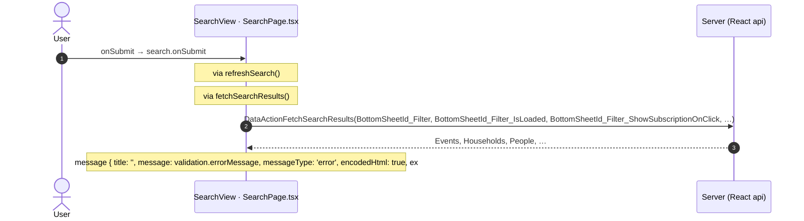

#### 6.2.2 SearchView: onTagListChanged

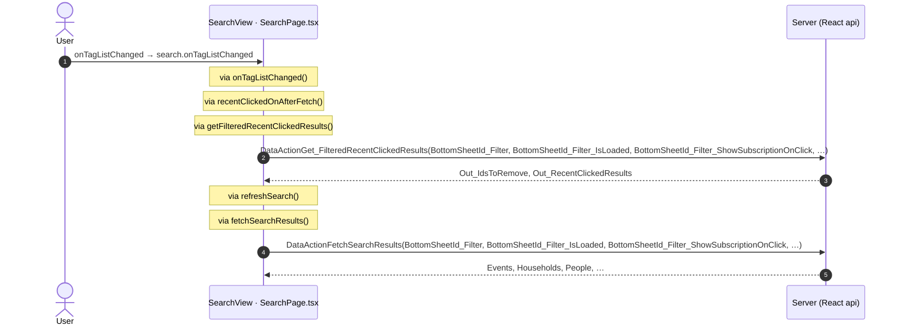

#### 6.2.4 SearchView: onRecentResultClick (Locality)

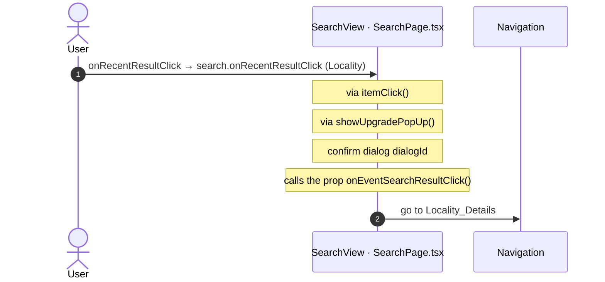

#### 6.2.5 SearchView: onRecentResultClick (OneSchoolGlobal)

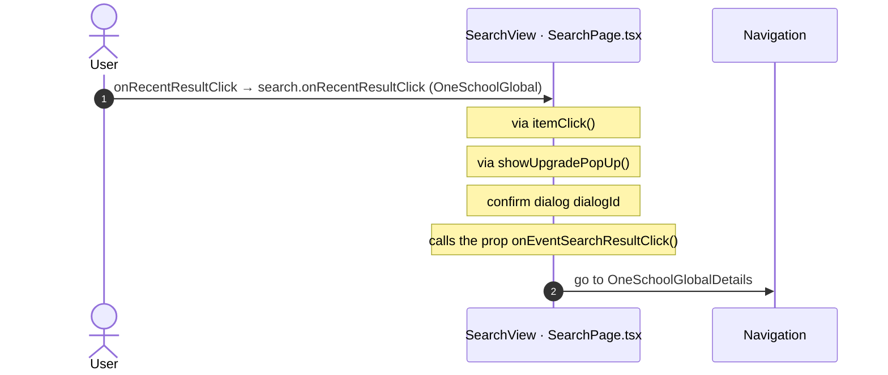

#### 6.2.6 SearchView: onRecentResultClick (Assemble)

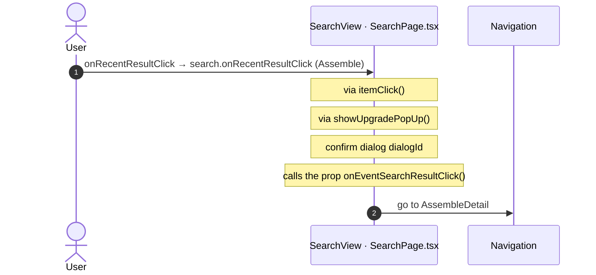

#### 6.2.7 SearchView: onRecentResultClick (LDM)

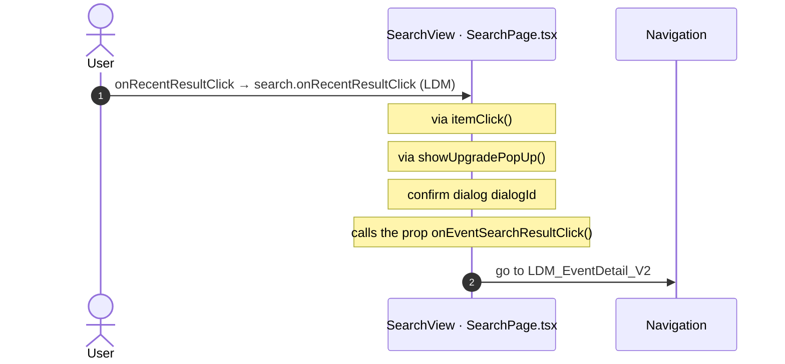

#### 6.2.8 SearchView: onRecentResultClick (other)

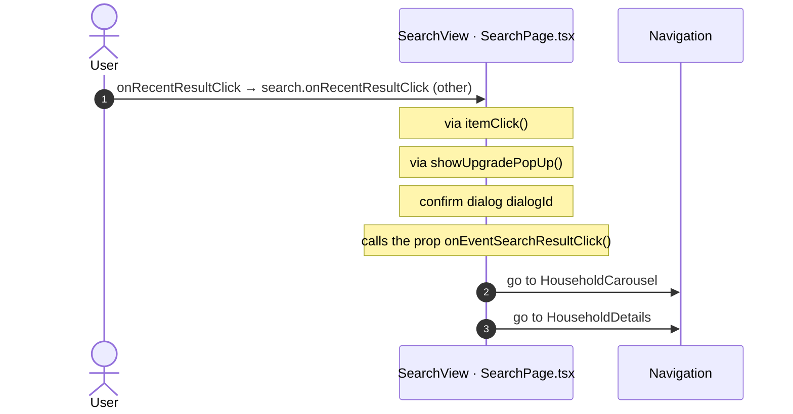

#### 6.2.9 SearchView: onResultClick (Locality)

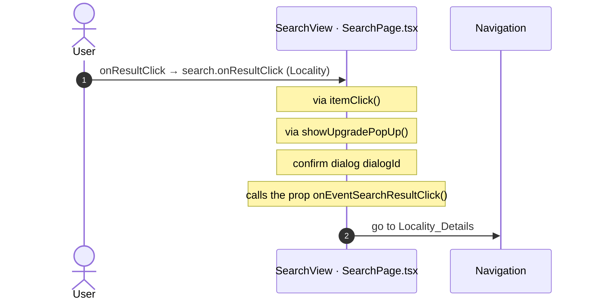

#### 6.2.10 SearchView: onResultClick (OneSchoolGlobal)

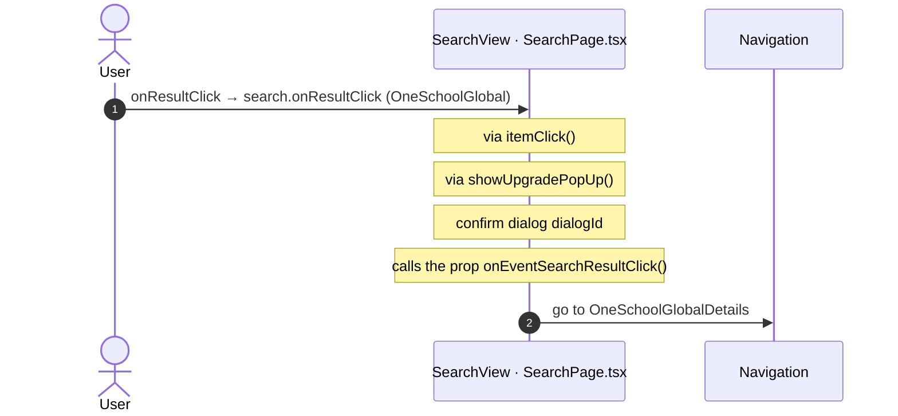

#### 6.2.11 SearchView: onResultClick (Assemble)

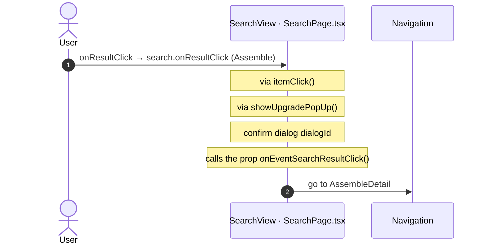

#### 6.2.12 SearchView: onResultClick (LDM)

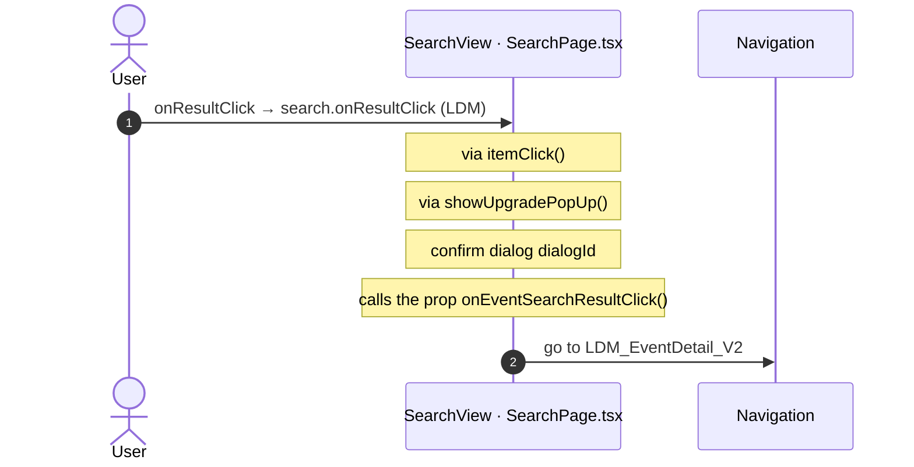

#### 6.2.13 SearchView: onResultClick (other)

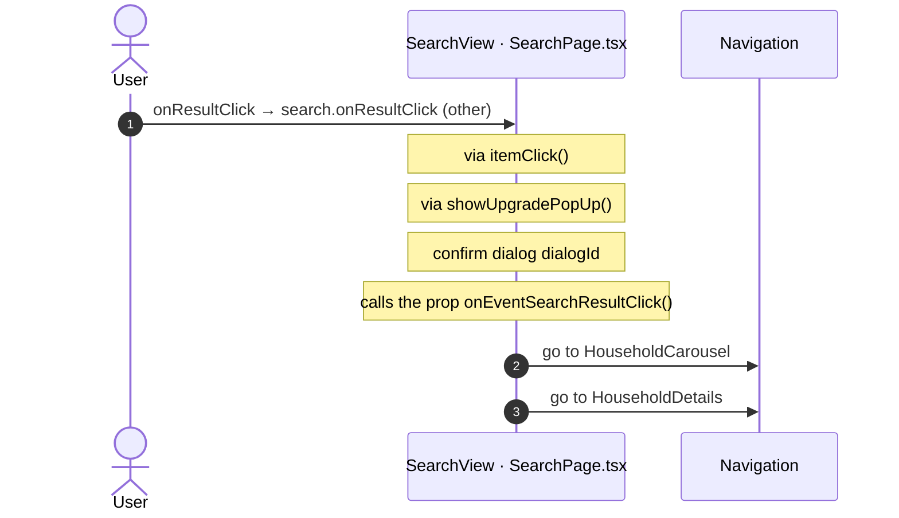

## 7. Screen inputs and navigation parameters

The input parameters of the screen, the parameters that the route reads, and the parameters that the route gives when it opens another screen. A navigation without parameters is only in section 2.
The OutSystems files are in `migration/sources/raw/` (the route's `analysis/manifest.json` names them); the files that TST changed after the capture are read from `migration/sources/runtime/`.

### 7.1 OutSystems (TST)

Screen inputs: none. `setInputs` of `Search` reads no input.

| Block | Target | Parameters | Place |
|---|---|---|---|
| `ScreenBlock_Search` | `Locality_Details` | `LocalityId` = `integerToLongInteger(textToInteger(searchResult.id))` | [`UBTConnect.Directory_Search.ScreenBlock_Search.mvc.js:3285`](../../sources/runtime/UBTConnect.Directory_Search.ScreenBlock_Search.mvc.js#L3285) |
| `ScreenBlock_Search` | `OneSchoolGlobalDetails` | `In_OneSchoolGlobalId` = `textToLongInteger(searchResult.id)` | [`UBTConnect.Directory_Search.ScreenBlock_Search.mvc.js:3297`](../../sources/runtime/UBTConnect.Directory_Search.ScreenBlock_Search.mvc.js#L3297) |
| `ScreenBlock_Search` | `AssembleDetail` | `EventId` = `searchResult.id` | [`UBTConnect.Directory_Search.ScreenBlock_Search.mvc.js:3305`](../../sources/runtime/UBTConnect.Directory_Search.ScreenBlock_Search.mvc.js#L3305) |
| `ScreenBlock_Search` | `LDM_EventDetail_V2` | `EventHostId` = `textToLongInteger(searchResult.event_EventHostId)` `EventId` = `textToLongInteger(searchResult.id)` | [`UBTConnect.Directory_Search.ScreenBlock_Search.mvc.js:3313`](../../sources/runtime/UBTConnect.Directory_Search.ScreenBlock_Search.mvc.js#L3313) |
| `ScreenBlock_Search` | `HouseholdCarousel` | `In_StartingHouseholdId` = `integerToLongInteger(textToInteger(searchResult.householderId))` | [`UBTConnect.Directory_Search.ScreenBlock_Search.mvc.js:3488`](../../sources/runtime/UBTConnect.Directory_Search.ScreenBlock_Search.mvc.js#L3488) |
| `ScreenBlock_Search` | `HouseholdDetails` | `HouseholdId` = `integerToLongInteger(textToInteger(searchResult.householderId))` | [`UBTConnect.Directory_Search.ScreenBlock_Search.mvc.js:3494`](../../sources/runtime/UBTConnect.Directory_Search.ScreenBlock_Search.mvc.js#L3494) |

### 7.2 React

Declared inputs of the route: none (`app/src/app/routes.generated.ts`).

Parameters read (`useSearchParams`, `useParams`): none.

| File | Target | Parameters | Place |
|---|---|---|---|
| `useSearch.ts` | `Locality_Details` | `LocalityId` = `searchResult.id` | [`pages/Search/hooks/useSearch.ts:392`](../../../app/src/pages/Search/hooks/useSearch.ts#L392) |
| `useSearch.ts` | `OneSchoolGlobalDetails` | `In_OneSchoolGlobalId` = `searchResult.id` | [`pages/Search/hooks/useSearch.ts:398`](../../../app/src/pages/Search/hooks/useSearch.ts#L398) |
| `useSearch.ts` | `AssembleDetail` | `EventId` = `searchResult.id` | [`pages/Search/hooks/useSearch.ts:402`](../../../app/src/pages/Search/hooks/useSearch.ts#L402) |
| `useSearch.ts` | `LDM_EventDetail_V2` | `EventHostId` = `searchResult.eventEventHostId` `EventId` = `searchResult.id` | [`pages/Search/hooks/useSearch.ts:406`](../../../app/src/pages/Search/hooks/useSearch.ts#L406) |
| `useSearch.ts` | `HouseholdCarousel` | `In_StartingHouseholdId` = `searchResult.householderId` | [`pages/Search/hooks/useSearch.ts:430`](../../../app/src/pages/Search/hooks/useSearch.ts#L430) |
| `useSearch.ts` | `HouseholdDetails` | `HouseholdId` = `searchResult.householderId` | [`pages/Search/hooks/useSearch.ts:432`](../../../app/src/pages/Search/hooks/useSearch.ts#L432) |

## 8. Lifecycle

What runs when the screen and its blocks open and close, without a user action.

### 8.1 OutSystems (TST)

Event handlers. The steps are the node comments and the conditions of the compiled action.

| Block | Event | Action | Steps |
|---|---|---|---|
| `ScreenBlock_Search` | OnInitialize ([`UBTConnect.Directory_Search.ScreenBlock_Search.mvc.js:4393`](../../sources/runtime/UBTConnect.Directory_Search.ScreenBlock_Search.mvc.js#L4393)) | `screenEvent_OnInitialize` | 1. If tagList.isEmpty ([`L3623`](../../sources/runtime/UBTConnect.Directory_Search.ScreenBlock_Search.mvc.js#L3623)) 2. Execute Action: SearchCategory_GetList ([`L3625`](../../sources/runtime/UBTConnect.Directory_Search.ScreenBlock_Search.mvc.js#L3625)) 3. TagList = SearchCategory_GetList.Out_SearchCategoryItemsList ([`L3629`](../../sources/runtime/UBTConnect.Directory_Search.ScreenBlock_Search.mvc.js#L3629)) 4. Else ([`L3638`](../../sources/runtime/UBTConnect.Directory_Search.ScreenBlock_Search.mvc.js#L3638)) |
| `ScreenBlock_Search` | OnReady ([`UBTConnect.Directory_Search.ScreenBlock_Search.mvc.js:4411`](../../sources/runtime/UBTConnect.Directory_Search.ScreenBlock_Search.mvc.js#L4411)) | `screenEvent_OnReady` | 1. isBirthdaySearchEnabled = Connect_OutSystems_PermissionCheck(C2EnableSearchByBirthday) ([`L3580`](../../sources/runtime/UBTConnect.Directory_Search.ScreenBlock_Search.mvc.js#L3580)) 2. If isBirthdaySearchEnabled ([`L3585`](../../sources/runtime/UBTConnect.Directory_Search.ScreenBlock_Search.mvc.js#L3585)) 3. Refresh Query: Get_SearchBirthdayOptions ([`L3587`](../../sources/runtime/UBTConnect.Directory_Search.ScreenBlock_Search.mvc.js#L3587)) 4. Else ([`L3593`](../../sources/runtime/UBTConnect.Directory_Search.ScreenBlock_Search.mvc.js#L3593)) |

Data actions and aggregates. The tool reads `dataFetchDependenciesOriginal`: `0` is a fetch when the block opens, `-1` is a fetch only on demand (a `Refresh Query` step). `Read by` lists the child block inputs, conditions, text widgets and actions that read the result.

| Block | Data action | Fetch | Read by | Place |
|---|---|---|---|---|
| `ScreenBlock_Search` | `Get_RecentClickedResults` | at start (`0`) | **no widget or action reads it** | [`UBTConnect.Directory_Search.ScreenBlock_Search.mvc.js:1979`](../../sources/runtime/UBTConnect.Directory_Search.ScreenBlock_Search.mvc.js#L1979) |
| `ScreenBlock_Search` | `Get_RecentSearchTerms` | at start (`0`) | **no widget or action reads it** | [`UBTConnect.Directory_Search.ScreenBlock_Search.mvc.js:1980`](../../sources/runtime/UBTConnect.Directory_Search.ScreenBlock_Search.mvc.js#L1980) |
| `ScreenBlock_Search` | `Get_SearchBirthdayOptions` | on demand (`-1`) | **no widget or action reads it** | [`UBTConnect.Directory_Search.ScreenBlock_Search.mvc.js:1981`](../../sources/runtime/UBTConnect.Directory_Search.ScreenBlock_Search.mvc.js#L1981) |
| `ScreenBlock_Search` | `Get_FilteredRecentClickedResults` | on demand (`-1`) | `shown if (SectionSeparator)` ([`UBTConnect.Directory_Search.ScreenBlock_Search.mvc.js:584`](../../sources/runtime/UBTConnect.Directory_Search.ScreenBlock_Search.mvc.js#L584)), `shown if (CustomContainer)` ([`UBTConnect.Directory_Search.ScreenBlock_Search.mvc.js:616`](../../sources/runtime/UBTConnect.Directory_Search.ScreenBlock_Search.mvc.js#L616)), `shown if (CustomText)` ([`UBTConnect.Directory_Search.ScreenBlock_Search.mvc.js:696`](../../sources/runtime/UBTConnect.Directory_Search.ScreenBlock_Search.mvc.js#L696)), `text` ([`UBTConnect.Directory_Search.ScreenBlock_Search.mvc.js:758`](../../sources/runtime/UBTConnect.Directory_Search.ScreenBlock_Search.mvc.js#L758)), `SkeletonSection.In_IsLoading` ([`UBTConnect.Directory_Search.ScreenBlock_Search.mvc.js:795`](../../sources/runtime/UBTConnect.Directory_Search.ScreenBlock_Search.mvc.js#L795)), `LazyImage.In_ForceLoadingState` ([`UBTConnect.Directory_Search.ScreenBlock_Search.mvc.js:888`](../../sources/runtime/UBTConnect.Directory_Search.ScreenBlock_Search.mvc.js#L888)), `action get_RecentClickedResultsOnAfterFetch` ([`UBTConnect.Directory_Search.ScreenBlock_Search.mvc.js:2524`](../../sources/runtime/UBTConnect.Directory_Search.ScreenBlock_Search.mvc.js#L2524)) | [`UBTConnect.Directory_Search.ScreenBlock_Search.mvc.js:1982`](../../sources/runtime/UBTConnect.Directory_Search.ScreenBlock_Search.mvc.js#L1982) |
| `ScreenBlock_Search` | `FetchSearchResults` | on demand (`-1`) | `Section.Items` ([`UBTConnect.Directory_Search.ScreenBlock_Search.mvc.js:1437`](../../sources/runtime/UBTConnect.Directory_Search.ScreenBlock_Search.mvc.js#L1437)), `view` ([`UBTConnect.Directory_Search.ScreenBlock_Search.mvc.js:1438`](../../sources/runtime/UBTConnect.Directory_Search.ScreenBlock_Search.mvc.js#L1438)), `Section.HideSeparator` ([`UBTConnect.Directory_Search.ScreenBlock_Search.mvc.js:1480`](../../sources/runtime/UBTConnect.Directory_Search.ScreenBlock_Search.mvc.js#L1480)), `text` ([`UBTConnect.Directory_Search.ScreenBlock_Search.mvc.js:1819`](../../sources/runtime/UBTConnect.Directory_Search.ScreenBlock_Search.mvc.js#L1819)), `action action_RefreshSearch` ([`UBTConnect.Directory_Search.ScreenBlock_Search.mvc.js:2765`](../../sources/runtime/UBTConnect.Directory_Search.ScreenBlock_Search.mvc.js#L2765)), `action action_ClearResults` ([`UBTConnect.Directory_Search.ScreenBlock_Search.mvc.js:2928`](../../sources/runtime/UBTConnect.Directory_Search.ScreenBlock_Search.mvc.js#L2928)), `action event_SectionOnItemClick` ([`UBTConnect.Directory_Search.ScreenBlock_Search.mvc.js:3436`](../../sources/runtime/UBTConnect.Directory_Search.ScreenBlock_Search.mvc.js#L3436)), `action onAfterFetch_FetchSearchResults` ([`UBTConnect.Directory_Search.ScreenBlock_Search.mvc.js:4209`](../../sources/runtime/UBTConnect.Directory_Search.ScreenBlock_Search.mvc.js#L4209)) | [`UBTConnect.Directory_Search.ScreenBlock_Search.mvc.js:1983`](../../sources/runtime/UBTConnect.Directory_Search.ScreenBlock_Search.mvc.js#L1983) |

### 8.2 React

Effects (`useEffect`, `useLayoutEffect`) of the screen files, and the effects of shared components that make a call, a navigation or a message.

| File | Hook (function) | Dependencies | Cleanup | Effects | Place |
|---|---|---|---|---|---|
| `useSearch.ts` | `useEffect` (`useSearch`) | `[flags.birthdaySearch]` | yes | none | [`pages/Search/hooks/useSearch.ts:173`](../../../app/src/pages/Search/hooks/useSearch.ts#L173) |
| `useSearch.ts` | `useLayoutEffect` (`useSearch`) | `none (every render)` | no | none | [`pages/Search/hooks/useSearch.ts:240`](../../../app/src/pages/Search/hooks/useSearch.ts#L240) |
| `useSearch.ts` | `useEffect` (`useSearch`) | `[inSearchTargetId]` | yes | call `/api/UBTConnect/ScreenBlock_Search/DataActionGet_FilteredRecentClickedResults` | [`pages/Search/hooks/useSearch.ts:256`](../../../app/src/pages/Search/hooks/useSearch.ts#L256) |

Sequence diagrams of the effects with a call, a navigation, a message or a refresh (1)

#### 8.2.1 useSearch: useEffect

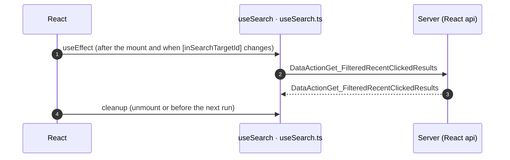

Queries. A query fetches when its component mounts and when its key changes. `Read by` lists what reads the result in the same file.

| File | Hook (function) | Calls | Read by | Place |
|---|---|---|---|---|
| `useSearch.ts` | `useSearchBirthdayOptionsQuery` (`useSearch`) | `/api/UBTConnect/ScreenBlock_Search/ScreenDataSetGet_SearchBirthdayOptions` | `return` ([`L440`](../../../app/src/pages/Search/hooks/useSearch.ts#L440)) | [`pages/Search/hooks/useSearch.ts:182`](../../../app/src/pages/Search/hooks/useSearch.ts#L182) |

## 9. Client state

Client variables and browser storage that the route reads or writes. Other screens can read this state.

### 9.1 OutSystems (TST)

| Block | Operation | Variable | Places |
|---|---|---|---|
| `ScreenBlock_Search` | get | `UBTConnect.Search_RecenctClickedResultsLimit` | [`UBTConnect.Directory_Search.ScreenBlock_Search.mvc.js:3249`](../../sources/runtime/UBTConnect.Directory_Search.ScreenBlock_Search.mvc.js#L3249), [`UBTConnect.Directory_Search.ScreenBlock_Search.mvc.js:3254`](../../sources/runtime/UBTConnect.Directory_Search.ScreenBlock_Search.mvc.js#L3254) |

### 9.2 React

| File | Operation | Variable or key | Place |
|---|---|---|---|
| `useSearch.ts` | `clientVar.get` | `UBTConnect.Search_RecenctClickedResultsLimit` | [`pages/Search/hooks/useSearch.ts:386`](../../../app/src/pages/Search/hooks/useSearch.ts#L386) |

## 10. Access

Who can open the route, and the role checks in the screen and block code.

| Side | Rule | Place |
|---|---|---|
| OutSystems (TST) | registered users (`checkRegistered()`) | [`UBTConnect.Directory_Search.Search.mvc.js:187`](../../sources/raw/UBTConnect.Directory_Search.Search.mvc.js#L187) |
| React | access `member`, lock `enforce`, flag redirect none | `app/src/app/routes.ts` |

Role checks in the TST screen and block actions (`RolesInfo`, `$roles`, `Check<Role>Role`): none.

## 11. Errors

What the route does when an action or a call fails.

### 11.1 OutSystems (TST)

| Block | Action | Error | Steps of the handler |
|---|---|---|---|
| `ScreenBlock_Search` | `action_RefreshSearch` | `NotRegistered` ([`UBTConnect.Directory_Search.ScreenBlock_Search.mvc.js:2827`](../../sources/runtime/UBTConnect.Directory_Search.ScreenBlock_Search.mvc.js#L2827)) | 1. Raise Error: NotRegistered ([`L2835`](../../sources/runtime/UBTConnect.Directory_Search.ScreenBlock_Search.mvc.js#L2835)) |
| `ScreenBlock_Search` | `action_RefreshSearch` | `BubbleCommunicationException` ([`UBTConnect.Directory_Search.ScreenBlock_Search.mvc.js:2840`](../../sources/runtime/UBTConnect.Directory_Search.ScreenBlock_Search.mvc.js#L2840)) | 1. Execute Action: Action_ClearResults3 ([`L2848`](../../sources/runtime/UBTConnect.Directory_Search.ScreenBlock_Search.mvc.js#L2848)) 2. IsLoading = False ([`L2851`](../../sources/runtime/UBTConnect.Directory_Search.ScreenBlock_Search.mvc.js#L2851)) 3. Raise Error: BubbleCommunicationException ([`L2854`](../../sources/runtime/UBTConnect.Directory_Search.ScreenBlock_Search.mvc.js#L2854)) |
| `ScreenBlock_Search` | `action_RefreshSearch` | `AllExceptions` ([`UBTConnect.Directory_Search.ScreenBlock_Search.mvc.js:2860`](../../sources/runtime/UBTConnect.Directory_Search.ScreenBlock_Search.mvc.js#L2860)) | 1. Execute Action: Action_ClearResults2 ([`L2868`](../../sources/runtime/UBTConnect.Directory_Search.ScreenBlock_Search.mvc.js#L2868)) 2. IsLoading = False ([`L2871`](../../sources/runtime/UBTConnect.Directory_Search.ScreenBlock_Search.mvc.js#L2871)) 3. Raise Error: BubbleGenericException ([`L2874`](../../sources/runtime/UBTConnect.Directory_Search.ScreenBlock_Search.mvc.js#L2874)) |

An error without a handler goes to the `OnException` of the UI flow (`handleError`):

1. UI flow `Directory_Search` not in `migration/sources/shell/`. Handled errors: none.

### 11.2 React

| File | Kind | Function | Effects | Place |
|---|---|---|---|---|
| `useSearch.ts` | try/catch | `refreshSearch` | none | [`pages/Search/hooks/useSearch.ts:297`](../../../app/src/pages/Search/hooks/useSearch.ts#L297) |

`flow handler`: `raiseToFlowHandler` gives the error to the flow handler of the screen (`app/src/platform/feedback/flowErrors.ts`). The tool lists `.catch`, `try/catch` and `onError` that do not give the error to it.

## 12. Shared blocks and components on this route

Blocks of other UI flows and modules (OutSystems), and files outside `app/src/pages/` (React) that the route renders. Their facts belong to them, not to the route. This section gives their user actions once, without diagrams.

### OutSystems (TST)

| Block | Module | React port | User actions |
|---|---|---|---|
| `Layout_DetailPage` | `UBTConnectLibrary` | [`components/layout/DetailLayout/DetailLayout.tsx`](../../../app/src/components/layout/DetailLayout/DetailLayout.tsx), [`containers/DetailLayout/DetailLayoutContainer.tsx`](../../../app/src/containers/DetailLayout/DetailLayoutContainer.tsx) | 1 |
| `Input` | `UBTConnectLibrary` | [`components/ui/Input/Input.tsx`](../../../app/src/components/ui/Input/Input.tsx) | 0 |
| `InputWithIcon` | `OutSystemsUI_2_23` | [`components/ui/InputWithIcon/InputWithIcon.tsx`](../../../app/src/components/ui/InputWithIcon/InputWithIcon.tsx) | 0 |
| `FilterSheet_Icon` | `UBTConnect` | [`components/filter/FilterSheetIcon/FilterSheetIcon.tsx`](../../../app/src/components/filter/FilterSheetIcon/FilterSheetIcon.tsx) | 1 |
| `HorizontalTagList` | `UBTConnectLibrary` | [`components/ui/HorizontalTagList/HorizontalTagList.tsx`](../../../app/src/components/ui/HorizontalTagList/HorizontalTagList.tsx) | 0 |
| `TagToggle` | `UBTConnectLibrary` | [`components/ui/TagToggle/TagToggle.tsx`](../../../app/src/components/ui/TagToggle/TagToggle.tsx) | 0 |
| `SectionSeparator` | `UBTConnect` | [`components/ui/SectionSeparator/SectionSeparator.tsx`](../../../app/src/components/ui/SectionSeparator/SectionSeparator.tsx) | 0 |
| `BottomBarMenu` | `UBTConnect` | [`components/layout/BottomBar/BottomBar.tsx`](../../../app/src/components/layout/BottomBar/BottomBar.tsx) | 1 |
| `BottomBarContent` | `UBTConnect` | [`components/layout/BottomBarContent/BottomBarContent.tsx`](../../../app/src/components/layout/BottomBarContent/BottomBarContent.tsx) | 0 |
| `BottomBarItem` | `OutSystemsUI_2_23` | [`components/ui/BottomBarItem/BottomBarItem.tsx`](../../../app/src/components/ui/BottomBarItem/BottomBarItem.tsx) | 0 |
| `App_IconBadge` | `UBTConnect` | [`components/layout/BottomBarIconBadge/BottomBarIconBadge.tsx`](../../../app/src/components/layout/BottomBarIconBadge/BottomBarIconBadge.tsx) | 0 |
| `IconBadge` | `UBTConnectLibrary` | [`components/ui/IconBadge/IconBadge.tsx`](../../../app/src/components/ui/IconBadge/IconBadge.tsx) | 0 |
| `Badge` | `UBTConnectLibrary` | [`components/ui/Badge/Badge.tsx`](../../../app/src/components/ui/Badge/Badge.tsx) | 0 |
| `FilterSheet` | `UBTConnect` | [`components/filter/FilterSheet/FilterSheet.tsx`](../../../app/src/components/filter/FilterSheet/FilterSheet.tsx), [`components/filter/FilterSheet/filterSheetActions.ts`](../../../app/src/components/filter/FilterSheet/filterSheetActions.ts), [`components/filter/FilterSheet/filterSheetState.ts`](../../../app/src/components/filter/FilterSheet/filterSheetState.ts), [`components/filter/FilterSheet/useFilterSheet.ts`](../../../app/src/components/filter/FilterSheet/useFilterSheet.ts), [`containers/FilterSheet/FilterSheetContainer.tsx`](../../../app/src/containers/FilterSheet/FilterSheetContainer.tsx) | 0 |
| `BottomSheet` | `UBTConnectLibrary` | [`components/ui/ConnectBottomSheet/ConnectBottomSheet.tsx`](../../../app/src/components/ui/ConnectBottomSheet/ConnectBottomSheet.tsx) | 0 |
| `BottomSheet` | `OutSystemsUI_2_23` | [`components/ui/BottomSheet/BottomSheet.tsx`](../../../app/src/components/ui/BottomSheet/BottomSheet.tsx) | 0 |
| `Columns_Three` | `UBTConnectLibrary` | [`components/ui/ColumnsThree/ColumnsThree.tsx`](../../../app/src/components/ui/ColumnsThree/ColumnsThree.tsx) | 0 |
| `Columns3` | `OutSystemsUI_2_23` | [`components/ui/Columns3/Columns3.tsx`](../../../app/src/components/ui/Columns3/Columns3.tsx) | 0 |
| `FilterSheet_OptionList_Item` | `UBTConnect` | [`components/filter/FilterOptionList/FilterOptionList.tsx`](../../../app/src/components/filter/FilterOptionList/FilterOptionList.tsx) | 1 |
| `SelectionOption_List` | `UBTConnectLibrary` | [`components/ui/SelectionOptionList/SelectionOptionList.tsx`](../../../app/src/components/ui/SelectionOptionList/SelectionOptionList.tsx) | 0 |
| `IconText` | `UBTConnectLibrary` | [`components/ui/IconText/IconText.tsx`](../../../app/src/components/ui/IconText/IconText.tsx) | 0 |
| `LazyImage` | `UBTConnectLibrary` | [`components/ui/LazyImage/LazyImage.tsx`](../../../app/src/components/ui/LazyImage/LazyImage.tsx) | 0 |
| `Button` | `UBTConnectLibrary` | [`components/ui/Button/Button.tsx`](../../../app/src/components/ui/Button/Button.tsx) | 0 |
| `CacheControl_AllCountries` | `UBTConnect_Utils` | [`legacy/os/cache/AllCountriesCacheControl/AllCountriesCacheControl.tsx`](../../../app/src/legacy/os/cache/AllCountriesCacheControl/AllCountriesCacheControl.tsx) | 0 |
| `CacheControl` | `UBTConnect_Utils` | [`legacy/os/cache/CacheControl/CacheControl.tsx`](../../../app/src/legacy/os/cache/CacheControl/CacheControl.tsx) | 0 |
| `CacheControl_UserInfo_Wrapper` | `UBTConnect` | [`platform/session/UserInfoCache/UserInfoCache.tsx`](../../../app/src/platform/session/UserInfoCache/UserInfoCache.tsx) | 0 |
| `CacheControl_UserInfo` | `UBTConnect_Utils` | [`legacy/os/cache/UserInfoCacheControl/UserInfoCacheControl.tsx`](../../../app/src/legacy/os/cache/UserInfoCacheControl/UserInfoCacheControl.tsx) | 0 |

User actions of the shared blocks (8)

| # | Block (OutSystems) | Event (TST view) | Handler | Branch | Effects |
|---|---|---|---|---|---|
| 1 | `BottomBarMenu` | `onClick (HTML element)` `onClick of IconBadge` | `event_BottomBar_Clicked` | `home` | goes to HomeFeed |
| 2 | `BottomBarMenu` | `onClick (HTML element)` `onClick of IconBadge` | `event_BottomBar_Clicked` | `directory` | goes to CountryList, Locality_Details |
| 3 | `BottomBarMenu` | `onClick (HTML element)` `onClick of IconBadge` | `event_BottomBar_Clicked` | `updates` | goes to Updates_SingleList |
| 4 | `BottomBarMenu` | `onClick (HTML element)` `onClick of IconBadge` | `event_BottomBar_Clicked` | `bookmarks` | goes to Bookmarks |
| 5 | `BottomBarMenu` | `onClick (HTML element)` `onClick of IconBadge` | `event_BottomBar_Clicked` | `menu` | goes to Menu |
| 6 | `FilterSheet_Icon` | `click of Icon` | `iconClick` | – | asks for a confirmation |
| 7 | `FilterSheet_OptionList_Item` | `notEnabledOnClick of List` | `selectionOption_ListNotEnabledOnClick` | – | asks for a confirmation |
| 8 | `Layout_DetailPage` | `click of Icon` | `onClick_BackNavigation` | – | goes to previous screen |

### React

| File | User actions |
|---|---|
| [`components/layout/BottomBar/BottomBar.tsx`](../../../app/src/components/layout/BottomBar/BottomBar.tsx) | 2 |
| [`components/layout/CommonUiLayout/CommonUiLayout.tsx`](../../../app/src/components/layout/CommonUiLayout/CommonUiLayout.tsx) | 2 |
| [`containers/DetailLayout/DetailLayoutContainer.tsx`](../../../app/src/containers/DetailLayout/DetailLayoutContainer.tsx) | 1 |
| [`containers/FilterSheet/FilterSheetContainer.tsx`](../../../app/src/containers/FilterSheet/FilterSheetContainer.tsx) | 1 |
| [`legacy/os/cache/AllCountriesCacheControl/AllCountriesCacheControl.tsx`](../../../app/src/legacy/os/cache/AllCountriesCacheControl/AllCountriesCacheControl.tsx) | 1 |
| [`legacy/os/cache/AllLocalitiesCacheControl/AllLocalitiesCacheControl.tsx`](../../../app/src/legacy/os/cache/AllLocalitiesCacheControl/AllLocalitiesCacheControl.tsx) | 1 |
| [`legacy/os/cache/UserInfoCacheControl/UserInfoCacheControl.tsx`](../../../app/src/legacy/os/cache/UserInfoCacheControl/UserInfoCacheControl.tsx) | 1 |

User actions of the shared components (19)

| # | File | Element | Event prop | Handler | Branch | Effects |
|---|---|---|---|---|---|---|
| 1 | [`containers/FilterSheet/FilterSheetContainer.tsx:43`](../../../app/src/containers/FilterSheet/FilterSheetContainer.tsx#L43) | `<FilterSheet>` | `onShowUpgradePopUp` | `showUpgradePopUp` | – | asks for a confirmation |
| 2 | [`legacy/os/cache/UserInfoCacheControl/UserInfoCacheControl.tsx:52`](../../../app/src/legacy/os/cache/UserInfoCacheControl/UserInfoCacheControl.tsx#L52) | `<CacheControl>` | `onNonCacheHit` | `onNonCacheHit` | – | calls DataActionGetCacheInfo |
| 3 | [`legacy/os/cache/AllLocalitiesCacheControl/AllLocalitiesCacheControl.tsx:55`](../../../app/src/legacy/os/cache/AllLocalitiesCacheControl/AllLocalitiesCacheControl.tsx#L55) | `<CacheControl>` | `onNonCacheHit` | `onNonCacheHit` | – | calls DataActionGetCacheInfo |
| 4 | [`legacy/os/cache/AllCountriesCacheControl/AllCountriesCacheControl.tsx:55`](../../../app/src/legacy/os/cache/AllCountriesCacheControl/AllCountriesCacheControl.tsx#L55) | `<CacheControl>` | `onNonCacheHit` | `onNonCacheHit` | – | calls DataActionGetCacheInfo |
| 5 | [`components/layout/CommonUiLayout/CommonUiLayout.tsx:80`](../../../app/src/components/layout/CommonUiLayout/CommonUiLayout.tsx#L80) | `<PreventBackNavigation>` | `onBackNavigationPrevented` | `redirectHome` | – | goes to HomeFeed |
| 6 | [`components/layout/CommonUiLayout/CommonUiLayout.tsx:82`](../../../app/src/components/layout/CommonUiLayout/CommonUiLayout.tsx#L82) | `<BackNavigationHandler>` | `onBackNavigation` | `maybeRedirectHome` | – | goes to HomeFeed |
| 7 | [`components/layout/BottomBar/BottomBar.tsx:130`](../../../app/src/components/layout/BottomBar/BottomBar.tsx#L130) | `<OSLink>` | `onClick` | `click` | `Home` | goes to HomeFeed |
| 8 | [`components/layout/BottomBar/BottomBar.tsx:130`](../../../app/src/components/layout/BottomBar/BottomBar.tsx#L130) | `<OSLink>` | `onClick` | `click` | `Directory` | goes to CountryList, Locality_Details |
| 9 | [`components/layout/BottomBar/BottomBar.tsx:130`](../../../app/src/components/layout/BottomBar/BottomBar.tsx#L130) | `<OSLink>` | `onClick` | `click` | `Updates` | goes to Updates_SingleList |
| 10 | [`components/layout/BottomBar/BottomBar.tsx:130`](../../../app/src/components/layout/BottomBar/BottomBar.tsx#L130) | `<OSLink>` | `onClick` | `click` | `Bookmarks` | goes to Bookmarks |
| 11 | [`components/layout/BottomBar/BottomBar.tsx:130`](../../../app/src/components/layout/BottomBar/BottomBar.tsx#L130) | `<OSLink>` | `onClick` | `click` | `Menu` | goes to Menu |
| 12 | [`components/layout/BottomBar/BottomBar.tsx:130`](../../../app/src/components/layout/BottomBar/BottomBar.tsx#L130) | `<OSLink>` | `onClick` | `click` | `other` | calls the prop onBottomBarClicked() |
| 13 | [`components/layout/BottomBar/BottomBar.tsx:140`](../../../app/src/components/layout/BottomBar/BottomBar.tsx#L140) | `<BottomBarIconBadge>` | `onOnClick` | `click` | `Home` | goes to HomeFeed |
| 14 | [`components/layout/BottomBar/BottomBar.tsx:140`](../../../app/src/components/layout/BottomBar/BottomBar.tsx#L140) | `<BottomBarIconBadge>` | `onOnClick` | `click` | `Directory` | goes to CountryList, Locality_Details |
| 15 | [`components/layout/BottomBar/BottomBar.tsx:140`](../../../app/src/components/layout/BottomBar/BottomBar.tsx#L140) | `<BottomBarIconBadge>` | `onOnClick` | `click` | `Updates` | goes to Updates_SingleList |
| 16 | [`components/layout/BottomBar/BottomBar.tsx:140`](../../../app/src/components/layout/BottomBar/BottomBar.tsx#L140) | `<BottomBarIconBadge>` | `onOnClick` | `click` | `Bookmarks` | goes to Bookmarks |
| 17 | [`components/layout/BottomBar/BottomBar.tsx:140`](../../../app/src/components/layout/BottomBar/BottomBar.tsx#L140) | `<BottomBarIconBadge>` | `onOnClick` | `click` | `Menu` | goes to Menu |
| 18 | [`components/layout/BottomBar/BottomBar.tsx:140`](../../../app/src/components/layout/BottomBar/BottomBar.tsx#L140) | `<BottomBarIconBadge>` | `onOnClick` | `click` | `other` | calls the prop onBottomBarClicked() |
| 19 | [`containers/DetailLayout/DetailLayoutContainer.tsx:66`](../../../app/src/containers/DetailLayout/DetailLayoutContainer.tsx#L66) | `<DetailLayout>` | `onBack` | `navigateBack` | – | goes to previous screen |

### React calls reached only through shared code

Calls that React can make on this route, without a TST chain on this route. Every reference chain starts in a shared container, component or app code (`containers/`, `components/`, `platform/`, `legacy/`, `lib/`), not in the screen files. TST makes these calls on a user action of the shared block, which the capture did not record, or on another screen.

| Call | React action | Reached through |
|---|---|---|
| `/api/UBTConnect_Utils/CacheControl_AllLocalities/DataActionGetCacheInfo` | `fetchAllLocalities()` [`api/locality/repository.ts:157`](../../../app/src/api/locality/repository.ts#L157) | `FilterSheetContainer` [`containers/FilterSheet/FilterSheetContainer.tsx`](../../../app/src/containers/FilterSheet/FilterSheetContainer.tsx) |
| `/api/UBTConnect_Utils/ActionGetSignedImagesInBulk` | `cache_SignedImageURL_GetCallback()` [`lib/ubtConnectUtils/actions.ts:131`](../../../app/src/lib/ubtConnectUtils/actions.ts#L131) | `EntityLazyImage` [`components/ui/EntityLazyImage/EntityLazyImage.tsx`](../../../app/src/components/ui/EntityLazyImage/EntityLazyImage.tsx) |
