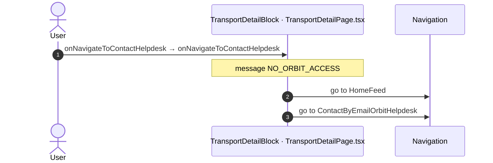

# TransportDetail: OutSystems (TST) and React

The route `/UBTConnect/TransportDetail`, read from the TST compiled code and from the React code by `tools/route-check/check_route.py` on 2026-11-06. Facts only, each with its place. The method is in [README.md](../README.md).

Scope of this file: the screen and the blocks of its UI flow (OutSystems), the files of `app/src/pages/TransportDetail/` (React). The app shell is in [APP_SHELL.md](../APP_SHELL.md). The shared blocks and components that the route uses are in the last section.

**Static check.** This route has no TST capture (`migration/screens/TransportDetail/no-capture.json`).

- The OutSystems facts come from the compiled code of the screen and of its static closure (TST survey).
- The code is in `migration/sources/runtime/` and in `migration/sources/raw/` (the captured routes).
- The tool observed no call and has no screenshot.
- Closure: 53 files, 0 without compiled code.

## 1. Route

| Item | Value | Source |
|---|---|---|
| Route | `/UBTConnect/TransportDetail` | `app/src/app/routes.generated.ts` |
| OutSystems screen | `UBTConnect.Legacy_OrbitEventsFlow.TransportDetail` | TST compiled code |
| UI flow | `Legacy_OrbitEventsFlow` | MCP `getScreenNames` (DEV) |
| React screen | [`pages/TransportDetail/TransportDetailPage.tsx`](../../../app/src/pages/TransportDetail/TransportDetailPage.tsx) | `app/src/pages/` |
| React route rules | access `member`, lock `enforce`, flag redirect none | `app/src/app/routes.ts` |
| Screenshots | no parity run | `route.py parity` |
| Code read | OutSystems: 1 files of the UI flow, 9 shared blocks, 43 app shell files. React: 146 files in the closure of the page | TST survey closure and compiled code (static), `react_calls.mjs` |

## 2. Result

| Check | Result |
|---|---|
| Server calls of the route on TST | 1: React makes 1, **0 missing** |
| Differences found | **0** (see [section 3](#3-differences-found)) |
| Questions | 0 (see [section 4](#4-questions)) |
| React calls reached only through shared code | 0: see the last section |
| User actions of the route (own code) | OutSystems: 0. React: 1 |
| Screen and blocks of the UI flow with a React port | 1 of 1 |
| Navigation targets found in React | 2 of 2 |
| Shared blocks and components on the route | OutSystems 9, React 2 with user actions: see the last section |
| App shell on this route | 3 calls: see [APP_SHELL.md](../APP_SHELL.md) |

## 3. Differences found

Each line is a fact of both sides: a TST call, navigation or variable, and the React code that has it or not. The tool does not judge the behaviour.

None.

## 4. Questions

None.

## 5. Server calls

All columns come from the code, without interpretation:

- **Direct caller (TST):** the block or module of the action that calls the server (the step before the server call in the chain).
- **Chain (TST):** the chains of client actions in the TST compiled code, from their start to the call.
  A long chain shows its first 2 steps, …, and its last 2 steps.
- **Seen on TST:** `yes` when TST made the call in the capture.
- **React action:** the React function with the `callAction` of the same call (`file:line`), and the code that loads it: `shell` (from `main.tsx`), `page` (from the screen), or both.
- **Used by (React references):** the functions and components that reference the React action, up to the nearest component. A reference is not always a call.
- **Status:** `implemented` when the contract path of the React call gives the same TST URL. It does not prove the same behaviour.

| # | Call (TST) | Kind | Direct caller (TST) | Chain (TST) | Seen on TST | React action | Used by (React references) | Status |
|---|---|---|---|---|---|---|---|---|
| 1 | `Connect2_OrbitMobile_MUI/Orbit_ScreenBlocks/ScreenBlock_TransportDetail/DataActionGet_TransportDetail` | data action | `ScreenBlock_TransportDetail` | ScreenBlock_TransportDetail.OnReady → ScreenBlock_TransportDetail.onReady → ScreenBlock_TransportDetail.DataActionGet_TransportDetail ScreenBlock_TransportDetail fetch at start → ScreenBlock_TransportDetail.DataActionGet_TransportDetail | no capture | `fetchTransportDetail()` [`api/event/repository.ts:265`](../../../app/src/api/event/repository.ts#L265) (page) | `TransportDetailBlock → useTransportDetail → fetchTransportDetail` [`pages/TransportDetail/TransportDetailPage.tsx`](../../../app/src/pages/TransportDetail/TransportDetailPage.tsx) | implemented |

## 6. User actions

Two independent lists: the event bindings of the TST views, and the JSX event bindings of the React files. The effects come from the handler and the functions it calls, 3 levels deep. No mapping.

### 6.1 OutSystems (TST)

None.

### 6.2 React

| # | File | Element | Event prop | Handler | Branch | Effects |
|---|---|---|---|---|---|---|
| [1](#621-transportdetailblock-onnavigatetocontacthelpdesk) | [`pages/TransportDetail/TransportDetailPage.tsx:39`](../../../app/src/pages/TransportDetail/TransportDetailPage.tsx#L39) | `<TransportDetailBlock>` | `onNavigateToContactHelpdesk` | `onNavigateToContactHelpdesk` | – | goes to HomeFeed, ContactByEmailOrbitHelpdesk; shows a message |

1 diagrams (handlers with two or more effects)

#### 6.2.1 TransportDetailBlock: onNavigateToContactHelpdesk

## 7. Screen inputs and navigation parameters

The input parameters of the screen, the parameters that the route reads, and the parameters that the route gives when it opens another screen. A navigation without parameters is only in section 2.
The OutSystems files are in `migration/sources/runtime/` and in `migration/sources/raw/` (the shared store of the captured routes; static check).

### 7.1 OutSystems (TST)

| Input | Type | Mandatory | Place |
|---|---|---|---|
| `In_MilestoneId` | Text | yes | [`UBTConnect.Legacy_OrbitEventsFlow.TransportDetail.mvc.js:83`](../../sources/runtime/UBTConnect.Legacy_OrbitEventsFlow.TransportDetail.mvc.js#L83) |
| `In_OrbitMilestoneTypeId` | Text | yes | [`UBTConnect.Legacy_OrbitEventsFlow.TransportDetail.mvc.js:87`](../../sources/runtime/UBTConnect.Legacy_OrbitEventsFlow.TransportDetail.mvc.js#L87) |
| `In_MilestoneName` | Text | yes | [`UBTConnect.Legacy_OrbitEventsFlow.TransportDetail.mvc.js:91`](../../sources/runtime/UBTConnect.Legacy_OrbitEventsFlow.TransportDetail.mvc.js#L91) |
| `In_HeaderClass` | Text | yes | [`UBTConnect.Legacy_OrbitEventsFlow.TransportDetail.mvc.js:95`](../../sources/runtime/UBTConnect.Legacy_OrbitEventsFlow.TransportDetail.mvc.js#L95) |
| `In_TargetMemberId` | LongInteger | yes | [`UBTConnect.Legacy_OrbitEventsFlow.TransportDetail.mvc.js:99`](../../sources/runtime/UBTConnect.Legacy_OrbitEventsFlow.TransportDetail.mvc.js#L99) |

| Block | Target | Parameters | Place |
|---|---|---|---|
| `TransportDetail` | `ContactByEmailOrbitHelpdesk` | `In_EventName` = `eventName` `In_Subject` = `subject` `In_TargetMemberId` = `in_TargetMemberId` `In_EventId` = `integerToLongInteger(nullIdentifier())` `In_MilestoneId` = `in_MilestoneId` | [`UBTConnect.Legacy_OrbitEventsFlow.TransportDetail.mvc.js:284`](../../sources/runtime/UBTConnect.Legacy_OrbitEventsFlow.TransportDetail.mvc.js#L284) |

### 7.2 React

Declared inputs of the route: `In_MilestoneId: Text`, `In_OrbitMilestoneTypeId: Text`, `In_MilestoneName: Text`, `In_HeaderClass: Text`, `In_TargetMemberId: LongInteger` (`app/src/app/routes.generated.ts`).

| Hook | Keys read | Place |
|---|---|---|
| `useSearchParams` | none | [`pages/TransportDetail/TransportDetailPage.tsx:27`](../../../app/src/pages/TransportDetail/TransportDetailPage.tsx#L27) |

| File | Target | Parameters | Place |
|---|---|---|---|
| `useContactHelpdeskNavigation.ts` | `HomeFeed` |  | [`pages/TransportDetail/hooks/useContactHelpdeskNavigation.ts:28`](../../../app/src/pages/TransportDetail/hooks/useContactHelpdeskNavigation.ts#L28) |
| `useContactHelpdeskNavigation.ts` | `ContactByEmailOrbitHelpdesk` | `In_EventName` = `eventName` `In_Subject` = `subject` `In_TargetMemberId` = `In_TargetMemberId` `In_EventId` = `'0'` `In_MilestoneId` = `In_MilestoneId` | [`pages/TransportDetail/hooks/useContactHelpdeskNavigation.ts:31`](../../../app/src/pages/TransportDetail/hooks/useContactHelpdeskNavigation.ts#L31) |

## 8. Lifecycle

What runs when the screen and its blocks open and close, without a user action.

### 8.1 OutSystems (TST)

Event handlers. The steps are the node comments and the conditions of the compiled action.

None.

Data actions and aggregates. The tool reads `dataFetchDependenciesOriginal`: `0` is a fetch when the block opens, `-1` is a fetch only on demand (a `Refresh Query` step). `Read by` lists the child block inputs, conditions, text widgets and actions that read the result.

None.

### 8.2 React

Effects (`useEffect`, `useLayoutEffect`) of the screen files, and the effects of shared components that make a call, a navigation or a message.

None.

Queries. A query fetches when its component mounts and when its key changes. `Read by` lists what reads the result in the same file.

None.

## 9. Client state

Client variables and browser storage that the route reads or writes. Other screens can read this state.

### 9.1 OutSystems (TST)

None.

### 9.2 React

None.

## 10. Access

Who can open the route, and the role checks in the screen and block code.

| Side | Rule | Place |
|---|---|---|
| OutSystems (TST) | registered users (`checkRegistered()`) | [`UBTConnect.Legacy_OrbitEventsFlow.TransportDetail.mvc.js:350`](../../sources/runtime/UBTConnect.Legacy_OrbitEventsFlow.TransportDetail.mvc.js#L350) |
| React | access `member`, lock `enforce`, flag redirect none | `app/src/app/routes.ts` |

Role checks in the TST screen and block actions (`RolesInfo`, `$roles`, `Check<Role>Role`): none.

## 11. Errors

What the route does when an action or a call fails.

### 11.1 OutSystems (TST)

The actions of the screen and its blocks have no `Handle Error` node.

An error without a handler goes to the `OnException` of the UI flow (`handleError`):

1. UI flow `Legacy_OrbitEventsFlow` not in `migration/sources/shell/`. Handled errors: none.

### 11.2 React

None.

`flow handler`: `raiseToFlowHandler` gives the error to the flow handler of the screen (`app/src/platform/feedback/flowErrors.ts`). The tool lists `.catch`, `try/catch` and `onError` that do not give the error to it.

## 12. Shared blocks and components on this route

Blocks of other UI flows and modules (OutSystems), and files outside `app/src/pages/` (React) that the route renders. Their facts belong to them, not to the route. This section gives their user actions once, without diagrams.

### OutSystems (TST)

| Block | Module | React port | User actions |
|---|---|---|---|
| `ScreenBlock_TransportDetail` | `Connect2_OrbitMobile_MUI` | [`pages/TransportDetail/components/TransportDetailView.tsx`](../../../app/src/pages/TransportDetail/components/TransportDetailView.tsx), [`pages/TransportDetail/hooks/transportDetailState.ts`](../../../app/src/pages/TransportDetail/hooks/transportDetailState.ts), [`pages/TransportDetail/hooks/useTransportDetail.ts`](../../../app/src/pages/TransportDetail/hooks/useTransportDetail.ts) | 0 |
| `ContactHelpdesk_Footer` | `Connect2_OrbitMobile_MUI` | [`components/orbit/ContactHelpdeskFooter/ContactHelpdeskFooter.tsx`](../../../app/src/components/orbit/ContactHelpdeskFooter/ContactHelpdeskFooter.tsx) | 0 |
| `Skeleton_Loading` | `Connect2_OrbitMobile_MUI` | [`components/orbit/OrbitSkeleton/OrbitSkeleton.tsx`](../../../app/src/components/orbit/OrbitSkeleton/OrbitSkeleton.tsx) | 0 |
| `TransportDetail` | `Connect2_OrbitMobile_MUI` | [`pages/TransportDetail/components/TransportDetail.tsx`](../../../app/src/pages/TransportDetail/components/TransportDetail.tsx) | 1 |
| `TransportDetail_TravelInfo` | `Connect2_OrbitMobile_MUI` | [`pages/TransportDetail/components/TransportDetail_TravelInfo.tsx`](../../../app/src/pages/TransportDetail/components/TransportDetail_TravelInfo.tsx) | 0 |
| `MenuIcon__UpdatedOSUI` | `Connect2_LegacyShared` | [`components/layout/MenuIcon/MenuIcon.tsx`](../../../app/src/components/layout/MenuIcon/MenuIcon.tsx) | 1 |
| `Layout_Orbit` | `Connect2_LegacyShared` | [`components/layout/OrbitLayout/OrbitLayout.tsx`](../../../app/src/components/layout/OrbitLayout/OrbitLayout.tsx) | 0 |
| `BaseLayout_UpdatedOSUI` | `Connect2_LegacyShared` | [`components/layout/BaseLayout/BaseLayout.tsx`](../../../app/src/components/layout/BaseLayout/BaseLayout.tsx) | 0 |
| `PullToRefresh` | `OutSystemsUI_2_23` | [`components/ui/PullToRefresh/PullToRefresh.tsx`](../../../app/src/components/ui/PullToRefresh/PullToRefresh.tsx) | 0 |

User actions of the shared blocks (2)

| # | Block (OutSystems) | Event (TST view) | Handler | Branch | Effects |
|---|---|---|---|---|---|
| 1 | `MenuIcon__UpdatedOSUI` | `onClick (HTML element)` | `onBack` | – | goes to previous screen |
| 2 | `TransportDetail` | `navigateTo_ContactHelpdesk of TransportDetail` | `onHandle_ContactHelpdesk` | – | goes to ContactByEmailOrbitHelpdesk, HomeFeed; shows a message |

### React

| File | User actions |
|---|---|
| [`components/layout/CommonUiLayout/CommonUiLayout.tsx`](../../../app/src/components/layout/CommonUiLayout/CommonUiLayout.tsx) | 2 |
| [`components/layout/MenuIcon/MenuIcon.tsx`](../../../app/src/components/layout/MenuIcon/MenuIcon.tsx) | 1 |

User actions of the shared components (3)

| # | File | Element | Event prop | Handler | Branch | Effects |
|---|---|---|---|---|---|---|
| 1 | [`components/layout/CommonUiLayout/CommonUiLayout.tsx:80`](../../../app/src/components/layout/CommonUiLayout/CommonUiLayout.tsx#L80) | `<PreventBackNavigation>` | `onBackNavigationPrevented` | `redirectHome` | – | goes to HomeFeed |
| 2 | [`components/layout/CommonUiLayout/CommonUiLayout.tsx:82`](../../../app/src/components/layout/CommonUiLayout/CommonUiLayout.tsx#L82) | `<BackNavigationHandler>` | `onBackNavigation` | `maybeRedirectHome` | – | goes to HomeFeed |
| 3 | [`components/layout/MenuIcon/MenuIcon.tsx:34`](../../../app/src/components/layout/MenuIcon/MenuIcon.tsx#L34) | `
` | `onClick` | `inline` | – | goes to previous screen |

### React calls reached only through shared code

Calls that React can make on this route, without a TST chain on this route. Every reference chain starts in a shared container, component or app code (`containers/`, `components/`, `platform/`, `legacy/`, `lib/`), not in the screen files. TST makes these calls on a user action of the shared block, which the capture did not record, or on another screen.

None.
