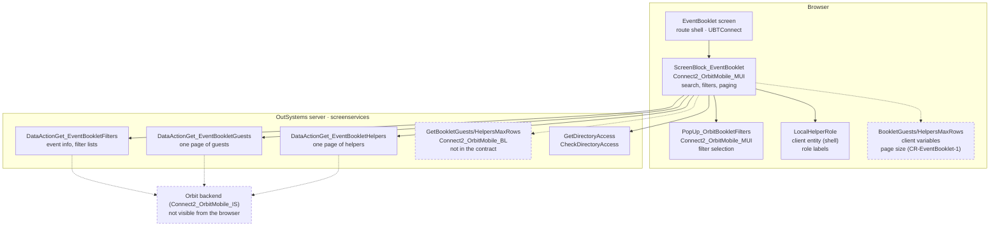
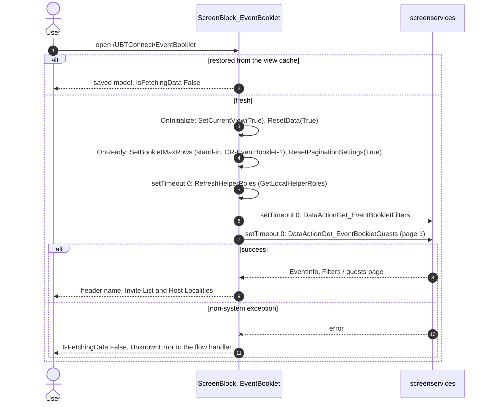
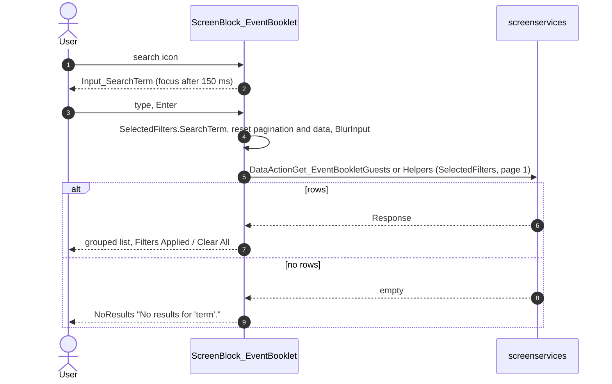
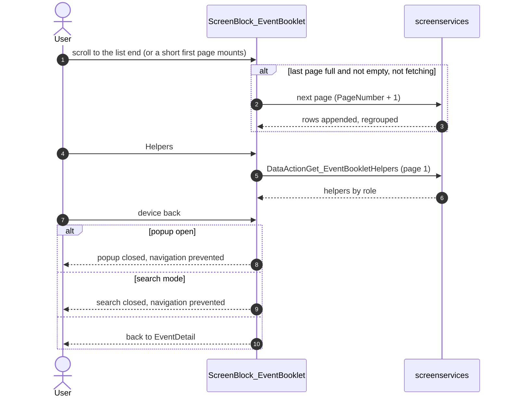

# Screen spec: EventBooklet

Sources (analysis/sources/, extracted unchanged, CRLF → LF, from capture/survey-UBTConnect.json `sources`; the TST copies
in migration/runtime-sources/ of the screen, ListHeader, MembersItem and the filters popup differ only in debugger ids and
a BOM): `S` = UBTConnect.Legacy_OrbitEventsFlow.EventBooklet.mvc.js, `SB` = Connect2_OrbitMobile_MUI.
Orbit_ScreenBlocks_EventBooklet.ScreenBlock_EventBooklet.mvc.js, `PF` = Connect2_OrbitMobile_MUI.Orbit_Blocks.
PopUp_OrbitBookletFilters.mvc.js, `LH` = …EventBooklet_ListHeader.mvc.js, `MI` = …EventBooklet_MembersItem.mvc.js,
`DA` = Connect2_OrbitMobile_MUI.Orbit_Generic_Blocks.DoubleAction.mvc.js, `C` = migration/runtime-sources/
Connect2_OrbitMobile_MUI.controller.js. No capture (no-capture.json, user 2026-10-16): built from the compiled code.

## 0. Summary
| Item | Value |
|---|---|
| Route | `/UBTConnect/EventBooklet` with In_EventId (Long Integer), In_EventName (Text) [S :12-23] |
| Tier | full |
| Captured | not captured (no-capture.json) |
| What it does | The guest list of an Orbit event: guests by locality (Invite List, Host Localities) and helpers by role, with days and host; search, filters popup (Guests/Helpers, days, roles, countries, localities), infinite scroll |
| Shared/shell used | Layout_Orbit, MenuIcon__UpdatedOSUI; HostSurvey_PillItem, NoResults, Skeleton_Loading, ListOfDaySelectors, Orbit_FooterWithActions, lib checkDirectoryAccess / getFormattedDate_Weekday; osui InputWithIcon, DropdownTags; BackNavigationHandler; Dialog_AccessRestrictedAction_Legacy; CommonUI_InsideLayout; OSBlock, OSList, usePopupWidget; shell getLocalHelperRoles, useViewState, raiseToFlowHandler, showFeedbackMessage, showUpgradePopUp |
| Own blocks (components/) | ScreenBlock_EventBooklet, PopUp_OrbitBookletFilters, EventBooklet_ListHeader, EventBooklet_MembersItem, DoubleAction (catalog: own, not built), BookletPopup (platform Popup), actions.ts (C ports) |
| Stylesheet | DoubleAction.css with the route (routes.css.generated.ts EventBooklet, StylesheetHost) |

## 1. Entry and routing
EventDetail OnHandle_NavigateTo_EventBooklet (built; flag mobileOrbitEventBooklet on, no access check) →
`/UBTConnect/EventBooklet?In_EventName=…&In_EventId=…`. Leaves to `/UBTConnect/HouseholdDetails` (HouseholdId) [S :226-260].

## 2. Component tree
Screen [S :146-199]: ScreenBlock_EventBooklet `$b1` (In_EventId, In_EventName; Menu, CommonUI_Elements empty),
CommonUI_InsideLayout `$b2`.

| Block | Inputs | Events raised | Placeholders | Notes |
|---|---|---|---|---|
| ScreenBlock_EventBooklet [SB :282-1849] | In_EventId, In_EventName | NavigateTo_HouseholdDetail(HouseholdId) | Menu, CommonUI_Elements | Layout_Orbit CustomClass "orbit-detail orbit-header-center", ExtendedClasses "orbit-booklet" [SB :295-298] |
| EventBooklet_ListHeader [LH :107-184] | – | – | Placeholder_Title | `orbit-booklet-list-header-cont`: title, "Day(s)", "Host" |
| EventBooklet_MembersItem [MI :122-284] | MemberItem | Click_Member, Click_Host | – | name; days list (weekday first letter, Sunday "L", "|" between; "-"); host or "-" |
| DoubleAction [DA :122-170] | ExtendedClass | – | Placeholder_Left, Placeholder_Right | `orbit-double-action-cont` |
| PopUp_OrbitBookletFilters [PF :145-680] | CurrentFilters, AvailableFilters (PopupFiltersRec) | ClosePopUp, ApplyFilters(SelectedFilters) | – | in the platform Popup "popup-dialog orbit-booklet-popup" [SB :1731-1799] |

## 2a. Architecture diagram


## 3. DOM and markup contract
No capture: markup from the compiled views. Container = `div[data-container]` with its Style Classes (extended class
replaces them); Expression = `span[data-expression]`; Icon = `i[data-icon]` "<style> fa fa-<icon> fa-1x"; Input =
`input[data-input].form-control.OSFillParent` type search, max 50, prompt "Search guest or host name" [SB :432-467];
List with `disable-virtualization` "True" (OSList disableVirtualization), the three main lists with
`infinite-scroll-threshold` = ScrollThreshold. Popup portal: `div.portal-class` (display inline) > div >
`.popup-backdrop` > `.popup-dialog.popup-dialog.orbit-booklet-popup` > `.popup-content` (OutSystemsReactWidgets.js Popup,
OutSystemsReactView.js Portal). Checkbox = `span > input.checkbox.ThemeGrid_MarginGutter[data-checkbox]`.

## 4. Visual specification
Original CSS only (OrbitTheme, DoubleAction.css). Header right `flex-center-all` + " opacity-0-50" until the helper roles
and the filters are fetched [SB :521-526]; Guests / Helpers switch `orbit-double-button-btn` +
" orbit-double-button-btn-active" [SB :629-661]; close icon inline `font-weight: bold;` [PF view].

## 5. Data model
Block variables [SB :79-155]: IsFetchingData, EventInfo, AvailableFilters / CurrentFilters / SelectedFilters,
Guests / Guests_InvitedList / Guests_HostingList (BookletMembers_ByLocality), Helpers (BookletMembers_ByRole),
IsSearchMode, FiltersPopUp, LocalHelperRoles, IsGuestView, HasFiltersApplied, LastFetchedGuests / LastFetchedHelpers /
LastFetched_Guests_InvitedLocality / LastFetched_Guests_HostLocality, PaginationSettings, LastFilters_Guest /
LastFilters_Helpers. Records are values (OutSystems.js getComplexProperty: per-attribute wrappers over immutable data).

## 6. API calls
| Call | Kind | Trigger | Inputs | Outputs used | Server side | Mock |
|---|---|---|---|---|---|---|
| `ScreenBlock_EventBooklet/DataActionGet_EventBookletFilters` | data action, on demand | OnReady (setTimeout 0) RefreshEventFilters [SB :3623-3677] | block variables (In_EventId, In_EventName, IsFetchingData, IsGuestView, IsSearchMode, FiltersPopUp, HasFiltersApplied, SelectedFilters, PaginationSettings; lists echoing the client left out) | Response.EventInfo, Filters (EventDays, HelperRoles, Countries.Localities) | unknown (Q2) | orbit.ts orbitEventBooklets; empty/loading/error |
| `…/DataActionGet_EventBookletGuests` | data action | OnReady RefreshEventGuests [SB :3386-3440]; search Enter, Apply, Clear All, view swap, scroll ending | same | Response (EventBookletMembers list) | filters / page (Q2) | filtered and paged as Q2 |
| `…/DataActionGet_EventBookletHelpers` | data action | Apply (helpers), view swap, search Enter, Clear All, scroll ending [SB :2279-2333] | same | Response | Q2 | same |
| GetLocalHelperRoles | client aggregate (LocalHelperRole, Max 20) | OnReady RefreshHelperRoles; filters OnAfterFetch when not fetched [SB :1902-1994] | – | List | shell getLocalHelperRoles | seeded rows (Sync_Info_GetMain) |
| GetBookletGuestsMaxRows / GetBookletHelpersMaxRows | server actions via SetBookletMaxRows [C :6599-6620, :8466-8530] | OnReady before the refreshes | – | page sizes | in the contract (CR-EventBooklet-1, F17) | shared `setBookletMaxRows` → client variables; mock 10 / 5 |
| GetDirectoryAccess | server action via CheckDirectoryAccess | name / host click [SB :3678-3777] | HouseholdId, Member | HasAccess | shared mock | shared |

## 7. State and lifecycle
OnInitialize [SB :2957-3010]: restored → IsFetchingData False; else SetCurrentView(True), ResetData(True). OnReady
[SB :3121-3194]: restored → nothing; else SetBookletMaxRows (stand-in), ResetPaginationSettings(True), then three
setTimeout 0 JS nodes: RefreshHelperRoles, RefreshEventFilters, RefreshEventGuests [SB :4183-4197]. Every Refresh sets
IsFetchingData True; each OnAfterFetch clears it when the current view's data source is fetched (filters, roles) or
always (guests, helpers). Model kept with useViewState (P-BACK).

## 8. Render logic
Title: IsSearchMode → InputWithIcon (search icon while the term is empty) > InputWithIcon right (cross icon while a
term is set, click ClearSearch) > Input_SearchTerm; else "Event Guest List" + EventInfo.EventName (In_EventName while
empty) [SB :349-514]. HeaderContent: the switch, then DoubleAction ("Filters Applied" / "Clear All") when
HasFiltersApplied and the view has rows or NoResults [SB :671-750]. Content per view [SB :754-1716]: fetching a new
search → sticky ListHeader + Skeleton(EventBooklet); after it: NoResults ("No results for 'term'." / "No results.";
"Make sure that all words…" or "There are no guests|helpers allocated to this event…") or the lists, then a Skeleton
while a next page loads. Guests: sticky "Guest Name" header, "Invite List", List_Guests_InvitedLocality, "Host
Localities" (only with host-locality guests), List_Guests_HostingLocality; each group = location pill
("Locality, Country") + MembersItem list. Helpers: List_Helpers, per role a sticky header with
GetHelperRoleByJSON_Name(Role, LocalHelperRoles).Label and its locality groups.

## 9. Interactions and navigation
| Element | Event | Logic | Navigates / feedback |
|---|---|---|---|
| search icon (header) | click | ToggleSearchMode(False, True) [SB :2582-2640]: once roles and filters are fetched, toggle; FocusOnInput (150 ms) | – |
| Input_SearchTerm | keyup Enter | SelectedFilters.SearchTerm = CurrentFilters.SearchTerm; reset the view's pagination and data; BlurInput; refresh the view [SB :3011-3090] | – |
| cross icon | click | ClearSearch: both terms "", FocusOnInput [SB :2926-2956] | – |
| filter icon / popup close | click | ToggleFiltersPopUp (once fetched) [SB :3091-3120] | – |
| Guests / Helpers | click | OnClick_ViewSwap [SB :2484-2581]: not while fetching, not the current view; SetCurrentView; always reset and refresh (the compiled `LastFilters_* !== SelectedFilters` compares two record wrappers) | – |
| Filters Applied | click | ToggleSearchMode(True, False), ToggleFiltersPopUp [SB :3501-3527] | – |
| Clear All | click | empty Current/SelectedFilters, ResetData(True), ResetPaginationSettings(True), refresh the view [SB :3312-3385] | – |
| popup Apply | ApplyFilters | [SB :2334-2483] both or neither of Guests/Helpers → rebuild AvailableFilters, message; else SelectedFilters (term kept), SetCurrentView, reset, close, refresh, CurrentFilters = popup filters | "The chosen filters were invalid, filters have been reset." (Info) |
| popup Reset / checkboxes / days / dropdowns | | PF :704-1400 (checkboxes exclusive, Guests checked resets to AvailableFilters; Roles disabled while Guests; Countries narrow Localities) | – |
| list end / list mount | OnScrollEnding / componentdidmount | next page when the last page was full and not empty [SB :3441-3500, :2684-2743]; a first page shorter than `.content` asks the next one [SB :2845-2925, :4156-4170] | – |
| name / host | Click_Member / Click_Host | OnHandle_ClickedMember [SB :3678-3777]: while fetching a message; id 0 → nothing; CheckDirectoryAccess → NavigateTo_HouseholdDetail + ViewHousehold audit (log), else upgrade popup | `/UBTConnect/HouseholdDetails` (HouseholdId); "Please wait until all data has finished loading" (Info) |
| device back | BackNavigation | [SB :3250-3311] popup open → prevent, close; search mode → prevent, leave it; else back | – |

## 10. Sequence diagrams
### 10.1 Enter the screen

### 10.2 Search

### 10.3 Filters popup
```mermaid
sequenceDiagram
  autonumber
  actor U as User
  participant S as ScreenBlock_EventBooklet
  participant P as PopUp_OrbitBookletFilters
  participant API as screenservices
  U->>S: filter icon
  S->>P: CurrentFilters, AvailableFilters (OnInitialize)
  U->>P: checkboxes, days, roles, countries, localities
  U->>P: Apply
  P->>S: ApplyFilters(SelectedFilters)
  alt both or neither of Guests / Helpers
    S->>S: OnAfterFetch_GetEventBookletFilters
    S-->>U: "The chosen filters were invalid, filters have been reset."
  else valid
    S->>S: SelectedFilters, SetCurrentView, reset, close popup
    S->>API: DataActionGet_EventBookletHelpers or Guests
    API-->>S: Response
    S-->>U: filtered list; CurrentFilters = popup filters
  end
```
### 10.4 Scroll, view swap, back


## 11. Error handling and feedback
| Situation | Detection | UI response | Message |
|---|---|---|---|
| a Refresh fails (non-system) | AllExceptions [SB :3386-3440 etc.] | IsFetchingData False, UnknownError raised to Legacy_OrbitEventsFlow | flow handler |
| system exception | same | raised as is (skeleton stays) | flow handler |
| click while fetching | IsFetchingData | feedback Info | "Please wait until all data has finished loading" |
| invalid filters | Apply with both/neither | feedback Info, filters rebuilt | "The chosen filters were invalid, filters have been reset." |

## 12. Strings
"Event Guest List", "Search guest or host name", "Guests", "Helpers", "Filters Applied", "Clear All", "Guest Name",
"Helper", "Day(s)", "Host", "Invite List", "Host Localities", "No results.", "No results for '…'.", "Make sure that all
words are spelled correctly, or refine your search terms.", "There are no guests allocated to this event. Please check
again later or contact the Orbit Helpdesk if you have any questions." (helpers likewise), popup "Filters", "Day",
"Roles", "Countries", "Localities", "Select Roles", "Select Countries", "Select Localities", "Select All or Search",
"Reset", "Apply".

## 13. Accessibility, platform and security notes
Popup: aria-modal dialog, `popup-disable-scroll` on <html>, #reactContainer aria-hidden (usePopupWidget). Server-side:
the three data actions must return only events the signed-in member may see (In_EventId is client input).

## 13a. Feature flags
- `mobileOrbitEventBooklet`: gates the entry on EventDetail (built there, on); nothing in this route reads it.

## 14. Unclear points
- Mock booklet and review → Q1 (decision, open; built with A).
- Server-side filtering and paging → Q2 (fact, open; conservative mock reading).
- Page size → Q3 (answered A): CR-EventBooklet-1 applied (F17, 2026-10-16). GetBookletGuestsMaxRows /
  GetBookletHelpersMaxRows are in the contract, and BookletGuestsMaxRows / BookletHelpersMaxRows are client variables
  (default 0; `runtime-sources/Connect2_OrbitMobile_MUI.clientVariables.js:8-19` gives no default). SetBookletMaxRows is
  ported; the stand-in is removed. Mock rows per page: 10 guests, 5 helpers.
- OSUI dropdown client API → Q4 (answered A): CR-EventBooklet-2 applied (F17). Real DropdownClear / ClearValidation /
  TogglePopup / Close and DropdownTags_CloseOtherOnClick are in place; the remount emulation is removed.
- Kept 1:1 (user rule 2026-10-14): the view swap always refetches (record wrappers `!==`); guests' OnAfterFetch forces the
  guest view; OnChange_DropdownSearch_Countries appends the first selected country record as a locality (getCurrent
  outside an iteration = row 0, OutSystems.js RecordList.getCurrent) [PF :969-1086]; FocusOnInput runs under the
  parameter named ForceBlurOnInput [SB :2582-2640].
- GetLocalHelperRoles has no sort; the shell aggregate sorts by Order (only looked up by JSON_Name here).

## 15. Acceptance criteria
- Guest view groups by country then locality in OrderNo order; helper view by role then locality, role labels from
  LocalHelperRole.
- Search, filters, Clear All, view swap and scroll call the data actions with the original variables; mocks answer
  filtered pages.
- Typecheck, lint, build, consistency check pass.

## 16. Decisions to confirm
- Q1 → A (pending orchestrator answer): fictional booklet of event 7301 (orbit.ts orbitEventBooklets). Review:
  EventDetail of event 7301 → Event Booklet, or
  `/UBTConnect/EventBooklet?mocksession=unlocked&In_EventId=7301&In_EventName=Weekend%20Bible%20Conferences%20-%20Bahia%20and%20Azul`;
  loading `&mock=loading`, empty `&mock=empty`, error `&mock=error`. Try: search "herrera" or "vitale" (host), the
  filters (Uruguay; Saturday; Helpers + Catering), Clear All, Helpers, scroll for the next page.
- Q2 (fact): server filter/paging semantics as the mock reads them.
- Q3 → A (pending orchestrator answer): CR-EventBooklet-1, page size stand-in 10. CR applied 2026-10-16 (F17): real client variables, stand-in removed.
- Q4 → A (pending orchestrator answer): CR-EventBooklet-2, DropdownClear by remount, other dropdown actions no-ops. CR applied 2026-10-16 (F17): real DropdownClear / ClearValidation / TogglePopup / CloseOtherOnClick, remount removed.
- Markup not captured: built from the compiled views.

## Change requests
- CR-EventBooklet-1: contract GetBookletGuestsMaxRows / GetBookletHelpersMaxRows, Orbit client variables, SetBookletMaxRows.
- CR-EventBooklet-2: OSUI Dropdown client API (clear, clear validation, toggle, close by name) and DropdownTags_CloseOtherOnClick.

## 17. Patterns used
- P-PARAMS: query inputs and navigation with the original names.
- P-DATA / P-CALLS: api.ts `callAction('Connect2_OrbitMobile_MUI', 'ScreenBlock_EventBooklet/DataActionGet_EventBooklet{Filters,Guests,Helpers}')` in the original triggers.
- P-MOCKS: mocks.ts contractHandler from the shared Orbit world.
- P-STATES: skeletons, NoResults, as compiled.
- P-BACK: model kept with useViewState; OnInitialize / OnReady skip after a restore.
- P-LIST: OSList for every List (scroll ending, threshold).
- P-OSUI: InputWithIcon, DropdownTags from src/shared/osui.

## 18. Builder notes
- No parity (no capture); the user reviews by hand. Inline styles only from the compiled views (`font-weight: bold;`)
  and the platform Portal (`display: inline`).
