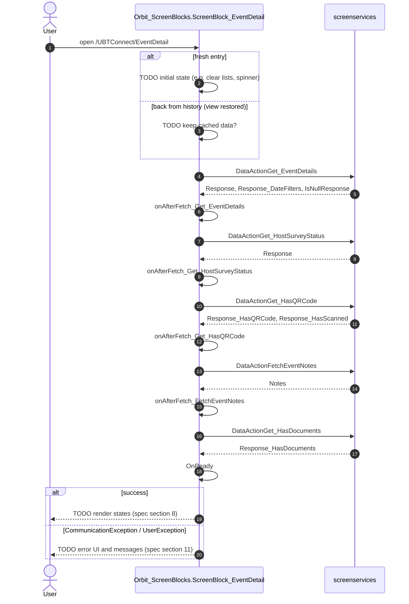
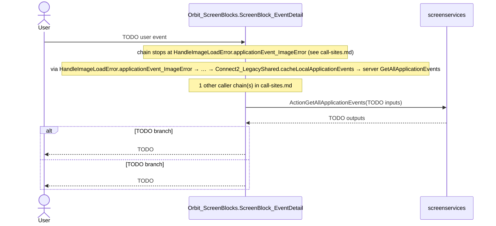

# Diagram drafts: EventDetail

Generated from the capture. They are starting points for spec section 2a (architecture) and section 10 (sequences): verify every node and arrow against the code, complete TODOs, keep 'unverified' notes where the capture cannot prove an order or a trigger. Dashed = declared but not observed, or not visible from the browser.

## Architecture (draft)

```mermaid
%% DRAFT generated by analyze_capture.py. Complete it by hand (see assets/example-diagrams.md).
flowchart TB
  subgraph Browser["Browser"]
    direction TB
    Shell["EventDetail screen<br/>UBTConnect.Legacy_OrbitEventsFlow.EventDetail.mvc.js"]
    subgraph Content["Rendered blocks"]
      direction LR
      B0["Orbit_ScreenBlocks.ScreenBlock_EventDetail<br/>Connect2_OrbitMobile_MUI<br/>fetch, lifecycle"]
      B1["Layout_OrbitTheme.Layout_Orbit<br/>Connect2_LegacyShared<br/>lifecycle"]
      B2["LayoutRuntime_NavigationHandler.LayoutRuntime_Top<br/>NavigationHandler<br/>lifecycle"]
      B3["Layout.BaseLayout_UpdatedOSUI<br/>Connect2_LegacyShared<br/>lifecycle"]
      B4["Layout.MenuIcon__UpdatedOSUI<br/>Connect2_LegacyShared<br/>lifecycle"]
      B5["CW_Notes.ItemNotesSection<br/>UBTConnect_Utils<br/>lifecycle"]
      B6["BasePatterns.CustomContainer<br/>UBTConnectLibrary<br/>lifecycle"]
      B7["BasePatterns.Columns_Two<br/>UBTConnectLibrary<br/>lifecycle"]
      B8["CW_Notes.NotesSheet<br/>UBTConnect_Utils<br/>lifecycle"]
      B9["Content.DEPRECATED_Accordion<br/>OutSystemsUI_2_23<br/>lifecycle"]
      B10["Content.DEPRECATED_AccordionItem<br/>OutSystemsUI_2_23<br/>lifecycle"]
      B11["Orbit_Blocks.HostAllocation_HelperItem<br/>Connect2_OrbitMobile_MUI<br/>lifecycle"]
      B12["Orbit_Blocks.EventDateSelection<br/>Connect2_OrbitMobile_MUI<br/>lifecycle"]
      B13["Orbit_Blocks.Card_Milestone<br/>Connect2_OrbitMobile_MUI<br/>lifecycle"]
    end
    Infra["App infrastructure blocks (20)<br/>render nothing visible"]
    Cache["View cache / preload<br/>CheckRestoredJS, IsRestoredFromCacheJS, WasCurrentViewRestoredFromCacheJS"]
    Vars["Client variables read<br/>App_PIN_BiometricEnabled, App_Policies_HasPolicyToAccept, IsNavigateToHomeOnBack, PIN_IsLocked, PIN_SessionInactivity_Use"]
    Shell --> Content
  end
  subgraph Server["OutSystems server · screenservices"]
    direction LR
    S0["DataActionGet_EventDetails<br/>data action / aggregate, observed"]
    S1["DataActionGet_HostSurveyStatus<br/>data action / aggregate, observed"]
    S2["DataActionGet_HasQRCode<br/>data action / aggregate, observed"]
    S3["DataActionFetchEventNotes<br/>data action / aggregate, observed"]
    S4["DataActionGet_HasDocuments<br/>data action / aggregate, observed"]
    S5["ActionGetAllApplicationEvents<br/>observed"]
  end
  Backend["Backend<br/>not visible from the browser"]
  B0 --> S0
  B0 --> S1
  B0 --> S2
  B0 --> S3
  B0 --> S4
  Content -.-> S5
  S0 -.-> Backend
  classDef unknown stroke-dasharray: 5 4;
  class Backend unknown;
```

## Sequence: enter the screen (draft)

### Action: ActionGetAllApplicationEvents

