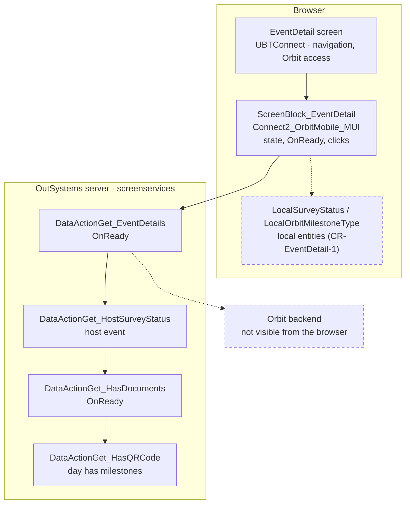
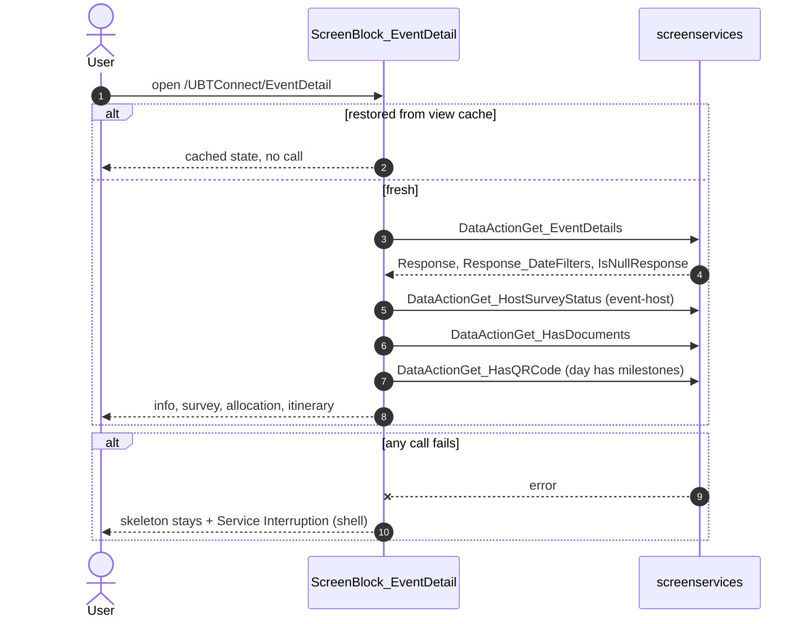

# Screen spec: EventDetail

## 0. Summary
This screen shows the detail of one Orbit event for a member of the signed-in household. It shows:
- dates, location and type;
- the host survey status (host events only);
- the host allocation (hosted milestones and helpers);
- the itinerary by day (day selector and milestone cards);
- the Contact Orbit Helpdesk footer.

The user reaches the screen from the OrbitLanding event card. OnReady runs four on-demand data actions. The screen makes no writes. [pack.md; ScreenBlock_EventDetail.mvc.js]

| Item | Value |
|---|---|
| Route (old) | `/UBTConnect/EventDetail` with `In_MemberId: LongInteger, In_EventId: LongInteger, In_EventName: Text, In_FromNotification: Boolean` |
| Screen file | `UBTConnect.Legacy_OrbitEventsFlow.EventDetail.mvc.js` |
| Content block | `Connect2_OrbitMobile_MUI › Orbit_ScreenBlocks › ScreenBlock_EventDetail` |
| Captured | 2026-10-16, TST, 390×844, full-permission account, via OrbitLanding → first Card_Event [states.json] |
| Variant | single variant; flags mobileOrbitAccess, mobileOrbitHostSurvey (default-only on), mobileOrbitEventBooklet (Q1) |
| OutSystems UI version | OutSystemsUI_2_23 |
| Sources | `migration/screens/EventDetail/analysis/` |

## 1. Entry and routing
- From OrbitLanding NavigateTo_EventDetail (`In_EventId, In_MemberId, In_FromNotification False, In_EventName`)
  [app/src/screens/OrbitLanding/index.tsx]; notifications pass In_FromNotification True.
- Inputs from the query string (P-PARAMS), Long Integers as text, Boolean "True"/"False" [index.tsx].
- Layout_Orbit (shared) with CustomClass `orbit-detail orbit-header-center` [SB view :321-330]; no bottom bar menu.

## 2. Component tree
```
EventDetail screen                                   [render] index.tsx
├─ Orbit_ScreenBlocks.ScreenBlock_EventDetail ($b1)  [render] components/ScreenBlock_EventDetail.tsx
│  └─ Layout_Orbit (b1-$b1)                          [shared]
│     ├─ HeaderLeft: MenuIcon__UpdatedOSUI Auto      [shared]
│     ├─ Title: In_EventName else EventDetails.EventName
│     ├─ HeaderRight: QR icon (HasQRCode ∧ ¬HasScanned), paper clip (HasDocuments)   [not captured]
│     ├─ Content: info rows · host survey row + HostSurvey_PillItem [shared] · Accordion_Orbit [shared] >
│     │   DEPRECATED_AccordionItem [shared] > HostAllocation_List [render: ListItem ×n, HelperItem] ·
│     │   "Itinerary" · EventDateSelection [render] > ListOfDaySelectors [shared] · List > Card_Milestone [shared]
│     │   · Skeleton_Loading (EventDetail) [shared] · NoInformation_Orbit [shared]
│     └─ BottomBar: ContactHelpdesk_Footer           [shared]
└─ App_Common.CommonUI_InsideLayout ($b2)            [shell]
```

| Block | Inputs | Events | Notes |
|---|---|---|---|
| HostAllocation_List | In_HostAllocationList | OnClick_View(MilestoneId, TypeId, Name, HostId), OnClick_ViewHelpers(Name) | virtualized list (position relative) [HL :160-205] |
| HostAllocation_ListItem | In_HostAllocationItem | OnClick_View | `icon <MainIcon>`, `Name: d Mon yyyy` [HI :150-205] |
| HostAllocation_HelperItem | — | OnClick_ViewHelpers("Helper") | icon of LocalOrbitMilestoneType helper-host [HH :81-140, :274] |
| EventDateSelection | In_DateList | ClickedDate(TimeTypeId, Date, Position) | B / A edges, ReplaceSunday, AddWeekdayBelow [ES :91-262] |

## 2a. Architecture diagram


## 3. DOM and markup contract
Markup = `analysis/dom/default.html:31-345` (pack.md § Markup). Body class `phone portrait orbit-theme osx is-ltr`.

Dynamic classes:
- Paper clip: `icon orbit-icon-paper-clip padding-none font-size-1-5em` + ` margin-left-base` when the QR icon shows [SB :477].
- QR button: `orbit-generate-qrcode-button` + ` orbit-generate-qrcode-button-disabled` [SB :740].
- Pill icon/style: by status Sent / other [SB :845, :854].
- Edge: `event-date-selector-selected` [ES :190-235].

Inline styles only as captured (`cursor: pointer`). The spec leaves out the compiled `line-height: initial` of the two header-right containers (rule 21, not captured; Decisions).

## 4. Visual specification
Original CSS only (no route CSS). Orbit theme classes from Layout_Orbit; card colours through `var(--orbit-<c>-<n>)`
inline styles of the shared Card_Template.

## 5. Data model
Wire types from the contract (`types.ts`: Get_EventDetailsWire, …); domain `EventDetails`, `DateFilters`,
`Milestone_Screen`, `DayFilter`. Null DateTime/Date (1900-01-01) → "" [api.ts]. Static entities: orbitEventType,
surveyStatus, menuAction.auto, applicationEvents_Orbit.generateQRCode [components/staticEntities.ts], milestoneTimeType,
orbitMilestoneType, orbitSkeletonLoading [shared lib]. Cached user: UserMemberId, HouseholderId, SpouseId
(Cache_UserInfo_Get = shell getUserInformation) [SB :1838-1853].

## 6. API calls
| # | Call | Kind | Trigger | Output used | React |
|---|---|---|---|---|---|
| 1 | `…/Connect2_LegacyShared/ActionGetAllApplicationEvents` | server | shell HandleImageLoadError chain (TST image error) | — | not called by the route; mock handler; Q3 |
| 2 | `…/ScreenBlock_EventDetail/DataActionGet_EventDetails` | data | OnReady | Response, Response_DateFilters, IsNullResponse | api.getEventDetails |
| 3 | `…/DataActionGet_HostSurveyStatus` | data | OnReady, OrbitEventType.Id = event-host | Response.Id (JSON_Name) | api.getHostSurveyStatus |
| 4 | `…/DataActionGet_HasDocuments` | data | OnReady | Response_HasDocuments | api.getHasDocuments |
| 5 | `…/DataActionGet_HasQRCode` | data | OnReady, selected day has milestones | Response_HasQRCode, Response_HasScanned | api.getHasQRCode |
Inputs: the block variables (screenData) [calls.md]; the route sends the scalar ones and UserInformation (types.ts).

## 7. State and lifecycle
Variables [SB model :90-170]: EventDetails, DateFilters, IsFetchingData, HostAllocation, HasQRCode, HasScanned,
HasDocuments, IsEventUnavailable, UserInformation; plus Get_EventDetails.Response.Milestones / IsDataFetched,
Get_HostSurveyStatus.Response.Id, GetLocalSurveyStatusByJSONName.List.
OnReady [SB :1799-1910]:
1. If the cache restores the view, nothing runs (P-BACK, useViewState).
2. Otherwise, IsFetchingData becomes True and Get_EventDetails runs.
3. OnAfterFetch [:2260-2330] sets EventDetails, DateFilters and IsEventUnavailable. It sets the milestones of the selected day with FilterMilestonesByDateGroup DAY, or BEFORE when there are no days.
4. Cache_UserInfo_Get sets the ids.
5. For a host event, Get_HostSurveyStatus runs. In its OnAfterFetch [:2356-2394], when the status is not "", an aggregate runs. When the status is Confirmed, HostAllocation = GetHostAllocation(all milestones) [:1712-1748].
6. Get_HasDocuments runs. When the day has milestones, Get_HasQRCode runs. Then IsFetchingData becomes False.

EventDateSelection OnReady [ES :288-350]; OnClick_Date [ES :380-470]; parent OnHandle_ClickedDate [SB :2395-2502].

## 8. Render logic
```
IsFetchingData → Skeleton_Loading(EventDetail)                          [loading, offline]
IsEventUnavailable → (fetched ∧ ¬fetching) NoInformation (alias 13, urgent)  [not captured]
else info rows (location + type only for event-host/admin; booklet row: flag ∧ IsBookletVisible; QR row: HasQRCode)
     host event ∧ local status found: (flag ∧ Sent|Confirmed) → link + pill [captured] else "Host Survey" tag
     Response.Milestones ≠ ∅ → (Confirmed → accordion [captured]) · Itinerary · EventDateSelection · cards [captured]
     else fetched ∧ ¬fetching → (Helpers ∧ Confirmed → accordion) else separator + NoInformation (12) [not captured]
Footer: Response.Milestones ≠ ∅ ∧ ¬fetching → ContactHelpdesk_Footer [captured]
```

## 9. Interactions and navigation
| Element | Logic | Navigates to |
|---|---|---|
| QR icon / GENERATE QR CODE | scanned → nothing; else NavigateTo_GenerateQRCode + OnApplicationEvent_GenerateQRCode (log, U17) | `/UBTConnect/QRCodeGenerate` (In_EventId, In_MemberId, In_EventName, In_EventStartDate, In_EventEndDate, In_EventLocation) |
| Paper clip | NavigateTo_ViewDocuments | `/UBTConnect/ViewDocuments` (…dates, In_MemberId, In_EventName, In_EventId, In_EventLocation) |
| View Event Guest List | flag → NavigateTo_EventBooklet, else Info message | `/UBTConnect/EventBooklet` (In_EventName, In_EventId), no access check |
| View/Complete Host Survey | Sent ∧ user and spouse not householder → Error message; else | `/UBTConnect/HostSurvey` (In_MemberId = HouseholderId, dates, In_EventId, In_EventName) |
| Host allocation View | NavigateTo_MilestoneDetail | `/UBTConnect/MilestoneDetail` (type, In_FromNotification False, In_HostId, In_EventId, In_MilestoneId, In_EventName, In_MilestoneName) |
| Helper View | Cache_UserInfo_Get → NavigateTo_Helpers | `/UBTConnect/HelpersDetail` (In_EventId, In_EventName, In_HostId = HouseholderId, In_OrbitMilestoneTypeId helper-host, In_MilestoneName) |
| Milestone card / View Guests | transport → TransportDetail; meal/accommodation guest/host/helper → MilestoneDetail; else nothing | `/UBTConnect/TransportDetail` (In_HeaderClass, In_MilestoneName, In_MilestoneId, In_TargetMemberId, In_OrbitMilestoneTypeId) |
| Day / B / A | filter milestones of the day / edge | — |
| Contact Orbit Helpdesk | subject = GetContactHelpdeskSubject_Event | `/UBTConnect/ContactByEmailOrbitHelpdesk` (In_MilestoneId "", In_EventId, In_Subject, In_EventName) |
All but EventBooklet check GetHasOrbitAccess; no access → message after transition + HomeFeed [EventDetail.mvc.js
:351-960]. Targets are not built: the router shows them as not migrated.

## 10. Sequence diagrams


## 11. Error handling and feedback
| Situation | UI | Text |
|---|---|---|
| Data action fails | flow handler (raiseToFlowHandler), skeleton stays [offline] | shell message |
| No Orbit access | after transition, HomeFeed | "You don't have access to Orbit. Please contact the Orbit Helpdesk if you have any questions." (Error) |
| Booklet flag off | Info | "You don't have access to this feature. Please contact your event organiser for more information." |
| Sent survey, not householder | Error | "Only Householder is able to edit the survey." |

## 12. Strings
- Host
- View Host Survey / Complete Host Survey
- Host Survey
- Host Allocation
- Helper
- View
- Itinerary
- B
- A
- View Event Guest List
- GENERATE QR CODE / QR CODE GENERATED
- Contact Orbit Helpdesk
- "Your itinerary will be available once it has been published by the event organiser."
- "The Event is no longer available for you."
- The messages of section 11.

## 13. Accessibility, platform and security notes
You cannot see the server-side authorization of the four data actions (member / event ownership) in the client. The backend must check that In_MemberId belongs to the signed-in household. Flags only hide UI.

## 13a. Feature flags
- mobileOrbitAccess (GetHasOrbitAccess): default-only on (user 2026-10-14) → `useFlagOn('mobileOrbitAccess')`.
- mobileOrbitHostSurvey (GetHasOrbitHostSurvey): default-only on (user 2026-10-14) → `useFlagOn('mobileOrbitHostSurvey')`.
- mobileOrbitEventBooklet (GetHasOrbitEventBooklet): TST true, no MCP; Q1 → A default-only on (answered, `flags.py decide` + `export` done [questions.md Q1])
  → `useFlagOn('mobileOrbitEventBooklet')` (captured IsBookletVisible False, so no captured state depends on it).
- App_PIN_BiometricEnabled: not a flag (user 2026-10-14).

## 14. Unclear points
| # | What | Question | Status |
|---|---|---|---|
| 1 | Booklet flag branches | Q1 | answered: A [questions.md Q1] |
| 2 | LocalSurveyStatus / LocalOrbitMilestoneType not synced by the shell | Q2, CR-EventDetail-1 | answered: A [questions.md Q2]; CR-EventDetail-1 applied |
| 3 | ActionGetAllApplicationEvents in the capture | Q3 | answered: A [questions.md Q3]; exemption merged into parity-exemptions.json |
| 4 | Mock event 7301 as a Host event | Q4 | answered: A [questions.md Q4] |
| 5 | TST SurveyStatus labels / JSON_Name | Q5 (fact) | answered: no source, fictional values in orbit.ts [questions.md Q5] |
| 6 | MenuIcon Auto back arrow when opened by URL | exemption VIA-BACK-MENUICON-EVENTDETAIL | merged into parity-exemptions.json |

## 15. Acceptance criteria
1. State default (with the captured inputs, see Decisions): the screen shows
   - info rows with dates in the style "Fri 23 Oct 2026 - Sun 25 Oct 2026", location, "Host" and type of event;
   - Itinerary with three days (first selected) and two cards (Accommodation with View Guests, Meeting 11:59 PM);
   - the footer.
2. State loading: Skeleton_Loading EventDetail, empty header right and footer.
3. State offline: skeleton and shell Service Interruption.
4. Calls in order: EventDetails → HostSurveyStatus → HasDocuments → HasQRCode.
5. Navigations of section 9 with the original parameter names.

## 16. Decisions to confirm
- Q1 → A: flag mobileOrbitEventBooklet default-only on (answered; `flags.py decide` + `export` done) [questions.md Q1].
- Q2 → A: CR-EventDetail-1 is applied [questions.md Q2; CR-EventDetail-1 status]. The route no longer shows `<NotCaptured>` for the host survey row and the Host Allocation accordion.
- Q3 → A: call exemption CALL-IMAGE-ERROR-APPEVENTS-EVENTDETAIL (merged into parity-exemptions.json); mock handler answers an empty EventList.
- Q4 → A: shared mock event 7301 is a Host event (ORBIT_EVENT_TYPES.host, same colour/icon, OrbitLanding unchanged). The mock data is:
  - host milestones: two accommodation nights and meetings;
  - hosts: "Mr Julián & Mrs Fiorella Vitale";
  - fictional type of event: "Weekend Conference Program";
  - survey status JSON_Name: "confirmed".
- Parity needs capture-plan `cloneQuery` with the captured inputs (proposed-exemptions.json `_comment`): parity opens
  the bare route while the capture came via OrbitLanding.
- Exemptions merged into parity-exemptions.json: VIA-BACK-MENUICON-EVENTDETAIL, CAPTURE-SKELETON-SHIMMER-PHASE-EVENTDETAIL.
- Header-right QR / documents containers built from the compiled view without `line-height: initial` (rule 21; not
  captured); "View Event Guest List", GENERATE QR CODE, B/A edges, unavailable and no-milestone branches: compiled
  view, not captured.
- Mock: MilestoneInfo dates null and Description empty as captured; DayFilter IsSelected on the first day (server rule
  unknown).

## 17. Patterns used
- P-PARAMS: index.tsx inputs and navigations.
- P-DATA / P-CALLS: api.ts, OnReady order.
- P-MOCKS: mocks.ts (contractHandler, shared Orbit world).
- P-STATES: skeleton, NoInformation.
- P-BACK: useViewState / useWasRestoredFromCache (block and EventDateSelection).
- P-LIST: OSList (host allocation, cards).
- P-OSUI: DEPRECATED_AccordionItem via Accordion_Orbit.
- P-FLAGS: useFlagOn.
- P-DIALOG: showFeedbackMessage.

## 18. Builder notes
Route files: `app/src/screens/EventDetail/{index.tsx,types.ts,api.ts,mocks.ts,components/}`; shared mock world
`app/src/mocks/fictional/orbit.ts` (host type, milestone types, survey statuses, event detail).
