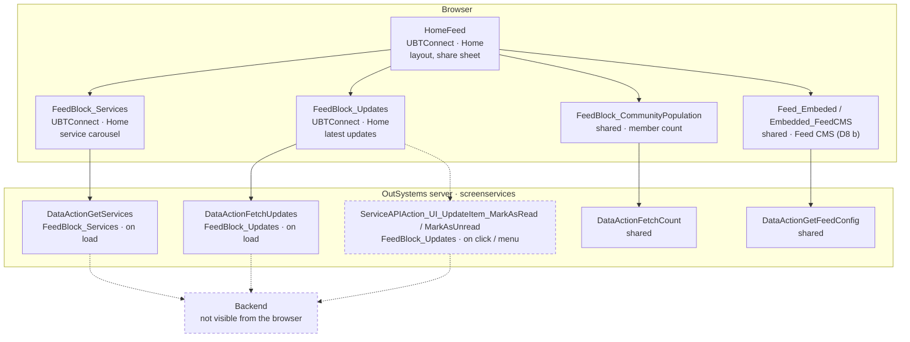

# Screen spec: HomeFeed

## 0. Summary
Home screen (V2 default screen, board reason). Under the home layout (logo, bell, search bar) it shows three feed
sections: Services (carousel of service shortcuts, settings button), Community Population (shared block) and Updates
(latest update items, "View all"), then the embedded Feed CMS (shared, D8 b) and the Leave App dialog. A Share sheet
opens from an update item or a feed item. [pack.md Block plan; HF = sources/pretty/UBTConnect.Home.HomeFeed.mvc.js]

| Item | Value |
|---|---|
| Route (old) | `/UBTConnect/HomeFeed`, no inputs [pack.md] |
| Screen file | `UBTConnect.Home.HomeFeed.mvc.js` |
| Captured | TST, phone 390x844, states default / loading / offline [states.json] |
| Variant | V2 home; flags below (all default-only except C2NewNotifications, handled by the shared bell) |
| OutSystems UI version | OutSystemsUI_2_23 [pack.md] |
| Sources | `migration/screens/HomeFeed/analysis/` |

## 1. Entry and routing
- Default screen after sign-in / PIN (shell `signIn()` → HomeFeed) and bottom bar Home [docs/guides/shell.md].
- No input parameters. Layout `Layout_HomePage` (SVGHeight "260px", ContentBackgroundColor Neutral4) [HF:150-153];
  bottom bar `BottomBarMenu` ActiveItem Home, isRootPage True [HF:460-479]; CommonUI_InsideLayout in
  `Placeholder_CommonUI_Inside_Layout` [HF:483-499]. No FixedFooter in this screen (none in dom/default.html).

## 2. Component tree
```
HomeFeed                                              [render]
├─ Layouts.Layout_HomePage $b1                        [shared]
│  ├─ Placeholder_Header_Title: App_Common.AppLogo_White $b2       [render, own]
│  ├─ Placeholder_Header_Right: App_NotificationIcon $b3           [shared]
│  ├─ Content
│  │  ├─ Home.Section_FeedWrapper "Section_Services" (b4)          [render, own]
│  │  │  └─ App_Common_Blocks.Section (b4-$b1) > Home.FeedBlock_Services $b5   [render, own]
│  │  │       └─ Dialog_GoExternalApp b5-$b12                       [render, own]
│  │  ├─ Home.Section_FeedWrapper "Section_CommunityPopulation" (b6) > FeedBlock_CommunityPopulation $b7 [shared]
│  │  ├─ if HasUpdates: Home.Section_FeedWrapper "Section_Updates" (b8) > Home.FeedBlock_Updates $b9 [render, own]
│  │  ├─ Home.Feed_Embeded $b10                                    [shared, D8 b]
│  │  └─ if IsScreenInitialized: Dialog_ExitConfirmation $b11      [shell]
│  ├─ Bottom: App_Common.BottomBarMenu $b12 (Home, root)           [shared]
│  └─ Placeholder_CommonUI_Inside_Layout: CommonUI_InsideLayout $b13 [shared]
└─ CW_Share.ShareSheet $b14 (placeholder: Update_ListItem $b15 | ShareableObject_Generic $b16) [shared]
```

| Block | Inputs | Events | Placeholders | Notes |
|---|---|---|---|---|
| Section_FeedWrapper | isTransparentBackground=False, ShowHeader=True, showViewAll=True, Title="", MarginTopSizeId="" (defaults) | OnClick_ViewAll | Content | header: Columns_Two(ReduceLast) Title neutral-9 base semi-bold + IconText "View all" (neutral-7, xs, semi-bold, underline, icon arrowRightAlt neutral-8 Medium_20, right, spacing base) [Section_FeedWrapper.mvc.js:200-330] |
| Section | isTransparentBackground=False, AddHorizontalPadding=True, MarginTopSizeId="" | – | Header, Content | CustomContainer: background Transparent/Neutral0, padding vertical Small, horizontal Base (if AddHorizontalPadding), margin top [Section.mvc.js:172-235] |
| FeedBlock_Services | ItemPerPage=6, ForceAddService=False | – | – | see 3, 7, 9 |
| Dialog_GoExternalApp | In_ExtendedClass="", ExternalApp_PopUpInfo | OnPopUpReady(PopUpId) | – | ActionConfirmationDialog "PopUp"; header "Move to " + AppName; body icon + message; confirm "Continue to " + AppName + open_new icon; dismiss "Cancel" [Dialog_GoExternalApp.mvc.js:157-560] |
| FeedBlock_Updates | – | Event_NoUpdates, Event_Share(UpdateItemId, ShareableUpdateItem) | – | see 3, 7, 9 |
| AppLogo_White | – | – | – | Image `img/UBTConnect.ConnectLogoWhite.svg`, width 155px [AppLogo_White.mvc.js:123-133] |

## 2a. Architecture diagram


## 3. DOM and markup contract
- Body class `phone portrait osx is-ltr`, body style `--header-size-content: 0px; --footer-height: 56px;
  --viewport-height: 844px;` [states.json]; layout markup from Layout_HomePage [shared README].
- Section wrappers [dom/default.html:122-130, 437-447, 481-552]: `OSBlockWidget Home.Section_FeedWrapper` with name ids
  `Section_Services` / `Section_CommunityPopulation` / `Section_Updates`, then `App_Common_Blocks.Section` `b4-$b1`,
  CustomContainer `b4-b1-$b1` classes `background-transparent padding-x-base padding-y-s margin-top-base` (Services),
  `background-transparent padding-x-base padding-y-s` (Community), `background-neutral-0 padding-x-base padding-y-s
  margin-top-s` (Updates); `<div id="b4-b1-Header">`, `<div id="b4-b1-Content"><div id="b4-Content">`.
- Updates header [dom:487-534]: CustomContainer `margin-y-base` > Columns_Two (no gutter, reduce-last) > CustomText
  `text-neutral-9 font-semi-bold font-size-base` "Updates" | IconText (row-reverse, gutter-base) icon
  `connect-icon-arrow_right_alt text-neutral-8 icon-medium` + CustomText `text-neutral-7 font-semi-bold font-size-xs
  text-underline` "View all".
- FeedBlock_Services [dom:130-433]: CustomContainer `b5-DIV_Services` classes `ubt-services-carousel background-neutral-0
  shadow-s border-radius-large padding-s`, inline style `background-color: rgba(var(--color-rgb-neutral-0),0.87)`;
  Columns_Two `padding-x-s` gutter-s reduce-last align-items-center: CustomText `margin-left-s` "Services" | CircleButton
  xs, border neutral-3, background neutral-0, icon `connect-icon-settings text-neutral-7 icon-base`; CustomContainer
  `margin-top-xs` > Carousel `b5-Carousel_Services` (ubt-services-carousel, dots) > List `list list-group
  ubt-services-carousel__list OSFillParent` (data-animation-disabled, data-virtualization-disabled) > per page Gallery
  (3/3/3, `ubt-services-carousel__gallery`) > List `…__list-items` > per item SkeletonSection > CircleButton_WithLabel
  (l, border neutral-3, background neutral-0, padding s or none for SVG_ icons) > Icon (IconId, display_36 or
  NonStandard_64 for SVG_) + text Name. Then Dialog_GoExternalApp closed markup [dom:421-430].
- FeedBlock_Updates [dom:550-918]: SkeletonSection `b9-$b1` > List `list list-group home-page--update-list
  OSFillParent` (`data-list`, style `position: relative`, `list-error` when the fetch failed [dom/offline.html]) > per
  item CustomContainer `overflow-hidden` + background `cyan-lightest` when unread, `border-s border-color-neutral-3
  border-radius-large padding-x-base padding-y-xs margin-y-s` > Update_ListItem (shared) + (HasAccess False:
  subscription container, not captured) + empty `<div data-container="">`.
- Item ids follow the capture (`b5-l2-53_1-l2-100_<i>-…`, `b9-l1-89_<i>-…`).

## 4. Visual specification
Original CSS only (shell). Screen-specific classes all come from the shared/library blocks above; nothing added.
Images: `img/UBTConnect.ConnectLogoWhite.svg` (captured, 155x25).

## 5. Data model
- `DataActionGetServices` out: `List` of Connect_Services (Id, Label, Order, IconId, …), `ExternalLinks_ElGusto`,
  `ExterrnalPackages_{CommunityTradelink,HR100,Trove}` [contract]. Mapped to pages of ItemPerPage UI_ServiceItem
  {Id, IconId, Name=Label, Order} [Services.mvc.js:825-900].
- `DataActionFetchUpdates` out: `UI_UpdateItemList` of Connect_Updates_CS.UI_UpdateItem (Long ids as strings) [contract].
- Screen variables: HasUpdates (True), IsScreenInitialized (False), ShareableUpdateItem, IsShareOpen, ShareableObjectId,
  ShareObjectTypeId, ShareableFeedItem [HF:13-33].
- Static entities (TST values, Q2 answered; `migration/knowledge/static-entities.md` "TST values"):
  Connect_Services ids = record names (Orbit, LDM, MyCalendar, Assemble, OrbitAdmin, MyNotes, Trove, HR100,
  CommunityTradelink, ElGusto, OneSchoolGlobal); Type_ShareObject Update = "Update", Feed = "Feed";
  UBT_Icons.FeedItem = `connect-icon-feed`. In code: `components/staticEntities.ts`.

## 6. API calls
| # | Old call | Kind | Trigger | Inputs | Output used | Server side | React |
|---|---|---|---|---|---|---|---|
| 1 | `…/Home/FeedBlock_Services/DataActionGetServices` | Data action | load | screen variables (MainElementClass, Local_ServicesPerPage, ExternalAppPopUp_Id, Local_ExternalApp_PopUpInfo, ItemPerPage, ForceAddService) | List, links, packages | unknown | `callAction('UBTConnect','FeedBlock_Services/DataActionGetServices')`, recordedHandler (fixture re-recorded with the real Id and IconId, Q1) |
| 2 | `…/Home/FeedBlock_Updates/DataActionFetchUpdates` | Data action | load | screen variables (CarouselPreloadedHouseholds) | UI_UpdateItemList | unknown | `callAction('UBTConnect','FeedBlock_Updates/DataActionFetchUpdates')`, fictional (person data) |
| 3 | `…/ServiceAPIAction_UI_UpdateItem_MarkAsRead` | Server action | item click (HasAccess) / menu Mark as read | UpdateItemId | – | unknown | store mutation (P-MUTATION) |
| 4 | `…/ServiceAPIAction_UI_UpdateItem_MarkAsUnread` | Server action | menu Mark as unread | UpdateItemId | – | unknown | store mutation |
| 5-6 | FetchCount, GetFeedConfig | Data actions | load | – | – | – | shared blocks |
| 7+ | SynchAppContext, AfterInitialize, Sync_Info_GetMain, GetUserInformation, GetNumberUnreadMessages, CacheableMapEntities, CacheableHouseholds | app start | load | – | – | – | shell |
Observed: 1, 2, 5-7+ [calls.json]; 3-4 declared only.

## 7. State and lifecycle
- HomeFeed OnInitialize: IsScreenInitialized = False; OnReady: True (mounts Dialog_ExitConfirmation) [HF:700-830].
- FeedBlock_Services OnInitialize: Local_ServicesPerPage = [page 1 with 5 empty items] (skeletons) [Services:820-835];
  OnAfterFetch: clear; if ForceAddService append "Add Service" (addCircle, mandatory); split List into pages of
  ItemPerPage (PageNumber 1..n) [Services:836-890].
- FeedBlock_Updates OnInitialize: when the view is restored from cache and data is fetched, reads the preload object
  (EntitiesCarousel_SwippedItems) and marks those items read [Updates:880-930]. OnReady: unless restored, appends 3
  loading items (Birth, "Loadin Name", "Loadinf Location", today, MALE, read, access) [Updates:960-990]. OnAfterFetch:
  empty list → Event_NoUpdates → HasUpdates = False (hides Section_Updates) [Updates:860-868, HF:735-745].

## 8. Render logic
```
Section_Updates if HasUpdates                                           [HF:315]
Dialog_ExitConfirmation if IsScreenInitialized                          [HF:436]
Services settings button if GetHasCustomEvents (C2EnableCustomServices) [Services:300-330]
Service skeleton In_IsLoading = not fetched or fetch error              [Services:517]
Updates skeleton In_IsLoading = not fetched and not fetch error         [Updates:157]
Update item background cyan-lightest if not IsRead; subscription container if not HasAccess (not captured)
ShareSheet placeholder: Update_ListItem if type Update; ShareableObject_Generic if type Feed [HF:554-640]
```
States: default (data), loading (requests unanswered), offline (requests fail: list-error, loading items kept).

## 9. Interactions and navigation
| Element | Event | Logic | Calls | Navigates to | Feedback |
|---|---|---|---|---|---|
| Updates "View all" | click | Section_UpdatesOnClick_ViewAll | – | `/UBTConnect/Updates_SingleList` | – |
| Services settings | click | OnClick_ServiceSettings | – | `/UBTConnect/Services` | – |
| Service item | click | OnClick_Service by Id: Orbit → OrbitLanding; LDM → LDM_MyEvents_V2 (C2NewLDM on); MyCalendar → MyEntertaining; Assemble → AssembleEvents; OrbitAdmin → OrbitAdminLanding; MyNotes → Notes; Trove/HR100/CommunityTradelink → PopUpInfo + ConfirmAction(dialog) ; ElGusto → OpenInApp_OpenExternalLink (shared, CR-HomeFeed-1 applied); OneSchoolGlobal → toast "Coming soon" | – | as listed | info toast |
| GoExternalApp Confirm | Confirmed | PackageName "" → "Not available" toast; else OpenInApp_OpenApp (CR-HomeFeed-1 applied: in the browser the "Not available" app toast, Utils controller :4439-4441) | – | – | toast |
| Update item | click | HasAccess: MarkAsRead → GetHasCarouselEnabled (on) → Directory_Updates_GetCarouselPreloadedHouseholds + SetPreloadObject (CR-HomeFeed-2 applied) → HouseholdCarousel(In_StartingHouseholdId); else ShowUpgradePopUp | MarkAsRead | HouseholdCarousel | – |
| Update menu | Mark as read / unread | server action, then Current.IsRead = True/False | MarkAsRead / MarkAsUnread | – | – |
| Update menu | Send gift | FeedbackMessageShow "Send gift", Info | – | – | info |
| Update menu | Share | GetHasExtendedShare (on) → Event_Share → screen: ShareObjectTypeId Update, ShareableObjectId MemberId, IsShareOpen | – | – | share sheet |
| Feed share | Event_Share | ShareObjectTypeId Feed, ShareableFeedItem (FeedItem, image, title, subtitle), IsShareOpen | – | – | share sheet |
| Share sheet | Event_ClosedShareSheet | IsShareOpen = False | – | – | – |
| Layout search | OnSearchClick | nothing (empty handler) [HF:159-170] | – | – | – |

## 10. Sequence diagrams
```mermaid
sequenceDiagram
  autonumber
  actor U as User
  participant S as HomeFeed blocks
  participant API as screenservices
  U->>S: open /UBTConnect/HomeFeed
  S->>S: OnInitialize (IsScreenInitialized False; services skeleton page)
  par load
    S->>API: DataActionGetServices
    S->>API: DataActionFetchUpdates
  end
  S->>S: OnReady (IsScreenInitialized True; 3 loading update items)
  alt success
    API-->>S: List, packages, links / UI_UpdateItemList
    S-->>U: service pages, update items (empty → Section_Updates hidden)
  else request failed
    API--xS: error
    S-->>U: service skeletons stay, update list-error with loading items
  end
```
```mermaid
sequenceDiagram
  autonumber
  actor U as User
  participant B as FeedBlock_Updates
  participant API as screenservices
  U->>B: click update item
  alt HasAccess
    B->>API: ServiceAPIAction_UI_UpdateItem_MarkAsRead(UpdateItemId)
    Note over B: C2EnableCarousel on (default-only); preload set (CR-HomeFeed-2 applied)
    B-->>U: HouseholdCarousel?In_StartingHouseholdId=…
  else no access
    B-->>U: ShowUpgradePopUp (Access Restricted dialog)
  end
```

## 11. Error handling and feedback
| Situation | Detection | UI | Text |
|---|---|---|---|
| GetServices fails | hasFetchError | skeletons stay | – |
| FetchUpdates fails | hasFetchError | list-error, loading items | – |
| MarkAsRead/Unread fails | exception | Home flow HandleError (shell) | – |
| External app without package | PackageName "" | feedback message (type expression bug: TextToInteger("Entities.UBT_MessageType.Error") = 0 → info) | "Not available" / "Sorry, this is not available in the platform you are using" |

## 12. Strings
"Services", "Updates", "View all", service labels (data), "Move to …", "You’re about to leave this app and open …. Are you
sure you want to continue?", "Continue to …", "Cancel", "Coming soon" / "This feature will be coming soon.",
"Send gift", "Subscription upgrade required", "Loadin Name", "Loadinf Location".

## 13. Accessibility, platform and security notes
- Native-only: OpenInApp_OpenApp (external apps) out of scope on the web apart from CR-HomeFeed-1.
- Server actions MarkAsRead/MarkAsUnread need server-side authorization (item belongs to the user); HasAccess only hides UI.

## 13a. Feature flags
| Flag | Decision | Built |
|---|---|---|
| C2EnableCustomServices | default-only on | settings button `useFlagOn` |
| C2EnableFeed | default-only on | inside shared Feed_Embeded |
| C2ExtendedShare | default-only on | Share → Event_Share; off renders/does nothing |
| C2EnableCarousel | default-only on | item click → HouseholdCarousel; off branch not built |
| C2NewLDM | default-only on | LDM → LDM_MyEvents_V2; off branch not built |
| C2NewNotifications | both, default off | shared bell (App_NotificationIcon) |
| others (C1DirectoryView, NewBookmarks, mobileDirectoryBookmarkNote, …) | default-only | shared bottom bar / blocks |

## 14. Unclear points
| # | What | Why | Question | Status |
|---|---|---|---|---|
| 1 | GetServices fixture Id/IconId | converter rule | Q1 | resolved: re-recorded read-only from TST with Id and IconId kept (user, 2026-10-15) |
| 2 | Connect_Services ids, Type_ShareObject.Update | static entity values not in compiled code | Q2 | resolved: TST values (knowledge/static-entities.md "TST values") |
| 3 | UBT_Icons / Connect_Entity FeedItem value | pending user MCP check (orchestrator) | – | resolved: UBT_Icons.FeedItem `connect-icon-feed` (TST value) |
| 4 | OpenInApp_OpenExternalLink / OpenApp bodies | Utils controller :4360-4538 | CR-HomeFeed-1 | applied (OpenApp browser path ported) |
| 5 | Directory_Updates_GetCarouselPreloadedHouseholds | UC:1828-1925 | CR-HomeFeed-2 | applied |
| 6 | Subscription container (HasAccess False), Add Service item, open dialog | not captured | – | NotCaptured / compiled code |
| 7 | Shared bottom bar, bell and slider differed from the capture; extra unread-count call | shared blocks | CR-HomeFeed-3 | applied: transition events (`shell/navigation/transitionEvents.ts`), unread-count call, bell link, offline bell rule; nested-`<a>` diffs gone with the live-nesting replay. Slider timing left (row 11) |
| 8 | Loading capture shows the data actions' error state (requests held until the OutSystems timeout); the mock "loading" scenario never answers, so the build shows skeletons | capture-replay | CAPTURE-LOADING-FETCH-TIMEOUT | resolved: exemption accepted (user, 2026-10-15); its pixel area is row 14 |
| 9 | AppLogo_White image 16x16 in the replayed reference (broken image), 155x25 live (`data-rendered-size`) | capture-replay | CAPTURE-LOGO-REPLAY-HOMEFEED | resolved for layout/position (user, 2026-10-15); pixel part is row 13 |
| 10 | Feed CMS iframe (D8 b) present in the build, empty container in the capture | shared, D8 b | FEED-CMS-D8B-IFRAME | resolved: exemption accepted (user, 2026-10-15) |
| 11 | Bottom-bar slider: default build lacks `dx-bottom-bar-slider-appear`; loading build has no slider. TST installed the slider about 2 s after the screen rendered (runtime-HomeFeed.json: AfterInitialize t=7211, Sync_Info_GetMain t=7961; UC:15318-15332), via ForceRefresh with no duration (`undefinedms`), so the CSS animation is invalid and `-appear` never leaves (UBTConnectLibrary.UBTConnectLibrary.css:1802-1803). Parity mocks answer at once (latency 0), so the clone's app start ends before the first screen. At the default mock latency (600 ms) the clone gives the captured markup. Loading: TST's SynchAppContext timed out after 10 s (AM:8579, AM:5103-5113) and the slider followed; the clone has no request timeout | parity timing | Q3 | open (decision) |
| 12 | Badge `right` differs in the bell (-6.33 → -4.80 px) and on bottom-bar item 3 (-12.92 → -17.31 px). `right` is the resolved value of `right: auto` for the pill with `left: 45%` (css-relevant.md:585), so it follows the pill width, i.e. the badge text. The capture masks it as "••" (2 characters, dom/default.html:51-55, :1019-1023). The bell fixture says 6 unread (ActionGetNumberUnreadMessages 0 + 6, recorded at another time); 2 characters at capture time mean ≥ 10, shown "9+" (Badge maxNumber 9) | masked user text | exemption proposed (report) | open |
| 13 | The logo replay (row 9) also gives 1660 diff pixels (hotspots 0-160,0) in every state; a `rules` entry cannot mask pixels, an `ignoreSubtrees` entry can (as Login's CAPTURE-LOGO-REPLAY) | capture-replay | exemption proposed (report) | open |
| 14 | Loading: about 4100 diff pixels in the Updates list (capture error state vs build skeletons), the area of the accepted CAPTURE-LOADING-FETCH-TIMEOUT; the parity tool masks pixels only for `ignoreSubtrees`, which takes no `states` filter | capture-replay | Q3 option B would remove it; otherwise a skill change (proposed in the report) | open |

## 15. Acceptance criteria
1. default, loading and offline states pass parity (DOM, styles, text, pixels, calls) at 390x844.
2. GetServices and FetchUpdates are called once on load with the original input names; MarkAsRead only on click.
3. View all → Updates_SingleList; settings → Services; update item → HouseholdCarousel with In_StartingHouseholdId.
4. Empty FetchUpdates hides Section_Updates; failure shows list-error with the loading items.

## 16. Decisions to confirm
- FetchUpdates mock: fictional items (person data), 3 unread items Birth / Marriage / Marriage with fictional names of the
  captured lengths, HasAccess True, ShowImage False (captured shape).
- MarkAsRead / MarkAsUnread mocked as mutations of a store collection (P-MUTATION), never recorded.
- Service click by Id with the TST Connect_Services values (Q2): Orbit → OrbitLanding, LDM → LDM_MyEvents_V2, MyCalendar →
  MyEntertaining, Assemble → AssembleEvents, OrbitAdmin → OrbitAdminLanding, MyNotes → Notes, Trove/HR100/CommunityTradelink
  → GoExternalApp dialog, ElGusto → new tab, OneSchoolGlobal → "Coming soon" toast (section 9).
- Service list and icons from the GetServices fixture re-recorded with the real Id and IconId (Q1, user 2026-10-15).
- Item click sets the preload object and navigates to HouseholdCarousel (CR-HomeFeed-2 applied).
- El Gusto opens in a new tab (U18, CR-HomeFeed-1 applied); GoToExternalApp OpenApp shows the "Not available" app toast in
  the browser (CR-HomeFeed-1).
- Lists rendered as the captured `div.list` markup inside the route (P-LIST names a shared list component that does not
  exist yet).
- Subscription-upgrade container (HasAccess False) rendered as NotCaptured with its compiled text and click.
- Dialog_GoExternalApp open-state content (body, confirm label) inside NotCaptured; container with inline
  `text-align: center` and the confirm row's FlexDirection Row left out (not captured).
- The "Not available" toast of GoToExternalApp uses the Info type (the original passes
  TextToInteger("Entities.UBT_MessageType.Error") = 0).
- Bell count from the recorded ActionGetNumberUnreadMessages fixture (6). The capture showed 2 characters, i.e. "9+";
  that is data recorded at another time, not markup (section 14 row 12).
- Q3 answered A (user, 2026-10-15): the bottom-bar slider timing (default `-appear` class, loading slider) is a
  capture-timing artifact (exemptions SLIDER-APPEAR-TIMING, SLIDER-LOADING-TIMEOUT); porting the OutSystems request
  timeouts (10 s AppManager / 20 s data actions) into callAction is a foundation backlog item.
- Exemptions accepted (user, 2026-10-15): CAPTURE-LOGO-REPLAY-HOMEFEED (+ -PIXEL), CAPTURE-LINK-HREF-CURSOR-HOMEFEED
  (cursor only), CAPTURE-LOADING-FETCH-TIMEOUT (+ -PIXEL, loading only), CAPTURE-SKELETON-SHIMMER-PHASE,
  FEED-CMS-D8B-IFRAME, CAPTURE-BADGE-MASKED-TEXT-HOMEFEED (`right` only), SLIDER-APPEAR-TIMING, SLIDER-LOADING-TIMEOUT.

## 17. Patterns used
- P-DATA / P-CALLS / P-MOCKS: api.ts adapters for GetServices, FetchUpdates, MarkAsRead/Unread; mocks.ts.
- P-MUTATION: read state of update items in `store.ts`.
- P-STATES: skeletons, list-error, NotCaptured gaps.
- P-DIALOG: Dialog_GoExternalApp (ActionConfirmationDialog), share sheet, feedback messages.
- P-PARAMS: navigation with original parameter names.
- P-BACK: view state (HasUpdates, IsScreenInitialized) and restored-from-cache check in FeedBlock_Updates.
- P-FLAGS: useFlagOn for C2EnableCustomServices, C2ExtendedShare, C2EnableCarousel, C2NewLDM.
- P-OSUI: Carousel and Gallery from src/shared/osui.
- P-LIST: OS List markup (see 16).

## 18. Builder notes
Reference implementations: Login (P-PARAMS, P-STATES, P-DIALOG), AcceptPendingPolicies (P-DATA, P-MOCKS, P-MUTATION,
P-CALLS, P-BACK).

## 19. Parity
`route.py parity HomeFeed --app http://localhost:5173`, 2026-10-15, after the last code change, with the exemptions the
user accepted (section 16). Regression parity clean on Login, PINUnlock, PINRegister and Splash. Reports: `parity/<state>.json`.

| State | Unexempted | Pixels |
|---|---|---|
| default | 0 | 0.03 %, worst tile 1.6 % |
| loading | 0 | 0.00 %, worst tile 0.1 % |
| offline | 0 | 0.04 %, worst tile 2.1 % |

Calls: 0 differences in every state.

## 20. Change requests
| CR | What | Status |
|---|---|---|
| CR-HomeFeed-1 | OpenInApp_OpenExternalLink / OpenApp web path | applied |
| CR-HomeFeed-2 | Directory_Updates_GetCarouselPreloadedHouseholds + SetPreloadObject | applied |
| CR-HomeFeed-3 | Bottom bar slider, transition events, unread-count call, bell link, offline bell rule | applied; slider timing = capture artifact (Q3 A) |
