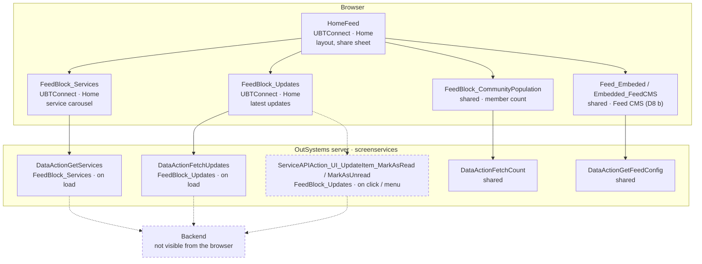

# Screen spec: HomeFeed

## 0. Summary
HomeFeed is the home screen (V2 default screen, board reason). The home layout has a logo, a bell and a search bar. Under the layout, the screen shows three feed sections:
- Services: a carousel of service shortcuts and a settings button.
- Community Population: a shared block.
- Updates: the latest update items and "View all".

After the three sections, the screen shows the embedded Feed CMS (shared, D8 b) and the Leave App dialog. The Leave App dialog opens on back navigation [app-shell.spec.md, Dialog_ExitConfirmation]. The Share sheet opens in two cases, and only when the flag C2ExtendedShare is on:
1. The user selects Share in the menu of an update item (sections 9 and 13a).
2. The embedded Feed CMS sends a share event for a feed item (section 9).

When the flag is off, the Share sheet does not open (section 13a).

[pack.md Block plan; HF = sources/pretty/UBTConnect.Home.HomeFeed.mvc.js]

| Item | Value |
|---|---|
| Route (old) | `/UBTConnect/HomeFeed`, no inputs [pack.md] |
| Screen file | `UBTConnect.Home.HomeFeed.mvc.js` |
| Captured | TST, phone 390x844, states default / loading / offline [states.json] |
| Variant | V2 home; flags below (all default-only except C2NewNotifications, handled by the shared bell) |
| OutSystems UI version | OutSystemsUI_2_23 [pack.md] |
| Sources | `migration/screens/HomeFeed/analysis/` |

## 1. Entry and routing
- The shell opens HomeFeed after sign-in or PIN (shell `signIn()` → HomeFeed). The user also opens HomeFeed with Home in the bottom bar [docs/guides/shell.md].
- The screen has no input parameters. Layout `Layout_HomePage` has SVGHeight "260px" and ContentBackgroundColor Neutral4 [HF:150-153].
- The bottom bar `BottomBarMenu` has ActiveItem Home and isRootPage True [HF:460-479].
- CommonUI_InsideLayout is in `Placeholder_CommonUI_Inside_Layout` [HF:483-499].
- The screen has no FixedFooter (none in dom/default.html).

## 2. Component tree
```
HomeFeed                                              [render]
├─ Layouts.Layout_HomePage $b1                        [shared]
│  ├─ Placeholder_Header_Title: App_Common.AppLogo_White $b2       [render, own]
│  ├─ Placeholder_Header_Right: App_NotificationIcon $b3           [shared]
│  ├─ Content
│  │  ├─ Home.Section_FeedWrapper "Section_Services" (b4)          [render, own]
│  │  │  └─ App_Common_Blocks.Section (b4-$b1) > Home.FeedBlock_Services $b5   [render, own]
│  │  │       └─ Dialog_GoExternalApp b5-$b12                       [render, own]
│  │  ├─ Home.Section_FeedWrapper "Section_CommunityPopulation" (b6) > FeedBlock_CommunityPopulation $b7 [shared]
│  │  ├─ if HasUpdates: Home.Section_FeedWrapper "Section_Updates" (b8) > Home.FeedBlock_Updates $b9 [render, own]
│  │  ├─ Home.Feed_Embeded $b10                                    [shared, D8 b]
│  │  └─ if IsScreenInitialized: Dialog_ExitConfirmation $b11      [shell]
│  ├─ Bottom: App_Common.BottomBarMenu $b12 (Home, root)           [shared]
│  └─ Placeholder_CommonUI_Inside_Layout: CommonUI_InsideLayout $b13 [shared]
└─ CW_Share.ShareSheet $b14 (placeholder: Update_ListItem $b15 | ShareableObject_Generic $b16) [shared]
```

| Block | Inputs | Events | Placeholders | Notes |
|---|---|---|---|---|
| Section_FeedWrapper | isTransparentBackground=False, ShowHeader=True, showViewAll=True, Title="", MarginTopSizeId="" (defaults) | OnClick_ViewAll | Content | header: Columns_Two(ReduceLast) Title neutral-9 base semi-bold + IconText "View all" (neutral-7, xs, semi-bold, underline, icon arrowRightAlt neutral-8 Medium_20, right, spacing base) [Section_FeedWrapper.mvc.js:200-330] |
| Section | isTransparentBackground=False, AddHorizontalPadding=True, MarginTopSizeId="" | – | Header, Content | CustomContainer: background Transparent/Neutral0, padding vertical Small, horizontal Base (if AddHorizontalPadding), margin top [Section.mvc.js:172-235] |
| FeedBlock_Services | ItemPerPage=6, ForceAddService=False | – | – | see 3, 7, 9 |
| Dialog_GoExternalApp | In_ExtendedClass="", ExternalApp_PopUpInfo | OnPopUpReady(PopUpId) | – | ActionConfirmationDialog "PopUp"; header "Move to " + AppName; body icon + message; confirm "Continue to " + AppName + open_new icon; dismiss "Cancel" [Dialog_GoExternalApp.mvc.js:157-560] |
| FeedBlock_Updates | – | Event_NoUpdates, Event_Share(UpdateItemId, ShareableUpdateItem) | – | see 3, 7, 9 |
| AppLogo_White | – | – | – | Image `img/UBTConnect.ConnectLogoWhite.svg`, width 155px [AppLogo_White.mvc.js:123-133] |

## 2a. Architecture diagram


## 3. DOM and markup contract
- Body class `phone portrait osx is-ltr`. Body style `--header-size-content: 0px; --footer-height: 56px;
  --viewport-height: 844px;` [states.json]. The layout markup comes from Layout_HomePage [shared README].
- Section wrappers [dom/default.html:122-130, 437-447, 481-552]:
  - Each wrapper is `OSBlockWidget Home.Section_FeedWrapper` with a name id: `Section_Services`, `Section_CommunityPopulation` or `Section_Updates`.
  - Inside each wrapper are `App_Common_Blocks.Section` `b4-$b1` and CustomContainer `b4-b1-$b1`.
  - Classes: `background-transparent padding-x-base padding-y-s margin-top-base` (Services), `background-transparent padding-x-base padding-y-s` (Community), `background-neutral-0 padding-x-base padding-y-s
    margin-top-s` (Updates); `<div id="b4-b1-Header">` and `<div id="b4-b1-Content"><div id="b4-Content">` are inside the CustomContainer.
- Updates header [dom:487-534]:
  - CustomContainer `margin-y-base` holds Columns_Two (no gutter, reduce-last).
  - The first column has CustomText `text-neutral-9 font-semi-bold font-size-base` "Updates".
  - The second column has IconText (row-reverse, gutter-base). It has the icon `connect-icon-arrow_right_alt text-neutral-8 icon-medium` and CustomText `text-neutral-7 font-semi-bold font-size-xs text-underline` "View all".
- FeedBlock_Services [dom:130-433]:
  - CustomContainer `b5-DIV_Services` has the classes `ubt-services-carousel background-neutral-0
    shadow-s border-radius-large padding-s`, inline style `background-color: rgba(var(--color-rgb-neutral-0),0.87)`.
  - Columns_Two `padding-x-s` (gutter-s, reduce-last, align-items-center) has two columns. The first column has CustomText `margin-left-s` "Services". The second column has a CircleButton (xs, border neutral-3, background neutral-0, icon `connect-icon-settings text-neutral-7 icon-base`).
  - CustomContainer `margin-top-xs` holds Carousel `b5-Carousel_Services` (ubt-services-carousel, dots). The Carousel holds List `list list-group
    ubt-services-carousel__list OSFillParent` (data-animation-disabled, data-virtualization-disabled).
  - Each page of the List has a Gallery (3/3/3, `ubt-services-carousel__gallery`). The Gallery has List `…__list-items`.
  - Each item has SkeletonSection > CircleButton_WithLabel (l, border neutral-3, background neutral-0, padding s, or none for SVG_ icons).
  - The CircleButton_WithLabel holds Icon (IconId, display_36 or NonStandard_64 for SVG_) + text Name.
  - After these, the closed markup of Dialog_GoExternalApp follows [dom:421-430].
- FeedBlock_Updates [dom:550-918]:
  - SkeletonSection `b9-$b1` holds List `list list-group home-page--update-list
    OSFillParent` (`data-list`, style `position: relative`, `list-error` when the fetch failed [dom/offline.html]).
  - Each item is a CustomContainer with `overflow-hidden`, the background `cyan-lightest` when the item is unread, and `border-s border-color-neutral-3 border-radius-large padding-x-base padding-y-xs margin-y-s`.
  - The CustomContainer holds Update_ListItem (shared), then the subscription container (only when HasAccess is False, not captured), then an empty `<div data-container="">`.
- The item ids are the same as in the capture (`b5-l2-53_1-l2-100_<i>-…`, `b9-l1-89_<i>-…`).

## 4. Visual specification
The screen uses only the original CSS (shell). All screen-specific classes come from the shared/library blocks above. The route adds no class.
Images: `img/UBTConnect.ConnectLogoWhite.svg` (captured, 155x25).

## 5. Data model
- `DataActionGetServices` output: `List` of Connect_Services (Id, Label, Order, IconId, …), `ExternalLinks_ElGusto` and `ExterrnalPackages_{CommunityTradelink,HR100,Trove}` [contract]. FeedBlock_Services maps the list to pages of ItemPerPage UI_ServiceItem {Id, IconId, Name=Label, Order} [Services.mvc.js:825-900].
- `DataActionFetchUpdates` output: `UI_UpdateItemList` of Connect_Updates_CS.UI_UpdateItem (Long ids as strings) [contract].
- The screen variables are HasUpdates (True), IsScreenInitialized (False), ShareableUpdateItem, IsShareOpen, ShareableObjectId, ShareObjectTypeId and ShareableFeedItem [HF:13-33].
- Static entities (TST values, Q2 answered; `migration/knowledge/static-entities.md` "TST values"):
  - The Connect_Services ids are the record names: Orbit, LDM, MyCalendar, Assemble, OrbitAdmin, MyNotes, Trove, HR100, CommunityTradelink, ElGusto, OneSchoolGlobal.
  - Type_ShareObject: Update = "Update", Feed = "Feed".
  - UBT_Icons.FeedItem = `connect-icon-feed`.
  - The code is in `components/staticEntities.ts`.

## 6. API calls
| # | Old call | Kind | Trigger | Inputs | Output used | Server side | React |
|---|---|---|---|---|---|---|---|
| 1 | `…/Home/FeedBlock_Services/DataActionGetServices` | Data action | load | screen variables (MainElementClass, Local_ServicesPerPage, ExternalAppPopUp_Id, Local_ExternalApp_PopUpInfo, ItemPerPage, ForceAddService) | List, links, packages | unknown | `callAction('UBTConnect','FeedBlock_Services/DataActionGetServices')`, recordedHandler (fixture re-recorded with the real Id and IconId, Q1) |
| 2 | `…/Home/FeedBlock_Updates/DataActionFetchUpdates` | Data action | load | screen variables (CarouselPreloadedHouseholds) | UI_UpdateItemList | unknown | `callAction('UBTConnect','FeedBlock_Updates/DataActionFetchUpdates')`, fictional (person data) |
| 3 | `…/ServiceAPIAction_UI_UpdateItem_MarkAsRead` | Server action | item click (HasAccess) / menu Mark as read | UpdateItemId | – | unknown | store mutation (P-MUTATION) |
| 4 | `…/ServiceAPIAction_UI_UpdateItem_MarkAsUnread` | Server action | menu Mark as unread | UpdateItemId | – | unknown | store mutation |
| 5-6 | FetchCount, GetFeedConfig | Data actions | load | – | – | – | shared blocks |
| 7+ | SynchAppContext, AfterInitialize, Sync_Info_GetMain, GetUserInformation, GetNumberUnreadMessages, CacheableMapEntities, CacheableHouseholds | app start | load | – | – | – | shell |
Observed: calls 1, 2, 5-7+ [calls.json]. Declared only (not observed): calls 3-4.

## 7. State and lifecycle
- HomeFeed OnInitialize sets IsScreenInitialized = False. OnReady sets IsScreenInitialized = True, which mounts Dialog_ExitConfirmation [HF:700-830].
- FeedBlock_Services OnInitialize sets Local_ServicesPerPage = [page 1 with 5 empty items] (skeletons) [Services:820-835].
- FeedBlock_Services OnAfterFetch does these steps in order [Services:836-890]:
  1. It clears Local_ServicesPerPage.
  2. If ForceAddService is True, it appends the item "Add Service" (addCircle, mandatory).
  3. It splits List into pages of ItemPerPage (PageNumber 1..n).
- FeedBlock_Updates OnInitialize [Updates:880-930]: when the app restores the view from the cache and FetchUpdates already has its data, OnInitialize does these steps:
  1. It reads the preload object (EntitiesCarousel_SwippedItems).
  2. It marks those items as read.
- FeedBlock_Updates OnReady [Updates:960-990]:
  - When the app does not restore the view from the cache, OnReady appends 3 loading items.
  - The loading items have these values: Birth, "Loadin Name", "Loadinf Location", today, MALE, read, access.
- FeedBlock_Updates OnAfterFetch [Updates:860-868, HF:735-745]: when the list is empty, it raises Event_NoUpdates. Event_NoUpdates sets HasUpdates = False, which hides Section_Updates.

## 8. Render logic
```
Section_Updates if HasUpdates                                           [HF:315]
Dialog_ExitConfirmation if IsScreenInitialized                          [HF:436]
Services settings button if GetHasCustomEvents (C2EnableCustomServices) [Services:300-330]
Service skeleton In_IsLoading = not fetched or fetch error              [Services:517]
Updates skeleton In_IsLoading = not fetched and not fetch error         [Updates:157]
Update item background cyan-lightest if not IsRead; subscription container if not HasAccess (not captured)
ShareSheet placeholder: Update_ListItem if type Update; ShareableObject_Generic if type Feed [HF:554-640]
```
States:
- default: the requests return data.
- loading: the requests get no answer.
- offline: the requests fail. The List has list-error and the loading items stay.

## 9. Interactions and navigation
| Element | Event | Logic | Calls | Navigates to | Feedback |
|---|---|---|---|---|---|
| Updates "View all" | click | Section_UpdatesOnClick_ViewAll | – | `/UBTConnect/Updates_SingleList` | – |
| Services settings | click | OnClick_ServiceSettings | – | `/UBTConnect/Services` | – |
| Service item | click | OnClick_Service by Id: Orbit → OrbitLanding; LDM → LDM_MyEvents_V2 (C2NewLDM on); MyCalendar → MyEntertaining; Assemble → AssembleEvents; OrbitAdmin → OrbitAdminLanding; MyNotes → Notes; Trove/HR100/CommunityTradelink → PopUpInfo + ConfirmAction(dialog) ; ElGusto → OpenInApp_OpenExternalLink (shared, CR-HomeFeed-1 applied); OneSchoolGlobal → toast "Coming soon" | – | as listed | info toast |
| GoExternalApp Confirm | Confirmed | PackageName "" → "Not available" toast; else OpenInApp_OpenApp (CR-HomeFeed-1 applied: in the browser the "Not available" app toast, Utils controller :4439-4441) | – | – | toast |
| Update item | click | HasAccess: MarkAsRead → GetHasCarouselEnabled (on) → Directory_Updates_GetCarouselPreloadedHouseholds + SetPreloadObject (CR-HomeFeed-2 applied) → HouseholdCarousel(In_StartingHouseholdId); else ShowUpgradePopUp | MarkAsRead | HouseholdCarousel | – |
| Update menu | Mark as read / unread | server action, then Current.IsRead = True/False | MarkAsRead / MarkAsUnread | – | – |
| Update menu | Send gift | FeedbackMessageShow "Send gift", Info | – | – | info |
| Update menu | Share | GetHasExtendedShare (on) → Event_Share → screen: ShareObjectTypeId Update, ShareableObjectId MemberId, IsShareOpen | – | – | share sheet |
| Feed share | Event_Share | ShareObjectTypeId Feed, ShareableFeedItem (FeedItem, image, title, subtitle), IsShareOpen | – | – | share sheet |
| Share sheet | Event_ClosedShareSheet | IsShareOpen = False | – | – | – |
| Layout search | OnSearchClick | OnClick_Search (feedback F1, 2026-10-16) [HF:159-166, :708-723] | – | `/UBTConnect/Search` | – |

## 10. Sequence diagrams
```mermaid
sequenceDiagram
  autonumber
  actor U as User
  participant S as HomeFeed blocks
  participant API as screenservices
  U->>S: open /UBTConnect/HomeFeed
  S->>S: OnInitialize (IsScreenInitialized False; services skeleton page)
  par load
    S->>API: DataActionGetServices
    S->>API: DataActionFetchUpdates
  end
  S->>S: OnReady (IsScreenInitialized True; 3 loading update items)
  alt success
    API-->>S: List, packages, links / UI_UpdateItemList
    S-->>U: service pages, update items (empty → Section_Updates hidden)
  else request failed
    API--xS: error
    S-->>U: service skeletons stay, update list-error with loading items
  end
```
```mermaid
sequenceDiagram
  autonumber
  actor U as User
  participant B as FeedBlock_Updates
  participant API as screenservices
  U->>B: click update item
  alt HasAccess
    B->>API: ServiceAPIAction_UI_UpdateItem_MarkAsRead(UpdateItemId)
    Note over B: C2EnableCarousel on (default-only); preload set (CR-HomeFeed-2 applied)
    B-->>U: HouseholdCarousel?In_StartingHouseholdId=…
  else no access
    B-->>U: ShowUpgradePopUp (Access Restricted dialog)
  end
```

## 11. Error handling and feedback
| Situation | Detection | UI | Text |
|---|---|---|---|
| GetServices fails | hasFetchError | skeletons stay | – |
| FetchUpdates fails | hasFetchError | list-error, loading items | – |
| MarkAsRead/Unread fails | exception | Home flow HandleError (shell) | – |
| External app without package | PackageName "" | feedback message (type expression bug: TextToInteger("Entities.UBT_MessageType.Error") = 0 → info) | "Not available" / "Sorry, this is not available in the platform you are using" |

## 12. Strings
The screen uses these strings:
- "Services", "Updates", "View all".
- The service labels (data).
- "Move to …".
- "You’re about to leave this app and open …. Are you sure you want to continue?"
- "Continue to …", "Cancel".
- "Coming soon" / "This feature will be coming soon."
- "Send gift".
- "Subscription upgrade required".
- "Loadin Name", "Loadinf Location".

## 13. Accessibility, platform and security notes
- OpenInApp_OpenApp (external apps) works only in the native app. It is out of scope on the web, except for CR-HomeFeed-1.
- The server actions MarkAsRead/MarkAsUnread need server-side authorization: the item must belong to the user. HasAccess only hides UI.

## 13a. Feature flags
| Flag | Decision | Built |
|---|---|---|
| C2EnableCustomServices | default-only on | settings button `useFlagOn` |
| C2EnableFeed | default-only on | inside shared Feed_Embeded |
| C2ExtendedShare | default-only on | Share → Event_Share; off renders/does nothing |
| C2EnableCarousel | default-only on | item click → HouseholdCarousel; off branch not built |
| C2NewLDM | default-only on | LDM → LDM_MyEvents_V2; off branch not built |
| C2NewNotifications | both, default off | shared bell (App_NotificationIcon) |
| others (C1DirectoryView, NewBookmarks, mobileDirectoryBookmarkNote, …) | default-only | shared bottom bar / blocks |

## 14. Unclear points
| # | What | Why | Question | Status |
|---|---|---|---|---|
| 1 | GetServices fixture Id/IconId | converter rule | Q1 | resolved: re-recorded read-only from TST with Id and IconId kept (user, 2026-10-15) |
| 2 | Connect_Services ids, Type_ShareObject.Update | static entity values not in compiled code | Q2 | resolved: TST values (knowledge/static-entities.md "TST values") |
| 3 | UBT_Icons / Connect_Entity FeedItem value | pending user MCP check (orchestrator) | – | resolved: UBT_Icons.FeedItem `connect-icon-feed` (TST value) |
| 4 | OpenInApp_OpenExternalLink / OpenApp bodies | Utils controller :4360-4538 | CR-HomeFeed-1 | applied (OpenApp browser path ported) |
| 5 | Directory_Updates_GetCarouselPreloadedHouseholds | UC:1828-1925 | CR-HomeFeed-2 | applied |
| 6 | Subscription container (HasAccess False), Add Service item, open dialog | not captured | – | NotCaptured / compiled code |
| 7 | Shared bottom bar, bell and slider differed from the capture; extra unread-count call | shared blocks | CR-HomeFeed-3 | applied: transition events (`shell/navigation/transitionEvents.ts`), unread-count call, bell link, offline bell rule; nested-`<a>` diffs gone with the live-nesting replay. Slider timing left (row 11) |
| 8 | Loading capture shows the data actions' error state (requests held until the OutSystems timeout); the mock "loading" scenario never answers, so the build shows skeletons | capture-replay | CAPTURE-LOADING-FETCH-TIMEOUT | resolved: exemption accepted (user, 2026-10-15); its pixel area is row 14 |
| 9 | AppLogo_White image 16x16 in the replayed reference (broken image), 155x25 live (`data-rendered-size`) | capture-replay | CAPTURE-LOGO-REPLAY-HOMEFEED | resolved for layout/position (user, 2026-10-15); pixel part is row 13 |
| 10 | Feed CMS iframe (D8 b) present in the build, empty container in the capture | shared, D8 b | FEED-CMS-D8B-IFRAME | resolved: exemption accepted (user, 2026-10-15) |
| 11 | Bottom-bar slider: default build lacks `dx-bottom-bar-slider-appear`; loading build has no slider. TST installed the slider about 2 s after the screen rendered (runtime-HomeFeed.json: AfterInitialize t=7211, Sync_Info_GetMain t=7961; UC:15318-15332), via ForceRefresh with no duration (`undefinedms`), so the CSS animation is invalid and `-appear` never leaves (UBTConnectLibrary.UBTConnectLibrary.css:1802-1803). Parity mocks answer at once (latency 0), so the clone's app start ends before the first screen. At the default mock latency (600 ms) the clone gives the captured markup. Loading: TST's SynchAppContext timed out after 10 s (AM:8579, AM:5103-5113) and the slider followed; the clone has no request timeout | parity timing | Q3 | resolved: Q3 A, exemptions SLIDER-APPEAR-TIMING and SLIDER-LOADING-TIMEOUT accepted (user, 2026-10-15) [§16] |
| 12 | Badge `right` differs in the bell (-6.33 → -4.80 px) and on bottom-bar item 3 (-12.92 → -17.31 px). `right` is the resolved value of `right: auto` for the pill with `left: 45%` (css-relevant.md:585), so it follows the pill width, i.e. the badge text. The capture masks it as "••" (2 characters, dom/default.html:51-55, :1019-1023). The bell fixture says 6 unread (ActionGetNumberUnreadMessages 0 + 6, recorded at another time); 2 characters at capture time mean ≥ 10, shown "9+" (Badge maxNumber 9) | masked user text | exemption proposed (report) | resolved: exemption CAPTURE-BADGE-MASKED-TEXT-HOMEFEED accepted (user, 2026-10-15) [§16] |
| 13 | The logo replay (row 9) also gives 1660 diff pixels (hotspots 0-160,0) in every state; a `rules` entry cannot mask pixels, an `ignoreSubtrees` entry can (as Login's CAPTURE-LOGO-REPLAY) | capture-replay | exemption proposed (report) | resolved: exemption CAPTURE-LOGO-REPLAY-HOMEFEED-PIXEL accepted (user, 2026-10-15) [§16] |
| 14 | Loading: about 4100 diff pixels in the Updates list (capture error state vs build skeletons), the area of the accepted CAPTURE-LOADING-FETCH-TIMEOUT; the parity tool masks pixels only for `ignoreSubtrees`, which takes no `states` filter | capture-replay | Q3 option B would remove it; otherwise a skill change (proposed in the report) | resolved: exemption CAPTURE-LOADING-FETCH-TIMEOUT-PIXEL accepted (user, 2026-10-15) [§16] |

## 15. Acceptance criteria
1. The default, loading and offline states pass parity (DOM, styles, text, pixels, calls) at 390x844.
2. On load, the screen calls GetServices and FetchUpdates once, with the original input names. The screen calls MarkAsRead only on click.
3. A click on View all goes to Updates_SingleList. A click on settings goes to Services. A click on an update item goes to HouseholdCarousel with In_StartingHouseholdId.
4. An empty FetchUpdates result hides Section_Updates. A failed FetchUpdates call shows list-error with the loading items.

## 16. Decisions to confirm
- FetchUpdates mock: fictional items (person data). It has 3 unread items, Birth / Marriage / Marriage, with fictional names of the captured lengths. HasAccess is True and ShowImage is False (captured shape).
- The mock turns MarkAsRead / MarkAsUnread into mutations of a store collection (P-MUTATION). The mock never records them.
- A click on a service item goes by Id, with the TST Connect_Services values (Q2) (section 9):
  - Orbit → OrbitLanding.
  - LDM → LDM_MyEvents_V2.
  - MyCalendar → MyEntertaining.
  - Assemble → AssembleEvents.
  - OrbitAdmin → OrbitAdminLanding.
  - MyNotes → Notes.
  - Trove/HR100/CommunityTradelink → GoExternalApp dialog.
  - ElGusto → new tab.
  - OneSchoolGlobal → "Coming soon" toast.
- The service list and the icons come from the GetServices fixture. The fixture is re-recorded with the real Id and IconId (Q1, user 2026-10-15).
- A click on an update item sets the preload object and goes to HouseholdCarousel (CR-HomeFeed-2 applied).
- El Gusto opens in a new tab (U18, CR-HomeFeed-1 applied). In the browser, GoToExternalApp OpenApp shows the "Not available" app toast (CR-HomeFeed-1).
- The route renders the lists as the captured `div.list` markup. P-LIST names a shared list component that does not exist yet.
- The subscription-upgrade container (HasAccess False) renders as NotCaptured, with its compiled text and click.
- The open-state content of Dialog_GoExternalApp (body, confirm label) is inside NotCaptured. The route leaves out these items (not captured): the container with inline `text-align: center` and the FlexDirection Row of the confirm row.
- The "Not available" toast of GoToExternalApp uses the Info type. The original passes TextToInteger("Entities.UBT_MessageType.Error") = 0.
- The bell count comes from the recorded ActionGetNumberUnreadMessages fixture (6). The capture showed 2 characters, i.e. "9+". That is data recorded at another time, not markup (section 14 row 12).
- Q3 answered A (user, 2026-10-15): the bottom-bar slider timing (default `-appear` class, loading slider) is a capture-timing artifact (exemptions SLIDER-APPEAR-TIMING, SLIDER-LOADING-TIMEOUT). Porting the OutSystems request timeouts (10 s AppManager / 20 s data actions) into callAction is a foundation backlog item.
- Exemptions accepted (user, 2026-10-15):
  - CAPTURE-LOGO-REPLAY-HOMEFEED (+ -PIXEL).
  - CAPTURE-LINK-HREF-CURSOR-HOMEFEED (cursor only).
  - CAPTURE-LOADING-FETCH-TIMEOUT (+ -PIXEL, loading only).
  - CAPTURE-SKELETON-SHIMMER-PHASE.
  - FEED-CMS-D8B-IFRAME.
  - CAPTURE-BADGE-MASKED-TEXT-HOMEFEED (`right` only).
  - SLIDER-APPEAR-TIMING.
  - SLIDER-LOADING-TIMEOUT.

## 17. Patterns used
- P-DATA / P-CALLS / P-MOCKS: api.ts has the adapters for MarkAsRead/Unread, GetServices and FetchUpdates; mocks.ts has the mocks.
- P-MUTATION: `store.ts` keeps the read state of update items.
- P-STATES: the screen has skeletons, list-error and NotCaptured gaps.
- P-DIALOG: Dialog_GoExternalApp (ActionConfirmationDialog), the share sheet and the feedback messages use this pattern.
- P-PARAMS: navigation uses the original parameter names.
- P-BACK: view state (HasUpdates, IsScreenInitialized). FeedBlock_Updates has the restored-from-cache check.
- P-FLAGS: the screen uses useFlagOn for C2EnableCustomServices, C2ExtendedShare, C2EnableCarousel and C2NewLDM.
- P-OSUI: Carousel and Gallery come from src/shared/osui.
- P-LIST: the screen uses the OS List markup (see 16).

## 18. Builder notes
The reference implementations are Login (P-PARAMS, P-STATES, P-DIALOG) and AcceptPendingPolicies (P-DATA, P-MOCKS, P-MUTATION, P-CALLS, P-BACK).

## 19. Parity
The command `route.py parity HomeFeed --app http://localhost:5173` ran on 2026-10-15, after the last code change. It used the exemptions that the user accepted (section 16). The regression parity is clean on Login, PINUnlock, PINRegister and Splash. The reports are in `parity/<state>.json`.

| State | Unexempted | Pixels |
|---|---|---|
| default | 0 | 0.03 %, worst tile 1.6 % |
| loading | 0 | 0.00 %, worst tile 0.1 % |
| offline | 0 | 0.04 %, worst tile 2.1 % |

Calls: 0 differences in every state.

## 20. Change requests
| CR | What | Status |
|---|---|---|
| CR-HomeFeed-1 | OpenInApp_OpenExternalLink / OpenApp web path | applied |
| CR-HomeFeed-2 | Directory_Updates_GetCarouselPreloadedHouseholds + SetPreloadObject | applied |
| CR-HomeFeed-3 | Bottom bar slider, transition events, unread-count call, bell link, offline bell rule | applied; slider timing = capture artifact (Q3 A) |
