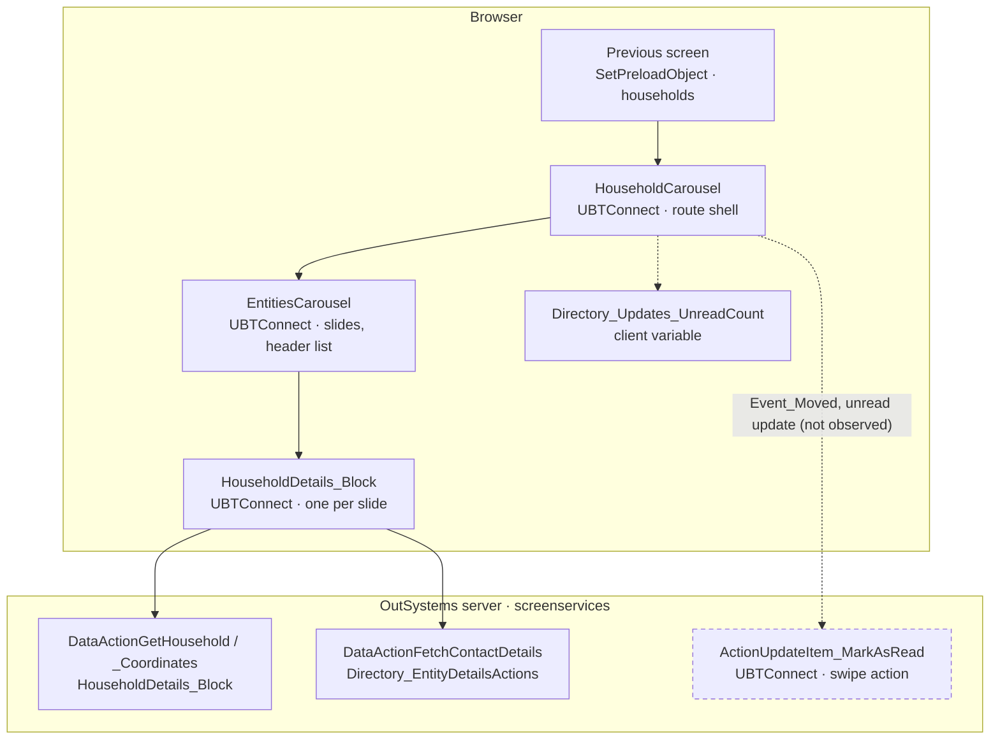
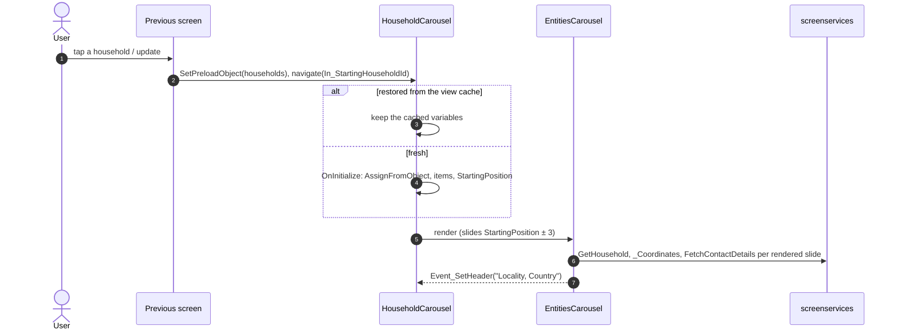

# Screen spec: HouseholdCarousel

## 0. Summary
A swipeable carousel of household detail cards. The previous screen (Locality_Details household list, HomeFeed and
Updates updates, Search, Supper meeting, bookmarks…) hands over the household ids through the preload object and the
starting household through `In_StartingHouseholdId`; each slide is the shared HouseholdDetails_Block (via
EntitiesCarousel), the header shows "Locality, Country" of the active slide. A slide coming from an unread update
marks it read when the user moves to it, and the swiped update ids go back to the previous screen on back.
[HouseholdCarousel.mvc.js view :142-350, controller :376-605]

| Item | Value |
|---|---|
| Route (old) | `/UBTConnect/HouseholdCarousel` with input `In_StartingHouseholdId` (Long Integer, default 0) [mvc.js :28-30, :77-79] |
| Screen file | `UBTConnect.Directory_Household.HouseholdCarousel.mvc.js` (no screen block; content = Directory_Caroussel.EntitiesCarousel) |
| Captured | TST, viewport 390×844, signed-in test account, reached from `/UBTConnect/Locality_Details?LocalityId=252` (first Household_Card) [states.json] |
| Variant | C2EnableCarousel on (TST; decided default-only): the callers open this screen instead of HouseholdDetails [pack: flags] |
| OutSystems UI version | OutSystemsUI_2_23 (Carousel = Splide 4.1.3) |
| Sources | `analysis/` (pack.md, dom/{default,loading,offline}.html, calls.json, sources/pretty) |

## 1. Entry and routing
- Callers set the preload `CarouselPreloadedHouseholds {CarouselHouseholdItem: [{Household, SwipeAction}]}` and
  navigate with `In_StartingHouseholdId` [survey: Locality_Households_HouseholdList.mvc.js
  Household_CardEvent_OnClickHousehold; FeedBlock_Updates.mvc.js:674-695 (app `FeedBlock_Updates.tsx:100-117`);
  Updates_SingleList (app `index.tsx:418-437`)]. Opened by URL without a preload, the carousel is empty
  [capture-plan note; mvc.js :450-510] → Q1.
- Layout: `Layouts.Layout_DetailPage` (In_IsPrimaryColor False, back arrow), BottomBarMenu, CommonUI_InsideLayout
  [mvc.js :155-347].

## 2. Component tree
```
HouseholdCarousel                                       [render]
└─ Layouts.Layout_DetailPage  id DetailPage (alias 1)   [shared]
   ├─ Placeholder_Header_Title: ConnectPatterns.SkeletonSection $b2 (In_IsLoading = HouseholdHeader = "")
   │    └─ Expression: HouseholdHeader, else "Unavailable, Unavailable"           [mvc.js :174-216]
   ├─ Content: Directory_Caroussel.EntitiesCarousel $b3   [shared]
   │    In_StartingPosition = StartingPosition, In_EntitiesCarousel_Items = EntitiesCarousel_Items,
   │    In_ConnectEntityTypeId = Connect_Entity.Household; events Event_SetHeader, Event_Moved   [mvc.js :220-266]
   │  └─ If SwippedItems not empty: NavigationHandler.BackNavigationHandler $b4 (event BackNavigation) [shared; :267-296]
   ├─ Bottom: App_Common.BottomBarMenu $b5                 [shared]
   └─ Placeholder_CommonUI_Inside_Layout: App_Common.CommonUI_InsideLayout $b6   [shared]
```
Every block is built (`@os-block` under `app/src/shared/`); the pack's "NOT BUILT" marks for the EntitiesCarousel
family are outdated (READMEs in `app/src/shared/UBTConnect/EntitiesCarousel*`). The route has no block of its own.

## 2a. Architecture diagram


## 3. DOM and markup contract
Captured skeleton (pack "Markup"; dom/default.html :1-45):
```html
<div class="OSBlockWidget" data-block="Layouts.Layout_DetailPage" id="DetailPage">  …
  <div class="header-title text-align-center OSInline" id="b1-Placeholder_Header_Title">
    <div class="OSBlockWidget" data-block="ConnectPatterns.SkeletonSection" id="$b2">
      <div class="" id="b2-Placeholder_LoadingSection"><span data-expression="">••••• ••••••• •••••••••</span></div>
  …<div class="content-middle" id="b1-Content">
     <div class="OSBlockWidget" data-block="Directory_Caroussel.EntitiesCarousel" id="$b3"> … 23 slides … </div>
```
The header text is "LocalityName, CountryName" of the active slide (masked). Slides 1-4 render
HouseholdDetails_Block (members 5, 3, 6, 6), slides 5-23 are empty `splide__slide` items (RenderBuffer 3). Four
ShareSheet portals (one per rendered HouseholdDetails_Block) follow `#reactContainer`.

## 4. Visual specification
Original CSS only (shell). Screen-specific: none; the carousel slide height comes from EntitiesCarousel
(`var(--carousel-slide-custom-height)`).

## 5. Data model
- `CarouselPreloadedHouseholds` / `CarouselHouseholdItem {Household: Long text, SwipeAction {ActionId, Parameters}}`
  (`app/src/shared/UBTConnect/lib/structures.ts:13-36`); `EntitiesCarousel_Item {EntityId}` (:260).
- `EntitiesCarousel_SwippedItem {EntityItemId: Text, ListPosition: Integer}` (the callers read it back:
  `FeedBlock_Updates.tsx:49-55`, `Updates_SingleList/index.tsx:151-165`).
- Static entities: `Connect_Entity.Household`, `Type_CarouselItemSwipeAction.UpdatesCarousel_SetIsRead`.
- Client variable: `UBTConnect.Directory_Updates_UnreadCount` (decremented by the swipe action).

## 6. API calls
| # | Old call | Kind | Trigger | Inputs | React replacement |
|---|---|---|---|---|---|
| 1-27 | HouseholdDetails_Block DataActionGetHousehold / _Coordinates, Directory_EntityDetailsActions DataActionFetchContactDetails, UBTConnect_Utils ActionGetSignedImagesInBulk | data/server | load, per rendered slide (4) | per block | the shared blocks' own adapters and mocks (observed, calls.json) |
| 28 | `screenservices/UBTConnect/ActionUpdateItem_MarkAsRead` | server action | Event_Moved to a slide with UpdatesCarousel_SetIsRead | In_UpdateItemId | not in the contract → Q2, CR-HouseholdCarousel-1 (not observed) |
The screen itself has no data action (`dataFetchActionNames = []`, mvc.js :371).

## 7. State and lifecycle
| Variable | Type | Initial | Set by | Read by |
|---|---|---|---|---|
| HouseholdHeader | Text | "" | Handler_SetHeader | header title |
| HouseholdPreload | CarouselPreloadedHouseholds | empty | OnInitialize (AssignFromObject), EventMoved (ActionId cleared) | EventMoved |
| StartingPosition | Integer | 0 | OnInitialize (ListIndexOf ≠ -1) | EntitiesCarousel |
| SwippedItems | EntitiesCarousel_SwippedItem list | empty | EventMoved (ListAppend) | BackNavigationHandler, its `If` |
| EntitiesCarousel_Items | EntitiesCarousel_Item list | empty | OnInitialize | EntitiesCarousel |
- OnInitialize [mvc.js :450-510]: only when HouseholdPreload.CarouselHouseholdItem is empty: GetPreloadObject,
  AssignFromObject (copy when the object is set: NH controller :154-172), EntitiesCarousel_Items = each Household as
  text, StartingPosition = ListIndexOf(Household = In_StartingHouseholdId) unless -1.
- View cache (P-BACK): all five variables are kept (`useViewState`); a restored HouseholdPreload that is not empty keeps
  the restored variables (the preload is not read again); an empty one takes the OnInitialize values, as the original.

## 8. Render logic
```
header: SkeletonSection loading while HouseholdHeader = ""; text = HouseholdHeader <> "" ? HouseholdHeader : "Unavailable, Unavailable"
content: EntitiesCarousel; then BackNavigationHandler only if SwippedItems is not empty
```
default: header loaded (captured); loading/offline: header loading with "Unavailable, Unavailable" (captured).

## 9. Interactions and navigation
| Element | Event | Logic | Calls | Navigates |
|---|---|---|---|---|
| EntitiesCarousel | Event_SetHeader(h) | HouseholdHeader = h [:413-448] | – | – |
| EntitiesCarousel | Event_Moved(i) | Handler_EventMoved [:511-605]: if i < items and item i has a SwipeAction ActionId: if UpdatesCarousel_SetIsRead → Directory_Updates_CarouselSwipeAction(Parameters) (UC:1625-1660), SwippedItemId = Out_ItemId, item i ActionId = ""; then if SwippedItemId <> "" and not in SwippedItems → append {EntityItemId, ListPosition = i} | #28 (Q2) | – |
| Back (device/browser, header arrow) | BackNavigation | SetPreloadObject(SwippedItems) [:376-411], back goes on | – | previous screen |
Header back arrow, bottom bar and slide actions belong to the shared blocks.

## 10. Sequence diagrams

```mermaid
sequenceDiagram
  autonumber
  actor U as User
  participant S as HouseholdCarousel
  participant API as screenservices
  participant P as Previous screen
  U->>S: swipe to slide i (Event_Moved)
  alt item i has UpdatesCarousel_SetIsRead
    Note over S,API: not observed; call missing from the contract (Q2)
    S->>API: ActionUpdateItem_MarkAsRead(In_UpdateItemId)
    S->>S: UnreadCount - 1, ActionId = "", append SwippedItem
  end
  U->>S: back
  S->>P: SetPreloadObject(SwippedItems) (only when not empty)
```

## 11. Error handling and feedback
| Situation | Detection | UI response |
|---|---|---|
| Block data actions fail (offline state) | shared blocks | skeletons stay; header "Unavailable, Unavailable" in skeleton (captured offline) |
| Swipe action fails | exception in Handler_EventMoved | goes to the screen's error handler (not observed) |

## 12. Strings
"Unavailable, Unavailable" (header fallback, mvc.js :206); header from data ("LocalityName, CountryName").

## 13. Accessibility, platform and security notes
- Carousel roles/aria from Splide (shared). No native-only branch on this screen.
- Security: the screen reads no permission variable; UpdateItem_MarkAsRead must check server-side that the update
  belongs to the user (server side unknown; mock phase).

## 13a. Feature flags
All flags of the pack are decided (`flags.py route`): C2EnableCarousel on (this screen exists), mobilePhotobook on,
C2ExtendedShare on, C2EnableC1DirectoryView on, C2NewBookmarks off, mobileDirectoryBookmarkNote off; the rest are
false positives. None is read by the screen itself; the shared blocks read them through `useFlag`.

## 14. Unclear points
| # | What is unclear | Why | Question | Status |
|---|---|---|---|---|
| 1 | How the mock phase opens the screen by URL (no preload) | captured via Locality_Details; parity opens the URL | Q1 | open, built with A |
| 2 | Swipe action server call not in the contract | contract gap | Q2 | open, built with A |
| 3 | Member counts of slides 3-4 (6 each), slide CTAs and bookmark state | shared mocks | CR-HouseholdCarousel-2 | open |
| 4 | Default state parity | parity tool cannot serialize the 64-level DOM | orchestrator (tool fix) | open |
Coverage gaps (blocks never rendered: share sheet sections, notes, KebabButtonMenu, SupperMeeting details…) belong to
the shared blocks and stay as they built them.

## 15. Acceptance criteria
1. Opened from a caller with a preload: one slide per household, the starting household active (StartingPosition).
2. Header: skeleton until the active slide raises its header, then "Locality, Country".
3. Calls per phase as calls.json (4 households rendered; contact details, coordinates, signed images by the blocks).
4. Back: when updates were swiped, SetPreloadObject(SwippedItems) before leaving; the BackNavigationHandler exists only then.
5. default, loading and offline states pass parity at 390×844 (except CR-HouseholdCarousel-2 rows).

## 16. Decisions to confirm
- Q1 → A (pending orchestrator answer): mock-only seed preload in `mocks.ts` (23 fictional households, the
  `In_StartingHouseholdId` first, no swipe actions, as Locality_Details hands over); real builds keep the empty carousel.
- Q2 → A (pending orchestrator answer): CR-HouseholdCarousel-1 adds ActionUpdateItem_MarkAsRead; until then the swipe
  branch makes no call and changes nothing.
- CR-HouseholdCarousel-2: two 6-member fictional households (9003, 9004) in the shared HouseholdDetails_Block mocks;
  until applied slides 3-4 show 5 members.
- Mock data of the slides (bookmark state, Share/Notes/Gift CTAs, member rows) differs from TST inside
  HouseholdDetails_Block: part of CR-HouseholdCarousel-2 (shared mocks), not worked around.
- Proposed exemptions (capture/timing artifacts, `proposed-exemptions.json`, not applied): app-start calls run on this
  screen because the capture came via Locality_Details; GetSignedImagesInBulk batch count; loading `list-error` from
  the capture's request timeout.
- Parity tool: the default state cannot be compared by `parity_check.cjs` (the DOM is 64 levels deep; Playwright's
  `page.evaluate` fails to return the serialized tree with "Execution context was destroyed"; loading/offline at 59
  levels pass through). A scratch copy returning the tree as a JSON string ran: route markup identical, remaining
  differences inside the shared blocks. The skill script needs that fix (orchestrator).
- Shared-block differences found by HouseholdDetails (CR-HouseholdDetails-1: actions-menu skeleton, skeleton chevron,
  OSList `list-loading`, `aria-hidden` with ShareSheet) are left to the foundation; not worked around here.

## 17. Patterns used
- P-PARAMS: `In_StartingHouseholdId` from the query string (api.ts).
- P-STATES: header skeleton; loading/offline come from the shared blocks.
- P-BACK: `useViewState` for the screen variables; `BackNavigationHandler` (shared) for SwippedItems.
- P-CALLS / P-DATA / P-MOCKS: no call of its own; adapter stub for #28 (CR-HouseholdCarousel-1); mocks.ts holds the
  Q1 seed and no handler.
- P-OSUI: Carousel through the shared EntitiesCarousel.
- P-FLAGS: none read by the screen.

## 18. Builder notes
- Ids: Layout_DetailPage "DetailPage"/b1, SkeletonSection `$b2`, EntitiesCarousel `$b3`, BackNavigationHandler `$b4`,
  BottomBarMenu `$b5`, CommonUI_InsideLayout `$b6` (aliases 1-6, mvc.js view).
