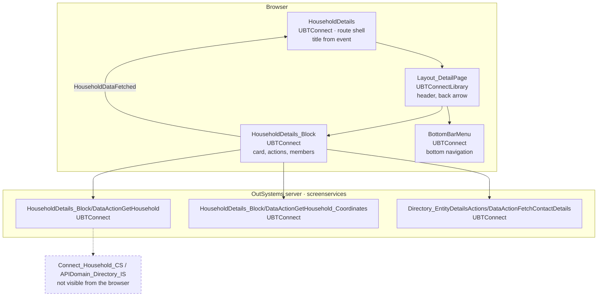
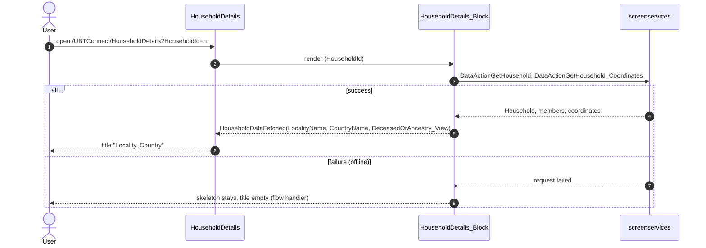

# Screen spec: HouseholdDetails

Sources: `analysis/sources/pretty/UBTConnect.Directory_Household.HouseholdDetails.mvc.js` (cited as `mvc.js:<line>`),
`analysis/dom/{default,loading,offline}.html`, `pack.md`, `analysis/calls.md`, shared block README
`app/src/shared/UBTConnect/HouseholdDetails_Block/README.md`.

## 0. Summary
Thin route shell for a household: Layout_DetailPage (not primary) whose title is "Locality, Country" raised by the
shared HouseholdDetails_Block, the block itself as content, the BottomBarMenu (no active item) and
CommonUI_InsideLayout. The screen makes no call of its own; every call comes from the shared block and its children.

| Item | Value |
|---|---|
| Route (old) | `/UBTConnect/HouseholdDetails` with input `HouseholdId: LongInteger` (default 0) [mvc.js:22-24, 70-74] |
| Screen file | `UBTConnect.Directory_Household.HouseholdDetails.mvc.js` |
| Content block | `UBTConnect › Directory_Household › HouseholdDetails_Block` [shared, built] |
| Captured | TST, 390×844 phone, states default, loading, offline [analysis/states.json] |
| Variant | one variant; carousel variant is HouseholdCarousel (separate route) [notes.md] |
| OutSystems UI version | OutSystemsUI_2_23 [mvc.js:133] |
| Sources | `migration/screens/HouseholdDetails/analysis/` |

## 1. Entry and routing
- Reached from 28 navigation sites (16 not behind the carousel flag) [notes.md, board decision 2026-10-14].
- Input `HouseholdId` (LongInteger, kept as a string, `'0'` when absent) from the query string [mvc.js:70-74].
- Layout Layout_DetailPage, `In_IsPrimaryColor = False` [mvc.js:150-152]; not a root page; BottomBarMenu with no
  inputs, so no active item [mvc.js:226-245; dom/default.html:1158-1290, every item `text-neutral-6`].

## 2. Component tree
```
HouseholdDetails screen                                  [render: route]
└─ Layouts.Layout_DetailPage (In_IsPrimaryColor False)   [shared]
   ├─ Placeholder_Header_Title: Expression "font-semi-bold text-neutral-10" = title (section 8)   [render]
   ├─ Placeholder_Header_Right / HeaderContent: empty
   ├─ Content: Directory_Household.HouseholdDetails_Block (HouseholdId; Placeholder_CarouselTag empty)  [shared]
   ├─ Bottom: App_Common.BottomBarMenu (no inputs)        [shared]
   └─ Placeholder_CommonUI_Inside_Layout: App_Common.CommonUI_InsideLayout   [shell]
```

| Block | Inputs | Events raised | Placeholders | Notes |
|---|---|---|---|---|
| Layout_DetailPage | In_IsPrimaryColor=False | — | title, content, bottom, CommonUI | [mvc.js:149-268] |
| HouseholdDetails_Block | HouseholdId = screen input | HouseholdDataFetched(LocalityName, CountryName, DeceasedOrAncestry_View) → Handler_HouseholdDetails_DataFetched | CarouselTag empty | [mvc.js:187-225] |
| BottomBarMenu | none | — | — | [mvc.js:226-245] |
| CommonUI_InsideLayout | none | — | — | [mvc.js:246-266] |

## 2a. Architecture diagram


## 3. DOM and markup contract
- Layout markup is the shared Layout_DetailPage's; without `ubt-layout-detail--primary` [dom/default.html:6].
- Title [dom/default.html:21-25]:
  `<div class="header-title text-align-center OSInline"><span class="font-semi-bold text-neutral-10" data-expression="">LocalityName, CountryName</span></div>`;
  empty span before the event (loading, offline) [dom/loading.html header].
- `<body>` class `phone portrait osx is-ltr`, footer height variables set by the shell [states.json].
- Everything else is inside the shared blocks (HouseholdDetails_Block README captures v3/v4 are this route's DOM).

## 4. Visual specification
Original CSS only (shell). No screen-specific rule. Nothing route-specific beyond section 3.

## 5. Data model
Screen variables [mvc.js:13-27]: `LocalityName` Text "", `CountryName` Text "", `DeceasedOrAncestry_View` Boolean
False (set, never read by the view). Input `HouseholdId` LongInteger → string.

## 6. API calls
None of its own (`dataFetchActionNames = []`, no server action) [mvc.js:290-292]. Captured calls 4-10
(GetHousehold, FetchContactDetails ×4, GetHousehold_Coordinates, GetSignedImagesInBulk) belong to
HouseholdDetails_Block and its children (mocked in the shared blocks); calls 1-3 and 11-15 are app start / shell
[pack.md Calls, call-sites.md].

## 7. State and lifecycle
| State variable | Type | Initial | Set by | Read by |
|---|---|---|---|---|
| LocalityName | Text | "" | Handler_HouseholdDetails_DataFetched [mvc.js:314] | title [mvc.js:172] |
| CountryName | Text | "" | same [mvc.js:317] | title |
| DeceasedOrAncestry_View | Boolean | False | same [mvc.js:320] | nothing |

No screen lifecycle handler (OnInitialize/OnReady/OnRender/OnDestroy/OnParametersChanged all null) [mvc.js:372-376].
Screen variables live in the OutSystems view cache, so on back they are restored (P-BACK: `useViewState`).
Errors go to the Directory_Household flow handler [mvc.js:377-379].

## 8. Render logic
```
title = LocalityName <> "" ? LocalityName + (CountryName <> "" ? ", " + CountryName : "") : CountryName   [mvc.js:172]
```
Captured: default (title filled, masked 5/7/9 chars), loading and offline (empty title, block skeleton).

## 9. Interactions and navigation
| Element | Event | Logic | Calls | Navigates to | Feedback |
|---|---|---|---|---|---|
| HouseholdDetails_Block | HouseholdDataFetched | set the three screen variables [mvc.js:300-325] | — | — | title updates |
| back arrow, bottom bar, block actions | click | shared blocks | shared | shared | shared |

## 10. Sequence diagrams
### 10.1 Enter the screen

### 10.2 Back navigation
View restored from cache: title kept from the screen variables; the block decides its own refresh (README "Data").

## 11. Error handling and feedback
| Situation | Detection | UI response | Message |
|---|---|---|---|
| data action fails | exception in the block | flow handler (`raiseToFlowHandler`); skeleton stays, title empty | shell's [dom/offline.html] |

## 12. Strings
No static string of its own; title from data.

## 13. Accessibility, platform and security notes
Roles and skip link from Layout_DetailPage. No client variable read by the screen. Household data authorization is
server-side in the block's data actions (shared block). No storage.

## 13a. Feature flags
The 8 flags listed in pack.md are read by child shared blocks (Directory_EntityDetailsActions, BottomBarMenu,
ShareSheet, HouseholdDetails_Block); all are decided (default-only TST value or not a flag, user 2026-10-14). The
screen itself reads none.

## 14. Unclear points
| # | What is unclear | Why | Question | Status |
|---|---|---|---|---|
| 1 | Parity differences inside shared blocks (behaviour + mock data) | shared code, not the route's | Q1 (CR-HouseholdDetails-1, -2) | open, pending orchestrator |
| 2 | Three capture/timing artifacts need exemptions (proposed-exemptions.json) | capture artifacts; route agent cannot write exemptions | Q2 | open, pending orchestrator |
| — | The screen itself is fully covered by its compiled code; uncaptured blocks in coverage.md belong to shared blocks | — | — | — |

## 15. Acceptance criteria
1. `/UBTConnect/HouseholdDetails?HouseholdId=n` renders Layout_DetailPage without the primary class (section 1, 3).
2. Title shows "Locality, Country" after HouseholdDataFetched, per section 8; empty before.
3. HouseholdDetails_Block gets `householdId` from the query string; BottomBarMenu has no active item.
4. Parity passes for default, loading and offline; call parity matches calls.json (all calls from shared blocks).

## 16. Decisions to confirm
- Layout_DetailPage instance id: the original names it `DetailPage` (outer id) with inner ids `b1-…`; the shared
  component derives inner ids from its `id`, so the route passes `$b1` (inner ids match, outer id differs; ids are not
  compared by parity) [dom/default.html:5-7].
- Mock data is the shared block's fictional household 9001 for every HouseholdId (block README "Data").
- Q1 → A (pending orchestrator answer): the shared fixes CR-HouseholdDetails-1 (actions menu stuck in skeleton,
  skeleton members' HasNavigation default, OSList `list-loading`, `aria-hidden` with the ShareSheet popup) and the mock
  data CR-HouseholdDetails-2 (household without phone/email, household bookmarked, text lengths) land before ready.
- Q2 → A (pending orchestrator answer): three capture/timing exemptions as drafted in `proposed-exemptions.json`.

## Change requests
- CR-HouseholdDetails-1 (`migration/change-requests/CR-HouseholdDetails-1.md`): shared-block behaviour, 4 items.
- CR-HouseholdDetails-2 (`migration/change-requests/CR-HouseholdDetails-2.md`): shared mock data for this capture.
No `<NotCaptured>` in the route: every difference is inside composed shared blocks.

## 17. Patterns used
- P-PARAMS: `HouseholdId` from the query string, LongInteger default `'0'`.
- P-BACK: screen variables through `useViewState`.
- P-STATES: loading and offline states come from the shared block's skeleton.
- P-CALLS / P-DATA / P-MOCKS: no call of its own; `api.ts` holds only the input reader, `mocks.ts` exports no handler.

## 18. Builder notes
Compose only shared components; no CSS; no NotCaptured needed (no gap of the screen itself).
