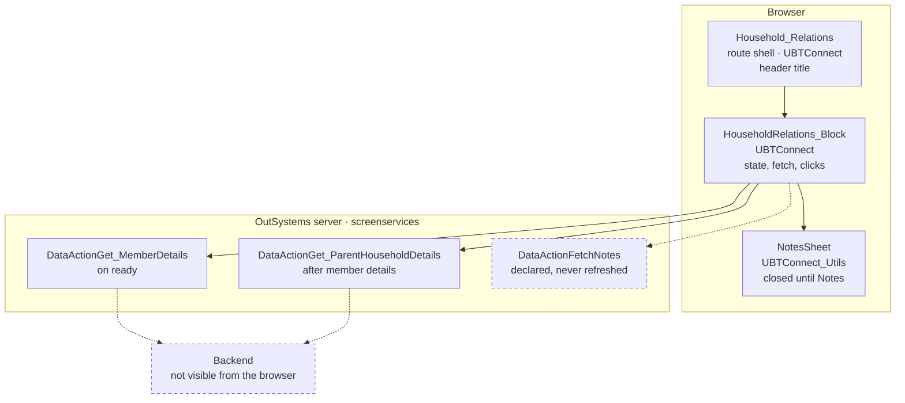
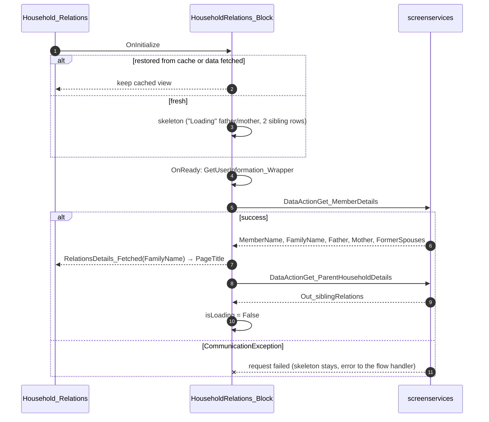
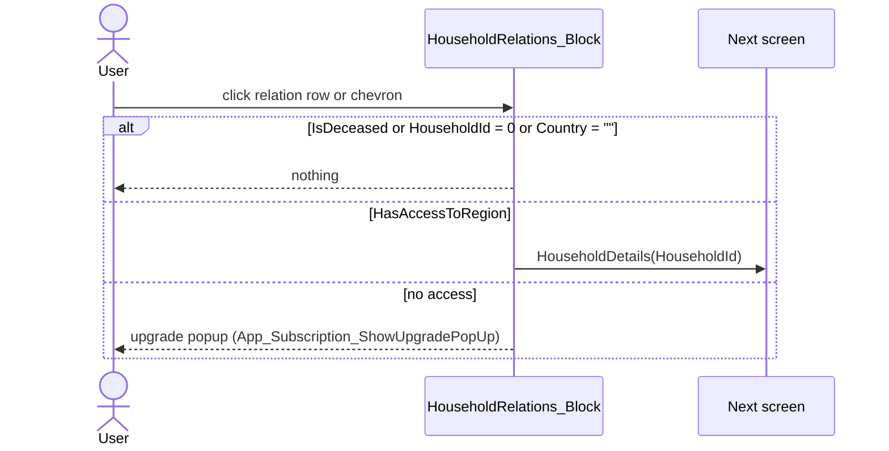

# Screen spec: Household_Relations

Abbreviations: **S** = `analysis/sources/pretty/UBTConnect.Directory_Household.Household_Relations.mvc.js`,
**B** = `…/UBTConnect.Directory_Household.HouseholdRelations_Block.mvc.js`,
**MR** = `…/UBTConnectLibrary.ConnectCorePatterns.MemberRelation_ListItem.mvc.js`, **dom** = `analysis/dom/`.

## 0. Summary
The screen shows the relations of one household member:
- the member's photo and name;
- "Notes" and (disabled) "Bookmark" buttons;
- a "Relations" section (father, mother, previous spouses);
- a "Household" section (the siblings from the parent household).

Each relation with a household opens HouseholdDetails. The header shows the member's family name.

| Item | Value |
|---|---|
| Route (old) | `/UBTConnect/Household_Relations` with inputs `HouseholdId`, `MemberId` (Long Integer) [S:13-30] |
| Screen file | `UBTConnect.Directory_Household.Household_Relations.mvc.js` |
| Content block | `UBTConnect › Directory_Household › HouseholdRelations_Block` [B] |
| Captured | 2026-10-14, env TST, viewport 390×844, test account (states default, loading, offline) [analysis/states.json] |
| Variant | single variant; flags decided default-only / not a flag (section 13a) |
| OutSystems UI version | OutSystemsUI_2_23 |
| Sources | `migration/screens/Household_Relations/analysis/` |

## 1. Entry and routing
- Reached from HouseholdDetails (member row click, `HouseholdDetails_Block.tsx` onClickMember → `HouseholdId`,
  `MemberId`). Inputs read from the query string, Long Integer default `'0'` [S:13-30, P-PARAMS].
- Layout `Layout_DetailPage` (In_IsPrimaryColor False), BottomBarMenu without inputs, CommonUI_InsideLayout [S:153-283].

## 2. Component tree
```
Household_Relations (screen)                                  [render]
└─ Layouts.Layout_DetailPage (In_IsPrimaryColor False)          [shared]
   ├─ Header_Title: CustomText(PageTitle; neutral-10, s, semi-bold) [shell]   S:172-202
   ├─ Content: Directory_Household.HouseholdRelations_Block       [render here]
   │  ├─ SkeletonSection(not Get_MemberDetails fetched/error)      B:248-600
   │  │  ├─ CustomContainer(margin-top s) > [CustomContainer(flex center) > UBT_LazyImage(Member, MemberId, xl/square)]
   │  │  │                                  [CustomContainer(margin-top s, flex baseline center) > CustomText(MemberName)]
   │  │  └─ CustomContainer "Buttons"(margin x/y base) > Columns_Two(base, center)
   │  │       left: Button(s, secondary, tooltip, "Notes")  right: Button(s, primary, bookmark, disabled, "Bookmark")
   │  ├─ SkeletonSection(isLoading)                               B:601-1505
   │  │  if any relation or isLoading:
   │  │   SubLayout_DirectoryDetailScreen_Section "Relations" (top s, bottom base) > CustomContainer(padding-top s)
   │  │     [Father.HouseholdId<>0] MemberRelation_ListItem "Father"               [render here]
   │  │     [Mother.HouseholdId<>0] Container margin-top-s > MemberRelation_ListItem "Mother"
   │  │     Container margin-top-s > List (FormerSpouses) > MemberRelation_ListItem "Previous spouse"
   │  │   [siblings not empty] SubLayout_DirectoryDetailScreen_Section "Household" > CustomContainer(padding-top s)
   │  │     > List (Out_siblingRelations) > NonMember_ListItem                    [shared]
   │  │  else: Container "padding-right-base padding-left-base text-align-center" "No relation or household information avaialble."
   │  └─ CW_Notes.NotesSheet (Member, MemberId, FetchNotes.Notes, ShowNotesSheet)  [shared] B:1508-1580
   ├─ Bottom: App_Common.BottomBarMenu                             [shared]
   └─ CommonUI_InsideLayout                                         [shell]
```

| Block | Inputs | Events | Placeholders | Notes |
|---|---|---|---|---|
| HouseholdRelations_Block | HouseholdId, MemberId (Long) | RelationsDetails_Fetched(RelationsTitle) | — | B |
| MemberRelation_ListItem | In_Title, isEnabled (True), In_DeceasedCaption, In_Relation, In_FormattedLocality, In_IsDeceased | OnClickPerson | Placeholder_Left, Actions | MR:150-490; only this route uses it → `components/` |

MemberRelation_ListItem [MR view]: Columns_Three (expand middle, base, center):
- Left: a clickable container with Placeholder_Left. OnClick: if isEnabled → OnClickPerson (MR controller `_onClick`).
- Middle: a clickable container that raises OnClickPerson directly. It has:
  - Title (neutral-9, base, semi-bold).
  - Relation (neutral-7, xs).
  - `[In_IsDeceased]` DeceasedCaption (neutral-7, xs, regular, italic).
  - `[not IsDeceased and FormattedLocality <> ""]` IconText (icon `connect-icon-home_pin`, neutral-7, `icon-non-standard-14`) with FormattedLocality.
- Right: Actions placeholder.

## 2a. Architecture diagram


## 3. DOM and markup contract
- Body `phone portrait osx is-ltr`; markup per block as in `dom/default.html:43-840` (header 17-30).
- Lists: `div.list.list-group.list--gap-s.OSFillParent[data-list]` (`list-loading` while the source data action is
  not fetched, dom/loading.html PreviousSpouses and siblings lists) [B:1040-1050, 1296-1302].
- Father/mother/previous-spouse actions: `div.display-flex.flex-direction-column.justify-content-center` > CustomContainer
  (width min 100) > Icon chevron_right neutral-4 [B:751-830]; sibling actions: CustomContainer (flex, center, center,
  width min 100) > Icon, no wrapper div [B:1389-1440, dom/default.html sibling Actions].
- Masked texts (names, family name, localities) are fictional in mocks with the captured word lengths.

## 4. Visual specification
Original CSS only (routes add none). Captured: avatar xl (98×98) for the member, base (50×50) for relations
(dom/default.html:58, 236). Loading: SkeletonSection class `ubt-skeleton-section` on both sections (dom/loading.html:45, 191).

## 5. Data model
- `Get_MemberDetails`: MemberName, FamilyName, Father, Mother (UI_HouseholdMember), FormerSpouses (list),
  ParentHouseholdId [types.ts, calls.md]. `Get_ParentHouseholdDetails`: Out_siblingRelations (list of UI_HouseholdMember).
- UI_HouseholdMember defaults: HouseholdId `'0'`, HasNavigation **True**, HasCTAs False, texts `""`
  [migration/contract/sources/raw/Connect_Household_CS.model.js:250-315].
- Block variables: UserAge_Visibility False, isLoading **True**, ShowNotesSheet False [B:86-94]; screen PageTitle "" [S:13].
- Static entities (TST, static-entities-tst.json):
  - uBT_Icons2 tooltip/bookmark
  - uBT_ButtonType scondary→`secondary`.
  - uBT_ImageSize extraLarge_100→`xl`, base_52→`base`.
  - uBT_AlignItems baseline→`align-items-baseline`.
  - noteCategory2 member→`Member`.
  - UBTConnectLibrary uBT_IconSize nonStandard_14, uBT_Icons homePIn.

## 6. API calls
| # | Old call | Kind | Trigger | Inputs | Output used | Server side | React |
|---|---|---|---|---|---|---|---|
| 1 | `…/HouseholdRelations_Block/DataActionGet_MemberDetails` | Data action (on demand) | OnReady → Action_Refresh_Get_MemberDetails [B:2111-2182, 2077-2110] | screen vars HouseholdId, MemberId, UserAge_Visibility, isLoading, ShowNotesSheet | all outputs | unknown (no MCP) | `callAction('UBTConnect','HouseholdRelations_Block/DataActionGet_MemberDetails')` |
| 2 | `…/HouseholdRelations_Block/DataActionGet_ParentHouseholdDetails` | Data action (on demand) | OnAfterFetch_Get_MemberDetails [B:1688-1725] | same | Out_siblingRelations | unknown; OutSystems also sends the Get_MemberDetails record (calls.md "Screen variables"), likely for ParentHouseholdId | same pattern |
| 3 | `…/HouseholdRelations_Block/DataActionFetchNotes` | Data action (on demand) | never refreshed in B (not in capture) | — | — | — | not called |
| — | GetSignedImagesInBulk, GetUserInformation, bottom bar and app-start calls | shared/shell | — | — | — | — | shared mocks |
Observed: #1 and #2 once each (calls.md #4, #5). All three data actions are on demand (`dataFetchDependenciesOriginal`
-1, B:1593-1597; FetchNotes never observed).

## 7. State and lifecycle
| Variable | Initial | Set by | Read by |
|---|---|---|---|
| PageTitle (screen) | "" | Handler_OnRelationsDetailsFetched = RelationsTitle [S:310-350] | header CustomText |
| isLoading | True | Actions_DefineLoading [B:1726-1770] | second SkeletonSection, Relations condition |
| UserAge_Visibility | False | OnReady [B:2160] | data action inputs |
| ShowNotesSheet | False | Handler_AddNotes / Handler_OnNotesSheetClosed [B:1917-1966] | NotesSheet In_IsOpen |
| Get_MemberDetails, Get_ParentHouseholdDetails, FetchNotes | record defaults, status Fetching | data actions, OnInitialize, note handlers | view |

- OnInitialize [B:1793-1878]:
  - Nothing happens when the view was restored from cache, or when either data action is already fetched.
  - Otherwise: Father/Mother.Title "Loading", Id -1, HouseholdId -1, and two sibling rows {FirstName "Loading", MemberRole ""}.
- OnReady [B:2111-2182]: GetUserInformation_Wrapper; if restored from cache and DisplayAge unchanged → stop;
  UserAge_Visibility = DisplayAge; Action_Refresh_Get_MemberDetails: isLoading = True, refresh Get_MemberDetails →
  OnAfterFetch: RelationsDetails_Fetched(FamilyName) → screen PageTitle; refresh Get_ParentHouseholdDetails;
  Actions_DefineLoading(False): isLoading = not fetched/no error on both [B:1750].
- View cache (P-BACK): variables kept through `useViewState`; restored view uses `useWasRestoredFromCache`.

## 8. Render logic
```
SkeletonSection 1 loading = not Get_MemberDetails.IsDataFetched and not HasFetchError   [B:251]
SkeletonSection 2 loading = isLoading                                                    [B:604]
if Father.HouseholdId<>0 or Mother.HouseholdId<>0 or FormerSpouses not empty or siblings not empty or isLoading [B:622]
   Relations section; Father if Father.HouseholdId<>0 [B:675]; Mother if Mother.HouseholdId<>0 [B:848];
   father/mother chevron if HasNavigation [B:751, 934]; spouse chevron if HasNavigation and HouseholdId<>0 [B:1133];
   Household section if siblings not empty [B:1239]; sibling chevron if HasNavigation [B:1389]
else "No relation or household information avaialble." [B:1496-1503] (not captured)
NotesSheet always rendered ($if(false) else branch) [B:1508-1511]
```
Captured: default (data), loading and offline (= OnInitialize skeleton: "Loading" father/mother, 2 empty sibling rows).

## 9. Interactions and navigation
| Element | Event | Logic | Calls | Navigates to |
|---|---|---|---|---|
| Notes button | ButtonOnClick | ShowNotesSheet = True [B:1917] | none (FetchNotes not refreshed) | — |
| Bookmark button | disabled; OnClick_Bookmark empty [B:1771-1792] | — | — | — |
| Relation row / chevron (father, mother, spouse, sibling) | OnClickPerson / Icon click | OnClick_Member(Locality, Country, HouseholdId, False) [B:1967-2076]: IsDeceased → nothing; HouseholdId = 0 → nothing; Country "" → nothing; HasAccessToRegion → navigate, else App_Subscription_ShowUpgradePopUp | none | `/UBTConnect/HouseholdDetails?HouseholdId=<id>` |
| NotesSheet | On_NotesChanged / On_NoteDeleted / On_NoteSheet_Closed | FetchNotes.Notes = New_Notes; remove note + Total; ShowNotesSheet = False [B:1879-1966, 2183-2236] | NotesSheet's own | — |

## 10. Sequence diagrams



## 11. Error handling and feedback
| Situation | Detection | UI |
|---|---|---|
| Get_MemberDetails fails | data action error | skeletons stay (isLoading stays True), error to the screen's handler (dom/offline.html = loading) |
| No access to region | HasAccessToRegion False | upgrade popup (shared `showUpgradePopUp`) |

## 12. Strings
"Notes", "Bookmark", "Relations", "Father", "Mother", "Previous spouse", "Household", "Loading" (skeleton titles),
"No relation or household information avaialble." (typo kept). Data: member name, family name (header), titles,
localities, married captions.

## 13. Accessibility, platform and security notes
No native branch in this route. Data actions return person data; server-side authorization of Get_MemberDetails /
Get_ParentHouseholdDetails is not visible from the browser (backend phase). HasAccessToRegion is a client check only.

## 13a. Feature flags
Shared children (BottomBarMenu, NotesSheet, layout) read the 6 flags in pack.md. The user decided all of them on
2026-10-14 (default-only TST value or not a flag). The route itself reads none.

## 14. Unclear points
| # | What is unclear | Why | Question | Status |
|---|---|---|---|---|
| 1 | Server logic of the two data actions (how the parent household is found) | server side, no MCP | — | backend phase; mock answers fictional data |
| 2 | "No relation…" state | not captured | — | built from B:1496-1503 |
| 3 | Three parity differences that are capture artifacts (loading fetch timeout on 3 avatars; masked member name offset; 1 px shift under the masked, broken replayed member photo) | route agent may not add exemptions | Q1 | answered A by the user, auto-accepted 2026-10-15: the 3 exemptions are merged into `migration/parity-exemptions.json` [questions.md Q1] |

## 15. Acceptance criteria
1. default/loading/offline match the capture (sections 3, 8).
2. Calls: Get_MemberDetails then Get_ParentHouseholdDetails on load, once each; FetchNotes never (section 6).
3. Header title = FamilyName after the fetch (section 7).
4. Relation click → HouseholdDetails?HouseholdId=… or upgrade dialog (section 9).

## 16. Decisions to confirm
- Mock data is fictional (person data, migration/knowledge/mock-fixtures.md): member, father, mother, no previous
  spouse, 4 siblings (1 single, 3 married) as captured (dom/default.html).
- Notes opens the sheet with empty notes. TST declares FetchNotes but never refreshes it (B:1593-1686). The route is built as compiled.
- MemberRelation_ListItem built in the route (`components/`): only this route uses it (pack block plan).
- Static-entity records missing from the shared lists (uBT_AlignItems baseline, UBTConnectLibrary uBT_Icons homePIn,
  uBT_IconSize nonStandard_14) are route constants in `components/staticEntities.ts` with their TST values.
- Data actions send the block variables HouseholdId, MemberId, UserAge_Visibility, isLoading, ShowNotesSheet (contract
  inputs). OutSystems also sends the Get_MemberDetails record as screen data (calls.md). The React app does not send it.
  The backend phase decides how Get_ParentHouseholdDetails finds the parent household.
- Q1 → A (answered by the user, auto-accepted 2026-10-15; the 3 exemptions are merged into `migration/parity-exemptions.json`) [questions.md Q1]: add the 3 capture-artifact exemptions drafted in
  `proposed-exemptions.json`. Parity before the exemptions: default position 1 + pixel 1, loading class 3, offline clean; nothing else.
- Shared CRs (CR-HouseholdDetails-1, CR-SupperMeeting_Details-1; both applied [CR-HouseholdDetails-1.md, CR-SupperMeeting_Details-1.md]): no parity difference of this route comes
  from them. The father/mother avatars change EntityId (-1 → id) after the fetch. So the UBT_LazyImage fix of
  CR-SupperMeeting_Details-1 §1 may add one GetSignedImagesInBulk call. Today the route makes 11 calls vs 12 captured
  (covered by CALL-COUNT-SIGNED-IMAGES-BATCH). No work-around in the route.

## Change requests
None: every block the route composes exists; no `<NotCaptured>` in the route.

## 17. Patterns used
- P-PARAMS: `HouseholdId`, `MemberId` from the query string; navigation to HouseholdDetails with `HouseholdId`.
- P-DATA / P-CALLS: `api.ts` adapters for the two data actions, called in the OnReady chain.
- P-MOCKS: `mocks.ts` contract handlers with fictional data; scenarios real, empty, error, loading.
- P-STATES: skeleton via SkeletonSection; OnInitialize skeleton records.
- P-BACK: block variables through `useViewState`, `useWasRestoredFromCache`.
- P-LIST: OSList for previous spouses and siblings.
- P-DIALOG: upgrade dialog through the shell's `showUpgradePopUp`.

## 18. Builder notes
Compose shared blocks; no CSS; MemberRelation_ListItem in `components/`.
