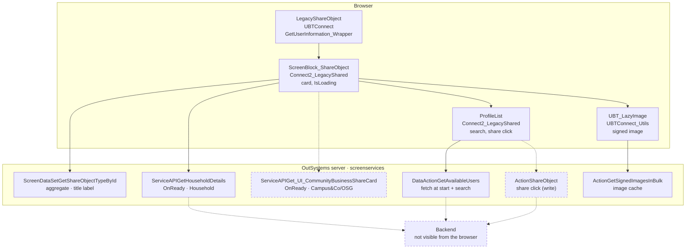

# Screen spec: LegacyShareObject

## 0. Summary
Share target screen. It shows the object that the user shares and a searchable list of Connect users.
The object is one of these: a household card, a Campus&Co / OneSchool Global card, or a feed item.
The share icon of a row calls ShareObject (a write, mocked, P-MUTATION) and turns into a green check.
12 in-scope screens reach this screen (user, 2026-10-14; notes.md).

| Item | Value |
|---|---|
| Route (old) | `/UBTConnect/LegacyShareObject` with `In_ShareObjectTypeId`, `In_ObjectId`, `In_CustomTitle` (Text) [pack.md:3] |
| Screen file | `UBTConnect.Legacy_Share.LegacyShareObject.mvc.js` |
| Content block | `Connect2_LegacyShared › Share_UI › ScreenBlock_ShareObject` (+ own blocks ProfileList, HighlightSearch, ListBlankSlate) |
| Captured | 2026-10-14, env TST, viewport 390×844, signed-in test user; route `?In_ShareObjectTypeId=Household&In_ObjectId=42438&In_CustomTitle=Test%20Household` [states.json] |
| Variant | one; branches by In_ShareObjectTypeId (Household captured) |
| OutSystems UI version | OutSystemsUI_2_23 |
| Sources | `migration/screens/LegacyShareObject/analysis/` |

## 1. Entry and routing
- Entered by navigation from share buttons (e.g. Directory_EntityDetailsActions, Feed_Embeded Handle_Share_Connect)
  with the three inputs [app/src/shared/UBTConnect/Directory_EntityDetailsActions/Directory_EntityDetailsActions.tsx:497].
- Screen OnInitialize: GetUserInformation_Wrapper → `User_AgeVisibility = UserInformation.Directory_UserCurrent_Visibility.DisplayAge`
  [LegacyShareObject.mvc.js:267-302]; shell `getUserInformation()`.
- Layout: Connect2_LegacyShared Layout.Layout (back arrow, title), no bottom bar, CommonUI_InsideLayout in
  CommonUI_Elements [LegacyShareObject.mvc.js:163-226; ScreenBlock_ShareObject.mvc.js view].

## 2. Component tree
```
LegacyShareObject screen                                  [render]
├─ Share_UI.ScreenBlock_ShareObject $b1                    [render, components/ScreenBlock_ShareObject.tsx]
│  └─ Layout.Layout b1-$b1                                 [shared]
│     ├─ headerLeft: Layout.MenuIcon_Back b1-$b2           [shared]
│     ├─ title: div.text-align-center > span "Share " + Label
│     ├─ content: div.padding
│     │  ├─ div.border-radius-soft.border-neutral-4
│     │  │  ├─ Household: Utility.Result_Item_Image b1-Household_List_Item [shared] > UBT_LazyImage b1-$b4 [shared]
│     │  │  ├─ Campus&Co / OneSchool Global: Result_Item_Image b1-CommunityBusiness_List_Item [shared] (not captured, Q4)
│     │  │  └─ Feed: Result_Item_Image b1-Feed_List_Item > AvatarImage b1-$b7 [shared] (not captured, Q4)
│     │  └─ div.margin-top-base > Share_UI.ProfileList b1-$b8 [render, components/ProfileList.tsx]
│     │     ├─ div.share-with-input > Interaction.InputWithIcon b1-b8-$b1 [shared] (search icon, Input_SearchFilter)
│     │     ├─ div.margin-top-base.text-bold (visible Label <> "") > span Label
│     │     ├─ List (ShareProfiles) > div.border-radius-soft… > Result_Item_Image > Directory.HighlightSearch [render]
│     │     │  or Share_UI.ListBlankSlate (no results / error / searching) [render]
│     │     └─ Utility.FreeSubscriptionActionDialog b1-b8-FreeSubscriptionAlert [shared] (closed; never opened here)
│     ├─ bottomBar: empty placeholder (div#b1-BottomBar)
│     └─ commonUIElements: div#b1-CommonUI_Elements > App_Common.CommonUI_InsideLayout $b2 [shared]
└─ CW_App_Common_Blocks_PopupDialogs.Dialog_AccessRestrictedAction SubscriptionDenied [shell], In_ExtendedClass
   "connect-legacy-compatibily-containter" [LegacyShareObject.mvc.js:220-240]
```

| Block | Inputs | Events | Placeholders | Notes |
|---|---|---|---|---|
| ScreenBlock_ShareObject | ShareObjectTypeId, ObjectId, In_CustomTitle, User_AgeVisibility | SubscriptionDenied | BottomBar, CommonUI_Elements | OnInitialize IsLoading=True; OnReady loads the card; OnParametersChanged refreshes the aggregate |
| ProfileList | ShareObjectId, ShareObjectTypeId | SubscriptionDenied, Share (never raised) | none | data action GetAvailableUsers, share click |
| HighlightSearch | Text, SearchTerms, StopWords "", isWordbound False | none | none | OnReady / OnParametersChanged Highlight JS |
| ListBlankSlate | none | none | Icon, Message | pure markup |

## 2a. Architecture diagram


## 3. DOM and markup contract
- Body `phone portrait connect-theme osx is-ltr`, style `--header-size-content: 0px; --footer-height: 0px; --viewport-height: 844px;` [states.json].
- Full markup: `analysis/dom/default.html` (loaded), `dom/loading.html` = `dom/offline.html` (title "Share", household
  `loading-item` with the LazyImage skeleton, ListBlankSlate "Error Searching").
- Title: `div.text-align-center > span[data-expression]` "Share " + Label [ScreenBlock view title].
- Household card: title `span.font-size-0-9em.bold#b1-Household_Title`; description
  `span.country-household-count.household-locality-no-paddingleft#b1-Household_Description`; tag
  `span.font-size-0-75em.text-align-left.padding-x-xs.padding-y-xs.border-radius-soft.background-neutral-2.text-neutral-6`
  with style `color: #000; font-size: 0.8em;` (captured `rgb(0, 0, 0)`) [dom/default.html:92-106].
- ProfileList row (dom/default.html:142-172): `div.border-radius-soft.border-neutral-4.margin-bottom-s` > Result_Item_Image
  (round default image 70×70, In_HasAction) > title `div.font-size-0-9em.bold` > HighlightSearch
  `div#…-b3-Contents[style=display: inline;]`.
  - The tag span is the same as above.
  - The action icon is `i.icon.fa.fa-share-square-o.fa-2x` with style `color: #0064C0;` (shared).
  - When IsShared, the action icon is `i.icon.fa.fa-check-circle.fa-2x` with style `color: #009706;`.
- List: `div.list.list-group.margin-top-base.OSFillParent[data-list][data-animation-disabled][style=position: relative;]`.
- ListBlankSlate: `div.display-flex.flex-direction-column.flex-center-vertical.padding-y-m.text-neutral-6.margin-top-xxl`
  > `div#…-Icon` > `i.icon  font-size-6em fa fa-<icon> fa-2x` (double space as compiled, raw dom) + `div#…-Message.text-align-center.font-size-0-75em.margin-top-base > span`.
- Input: `input.form-control.OSFillParent#b1-b8-Input_SearchFilter[type=search][placeholder="Share with..."][maxlength=50][aria-required=false]` inside `div.form-control > span.input-search`.

## 4. Visual specification
Original CSS only (no route CSS). Images:
- `img/Connect2_LegacyShared.User_rectangle.png` (captured).
- Coming-soon images for Campus&Co / OneSchool Global (not captured, `osImage()`).
- The household photo comes from GetSignedImagesInBulk. The capture masks it. The shared mock answers the neutral landscape placeholder, Q-W2C-1.

## 5. Data model
- `types.ts`: ShareType label, HouseholdCard {name, familyNames, localityName, countryName}, CommunityBusinessCard,
  AvailableUsers {label, itemsEmpty, items: ShareProfile[]}, ShareProfile {profileId, name, description, cdn, isShared},
  ShareResult {isSuccess, message, isAllowed, shareId}.
- Mapping in `api.ts`: `{List}` → arrays; ShareProfile.description = LocalityName + ", " + CountryName; cdn = Photo
  [ProfileList GetAvailableUsersOnAfterFetch].
- Static entities: Type_ShareObject identifiers (Household, Feed, Campus&Co, OneSchool Global…;
  static-entities-tst.json `Connect2_LegacyShared.type_ShareObject`); ResultListType Household 2, Subdivision 3;
  Connect_Entity Household; ImageSize Large_65 `l`; UBT_Icons2.FeedItem `connect-icon-feed`, UBT_Color CyanDark /
  Neutral0, UBT_Shape Soft, AvatarSize Large_65 (TST values).
- Cached user: `appManager_GetCachedUserInfo()` FirstName + " " + LastName → In_SharingProfileName.

## 6. API calls
| # | Call | Kind | Trigger | Inputs | Output used | React |
|---|---|---|---|---|---|---|
| 1 | ScreenBlock_ShareObject/ScreenDataSetGetShareObjectTypeById | aggregate (recorded) | fetch at start; OnParametersChanged | block variables (ShareObjectTypeId, ObjectId…) | List[current].Type_ShareObject.Label | `useShareObjectType` |
| 2 | ProfileList/DataActionGetAvailableUsers | data action (fictional, Q2) | fetch at start; Enter in search; search cleared after a search | ProfileList variables (SearchFilter, ShareObjectId, ShareObjectTypeId, MaxRecords 50, HasSearched) | Label, Response.Items | `useGetAvailableUsers` |
| 3 | ServiceAPIGetHouseholdDetails | service action (fictional) | block OnReady, type Household | HouseholdId = TextToInteger(ObjectId), User_AgeVisibility, CheckVisibility False | HouseholdCard.Household_Card_Content Name, FamilyNames, LocalityName, CountryName | `getHouseholdDetails` |
| 4 | ServiceAPIGet_UI_CommunityBusinessShareCard | service action (not observed, Q4) | block OnReady, Campus&Co / OneSchool Global | In_CommunityBusinessId | Out_UI_CommunityBusiness_ShareCard | `getCommunityBusinessShareCard` |
| 5 | ActionShareObject | server action, write (not observed, Q3) | share icon click | In_ShareObjectTypeId, In_SharedObjectId, In_SharingProfileName, In_TargetCBUserId, In_UpdateType "", In_UpdateDate null date | IsAllowed, IsSuccess, Message | `shareObject` |
| 6 | ActionGetSignedImagesInBulk | server action (shared block) | UBT_LazyImage OnReady | — | — | shared UBT_LazyImage |
App-start calls (SynchAppContext, GetUserInformation, AfterInitialize, Sync_Info_GetMain, GetNumberUnreadMessages,
CacheableHouseholds, CacheableMapEntities) come from the shell [calls.md].

## 7. State and lifecycle
| Variable | Initial | Set by |
|---|---|---|
| Screen User_AgeVisibility | False | OnInitialize (GetUserInformation_Wrapper) |
| Block IsLoading | True (OnInitialize) | OnReady end → False (stays True when OnReady raises) |
| HouseholdName/Description/Tag, CommunityBusiness | "" / empty | OnReady |
| ProfileList SearchFilter, HasSearched, ShareProfiles, SharedProfileIds, NoResultsFoundMessage | "", False, [], [], "" | input, OnAfterFetch, share |
OnReady (block):
- Household → GetHouseholdDetails → Name, FamilyNames, Tag = LocalityName + ", " + CountryName, Bucket/Path/Type/SignedURL "".
- Campus&Co or OneSchool Global → Get_UI_CommunityBusinessShareCard → CommunityBusiness, AreasServed += If(CountryName <> "", ", " + CountryName, "").
- Other types → nothing.
- Then IsLoading = False.

GetAvailableUsersOnAfterFetch:
- NoResultsFoundMessage = "No results found for '" + SearchFilter + "'".
- SharedProfileIds += ids of ShareProfiles with IsShared.
- ShareProfiles = Items mapped (IsShared = id in SharedProfileIds).

## 8. Render logic
```
title = "Share " + Label
Household → household card (captured); Campus&Co | OneSchool Global → community card; Feed → feed card; else none
ProfileList: Label <> "" → label row
  isDataFetched → Items not empty → List(ShareProfiles) (captured) else ListBlankSlate search icon + NoResultsFoundMessage
  else hasFetchError → ListBlankSlate exclamation-triangle "Error Searching " (captured, loading/offline)
  else → ListBlankSlate spinner fa-spin "Searching" (not captured)
row action: IsShared → check-circle #009706 else share-square-o #0064C0 (OnClick)
```

## 9. Interactions and navigation
| Element | Event | Logic | Calls | Feedback |
|---|---|---|---|---|
| back arrow | click | shared MenuIcon_Back (history back) | — | — |
| Input_SearchFilter | change | if Trim(SearchFilter) = "" and HasSearched → refresh GetAvailableUsers; HasSearched = False | #2 | — |
| Input_SearchFilter | keyup Enter | SearchProfile: refresh GetAvailableUsers, then HasSearched = True; blur | #2 | — |
| share icon | click | DeferredHandleShareObjectList(ProfileId) (fire and forget): ShareObject; IsAllowed and IsSuccess → row IsShared = True; IsAllowed and not success → feedback Error(Message); not success: SharedProfileIds −= id, row IsShared = False; not IsAllowed → SubscriptionDenied → screen App_Subscription_ShowUpgradePopUp | #5 | error message / Access Restricted popup |

## 10. Sequence diagrams
```mermaid
sequenceDiagram
  autonumber
  actor U as User
  participant S as ScreenBlock_ShareObject
  participant P as ProfileList
  participant API as screenservices
  U->>S: open /UBTConnect/LegacyShareObject?In_ShareObjectTypeId&In_ObjectId&In_CustomTitle
  S->>S: OnInitialize IsLoading = True
  S->>API: ScreenDataSetGetShareObjectTypeById
  P->>API: DataActionGetAvailableUsers
  S->>API: ServiceAPIGetHouseholdDetails (OnReady, Household)
  alt success
    API-->>S: HouseholdCard content
    S-->>U: card, IsLoading False
  else exception
    API--xS: error
    S-->>U: card stays loading; flow handler message
  end
  API-->>P: Label, Items → OnAfterFetch → list
```
```mermaid
sequenceDiagram
  autonumber
  actor U as User
  participant P as ProfileList
  participant API as screenservices
  participant Scr as LegacyShareObject
  U->>P: click share icon (row ProfileId)
  P->>API: ActionShareObject(type, object, sharing name, ProfileId, "", null date)
  alt IsAllowed and IsSuccess
    API-->>P: row IsShared = True (check icon)
  else IsAllowed, not success
    API-->>P: feedback Error(Message); row not shared
  else not IsAllowed
    API-->>P: row not shared
    P->>Scr: SubscriptionDenied → App_Subscription_ShowUpgradePopUp
  end
```

## 11. Error handling and feedback
| Situation | Detection | UI |
|---|---|---|
| GetAvailableUsers fails before any data | hasFetchError | ListBlankSlate "Error Searching " |
| OnReady service action fails | exception | IsLoading stays True; raiseToFlowHandler (shell) |
| ShareObject not successful | IsSuccess False | `showFeedbackMessage(Message, Error)` |
| ShareObject not allowed | IsAllowed False | Access Restricted popup (shell showUpgradePopUp) |

## 12. Strings
"Share " + label; "Share with..."; "Searching"; "Error Searching "; "No results found for '<SearchFilter>'"; data:
household name / family names / locality, user names and localities, Label.

## 13. Accessibility, platform and security notes
- The server must authorise ShareObject (sharing user, target user, object access). The React app only mocks it (P-MUTATION).
- No storage of personal data; cached user info read from the shell.

## 13a. Feature flags
- `clientVar:App_PIN_BiometricEnabled`: not a flag (user, 2026-10-14); nothing built for it in this route.

## 14. Unclear points
| # | What | Why | Question | Status |
|---|---|---|---|---|
| 1 | Labels of the other share types | only Household recorded | Q1 | answered A [questions.md Q1] |
| 2 | GetAvailableUsers semantics, Label text | server-side | Q2 | answered: mock with no source; confirmed for the demo (user, 2026-10-21) [questions.md Q2] |
| 3 | ShareObject answer | write, never recorded | Q3 | answered A [questions.md Q3] |
| 4 | Campus&Co / OneSchool Global and Feed cards | not captured | Q4 | answered A [questions.md Q4] |
| 5 | Loading state "Error Searching" and the household image fallback | TST calls timed out while the capture held them; the mock never answers, so the build shows "Searching" and the image skeleton | proposed exemptions CAPTURE-LOADING-FETCH-TIMEOUT-LEGACYSHAREOBJECT-PROFILES / -IMAGE | proposed |
| 5b | Masked household photo (default), shimmer phase (loading/offline), GetHouseholdDetails order among app-start calls | capture / timing artifacts | proposed exemptions CAPTURE-MASKED-IMAGE-LEGACYSHAREOBJECT, CAPTURE-SHIMMER-PHASE-LEGACYSHAREOBJECT-LOADING-ITEM, CALL-ORDER-APPSTART-RACE-LEGACYSHAREOBJECT | proposed |
| 6b | IsShared check icon colour | state never captured; NO-INLINE-COLOR | Q5 | answered A [questions.md Q5] |
| 6 | ProfileList Share event | declared, never raised (ProfileList controller `share$Action` only) → ScreenBlock HandleShareProfileList / its ShareObject call unreachable | — | not built |

## 15. Acceptance criteria
1. Default state matches dom/default.html: title "Share Household", household card, one user row, label row.
2. Loading/offline: title "Share ", household loading item with skeleton image, ListBlankSlate (offline: error).
3. Calls per calls.json phase load: aggregate, GetAvailableUsers, GetHouseholdDetails, GetSignedImagesInBulk.
4. Enter in the search refreshes GetAvailableUsers with SearchFilter. When the user clears the search after a search, it refreshes again.
5. Share click calls ShareObject only through the mock and shows the check icon.

## 16. Decisions to confirm
- Q1 → A (answered) [questions.md Q1]: other share types answer Label = identifier in the mock.
- Q2 (fact, answered: mock with no source; confirmed for the demo (user, 2026-10-21)) [questions.md Q2]: fictional GetAvailableUsers: 1 fictional user (captured count and text lengths), Label "Contacts list" (13 chars, fictional), filter = every search word in FullName (case-insensitive).
- Q5 → A (answered) [questions.md Q5]: the IsShared check-circle icon (compiled colour #009706, never captured) renders inside a NotCaptured marker without the inline colour (NO-INLINE-COLOR).
- Q3 → A (answered) [questions.md Q3]: ShareObject stores the share in `LegacyShareObject.shares`; IsAllowed = mock user's subscription active.
- Q4 → A (answered) [questions.md Q4]: Campus&Co / OneSchool Global and Feed cards built as compiled with fictional mocks.
- GetHouseholdDetails fictional: the mock user's household (Bahia Blanca, Argentina; captured lengths), no members.
- Proposed exemptions (capture / timing artifacts, `proposed-exemptions.json`):
  - masked household photo (default);
  - loading-item shimmer phase (loading, offline);
  - loading fetch timeout of GetAvailableUsers and of the household image (loading);
  - GetHouseholdDetails among the app-start calls (default).
- Search input keeps the compiled `maxLength 50` as the `maxlength` attribute (OutSystemsReactWidgets Input; the capture shows none and parity does not flag it).
- No change request: every shared block used exists (Layout, MenuIcon_Back, Result_Item_Image, UBT_LazyImage, AvatarImage, InputWithIcon, FreeSubscriptionActionDialog, CommonUI_InsideLayout, shell DialogAccessRestrictedAction).
- ScreenBlock_ShareObject HandleShareProfileList (Share event) not wired: never raised by ProfileList.

## 17. Patterns used
- P-PARAMS: inputs from the query string (`readInputs` in api.ts).
- P-DATA / P-CALLS: api.ts hooks and calls in the original phases.
- P-MOCKS / P-MUTATION: mocks.ts (recorded aggregate, fictional rest, ShareObject in a collection).
- P-STATES: blank slates for the loading, error and "Searching" states, as compiled.
- P-LIST: OSList for ShareProfiles.
- P-DIALOG: shell showFeedbackMessage, showUpgradePopUp, DialogAccessRestrictedAction.
- P-OSUI: InputWithIcon from src/shared/osui.

## 18. Builder notes
- HighlightSearch renders the same text / `<mark>` segments the Highlight JS node writes (no DOM replacement).
