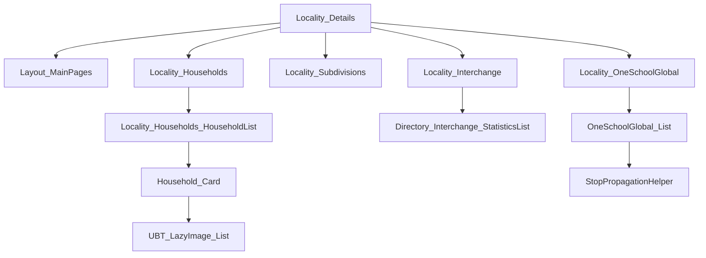
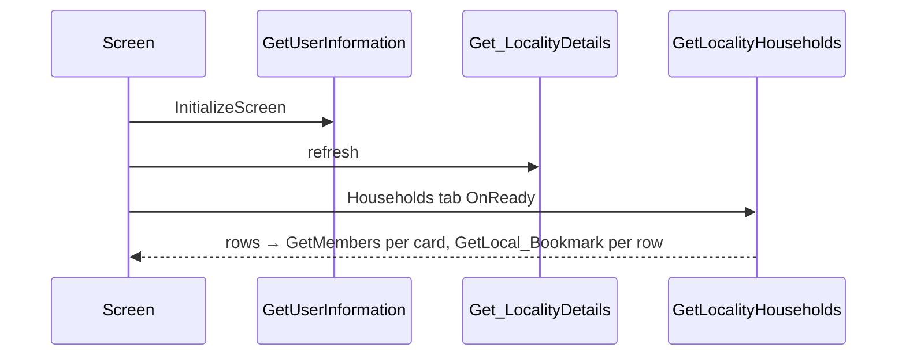

# Screen spec: Locality_Details

## 0. Summary
Directory locality page: header "Directory" with the search input, the locality label (preloaded, then
"<Locality>, <Country>") with the local time, a single-selection tag list (Households, My Household when it is the
user's locality, Supper Meetings, Interchange, OneSchool Global, Locality Contacts behind a flag) and the selected tab's
content; captured tabs: Households (brethren and household counts, household cards with member avatars) and, since
feedback F1 (capture-tags-2026-10-16), Supper Meetings, Interchange and OneSchool Global.

| Item | Value |
|---|---|
| Route (old) | `/UBTConnect/Locality_Details` with inputs `LocalityId` (LongInteger), `PreloadedLocalityLabel` (Text) |
| Screen file | `UBTConnect.Directory_Locality.Locality_Details.mvc.js` |
| Content blocks | `Directory_Locality › Locality_Households`, `Locality_Subdivisions`, `Locality_Interchange`, `Locality_OneSchoolGlobal` |
| Captured | TST, viewport 390×844, states default / loading / offline, tag-suppermeetings / tag-interchange / tag-oneschoolglobal (steps: click TagToggle nth 1-3) [analysis/states.json] |
| Variant | C2EnableC1DirectoryView on, C2EnableMaps off, C2NewBookmarks off, C2EnableCarousel on (decided default-only) |
| OutSystems UI version | OutSystemsUI_2_23 |
| Sources | `migration/screens/Locality_Details/analysis/` |

## 1. Entry and routing
Inputs from the query string (P-PARAMS). Navigation: Search (search input / sub-header search icon), CountryDetails or
BrowseDirectory with CountryCode (label click, GetHasC1DirectoryView) [ctrl :1120-1150], Map (explore icon, maps flag
off) [:1560-1580], HouseholdCarousel with In_StartingHouseholdId + preload CarouselHouseholdItem (card click, carousel on)
or HouseholdDetails?HouseholdId [HouseholdList ctrl :375-420; screen ctrl :1600-1625]. Tags (F1): supper meeting card →
SupperMeeting_Carousel?In_StartingSupperMeetingId + preload PreloadedSupperMeetings.SupperMeetingIds (carousel on) or
SupperMeeting_Details?In_SubdivsionId [Locality_Subdivisions ctrl :984-1085]; interchange card → HasAccessToRegion →
Locality_Details?PreloadedLocalityLabel&LocalityId (itself; the route keys the screen instance by history entry, Q7) or
App_Subscription_ShowUpgradePopUp [Locality_Interchange ctrl :452-618]; school card → OneSchoolGlobalDetails?
In_OneSchoolGlobalId unless the click started in StopPropagationHelper [screen ctrl :1537-1560].

## 2. Component tree
Layout_MainPages [shared] › StaticInput [shared] · headerContent: `locality-subtitle` › SubHeader_MainPages [route] ›
(label Columns_Two + SkeletonSection, Locality_DateTimeLabel [route] › Timer [route]); CustomContainer › SkeletonSection ›
HorizontalTagList [shared] · content: Locality_Households [route] › Locality_Households_HouseholdList [route] › OSList ›
Household_Card [route] › ImageCard_LazyLoading [shared] (UBT_LazyImage, UBT_LazyImage_List [route], ImageCard__Content) ·
Locality_Subdivisions [route] › SkeletonSection › CustomContainer › OSList › ImageCard_LazyLoading [shared] (UBT_LazyImage,
SupperMeeting_ImageCard_Content [shared]) · Locality_Interchange [route] › Directory_Interchange_StatisticsList [route] ›
Statistics_ListItem [shared] › Directory_EntityDetailsActions [shared] · Locality_OneSchoolGlobal [route] ›
OneSchoolGlobal_List [route] › ImageCard_LazyLoading [shared] › ImageCard__Content [shared] › StopPropagationHelper
[route] › Directory_EntityDetailsActions [shared] · Directory_EmptyState [shared] for empty lists ·
BottomBarMenu [shared] · CommonUI_InsideLayout [shared]. [pack.md Block plan; analysis/sources/pretty/ for the tag blocks,
extracted from capture/survey-UBTConnect.json]

## 2a. Architecture diagram

## 3. DOM and markup contract
As captured in analysis/dom/default.html (header :15-205, households :209-3535) and loading.html; block ids follow the
capture where they are not runtime list keys (ids are not compared). Tags: dom/tag-*.html (content from `b1-Content`);
list record keys continue after the skeleton rows (Subdivisions `l1-3598_10..12` after 10, schools `l1-3709_3..4` after
3; Interchange restarts at 0 because the data action record is replaced).

## 4. Visual specification
Original CSS only; classes from ContainerOptions / TextOptions as in the compiled views (cited in each component).

## 5. Data model
`types.ts`: LocalityDetails, LocalityHousehold, LazyImageItem, HouseholdMembers, SubdivisionCard, InterchangeItem,
OneSchoolCard; wire mapping in `api.ts`.

## 6. API calls
| Action | Phase | Trigger | Inputs |
|---|---|---|---|
| UBTConnect_Utils/ActionGetUserInformation | load | Action_InitializeScreen (GetUserInformation_Wrapper, shell cache) | none |
| Locality_Details/DataActionGet_LocalityDetails | load | OnReady after initialize | screen variables (recorded) |
| Locality_Households_HouseholdList/DataActionGetLocalityHouseholds | load | block OnReady | In_LocalityId |
| Household_Card/DataActionGetMembers | load | card OnReady / OnParametersChanged (HouseholdId ≠ 0) | Household |
| UBTConnect_Utils/ActionGetSignedImagesInBulk | load, tag-suppermeetings | shared UBT_LazyImage | shared |
| Locality_Subdivisions/DataActionGet_Subdivision_List | tag-suppermeetings | block OnReady (not restored) | block variables (StartIndex, Offset 20, card list, IsLoading, IsPaginated, LocalityId) |
| Locality_Interchange/DataActionGetInterchangesByLocalityId | tag-interchange | block OnReady | In_InterchangeLocalityId |
| Directory_EntityDetailsActions/DataActionFetchNotes | tag-interchange (1), tag-oneschoolglobal (2) | shared block | shared |
| Locality_OneSchoolGlobal/DataActionGet_OneSchoolGlobal_List | tag-oneschoolglobal | block OnReady | block variables (StartIndex, Offset 20, IsLoading, list, In_LocalityId, In_LocalityTimezoneData) |
| Directory_EntityDetailsActions/DataActionFetchContactDetails | tag-oneschoolglobal (2) | shared block | shared |
[analysis/calls.json; P-CALLS]

## 7. State and lifecycle
OnInitialize: LocalityLabel = PreloadedLocalityLabel; TagsList = GetSample_FilterTags(True) [ctrl :1170-1200].
OnReady: InitializeScreen (user; LocalityId 0 → user's; IsUserLocality; tags; selected Households; initialized) then
refresh Get_LocalityDetails → label "<Name>, <CountryName>" [ctrl :1262-1460]. View cache (P-BACK) via useViewState.
Tag blocks (OnReady unless restored with data): Subdivisions 10 skeleton cards (GetSkeletonList_UI_SubdivisionCard) then
fetch; OnAfterFetch first ListClear + IsLoading False, then ListAppendAll; scroll paging only when IsPaginated (never
set). Interchange: 3 "Loading" records, fetch, OnAfterFetch sets each statistic's icon and color
(GetIconLabel_Interchange_Statistics → GetLookupConcepts). OneSchool Global: 3 skeleton cards, fetch, same append rule,
scroll paging when a full page (20) came back.

## 8. Render logic
"My Locality:" only for the user's locality (not captured → NotCaptured); time zone row hidden when fetched with an
empty TimezoneName; skeletons as compiled [view :350-640]; content per TagsList_SelectedTag [view :880-1010].

## 9. Interactions and navigation
See section 1; tag change: TagsList = updated, ScrollTop JS on `.active-screen`, selected tag = its Identifier.

## 10. Sequence diagrams

## 11. Error handling and feedback
Exceptions go to the Directory_Locality flow handler (raiseToFlowHandler); Get_LocalityDetails failure sets
HasFetchError (time row skeleton).

## 12. Strings
"Directory", "Search for households or members", "My Locality:", "Local Timezone And UTC Offset", " Brethren",
" Households", tag texts (Entities_LocalityMenuOptions defaults).

## 13. Accessibility, platform and security notes
No native-only branch on this screen. GetLocalityHouseholds / GetMembers return person data: server-side authorization
of the locality/household is not visible client-side (to verify with the backend spec).

## 13a. Feature flags
C2EnableC1DirectoryView on, C2EnableCarousel on, C2EnableMaps off, C2NewBookmarks off (decided default-only, read via the
flag store); mobileDirectoryLocalityContacts undecided → Q2 (built with recommendation: off by default via flag store).

## 14. Unclear points
| # | What is unclear | Why | Question | Status |
|---|---|---|---|---|
| 1 | Uncaptured tabs (My Household, Locality Contacts; not on locality 252) | not captured | Q1 | answered; Supper Meetings, Interchange, OneSchool Global captured and built (F1) |
| 5 | Tag-state parity artifacts (masked photos, tag row scroll, time label, slider, app-start calls, footer shadow) | capture / timing | Q6 | open (proposed-exemptions.json) |
| 6 | Navigation from Locality_Details to itself (Interchange) | shell Outlet not keyed by entry | Q7 | open (keyed in the route) |
| 2 | Flag mobileDirectoryLocalityContacts | undecided flag | Q2 | open (off) |
| 3 | First card bookmarked in the capture (test account local bookmark) | mock data | Q3 | open (CR-Locality_Details-1) |
| 4 | Signed-image batch count; offline state shows PIN unlock | shared/shell behaviour | Q4 | open |

## 15. Acceptance criteria
1. default: header, label, time row, 4 tags, counters "95 Brethren"/"25 Households", 23 household cards with 1-2
   avatars match dom/default.html. 2. loading/offline: tag skeleton with 5 tags incl. My Household, empty content.
3. Calls per section 6 in the load phase. 4. Navigation per section 1. 5. tag-suppermeetings: 3 supper meeting cards
   (photo, photo, "Sorry, no photo available"), tag-interchange: 1 statistics card with Bookmark / Notes,
   tag-oneschoolglobal: 2 school cards with Bookmark / Call / Email / Notes / Share, calls in the tag phases
   (dom/tag-*.html, calls.json).

## 16. Decisions to confirm
- Q1 → answered: the three tags captured read-only and built (F1); My Household and Locality Contacts stay NotCaptured.
- Q6 → A: accept proposed-exemptions.json (tag-state artifacts) and capture-plan latency 600 ms for tag-interchange
  (pending orchestrator answer).
- Q7 → A: Locality_Details keys its screen instance by `location.key` (pending orchestrator answer).
- Tag mocks are fictional (never recorded), captured counts and text lengths: supper meetings 1210 / 9202 / 9203 (ids of
  the SupperMeeting_Details / Carousel mocks; their household lists keep their own counts 11 / 7 / 5, the cards show
  the captured 11 / 8 / 6), the third without photo (markNoPhoto); one interchange locality (253, "Sample North");
  schools 1430 (OneSchoolGlobalDetails mock id) and 1431 with the landscape placeholder, Phone/Email empty.
- StopPropagationHelper_Check reads `window.event` like its JavaScript node (lint rule no-deprecated disabled there).
- Q2 → mobileDirectoryLocalityContacts default-only, TST value off (pending orchestrator answer).
- Q3 → CR-Locality_Details-1: seed one legacy Contact bookmark in the shell mock (pending orchestrator answer).
- Q4 → signed-image batch count as timing artifact; offline error-scenario app start to the foundation (pending).
- GetLocalityHouseholds and GetMembers are fictional (never recorded): 23 households with captured text lengths, 1-2
  members, VisibleAvatars 5; Get_LocalityDetails recorded fixture served without input matching (LocalityId remapped).
- UBT_LazyImage_List "+N" counter (AvatarImage) rendered as NotCaptured (never captured).
- Exemptions added (artifacts): CAPTURE-MASKED-IMAGE-LOCALITYDETAILS, CAPTURE-MASKED-AVATAR-LOCALITYDETAILS,
  TIME-LABEL-LOCALITYDETAILS.

## 17. Patterns used
- P-PARAMS: route inputs, navigation with original parameter names.
- P-DATA / P-CALLS / P-MOCKS: api.ts adapters, mocks.ts (recorded + contract handlers).
- P-STATES: skeletons, NotCaptured gaps.
- P-LIST: OSList for households and avatars.
- P-FLAGS: useFlagOn / isOn for maps, carousel, new bookmarks, C1 directory view, locality contacts.
- P-OSUI: HorizontalTagList, BottomBarMenu (shared).
- P-BACK: useViewState / useWasRestoredFromCache (screen model, household list).

## 18. Builder notes
- Own blocks in app/src/screens/Locality_Details/components/ (SubHeader_MainPages, Locality_DateTimeLabel, Timer,
  Locality_Households, Locality_Households_HouseholdList, Household_Card, UBT_LazyImage_List; F1: Locality_Subdivisions,
  Locality_Interchange, Directory_Interchange_StatisticsList, Locality_OneSchoolGlobal, OneSchoolGlobal_List,
  StopPropagationHelper).
