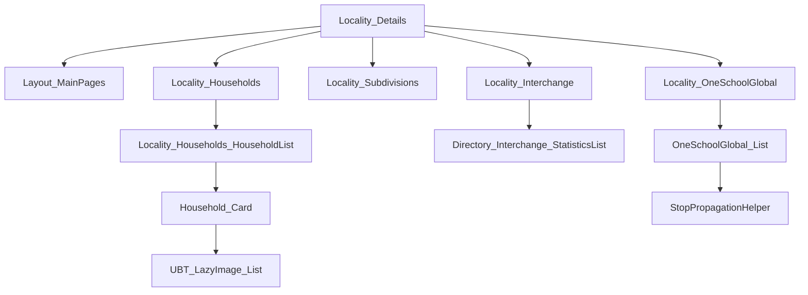
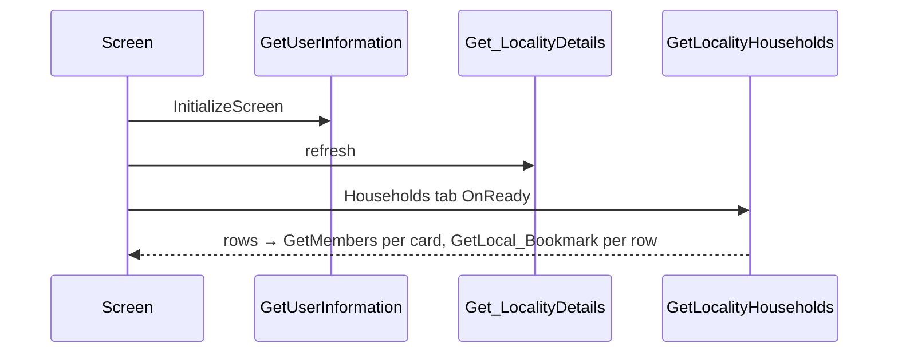

# Screen spec: Locality_Details

## 0. Summary
Locality_Details is the directory locality screen. It shows these parts:
- The header "Directory" with the search input.
- The locality label with the local time. At first, the label shows the preloaded label. After the fetch, it shows "<Locality>, <Country>".
- A single-selection tag list: Households, My Household, Supper Meetings, Interchange, OneSchool Global and Locality Contacts. My Household shows when the locality is the user's locality. Locality Contacts is behind a flag (mobileDirectoryLocalityContacts, section 13a).
- The content of the selected tab.

The capture has these tabs: Households (brethren and household counts, household cards with member avatars) and, since feedback F1 (capture-tags-2026-10-16), Supper Meetings, Interchange and OneSchool Global.

| Item | Value |
|---|---|
| Route (old) | `/UBTConnect/Locality_Details` with inputs `LocalityId` (LongInteger), `PreloadedLocalityLabel` (Text) |
| Screen file | `UBTConnect.Directory_Locality.Locality_Details.mvc.js` |
| Content blocks | `Directory_Locality › Locality_Households`, `Locality_Subdivisions`, `Locality_Interchange`, `Locality_OneSchoolGlobal` |
| Captured | TST, viewport 390×844, states default / loading / offline, tag-suppermeetings / tag-interchange / tag-oneschoolglobal (steps: click TagToggle nth 1-3) [analysis/states.json] |
| Variant | C2EnableC1DirectoryView on, C2EnableMaps off, C2NewBookmarks off, C2EnableCarousel on (decided default-only) |
| OutSystems UI version | OutSystemsUI_2_23 |
| Sources | `migration/screens/Locality_Details/analysis/` |

## 1. Entry and routing
The screen reads the inputs from the query string (P-PARAMS). The screen goes to other screens in these cases:
- The user clicks the search input or the sub-header search icon. The screen goes to Search [view :239-246, :329-336].
- The user clicks the locality label [ctrl :1120-1150]:
  - When GetHasC1DirectoryView is true, the screen goes to CountryDetails with CountryCode.
  - Otherwise, the screen goes to BrowseDirectory with CountryCode.
- The user clicks the explore icon. The screen goes to Map [:1560-1580]. The icon shows only when GetHasMapsEnabled is true [view :268, :664]. The maps flag is off (section 13a).
- The user clicks a household card [HouseholdList ctrl :375-420; screen ctrl :1600-1625]:
  - When the carousel is on (GetHasCarouselEnabled is true), the screen sets the preload CarouselHouseholdItem. Then it goes to HouseholdCarousel with In_StartingHouseholdId.
  - Otherwise, the screen goes to HouseholdDetails?HouseholdId.
- Tags (F1), supper meeting card [Locality_Subdivisions ctrl :984-1085]. The user clicks the card:
  - When the carousel is on, the screen sets the preload PreloadedSupperMeetings.SupperMeetingIds. Then it goes to SupperMeeting_Carousel?In_StartingSupperMeetingId.
  - Otherwise, the screen goes to SupperMeeting_Details?In_SubdivsionId.
- Tags (F1), interchange card [Locality_Interchange ctrl :452-618]. The list Directory_Interchange_StatisticsList sends the event Event_NavigateToLocality. The screen runs HasAccessToRegion:
  - When the user has access, the screen goes to Locality_Details?PreloadedLocalityLabel&LocalityId. This is the same screen. The route keys the screen instance by history entry (Q7).
  - Otherwise, the screen runs App_Subscription_ShowUpgradePopUp.
- Tags (F1), school card [screen ctrl :1537-1560]. The user clicks the card. The screen goes to OneSchoolGlobalDetails?In_OneSchoolGlobalId. It does not go there when the click started in StopPropagationHelper.

## 2. Component tree
The tree uses "›" for "contains". Each item below is one part of the tree, in the order of the original:
- Layout_MainPages [shared] › StaticInput [shared].
- headerContent: `locality-subtitle` › SubHeader_MainPages [route] › (label Columns_Two + SkeletonSection, Locality_DateTimeLabel [route] › Timer [route]).
- CustomContainer › SkeletonSection › HorizontalTagList [shared].
- content: Locality_Households [route] › Locality_Households_HouseholdList [route] › OSList › Household_Card [route] › ImageCard_LazyLoading [shared] (UBT_LazyImage, UBT_LazyImage_List [route], ImageCard__Content).
- Locality_Subdivisions [route] › SkeletonSection › CustomContainer › OSList › ImageCard_LazyLoading [shared] (UBT_LazyImage, SupperMeeting_ImageCard_Content [shared]).
- Locality_Interchange [route] › Directory_Interchange_StatisticsList [route] › Statistics_ListItem [shared] › Directory_EntityDetailsActions [shared].
- Locality_OneSchoolGlobal [route] › OneSchoolGlobal_List [route] › ImageCard_LazyLoading [shared] › ImageCard__Content [shared] › StopPropagationHelper [route] › Directory_EntityDetailsActions [shared].
- Directory_EmptyState [shared] for empty lists.
- BottomBarMenu [shared].
- CommonUI_InsideLayout [shared].

[pack.md Block plan; analysis/sources/pretty/ for the tag blocks,
extracted from capture/survey-UBTConnect.json]

## 2a. Architecture diagram

## 3. DOM and markup contract
- The markup is as captured in analysis/dom/default.html (header :15-205, households :209-3535) and loading.html.
- Block ids follow the capture, except runtime list keys. The parity check does not compare ids.
- For the tags, the markup is in dom/tag-*.html (content from `b1-Content`).
- List record keys continue after the skeleton rows:
  - Subdivisions: `l1-3598_10..12` after 10.
  - Schools: `l1-3709_3..4` after 3.
  - Interchange restarts at 0, because the data action replaces the record.

## 4. Visual specification
The screen uses only the original CSS. The classes come from ContainerOptions / TextOptions, as in the compiled views. Each component cites its view.

## 5. Data model
`types.ts` defines these types: LocalityDetails, LocalityHousehold, LazyImageItem, HouseholdMembers, SubdivisionCard, InterchangeItem, OneSchoolCard. `api.ts` has the wire mapping.

## 6. API calls
| Action | Phase | Trigger | Inputs |
|---|---|---|---|
| UBTConnect_Utils/ActionGetUserInformation | load | Action_InitializeScreen (GetUserInformation_Wrapper, shell cache) | none |
| Locality_Details/DataActionGet_LocalityDetails | load | OnReady after initialize | screen variables (recorded) |
| Locality_Households_HouseholdList/DataActionGetLocalityHouseholds | load | block OnReady | In_LocalityId |
| Household_Card/DataActionGetMembers | load | card OnReady / OnParametersChanged (HouseholdId ≠ 0) | Household |
| UBTConnect_Utils/ActionGetSignedImagesInBulk | load, tag-suppermeetings | shared UBT_LazyImage | shared |
| Locality_Subdivisions/DataActionGet_Subdivision_List | tag-suppermeetings | block OnReady (not restored) | block variables (StartIndex, Offset 20, card list, IsLoading, IsPaginated, LocalityId) |
| Locality_Interchange/DataActionGetInterchangesByLocalityId | tag-interchange | block OnReady | In_InterchangeLocalityId |
| Directory_EntityDetailsActions/DataActionFetchNotes | tag-interchange (1), tag-oneschoolglobal (2) | shared block | shared |
| Locality_OneSchoolGlobal/DataActionGet_OneSchoolGlobal_List | tag-oneschoolglobal | block OnReady | block variables (StartIndex, Offset 20, IsLoading, list, In_LocalityId, In_LocalityTimezoneData) |
| Directory_EntityDetailsActions/DataActionFetchContactDetails | tag-oneschoolglobal (2) | shared block | shared |
[analysis/calls.json; P-CALLS]

## 7. State and lifecycle
- OnInitialize [ctrl :1170-1200]:
  - If LocalityLabel is empty, the screen sets LocalityLabel = PreloadedLocalityLabel.
  - If TagsList is empty, the screen sets TagsList = GetSample_FilterTags(True).
- OnReady [ctrl :1262-1460]:
  - When IsScreenInitialized is False, the screen runs InitializeScreen. Then it refreshes Get_LocalityDetails.
  - When IsScreenInitialized is True and Get_LocalityDetails has data without an error, the screen does nothing more.
  - When IsScreenInitialized is True and Get_LocalityDetails has no data or has an error, the screen refreshes Get_LocalityDetails.
- InitializeScreen does these steps in order [ctrl :1262-1460]:
  1. It gets the user.
  2. When the input LocalityId is 0, it uses the locality of the user.
  3. It sets IsUserLocality. The value is True when LocalityId equals the locality of the user.
  4. It sets the tags.
  5. It selects the tag Households.
  6. It sets IsScreenInitialized = True.
- After the fetch, the screen sets the label "<Name>, <CountryName>" [ctrl :1262-1460].
- The React app keeps the view cache (P-BACK) with useViewState.
- Each tag block runs its OnReady steps unless the app restores the view from the cache with data:
  - Subdivisions: OnReady shows 10 skeleton cards (GetSkeletonList_UI_SubdivisionCard). Then it fetches the list.
  - Subdivisions: OnAfterFetch does ListClear and sets IsLoading False. Then it does ListAppendAll.
  - Subdivisions: scroll paging runs only when IsPaginated is True. No action sets IsPaginated.
  - Interchange: OnReady adds 3 "Loading" records. Then it fetches the list.
  - Interchange: OnAfterFetch sets the icon and the color of each statistic (GetIconLabel_Interchange_Statistics → GetLookupConcepts).
  - OneSchool Global: OnReady adds 3 skeleton cards. Then it fetches the list.
  - OneSchool Global: OnAfterFetch uses the same append rule as Subdivisions.
  - OneSchool Global: scroll paging runs when the fetch returns a full page (20).

## 8. Render logic
- The screen shows "My Locality:" only for the user's locality. The capture does not include it, so the React app renders NotCaptured.
- The screen hides the time zone row when the fetch returns an empty TimezoneName.
- The skeletons are as compiled [view :350-640].
- The selected tag (TagsList_SelectedTag) decides the content [view :880-1010].

## 9. Interactions and navigation
For navigation, see section 1. When the user selects a tag (event Handler_HorizontalTagListChanged), the screen does these steps:
1. It sets TagsList = the updated list.
2. It runs the ScrollTop JS on `.active-screen`.
3. It sets the selected tag = the Identifier of the selected tag.

## 10. Sequence diagrams

## 11. Error handling and feedback
The Directory_Locality flow handler receives the exceptions (raiseToFlowHandler). When Get_LocalityDetails fails, the screen sets HasFetchError. The time row then shows a skeleton.

## 12. Strings
The screen uses these strings: "Directory", "Search for households or members", "My Locality:", "Local Timezone And UTC Offset", " Brethren", " Households". It also uses the tag texts (Entities_LocalityMenuOptions defaults).

## 13. Accessibility, platform and security notes
- This screen has no native-only branch.
- GetLocalityHouseholds / GetMembers return person data. The client code does not show a server-side authorization of the locality/household for them. Verify it with the backend spec.

## 13a. Feature flags
- Decided default-only (read via the flag store): C2EnableC1DirectoryView on, C2EnableCarousel on, C2EnableMaps off, C2NewBookmarks off.
- mobileDirectoryLocalityContacts: default-only, TST value off (Q2 answered: auto-accepted recommendation (user instruction, 2026-10-15)). The React app keeps it off through the flag store.

## 14. Unclear points
| # | What is unclear | Why | Question | Status |
|---|---|---|---|---|
| 1 | Uncaptured tabs (My Household, Locality Contacts; not on locality 252) | not captured | Q1 | answered; Supper Meetings, Interchange, OneSchool Global captured and built (F1) |
| 5 | Tag-state parity artifacts (masked photos, tag row scroll, time label, slider, app-start calls, footer shadow) | capture / timing | Q6 | answered: A, tag exemptions merged |
| 6 | Navigation from Locality_Details to itself (Interchange) | shell Outlet not keyed by entry | Q7 | answered: A, keyed in the route |
| 2 | Flag mobileDirectoryLocalityContacts | undecided flag | Q2 | answered: default-only, TST value off |
| 3 | First card bookmarked in the capture (test account local bookmark) | mock data | Q3 | answered: CR-Locality_Details-1 applied |
| 4 | Signed-image batch count; offline state shows PIN unlock | shared/shell behaviour | Q4 | answered: (a) + (b) |

## 15. Acceptance criteria
1. In the state default, these items match dom/default.html.
   - The header, the label and the time row.
   - 4 tags.
   - The counters "95 Brethren"/"25 Households".
   - 23 household cards with 1-2 avatars.
2. In the states loading/offline, the tag list shows a skeleton with 5 tags, with My Household. The content is empty.
3. The screen makes the calls of section 6 in the load phase.
4. Navigation follows section 1.
5. The tag states show these items:
   - tag-suppermeetings: 3 supper meeting cards (photo, photo, "Sorry, no photo available").
   - tag-interchange: 1 statistics card with Bookmark / Notes.
   - tag-oneschoolglobal: 2 school cards with Bookmark / Call / Email / Notes / Share.
   - The calls in the tag phases follow (dom/tag-*.html, calls.json).

## 16. Decisions to confirm
- Q1 → answered: the React app builds the three tags that the capture shows read-only (F1). My Household and Locality Contacts stay NotCaptured.
- Q6 → A: accept proposed-exemptions.json (tag-state artifacts). Also accept the capture-plan latency 600 ms for tag-interchange. Answered: auto-accepted recommendation (user instruction, 2026-10-16) [questions.md Q6].
- Q7 → A: Locality_Details keys its screen instance by `location.key`. Answered: auto-accepted recommendation (user instruction, 2026-10-16) [questions.md Q7].
- The tag mocks are fictional (never recorded). They keep the captured counts and text lengths:
  - Supper meetings: 1210 / 9202 / 9203. These are the ids of the SupperMeeting_Details / Carousel mocks. Their household lists keep their own counts 11 / 7 / 5. The cards show the captured counts 11 / 8 / 6. The third supper meeting has no photo (markNoPhoto).
  - Interchange: one locality (253, "Sample North").
  - Schools: 1430 (OneSchoolGlobalDetails mock id) and 1431. Both use the landscape placeholder. Their Phone/Email values are empty.
- StopPropagationHelper_Check reads `window.event`, like its JavaScript node. The code disables the lint rule no-deprecated there.
- Q2 → mobileDirectoryLocalityContacts is default-only, with the TST value off. Answered: auto-accepted recommendation (user instruction, 2026-10-15) [questions.md Q2].
- Q3 → CR-Locality_Details-1: the shell mock seeds one legacy Contact bookmark. Answered: auto-accepted recommendation (user instruction, 2026-10-15); CR-Locality_Details-1 applied [questions.md Q3].
- Q4 → the signed-image batch count is a timing artifact. The offline error-scenario app start goes to the foundation. Answered (a) + (b): auto-accepted recommendation (user instruction, 2026-10-15) [questions.md Q4].
- The GetLocalityHouseholds and GetMembers mocks are fictional (never recorded): 23 households with captured text lengths, 1-2 members, VisibleAvatars 5.
- The mock serves the recorded Get_LocalityDetails fixture for every input (the mock remaps LocalityId).
- The route renders the UBT_LazyImage_List "+N" counter (AvatarImage) as NotCaptured, because the capture never shows it.
- The route adds these exemptions (artifacts): CAPTURE-MASKED-IMAGE-LOCALITYDETAILS, CAPTURE-MASKED-AVATAR-LOCALITYDETAILS, TIME-LABEL-LOCALITYDETAILS.

## 17. Patterns used
- P-PARAMS: the route reads the inputs. Navigation uses the original parameter names.
- P-DATA / P-CALLS / P-MOCKS: api.ts has the adapters. mocks.ts has the recorded handlers and the contract handlers.
- P-STATES: the screen has skeletons and NotCaptured gaps.
- P-LIST: the screen uses OSList for households and avatars.
- P-FLAGS: the screen uses useFlagOn / isOn for these flags: maps, carousel, new bookmarks, C1 directory view, locality contacts.
- P-OSUI: the screen uses HorizontalTagList and BottomBarMenu (shared).
- P-BACK: the screen model and the household list use useViewState / useWasRestoredFromCache.

## 18. Builder notes
- The own blocks are in app/src/screens/Locality_Details/components/:
  - SubHeader_MainPages, Locality_DateTimeLabel, Timer, Locality_Households, Locality_Households_HouseholdList, Household_Card, UBT_LazyImage_List.
  - F1: Locality_Subdivisions, Locality_Interchange, Directory_Interchange_StatisticsList, Locality_OneSchoolGlobal, OneSchoolGlobal_List, StopPropagationHelper.
