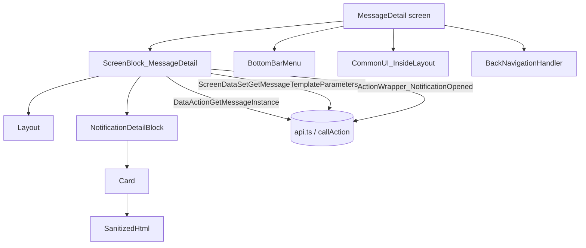
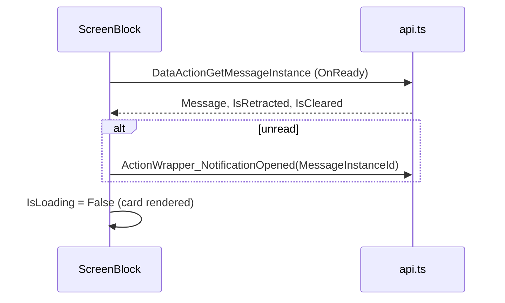

# Screen spec: MessageDetail

## 0. Summary
Detail of one notification message (legacy My Notifications flow): header with back arrow and the sender name as
title, a card with sender icon, title, optional summary and urgent icon, the HTML body (sanitized) and the creation
date; bottom bar when signed in. Opening an unread message decrements the unread counter and calls
Wrapper_NotificationOpened. Reached from MessageList rows, push notifications and deep links.

| Item | Value |
|---|---|
| Route (old) | `/UBTConnect/MessageDetail` with inputs `MessageInstanceId: LongInteger, isOriginPushNotification: Boolean, MessageTemplateId: LongInteger, HardwareId: Text` [pack.md] |
| Screen file | `UBTConnect.Legacy_MyNotificationsFlow.MessageDetail.mvc.js` |
| Content block | `Connect2_LegacyShared › MyNotifications › ScreenBlock_MessageDetail` (+ `Widgets.NotificationDetailBlock`) |
| Captured | 2026-10-14, env TST, viewport 390×844, signed-in test account; states default, loading, offline [states.json] |
| Variant | one; flag C2NewNotifications only changes the "back to list" target (Notifications / MessageList) |
| OutSystems UI version | OutSystemsUI_2_23 |
| Sources | `migration/screens/MessageDetail/analysis/` |

## 1. Entry and routing
- MessageList row → `MessageDetail?MessageInstanceId=…` [MessageList index.tsx]; push / deep links pass the same inputs.
- Inputs read from the query string with the original names; LongIntegers stay strings, `isOriginPushNotification`
  Boolean, `HardwareId` Text [screen mvc.js view :173-179].
- Layout `Connect2_LegacyShared.Layout.Layout`, header left `MenuIcon_Back`, no menu; bottom bar only when signed in
  (`GetUserId() <> NullIdentifier()`) [screen view :372-395].

## 2. Component tree
- `MyNotifications.ScreenBlock_MessageDetail` **render** (`$b1`)
  - `Layout.Layout` **shared** (`b1-$b1`): headerLeft `Layout.MenuIcon_Back` **shared** (`b1-$b2`); title container
    `notification-detail-title-overflow` (inline `text-align: center;`) with the sender expression; content:
    - IsLoading → `Reusable.Spinner` **shared** (`b1-$b3`, ShowLoader True) [dom/loading.html :63-68]
    - else `Widgets.NotificationDetailBlock` **render** (`b1-NotificationDetailBlock`) → `Content.Card` **shared**
      (`b1-b4-NotificationDetail`, UsePadding True) → icon / title / urgent row, body (`HtmlSanitizer.SanitizedHtml`
      **shared**, `b1-b4-$b3`), date (`b1-b4-Message_List_Item_Info`), action-button container.
      - MessageDetails placeholder (Sharing): `Share_UI.ShareObjectDetail(_ExtendedShare)` **not captured** (Q1)
      - adaptive card: `Widgets.AdaptiveCardViewer` **not captured** (Q1)
      - Placeholder_ActionButton (Orbit / Assemble buttons) **not captured** (Q1)
  - bottomBar placeholder `b1-BottomBar` ← screen: `App_Common.BottomBarMenu` **shared** (`$b3`) when signed in
  - commonUI placeholder `b1-CommonUI_Elements` ← screen: `App_Common.CommonUI_InsideLayout` **shell** (`$b4`) and
    `NavigationHandler.BackNavigationHandler` **shared** (`$b5`)

## 2a. Architecture diagram

## 3. DOM and markup contract
Exactly pack.md "Markup" and `analysis/dom/default.html` :64-96 (card) and `dom/loading.html` :63-68 (spinner). Icon
container class is `"notification-detail-icon-badge " + (ForceNoIconBorder ? "no-border" : ProfileIconURL = "" ?
"no-border" : "")` [NotificationDetailBlock view :331-337]; image External (ProfileIconURL) or Static
`img/Connect2_LegacyShared.User_rectangle.png` [:345-365]. Inline styles only as captured / compiled.

## 4. Visual specification
Original CSS only; no route CSS. Text-note date is masked in the capture (accepted kind "masked text").

## 5. Data model
`GetMessageInstanceResponse` [types.ts]: Message (MessageTemplate, MessageSenderTarget, MessageInstance,
MessageContent, AdaptiveCardJSON, User, CreatedByMemberId), IsRetracted, IsCleared, PlaceholderDelimiters. Domain type
in `types.ts` (no wire shapes in components). Static entities from `knowledge/static-entities-tst.json`:
MessageSenderTarget orbit 2, directory 3, lordsDayMeal 6, orbitHostSurvey 20, assemble 21; MessageInfoType whatsNew 2,
sharing 3; MessagePriority urgent 2; MessageType private 1; ParameterName assembleEventParentId 18,
assembleEventInstanceId 17.

## 6. API calls
| Call | When | Inputs | Evidence |
|---|---|---|---|
| `ScreenBlock_MessageDetail/DataActionGetMessageInstance` | OnReady (on demand), unless both ids are null | screen variables | calls.md #2; controller :1532-1572 |
| `ScreenBlock_MessageDetail/ScreenDataSetGetMessageTemplateParametersByMessageTemplateId` | OnAfterFetch, Sharing/Orbit/Assemble, not restored from cache (MaxRecords 50) | screen variables | controller :1083-1099 |
| `ActionWrapper_NotificationOpened` | OnAfterFetch when not read | MessageInstanceId | controller :1030-1059; allowAction (user, 2026-10-14) |
| `UBTConnect_Utils` signed image (Cache_SignedImageURL_Get) | OnAfterFetch when SentAs = null | CreatedByMemberId, Member, Small | controller :1063-1076 |
| `ActionGetUserInformation` (cached) | Orbit kinds (AddFirstSentence) | – | controller :1104-1119 |
Other captured calls (#1, #3-#8) belong to the app start (shell).

## 7. State and lifecycle
Variables IsLoading (True), ShowAssembleAction, MessageInstanceId [ScreenBlock model :40-91]. OnReady → refresh
GetMessageInstance → OnAfterFetch (section 8 flow) → IsLoading False [controller :916-1203].

## 8. Render logic
- Title: SentAs ≠ null ? (sender = LordsDayMeal ? "Meal Allocation" : sender Name) : User.Name [view :289-299].
- IsLoading → Spinner, else NotificationDetailBlock with ForceNoIconBorder (Orbit/OrbitHostSurvey),
  ShowDetailsPlaceholder (Sharing), IsUrgent, isAdaptiveCard, HasActionButton (Orbit/HostSurvey/Assemble) [view :333-361].
- Summary row only when Summary ≠ ""; urgent icon only when IsUrgent [block view :405-476].
- Date: `FormatDateTime(d,"ddd dd/MM/yyyy") + " " + ToLower(FormatDateTime(d,"h:mm tt"))`, "" for null date [:601-604].
- OnAfterFetch: MessageInstanceId = fetched id; IsRetracted → MessageRetractedFlow (toast "Sorry, this message is
  not available anymore." + ReplaceOnUpcomingNavigation + NavigateTo_MessageList); id null → signed in ? toast "You
  don't have access to that message" + ReplaceOnUpcomingNavigation + NavigateTo_MessageList : NavigateTo_Login;
  Private: signed out → NavigateTo_Login; other user → toast, then (after the loop) ReplaceOnUpcomingNavigation +
  NavigateTo_MessageList; IsCleared → toast "Sorry, this message is not available anymore.", then the same
  navigation; else unread → Decrement (WhatsNew or Messages counter) + Wrapper_NotificationOpened (IsRetracted →
  retracted flow); SentAs null → signed image; Sharing/Orbit/Assemble → aggregate (not when restored from cache),
  Orbit → AddFirstSentence, Assemble → BuildAssembleNotificationContent (Q1); then IsLoading False
  [controller :916-1203].
- Uncaptured styled parts (Summary row, urgent icon) render `<NotCaptured>`: their inline styles are not in any
  captured state (AGENTS rule 21).

## 9. Interactions and navigation
- Back arrow: MenuIcon_Back (shared). BackNavigationHandler ($b5): when the back target pathname is `/UBTConnect/`
  → PreventNavigation + HomeFeed [screen controller :1058-1095, CheckIfInvalidLocationJS].
- NavigateTo_MessageList: C2NewNotifications on → `/UBTConnect/Notifications`, off → `/UBTConnect/MessageList`
  [:693-725]. NavigateTo_Login → `/UBTConnect/Login`.
- Body links open in a new tab (OpenLinksInSystemBrowserJS, web branch) [block :828-845].

## 10. Sequence diagrams

## 11. Error handling and feedback
Data-action failure → flow handler (shell). Toasts: FeedbackMessage_AutoClose (error) texts above; "Invalid message
detail id." (platform Error) when both ids are null [controller :1545-1550].

## 12. Strings
"Meal Allocation", "You don't have access to that message", "Sorry, this message is not available anymore.",
"Invalid message detail id." [controller].

## 13. Accessibility, platform and security notes
Web branch only (no Cordova InAppBrowser). Security: GetMessageInstance / Wrapper_NotificationOpened must enforce
on the server that the instance belongs to the user (client checks only UserId for private messages) [security.md].

## 13a. Feature flags
All decided by the user 2026-10-14 (pack "Feature flags"): C2NewNotifications both branches (navigation target only,
default off), read with `getHasNewNotifications()` (flag store); C2ExtendedShare, mobileDirectoryUpdateFeedDeceasedProfile,
mobileAssemble, mobileOrbitAccess, mobileOrbitHostSurvey default-only (only used by Q1 parts). Others not read here.

## 14. Unclear points
| # | What is unclear | Why | Question | Status |
|---|---|---|---|---|
| 1 | Sharing, adaptive-card, Assemble, Orbit message kinds | not captured; blocks not built; PlaceholderLib source missing | Q1 | open |
| 2 | Targets decided skip:external | divergence | Q2 | open |
| 3 | Spinner rotation phase in loading/offline parity | animation phase | Q3 | open |

## 15. Acceptance criteria
1. Default state matches dom/default.html (title "Directory", card, body, date) at 390×844.
2. Loading/offline: spinner and empty title (dom/loading.html).
3. Calls: DataActionGetMessageInstance on load; no Wrapper_NotificationOpened for a read message.
4. Back to list goes to MessageList (flag off) / Notifications (flag on).

## 16. Decisions to confirm
- Mock: GetMessageInstance has no recorded fixture → fictional message "Test Noti 56" (Directory sender, read) for the captured id; other ids are built from the MessageList mock rows (shared store `MessageList.messages`), unknown ids answer "not found" (P-MUTATION).
- Mock: Wrapper_NotificationOpened answers IsRetracted False and marks the row read in that store.
- Sharing / adaptive-card / Orbit / Assemble parts render `<NotCaptured>` until Q1 is answered (calls and flow built).
- DecrementReadWhatsNewsCounter: client variable UnreadWhatsNewsNumber missing in the shell → CR-MessageDetail-1; the What's New branch skips the decrement until then.
- Navigation to skip:external targets is not reachable while Q1 parts are NotCaptured (Q2).
- Summary row and urgent icon render `<NotCaptured>` (not captured; inline styles not in a captured state).
- Exemption CAPTURE-LINK-HREF-CURSOR-MENUICON-BACK added (accepted kind link cursor, auto-decided in the user's 3h window 2026-10-15); spinner rotation phase proposed (Q3).
- Body links open in a new tab (OpenLinksInSystemBrowserJS web branch, window.open _blank).

## 17. Patterns used
- P-PARAMS: query inputs, navigation targets (index.tsx).
- P-STATES: spinner while loading, NotCaptured gaps.
- P-DATA / P-CALLS: api.ts adapters, calls in OnReady / OnAfterFetch.
- P-MOCKS / P-MUTATION: mocks.ts with store collections.
- P-FLAGS: C2NewNotifications via the UBTConnect_Utils flag helper.
- P-BACK: aggregate skipped when restored from the view cache (useWasRestoredFromCache).
- P-DIALOG: feedback messages through shell/feedback.

## 18. Builder notes
- Copy MessageList's local decrementReadMessagesCounter (controller.js:1846-1862).
