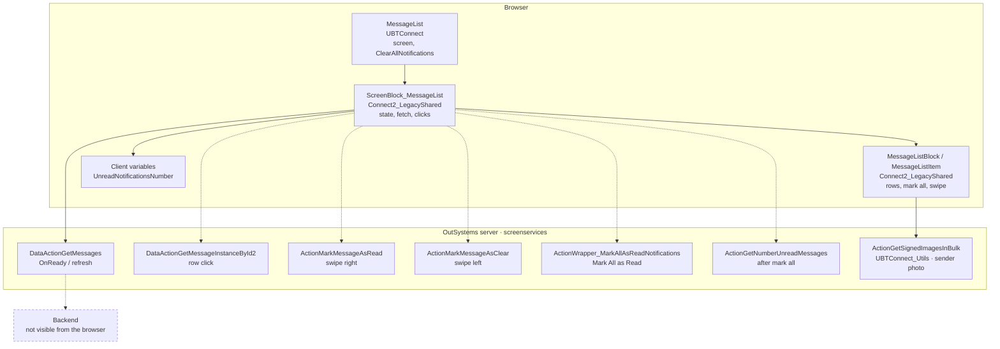
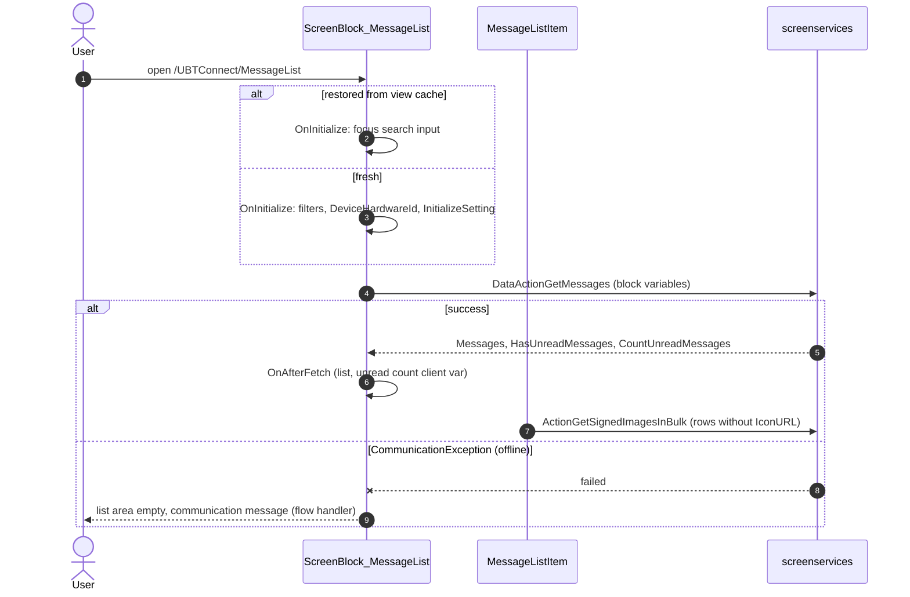
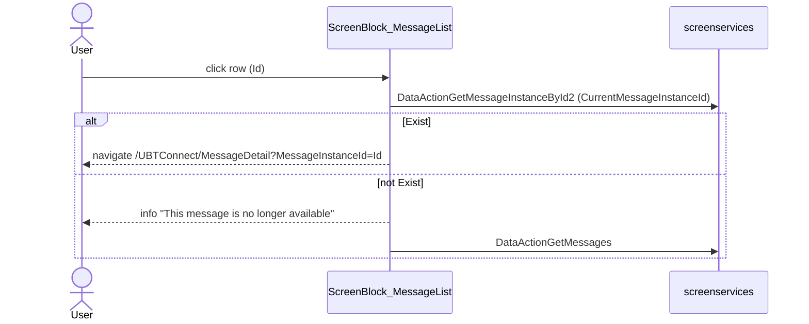
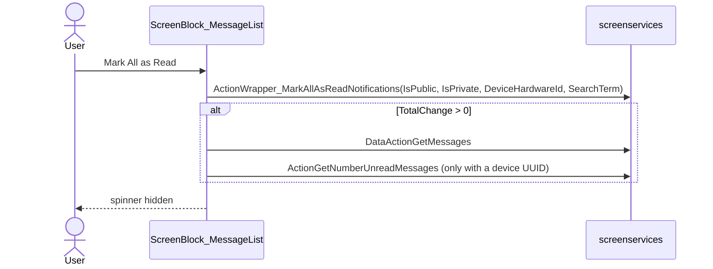

# Screen spec: MessageList

## 0. Summary
"My Notifications" (legacy inbox): the signed-in user's messages, newest first, unread rows highlighted, "Mark All as
Read" on top, a tap opens MessageDetail. Header search and sort (filter) modes switch the header and content. The bell
opens this screen when flag C2NewNotifications is off (D11 c, user 2026-10-14; bell logic is in the shared
BottomBarMenu / App_NotificationIcon).

| Item | Value |
|---|---|
| Route (old) | `/UBTConnect/MessageList`, no inputs [pack.md] |
| Screen file | `UBTConnect.Legacy_MyNotificationsFlow.MessageList.mvc.js` |
| Content block | `Connect2_LegacyShared › MyNotifications › ScreenBlock_MessageList` |
| Captured | TST, 390×844, signed-in test account; states default, loading, offline (2026-10-14); filter, search (2026-10-15, plan steps, read-only UI toggles, Q7) [analysis/states.json] |
| Variant | Legacy notifications (C2NewNotifications off → MessageList; on → Notifications, separate route) |
| OutSystems UI version | OutSystemsUI_2_23 |
| Sources | `migration/screens/MessageList/analysis/` |

## 1. Entry and routing
- Reached from the bottom-bar bell (BottomBarMenu, shared) and from notification links. No inputs [MessageList.mvc.js model :63].
- Layout `Connect2_LegacyShared.Layout.Layout`, UsePullToRefresh True [ScreenBlock view :268]. BottomBarMenu only when
  signed in (`GetUserId() <> NullIdentifier()`) [MessageList.mvc.js view :213]; CommonUI_InsideLayout `$b3` [:246].
- Screen OnReady: `ClearAllNotifications` (UBTConnect_Utils) [MessageList.mvc.js :311]: Firebase plugin only; on the web
  `CheckCloudMessagingPlugin` is false → no-op [UBTConnect_Utils.controller.js clearAllNotifications].

## 2. Component tree
```
MessageList (screen)                                  index.tsx
  ScreenBlock_MessageList $b1                         components/ScreenBlock_MessageList.tsx
    Layout b1-$b1 [shared]  (PullToRefresh inside BaseLayout [shared osui])
      headerLeft: signed in → Close_Search_Icon (search/filter mode) | MenuIcon__UpdatedOSUI b1-$b2 (MenuAction Menu) [shared]
                  signed out → MenuIcon_Back b1-$b3 [shared]
      title: search mode → InputWithIcon b1-$b4 [shared osui] › Input_SearchMessages + remove icon (Q3) | "Sort" / "My Notifications"
      headerRight: Search_Icon, Filter_Icon / Close_Filter_Icon, ThemeGrid_Width1
      content .message-list: MessageSearchHistory b1-$b5 (own; data: shell localEntities/localSearchHistory, CR-MessageList-3); FilterDataBlock:
         not filters → Warning_PrivateMessage b1-$b6 (own) · MessageListBlock b1-$b7 (own) › OSList / OSListItem
                       [components/OSList] › MessageListItem (own)
                       · MessageList_NoResults b1-$b8 [shared] / NoNotifications_Banner b1-$b9|$b10 (own) · Spinner b1-$b11 [shared]
         filters → Animate b1-$b12 [shared osui] › MessageList_Filter b1-$b13 (own) › MessageFilterGroup ›
                   MessageFilterItem › CircledCheckbox, TwoButtonsAligned (own, Q3)
      Spinner b1-LoadingMarkAllRead [shared]; BackNavigationHandler b1-$b15 [shared]
  bottomBar: <div data-container> BottomBarMenu $b2 [shared]; commonUI: CommonUI_InsideLayout $b3 [shared]
```

## 2a. Architecture diagram


## 3. DOM and markup contract
Exactly `analysis/dom/default.html` (pack "Markup"), through the shared OSList / OSListItem (Q1). Row: `div[data-container]` (visible `not IsClear`) ›
`div[data-list-item][data-not-scrollable]#…-Messages_List_Item` › `.list-item-container.list-item-float-left` › empty
`.list-item-left-actions`, `div.list-item[ background-blue-lightest when not IsRead][data-list-item-content]`, empty
`.list-item-right-actions` [MessageListBlock view :115-230; dom rows 0-18]. List `div.list.list-group.OSFillParent
[data-animation-disabled][data-list]#b1-b7-Messages_List` style `position: relative`. Mark-all bar inline style as
captured (`… top: 0px; z-index: 2;`) [dom/default.html:91].

## 4. Visual specification
Original CSS only; no route CSS. Item image 43×43 `.notification-list-icon-badge`; urgent icon inline style as captured
[dom/default.html:719].

## 5. Data model
Wire `MessagesItem` [analysis/types.ts:53-67] → domain `MessageItem { id, title, dateTimeCreated, isUrgent
(MessageTemplatePriorityId = MessagePriority.Urgent "2"), profileIconURL, isClear, isRead, createdByUserId,
createdByMemberId, messageInfoTypeId }`. Outputs `HasUnreadMessages`, `CountUnreadMessages` (Long Integer string).
Static entities from `static-entities-tst.json`: MessagePriority, Connect_Entity.Member "Member", ImageSize.Small "Small",
MenuAction.Menu "Menu", RecentSearchType.MyNotifications.

## 6. API calls
| Call | Phase / trigger | Inputs | Outputs used |
|---|---|---|---|
| `Connect2_LegacyShared ScreenBlock_MessageList/DataActionGetMessages` | OnReady; RefreshMessages (pull to refresh, scroll ending, mark all, apply/reset filters, search) [ScreenBlock ctrl :1495, RefreshMessages] | block variables (screen-variables contract) | Messages, HasUnreadMessages, CountUnreadMessages |
| `… ScreenBlock_MessageList/DataActionGetMessageInstanceById2` | row click | block variables (CurrentMessageInstanceId) | Exist |
| `ActionWrapper_MarkAllAsReadNotifications` | Mark All as Read | IsPublic, IsPrivate, DeviceHardwareId, SearchTerm (= SelectedHistorySearch) | TotalChange |
| `ActionMarkMessageAsRead` / `ActionMarkMessageAsClear` | swipe actions "Mark as Read" / "Clear" (Q2, OSListItem) | MessageInstanceId, DeviceHardwareId, SelectedHistorySearch, MessageTypePrivate, MessageTypePublic | HasUnreadMessages (+ IsHaveMessage, IsRead) |
| `ActionGetNumberUnreadMessages` | SynchronizeNumberUnreadMessages after mark all | DeviceId | counts → client vars |
| `UBTConnect_Utils ActionGetSignedImagesInBulk` | MessageListItem OnReady when IconURL = "" and UserId ≠ 0 (Cache_SignedImageURL_Get(MemberId, Member, Small)) [MessageListItem ctrl :436-450] | shared helper | URL |
Other captured calls (SynchAppContext, AfterInitialize, Sync_Info_GetMain, GetUserInformation, GetNumberUnreadMessages,
CacheableHouseholds/MapEntities) belong to the shell / CommonUI [calls.json].

## 7. State and lifecycle
- Variables and defaults [ScreenBlock model :56-135]: MaxRecords 20, Filter_OrderDESC/SelectedFilter_* True, others False/"".
- OnInitialize [ctrl :1305]: restored from cache → focus search input only; else SelectedFilter_Private/Public True,
  OrderASC False, DeviceHardwareId = device UUID (client var `UBT_AppManager.DeviceInfo_UUID`), InitializeSetting
  (signed in: ShowWarning True, filters = selected; signed out: ShowWarning False, Private False, Public True; order).
- OnReady: refresh GetMessages. OnAfterFetch: MessagesList = Messages; SetUnreadNotificationsNumber(CountUnreadMessages);
  HasUnread; MessagesList.HasUnreadMessages; TotalPrivate/TotalPublic (not shown); IsRefreshing False.
- OnParametersChanged: Trigger_PullToRefresh → PullToRefresh → event PullToRefreshTriggered (screen resets it).
- View cache: variables kept with `useViewState`; GetMessages has a stable query key (P-BACK).

## 8. Render logic
As section 2; FilterDataBlock visible `not IsShowLoading`; Mark-all bar visible `not IsShowLoading and
MessagesList.HasUnreadMessages`; list wrapper visible `not IsShowLoading`; empty list: NoResults / Banner conditions
[ScreenBlock view :720-790]. Loading and offline: GetMessages not fetched → FilterDataBlock holds only the hidden Spinner
[dom/loading.html:89-93].

## 9. Interactions and navigation
- Row click → CurrentMessageInstanceId, GetMessageInstanceById2; Exist → NavigateTo_MessageDetail(MessageInstanceId) →
  `/UBTConnect/MessageDetail?MessageInstanceId=…`; else info message "This message is no longer available" + refresh.
- Mark All as Read → IsShowLoading True, Wrapper_MarkAllAsReadNotifications; TotalChange > 0 → RefreshMessages,
  SynchronizeNumberUnreadMessages; IsShowLoading False.
- Scroll ending (last row visible) → not refreshing: isLoadMore, MaxRecords += 20 when length ≥ MaxRecords − 20, refresh.
- Pull to refresh → not refreshing → RefreshMessages(False).
- Search_Icon → ShowFilters False, toggle ShowSearch; Filter_Icon → ShowSearch False, ToggleShowFilters; Close icons →
  OnClick_CloseSearchAndFilter. Back: in filter/search mode prevents navigation and closes the mode.
- Swipe (Q2, ListItem port in `components/OSList/OSListItem.tsx`, OutSystemsReactWidgets.js W:1392-1984): left
  "Clear" → Swipe_EventsClear; right "Mark as Read" (visible when not read) → Swipe_EventsRead; full swipe either way
  triggers the action (MessageListBlock view :289-290); a short swipe shows the button until the next touch.
- Filter mode (Q3): radios Newest to Oldest / Oldest to Newest → OnChange_MessageSort(IsAscending) [:2250]; Apply →
  OnClick_ApplyFilters (SaveSetting, RefreshMessages(False), ToggleShowFilters) [:2450]; Reset → OnClick_ResetFilters
  (Private = signed in, Public True, DESC, SaveSetting, RefreshMessages(False), ToggleShowFilters) [:1698].
- Search mode (Q3): Input_SearchMessages (type search, max 50) bound to SearchMessageString; Enter → CheckForEnterKey JS
  [:3198]: OnHandle_SearchHistorySelectedItem("") and blur; remove icon → OnClickSearchClear. MessageSearchHistory has
  no event handlers in this screen (view :664-680); it runs GetFilteredUserSearchHistory (SearchString, RecentSearchType
  MyNotifications, ShowOnlyOnCorrectTerm True, MaxRecords 5) at start and on input change, and LocalSearchHistory_Update
  on item click [MessageSearchHistory.mvc.js :494-600, :649, :717-745, :755-830]. Nothing in this route creates rows.
- Warning: Login → ForceInitiateLoginFlowDateTime = now (B2C flow not ported; NavigateTo_B2CLanding → `/UBTConnect/Login`);
  Dismiss → ShowWarning True.

## 10. Sequence diagrams
### 10.1 Enter

### 10.2 Row click

### 10.3 Mark All as Read

### 10.4 Back navigation
Back in search or filter mode: PreventNavigation, mode closed. Otherwise the CommonUI handler (shell). Back from
MessageDetail: view restored from cache (list shown at once), OnReady refreshes GetMessages.

## 11. Error handling and feedback
| Situation | Detection | UI response | Message text |
|---|---|---|---|
| GetMessages fails | CommunicationException | flow handler (`raiseToFlowHandler`) | shell communication message |
| Message gone | GetMessageInstanceById2.Exist False | info feedback + refresh | "This message is no longer available" |
| Server action fails | exception | flow handler | shell message |

## 12. Strings
"My Notifications", "Sort", "Mark All as Read", "Search My Notifications..." (placeholder, dom/search.html:44), "Clear", "Mark as Read",
"You have no notifications", "To access your Private Messages,\r\nplease login to the  Connect App.", "Dismiss",
"Login", "Newest to Oldest", "Oldest to Newest", "Reset", "Apply", NoResults placeholders "Make sure that all words are spelled correctly.", "Try different keyword.", "Clear
filter.", info "This message is no longer available". Data: title; info = FormatDateTime(ddd dd/MM/yyyy) + " " +
ToLower(FormatDateTime(h:mm tt)).

## 13. Accessibility, platform and security notes
- ClearAllNotifications native only (no-op on the web). Swipe gestures: touch events only, as the original (Q2).
- Security: the server actions must check that the message instance belongs to the caller (MarkMessageAsRead/Clear,
  GetMessageInstanceById2, MarkAll); not visible from the browser. No token or id in browser storage.

## 13a. Feature flags
The 5 flags of the route belong to the shared bottom bar (C2EnableC1DirectoryView on, C2NewBookmarks off,
mobileDirectoryBookmarkNote off, default-only, user 2026-10-14; two false positives built as compiled). The screen
reads none itself. C2NewNotifications chooses this route vs Notifications in the shared bell (D11 c).

## 14. Unclear points
| # | What is unclear | Why | Question | Status |
|---|---|---|---|---|
| 1 | Shared OS List component for P-LIST | not built | Q1 | answered: shared OSList / OSListItem used |
| 2 | Swipe actions Clear / Mark as Read | no swiped state captured | Q2 | answered: ported from OutSystemsReactWidgets.js |
| 3 | MessageList_Filter, MessageSearchHistory, search input | not captured | Q3 | answered: built from compiled views |
| 4 | Unmasked captured titles in the fictional mock | person-data rule | Q4 | answered: TST test labels reused |
| 5 | `Layout_OnEventNotificationReceived` (screen) has no caller in the view | compiled code | — | not built (no trigger) |
| 6 | GetSignedImagesInBulk after the shell's app-start calls | shell renders the first screen later | Q5 | answered: CALL-ORDER-APPSTART-RACE |
| 7 | `.pull-to-refresh` opacity animation phase | CSS animation timing | Q6 | answered: PULL-TO-REFRESH-FADEIN-PHASE |
| 8 | `/UBT_CW/img/…` icons | static files | CR-MessageList-2 | closed: served by the dev server |
| 9 | Remove icon inline style of the search input (compiled :483) not in any capture | consistency_check rule 21 | Q7 | answered A: search state captured, style kept [dom/search.html:46] |
| 10 | MessageSearchHistory data: client entity LocalSearchHistory (IndexedDB) | shell had no adapter | CR-MessageList-3 | applied: `src/shell/localEntities/localSearchHistory.ts` |
| 11 | Search input border: focused in the build, unfocused in the headless capture | capture page not focused | Q8 | open (rec. A: extend CAPTURE-UNFOCUSED-SEARCH-INPUT) |
| 12 | Search rows read/unread differ from the mock | live TST data changed since 2026-10-14 (6 vs 16 unread) | Q9 | open (rec. A: capture data drift exemption) |
| 13 | Filter Animate captured mid-animation | animation phase at capture time | Q10 | open (rec. A: exemption) |
| 14 | Filter: TST shows no sort radio checked; compiled logic checks Newest to Oldest | not explained by compiled code | Q11 | open (rec. A: keep compiled + exemption) |
| 15 | Filter/search load call order | same app-start race as default (Q5) | Q12 | open (rec. A: widen CALL-ORDER-APPSTART-RACE) |

## 15. Acceptance criteria
1. default/loading/offline pass parity (DOM, styles, positions, text, pixels, calls) at 390×844.
2. One DataActionGetMessages on enter, then GetSignedImagesInBulk for rows without IconURL.
3. Row click navigates with `MessageInstanceId`; Mark All as Read updates rows and the bell count.
4. Search/filter modes render the compiled views and pass parity on the captured filter/search states (Q8-Q12 apart);
   history from the shell LocalSearchHistory adapter (CR-MessageList-3); back closes them.
5. Swipe right on an unread row past the threshold marks it read; swipe left clears it (touch).

## 16. Decisions to confirm
- Messages mock is fictional (19 rows: 16 unread, 1 urgent, 9 with a sender photo), TST test labels reused (Q4),
  stateful for read / clear / mark all (P-MUTATION); scenarios real, empty, error, loading.
- Messages_List uses the shared OSList / OSListItem (Q1). OnScrollEnding now follows the platform rule (scroll host,
  2000 px threshold, not while the handler runs; OSList README), no longer "last row visible".
- Swipe (Q2) ported in the shared OSListItem (OutSystemsReactWidgets.js W:1392-1984), touch only; thresholds from the
  original CSS max-width of `[data-list-item-action]`; edge-threshold extended properties not ported (unused here).
- Search input, MessageList_Filter (+ MessageFilterGroup, MessageFilterItem, CircledCheckbox, TwoButtonsAligned) built
  from compiled views (Q3); states filter and search captured on TST 2026-10-15 (Q7 A) and checked by parity.
- Capture plan steps (Q7 A): filter (click Filter_Icon), close it (click Close_Filter_Icon, no call), search (click
  Search_Icon): search mode hides the header-right icons [ScreenBlock view :528-640], so search cannot come first.
- MessageSearchHistory reads the shell adapter `localSearchHistory.ts` (CR-MessageList-3); empty on TST as captured.
- Remove icon of the search input keeps the compiled inline style, now in the captured DOM (Q7 A).
- Open decisions on the new states (recommendation A each): Q8 search input focus (exemption), Q9 capture data drift
  of the read flags, Q10 Animate entrance phase, Q11 filter radios unchecked on TST, Q12 call order exemption states.
- SynchronizeNumberUnreadMessages: the shell's export (`src/shell/startup.ts`, CR-MessageList-1 applied).
- DeviceHardwareId from client var `UBT_AppManager.DeviceInfo_UUID` ('' on the web).
- Warning Login: B2C sign-in flow not ported; ForceInitiateLoginFlowDateTime only.
- Call order on load differs only by the shell's app-start timing (Q5); PullToRefresh opacity phase (Q6).
- Mock GetMessages ignores filters and search (server logic not visible); sorts by date, limits to MaxRecords.
- TotalPrivate/TotalPublic count unread rows of MessageType 1 / 2.

## 16a. Parity
`route.py parity MessageList` (2026-10-15, after the last code change): default, loading, offline all 0 (structure,
class, attr, text, style, pseudo, layout, position, pixel, call); exemptions applied: PULL-TO-REFRESH-FADEIN-PHASE,
CALL-ORDER-APPSTART-RACE and the existing shared ones.
- filter: style 1, pseudo 1, position 1, pixel 1 (0.09%, worst tile 6.7%), call 1: Animate phase (Q10), sort radio
  (Q11), load call order (Q12).
- search: class 10, style 11, pixel 1 (0.52%, worst tile 14.1%), call 1: read flags of rows 0-9 (Q9), focused input
  border (Q8), load call order (Q12). Structure and position 0 since the history adapter (CR-MessageList-3). Regression after the OSList change: Login, PINUnlock,
PINRegister, Splash, HomeFeed, MyEntertaining, Services, Search, Notifications, Notes all 0 (Notes offline 0 on re-run).

## 16b. Change requests
- CR-MessageList-1 (export SynchronizeNumberUnreadMessages): applied, local copy removed.
- CR-MessageList-2 (serve `/UBT_CW/img/`): closed, served by the dev server.
- CR-MessageList-3 (search history adapter): applied 2026-10-15 (`src/shell/localEntities/localSearchHistory.ts`,
  tests in `localSearchHistory.test.ts`; GetFilteredUserSearchHistory and LocalSearchHistory_Update from
  `runtime-sources/Connect2_LegacyShared.entities.js:102-150`, `aggregates.IDB.js:245-312, 609-712`); NotCaptured removed.

## 17. Patterns used
- P-PARAMS: navigation to MessageDetail / Login. P-STATES: loading/offline/empty, NotCaptured gaps.
- P-DATA, P-CALLS, P-MOCKS, P-MUTATION: api.ts / mocks.ts, read, clear, mark all. P-BACK: useViewState + stable keys.
- P-DIALOG: feedback message on missing message. P-LIST: shared OSList / OSListItem (Q1, Q2). P-OSUI: PullToRefresh
  via Layout, InputWithIcon, Animate, Separator.
- P-FLAGS: none read by the route itself.

## 18. Builder notes
- Ids follow the capture (`b1-b7-l1-36_<i>-…`).
- Inline styles only where captured.
