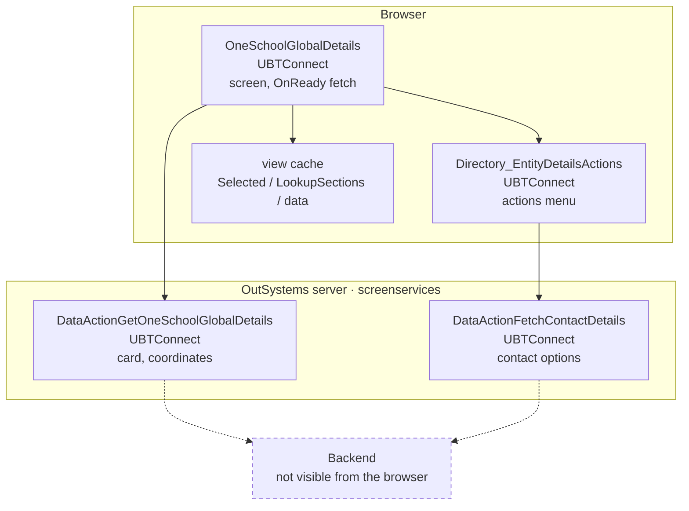
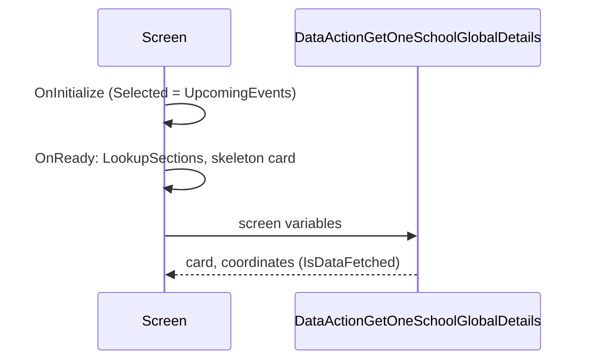

# Screen spec: OneSchoolGlobalDetails

Paths are relative to `migration/screens/OneSchoolGlobalDetails/`; `mvc.js` = `analysis/sources/pretty/UBTConnect.Directory_OneSchoolGlobal.OneSchoolGlobalDetails.mvc.js`.

## 0. Summary
Detail page of one OneSchool Global school (directory): photo, name, areas served, address (address popup) and
business links; the directory actions menu (bookmark, notes, call, email, share); a "Show student numbers" expandable
section (behind `mobileStudentInformation`), an "Upcoming events / About our campus" button group and a "Coming Soon"
box. One data action (DataActionGetOneSchoolGlobalDetails) on OnReady [mvc.js:1271-1337].

| Item | Value |
|---|---|
| Route (old) | `/UBTConnect/OneSchoolGlobalDetails` with `In_OneSchoolGlobalId: LongInteger` (default 0) [mvc.js:47-49, 95-100] |
| Screen file | `UBTConnect.Directory_OneSchoolGlobal.OneSchoolGlobalDetails.mvc.js` |
| Captured | TST, 390×844, states default / loading / offline [analysis/states.json] |
| Variant | single; `mobileStudentInformation` default-only (TST on) |
| OutSystems UI version | OutSystemsUI_2_23 |

## 1. Entry and routing
- Reached from directory lists with `In_OneSchoolGlobalId` [pack.md: route inputs]; read in `api.ts`
  `readOneSchoolGlobalDetailsInputs` (absent → "0").
- Layout_DetailPage, default inputs (primary header) [mvc.js:174-190]; BottomBarMenu and CommonUI_InsideLayout without
  inputs [mvc.js:1125-1164].

## 2. Component tree
```
Layout_DetailPage $b1                                   [shared]
├─ title: CustomText "OneSchool Global" (empty TextOptions) [mvc.js:191-217]
├─ content: SubLayout_DirectoryDetailScreen $b3          [shared]
│  ├─ DetailCard: SkeletonSection(not IsDataFetched)      [mvc.js:239-548]
│  │  └─ ImageCard_LazyLoading (Detail, In_IsBookmarked = LocalIsBookmarked)
│  │     ├─ LazyImage: UBT_LazyImage (SignedURL, MaxWidth_100vw, EntityId CommunityBusinessId, OneSchool Global, HasErrorMessage)
│  │     └─ Content: ImageCard__Content (title Name)
│  │        └─ Bottom: CustomText "Educating Students From:" (neutral 8, s, semi-bold); CustomText AreasServed
│  │           (neutral 7, xs, regular); CustomContainer (margin-top xs, text cyan-darker) >
│  │           Container (IsDataFetched ? "school-address" : "margin-top-s margin-bottom-xs") > AddressPopup_Wrapper;
│  │           List "list list-group" of BusinesLinks > Container "school-link-item" > External_Link   [render]
│  ├─ CallToAction: CustomContainer (neutral-0, padding base) > Directory_EntityDetailsActions [shared] [mvc.js:550-645]
│  └─ Content: SkeletonSection(not IsDataFetched)        [mvc.js:646-1120]
│     ├─ If mobileStudentInformation: CustomContainer Block_StudentNumbers (neutral-0) >
│     │  ExpandableSection (StartExpanded False) [render]: title IconText (Lookup OneSchoolStatistitics) / content
│     │  CustomContainer (border neutral-3 s, radius large) > ComingSoon
│     ├─ CustomContainer Block_ButtonGroup (neutral-0, padding-bottom s) > CustomContainer (padding x base, top s,
│     │  margin-top xs when the flag is on) > ButtonGroup1 (Upcoming events / About our campus) [render, platform widget]
│     └─ CustomContainer (neutral-0) > CustomContainer (margins x base, border) > ComingSoon4
├─ bottom: BottomBarMenu                                 [shared]
└─ CommonUI_InsideLayout                                 [shell]
```

| Block (route-local) | Inputs | Events | Placeholders | Notes |
|---|---|---|---|---|
| ExpandableSection `components/ExpandableSection.tsx` | StartExpanded (True), ExtendedClasses | none | Title, Content | isExpanded toggled by the icon container click; class `expanded`/`closed` [ExpandableSection.mvc.js view, :420, :445] |
| External_Link `components/External_Link.tsx` | In_Link, IsEnabled (True), IconVisible (True) | none | none | LinkClicked: iOS → navigateTo(Link), else OpenInApp_OpenExternalLink(Link, False) [External_Link.mvc.js:284-318] |
| ButtonGroup `components/ButtonGroup.tsx` | variable, items | change | items | port of OSWidgets ButtonGroup/ButtonGroupItem [runtime-sources/OutSystemsReactWidgets.js] (Q3) |

## 2a. Architecture diagram


## 3. DOM and markup contract
- Markup as `analysis/dom/default.html:1-578` (pack.md "Markup"); body class `phone portrait osx is-ltr`.
- Dynamic: address container class `school-address` when fetched, else `margin-top-s margin-bottom-xs` [mvc.js:434-438];
  List class + ` list-loading` (status Fetching) / ` list-error` (Error) [OutSystemsReactWidgets.js List render];
  ExpandableSection `ubt-expandable-section closed|expanded`; ButtonGroup selected item `button-group-selected-item`,
  `aria-checked`, group `aria-activedescendant`.
- Captured inline styles kept: `cursor: pointer; width: auto;` (expand icon), `position: relative;` (list).

## 4. Visual specification
Original CSS only (no route CSS). ComingSoon text options checked against the compiled source: both instances pass
neutral-7 / base / semi-bold [mvc.js:821-829, 1081-1089] = the captured `text-neutral-7 font-semi-bold font-size-base`.

## 5. Data model
`types.ts`: OneSchoolGlobalDetailCard (CommunityBusinessId, SignedURL, Name, Address, AreasServed, BusinesLinks →
`businessLinks`), HouseholdCoordinates passed to AddressPopup_Wrapper; screen variables LookupSections,
Selected_OneschoolGlobal_SubsectionId, Type_OneschoolGlobal_SubsectionId (record defaults "Upcoming events" /
"About our campus", UBTConnect.model.js:194-198), LocalIsBookmarked [mvc.js:35-55].

## 6. API calls
| Action | When | Inputs | Mock |
|---|---|---|---|
| `OneSchoolGlobalDetails/DataActionGetOneSchoolGlobalDetails` | OnReady unless restored with data [mvc.js:1300-1323] | screen variables (fixture 01-5a0e2715 inputs) | recorded fixture served for every id (Q2), SignedURL = neutral landscape placeholder (Q-W2C-1) |
| `Directory_EntityDetailsActions/DataActionFetchContactDetails` | shared block | shared | shared mocks |
| App-start calls (SynchAppContext, AfterInitialize, Sync_Info_GetMain, GetUserInformation, GetNumberUnreadMessages, Cacheable*) | shell | — | shell mocks |

## 7. State and lifecycle
OnInitialize: Selected = UpcomingEvents unless restored [mvc.js:1245-1252]. OnReady: if restored and fetched → nothing;
else LookupSections = Get_LookupSection(False), card = GetSkeleton_UI_OneSchoolGlobal_DetailCard
(UBTConnect.controller.js:11952-11990), refresh the data action [mvc.js:1300-1323]. View cache (P-BACK) keeps the four
variables and the fetched data (`useViewState`). OnChange_Bookmark → LocalIsBookmarked [mvc.js:1347-1374].

## 8. Render logic
Both SkeletonSections loading while not IsDataFetched; student-number section only with the flag [mvc.js:667-669];
`$if(false…)` branches always render their else part [mvc.js:776, 1022].

## 9. Interactions and navigation
Back arrow (layout); expand icon toggles the section; button group sets Selected (nothing else reads it); business
link → External_Link LinkClicked; address → AddressPopup (shared); actions menu (shared).

## 10. Sequence diagrams


## 11. Error handling and feedback
A failed fetch: card stays the skeleton, List `list-error`, the error goes to the screen's handleError → the
Directory_OneSchoolGlobal flow handler (controller not in local sources; built as App_Common, `raiseToFlowHandler`; Q1).

## 12. Strings
"OneSchool Global", "Educating Students From:", "Show student numbers" (Get_LookupSection), "Upcoming events",
"About our campus", "Coming Soon" (shared ComingSoon) [mvc.js; dom/default.html].

## 13. Accessibility, platform and security notes
ButtonGroup role radiogroup / radio. External links open in a new tab off iOS (shared OpenInApp_OpenExternalLink, U18).
No write from this screen; bookmark/notes writes are the shared block's (mocked).

## 13a. Feature flags
- `mobileStudentInformation` (launchDarkly_FF, default-only, TST on; user 2026-10-14): `useFlagOn`; on → student
  numbers section and margin-top xs on the button group container [mvc.js:667-669, 910-912]. Other flags of the pack
  belong to shared blocks (C2NewBookmarks, C2ExtendedShare, mobileDirectoryBookmarkNote, C2EnableC1DirectoryView) or
  are not flags.

## 14. Unclear points
- Q1 (fact): Directory_OneSchoolGlobal flow handler — `UBTConnect.Directory_OneSchoolGlobal.controller.js` missing
  locally; conservative: App_Common handler (`raiseToFlowHandler`), as Directory_Locality.

## 15. Acceptance criteria
default / loading / offline pass parity except the shared differences of CR-OneSchoolGlobalDetails-1 and the two
proposed capture-artifact exemptions (Q4).

## 16. Decisions to confirm
- Q1 → App_Common flow handler (fact, pending orchestrator answer).
- Q2 → A: serve the one recording for every In_OneSchoolGlobalId (pending orchestrator answer).
- Q3 → A: ButtonGroup ported in the route's components (pending orchestrator answer).
- Q4 → A: add the two proposed exemptions (`proposed-exemptions.json`; the route agent's write was refused).
- CR-OneSchoolGlobalDetails-1 (= CR-HouseholdDetails-1 #1 and #4): actions menu skeleton in default; aria-hidden /
  popup-disable-scroll of the ShareSheet popup.
- Mock photo: neutral landscape placeholder for SignedURL (rule Q-W2C-1, user 2026-10-14).

## 17. Patterns used
P-PARAMS (`readOneSchoolGlobalDetailsInputs`), P-DATA / P-CALLS (`api.ts` useQuery, screen variables at fetch time),
P-MOCKS (`mocks.ts` contractHandler over the recorded fixture), P-BACK (`useViewState`, `useWasRestoredFromCache`),
P-FLAGS (`useFlagOn('mobileStudentInformation')`), P-LIST (`OSList` for BusinesLinks), P-STATES (skeletons, list
status classes), P-OSUI not used (no OSUI pattern of its own).

## 18. Builder notes
- First frame: the model defaults (empty lookup and card) are not rendered; state starts from the OnReady values.
- ButtonGroup: executeWithActiveClassOn (transient click class) not ported; aria-activedescendant left out when no
  item matches (runtime keeps the previous id).
