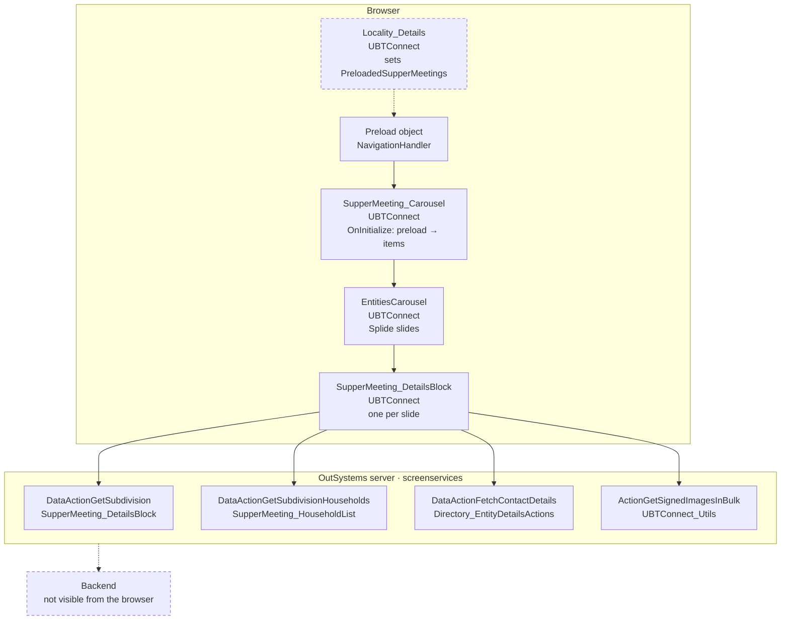
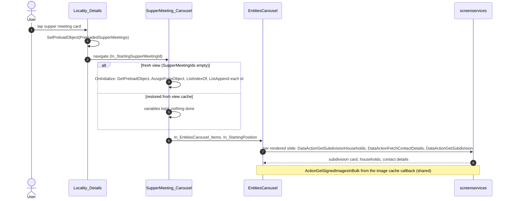

# Screen spec: SupperMeeting_Carousel

## 0. Summary
Swipeable detail view of the supper meetings of a locality: one slide per supper meeting (SupperMeeting_DetailsBlock with
"n / total" tag), opened from a supper meeting card with the list of ids handed over as a preload object. The screen has
no call and no event handler of its own; every call comes from the shared slide blocks. [SupperMeeting_Carousel.mvc.js
controller: `dataFetchActionNames = []`, no OnReady/OnParametersChanged]

| Item | Value |
|---|---|
| Route (old) | `/UBTConnect/SupperMeeting_Carousel` with input `In_StartingSupperMeetingId` (Long Integer) |
| Screen file | `UBTConnect.Directory_SupperMeetings.SupperMeeting_Carousel.mvc.js` |
| Content block | `UBTConnect › Directory_Caroussel › EntitiesCarousel` (shared, built) |
| Captured | 2026-10-14, env TST, viewport 390×844, test account (no personal data) [states.json] |
| Variant | single variant; reached via Locality_Details supper meeting card [states.json `via`; capture-plan note] |
| OutSystems UI version | OutSystemsUI_2_23 [pack: Carousel] |
| Sources | `migration/screens/SupperMeeting_Carousel/analysis/` |

## 1. Entry and routing
- Reached from a supper meeting card of Locality_Details (TagToggle 2 → ImageCard_LazyLoading) which sets a
  `PreloadedSupperMeetings` preload and navigates with `In_StartingSupperMeetingId` [states.json via; capture-plan note].
  Opened by URL the carousel is empty in the original [capture-plan note] → Q1.
- Input `In_StartingSupperMeetingId`: Long Integer, default 0 [mvc.js model setInputs].
- Layout: Layout_DetailPage, `In_AlignTitleLeft` False, primary header (`ubt-layout-detail--primary`), no bottom bar
  (`bottom: PlaceholderContent.Empty`), CommonUI_InsideLayout [mvc.js view internalRender; dom/default.html:8].

## 2. Component tree
```
SupperMeeting_Carousel                                   [render]
└─ Layouts.Layout_DetailPage ($b1, In_AlignTitleLeft False)   [shared]
   ├─ header title: BasePatterns.CustomText ($b2) "Supper Meeting", default TextOptions   [shell]
   ├─ content: Directory_Caroussel.EntitiesCarousel ($b3)      [shared]
   │    In_ConnectEntityTypeId = Connect_Entity "Supper Meetings", In_StartingPosition, In_EntitiesCarousel_Items
   │    └─ EntitiesCarousel_Element → EntitiesCarouse_lSupperMeetingDetails → SupperMeeting_DetailsBlock (+ CarouselTag)
   ├─ bottom: empty
   └─ placeholder_CommonUI_Inside_Layout: App_Common.CommonUI_InsideLayout ($b4)   [shell]
```
| Block | Inputs | Events raised | Placeholders | Notes |
|---|---|---|---|---|
| EntitiesCarousel | In_ConnectEntityTypeId `Supper Meetings`, In_StartingPosition = StartingPosition, In_EntitiesCarousel_Items = EntitieslCarousel_Items | Event_SetHeader, Event_Moved: **not handled** by this screen [mvc.js view: only `_handleError`] | none | README `app/src/shared/UBTConnect/EntitiesCarousel/README.md` |

## 2a. Architecture diagram


## 3. DOM and markup contract
- Root: `active-screen screen-container` → `Layouts.Layout_DetailPage` `$b1` → `layout … ubt-layout-detail ubt-layout-detail--primary` [dom/default.html:4-8].
- `<body>` class `phone portrait osx is-ltr`, style `--header-size-content: 0px; --footer-height: 0px; --viewport-height: 844px;`; `<html>` class `popup-disable-scroll` in default only [states.json].
- Header title [dom/default.html:20-30]:
```html
<div class="header-title text-align-center OSInline" id="b1-Placeholder_Header_Title">
 <div class="OSBlockWidget" data-block="BasePatterns.CustomText" id="$b2">
  <div class="" data-container="" style="cursor: pointer;">
   <div class="OSBlockWidget" data-block="ConnectPatterns.IconInline_Internal" id="b2-$b2"></div>
   <span data-expression="" style="margin-left: 0px;">Supper Meeting</span>
```
- Content: `Directory_Caroussel.EntitiesCarousel` `$b3` with Interaction.Carousel `b3-EntitiesCarousel` (3 slides, slide01
  `is-active`, aria-label "1 of 3"), and `EntitiesCarousel_HeaderGenerator` `b3-$b3` [dom/default.html:43-50, pack markup].
  Each slide's CarouselTag text is masked `• • •` ("n / 3") [dom/default.html:90-92].
- Three ShareSheet portals after `#reactContainer` (one per slide's SharePopup) [dom/default.html:2930-2966]: rendered by the shared blocks.

## 4. Visual specification
Shell spec and the original CSS (`routes.css.generated.ts` entry `SupperMeeting_Carousel`). No screen-specific rule; slide
height from `--carousel-slide-custom-height` set by EntitiesCarousel (README).

## 5. Data model
- Screen variables [mvc.js model]: `SupperMeetingsIdList` (PreloadedSupperMeetings: `SupperMeetingIds` Long Integer list,
  UBTConnect.model.js:21984-22005), `StartingPosition` Integer = 0, `EntitieslCarousel_Items` (EntitiesCarousel_Item list),
  input `In_StartingSupperMeetingId`.
- Long Integers stay strings; `EntityId = LongIntegerToText(TextToLongInteger(LongIntegerToText(id)))`.
- Static entity: Connect_Entity `Supper Meetings` (`app/src/shared/UBTConnect/lib/staticEntities.ts:128`).

## 6. API calls
The screen calls nothing itself [mvc.js controller `dataFetchActionNames = []`]. Calls of the capture, all from shared blocks:

| # | Old call | Kind | Trigger | Owner | React replacement |
|---|---|---|---|---|---|
| 1-3 | `…/SupperMeeting_HouseholdList/DataActionGetSubdivisionHouseholds` | Data action | slide load | SupperMeeting_HouseholdList | shared block adapter/mock |
| 4-15 | `…/Directory_EntityDetailsActions/DataActionFetchContactDetails` (9) | Data action | slide load | Directory_EntityDetailsActions | shared |
| 7,10,12 | `…/SupperMeeting_DetailsBlock/DataActionGetSubdivision` (3) | Data action | slide OnReady | SupperMeeting_DetailsBlock | shared |
| 16 | `UBTConnect_Utils/ActionGetSignedImagesInBulk` | Server action | image cache callback | UBTConnect_Utils | shared |
[calls.md; call-sites.md]

## 7. State and lifecycle
| State variable | Type | Initial | Set by | Read by |
|---|---|---|---|---|
| SupperMeetingsIdList | PreloadedSupperMeetings | empty | OnInitialize AssignFromObject | OnInitialize |
| StartingPosition | Integer | 0 | OnInitialize (ListIndexOf ≠ -1) | EntitiesCarousel In_StartingPosition |
| EntitieslCarousel_Items | EntitiesCarousel_Item list | empty | OnInitialize ListAppend | EntitiesCarousel |

OnInitialize [mvc.js controller `_screenEvent_OnInitialize$Action`]: if `SupperMeetingsIdList.SupperMeetingIds` is empty
(always on a fresh view; a restored view keeps its variables): GetPreloadObject → AssignFromObject(SupperMeetingsIdList)
→ ListIndexOf(SupperMeetingIds, = In_StartingSupperMeetingId); position ≠ -1 → StartingPosition = position; for each id
append `{EntityId}`. No OnReady, OnRender, OnDestroy, OnParametersChanged. View cache: P-BACK (`useViewState`).

## 8. Render logic
No `$if` in the screen view. The carousel renders one slide per item; an empty list renders an empty carousel (not captured).
States: default (captured), loading (captured: slides with skeletons, scenario `loading`), offline (captured).

## 9. Interactions and navigation
No interaction of the screen itself. Back arrow is Layout_DetailPage's (shell). Slide swipes, actions menu, address,
household navigation belong to the shared blocks (READMEs).

## 10. Sequence diagrams


## 11. Error handling and feedback
Screen errors go to the flow's `handleError` (Directory_SupperMeetings flow) [mvc.js controller handleError]; the shared
blocks keep their skeletons on failed calls (their READMEs). No message of its own.

## 12. Strings
"Supper Meeting" (header title, static) [mvc.js view In_Text]. Everything else comes from the shared blocks.

## 13. Accessibility, platform and security notes
Skip link and roles from Layout_DetailPage (shell). No client variable read by the screen itself; no server action of its
own. The preload object carries only ids.

## 13a. Feature flags
The screen reads no flag itself; the flags of the pack (C2EnableCarousel on, C2ExtendedShare on, C2NewBookmarks off,
mobilePhotobook on, default-only, user 2026-10-14) are read by the shared blocks with `useFlag`.

## 14. Unclear points
| # | What is unclear | Why | Question | Status |
|---|---|---|---|---|
| 1 | Content when opened without a preload (mock phase) | the original gets its ids only from the previous screen; no React screen sets this preload yet | Q1 | open (recommend A) |
| 2 | Slides 2 and 3 (off-screen) show SupperMeeting_DetailsBlock's skeleton in the default capture although 3 GetSubdivision calls returned 200 and their household lists loaded | capture timing or runtime behaviour, not settled by the compiled code (SupperMeeting_DetailsBlock.mvc.js:188, :302, :660-680) | Q2 (fact) | open; build keeps the shared block's behaviour (every slide loads), the most conservative and reversible choice; exemption proposed only if the answer is "timing" |
| 3 | Household counts per slide 11, 7, 5 (shared mock: 11 for every id) | shared mock | CR-SupperMeeting_Carousel-1 | open (foundation) |

## 15. Acceptance criteria
1. Header title "Supper Meeting" in CustomText `$b2`, centered, primary detail layout, no bottom bar (§2, §3).
2. EntitiesCarousel `$b3` with entity type "Supper Meetings" and one slide per preloaded id; StartingPosition = index of
   In_StartingSupperMeetingId, else 0 (§7).
3. Opened with `In_StartingSupperMeetingId=1210` and no preload (mock phase, Q1 → A): 3 slides, slide 1 active (§0, dom).
4. No call of its own; the captured calls come from the shared slides (§6, call parity).
5. Restored view keeps its items and position (P-BACK).
6. Parity: offline clean; loading only the foundation issues of §16; default only the foundation issues, CR-SupperMeeting_Carousel-1
   and the capture artifacts proposed in `proposed-exemptions.json` (Q2 for the off-screen slides).

## 16. Decisions to confirm
- Q1 → A (pending orchestrator answer): mock-phase fictional preload of 3 supper meetings (start id first, then fictional
  ids 9202, 9203) registered by `mocks.ts`, used only when no preload is waiting.
- Q2 (fact, pending): off-screen slides 2-3 kept as loaded by the shared block; proposed exemption
  CAPTURE-OFFSCREEN-SLIDE-SKELETON-SMCAROUSEL (`proposed-exemptions.json`) only if the answer is "capture timing".
- CR-SupperMeeting_Carousel-1: household list mock by subdivision id (captured 11 / 7 / 5 households on the three slides;
  the shared mock answers 11 for every id). No route workaround (MSW handlers are global).
- Proposed exemptions (capture artifacts, `proposed-exemptions.json`): masked subdivision and household photos
  (layout/position), gallery rows of slide 1 sized by those photos, masked CarouselTag text shifting the tag by 0.34 px.
  App-start calls of the via capture are handled by the parity tool (APP-START-VIA), no proposal.
- Event_SetHeader / Event_Moved of EntitiesCarousel are not handled, as in the original (header stays "Supper Meeting").
- Foundation issues not worked around (CR-HouseholdDetails-1: actions-menu skeleton, `aria-hidden` /
  `popup-disable-scroll` with popups, OSList `list-loading`; CR-SupperMeeting_Details-1: UBT_LazyImage
  OnParametersChanged, contact-details mock per entity): parity differences from them are noted in the report.

## 17. Patterns used
- P-PARAMS: `In_StartingSupperMeetingId` from the query string (`api.ts`).
- P-BACK: screen variables in `useViewState` (index.tsx).
- P-STATES: loading/offline come from the shared blocks' skeletons.
- P-MOCKS: `mocks.ts` (no handler of its own; mock preload, Q1).
- P-OSUI: Carousel through EntitiesCarousel (shared).
- P-CALLS: no call of its own; shared blocks make the captured calls.

## 18. Builder notes
- Close reference: `app/src/screens/HouseholdCarousel/` (same EntitiesCarousel, preload, mock preload).
- Not captured → `<NotCaptured>`; no CSS; markup through shared blocks only.
