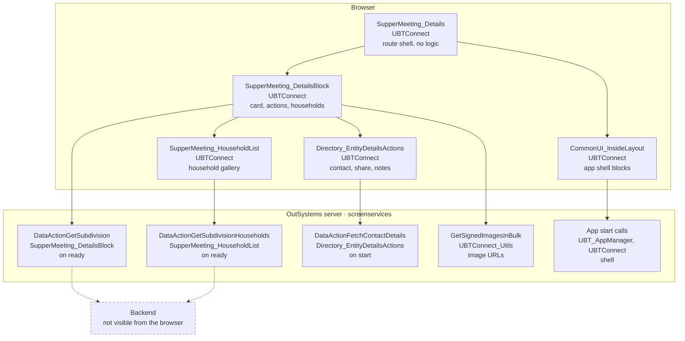
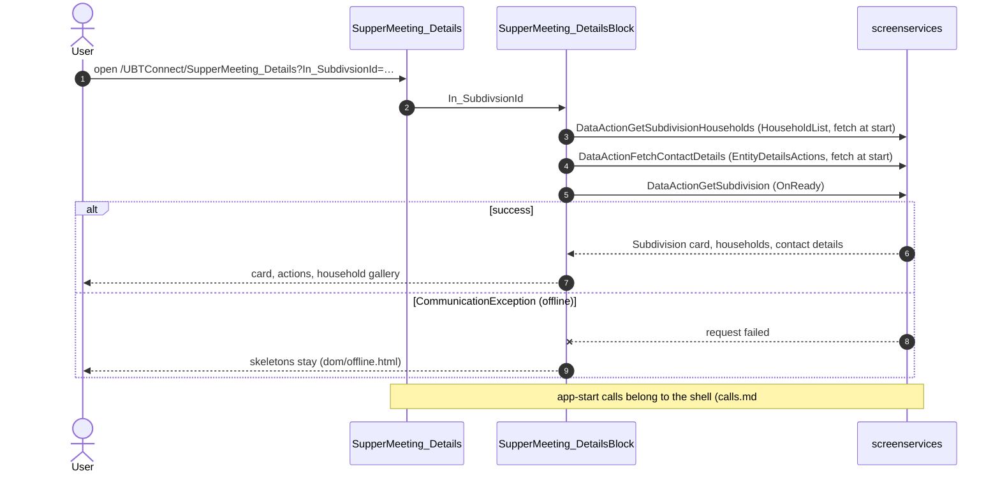

# Screen spec: SupperMeeting_Details

## 0. Summary
Detail page of one supper meeting (OutSystems "Subdivision"): a primary-coloured detail layout titled "Supper Meeting"
whose content is the shared `SupperMeeting_DetailsBlock` (photo card with statistics and address, the actions section,
the household gallery). The screen itself has no variables, no lifecycle handler and no call of its own
[SupperMeeting_Details.mvc.js:261, :275-279]; every call comes from the shared blocks and the app shell.

| Item | Value |
|---|---|
| Route (old) | `/UBTConnect/SupperMeeting_Details` with input `In_SubdivsionId` (Long Integer, default 0) [mvc.js:13-15, :61-65] |
| Screen file | `UBTConnect.Directory_SupperMeetings.SupperMeeting_Details.mvc.js` |
| Content block | `UBTConnect › Directory_SupperMeetings › SupperMeeting_DetailsBlock` [shared, built] |
| Captured | 2026-10-14, env TST, viewport 390×844 dpr 1, test account (no personal data) [states.json] |
| Variant | single variant; flags only inside the shared block (C2EnableCarousel, see 13a) |
| OutSystems UI version | OutSystemsUI_2_23 [pack.md block plan] |
| Sources | `migration/screens/SupperMeeting_Details/analysis/` |

## 1. Entry and routing
- Reached from HouseholdDetails_Block, Locality_Subdivisions, MyBookmarks/BookmarksByGroup (legacy and new), MessageDetail,
  ConnectShare, Map_PoIPreview and Notes (navigation to `SupperMeeting_Details` in their compiled code,
  capture/survey-UBTConnect.json `sources`). Not a root page, no bottom bar (`bottom: PlaceholderContent.Empty`, mvc.js:214).
- Input `In_SubdivsionId` from the query string, OutSystems Long Integer conversion, default 0 [mvc.js:61-65].
  Captured with `In_SubdivsionId=1210` [states.json].
- Layout: `Layout_DetailPage` with `In_AlignTitleLeft: false` [mvc.js:142]; `In_IsPrimaryColor` not set → default
  true (`ubt-layout-detail--primary`, dom/default.html:8).

## 2. Component tree
```
SupperMeeting_Details                                     [render]
└─ Layouts.Layout_DetailPage ($b1, In_AlignTitleLeft False) [shared]
   ├─ header title: BasePatterns.CustomText ($b2) "Supper Meeting", default TextOptions [shell]
   ├─ header right / HeaderContent / Bottom: empty
   ├─ content: Directory_SupperMeetings.SupperMeeting_DetailsBlock ($b3, In_SubdivsionId) [shared]
   │    Placeholder_CarouselTag: empty
   └─ Placeholder_CommonUI_Inside_Layout: App_Common.CommonUI_InsideLayout ($b4) [shell]
CW_Share.ShareSheet portal (rendered by Directory_EntityDetailsActions inside the block) [shared]
```

| Block | Inputs | Events | Placeholders | Notes |
|---|---|---|---|---|
| Layout_DetailPage | In_AlignTitleLeft=False [mvc.js:142] | _handleError | Header_Title, Content, CommonUI | others empty [mvc.js:187-188, :214] |
| CustomText | In_Text="Supper Meeting", In_TextOptions=new TextOptionsRec() [mvc.js:162-168] | none | none | dom/default.html:22-29 |
| SupperMeeting_DetailsBlock | In_SubdivsionId=in_SubdivsionIdIn [mvc.js:192] | none | Placeholder_CarouselTag Empty [mvc.js:209] | README of the shared block |
| CommonUI_InsideLayout | none [mvc.js:215-232] | none | none | shell |

## 2a. Architecture diagram


## 3. DOM and markup contract
- Root: `div.active-screen.screen-container` > `[Layouts.Layout_DetailPage]#$b1` > `div.layout.layout-side.layout-native.ios-bounce.ubt-layout-detail.ubt-layout-detail--primary` [dom/default.html:4-8].
- `<body>` class `phone portrait osx is-ltr`, style `--header-size-content: 0px; --footer-height: 0px; --viewport-height: 844px;`; `<html>` class empty (default/offline), `popup-disable-scroll` (loading) [states.json].
- Header title (only screen-owned markup) [dom/default.html:20-30]:
```html
<div class="header-title text-align-center OSInline" id="b1-Placeholder_Header_Title">
 <div class="OSBlockWidget" data-block="BasePatterns.CustomText" id="$b2">
  <div class="" data-container="" style="cursor: pointer;">
   <div class="OSBlockWidget" data-block="ConnectPatterns.IconInline_Internal" id="b2-$b2"></div>
   <span data-expression="" style="margin-left: 0px;">Supper Meeting</span>
  </div>
 </div>
</div>
```
- Content `#b1-Content` holds `[Directory_SupperMeetings.SupperMeeting_DetailsBlock]#$b3` [dom/default.html:43]; `#b1-Bottom` is empty [pack.md markup].

## 4. Visual specification
Shell spec owns global CSS; route CSS order is `routes.css.generated.ts` → `SupperMeeting_Details`. No screen-specific
rule: every class comes from the shared blocks [css-relevant.md]. Images: the subdivision photo and household photos go
through UBT_LazyImage (masked in the capture: 12 user images removed, coverage.md).

## 5. Data model
Route input only: `{ In_SubdivsionId: string }` (Long Integer as text, `'0'` when absent or invalid). Data types of the
calls live in the shared blocks (`SupperMeeting_DetailsBlock/types.ts`, `SupperMeeting_HouseholdList/types.ts`).

## 6. API calls
The screen calls nothing (`dataFetchActionNames = []`, no server action, mvc.js:259-261). Captured calls by owner [calls.md]:

| # | Call | Kind | Trigger | Owner (React) | Mock |
|---|---|---|---|---|---|
| 1,7,10-14 | SynchAppContext, AfterInitialize, Sync_Info_GetMain, GetUserInformation, GetNumberUnreadMessages, FetchData_Cacheable* | server/service | app start | shell | shell mocks |
| 2 | DataActionGetSubdivisionHouseholds | data action | SupperMeeting_HouseholdList fetch at start | shared block | fictional, 11 households (shared mocks) |
| 3,6,9 | DataActionFetchContactDetails | data action | Directory_EntityDetailsActions fetch at start / refresh | shared block | shared mocks |
| 4,8 | ActionGetSignedImagesInBulk | server action | image cache callback | shared util | shared mocks |
| 5 | DataActionGetSubdivision | data action | SupperMeeting_DetailsBlock OnReady | shared block | recorded fixture (any id) |

## 7. State and lifecycle
No screen variable besides the input; no OnInitialize/OnReady/OnRender/OnDestroy/OnParametersChanged handler
[mvc.js:275-279]. Lifecycle and the view-cache skip of the refresh are the shared block's (README "Not settled").

## 8. Render logic
No `$if` in the screen view [mvc.js:127-237]. States: default (data), loading (skeletons: dom/loading.html), offline
(calls fail: skeletons stay, dom/offline.html) are all produced by the shared blocks.

## 9. Interactions and navigation
The screen has no handler. Header back icon: Layout_DetailPage (shared). Household click, contact/share/notes actions:
shared blocks (README of SupperMeeting_DetailsBlock: GetHasCarouselEnabled → HouseholdCarousel(In_StartingHouseholdId),
else HouseholdDetails(HouseholdId)).

## 10. Sequence diagrams
### 10.1 Enter the screen

### 10.2 Back navigation
```mermaid
sequenceDiagram
  actor U as User
  participant S as SupperMeeting_Details
  participant B as SupperMeeting_DetailsBlock
  U->>S: back to the screen
  S->>B: same input
  Note over B: unverified: the original skips the skeleton and refresh when restored from cache; the shared block refetches on mount (README)
```

## 11. Error handling and feedback
| Situation | Detection | UI response | Message |
|---|---|---|---|
| Any exception in a child | `_handleError` → flow handler `Directory_SupperMeetings.handleError` [mvc.js:280-282] | shell flow handler | shell's |
| Calls fail (offline) | shared blocks | skeletons stay | none (dom/offline.html) |
| Loading capture | shell | "Service Interruption" feedback message (dom/loading.html:2-12) | shell's app-start message |

## 12. Strings
"Supper Meeting" (header title, mvc.js:162). All others come from the shared blocks or data.

## 13. Accessibility, platform and security notes
`role="banner"`, `role="main"`, `role="contentinfo"` from the layout. `#reactContainer` has `aria-hidden="true"` while the
ShareSheet portal is mounted (dom/default.html:2; foundation CR-HouseholdDetails-1). Security: the screen reads no client
variable; server-side authorization of DataActionGetSubdivision / GetSubdivisionHouseholds is not visible from the
browser (security.md); tokens in localStorage are not copied (stack rule).

## 13a. Feature flags
Flags listed for the route are inside the shared blocks: `C2EnableCarousel` default-only on (user, 2026-10-14) read by
SupperMeeting_DetailsBlock with `useFlagOn`; `C2ExtendedShare` on and `C2NewBookmarks` off default-only (user,
2026-10-14) not read on this screen's rendered path; `App_PIN_BiometricEnabled` and `onToggle` are not flags (user,
2026-10-14). `flags.py questions --route SupperMeeting_Details` lists nothing open.

## 14. Unclear points
| # | What is unclear | Why (not captured / server-side / unreadable) | Question | Status |
|---|---|---|---|---|
| 1 | Back from history: refresh skipped on view-cache restore | not captured | shared block README (block owner) | inherited, not this route |
| 2 | DataActionGetSubdivisionHouseholds data | never recorded (person data) | fictional 11 households (shared mock) | Decisions to confirm |
| 3 | Review before or after the shared fixes (CR-SupperMeeting_Details-1, CR-HouseholdDetails-1) | parity differences live in shared blocks/mocks | Q1 (decision) | open; built with A (pending orchestrator answer) |

Blocks of coverage.md not rendered (EmptyList, Directory_EmptyState, BottomSheet, AddNote, PinCode…) belong to shared
blocks and the shell; the screen renders none of them directly.

### Parity (2026-10-15, after the build)
- default: every difference is inside shared blocks or comes from the capture: subdivision photo no-photo fallback and
  1× vs 2× ActionGetSignedImagesInBulk (UBT_LazyImage does not run OnReady when EntityId changes:
  CR-SupperMeeting_Details-1 §1); Call/Email actions and 4 household subtitles (shared mocks: CR-SupperMeeting_Details-1
  §2); actions menu skeleton (CR-HouseholdDetails-1 §1); `aria-hidden` on `#reactContainer` (CR-HouseholdDetails-1 §4);
  masked photos 390×26 / 195×24 and gallery rows (capture artifact, proposed exemption).
- loading: actions menu and household list in their fetch-error state on TST (request timeout: proposed exemption);
  `aria-hidden` and `html.popup-disable-scroll` (Popup widget: CR-HouseholdDetails-1 §4, noted in CR-SupperMeeting_Details-1).
- offline: `aria-hidden` only (CR-HouseholdDetails-1 §4).
- Proposed exemptions: `migration/screens/SupperMeeting_Details/proposed-exemptions.json`.

## 15. Acceptance criteria
1. `/UBTConnect/SupperMeeting_Details?In_SubdivsionId=1210` renders Layout_DetailPage primary with the title "Supper Meeting" (§3).
2. The block receives `In_SubdivsionId` from the query string, `'0'` when absent (§1).
3. The screen itself makes no call; call parity matches calls.md per phase (§6).
4. default, loading and offline pass parity at 390×844 (§8).

## 16. Decisions to confirm
- Q1 → A (pending orchestrator answer): apply CR-SupperMeeting_Details-1 and CR-HouseholdDetails-1, re-run parity,
  then ready.
- DataActionGetSubdivisionHouseholds answers fictional data (11 neutral households, the captured count) from the shared
  SupperMeeting_HouseholdList mock: never recorded (person data) (brief; shared mocks.ts).
- DataActionGetSubdivision answers the recorded fixture for any `In_SubdivsionId` (shared block mocks.ts).
- Back navigation refetches instead of restoring the cached view (shared block README).
- Change request CR-SupperMeeting_Details-1 (UBT_LazyImage OnParametersChanged; shared mocks: no contact details for
  the supper meeting, 4 empty household subtitles): the route composes the shared blocks unchanged, no `<NotCaptured>`
  needed (the screen renders the blocks; only their behaviour/data differ).
- Proposed parity exemptions (capture artifacts: masked photos, gallery rows, loading fetch timeout):
  `proposed-exemptions.json`.

## 17. Patterns used
- P-PARAMS: `In_SubdivsionId` from the query string (`api.ts`, `readSupperMeetingDetailsInputs`).
- P-STATES: loading/offline come from the shared blocks' skeletons.
- P-CALLS / P-DATA / P-MOCKS: no own call; `api.ts` and `mocks.ts` state so (as HouseholdDetails).
- P-FLAGS: none read by the screen (inside the shared block).

## 18. Builder notes
Copy the HouseholdDetails screen structure (thin wrapper). No CSS, no inline style except the captured ones inside
shared components.
