# App shell: server calls and user actions in OutSystems and React

The app shell is the part of the app that the routes share. The route files leave it out.
- OutSystems: `CommonUI_InsideLayout` with its blocks (TST survey), and the chains that start in a module action.
- React: the code that `app/src/main.tsx` loads (router, `AppFrame`, app start, hosts).
The tool `route-actions/tools/check_route.py` merges it from the checked routes on 2026-11-04: [HomeFeed](routes/HomeFeed.md), [Login](routes/Login.md), [Menu](routes/Menu.md), [PINBiometricsMenu](routes/PINBiometricsMenu.md), [Splash](routes/Splash.md), [TermsAndPoliciesMenu](routes/TermsAndPoliciesMenu.md).

## 1. Result

| Check | Result |
|---|---|
| App shell server calls on TST | 12: React makes 10, **2 missing** |
| App shell event bindings | OutSystems: 9 diagrams. React: 6 diagrams |
| React app shell calls that TST does not make on a route | 4 |

## 2. Diagram

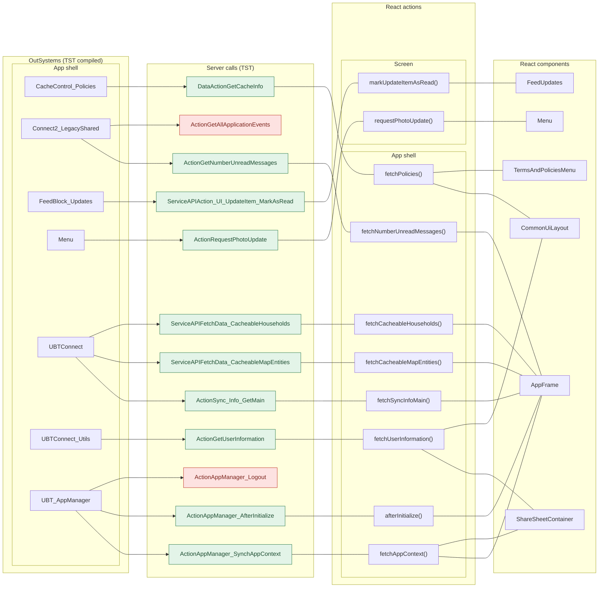

## 3. User actions

The two lists are independent: the OutSystems list comes from the TST compiled code, the React list from the React code. The tool does not map one list to the other.

- **OutSystems:** each event binding of the compiled views (`<event>$Action: function` of a child block or widget, `on<Event>: function` of an HTML element) with its handler.
- **React:** each JSX attribute `on<Event>={handler}` with its handler.
- Both lists keep only the bindings whose handler has an effect: a server call, a navigation, an external link, a message or a confirm dialog. The tool follows the called functions 3 levels deep.
- When the handler has branches in the code (`switch` case, `if` with `===`), each branch has its own diagram. The branch name is the constant of the condition. `other` is the last `else` or `default`.
- An arrow to the server gives the inputs of the call, the return arrow its outputs (contract `app/src/api/openapi.yaml`).

### 3.1 OutSystems (TST)

| # | Block (OutSystems) | Event (TST view) | Handler | Branch | Effects |
|---|---|---|---|---|---|
| [1](#311-commonui_insidelayout-onbacknavigation_redirecthome) | `CommonUI_InsideLayout` | `backNavigationPrevented of PreventBackNavigation` | `onBackNavigation_RedirectHome` | – | goes to HomeFeed |
| [2](#312-block_pinunlock-block_pinunlock_contentwrappernavigateto_pinregist) | `Block_PINUnlock` | `navigateTo_PINRegister of ContentWrapper` | `block_PINUnlock_ContentWrapperNavigateTo_PINRegist` | – | goes to PINRegister |
| [3](#313-block_pinunlock_contentwrapper-onclick_forgotpin) | `Block_PINUnlock_ContentWrapper` | `onClick (HTML element)` | `onClick_ForgotPIN` | – | goes to Login |
| [4](#314-block_pinunlock_contentwrapper-onclick_termsandcondition) | `Block_PINUnlock_ContentWrapper` | `onClick (HTML element)` | `onClick_TermsAndCondition` | – | opens an external link; shows a message |
| [5](#315-block_pinunlock_contentwrapper-onclick_privacypolicy) | `Block_PINUnlock_ContentWrapper` | `onClick (HTML element)` | `onClick_PrivacyPolicy` | – | opens an external link; shows a message |
| [6](#316-handleonresumeopenlink-androidapplinkonresumehandlerresumenavigation) | `HandleOnResumeOpenLink` | `resumeNavigation of AndroidAppLinkOnResumeHandler` | `androidAppLinkOnResumeHandlerResumeNavigation` | – | goes to /UBTConnect/ |
| [7](#317-handleonresumeopenlink-deeplinkhandlercentralondeeplinkopen) | `HandleOnResumeOpenLink` | `onDeeplinkOpen of DeeplinkHandlerCentral` | `deeplinkHandlerCentralOnDeeplinkOpen` | – | goes to /UBTConnect/ |
| [8](#318-dialog_accessrestrictedaction-upgrade) | `Dialog_AccessRestrictedAction` | `confirmed of ActionConfirmationDialog` | `upgrade` | – | opens an external link |
| [9](#319-cachecontrol_policies-cachecontrolonnoncachehit) | `CacheControl_Policies` | `onNonCacheHit of CacheControl` | `cacheControlOnNonCacheHit` | – | calls GetCacheInfo |

#### 3.1.1 CommonUI_InsideLayout: onBackNavigation_RedirectHome

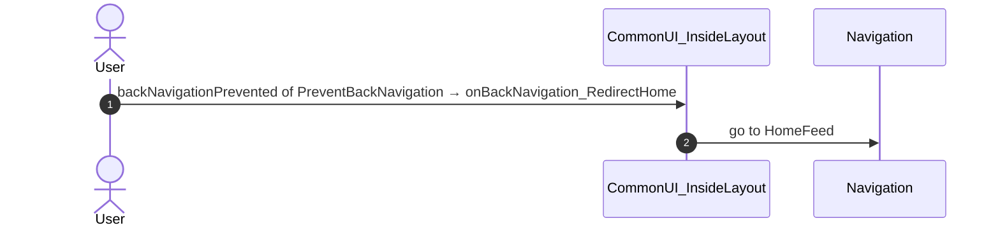

#### 3.1.2 Block_PINUnlock: block_PINUnlock_ContentWrapperNavigateTo_PINRegist

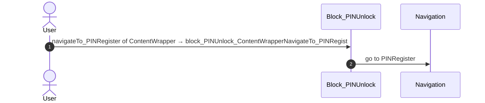

#### 3.1.3 Block_PINUnlock_ContentWrapper: onClick_ForgotPIN

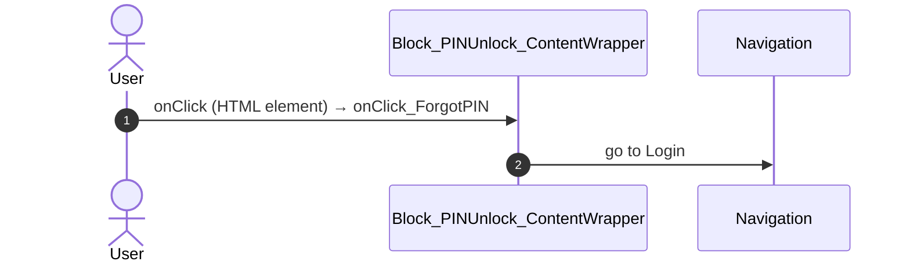

#### 3.1.4 Block_PINUnlock_ContentWrapper: onClick_TermsAndCondition

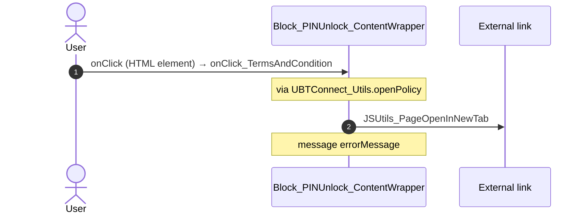

#### 3.1.5 Block_PINUnlock_ContentWrapper: onClick_PrivacyPolicy

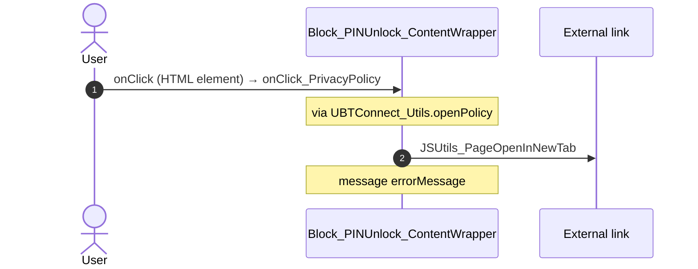

#### 3.1.6 HandleOnResumeOpenLink: androidAppLinkOnResumeHandlerResumeNavigation

#### 3.1.7 HandleOnResumeOpenLink: deeplinkHandlerCentralOnDeeplinkOpen

#### 3.1.8 Dialog_AccessRestrictedAction: upgrade

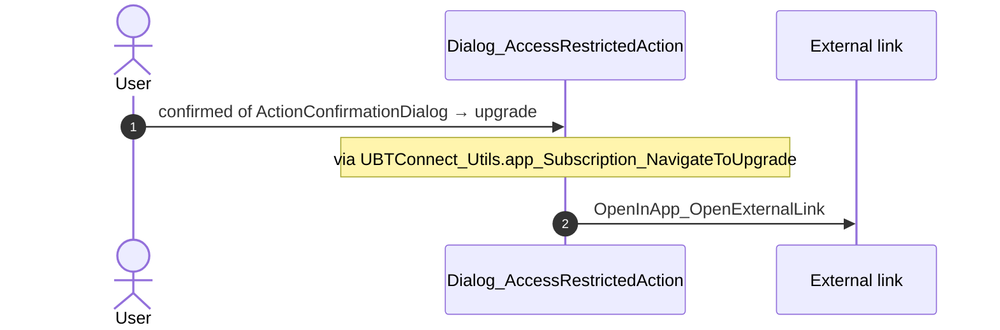

#### 3.1.9 CacheControl_Policies: cacheControlOnNonCacheHit

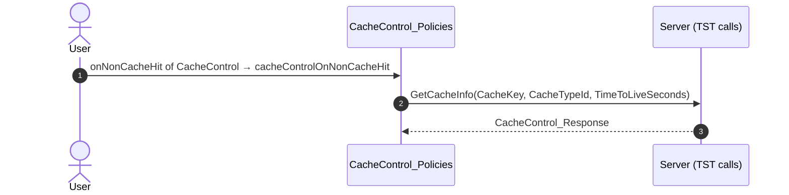

### 3.2 React

| # | File | Element | Event prop | Handler | Branch | Effects |
|---|---|---|---|---|---|---|
| [1](#321-confirmdialogview-onconfirmed) | [`platform/feedback/dialogs/DialogAccessRestrictedAction.tsx:74`](../app/src/platform/feedback/dialogs/DialogAccessRestrictedAction.tsx#L74) | `<ConfirmDialogView>` | `onConfirmed` | `navigateToUpgrade` | – | opens an external link |
| [2](#322-pinunlockcontentcontainer-onnavigatetopinregister) | [`platform/feedback/dialogs/BlockPinUnlock.tsx:90`](../app/src/platform/feedback/dialogs/BlockPinUnlock.tsx#L90) | `<PinUnlockContentContainer>` | `onNavigateToPINRegister` | `inline` | – | goes to PINRegister |
| [3](#323-pinunlockcontent-onpinunlockerror) | [`platform/feedback/dialogs/PinUnlockContentContainer.tsx:70`](../app/src/platform/feedback/dialogs/PinUnlockContentContainer.tsx#L70) | `<PinUnlockContent>` | `onPinUnlockError` | `content.onPinUnlockError` | – | shows a message; calls the prop onNavigateToPINRegister() |
| [4](#324-pinunlockcontent-onforgotpin) | [`platform/feedback/dialogs/PinUnlockContentContainer.tsx:71`](../app/src/platform/feedback/dialogs/PinUnlockContentContainer.tsx#L71) | `<PinUnlockContent>` | `onForgotPin` | `content.onForgotPin` | – | goes to Login |
| [5](#325-pinunlockcontent-onclickpolicy) | [`platform/feedback/dialogs/PinUnlockContentContainer.tsx:72`](../app/src/platform/feedback/dialogs/PinUnlockContentContainer.tsx#L72) | `<PinUnlockContent>` | `onClickPolicy` | `content.onClickPolicy` | – | opens an external link; shows a message |
| [6](#326-cachecontrol-onnoncachehit) | [`legacy/os/cache/PoliciesCacheControl/PoliciesCacheControl.tsx:55`](../app/src/legacy/os/cache/PoliciesCacheControl/PoliciesCacheControl.tsx#L55) | `<CacheControl>` | `onNonCacheHit` | `onNonCacheHit` | – | calls DataActionGetCacheInfo |

#### 3.2.1 ConfirmDialogView: onConfirmed

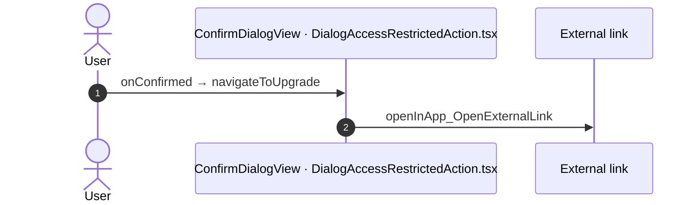

#### 3.2.2 PinUnlockContentContainer: onNavigateToPINRegister

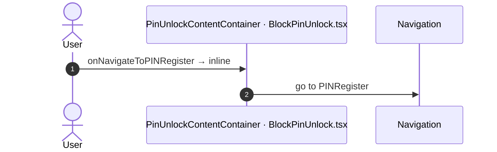

#### 3.2.3 PinUnlockContent: onPinUnlockError

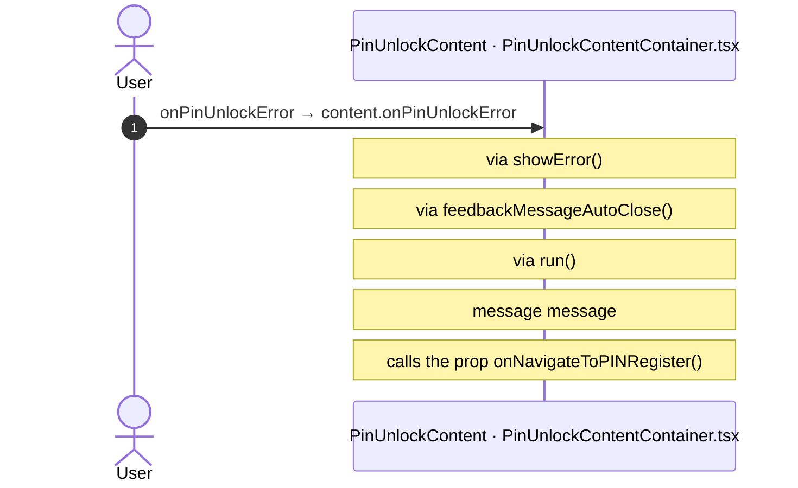

#### 3.2.4 PinUnlockContent: onForgotPin

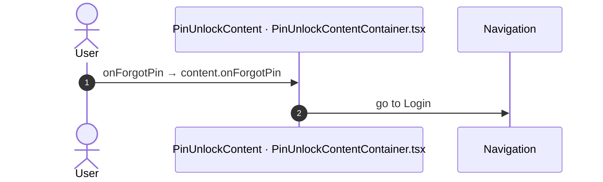

#### 3.2.5 PinUnlockContent: onClickPolicy

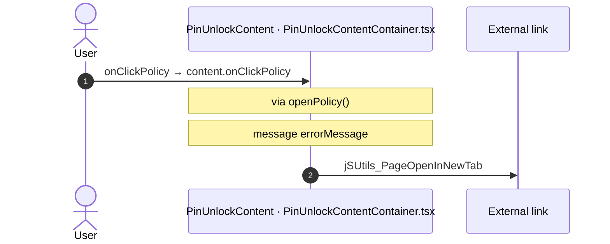

#### 3.2.6 CacheControl: onNonCacheHit

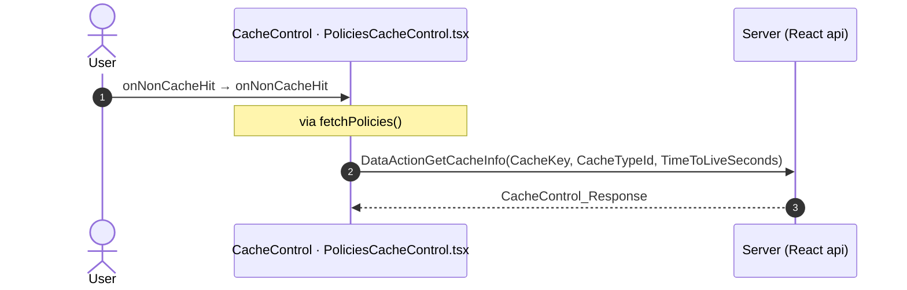

## 4. Server calls

The column **Routes** gives the checked routes where the app shell makes the call.

All columns come from the code, without interpretation:

- **Direct caller (TST):** the block or module of the action that calls the server (the step before the server call in the chain).
- **Chain (TST):** the chains of client actions in the TST compiled code, from their start to the call.
  A long chain shows its first 2 steps, …, and its last 2 steps.
- **Seen on TST:** `yes` when TST made the call in the capture.
- **React action:** the React function with the `callAction` of the same call (`file:line`), and the code that loads it: `shell` (from `main.tsx`), `page` (from the screen), or both.
- **Used by (React references):** the functions and components that reference the React action, up to the nearest component. A reference is not always a call.
- **Status:** `implemented` when the contract path of the React call gives the same TST URL. It does not prove the same behaviour.

| # | Call (TST) | Kind | Direct caller (TST) | Chain (TST) | Seen on TST | React action | Used by (React references) | Status | Routes |
|---|---|---|---|---|---|---|---|---|---|
| 1 | `UBTConnect_Utils/CacheControl/CacheControl_Policies/DataActionGetCacheInfo` | data action | `CacheControl_Policies` | CacheControl.OnInitialize → CacheControl.onInitialize → event onNonCacheHit of CacheControl → CacheControl_Policies.cacheControlOnNonCacheHit → CacheControl_Policies.DataActionGetCacheInfo CacheControl_Policies fetch at start → CacheControl_Policies.DataActionGetCacheInfo | yes | `fetchPolicies()` [`api/app/repository.ts:54`](../app/src/api/app/repository.ts#L54) (shell + page) | `TermsAndPoliciesMenu → PoliciesCacheControl → fetchPolicies` [`pages/TermsAndPoliciesMenu/TermsAndPoliciesMenuPage.tsx`](../app/src/pages/TermsAndPoliciesMenu/TermsAndPoliciesMenuPage.tsx) `CommonUiLayout → LockHost → … → fetchPolicies` [`components/layout/CommonUiLayout/CommonUiLayout.tsx`](../app/src/components/layout/CommonUiLayout/CommonUiLayout.tsx) | implemented | [TermsAndPoliciesMenu](routes/TermsAndPoliciesMenu.md) |
| 2 | `Connect2_LegacyShared/ActionGetAllApplicationEvents` | server action | `Connect2_LegacyShared` | HandleImageLoadError.applicationEvent_ImageError → Connect2_LegacyShared.zOnApplicationEvent_Wrapper → Connect2_LegacyShared.getAppEventName → Connect2_LegacyShared.cacheLocalApplicationEvents → server GetAllApplicationEvents | no | – | – | **missing** | [HomeFeed](routes/HomeFeed.md), [Login](routes/Login.md), [Menu](routes/Menu.md), [TermsAndPoliciesMenu](routes/TermsAndPoliciesMenu.md) |
| 3 | `Connect2_LegacyShared/ActionGetNumberUnreadMessages` | server action | `Connect2_LegacyShared` | UBTConnect.onApplicationReady → UBTConnect.connect_SetLoggedContext → Connect2_LegacyShared.synchronizeNumberUnreadMessages → server GetNumberUnreadMessages UBTConnect.fCM_NotificationCallback → Connect2_LegacyShared.synchronizeNumberUnreadMessages → server GetNumberUnreadMessages | yes | `fetchNumberUnreadMessages()` [`api/message/unreadMessages.ts:22`](../app/src/api/message/unreadMessages.ts#L22) (shell) | `AppFrame → AppStart → … → fetchNumberUnreadMessages` [`app/AppFrame.tsx`](../app/src/app/AppFrame.tsx) | implemented | [HomeFeed](routes/HomeFeed.md), [Menu](routes/Menu.md), [PINBiometricsMenu](routes/PINBiometricsMenu.md), [Splash](routes/Splash.md), [TermsAndPoliciesMenu](routes/TermsAndPoliciesMenu.md) |
| 4 | `UBTConnect/Home/FeedBlock_Updates/ServiceAPIAction_UI_UpdateItem_MarkAsRead` | service action | `FeedBlock_Updates` | onClick in CustomContainer → event clicked of CustomContainer → event onClick of Update_ListItem → FeedBlock_Updates.event_ListItemOnClick → server Action_UI_UpdateItem_MarkAsRead | no | `markUpdateItemAsRead()` [`api/update/repository.ts:47`](../app/src/api/update/repository.ts#L47) (page) | `FeedUpdates → useFeedUpdates → markUpdateItemAsRead` [`pages/HomeFeed/HomeFeedPage.tsx`](../app/src/pages/HomeFeed/HomeFeedPage.tsx) | implemented | [HomeFeed](routes/HomeFeed.md) |
| 5 | `UBTConnect/App_Menu/Menu/ActionRequestPhotoUpdate` | server action | `Menu` | onClick in CustomContainer → event clicked of CustomContainer → event onClick_MenuOption of Menu_List → Menu.onClick_MenuOption → server RequestPhotoUpdate | no | `requestPhotoUpdate()` [`api/member/repository.ts:46`](../app/src/api/member/repository.ts#L46) (page) | `Menu → useMenu → requestPhotoUpdate` [`pages/Menu/MenuPage.tsx`](../app/src/pages/Menu/MenuPage.tsx) | implemented | [Menu](routes/Menu.md) |
| 6 | `UBTConnect/ActionSync_Info_GetMain` | server action | `UBTConnect` | UBTConnect.onApplicationReady → UBTConnect.connect_SetLoggedContext → UBTConnect.sync_Info_Main → server Sync_Info_GetMain UBTConnect.onApplicationReady → UBTConnect.sync_Info_Main → server Sync_Info_GetMain | yes | `fetchSyncInfoMain()` [`api/app/repository.ts:36`](../app/src/api/app/repository.ts#L36) (shell) | `AppFrame → AppStart → … → fetchSyncInfoMain` [`app/AppFrame.tsx`](../app/src/app/AppFrame.tsx) | implemented | [HomeFeed](routes/HomeFeed.md), [Menu](routes/Menu.md), [PINBiometricsMenu](routes/PINBiometricsMenu.md), [Splash](routes/Splash.md), [TermsAndPoliciesMenu](routes/TermsAndPoliciesMenu.md) |
| 7 | `UBTConnect/ServiceAPIFetchData_CacheableHouseholds` | service action | `UBTConnect` | UBTConnect.get_Cacheable_MapHouseholds → server FetchData_CacheableHouseholds | yes | `fetchCacheableHouseholds()` [`api/app/repository.ts:48`](../app/src/api/app/repository.ts#L48) (shell) | `AppFrame → AppStart → … → fetchCacheableHouseholds` [`app/AppFrame.tsx`](../app/src/app/AppFrame.tsx) | implemented | [HomeFeed](routes/HomeFeed.md), [Menu](routes/Menu.md), [PINBiometricsMenu](routes/PINBiometricsMenu.md), [Splash](routes/Splash.md), [TermsAndPoliciesMenu](routes/TermsAndPoliciesMenu.md) |
| 8 | `UBTConnect/ServiceAPIFetchData_CacheableMapEntities` | service action | `UBTConnect` | UBTConnect.get_Cacheable_MapEntities → server FetchData_CacheableMapEntities | yes | `fetchCacheableMapEntities()` [`api/app/repository.ts:42`](../app/src/api/app/repository.ts#L42) (shell) | `AppFrame → AppStart → … → fetchCacheableMapEntities` [`app/AppFrame.tsx`](../app/src/app/AppFrame.tsx) | implemented | [HomeFeed](routes/HomeFeed.md), [Menu](routes/Menu.md), [PINBiometricsMenu](routes/PINBiometricsMenu.md), [Splash](routes/Splash.md), [TermsAndPoliciesMenu](routes/TermsAndPoliciesMenu.md) |
| 9 | `UBTConnect_Utils/ActionGetUserInformation` | server action | `UBTConnect_Utils` | UBTConnect_Utils.cache_UserInfo_GetCallback → server GetUserInformation | yes | `fetchUserInformation()` [`api/member/userInformation.ts:6`](../app/src/api/member/userInformation.ts#L6) (shell + page) | `ShareSheetContainer → useShareSheet → … → fetchUserInformation` [`containers/ShareSheet/ShareSheetContainer.tsx`](../app/src/containers/ShareSheet/ShareSheetContainer.tsx) `CommonUiLayout → DialogAccessRestrictedAction → … → fetchUserInformation` [`components/layout/CommonUiLayout/CommonUiLayout.tsx`](../app/src/components/layout/CommonUiLayout/CommonUiLayout.tsx) | implemented | [HomeFeed](routes/HomeFeed.md), [PINBiometricsMenu](routes/PINBiometricsMenu.md), [Splash](routes/Splash.md), [TermsAndPoliciesMenu](routes/TermsAndPoliciesMenu.md) |
| 10 | `UBT_AppManager/ActionAppManager_AfterInitialize` | server action | `UBT_AppManager` | UBT_AppManager.appManager_OnAppReady_Web → UBT_AppManager.appManager_InitializeWebComponents → UBT_AppManager.appManager_AfterInitialize → server AppManager_AfterInitialize UBTConnect.onApplicationReady → UBT_AppManager_Mobile.appManager_Mobile_OnAppReady → UBT_AppManager.appManager_InitializeWebComponents → UBT_AppManager.appManager_AfterInitialize → server AppManager_AfterInitialize | yes | `afterInitialize()` [`api/app/repository.ts:30`](../app/src/api/app/repository.ts#L30) (shell) | `AppFrame → AppStart → … → afterInitialize` [`app/AppFrame.tsx`](../app/src/app/AppFrame.tsx) | implemented | [HomeFeed](routes/HomeFeed.md), [Menu](routes/Menu.md), [PINBiometricsMenu](routes/PINBiometricsMenu.md), [Splash](routes/Splash.md), [TermsAndPoliciesMenu](routes/TermsAndPoliciesMenu.md) |
| 11 | `UBT_AppManager/ActionAppManager_Logout` | server action | `UBT_AppManager` | onClick in CustomContainer → event clicked of CustomContainer → … → UBT_AppManager.appManager_Logout → server AppManager_Logout | no | – | – | **missing** | [Menu](routes/Menu.md) |
| 12 | `UBT_AppManager/ActionAppManager_SynchAppContext` | server action | `UBT_AppManager` | HandleImageLoadError.applicationEvent_ImageError → Connect2_LegacyShared.zOnApplicationEvent_Wrapper → … → UBT_AppManager.appManager_SynchAppContextInternal → server AppManager_SynchAppContext | yes | `fetchAppContext()` [`api/app/repository.ts:23`](../app/src/api/app/repository.ts#L23) (shell + page) | `AppFrame → AppStart → … → fetchAppContext` [`app/AppFrame.tsx`](../app/src/app/AppFrame.tsx) `ShareSheetContainer → useShareSheet → … → fetchAppContext` [`containers/ShareSheet/ShareSheetContainer.tsx`](../app/src/containers/ShareSheet/ShareSheetContainer.tsx) | implemented | [HomeFeed](routes/HomeFeed.md), [Login](routes/Login.md), [Menu](routes/Menu.md), [PINBiometricsMenu](routes/PINBiometricsMenu.md), [Splash](routes/Splash.md), [TermsAndPoliciesMenu](routes/TermsAndPoliciesMenu.md) |

## 5. Missing in React

- Call `Connect2_LegacyShared/ActionGetAllApplicationEvents`. Chain on TST: HandleImageLoadError.applicationEvent_ImageError → Connect2_LegacyShared.zOnApplicationEvent_Wrapper → Connect2_LegacyShared.getAppEventName → Connect2_LegacyShared.cacheLocalApplicationEvents → server GetAllApplicationEvents.
  - No React code makes this call.
- Call `UBT_AppManager/ActionAppManager_Logout`. Chain on TST: onClick in CustomContainer → event clicked of CustomContainer → event onClick_MenuOption of Menu_List → Menu.onClick_MenuOption → Menu.action_Logout → UBTConnect.connect_Logout → UBT_AppManager.appManager_Logout → server AppManager_Logout.
  - No React code makes this call.
  - Note in [`platform/auth/mockAuth.ts:24`](../app/src/platform/auth/mockAuth.ts#L24): "/** The server logout of AppManager_Logout: no call (app-shell spec 10). */"
  - Note in [`platform/session/auth.ts:84`](../app/src/platform/session/auth.ts#L84): "/** Connect_Logout (UC:1062-1066): Cache_InvalidateEverything, then AppManager_Logout (AM:3649-3720): server logout"
  - Note in [`platform/session/pin.ts:66`](../app/src/platform/session/pin.ts#L66): "/** PIN_Delete(UserId, AppName), part of AppManager_Logout (AM:3712). */"

## 6. Questions

1. React calls `/api/UBTConnect/ServiceAPIFetchData_CacheableHouseholds` from `fetchCacheableHouseholds()` [`api/app/repository.ts:48`](../app/src/api/app/repository.ts#L48) in the app shell. TST has no chain to this call on Login. Does the app shell make this call on these routes?
2. React calls `/api/UBTConnect/ServiceAPIFetchData_CacheableMapEntities` from `fetchCacheableMapEntities()` [`api/app/repository.ts:42`](../app/src/api/app/repository.ts#L42) in the app shell. TST has no chain to this call on Login. Does the app shell make this call on these routes?
3. React calls `/api/UBT_AppManager/ActionAppManager_AfterInitialize` from `afterInitialize()` [`api/app/repository.ts:30`](../app/src/api/app/repository.ts#L30) in the app shell. TST has no chain to this call on Login. Does the app shell make this call on these routes?
4. React calls `/api/UBTConnect_Utils/CacheControl_Policies/DataActionGetCacheInfo` from `fetchPolicies()` [`api/app/repository.ts:54`](../app/src/api/app/repository.ts#L54) in the app shell. TST has no chain to this call on PINBiometricsMenu. Does the app shell make this call on these routes?
