# App shell: server calls and user actions in OutSystems and React

The app shell is the part of the app that the routes share. The route files leave it out.
- OutSystems: `CommonUI_InsideLayout` with its blocks (TST survey), and the chains that start in a module action.
- React: the code that `app/src/main.tsx` loads (router, `AppFrame`, app start, hosts).
The tool `route-actions/tools/check_route.py` merges it from the 68 checked routes on 2026-11-05:

- [AcceptPendingPolicies](routes/AcceptPendingPolicies.md)
- [AssembleDetail](routes/AssembleDetail.md)
- [AssembleEvents](routes/AssembleEvents.md)
- [Assemble_BrowseByCountry](routes/Assemble_BrowseByCountry.md)
- [Bookmarks](routes/Bookmarks.md)
- [BrowseCountries](routes/BrowseCountries.md)
- [BrowseDirectory](routes/BrowseDirectory.md)
- [CommunityBusinessDetails_CoomingSoon](routes/CommunityBusinessDetails_CoomingSoon.md)
- [ConnectShare](routes/ConnectShare.md)
- [ContactByEmailLDMCoordinator](routes/ContactByEmailLDMCoordinator.md)
- [ContactByEmailMember](routes/ContactByEmailMember.md)
- [ContactByEmailOneSchoolGlobal](routes/ContactByEmailOneSchoolGlobal.md)
- [ContactByEmailOrbitHelpdesk](routes/ContactByEmailOrbitHelpdesk.md)
- [ContactByEmailOrbitHost](routes/ContactByEmailOrbitHost.md)
- [ContactUsDetails](routes/ContactUsDetails.md)
- [ContactUsMenu](routes/ContactUsMenu.md)
- [CountryDetails](routes/CountryDetails.md)
- [CountryList](routes/CountryList.md)
- [EmailContact](routes/EmailContact.md)
- [EmailTarget](routes/EmailTarget.md)
- [EventBooklet](routes/EventBooklet.md)
- [EventDetail](routes/EventDetail.md)
- [FeedItemDetail](routes/FeedItemDetail.md)
- [GuestArrangements](routes/GuestArrangements.md)
- [HelpersDetail](routes/HelpersDetail.md)
- [HomeFeed](routes/HomeFeed.md)
- [HostSurvey](routes/HostSurvey.md)
- [HouseholdCarousel](routes/HouseholdCarousel.md)
- [HouseholdDetails](routes/HouseholdDetails.md)
- [Household_Relations](routes/Household_Relations.md)
- [LDM_Email_V2](routes/LDM_Email_V2.md)
- [LDM_EventDetail_V2](routes/LDM_EventDetail_V2.md)
- [LDM_MyEvents_V2](routes/LDM_MyEvents_V2.md)
- [LegacyShareObject](routes/LegacyShareObject.md)
- [Locality_Details](routes/Locality_Details.md)
- [Login](routes/Login.md)
- [Menu](routes/Menu.md)
- [MessageDetail](routes/MessageDetail.md)
- [MessageList](routes/MessageList.md)
- [MilestoneDetail](routes/MilestoneDetail.md)
- [MyEntertaining](routes/MyEntertaining.md)
- [Notes](routes/Notes.md)
- [NotificationDetails](routes/NotificationDetails.md)
- [Notifications](routes/Notifications.md)
- [OneSchoolGlobalCarousel](routes/OneSchoolGlobalCarousel.md)
- [OneSchoolGlobalDetails](routes/OneSchoolGlobalDetails.md)
- [OrbitAdminEventDetail](routes/OrbitAdminEventDetail.md)
- [OrbitAdminLanding](routes/OrbitAdminLanding.md)
- [OrbitAdminMilestoneDetail](routes/OrbitAdminMilestoneDetail.md)
- [OrbitAdminMilestones](routes/OrbitAdminMilestones.md)
- [OrbitLanding](routes/OrbitLanding.md)
- [PINBiometricsMenu](routes/PINBiometricsMenu.md)
- [PINChange](routes/PINChange.md)
- [PINRegister](routes/PINRegister.md)
- [PINUnlock](routes/PINUnlock.md)
- [PassportScan](routes/PassportScan.md)
- [Photobook](routes/Photobook.md)
- [Profile](routes/Profile.md)
- [QRCodeGenerate](routes/QRCodeGenerate.md)
- [Search](routes/Search.md)
- [Services](routes/Services.md)
- [Splash](routes/Splash.md)
- [SupperMeeting_Carousel](routes/SupperMeeting_Carousel.md)
- [SupperMeeting_Details](routes/SupperMeeting_Details.md)
- [TermsAndPoliciesMenu](routes/TermsAndPoliciesMenu.md)
- [TransportDetail](routes/TransportDetail.md)
- [Updates_SingleList](routes/Updates_SingleList.md)
- [ViewDocuments](routes/ViewDocuments.md)

## 1. Result

| Check | Result |
|---|---|
| App shell server calls on TST | 29: React makes 27, **0 missing** |
| App shell event bindings | OutSystems: 11 diagrams. React: 8 diagrams |
| React app shell calls that TST does not make on a route | 0 |

## 2. Diagram

```mermaid
flowchart LR
  subgraph OS["OutSystems (TST compiled)"]
    subgraph OS_shell["App shell"]
      o0["?"]
      o1["Bookmarks"]
      o2["CacheControl_Policies"]
      o3["Connect2_LegacyShared"]
      o4["FeedBlock_Updates"]
      o5["Menu"]
      o6["Notes"]
      o7["Notifications"]
      o8["Photobook_Options_Left"]
      o9["Policy_Custom_AcceptPendingPolicies"]
      o10["ShareSheet"]
      o11["UBTConnect"]
      o12["UBTConnect_Utils"]
      o13["UBT_AppManager"]
      o14["Updates_SingleList"]
    end
  end
  subgraph EP["Server calls (TST)"]
    e15["DataActionGetCacheInfo"]
    e16["ActionAcceptPolicies"]
    e17["ActionGetAllApplicationEvents"]
    e18["ActionAppManager_SynchAppContext"]
    e19["ActionCS_ShareObject"]
    e20["ActionGetUserInformation"]
    e21["ActionGetUserInformation"]
    e22["ActionGetCountriesBySubscription"]
    e23["ActionAppManager_AfterInitialize"]
    e24["ActionSync_Info_GetMain"]
    e25["ActionGetNumberUnreadMessages"]
    e26["ServiceAPIFetchData_CacheableMapEntities"]
    e27["ServiceAPIFetchData_CacheableHouseholds"]
    e28["DataActionGetBookmarks"]
    e29["ActionGet_BookmarkPills_ByBookmarkCategoryIds"]
    e30["ActionGetSignedImagesInBulk"]
    e31["ActionCS_CreateShareProfileLink"]
    e32["ServiceAPIAction_UI_UpdateItem_MarkAsRead"]
    e33["ActionAppManager_Logout"]
    e34["ActionRequestPhotoUpdate"]
    e35["ActionGetSignedImagesInBulk"]
    e36["DataActionGetNotes"]
    e37["ActionGet_NotePills_ByNoteCategoryIds"]
    e38["DataActionFetchNotifications"]
    e39["DataActionGetHouseholdCaption"]
    e40["ServiceAPIGet_UI_UpdateItems_UnreadCount_All"]
    e41["ServiceAPIAction_UI_UpdateItem_MarkAsRead"]
    e42["ServiceAPIAction_UI_UpdateItem_MarkAllAsRead"]
    e43["DataActionFetchUpdates"]
  end
  subgraph RE["React actions"]
    subgraph RE_shell["App shell"]
      r44["afterInitialize()"]
      r45["appManagerLogout()"]
      r46["fetchAppContext()"]
      r47["fetchCacheableHouseholds()"]
      r48["fetchCacheableMapEntities()"]
      r49["fetchNumberUnreadMessages()"]
      r50["fetchPolicies()"]
      r51["fetchSyncInfoMain()"]
      r52["fetchUserInformation()"]
    end
    subgraph RE_page["Screen"]
      r53["acceptPolicies()"]
      r54["cache_SignedImageURL_GetCallback()"]
      r55["csShareObject()"]
      r56["fetchBookmarkCards()"]
      r57["fetchBookmarkPills()"]
      r58["fetchHouseholdCaption()"]
      r59["fetchLegacySignedImagesInBulk()"]
      r60["fetchNoteCards()"]
      r61["fetchNotePills()"]
      r62["fetchNotifications()"]
      r63["fetchRegionSubscribedCountries()"]
      r64["fetchUnreadUpdateItemsCount()"]
      r65["fetchUpdatesList()"]
      r66["getCacheableUserInfo()"]
      r67["markAllUpdateItemsAsRead()"]
      r68["markUpdateItemAsRead()"]
      r69["requestPhotoUpdate()"]
    end
  end
  subgraph RC["React components"]
    c70["AcceptPendingPolicies"]
    c71["AccommodationHost"]
    c72["AppFrame"]
    c73["AssembleFilterSheetBlock"]
    c74["AssembleLocalityFilter"]
    c75["Bookmarks"]
    c76["BottomBar"]
    c77["CommonUiLayout"]
    c78["EntityLazyImage"]
    c79["Menu"]
    c80["MilestoneBlock"]
    c81["Notes"]
    c82["Notifications"]
    c83["Photobook_Options_Left"]
    c84["ShareSheetContainer"]
    c85["Updates_SingleList"]
  end
  r50 --- c77
  r52 --- c77
  r44 --- c72
  r45 --- c72
  r46 --- c72
  r47 --- c72
  r48 --- c72
  r49 --- c72
  r50 --- c72
  r51 --- c72
  r53 --- c70
  r46 --- c70
  r55 --- c84
  r52 --- c74
  r66 --- c74
  r63 --- c73
  r66 --- c73
  r56 --- c75
  r57 --- c75
  r54 --- c78
  r64 --- c85
  r65 --- c85
  r67 --- c85
  r68 --- c85
  r45 --- c79
  r69 --- c79
  r59 --- c80
  r59 --- c71
  r60 --- c81
  r61 --- c81
  r62 --- c82
  r58 --- c83
  r64 --- c76
  o2 --> e15
  o9 --> e16
  o3 --> e17
  o3 --> e20
  o3 --> e22
  o3 --> e25
  o3 --> e35
  o13 --> e18
  o13 --> e23
  o13 --> e33
  o10 --> e19
  o12 --> e21
  o12 --> e30
  o12 --> e31
  o11 --> e24
  o11 --> e26
  o11 --> e27
  o11 --> e40
  o1 --> e28
  o0 --> e29
  o0 --> e37
  o4 --> e32
  o5 --> e34
  o6 --> e36
  o7 --> e38
  o8 --> e39
  o14 --> e41
  o14 --> e42
  o14 --> e43
  e15 --- r50
  e16 --- r53
  e18 --- r46
  e19 --- r55
  e20 --- r66
  e21 --- r52
  e22 --- r63
  e23 --- r44
  e24 --- r51
  e25 --- r49
  e26 --- r48
  e27 --- r47
  e28 --- r56
  e29 --- r57
  e30 --- r54
  e32 --- r68
  e33 --- r45
  e34 --- r69
  e35 --- r59
  e36 --- r60
  e37 --- r61
  e38 --- r62
  e39 --- r58
  e40 --- r64
  e41 --- r68
  e42 --- r67
  e43 --- r65
  classDef missing fill:#fde2e1,stroke:#c0392b,color:#7b241c
  classDef ok fill:#e3f4e8,stroke:#2e7d4f,color:#1d4d31
  class e15,e16,e17,e18,e19,e20,e21,e22,e23,e24,e25,e26,e27,e28,e29,e30,e31,e32,e33,e34,e35,e36,e37,e38,e39,e40,e41,e42,e43 ok
```

## 3. User actions

The two lists are independent: the OutSystems list comes from the TST compiled code, the React list from the React code. The tool does not map one list to the other.

- **OutSystems:** each event binding of the compiled views (`<event>$Action: function` of a child block or widget, `on<Event>: function` of an HTML element) with its handler.
- **React:** each JSX attribute `on<Event>={handler}` with its handler.
- Both lists keep only the bindings whose handler has an effect: a server call, a navigation, an external link, a message or a confirm dialog. The tool follows the called functions 3 levels deep.
- When the handler has branches in the code (`switch` case, `if` with `===`), each branch has its own diagram. The branch name is the constant of the condition. `other` is the last `else` or `default`.
- An arrow to the server gives the inputs of the call, the return arrow its outputs (contract `app/src/api/openapi.yaml`).

### 3.1 OutSystems (TST)

| # | Block (OutSystems) | Event (TST view) | Handler | Branch | Effects |
|---|---|---|---|---|---|
| [1](#311-commonui_insidelayout-onbacknavigation_redirecthome) | `CommonUI_InsideLayout` | `backNavigationPrevented of PreventBackNavigation` | `onBackNavigation_RedirectHome` | – | goes to HomeFeed |
| [2](#312-commonui_insidelayout-onbacknavigation_mayberedirecthome) | `CommonUI_InsideLayout` | `backNavigation of BackNavigationHandler` | `onBackNavigation_MaybeRedirectHome` | – | goes to HomeFeed |
| [3](#313-block_pinunlock-block_pinunlock_contentwrappernavigateto_pinregist) | `Block_PINUnlock` | `navigateTo_PINRegister of ContentWrapper` | `block_PINUnlock_ContentWrapperNavigateTo_PINRegist` | – | goes to PINRegister |
| [4](#314-block_pinunlock_contentwrapper-event_pincode_pinunlockerror) | `Block_PINUnlock_ContentWrapper` | `pinUnlockError of MobileWrapper` | `event_Pincode_PinUnlockError` | – | shows a message |
| [5](#315-block_pinunlock_contentwrapper-onclick_forgotpin) | `Block_PINUnlock_ContentWrapper` | `onClick (HTML element)` | `onClick_ForgotPIN` | – | goes to Login |
| [6](#316-block_pinunlock_contentwrapper-onclick_termsandcondition) | `Block_PINUnlock_ContentWrapper` | `onClick (HTML element)` | `onClick_TermsAndCondition` | – | opens an external link; shows a message |
| [7](#317-block_pinunlock_contentwrapper-onclick_privacypolicy) | `Block_PINUnlock_ContentWrapper` | `onClick (HTML element)` | `onClick_PrivacyPolicy` | – | opens an external link; shows a message |
| [8](#318-handleonresumeopenlink-androidapplinkonresumehandlerresumenavigation) | `HandleOnResumeOpenLink` | `resumeNavigation of AndroidAppLinkOnResumeHandler` | `androidAppLinkOnResumeHandlerResumeNavigation` | – | goes to URL in_URL |
| [9](#319-handleonresumeopenlink-deeplinkhandlercentralondeeplinkopen) | `HandleOnResumeOpenLink` | `onDeeplinkOpen of DeeplinkHandlerCentral` | `deeplinkHandlerCentralOnDeeplinkOpen` | – | goes to URL in_URL |
| [10](#3110-dialog_accessrestrictedaction-upgrade) | `Dialog_AccessRestrictedAction` | `confirmed of ActionConfirmationDialog` | `upgrade` | – | opens an external link |
| [11](#3111-cachecontrol_policies-cachecontrolonnoncachehit) | `CacheControl_Policies` | `onNonCacheHit of CacheControl` | `cacheControlOnNonCacheHit` | – | calls GetCacheInfo |

#### 3.1.1 CommonUI_InsideLayout: onBackNavigation_RedirectHome

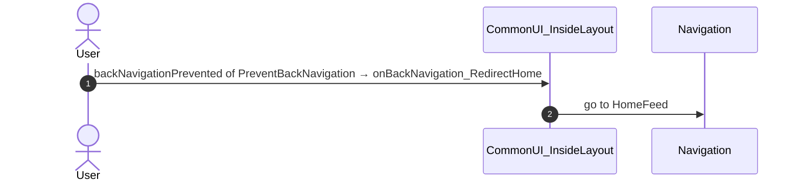

#### 3.1.2 CommonUI_InsideLayout: onBackNavigation_MaybeRedirectHome

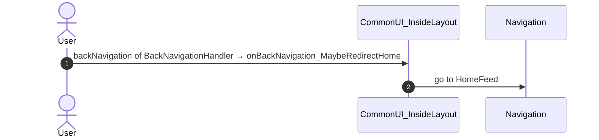

#### 3.1.3 Block_PINUnlock: block_PINUnlock_ContentWrapperNavigateTo_PINRegist

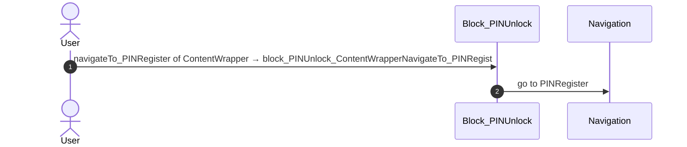

#### 3.1.4 Block_PINUnlock_ContentWrapper: event_Pincode_PinUnlockError

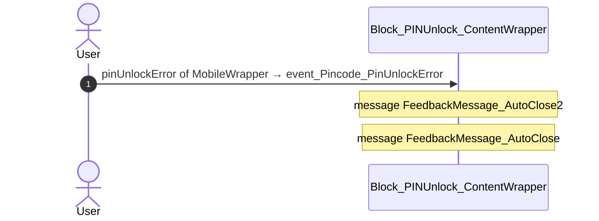

#### 3.1.5 Block_PINUnlock_ContentWrapper: onClick_ForgotPIN

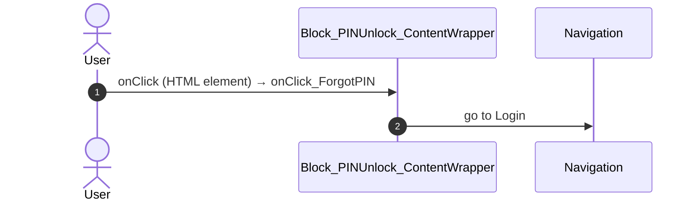

#### 3.1.6 Block_PINUnlock_ContentWrapper: onClick_TermsAndCondition

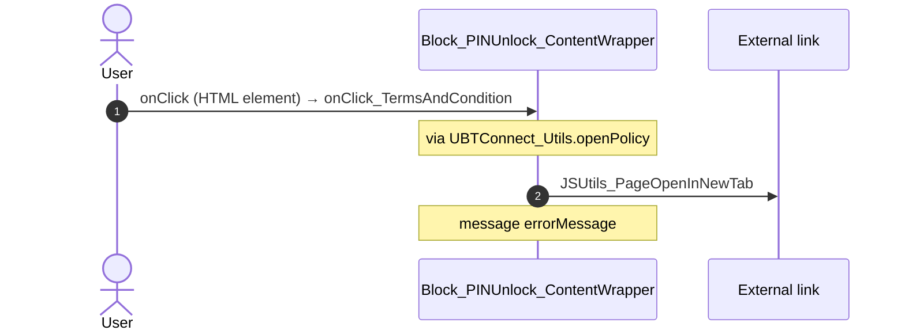

#### 3.1.7 Block_PINUnlock_ContentWrapper: onClick_PrivacyPolicy

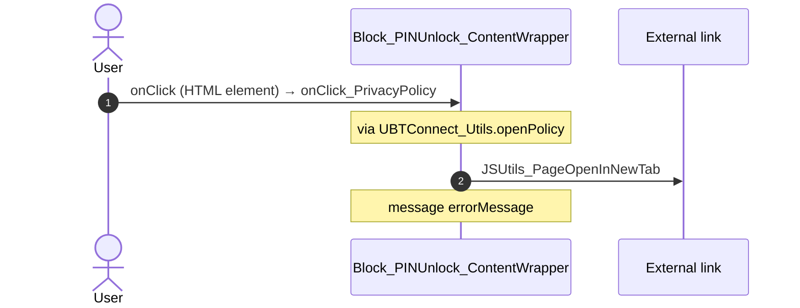

#### 3.1.8 HandleOnResumeOpenLink: androidAppLinkOnResumeHandlerResumeNavigation

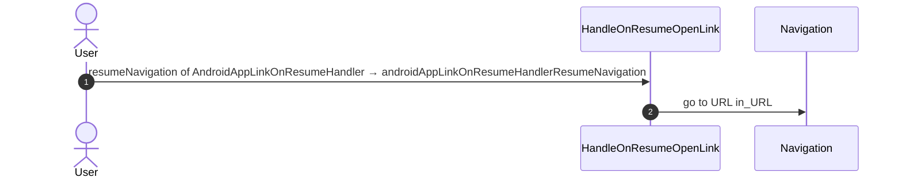

#### 3.1.9 HandleOnResumeOpenLink: deeplinkHandlerCentralOnDeeplinkOpen

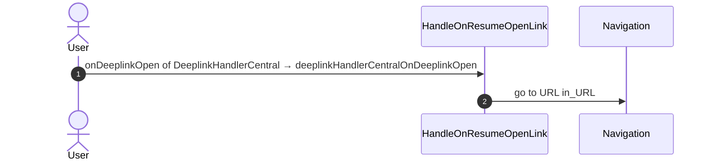

#### 3.1.10 Dialog_AccessRestrictedAction: upgrade

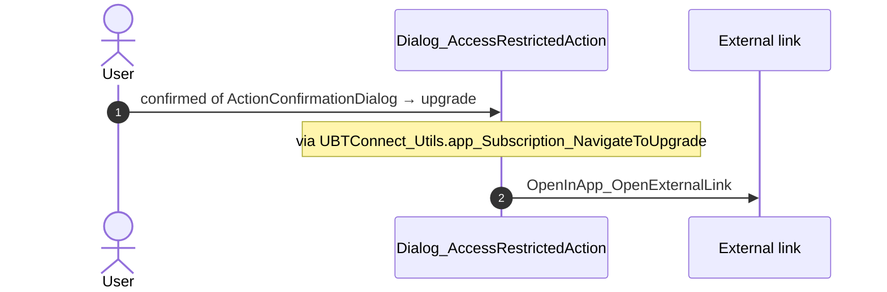

#### 3.1.11 CacheControl_Policies: cacheControlOnNonCacheHit

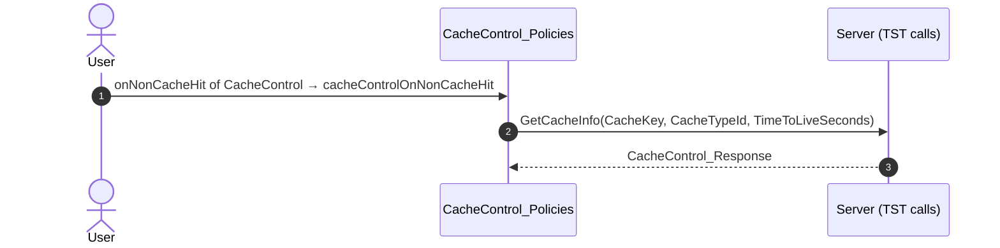

### 3.2 React

| # | File | Element | Event prop | Handler | Branch | Effects |
|---|---|---|---|---|---|---|
| [1](#321-confirmdialogview-onconfirmed) | [`platform/feedback/dialogs/DialogAccessRestrictedAction.tsx:74`](../app/src/platform/feedback/dialogs/DialogAccessRestrictedAction.tsx#L74) | `<ConfirmDialogView>` | `onConfirmed` | `navigateToUpgrade` | – | opens an external link |
| [2](#322-pinunlockcontentcontainer-onnavigatetopinregister) | [`platform/feedback/dialogs/BlockPinUnlock.tsx:90`](../app/src/platform/feedback/dialogs/BlockPinUnlock.tsx#L90) | `<PinUnlockContentContainer>` | `onNavigateToPINRegister` | `inline` | – | goes to PINRegister |
| [3](#323-pinunlockcontent-onsetpin-unlocked) | [`platform/feedback/dialogs/PinUnlockContentContainer.tsx:67`](../app/src/platform/feedback/dialogs/PinUnlockContentContainer.tsx#L67) | `<PinUnlockContent>` | `onSetPin` | `unlock.onSetPin` | `unlocked` | calls the prop onPinUnlockSuccess() |
| [4](#324-pinunlockcontent-onsetpin-other) | [`platform/feedback/dialogs/PinUnlockContentContainer.tsx:67`](../app/src/platform/feedback/dialogs/PinUnlockContentContainer.tsx#L67) | `<PinUnlockContent>` | `onSetPin` | `unlock.onSetPin` | `other` | shows a message; calls the prop onNavigateToPINRegister() |
| [5](#325-pinunlockcontent-onpinunlockerror) | [`platform/feedback/dialogs/PinUnlockContentContainer.tsx:70`](../app/src/platform/feedback/dialogs/PinUnlockContentContainer.tsx#L70) | `<PinUnlockContent>` | `onPinUnlockError` | `content.onPinUnlockError` | – | shows a message; calls the prop onNavigateToPINRegister() |
| [6](#326-pinunlockcontent-onforgotpin) | [`platform/feedback/dialogs/PinUnlockContentContainer.tsx:71`](../app/src/platform/feedback/dialogs/PinUnlockContentContainer.tsx#L71) | `<PinUnlockContent>` | `onForgotPin` | `content.onForgotPin` | – | goes to Login |
| [7](#327-pinunlockcontent-onclickpolicy) | [`platform/feedback/dialogs/PinUnlockContentContainer.tsx:72`](../app/src/platform/feedback/dialogs/PinUnlockContentContainer.tsx#L72) | `<PinUnlockContent>` | `onClickPolicy` | `content.onClickPolicy` | – | opens an external link; shows a message |
| [8](#328-cachecontrol-onnoncachehit) | [`legacy/os/cache/PoliciesCacheControl/PoliciesCacheControl.tsx:55`](../app/src/legacy/os/cache/PoliciesCacheControl/PoliciesCacheControl.tsx#L55) | `<CacheControl>` | `onNonCacheHit` | `onNonCacheHit` | – | calls DataActionGetCacheInfo |

#### 3.2.1 ConfirmDialogView: onConfirmed

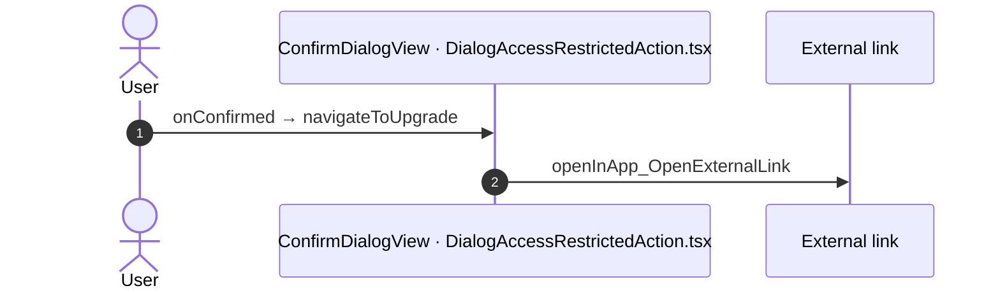

#### 3.2.2 PinUnlockContentContainer: onNavigateToPINRegister

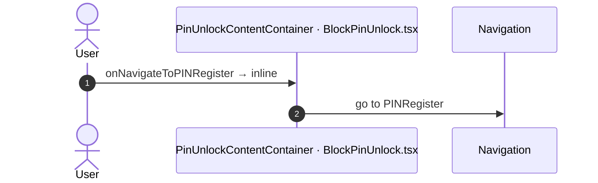

#### 3.2.3 PinUnlockContent: onSetPin (unlocked)

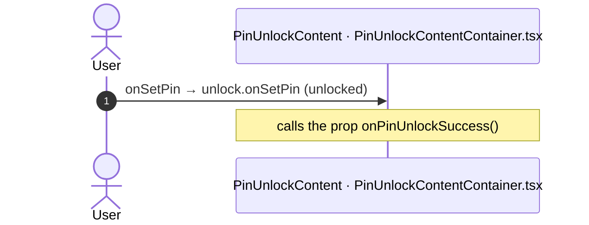

#### 3.2.4 PinUnlockContent: onSetPin (other)

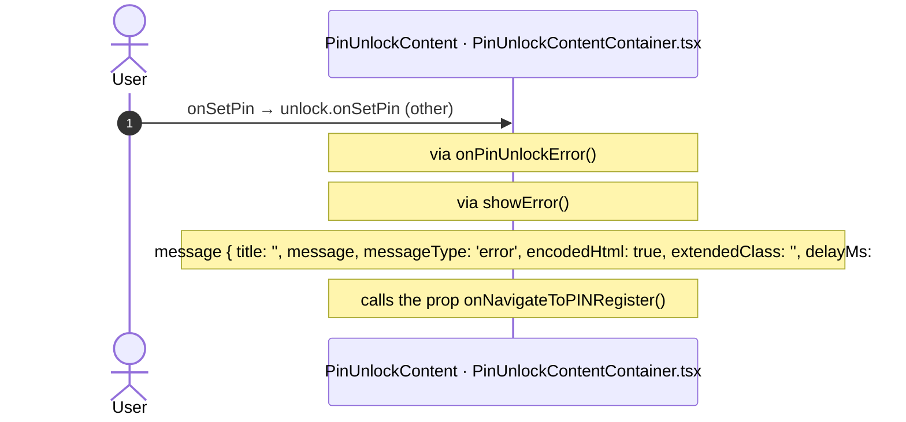

#### 3.2.5 PinUnlockContent: onPinUnlockError

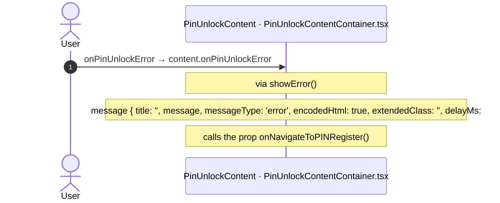

#### 3.2.6 PinUnlockContent: onForgotPin

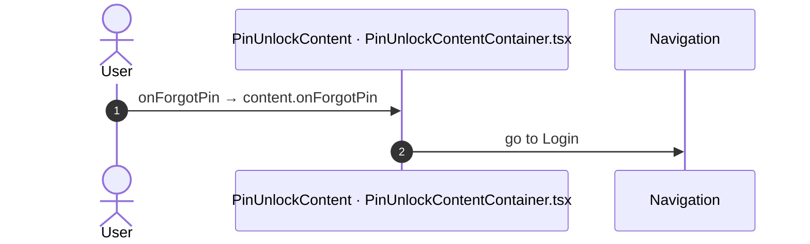

#### 3.2.7 PinUnlockContent: onClickPolicy

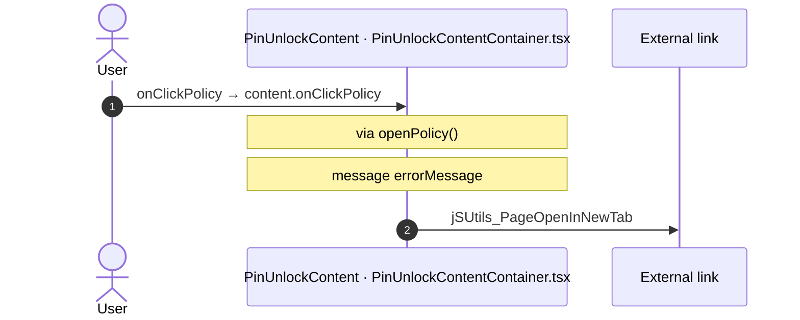

#### 3.2.8 CacheControl: onNonCacheHit

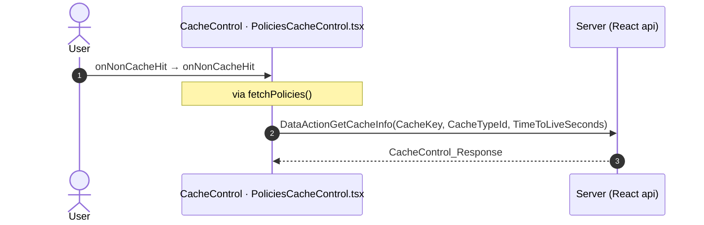

## 4. Server calls

The column **Routes** gives the checked routes where the app shell makes the call.

All columns come from the code, without interpretation:

- **Direct caller (TST):** the block or module of the action that calls the server (the step before the server call in the chain).
- **Chain (TST):** the chains of client actions in the TST compiled code, from their start to the call.
  A long chain shows its first 2 steps, …, and its last 2 steps.
- **Seen on TST:** `yes` when TST made the call in the capture.
- **React action:** the React function with the `callAction` of the same call (`file:line`), and the code that loads it: `shell` (from `main.tsx`), `page` (from the screen), or both.
- **Used by (React references):** the functions and components that reference the React action, up to the nearest component. A reference is not always a call.
- **Status:** `implemented` when the contract path of the React call gives the same TST URL. It does not prove the same behaviour.

| # | Call (TST) | Kind | Direct caller (TST) | Chain (TST) | Seen on TST | React action | Used by (React references) | Status | Routes |
|---|---|---|---|---|---|---|---|---|---|
| 1 | `UBTConnect/Bookmarks/Bookmarks/DataActionGetBookmarks` | data action | `Bookmarks` | onClick in CustomContainer → event clicked of CustomContainer → … → Bookmarks.refresh_GetBookmarksData → Bookmarks.DataActionGetBookmarks onClick in Icon → event click of Icon → … → Bookmarks.refresh_GetBookmarksData → Bookmarks.DataActionGetBookmarks | yes | `fetchBookmarkCards()` [`api/bookmark/bookmarkCards.ts:114`](../app/src/api/bookmark/bookmarkCards.ts#L114) (page) | `Bookmarks → useBookmarks → fetchBookmarkCards` [`pages/Bookmarks/BookmarksPage.tsx`](../app/src/pages/Bookmarks/BookmarksPage.tsx) | implemented | [Bookmarks](routes/Bookmarks.md) |
| 2 | `UBTConnect_Utils/CacheControl/CacheControl_Policies/DataActionGetCacheInfo` | data action | `CacheControl_Policies` | CacheControl.OnInitialize → CacheControl.onInitialize → event onNonCacheHit of CacheControl → CacheControl_Policies.cacheControlOnNonCacheHit → CacheControl_Policies.DataActionGetCacheInfo CacheControl_Policies fetch at start → CacheControl_Policies.DataActionGetCacheInfo | yes | `fetchPolicies()` [`api/app/repository.ts:62`](../app/src/api/app/repository.ts#L62) (shell + page) | `CommonUiLayout → LockHost → … → fetchPolicies` [`components/layout/CommonUiLayout/CommonUiLayout.tsx`](../app/src/components/layout/CommonUiLayout/CommonUiLayout.tsx) `AppFrame → AppLockHost → … → fetchPolicies` [`app/AppFrame.tsx`](../app/src/app/AppFrame.tsx) | implemented | [AcceptPendingPolicies](routes/AcceptPendingPolicies.md), [AssembleDetail](routes/AssembleDetail.md), [EmailContact](routes/EmailContact.md), [EmailTarget](routes/EmailTarget.md), [EventBooklet](routes/EventBooklet.md), [FeedItemDetail](routes/FeedItemDetail.md), [GuestArrangements](routes/GuestArrangements.md), [LDM_Email_V2](routes/LDM_Email_V2.md), [OrbitAdminEventDetail](routes/OrbitAdminEventDetail.md), [OrbitAdminMilestoneDetail](routes/OrbitAdminMilestoneDetail.md), [OrbitAdminMilestones](routes/OrbitAdminMilestones.md), [PINUnlock](routes/PINUnlock.md), [PassportScan](routes/PassportScan.md), [QRCodeGenerate](routes/QRCodeGenerate.md), [TermsAndPoliciesMenu](routes/TermsAndPoliciesMenu.md), [TransportDetail](routes/TransportDetail.md), [ViewDocuments](routes/ViewDocuments.md) |
| 3 | `Connect2_LegacyShared/ActionGetAllApplicationEvents` | server action | `Connect2_LegacyShared` | HandleImageLoadError.applicationEvent_ImageError → Connect2_LegacyShared.zOnApplicationEvent_Wrapper → Connect2_LegacyShared.getAppEventName → Connect2_LegacyShared.cacheLocalApplicationEvents → server GetAllApplicationEvents | yes | – | – | not applicable (telemetry) | [AcceptPendingPolicies](routes/AcceptPendingPolicies.md), [AssembleDetail](routes/AssembleDetail.md), [AssembleEvents](routes/AssembleEvents.md), [Assemble_BrowseByCountry](routes/Assemble_BrowseByCountry.md), [Bookmarks](routes/Bookmarks.md), [BrowseCountries](routes/BrowseCountries.md), [BrowseDirectory](routes/BrowseDirectory.md), [ConnectShare](routes/ConnectShare.md), [ContactUsDetails](routes/ContactUsDetails.md), [ContactUsMenu](routes/ContactUsMenu.md), [CountryDetails](routes/CountryDetails.md), [CountryList](routes/CountryList.md), [EmailContact](routes/EmailContact.md), [EmailTarget](routes/EmailTarget.md), [EventBooklet](routes/EventBooklet.md), [EventDetail](routes/EventDetail.md), [FeedItemDetail](routes/FeedItemDetail.md), [GuestArrangements](routes/GuestArrangements.md), [HelpersDetail](routes/HelpersDetail.md), [HomeFeed](routes/HomeFeed.md), [HostSurvey](routes/HostSurvey.md), [HouseholdCarousel](routes/HouseholdCarousel.md), [HouseholdDetails](routes/HouseholdDetails.md), [Household_Relations](routes/Household_Relations.md), [LDM_Email_V2](routes/LDM_Email_V2.md), [LDM_EventDetail_V2](routes/LDM_EventDetail_V2.md), [LDM_MyEvents_V2](routes/LDM_MyEvents_V2.md), [LegacyShareObject](routes/LegacyShareObject.md), [Locality_Details](routes/Locality_Details.md), [Login](routes/Login.md), [Menu](routes/Menu.md), [MessageDetail](routes/MessageDetail.md), [MessageList](routes/MessageList.md), [MilestoneDetail](routes/MilestoneDetail.md), [MyEntertaining](routes/MyEntertaining.md), [Notes](routes/Notes.md), [NotificationDetails](routes/NotificationDetails.md), [Notifications](routes/Notifications.md), [OneSchoolGlobalCarousel](routes/OneSchoolGlobalCarousel.md), [OneSchoolGlobalDetails](routes/OneSchoolGlobalDetails.md), [OrbitAdminEventDetail](routes/OrbitAdminEventDetail.md), [OrbitAdminLanding](routes/OrbitAdminLanding.md), [OrbitAdminMilestoneDetail](routes/OrbitAdminMilestoneDetail.md), [OrbitAdminMilestones](routes/OrbitAdminMilestones.md), [OrbitLanding](routes/OrbitLanding.md), [PINRegister](routes/PINRegister.md), [PINUnlock](routes/PINUnlock.md), [PassportScan](routes/PassportScan.md), [Photobook](routes/Photobook.md), [Profile](routes/Profile.md), [QRCodeGenerate](routes/QRCodeGenerate.md), [Search](routes/Search.md), [SupperMeeting_Carousel](routes/SupperMeeting_Carousel.md), [SupperMeeting_Details](routes/SupperMeeting_Details.md), [TermsAndPoliciesMenu](routes/TermsAndPoliciesMenu.md), [TransportDetail](routes/TransportDetail.md), [Updates_SingleList](routes/Updates_SingleList.md), [ViewDocuments](routes/ViewDocuments.md) |
| 4 | `Connect2_LegacyShared/ActionGetCountriesBySubscription` | server action | `Connect2_LegacyShared` | Connect2_LegacyShared.getRegionSubscribedCountries → server GetCountriesBySubscription | yes | `fetchRegionSubscribedCountries()` [`api/country/repository.ts:84`](../app/src/api/country/repository.ts#L84) (page) | `AssembleFilterSheetBlock → useAssembleFilterSheet → … → fetchRegionSubscribedCountries` [`pages/AssembleEvents/AssembleEventsPage.tsx`](../app/src/pages/AssembleEvents/AssembleEventsPage.tsx) | implemented | [AssembleEvents](routes/AssembleEvents.md), [Assemble_BrowseByCountry](routes/Assemble_BrowseByCountry.md) |
| 5 | `Connect2_LegacyShared/ActionGetNumberUnreadMessages` | server action | `Connect2_LegacyShared` | UBTConnect.onApplicationReady → UBTConnect.connect_SetLoggedContext → Connect2_LegacyShared.synchronizeNumberUnreadMessages → server GetNumberUnreadMessages UBTConnect.fCM_NotificationCallback → Connect2_LegacyShared.synchronizeNumberUnreadMessages → server GetNumberUnreadMessages | yes | `fetchNumberUnreadMessages()` [`api/message/unreadMessages.ts:22`](../app/src/api/message/unreadMessages.ts#L22) (shell) | `AppFrame → AppStart → … → fetchNumberUnreadMessages` [`app/AppFrame.tsx`](../app/src/app/AppFrame.tsx) | implemented | [AssembleEvents](routes/AssembleEvents.md), [Assemble_BrowseByCountry](routes/Assemble_BrowseByCountry.md), [Bookmarks](routes/Bookmarks.md), [BrowseCountries](routes/BrowseCountries.md), [BrowseDirectory](routes/BrowseDirectory.md), [CommunityBusinessDetails_CoomingSoon](routes/CommunityBusinessDetails_CoomingSoon.md), [ConnectShare](routes/ConnectShare.md), [ContactByEmailMember](routes/ContactByEmailMember.md), [ContactByEmailOneSchoolGlobal](routes/ContactByEmailOneSchoolGlobal.md), [ContactUsDetails](routes/ContactUsDetails.md), [ContactUsMenu](routes/ContactUsMenu.md), [CountryDetails](routes/CountryDetails.md), [CountryList](routes/CountryList.md), [HomeFeed](routes/HomeFeed.md), [HouseholdDetails](routes/HouseholdDetails.md), [Household_Relations](routes/Household_Relations.md), [LDM_MyEvents_V2](routes/LDM_MyEvents_V2.md), [LegacyShareObject](routes/LegacyShareObject.md), [Locality_Details](routes/Locality_Details.md), [Menu](routes/Menu.md), [MessageDetail](routes/MessageDetail.md), [MyEntertaining](routes/MyEntertaining.md), [Notes](routes/Notes.md), [NotificationDetails](routes/NotificationDetails.md), [Notifications](routes/Notifications.md), [OneSchoolGlobalDetails](routes/OneSchoolGlobalDetails.md), [OrbitAdminLanding](routes/OrbitAdminLanding.md), [OrbitLanding](routes/OrbitLanding.md), [PINBiometricsMenu](routes/PINBiometricsMenu.md), [PINChange](routes/PINChange.md), [PINRegister](routes/PINRegister.md), [PINUnlock](routes/PINUnlock.md), [Photobook](routes/Photobook.md), [Profile](routes/Profile.md), [Search](routes/Search.md), [Services](routes/Services.md), [Splash](routes/Splash.md), [SupperMeeting_Details](routes/SupperMeeting_Details.md), [TermsAndPoliciesMenu](routes/TermsAndPoliciesMenu.md), [Updates_SingleList](routes/Updates_SingleList.md) |
| 6 | `Connect2_LegacyShared/ActionGetSignedImagesInBulk` | server action | `Connect2_LegacyShared` | Connect2_LegacyShared.getBulkSignedImageURL → server GetSignedImagesInBulk | yes | `fetchLegacySignedImagesInBulk()` [`api/image/repository.ts:21`](../app/src/api/image/repository.ts#L21) (page) | `MilestoneBlock → useMilestoneBlock → fetchLegacySignedImageURL → fetchLegacySignedImagesInBulk` [`pages/MilestoneDetail/MilestoneDetailPage.tsx`](../app/src/pages/MilestoneDetail/MilestoneDetailPage.tsx) `AccommodationHost → useAccommodationHost → fetchLegacySignedImageURL → fetchLegacySignedImagesInBulk` [`pages/MilestoneDetail/MilestoneDetailPage.tsx`](../app/src/pages/MilestoneDetail/MilestoneDetailPage.tsx) | implemented | [MilestoneDetail](routes/MilestoneDetail.md) |
| 7 | `Connect2_LegacyShared/ActionGetUserInformation` | server action | `Connect2_LegacyShared` | Connect2_LegacyShared.getUserInformation → server GetUserInformation | yes | `getCacheableUserInfo()` [`lib/legacyShared/actions.ts:302`](../app/src/lib/legacyShared/actions.ts#L302) (page) | `AssembleLocalityFilter → getCacheableUserInfo` [`components/assemble/AssembleLocalityFilter/AssembleLocalityFilter.tsx`](../app/src/components/assemble/AssembleLocalityFilter/AssembleLocalityFilter.tsx) `AssembleFilterSheetBlock → useAssembleFilterSheet → hasAccessToRegion → getCacheableUserInfo` [`pages/AssembleEvents/AssembleEventsPage.tsx`](../app/src/pages/AssembleEvents/AssembleEventsPage.tsx) | implemented | [AssembleEvents](routes/AssembleEvents.md), [Assemble_BrowseByCountry](routes/Assemble_BrowseByCountry.md) |
| 8 | `UBTConnect/Home/FeedBlock_Updates/ServiceAPIAction_UI_UpdateItem_MarkAsRead` | service action | `FeedBlock_Updates` | onClick in CustomContainer → event clicked of CustomContainer → event onClick of Update_ListItem → FeedBlock_Updates.event_ListItemOnClick → server Action_UI_UpdateItem_MarkAsRead | no | `markUpdateItemAsRead()` [`api/update/repository.ts:47`](../app/src/api/update/repository.ts#L47) (page) | `FeedUpdates → useFeedUpdates → markUpdateItemAsRead` [`pages/HomeFeed/HomeFeedPage.tsx`](../app/src/pages/HomeFeed/HomeFeedPage.tsx) | implemented | [HomeFeed](routes/HomeFeed.md) |
| 9 | `UBTConnect/App_Menu/Menu/ActionRequestPhotoUpdate` | server action | `Menu` | onClick in CustomContainer → event clicked of CustomContainer → event onClick_MenuOption of Menu_List → Menu.onClick_MenuOption → server RequestPhotoUpdate | no | `requestPhotoUpdate()` [`api/member/repository.ts:46`](../app/src/api/member/repository.ts#L46) (page) | `Menu → useMenu → requestPhotoUpdate` [`pages/Menu/MenuPage.tsx`](../app/src/pages/Menu/MenuPage.tsx) | implemented | [Menu](routes/Menu.md) |
| 10 | `UBTConnect/Notes/Notes/DataActionGetNotes` | data action | `Notes` | onClick in CustomContainer → event clicked of CustomContainer → … → Notes.refresh_GetNotes → Notes.DataActionGetNotes onClick in Icon → event click of Icon → … → Notes.refresh_GetNotes → Notes.DataActionGetNotes | yes | `fetchNoteCards()` [`api/note/repository.ts:31`](../app/src/api/note/repository.ts#L31) (page) | `Notes → useNotes → fetchNoteCards` [`pages/Notes/NotesPage.tsx`](../app/src/pages/Notes/NotesPage.tsx) | implemented | [Notes](routes/Notes.md) |
| 11 | `UBTConnect/App_Notifications/Notifications/DataActionFetchNotifications` | data action | `Notifications` | onClick in Icon → event click of Icon → … → Notifications.refreshNotifications → Notifications.DataActionFetchNotifications | yes | `fetchNotifications()` [`api/notification/repository.ts:40`](../app/src/api/notification/repository.ts#L40) (page) | `Notifications → useNotifications → fetchNotifications` [`pages/Notifications/NotificationsPage.tsx`](../app/src/pages/Notifications/NotificationsPage.tsx) | implemented | [Notifications](routes/Notifications.md) |
| 12 | `UBTConnect/Directory_Photobook/Photobook_Options_Left/DataActionGetHouseholdCaption` | data action | `Photobook_Options_Left` | onClick in CustomContainer → event clicked of CustomContainer → Photobook_Options_Left.handler_ClickedInfo → Photobook_Options_Left.DataActionGetHouseholdCaption | no | `fetchHouseholdCaption()` [`api/household/repository.ts:67`](../app/src/api/household/repository.ts#L67) (page) | `Photobook_Options_Left → useHouseholdCaption → fetchHouseholdCaption` [`pages/Photobook/components/Photobook_Options_Left.tsx`](../app/src/pages/Photobook/components/Photobook_Options_Left.tsx) | implemented | [Photobook](routes/Photobook.md) |
| 13 | `UBTConnect/App_Policies/Policy_Custom_AcceptPendingPolicies/ActionAcceptPolicies` | server action | `Policy_Custom_AcceptPendingPolicies` | onClick in Button → event event_OnClick of Button → event buttonOnClick of Button → Policy_Custom_AcceptPendingPolicies.continueOnClick → server AcceptPolicies | no capture | `acceptPolicies()` [`api/policy/repository.ts:29`](../app/src/api/policy/repository.ts#L29) (page) | `AcceptPendingPolicies → usePendingPoliciesForm → acceptPolicies` [`pages/AcceptPendingPolicies/AcceptPendingPoliciesPage.tsx`](../app/src/pages/AcceptPendingPolicies/AcceptPendingPoliciesPage.tsx) | implemented | [AcceptPendingPolicies](routes/AcceptPendingPolicies.md) |
| 14 | `UBTConnect_Utils/CW_Share/ShareSheet/ActionCS_ShareObject` | server action | `ShareSheet` | onClick in Button → event event_OnClick of Button → … → ShareSheet.action_SubmitShare → server CS_ShareObject | no capture | `csShareObject()` [`api/share/shareSheet.ts:25`](../app/src/api/share/shareSheet.ts#L25) (page) | `ShareSheetContainer → useShareSheet → csShareObject` [`containers/ShareSheet/ShareSheetContainer.tsx`](../app/src/containers/ShareSheet/ShareSheetContainer.tsx) | implemented | [AssembleDetail](routes/AssembleDetail.md), [FeedItemDetail](routes/FeedItemDetail.md) |
| 15 | `UBTConnect/ActionSync_Info_GetMain` | server action | `UBTConnect` | UBTConnect.onApplicationReady → UBTConnect.connect_SetLoggedContext → UBTConnect.sync_Info_Main → server Sync_Info_GetMain UBTConnect.onApplicationReady → UBTConnect.sync_Info_Main → server Sync_Info_GetMain | yes | `fetchSyncInfoMain()` [`api/app/repository.ts:44`](../app/src/api/app/repository.ts#L44) (shell) | `AppFrame → AppStart → … → fetchSyncInfoMain` [`app/AppFrame.tsx`](../app/src/app/AppFrame.tsx) | implemented | [AssembleEvents](routes/AssembleEvents.md), [Assemble_BrowseByCountry](routes/Assemble_BrowseByCountry.md), [Bookmarks](routes/Bookmarks.md), [BrowseCountries](routes/BrowseCountries.md), [BrowseDirectory](routes/BrowseDirectory.md), [CommunityBusinessDetails_CoomingSoon](routes/CommunityBusinessDetails_CoomingSoon.md), [ConnectShare](routes/ConnectShare.md), [ContactByEmailMember](routes/ContactByEmailMember.md), [ContactByEmailOneSchoolGlobal](routes/ContactByEmailOneSchoolGlobal.md), [ContactUsDetails](routes/ContactUsDetails.md), [ContactUsMenu](routes/ContactUsMenu.md), [CountryDetails](routes/CountryDetails.md), [CountryList](routes/CountryList.md), [HomeFeed](routes/HomeFeed.md), [HouseholdDetails](routes/HouseholdDetails.md), [Household_Relations](routes/Household_Relations.md), [LDM_MyEvents_V2](routes/LDM_MyEvents_V2.md), [LegacyShareObject](routes/LegacyShareObject.md), [Locality_Details](routes/Locality_Details.md), [Menu](routes/Menu.md), [MessageDetail](routes/MessageDetail.md), [MessageList](routes/MessageList.md), [MyEntertaining](routes/MyEntertaining.md), [Notes](routes/Notes.md), [NotificationDetails](routes/NotificationDetails.md), [Notifications](routes/Notifications.md), [OneSchoolGlobalDetails](routes/OneSchoolGlobalDetails.md), [OrbitAdminLanding](routes/OrbitAdminLanding.md), [OrbitLanding](routes/OrbitLanding.md), [PINBiometricsMenu](routes/PINBiometricsMenu.md), [PINChange](routes/PINChange.md), [PINRegister](routes/PINRegister.md), [PINUnlock](routes/PINUnlock.md), [Photobook](routes/Photobook.md), [Profile](routes/Profile.md), [Search](routes/Search.md), [Services](routes/Services.md), [Splash](routes/Splash.md), [SupperMeeting_Details](routes/SupperMeeting_Details.md), [TermsAndPoliciesMenu](routes/TermsAndPoliciesMenu.md), [Updates_SingleList](routes/Updates_SingleList.md) |
| 16 | `UBTConnect/ServiceAPIFetchData_CacheableHouseholds` | service action | `UBTConnect` | UBTConnect.get_Cacheable_MapHouseholds → server FetchData_CacheableHouseholds | yes | `fetchCacheableHouseholds()` [`api/app/repository.ts:56`](../app/src/api/app/repository.ts#L56) (shell) | `AppFrame → AppStart → … → fetchCacheableHouseholds` [`app/AppFrame.tsx`](../app/src/app/AppFrame.tsx) | implemented | [AssembleEvents](routes/AssembleEvents.md), [Assemble_BrowseByCountry](routes/Assemble_BrowseByCountry.md), [Bookmarks](routes/Bookmarks.md), [BrowseCountries](routes/BrowseCountries.md), [BrowseDirectory](routes/BrowseDirectory.md), [CommunityBusinessDetails_CoomingSoon](routes/CommunityBusinessDetails_CoomingSoon.md), [ConnectShare](routes/ConnectShare.md), [ContactByEmailMember](routes/ContactByEmailMember.md), [ContactByEmailOneSchoolGlobal](routes/ContactByEmailOneSchoolGlobal.md), [ContactUsDetails](routes/ContactUsDetails.md), [ContactUsMenu](routes/ContactUsMenu.md), [CountryDetails](routes/CountryDetails.md), [CountryList](routes/CountryList.md), [HomeFeed](routes/HomeFeed.md), [HouseholdDetails](routes/HouseholdDetails.md), [Household_Relations](routes/Household_Relations.md), [LDM_MyEvents_V2](routes/LDM_MyEvents_V2.md), [LegacyShareObject](routes/LegacyShareObject.md), [Locality_Details](routes/Locality_Details.md), [Menu](routes/Menu.md), [MessageDetail](routes/MessageDetail.md), [MessageList](routes/MessageList.md), [MyEntertaining](routes/MyEntertaining.md), [Notes](routes/Notes.md), [NotificationDetails](routes/NotificationDetails.md), [Notifications](routes/Notifications.md), [OneSchoolGlobalDetails](routes/OneSchoolGlobalDetails.md), [OrbitAdminLanding](routes/OrbitAdminLanding.md), [OrbitLanding](routes/OrbitLanding.md), [PINBiometricsMenu](routes/PINBiometricsMenu.md), [PINChange](routes/PINChange.md), [PINRegister](routes/PINRegister.md), [PINUnlock](routes/PINUnlock.md), [Photobook](routes/Photobook.md), [Profile](routes/Profile.md), [Search](routes/Search.md), [Services](routes/Services.md), [Splash](routes/Splash.md), [SupperMeeting_Details](routes/SupperMeeting_Details.md), [TermsAndPoliciesMenu](routes/TermsAndPoliciesMenu.md), [Updates_SingleList](routes/Updates_SingleList.md) |
| 17 | `UBTConnect/ServiceAPIFetchData_CacheableMapEntities` | service action | `UBTConnect` | UBTConnect.get_Cacheable_MapEntities → server FetchData_CacheableMapEntities | yes | `fetchCacheableMapEntities()` [`api/app/repository.ts:50`](../app/src/api/app/repository.ts#L50) (shell) | `AppFrame → AppStart → … → fetchCacheableMapEntities` [`app/AppFrame.tsx`](../app/src/app/AppFrame.tsx) | implemented | [AssembleEvents](routes/AssembleEvents.md), [Assemble_BrowseByCountry](routes/Assemble_BrowseByCountry.md), [Bookmarks](routes/Bookmarks.md), [BrowseCountries](routes/BrowseCountries.md), [BrowseDirectory](routes/BrowseDirectory.md), [CommunityBusinessDetails_CoomingSoon](routes/CommunityBusinessDetails_CoomingSoon.md), [ConnectShare](routes/ConnectShare.md), [ContactByEmailMember](routes/ContactByEmailMember.md), [ContactByEmailOneSchoolGlobal](routes/ContactByEmailOneSchoolGlobal.md), [ContactUsDetails](routes/ContactUsDetails.md), [ContactUsMenu](routes/ContactUsMenu.md), [CountryDetails](routes/CountryDetails.md), [CountryList](routes/CountryList.md), [HomeFeed](routes/HomeFeed.md), [HouseholdDetails](routes/HouseholdDetails.md), [Household_Relations](routes/Household_Relations.md), [LDM_MyEvents_V2](routes/LDM_MyEvents_V2.md), [LegacyShareObject](routes/LegacyShareObject.md), [Locality_Details](routes/Locality_Details.md), [Menu](routes/Menu.md), [MessageDetail](routes/MessageDetail.md), [MessageList](routes/MessageList.md), [MyEntertaining](routes/MyEntertaining.md), [Notes](routes/Notes.md), [NotificationDetails](routes/NotificationDetails.md), [Notifications](routes/Notifications.md), [OneSchoolGlobalDetails](routes/OneSchoolGlobalDetails.md), [OrbitAdminLanding](routes/OrbitAdminLanding.md), [OrbitLanding](routes/OrbitLanding.md), [PINBiometricsMenu](routes/PINBiometricsMenu.md), [PINChange](routes/PINChange.md), [PINRegister](routes/PINRegister.md), [PINUnlock](routes/PINUnlock.md), [Photobook](routes/Photobook.md), [Profile](routes/Profile.md), [Search](routes/Search.md), [Services](routes/Services.md), [Splash](routes/Splash.md), [SupperMeeting_Details](routes/SupperMeeting_Details.md), [TermsAndPoliciesMenu](routes/TermsAndPoliciesMenu.md), [Updates_SingleList](routes/Updates_SingleList.md) |
| 18 | `UBTConnect/ServiceAPIGet_UI_UpdateItems_UnreadCount_All` | service action | `UBTConnect` | onClick in CustomText → event clicked of CustomText → … → UBTConnect.directory_Updates_RefreshBottomBarCount → server Get_UI_UpdateItems_UnreadCount_All onClick in CustomContainer → event clicked of CustomContainer → … → UBTConnect.directory_Updates_RefreshBottomBarCount → server Get_UI_UpdateItems_UnreadCount_All | yes | `fetchUnreadUpdateItemsCount()` [`api/update/repository.ts:73`](../app/src/api/update/repository.ts#L73) (page) | `BottomBar → directory_Updates_RefreshBottomBarCount → fetchUnreadUpdateItemsCount` [`components/layout/BottomBar/BottomBar.tsx`](../app/src/components/layout/BottomBar/BottomBar.tsx) `Updates_SingleList → useUpdatesSingleList → directory_Updates_RefreshBottomBarCount → fetchUnreadUpdateItemsCount` [`pages/Updates_SingleList/Updates_SingleListPage.tsx`](../app/src/pages/Updates_SingleList/Updates_SingleListPage.tsx) | implemented | [Updates_SingleList](routes/Updates_SingleList.md) |
| 19 | `UBTConnect_Bookmarks_MCS/ActionGet_BookmarkPills_ByBookmarkCategoryIds` | server action | `UBTConnect_Bookmarks_MCS` | no chain in the TST code; TST made the call in the capture | yes | `fetchBookmarkPills()` [`api/bookmark/bookmarkCards.ts:122`](../app/src/api/bookmark/bookmarkCards.ts#L122) (page) | `Bookmarks → useBookmarks → get_LocalDynamicBookmarkPills → fetchBookmarkPills` [`pages/Bookmarks/BookmarksPage.tsx`](../app/src/pages/Bookmarks/BookmarksPage.tsx) | implemented | [Bookmarks](routes/Bookmarks.md) |
| 20 | `UBTConnect_Notes_MCS/ActionGet_NotePills_ByNoteCategoryIds` | server action | `UBTConnect_Notes_MCS` | no chain in the TST code; TST made the call in the capture | yes | `fetchNotePills()` [`api/note/repository.ts:38`](../app/src/api/note/repository.ts#L38) (page) | `Notes → useNotes → getNotes_Pills → fetchNotePills` [`pages/Notes/NotesPage.tsx`](../app/src/pages/Notes/NotesPage.tsx) | implemented | [Notes](routes/Notes.md) |
| 21 | `UBTConnect_Utils/ActionCS_CreateShareProfileLink` | server action | `UBTConnect_Utils` | onClick in Button → event event_OnClick of Button → … → UBTConnect_Utils.shareEntity_ByURL → server CS_CreateShareProfileLink | no capture | – | – | not applicable (nativeOnly) | [FeedItemDetail](routes/FeedItemDetail.md) |
| 22 | `UBTConnect_Utils/ActionGetSignedImagesInBulk` | server action | `UBTConnect_Utils` | UBTConnect_Utils.cache_SignedImageURL_GetCallback → server GetSignedImagesInBulk | yes | `cache_SignedImageURL_GetCallback()` [`lib/ubtConnectUtils/actions.ts:124`](../app/src/lib/ubtConnectUtils/actions.ts#L124) (page) | `EntityLazyImage → cache_SignedImageURL_Get → cache_SignedImageURL_GetCallback` [`components/ui/EntityLazyImage/EntityLazyImage.tsx`](../app/src/components/ui/EntityLazyImage/EntityLazyImage.tsx) | implemented | [CountryDetails](routes/CountryDetails.md), [HouseholdCarousel](routes/HouseholdCarousel.md), [HouseholdDetails](routes/HouseholdDetails.md), [Household_Relations](routes/Household_Relations.md), [LegacyShareObject](routes/LegacyShareObject.md), [Locality_Details](routes/Locality_Details.md), [MessageDetail](routes/MessageDetail.md), [MessageList](routes/MessageList.md), [Photobook](routes/Photobook.md), [Profile](routes/Profile.md), [SupperMeeting_Carousel](routes/SupperMeeting_Carousel.md), [SupperMeeting_Details](routes/SupperMeeting_Details.md) |
| 23 | `UBTConnect_Utils/ActionGetUserInformation` | server action | `UBTConnect_Utils` | UBTConnect_Utils.cache_UserInfo_GetCallback → server GetUserInformation | yes | `fetchUserInformation()` [`api/member/userInformation.ts:6`](../app/src/api/member/userInformation.ts#L6) (shell + page) | `AssembleLocalityFilter → hasAccessToRegion → … → fetchUserInformation` [`components/assemble/AssembleLocalityFilter/AssembleLocalityFilter.tsx`](../app/src/components/assemble/AssembleLocalityFilter/AssembleLocalityFilter.tsx) `CommonUiLayout → DialogAccessRestrictedAction → … → fetchUserInformation` [`components/layout/CommonUiLayout/CommonUiLayout.tsx`](../app/src/components/layout/CommonUiLayout/CommonUiLayout.tsx) | implemented | [AssembleEvents](routes/AssembleEvents.md), [Assemble_BrowseByCountry](routes/Assemble_BrowseByCountry.md), [Bookmarks](routes/Bookmarks.md), [BrowseCountries](routes/BrowseCountries.md), [BrowseDirectory](routes/BrowseDirectory.md), [CommunityBusinessDetails_CoomingSoon](routes/CommunityBusinessDetails_CoomingSoon.md), [ConnectShare](routes/ConnectShare.md), [ContactByEmailMember](routes/ContactByEmailMember.md), [ContactByEmailOneSchoolGlobal](routes/ContactByEmailOneSchoolGlobal.md), [ContactUsMenu](routes/ContactUsMenu.md), [HomeFeed](routes/HomeFeed.md), [HouseholdDetails](routes/HouseholdDetails.md), [Household_Relations](routes/Household_Relations.md), [LDM_MyEvents_V2](routes/LDM_MyEvents_V2.md), [LegacyShareObject](routes/LegacyShareObject.md), [Locality_Details](routes/Locality_Details.md), [MessageDetail](routes/MessageDetail.md), [MessageList](routes/MessageList.md), [MyEntertaining](routes/MyEntertaining.md), [Notes](routes/Notes.md), [NotificationDetails](routes/NotificationDetails.md), [Notifications](routes/Notifications.md), [OneSchoolGlobalDetails](routes/OneSchoolGlobalDetails.md), [OrbitAdminLanding](routes/OrbitAdminLanding.md), [OrbitLanding](routes/OrbitLanding.md), [PINBiometricsMenu](routes/PINBiometricsMenu.md), [PINChange](routes/PINChange.md), [PINRegister](routes/PINRegister.md), [PINUnlock](routes/PINUnlock.md), [Photobook](routes/Photobook.md), [Services](routes/Services.md), [Splash](routes/Splash.md), [SupperMeeting_Details](routes/SupperMeeting_Details.md), [TermsAndPoliciesMenu](routes/TermsAndPoliciesMenu.md) |
| 24 | `UBT_AppManager/ActionAppManager_AfterInitialize` | server action | `UBT_AppManager` | UBT_AppManager.appManager_OnAppReady_Web → UBT_AppManager.appManager_InitializeWebComponents → UBT_AppManager.appManager_AfterInitialize → server AppManager_AfterInitialize UBTConnect.onApplicationReady → UBT_AppManager_Mobile.appManager_Mobile_OnAppReady → UBT_AppManager.appManager_InitializeWebComponents → UBT_AppManager.appManager_AfterInitialize → server AppManager_AfterInitialize | yes | `afterInitialize()` [`api/app/repository.ts:38`](../app/src/api/app/repository.ts#L38) (shell) | `AppFrame → AppStart → … → afterInitialize` [`app/AppFrame.tsx`](../app/src/app/AppFrame.tsx) | implemented | [AssembleEvents](routes/AssembleEvents.md), [Assemble_BrowseByCountry](routes/Assemble_BrowseByCountry.md), [Bookmarks](routes/Bookmarks.md), [BrowseCountries](routes/BrowseCountries.md), [BrowseDirectory](routes/BrowseDirectory.md), [CommunityBusinessDetails_CoomingSoon](routes/CommunityBusinessDetails_CoomingSoon.md), [ConnectShare](routes/ConnectShare.md), [ContactByEmailMember](routes/ContactByEmailMember.md), [ContactByEmailOneSchoolGlobal](routes/ContactByEmailOneSchoolGlobal.md), [ContactUsDetails](routes/ContactUsDetails.md), [ContactUsMenu](routes/ContactUsMenu.md), [CountryDetails](routes/CountryDetails.md), [CountryList](routes/CountryList.md), [HomeFeed](routes/HomeFeed.md), [HouseholdDetails](routes/HouseholdDetails.md), [Household_Relations](routes/Household_Relations.md), [LDM_MyEvents_V2](routes/LDM_MyEvents_V2.md), [LegacyShareObject](routes/LegacyShareObject.md), [Locality_Details](routes/Locality_Details.md), [Menu](routes/Menu.md), [MessageDetail](routes/MessageDetail.md), [MessageList](routes/MessageList.md), [MyEntertaining](routes/MyEntertaining.md), [Notes](routes/Notes.md), [NotificationDetails](routes/NotificationDetails.md), [Notifications](routes/Notifications.md), [OneSchoolGlobalDetails](routes/OneSchoolGlobalDetails.md), [OrbitAdminLanding](routes/OrbitAdminLanding.md), [OrbitLanding](routes/OrbitLanding.md), [PINBiometricsMenu](routes/PINBiometricsMenu.md), [PINChange](routes/PINChange.md), [PINRegister](routes/PINRegister.md), [PINUnlock](routes/PINUnlock.md), [Photobook](routes/Photobook.md), [Profile](routes/Profile.md), [Search](routes/Search.md), [Services](routes/Services.md), [Splash](routes/Splash.md), [SupperMeeting_Details](routes/SupperMeeting_Details.md), [TermsAndPoliciesMenu](routes/TermsAndPoliciesMenu.md), [Updates_SingleList](routes/Updates_SingleList.md) |
| 25 | `UBT_AppManager/ActionAppManager_Logout` | server action | `UBT_AppManager` | onClick in CustomContainer → event clicked of CustomContainer → … → UBT_AppManager.appManager_Logout → server AppManager_Logout | no | `appManagerLogout()` [`api/app/repository.ts:32`](../app/src/api/app/repository.ts#L32) (shell + page) | `Menu → useMenu → … → appManagerLogout` [`pages/Menu/MenuPage.tsx`](../app/src/pages/Menu/MenuPage.tsx) `AppFrame → AppStart → … → appManagerLogout` [`app/AppFrame.tsx`](../app/src/app/AppFrame.tsx) | implemented | [Menu](routes/Menu.md) |
| 26 | `UBT_AppManager/ActionAppManager_SynchAppContext` | server action | `UBT_AppManager` | HandleImageLoadError.applicationEvent_ImageError → Connect2_LegacyShared.zOnApplicationEvent_Wrapper → … → UBT_AppManager.appManager_SynchAppContextInternal → server AppManager_SynchAppContext UBT_AppManager.inAppBrowser_BeforeLoadCallback → UBT_AppManager.appManager_HandleCallback → … → UBT_AppManager.appManager_SynchAppContextInternal → server AppManager_SynchAppContext UBT_AppManager.inAppBrowser_BeforeLoadCallback → UBT_AppManager.appManager_HandleCallback → … → UBT_AppManager.appManager_SynchAppContextInternal → server AppManager_SynchAppContext (+4 more chains) | yes | `fetchAppContext()` [`api/app/repository.ts:24`](../app/src/api/app/repository.ts#L24) (shell + page) | `AppFrame → AppStart → … → fetchAppContext` [`app/AppFrame.tsx`](../app/src/app/AppFrame.tsx) `AcceptPendingPolicies → useAcceptPendingPolicies → … → fetchAppContext` [`pages/AcceptPendingPolicies/AcceptPendingPoliciesPage.tsx`](../app/src/pages/AcceptPendingPolicies/AcceptPendingPoliciesPage.tsx) | implemented | [AcceptPendingPolicies](routes/AcceptPendingPolicies.md), [AssembleDetail](routes/AssembleDetail.md), [AssembleEvents](routes/AssembleEvents.md), [Assemble_BrowseByCountry](routes/Assemble_BrowseByCountry.md), [Bookmarks](routes/Bookmarks.md), [BrowseCountries](routes/BrowseCountries.md), [BrowseDirectory](routes/BrowseDirectory.md), [CommunityBusinessDetails_CoomingSoon](routes/CommunityBusinessDetails_CoomingSoon.md), [ConnectShare](routes/ConnectShare.md), [ContactByEmailMember](routes/ContactByEmailMember.md), [ContactByEmailOneSchoolGlobal](routes/ContactByEmailOneSchoolGlobal.md), [ContactUsDetails](routes/ContactUsDetails.md), [ContactUsMenu](routes/ContactUsMenu.md), [CountryDetails](routes/CountryDetails.md), [CountryList](routes/CountryList.md), [EmailContact](routes/EmailContact.md), [EmailTarget](routes/EmailTarget.md), [EventBooklet](routes/EventBooklet.md), [EventDetail](routes/EventDetail.md), [FeedItemDetail](routes/FeedItemDetail.md), [GuestArrangements](routes/GuestArrangements.md), [HelpersDetail](routes/HelpersDetail.md), [HomeFeed](routes/HomeFeed.md), [HostSurvey](routes/HostSurvey.md), [HouseholdCarousel](routes/HouseholdCarousel.md), [HouseholdDetails](routes/HouseholdDetails.md), [Household_Relations](routes/Household_Relations.md), [LDM_Email_V2](routes/LDM_Email_V2.md), [LDM_EventDetail_V2](routes/LDM_EventDetail_V2.md), [LDM_MyEvents_V2](routes/LDM_MyEvents_V2.md), [LegacyShareObject](routes/LegacyShareObject.md), [Locality_Details](routes/Locality_Details.md), [Login](routes/Login.md), [Menu](routes/Menu.md), [MessageDetail](routes/MessageDetail.md), [MessageList](routes/MessageList.md), [MilestoneDetail](routes/MilestoneDetail.md), [MyEntertaining](routes/MyEntertaining.md), [Notes](routes/Notes.md), [NotificationDetails](routes/NotificationDetails.md), [Notifications](routes/Notifications.md), [OneSchoolGlobalCarousel](routes/OneSchoolGlobalCarousel.md), [OneSchoolGlobalDetails](routes/OneSchoolGlobalDetails.md), [OrbitAdminEventDetail](routes/OrbitAdminEventDetail.md), [OrbitAdminLanding](routes/OrbitAdminLanding.md), [OrbitAdminMilestoneDetail](routes/OrbitAdminMilestoneDetail.md), [OrbitAdminMilestones](routes/OrbitAdminMilestones.md), [OrbitLanding](routes/OrbitLanding.md), [PINBiometricsMenu](routes/PINBiometricsMenu.md), [PINChange](routes/PINChange.md), [PINRegister](routes/PINRegister.md), [PINUnlock](routes/PINUnlock.md), [PassportScan](routes/PassportScan.md), [Photobook](routes/Photobook.md), [Profile](routes/Profile.md), [QRCodeGenerate](routes/QRCodeGenerate.md), [Search](routes/Search.md), [Services](routes/Services.md), [Splash](routes/Splash.md), [SupperMeeting_Carousel](routes/SupperMeeting_Carousel.md), [SupperMeeting_Details](routes/SupperMeeting_Details.md), [TermsAndPoliciesMenu](routes/TermsAndPoliciesMenu.md), [TransportDetail](routes/TransportDetail.md), [Updates_SingleList](routes/Updates_SingleList.md), [ViewDocuments](routes/ViewDocuments.md) |
| 27 | `UBTConnect/Directory_Updates/Updates_SingleList/DataActionFetchUpdates` | data action | `Updates_SingleList` | onClick in Icon → event click of Icon → … → Updates_SingleList.refreshUpdates → Updates_SingleList.DataActionFetchUpdates onClick in CustomText → event clicked of CustomText → … → Updates_SingleList.refreshUpdates → Updates_SingleList.DataActionFetchUpdates | yes | `fetchUpdatesList()` [`api/update/repository.ts:32`](../app/src/api/update/repository.ts#L32) (page) | `Updates_SingleList → useUpdatesSingleList → fetchUpdatesList` [`pages/Updates_SingleList/Updates_SingleListPage.tsx`](../app/src/pages/Updates_SingleList/Updates_SingleListPage.tsx) | implemented | [Updates_SingleList](routes/Updates_SingleList.md) |
| 28 | `UBTConnect/Directory_Updates/Updates_SingleList/ServiceAPIAction_UI_UpdateItem_MarkAllAsRead` | service action | `Updates_SingleList` | onClick in CustomText → event clicked of CustomText → event click_MarkAll of UpdateItem_Header → Updates_SingleList.handler_MarkAllAsRead → server Action_UI_UpdateItem_MarkAllAsRead | no | `markAllUpdateItemsAsRead()` [`api/update/repository.ts:58`](../app/src/api/update/repository.ts#L58) (page) | `Updates_SingleList → useUpdatesSingleList → markAllUpdateItemsAsRead` [`pages/Updates_SingleList/Updates_SingleListPage.tsx`](../app/src/pages/Updates_SingleList/Updates_SingleListPage.tsx) | implemented | [Updates_SingleList](routes/Updates_SingleList.md) |
| 29 | `UBTConnect/Directory_Updates/Updates_SingleList/ServiceAPIAction_UI_UpdateItem_MarkAsRead` | service action | `Updates_SingleList` | onClick in CustomContainer → event clicked of CustomContainer → … → Updates_SingleList.handler_MarkAsRead → server Action_UI_UpdateItem_MarkAsRead | no | `markUpdateItemAsRead()` [`api/update/repository.ts:47`](../app/src/api/update/repository.ts#L47) (page) | `Updates_SingleList → useUpdatesSingleList → markUpdateItemAsRead` [`pages/Updates_SingleList/Updates_SingleListPage.tsx`](../app/src/pages/Updates_SingleList/Updates_SingleListPage.tsx) | implemented | [Updates_SingleList](routes/Updates_SingleList.md) |

## 5. Missing in React

None.

## 6. Questions

None.

### Calls that TST declares outside the static call graph

React calls of the app shell without a TST chain on some routes. TST makes them: the contract or `extra-actions.json` records each (app start, module client actions, JavaScript callbacks). Not questions (user 2026-11-05).

| Call | React action | How TST declares it | Evidence |
|---|---|---|---|
| `/api/UBTConnect_Utils/ActionGetUserInformation` | `fetchUserInformation()` [`api/member/userInformation.ts:6`](../app/src/api/member/userInformation.ts#L6) | app start | the app-start calls observed on TST (migration/knowledge/shell-observed.md:26-27, U3: SynchAppContext, AfterInitialize, Sync_Info_GetMain, GetUserInformation, GetNumberUnreadMessages, CacheableMapEntities, CacheableHouseholds, GetCacheInfo of CacheControl_Policies); the call graph does not read the  |
| `/api/UBT_AppManager/ActionAppManager_Logout` | `appManagerLogout()` [`api/app/repository.ts:32`](../app/src/api/app/repository.ts#L32) | sign-out | TST Connect_Logout: Cache_InvalidateEverything, then AppManager_Logout (UBTConnect.controller.js:1054-1069); the client action calls the server action (UBT_AppManager.controller.js:3684-3694); Login OnInitialize and PINRegister OnClick_BackToLogin call it too (route-actions gap 6) |
| `/api/UBTConnect/ServiceAPIFetchData_CacheableHouseholds` | `fetchCacheableHouseholds()` [`api/app/repository.ts:56`](../app/src/api/app/repository.ts#L56) | app start | the app-start calls observed on TST (migration/knowledge/shell-observed.md:26-27, U3: SynchAppContext, AfterInitialize, Sync_Info_GetMain, GetUserInformation, GetNumberUnreadMessages, CacheableMapEntities, CacheableHouseholds, GetCacheInfo of CacheControl_Policies); the call graph does not read the  |
| `/api/UBTConnect/ServiceAPIFetchData_CacheableMapEntities` | `fetchCacheableMapEntities()` [`api/app/repository.ts:50`](../app/src/api/app/repository.ts#L50) | app start | the app-start calls observed on TST (migration/knowledge/shell-observed.md:26-27, U3: SynchAppContext, AfterInitialize, Sync_Info_GetMain, GetUserInformation, GetNumberUnreadMessages, CacheableMapEntities, CacheableHouseholds, GetCacheInfo of CacheControl_Policies); the call graph does not read the  |
| `/api/Connect2_LegacyShared/ActionGetNumberUnreadMessages` | `fetchNumberUnreadMessages()` [`api/message/unreadMessages.ts:22`](../app/src/api/message/unreadMessages.ts#L22) | app start | the app-start calls observed on TST (migration/knowledge/shell-observed.md:26-27, U3: SynchAppContext, AfterInitialize, Sync_Info_GetMain, GetUserInformation, GetNumberUnreadMessages, CacheableMapEntities, CacheableHouseholds, GetCacheInfo of CacheControl_Policies); the call graph does not read the  |
| `/api/UBTConnect/ActionSync_Info_GetMain` | `fetchSyncInfoMain()` [`api/app/repository.ts:44`](../app/src/api/app/repository.ts#L44) | app start | the app-start calls observed on TST (migration/knowledge/shell-observed.md:26-27, U3: SynchAppContext, AfterInitialize, Sync_Info_GetMain, GetUserInformation, GetNumberUnreadMessages, CacheableMapEntities, CacheableHouseholds, GetCacheInfo of CacheControl_Policies); the call graph does not read the  |
| `/api/UBT_AppManager/ActionAppManager_AfterInitialize` | `afterInitialize()` [`api/app/repository.ts:38`](../app/src/api/app/repository.ts#L38) | app start | the app-start calls observed on TST (migration/knowledge/shell-observed.md:26-27, U3: SynchAppContext, AfterInitialize, Sync_Info_GetMain, GetUserInformation, GetNumberUnreadMessages, CacheableMapEntities, CacheableHouseholds, GetCacheInfo of CacheControl_Policies); the call graph does not read the  |
| `/api/UBTConnect_Utils/CacheControl_Policies/DataActionGetCacheInfo` | `fetchPolicies()` [`api/app/repository.ts:62`](../app/src/api/app/repository.ts#L62) | app start | the app-start calls observed on TST (migration/knowledge/shell-observed.md:26-27, U3: SynchAppContext, AfterInitialize, Sync_Info_GetMain, GetUserInformation, GetNumberUnreadMessages, CacheableMapEntities, CacheableHouseholds, GetCacheInfo of CacheControl_Policies); the call graph does not read the  |
| `/api/UBT_AppManager/ActionAppManager_SynchAppContext` | `fetchAppContext()` [`api/app/repository.ts:24`](../app/src/api/app/repository.ts#L24) | app start | the app-start calls observed on TST (migration/knowledge/shell-observed.md:26-27, U3: SynchAppContext, AfterInitialize, Sync_Info_GetMain, GetUserInformation, GetNumberUnreadMessages, CacheableMapEntities, CacheableHouseholds, GetCacheInfo of CacheControl_Policies); the call graph does not read the  |
