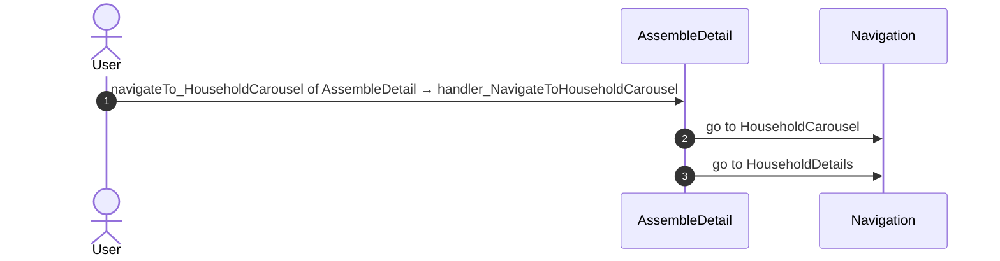
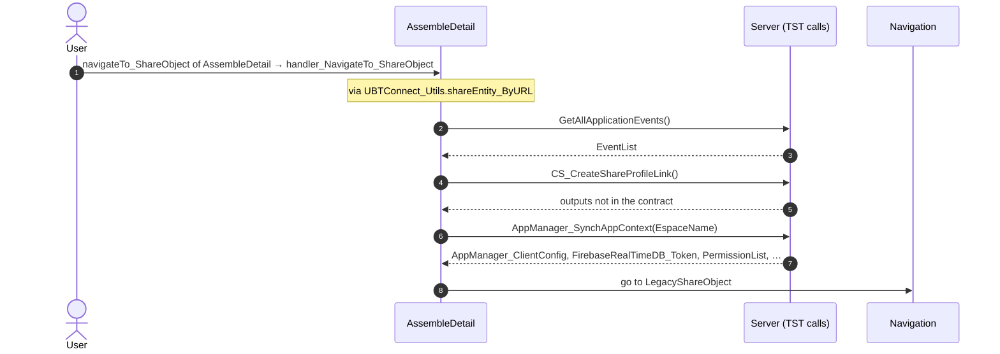
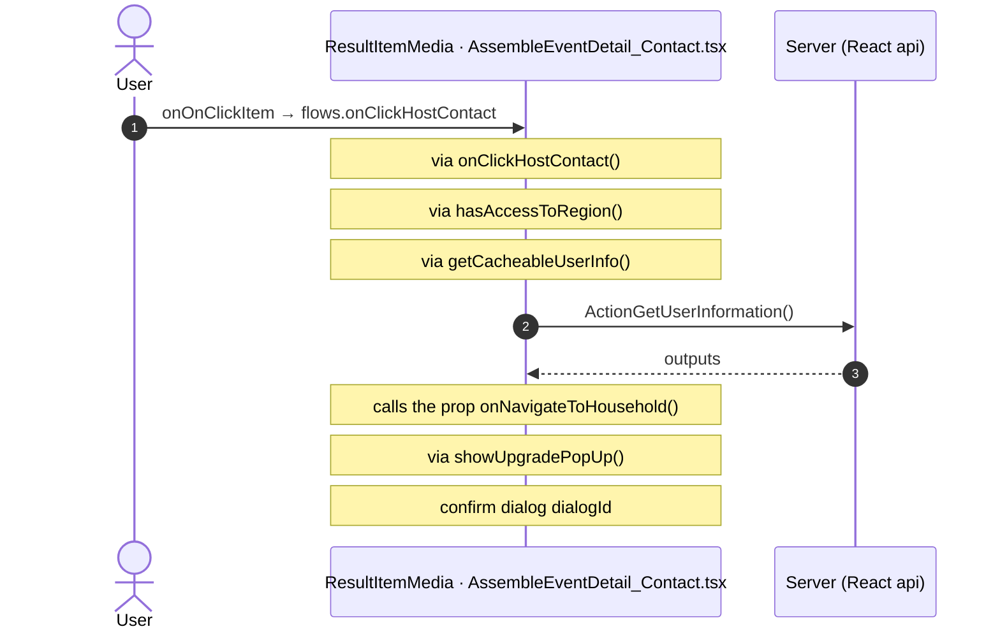
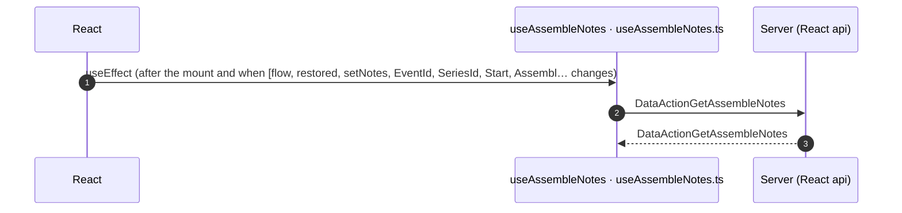

# AssembleDetail: OutSystems (TST) and React

The route `/UBTConnect/AssembleDetail`, read from the TST compiled code and from the React code by `route-actions/tools/check_route.py` on 2026-11-05. Facts only, each with its place. The method is in [README.md](../README.md).

Scope of this file: the screen and the blocks of its UI flow (OutSystems), the files of `app/src/pages/AssembleDetail/` (React). The app shell is in [APP_SHELL.md](../APP_SHELL.md). The shared blocks and components that the route uses are in the last section.

**Static check.** This route has no TST capture (`migration/screens/AssembleDetail/no-capture.json`).

- The OutSystems facts come from the compiled code of the screen and of its static closure (TST survey).
- The code is in `migration/runtime-sources/` and in the raw folders of the captured routes.
- The tool observed no call and has no screenshot.
- Closure: 111 files, 1 without compiled code: `Connect2_LegacyShared.Utility.ShowMoreShowLessContainer.mvc.js`.

## 1. Route

| Item | Value | Source |
|---|---|---|
| Route | `/UBTConnect/AssembleDetail` | `app/src/app/routes.generated.ts` |
| OutSystems screen | `UBTConnect.Legacy_AssembleFlow.AssembleDetail` | TST compiled code |
| UI flow | `Legacy_AssembleFlow` | MCP `getScreenNames` (DEV) |
| React screen | [`pages/AssembleDetail/AssembleDetailPage.tsx`](../../app/src/pages/AssembleDetail/AssembleDetailPage.tsx) | `app/src/pages/` |
| React route rules | access `member`, lock `enforce`, flag redirect none | `app/src/app/routes.ts` |
| Screenshots | no parity run | `route.py parity` |
| Code read | OutSystems: 1 files of the UI flow, 66 shared blocks, 43 app shell files. React: 272 files in the closure of the page | TST survey closure and compiled code (static), `react_calls.mjs` |

## 2. Result

| Check | Result |
|---|---|
| Server calls of the route on TST | 9: React makes 6, **0 missing**, 3 not a gap of the web app |
| Differences found | **0** (+ 3 not a gap of the web app) (see [section 3](#3-differences-found)) |
| Questions | 6 (see [section 4](#4-questions)) |
| React calls reached only through shared code | 4: see the last section |
| User actions of the route (own code) | OutSystems: 4. React: 3 |
| Screen and blocks of the UI flow with a React port | 1 of 1 |
| Navigation targets found in React | 10 of 10 |
| Shared blocks and components on the route | OutSystems 66, React 9 with user actions: see the last section |
| App shell on this route | 4 calls: see [APP_SHELL.md](../APP_SHELL.md) |

## 3. Differences found

Each line is a fact of both sides: a TST call, navigation or variable, and the React code that has it or not. The tool does not judge the behaviour.

None.

### Not a gap of the web app

Missing TST calls that a rule of `route-actions/config.json` (`notApplicable`, user 2026-11-05) sets aside. The rule names the fact and its evidence; the chain is the one of the TST code.

**Native only.** TST offers the external share options only when AppManager_GetIsNative is true; the React app is never native. Evidence: ShareSheet Action_SetExternalShareOptions appends Share via, Copy link, WhatsApp, Signal and Outlook inside `if (AppManager_GetIsNative)` (UBTConnect_Utils.CW_Share.ShareSheet.mvc.js:2418-2475); SharePopup appends "Share to other apps" after AppManager_GetIsNative (UBTConnect_Utils.CW_CTA_PopUps.SharePopup.mvc.js:274-288); ShareEntity_ByURL calls the SocialSharing plugin (UBTConnect_Utils.controller.js:5319+); app/src/platform/session/clientVars.ts:40 (DeviceInfo_IsNative false).

- `UBTConnect_Utils/CW_Share/ShareSheet/ActionCS_CreateShareProfileLink`. Chain on TST: onClick in CircleButton_WithLabel → CircleButton_WithLabel.action_OnClick → event onClick of CircleButton_WithLabel → ShareSheet.handler_OnClickExternalOption → server CS_CreateShareProfileLink.
- `UBTConnect_Utils/ActionCS_CreateShareProfileLink`. Chain on TST: AssembleEventDetail_AttendeeSubdivision.handler_OnClickShareConnect → event navigateTo_ShareObject of AssembleEventDetail_AttendeeSubdivision → … → UBTConnect_Utils.shareEntity_ByURL → server CS_CreateShareProfileLink.

**Telemetry (decision U17).** The call belongs to the application-event pipeline (zOnApplicationEvent_Wrapper → getAppEventName → cacheLocalApplicationEvents). Telemetry is not wired in the mock phase (decision U17). Evidence: Connect2_LegacyShared.controller.js:989-1240 (CacheLocalApplicationEvents); migration/clarify/decisions.md U17; app/src/lib/orbit/actions.ts:318-321.

- `Connect2_LegacyShared/ActionGetAllApplicationEvents`. Chain on TST: NC_Result_Item__Image.onClick_Result_Item → event onClick_Item of NC_Result_Item__Image → … → Connect2_LegacyShared.cacheLocalApplicationEvents → server GetAllApplicationEvents.

## 4. Questions

1. React calls `/api/Connect2_LegacyShared/ActionGetSignedPhotosInBulk` from `getSignedPhotosInBulk()` [`lib/legacyShared/actions.ts:49`](../../app/src/lib/legacyShared/actions.ts#L49) (page). TST AssembleDetail has no chain to this call. Does the call belong to this route?
2. React calls `/api/Connect2_LegacyShared/ActionGetUserInformation` from `getCacheableUserInfo()` [`lib/legacyShared/actions.ts:302`](../../app/src/lib/legacyShared/actions.ts#L302) (page). TST AssembleDetail has no chain to this call. Does the call belong to this route?
3. React calls `/api/Connect2_LegacyShared/ActionGetMemberContactByCacheKey` from `fetchMemberContacts()` [`api/message/repository.ts:271`](../../app/src/api/message/repository.ts#L271) (page). TST AssembleDetail has no chain to this call. Does the call belong to this route?
4. React calls `/api/Connect2_Assemble_MUI/ActionAddBookmark` from `addAssembleBookmark()` [`api/bookmark/repository.ts:20`](../../app/src/api/bookmark/repository.ts#L20) (page). TST AssembleDetail has no chain to this call. Does the call belong to this route?
5. React calls `/api/Connect2_Assemble_MUI/ActionDeleteBookmarkByBookmarkId` from `deleteAssembleBookmark()` [`api/bookmark/repository.ts:33`](../../app/src/api/bookmark/repository.ts#L33) (page). TST AssembleDetail has no chain to this call. Does the call belong to this route?
6. React calls `/api/Connect2_LegacyShared/ActionGetBulkSubdivisions_V2` from `fetchBulkSubdivisions()` [`api/locality/repository.ts:181`](../../app/src/api/locality/repository.ts#L181) (page). TST AssembleDetail has no chain to this call. Does the call belong to this route?

React reaches 4 more calls without a TST chain on this route only through shared containers, components or app code. The last section lists them, not this one.

## 5. Server calls

All columns come from the code, without interpretation:

- **Direct caller (TST):** the block or module of the action that calls the server (the step before the server call in the chain).
- **Chain (TST):** the chains of client actions in the TST compiled code, from their start to the call.
  A long chain shows its first 2 steps, …, and its last 2 steps.
- **Seen on TST:** `yes` when TST made the call in the capture.
- **React action:** the React function with the `callAction` of the same call (`file:line`), and the code that loads it: `shell` (from `main.tsx`), `page` (from the screen), or both.
- **Used by (React references):** the functions and components that reference the React action, up to the nearest component. A reference is not always a call.
- **Status:** `implemented` when the contract path of the React call gives the same TST URL. It does not prove the same behaviour.

| # | Call (TST) | Kind | Direct caller (TST) | Chain (TST) | Seen on TST | React action | Used by (React references) | Status |
|---|---|---|---|---|---|---|---|---|
| 1 | `UBTConnect/Legacy_AssembleFlow/AssembleDetail/DataActionGetAssembleNotes` | data action | `AssembleDetail` | AssembleDetail fetch at start → AssembleDetail.DataActionGetAssembleNotes | no capture | `fetchAssembleNotes()` [`api/event/repository.ts:101`](../../app/src/api/event/repository.ts#L101) (page) | `AssembleDetail → useAssembleNotes → fetchAssembleNotes` [`pages/AssembleDetail/AssembleDetailPage.tsx`](../../app/src/pages/AssembleDetail/AssembleDetailPage.tsx) | implemented |
| 2 | `Connect2_Assemble_MUI/Assemble/AssembleEventDetail/DataActionGetAssembleEvent` | data action | `AssembleEventDetail` | AssembleEventDetail.OnReady → AssembleEventDetail.onReady → AssembleEventDetail.DataActionGetAssembleEvent AssembleEventDetail fetch at start → AssembleEventDetail.DataActionGetAssembleEvent | no capture | `fetchAssembleEvent()` [`api/event/repository.ts:107`](../../app/src/api/event/repository.ts#L107) (page) | `AssembleEventDetail → useAssembleEventDetail → fetchAssembleEvent` [`pages/AssembleDetail/components/AssembleEventDetail.tsx`](../../app/src/pages/AssembleDetail/components/AssembleEventDetail.tsx) | implemented |
| 3 | `Connect2_LegacyShared/ActionGetAllApplicationEvents` | server action | `Connect2_LegacyShared` | NC_Result_Item__Image.onClick_Result_Item → event onClick_Item of NC_Result_Item__Image → … → Connect2_LegacyShared.cacheLocalApplicationEvents → server GetAllApplicationEvents event bookmarkButtonClicked of ContextMenu → AssembleEventDetail_AttendeeSubdivision.handler_OnClickBookmarkButton → … → Connect2_LegacyShared.cacheLocalApplicationEvents → server GetAllApplicationEvents event onClick_Item of NC_Result_Item__Image → AssembleEventDetail_AttendeeSubdivision.handler_OnClickHousehold → … → Connect2_LegacyShared.cacheLocalApplicationEvents → server GetAllApplicationEvents (+2 more chains) | no capture | – | – | not applicable (telemetry) |
| 4 | `UBTConnect_Utils/CW_Share/ShareSheet/ActionCS_CreateShareProfileLink` | server action | `ShareSheet` | onClick in CircleButton_WithLabel → CircleButton_WithLabel.action_OnClick → event onClick of CircleButton_WithLabel → ShareSheet.handler_OnClickExternalOption → server CS_CreateShareProfileLink | no capture | – | – | not applicable (nativeOnly) |
| 5 | `UBTConnect_Utils/CW_Share/ShareSheet/ActionCS_ShareObject` | server action | `ShareSheet` | onClick in CircleButton_WithLabel → CircleButton_WithLabel.action_OnClick → … → ShareSheet.action_SubmitShare → server CS_ShareObject | no capture | `csShareObject()` [`api/share/shareSheet.ts:25`](../../app/src/api/share/shareSheet.ts#L25) (page) | `ShareSheetContainer → useShareSheet → csShareObject` [`containers/ShareSheet/ShareSheetContainer.tsx`](../../app/src/containers/ShareSheet/ShareSheetContainer.tsx) | implemented |
| 6 | `UBTConnect_Utils/CW_Share/ShareSheet/DataActionGetAvailableMembers` | data action | `ShareSheet` | onKeyUp in Input → Input.onKeyup → event event_Submit of Input → ShareSheet.handler_InputEventSubmit → ShareSheet.DataActionGetAvailableMembers ShareSheet fetch at start → ShareSheet.DataActionGetAvailableMembers | no capture | `fetchAvailableMembers()` [`api/member/repository.ts:12`](../../app/src/api/member/repository.ts#L12) (page) | `ShareSheetContainer → useShareSheet → useAvailableMembersQuery → fetchAvailableMembers` [`containers/ShareSheet/ShareSheetContainer.tsx`](../../app/src/containers/ShareSheet/ShareSheetContainer.tsx) | implemented |
| 7 | `UBTConnect_Utils/CW_Share/ShareSheet/DataActionGetRecentlyShared` | data action | `ShareSheet` | ShareSheet.OnParametersChanged → ShareSheet.screenEvent_OnParametersChanged → ShareSheet.DataActionGetRecentlyShared ShareSheet fetch at start → ShareSheet.DataActionGetRecentlyShared | no capture | `fetchRecentlyShared()` [`api/share/shareSheet.ts:14`](../../app/src/api/share/shareSheet.ts#L14) (page) | `ShareSheetContainer → useShareSheet → useRecentlySharedQuery → fetchRecentlyShared` [`containers/ShareSheet/ShareSheetContainer.tsx`](../../app/src/containers/ShareSheet/ShareSheetContainer.tsx) | implemented |
| 8 | `UBTConnect/ServiceAPIGet_UI_UpdateItems_UnreadCount_All` | service action | `UBTConnect` | BottomBarMenu.OnReady → BottomBarMenu.onReady → UBTConnect.directory_Updates_RefreshBottomBarCount → server Get_UI_UpdateItems_UnreadCount_All | no capture | `fetchUnreadUpdateItemsCount()` [`api/update/repository.ts:73`](../../app/src/api/update/repository.ts#L73) (page) | `BottomBar → directory_Updates_RefreshBottomBarCount → fetchUnreadUpdateItemsCount` [`components/layout/BottomBar/BottomBar.tsx`](../../app/src/components/layout/BottomBar/BottomBar.tsx) | implemented |
| 9 | `UBTConnect_Utils/ActionCS_CreateShareProfileLink` | server action | `UBTConnect_Utils` | AssembleEventDetail_AttendeeSubdivision.handler_OnClickShareConnect → event navigateTo_ShareObject of AssembleEventDetail_AttendeeSubdivision → … → UBTConnect_Utils.shareEntity_ByURL → server CS_CreateShareProfileLink AssembleEventDetail_AttendeeSubdivision.handler_OnShareToOthers → event navigateTo_ShareObject of AssembleEventDetail_AttendeeSubdivision → … → UBTConnect_Utils.shareEntity_ByURL → server CS_CreateShareProfileLink | no capture | – | – | not applicable (nativeOnly) |

## 6. User actions

Two independent lists: the event bindings of the TST views, and the JSX event bindings of the React files. The effects come from the handler and the functions it calls, 3 levels deep. No mapping.

### 6.1 OutSystems (TST)

| # | Block (OutSystems) | Event (TST view) | Handler | Branch | Effects |
|---|---|---|---|---|---|
| 1 | `AssembleDetail` | `navigateTo_Household of AssembleDetail` | `handler_NavigateToHousehold` | – | goes to HouseholdDetails |
| 2 | `AssembleDetail` | `navigateTo_EmailContact of AssembleDetail` | `handler_NavigateTo_EmailContact` | – | goes to ContactByEmailMember |
| [3](#613-assembledetail-handler_navigatetohouseholdcarousel) | `AssembleDetail` | `navigateTo_HouseholdCarousel of AssembleDetail` | `handler_NavigateToHouseholdCarousel` | – | goes to HouseholdCarousel, HouseholdDetails |
| [4](#614-assembledetail-handler_navigateto_shareobject) | `AssembleDetail` | `navigateTo_ShareObject of AssembleDetail` | `handler_NavigateTo_ShareObject` | – | calls GetAllApplicationEvents, CS_CreateShareProfileLink, AppManager_SynchAppContext; goes to LegacyShareObject |

2 diagrams (handlers with two or more effects)

#### 6.1.3 AssembleDetail: handler_NavigateToHouseholdCarousel

#### 6.1.4 AssembleDetail: handler_NavigateTo_ShareObject

### 6.2 React

| # | File | Element | Event prop | Handler | Branch | Effects |
|---|---|---|---|---|---|---|
| [1](#621-resultitemmedia-ononclickitem) | [`pages/AssembleDetail/components/AssembleEventDetail_Contact.tsx:48`](../../app/src/pages/AssembleDetail/components/AssembleEventDetail_Contact.tsx#L48) | `<ResultItemMedia>` | `onOnClickItem` | `flows.onClickHostContact` | – | calls ActionGetUserInformation; asks for a confirmation; calls the prop onNavigateToHousehold() |
| 2 | [`pages/AssembleDetail/components/AssembleEventDetail_Contact.tsx:56`](../../app/src/pages/AssembleDetail/components/AssembleEventDetail_Contact.tsx#L56) | `<PersonContactOptions>` | `onCallClicked` | `flows.onCallClicked` | – | shows a message |
| 3 | [`pages/AssembleDetail/components/AssembleEventDetail_Contact.tsx:73`](../../app/src/pages/AssembleDetail/components/AssembleEventDetail_Contact.tsx#L73) | `<ContactByMessage>` | `onEventEmail` | `flows.onContactByEmail` | `UNAVAILABLE` | shows a message |
| 4 | [`pages/AssembleDetail/components/AssembleEventDetail_Contact.tsx:73`](../../app/src/pages/AssembleDetail/components/AssembleEventDetail_Contact.tsx#L73) | `<ContactByMessage>` | `onEventEmail` | `flows.onContactByEmail` | `other` | calls the prop onEmailContact() |

1 diagrams (handlers with two or more effects)

#### 6.2.1 ResultItemMedia: onOnClickItem

## 7. Screen inputs and navigation parameters

The input parameters of the screen, the parameters that the route reads, and the parameters that the route gives when it opens another screen. A navigation without parameters is only in section 2.
The OutSystems files are in `migration/runtime-sources/` and in the `analysis/sources/raw/` folders of the captured routes (static check).

### 7.1 OutSystems (TST)

| Input | Type | Mandatory | Place |
|---|---|---|---|
| `EventId` | Text | yes | [`UBTConnect.Legacy_AssembleFlow.AssembleDetail.mvc.js:112`](../../migration/runtime-sources/UBTConnect.Legacy_AssembleFlow.AssembleDetail.mvc.js#L112) |
| `SeriesId` | Text | yes | [`UBTConnect.Legacy_AssembleFlow.AssembleDetail.mvc.js:116`](../../migration/runtime-sources/UBTConnect.Legacy_AssembleFlow.AssembleDetail.mvc.js#L116) |
| `Start` | DateTime | yes | [`UBTConnect.Legacy_AssembleFlow.AssembleDetail.mvc.js:120`](../../migration/runtime-sources/UBTConnect.Legacy_AssembleFlow.AssembleDetail.mvc.js#L120) |
| `AssembleEventTypeTile` | Text | yes | [`UBTConnect.Legacy_AssembleFlow.AssembleDetail.mvc.js:124`](../../migration/runtime-sources/UBTConnect.Legacy_AssembleFlow.AssembleDetail.mvc.js#L124) |

| Block | Target | Parameters | Place |
|---|---|---|---|
| `AssembleDetail` | `LegacyShareObject` | `In_ShareObjectTypeId` = `shareObjectTypeId` `In_ObjectId` = `longIntegerToText(objectId)` | [`UBTConnect.Legacy_AssembleFlow.AssembleDetail.mvc.js:665`](../../migration/runtime-sources/UBTConnect.Legacy_AssembleFlow.AssembleDetail.mvc.js#L665) |
| `AssembleDetail` | `HouseholdCarousel` | `In_StartingHouseholdId` = `selectedHouseholdId` | [`UBTConnect.Legacy_AssembleFlow.AssembleDetail.mvc.js:778`](../../migration/runtime-sources/UBTConnect.Legacy_AssembleFlow.AssembleDetail.mvc.js#L778) |
| `AssembleDetail` | `ContactByEmailMember` | `In_EntityId` = `event_MemberId` `In_EntityType` = `UBTConnectModel.staticEntities.connect_Entity.member` `In_ContactName` = `getNameAndSurname_ByFullName.out_Name` `In_ContactLocality` = `event_ContactLocality` `In_AuditEventId` = `UBTConnectModel.staticEntities.applicationEvents_Directory.emailHousehold` `In_ContactCountry` = `event_ContactCountry` `In_EmailTo` = `event_EmailTo` `In_ContactSurname` = `getNameAndSurname_ByFullName.out_Surname` `In_AvatarURL` = `event_AvatarURL` | [`UBTConnect.Legacy_AssembleFlow.AssembleDetail.mvc.js:912`](../../migration/runtime-sources/UBTConnect.Legacy_AssembleFlow.AssembleDetail.mvc.js#L912) |
| `AssembleDetail` | `HouseholdDetails` | `HouseholdId` = `householdId` | [`UBTConnect.Legacy_AssembleFlow.AssembleDetail.mvc.js:1058`](../../migration/runtime-sources/UBTConnect.Legacy_AssembleFlow.AssembleDetail.mvc.js#L1058) |

### 7.2 React

Declared inputs of the route: `EventId: Text`, `SeriesId: Text`, `Start: DateTime`, `AssembleEventTypeTile: Text` (`app/src/app/routes.generated.ts`).

| Hook | Keys read | Place |
|---|---|---|
| `useSearchParams` | none | [`pages/AssembleDetail/AssembleDetailPage.tsx:52`](../../app/src/pages/AssembleDetail/AssembleDetailPage.tsx#L52) |

| File | Target | Parameters | Place |
|---|---|---|---|
| `AssembleDetailPage.tsx` | `HouseholdDetails` | `HouseholdId` = `householdId` | [`pages/AssembleDetail/AssembleDetailPage.tsx:88`](../../app/src/pages/AssembleDetail/AssembleDetailPage.tsx#L88) |
| `AssembleDetailPage.tsx` | `HouseholdCarousel` | `In_StartingHouseholdId` = `selectedHouseholdId` | [`pages/AssembleDetail/AssembleDetailPage.tsx:106`](../../app/src/pages/AssembleDetail/AssembleDetailPage.tsx#L106) |
| `AssembleDetailPage.tsx` | `ContactByEmailMember` | `In_EntityId` = `a.memberId` `In_EntityType` = `CONNECT_ENTITY_MEMBER` `In_ContactName` = `split.Out_Name` `In_ContactLocality` = `a.contactLocality` `In_AuditEventId` = `AUDIT_EMAIL_HOUSEHOLD` `In_ContactCountry` = `a.contactCountry` `In_EmailTo` = `a.emailTo` `In_ContactSurname` = `split.Out_Surname` `In_AvatarURL` = `a.avatarURL` | [`pages/AssembleDetail/AssembleDetailPage.tsx:113`](../../app/src/pages/AssembleDetail/AssembleDetailPage.tsx#L113) |
| `AssembleDetailPage.tsx` | `LegacyShareObject` | `In_ShareObjectTypeId` = `shareObjectTypeId` `In_ObjectId` = `objectId` | [`pages/AssembleDetail/AssembleDetailPage.tsx:127`](../../app/src/pages/AssembleDetail/AssembleDetailPage.tsx#L127) |

## 8. Lifecycle

What runs when the screen and its blocks open and close, without a user action.

### 8.1 OutSystems (TST)

Event handlers. The steps are the node comments and the conditions of the compiled action.

None.

Data actions and aggregates. The tool reads `dataFetchDependenciesOriginal`: `0` is a fetch when the block opens, `-1` is a fetch only on demand (a `Refresh Query` step). `Read by` lists the child block inputs, conditions, text widgets and actions that read the result.

| Block | Data action | Fetch | Read by | Place |
|---|---|---|---|---|
| `AssembleDetail` | `GetAssembleNotes` | at start (`0`) | `NoteListActions.Notes` ([`UBTConnect.Legacy_AssembleFlow.AssembleDetail.mvc.js:315`](../../migration/runtime-sources/UBTConnect.Legacy_AssembleFlow.AssembleDetail.mvc.js#L315)), `view` ([`UBTConnect.Legacy_AssembleFlow.AssembleDetail.mvc.js:316`](../../migration/runtime-sources/UBTConnect.Legacy_AssembleFlow.AssembleDetail.mvc.js#L316)), `text` ([`UBTConnect.Legacy_AssembleFlow.AssembleDetail.mvc.js:451`](../../migration/runtime-sources/UBTConnect.Legacy_AssembleFlow.AssembleDetail.mvc.js#L451)), `NotesSheet.In_Notes` ([`UBTConnect.Legacy_AssembleFlow.AssembleDetail.mvc.js:497`](../../migration/runtime-sources/UBTConnect.Legacy_AssembleFlow.AssembleDetail.mvc.js#L497)), `action handler_OnNoteDeleted` ([`UBTConnect.Legacy_AssembleFlow.AssembleDetail.mvc.js:851`](../../migration/runtime-sources/UBTConnect.Legacy_AssembleFlow.AssembleDetail.mvc.js#L851)), `action handler_OnNotesChanged` ([`UBTConnect.Legacy_AssembleFlow.AssembleDetail.mvc.js:997`](../../migration/runtime-sources/UBTConnect.Legacy_AssembleFlow.AssembleDetail.mvc.js#L997)) | [`UBTConnect.Legacy_AssembleFlow.AssembleDetail.mvc.js:575`](../../migration/runtime-sources/UBTConnect.Legacy_AssembleFlow.AssembleDetail.mvc.js#L575) |

### 8.2 React

Effects (`useEffect`, `useLayoutEffect`) of the screen files, and the effects of shared components that make a call, a navigation or a message.

| File | Hook (function) | Dependencies | Cleanup | Effects | Place |
|---|---|---|---|---|---|
| `ShowMoreShowLessContainer.tsx` | `useEffect` (`ShowMoreShowLessContainer`) | `[]` | yes | none | [`pages/AssembleDetail/components/ShowMoreShowLessContainer.tsx:44`](../../app/src/pages/AssembleDetail/components/ShowMoreShowLessContainer.tsx#L44) |
| `useAssembleNotes.ts` | `useEffect` (`useAssembleNotes`) | `[flow, restored, setNotes, EventId, SeriesId, Start, Assembl…` | no | call `/api/UBTConnect/AssembleDetail/DataActionGetAssembleNotes` | [`pages/AssembleDetail/hooks/useAssembleNotes.ts:50`](../../app/src/pages/AssembleDetail/hooks/useAssembleNotes.ts#L50) |

Sequence diagrams of the effects with a call, a navigation, a message or a refresh (1)

#### 8.2.1 useAssembleNotes: useEffect

Queries. A query fetches when its component mounts and when its key changes. `Read by` lists what reads the result in the same file.

None.

## 9. Client state

Client variables and browser storage that the route reads or writes. Other screens can read this state.

### 9.1 OutSystems (TST)

None.

### 9.2 React

None.

## 10. Access

Who can open the route, and the role checks in the screen and block code.

| Side | Rule | Place |
|---|---|---|
| OutSystems (TST) | registered users (`checkRegistered()`) | [`UBTConnect.Legacy_AssembleFlow.AssembleDetail.mvc.js:1196`](../../migration/runtime-sources/UBTConnect.Legacy_AssembleFlow.AssembleDetail.mvc.js#L1196) |
| React | access `member`, lock `enforce`, flag redirect none | `app/src/app/routes.ts` |

Role checks in the TST screen and block actions (`RolesInfo`, `$roles`, `Check<Role>Role`): none.

## 11. Errors

What the route does when an action or a call fails.

### 11.1 OutSystems (TST)

The actions of the screen and its blocks have no `Handle Error` node.

An error without a handler goes to the `OnException` of the UI flow (`handleError`):

1. UI flow `Legacy_AssembleFlow` not in `migration/shell/sources/`. Handled errors: none.

### 11.2 React

| File | Kind | Function | Effects | Place |
|---|---|---|---|---|
| `useAssembleNotes.ts` | flow handler | `useAssembleNotes` | none | [`pages/AssembleDetail/hooks/useAssembleNotes.ts:69`](../../app/src/pages/AssembleDetail/hooks/useAssembleNotes.ts#L69) |

`flow handler`: `raiseToFlowHandler` gives the error to the flow handler of the screen (`app/src/platform/feedback/flowErrors.ts`). The tool lists `.catch`, `try/catch` and `onError` that do not give the error to it.

## 12. Shared blocks and components on this route

Blocks of other UI flows and modules (OutSystems), and files outside `app/src/pages/` (React) that the route renders. Their facts belong to them, not to the route. This section gives their user actions once, without diagrams.

### OutSystems (TST)

| Block | Module | React port | User actions |
|---|---|---|---|
| `ShareSheet` | `UBTConnect_Utils` | [`containers/ShareSheet/ShareSheetContainer.tsx`](../../app/src/containers/ShareSheet/ShareSheetContainer.tsx), [`containers/ShareSheet/components/ShareSheetFirstStep.tsx`](../../app/src/containers/ShareSheet/components/ShareSheetFirstStep.tsx), [`containers/ShareSheet/components/ShareSheetSearchStep.tsx`](../../app/src/containers/ShareSheet/components/ShareSheetSearchStep.tsx), [`containers/ShareSheet/shareSheetState.ts`](../../app/src/containers/ShareSheet/shareSheetState.ts), [`containers/ShareSheet/useShareSheet.ts`](../../app/src/containers/ShareSheet/useShareSheet.ts) | 5 |
| `SearchResult_Item` | `UBTConnect_Utils` | [`components/search/SearchResultItem/SearchResultItem.tsx`](../../app/src/components/search/SearchResultItem/SearchResultItem.tsx) | 1 |
| `UBT_LazyImage` | `UBTConnect_Utils` | [`components/ui/EntityLazyImage/EntityLazyImage.tsx`](../../app/src/components/ui/EntityLazyImage/EntityLazyImage.tsx) | 0 |
| `LazyImage` | `UBTConnectLibrary` | [`components/ui/LazyImage/LazyImage.tsx`](../../app/src/components/ui/LazyImage/LazyImage.tsx) | 0 |
| `EmptyList` | `UBTConnectLibrary` | [`components/ui/EmptyState/EmptyState.tsx`](../../app/src/components/ui/EmptyState/EmptyState.tsx) | 0 |
| `CircleButton` | `UBTConnectLibrary` | [`components/ui/CircleButton/CircleButton.tsx`](../../app/src/components/ui/CircleButton/CircleButton.tsx) | 0 |
| `CircleButton_WithLabel` | `UBTConnectLibrary` | [`components/ui/CircleButtonWithLabel/CircleButtonWithLabel.tsx`](../../app/src/components/ui/CircleButtonWithLabel/CircleButtonWithLabel.tsx) | 0 |
| `ShareSheet_SectionTitle` | `UBTConnect_Utils` | [`components/share/ShareSheetSectionTitle/ShareSheetSectionTitle.tsx`](../../app/src/components/share/ShareSheetSectionTitle/ShareSheetSectionTitle.tsx) | 0 |
| `ShareSheet_Section` | `UBTConnect_Utils` | [`components/share/ShareSheetSection/ShareSheetSection.tsx`](../../app/src/components/share/ShareSheetSection/ShareSheetSection.tsx) | 0 |
| `Input` | `UBTConnectLibrary` | [`components/ui/Input/Input.tsx`](../../app/src/components/ui/Input/Input.tsx) | 0 |
| `InputWithIcon` | `OutSystemsUI_2_23` | [`components/ui/InputWithIcon/InputWithIcon.tsx`](../../app/src/components/ui/InputWithIcon/InputWithIcon.tsx) | 0 |
| `BottomSheet` | `UBTConnectLibrary` | [`components/ui/ConnectBottomSheet/ConnectBottomSheet.tsx`](../../app/src/components/ui/ConnectBottomSheet/ConnectBottomSheet.tsx) | 0 |
| `Columns_Three` | `UBTConnectLibrary` | [`components/ui/ColumnsThree/ColumnsThree.tsx`](../../app/src/components/ui/ColumnsThree/ColumnsThree.tsx) | 0 |
| `Columns3` | `OutSystemsUI_2_23` | [`components/ui/Columns3/Columns3.tsx`](../../app/src/components/ui/Columns3/Columns3.tsx) | 0 |
| `BottomSheet` | `OutSystemsUI_2_23` | [`components/ui/BottomSheet/BottomSheet.tsx`](../../app/src/components/ui/BottomSheet/BottomSheet.tsx) | 0 |
| `BottomBarMenu` | `UBTConnect` | [`components/layout/BottomBar/BottomBar.tsx`](../../app/src/components/layout/BottomBar/BottomBar.tsx) | 1 |
| `App_IconBadge` | `UBTConnect` | [`components/layout/BottomBarIconBadge/BottomBarIconBadge.tsx`](../../app/src/components/layout/BottomBarIconBadge/BottomBarIconBadge.tsx) | 0 |
| `IconBadge` | `UBTConnectLibrary` | [`components/ui/IconBadge/IconBadge.tsx`](../../app/src/components/ui/IconBadge/IconBadge.tsx) | 0 |
| `Badge` | `UBTConnectLibrary` | [`components/ui/Badge/Badge.tsx`](../../app/src/components/ui/Badge/Badge.tsx) | 0 |
| `BottomBarItem` | `OutSystemsUI_2_23` | [`components/ui/BottomBarItem/BottomBarItem.tsx`](../../app/src/components/ui/BottomBarItem/BottomBarItem.tsx) | 0 |
| `BottomBarContent` | `UBTConnect` | [`components/layout/BottomBarContent/BottomBarContent.tsx`](../../app/src/components/layout/BottomBarContent/BottomBarContent.tsx) | 0 |
| `ScreenBlock_AssembleDetail` | `Connect2_Assemble_MUI` | [`pages/AssembleDetail/components/AssembleDetailView.tsx`](../../app/src/pages/AssembleDetail/components/AssembleDetailView.tsx), [`pages/AssembleDetail/hooks/assembleDetailState.ts`](../../app/src/pages/AssembleDetail/hooks/assembleDetailState.ts), [`pages/AssembleDetail/hooks/useAssembleDetail.ts`](../../app/src/pages/AssembleDetail/hooks/useAssembleDetail.ts) | 0 |
| `FocusScrollAnchorOnBack` | `NavigationHandler` | [`pages/AssembleDetail/components/FocusScrollAnchorOnBack.tsx`](../../app/src/pages/AssembleDetail/components/FocusScrollAnchorOnBack.tsx) | 0 |
| `AssembleEventDetail` | `Connect2_Assemble_MUI` | [`pages/AssembleDetail/components/AssembleEventDetail.tsx`](../../app/src/pages/AssembleDetail/components/AssembleEventDetail.tsx), [`pages/AssembleDetail/hooks/assembleEventDetailState.ts`](../../app/src/pages/AssembleDetail/hooks/assembleEventDetailState.ts), [`pages/AssembleDetail/hooks/useAssembleEventDetail.ts`](../../app/src/pages/AssembleDetail/hooks/useAssembleEventDetail.ts) | 0 |
| `AssembleEventDetail_ContactList` | `Connect2_Assemble_MUI` | [`pages/AssembleDetail/components/AssembleEventDetail_ContactList.tsx`](../../app/src/pages/AssembleDetail/components/AssembleEventDetail_ContactList.tsx), [`pages/AssembleDetail/hooks/assembleEventContacts.ts`](../../app/src/pages/AssembleDetail/hooks/assembleEventContacts.ts), [`pages/AssembleDetail/hooks/useAssembleEventContactList.ts`](../../app/src/pages/AssembleDetail/hooks/useAssembleEventContactList.ts) | 0 |
| `AssembleEventDetail_Contact` | `Connect2_Assemble_MUI` | [`pages/AssembleDetail/components/AssembleEventDetail_Contact.tsx`](../../app/src/pages/AssembleDetail/components/AssembleEventDetail_Contact.tsx), [`pages/AssembleDetail/hooks/useAssembleEventContact.ts`](../../app/src/pages/AssembleDetail/hooks/useAssembleEventContact.ts) | 3 |
| `ContactByMessage_Wrapper` | `UBTConnect_Utils` | [`components/contact/ContactByMessage/ContactByMessage.tsx`](../../app/src/components/contact/ContactByMessage/ContactByMessage.tsx) | 1 |
| `ContactPopup_ByMessage` | `UBTConnect_Utils` | [`components/contact/ContactPopupByMessage/ContactPopupByMessage.tsx`](../../app/src/components/contact/ContactPopupByMessage/ContactPopupByMessage.tsx) | 0 |
| `ContactPopup` | `UBTConnect_Utils` | [`components/contact/ContactPopup/ContactPopup.tsx`](../../app/src/components/contact/ContactPopup/ContactPopup.tsx) | 0 |
| `ContactPopup_ByPhone` | `UBTConnect_Utils` | [`components/contact/ContactPopupByPhone/ContactPopupByPhone.tsx`](../../app/src/components/contact/ContactPopupByPhone/ContactPopupByPhone.tsx) | 1 |
| `Dialog_AccessRestrictedAction_Legacy` | `UBTConnect_Utils` | [`platform/feedback/dialogs/DialogAccessRestrictedActionLegacy.tsx`](../../app/src/platform/feedback/dialogs/DialogAccessRestrictedActionLegacy.tsx) | 0 |
| `Person_Contact_Options` | `Connect2_LegacyShared` | [`components/contact/PersonContactOptions/PersonContactOptions.tsx`](../../app/src/components/contact/PersonContactOptions/PersonContactOptions.tsx) | 0 |
| `NC_Result_Item__Image` | `Connect2_LegacyShared` | [`components/ui/ResultItemMedia/ResultItemMedia.tsx`](../../app/src/components/ui/ResultItemMedia/ResultItemMedia.tsx) | 0 |
| `NC_Result_Item__Image__Skeleton` | `Connect2_LegacyShared` | [`pages/AssembleDetail/components/NC_Result_Item__Image__Skeleton.tsx`](../../app/src/pages/AssembleDetail/components/NC_Result_Item__Image__Skeleton.tsx) | 0 |
| `AssembleEventDetail_LocalitiesList` | `Connect2_Assemble_MUI` | [`pages/AssembleDetail/components/AssembleEventDetail_LocalitiesList.tsx`](../../app/src/pages/AssembleDetail/components/AssembleEventDetail_LocalitiesList.tsx) | 0 |
| `AssembleEventDetail_LocalitySubdivisionList` | `Connect2_Assemble_MUI` | [`pages/AssembleDetail/components/AssembleEventDetail_LocalitySubdivisionList.tsx`](../../app/src/pages/AssembleDetail/components/AssembleEventDetail_LocalitySubdivisionList.tsx), [`pages/AssembleDetail/hooks/useLocalitySubdivisionList.ts`](../../app/src/pages/AssembleDetail/hooks/useLocalitySubdivisionList.ts) | 0 |
| `AssembleEventDetail_AttendeeSubdivision` | `Connect2_Assemble_MUI` | [`pages/AssembleDetail/components/AssembleEventDetail_AttendeeSubdivision.tsx`](../../app/src/pages/AssembleDetail/components/AssembleEventDetail_AttendeeSubdivision.tsx), [`pages/AssembleDetail/hooks/attendeeSubdivisionState.ts`](../../app/src/pages/AssembleDetail/hooks/attendeeSubdivisionState.ts), [`pages/AssembleDetail/hooks/useAttendeeSubdivision.ts`](../../app/src/pages/AssembleDetail/hooks/useAttendeeSubdivision.ts) | 4 |
| `ShareableObject_Generic` | `UBTConnect_Utils` | [`components/share/ShareableObject/ShareableObject.tsx`](../../app/src/components/share/ShareableObject/ShareableObject.tsx) | 0 |
| `BookmarkNoteAddEdit` | `Connect2_LegacyShared` | [`pages/AssembleDetail/components/BookmarkNoteAddEdit.tsx`](../../app/src/pages/AssembleDetail/components/BookmarkNoteAddEdit.tsx) | 0 |
| `InputCounter` | `Connect2_LegacyShared` | [`components/ui/LegacyInputCounter/LegacyInputCounter.tsx`](../../app/src/components/ui/LegacyInputCounter/LegacyInputCounter.tsx) | 0 |
| `ContextMenu` | `Connect2_LegacyShared` | [`pages/AssembleDetail/components/ContextMenu.tsx`](../../app/src/pages/AssembleDetail/components/ContextMenu.tsx) | 0 |
| `ItemOptionsMenu` | `Connect2_LegacyShared` | [`components/bookmark/ItemOptionsMenu/ItemOptionsMenu.tsx`](../../app/src/components/bookmark/ItemOptionsMenu/ItemOptionsMenu.tsx) | 0 |
| `PopupMenu` | `Connect2_LegacyShared` | [`components/ui/LegacyPopupMenu/LegacyPopupMenu.tsx`](../../app/src/components/ui/LegacyPopupMenu/LegacyPopupMenu.tsx) | 0 |
| `NC_Result_Item__Tag` | `Connect2_LegacyShared` | [`pages/AssembleDetail/components/NC_Result_Item__Tag.tsx`](../../app/src/pages/AssembleDetail/components/NC_Result_Item__Tag.tsx) | 0 |
| `ScrollAnchor` | `NavigationHandler` | [`platform/navigation/ScrollAnchor/ScrollAnchor.tsx`](../../app/src/platform/navigation/ScrollAnchor/ScrollAnchor.tsx) | 0 |
| `NC_Result_Item_Badge` | `Connect2_LegacyShared` | [`components/ui/ResultItemBadge/ResultItemBadge.tsx`](../../app/src/components/ui/ResultItemBadge/ResultItemBadge.tsx) | 0 |
| `AssembleEventDetail_AttendeeSubdivisionList_Skelet` | `Connect2_Assemble_MUI` | [`pages/AssembleDetail/components/AssembleEventDetail_AttendeeSubdivisionList_Skelet.tsx`](../../app/src/pages/AssembleDetail/components/AssembleEventDetail_AttendeeSubdivisionList_Skelet.tsx) | 0 |
| `NC_Card_Item_Text__Skeleton` | `Connect2_LegacyShared` | [`components/ui/CardTextSkeleton/CardTextSkeleton.tsx`](../../app/src/components/ui/CardTextSkeleton/CardTextSkeleton.tsx) | 0 |
| `AssembleEventDetail_Section` | `Connect2_Assemble_MUI` | [`pages/AssembleDetail/components/AssembleEventDetail_Section.tsx`](../../app/src/pages/AssembleDetail/components/AssembleEventDetail_Section.tsx) | 0 |
| `AssembleSummaryCard` | `Connect2_Assemble_MUI` | [`components/assemble/AssembleSummaryCard/AssembleSummaryCard.tsx`](../../app/src/components/assemble/AssembleSummaryCard/AssembleSummaryCard.tsx), [`containers/AssembleSummaryCard/AssembleSummaryCardContainer.tsx`](../../app/src/containers/AssembleSummaryCard/AssembleSummaryCardContainer.tsx) | 1 |
| `AssembleCommon_VirtualMeetingURL` | `Connect2_Assemble_MUI` | [`components/assemble/VirtualMeetingUrl/VirtualMeetingUrl.tsx`](../../app/src/components/assemble/VirtualMeetingUrl/VirtualMeetingUrl.tsx) | 1 |
| `AssembleCommon_VirtualMeetingDetails` | `Connect2_Assemble_MUI` | [`components/assemble/VirtualMeetingDetails/VirtualMeetingDetails.tsx`](../../app/src/components/assemble/VirtualMeetingDetails/VirtualMeetingDetails.tsx) | 0 |
| `AssembleCommon_VirtualMeetingDetails_Entry` | `Connect2_Assemble_MUI` | [`components/assemble/VirtualMeetingDetailsEntry/VirtualMeetingDetailsEntry.tsx`](../../app/src/components/assemble/VirtualMeetingDetailsEntry/VirtualMeetingDetailsEntry.tsx) | 0 |
| `LabelWithCopyIcon` | `Connect2_LegacyShared` | [`components/ui/LabelWithCopyIcon/LabelWithCopyIcon.tsx`](../../app/src/components/ui/LabelWithCopyIcon/LabelWithCopyIcon.tsx) | 0 |
| `AlignCenter` | `OutSystemsUI_2_23` | [`components/ui/AlignCenter/AlignCenter.tsx`](../../app/src/components/ui/AlignCenter/AlignCenter.tsx) | 0 |
| `NewConnectContent` | `Connect2_LegacyShared` | [`components/ui/NewConnectContent/NewConnectContent.tsx`](../../app/src/components/ui/NewConnectContent/NewConnectContent.tsx) | 0 |
| `AssembleSummary_Card_Row` | `Connect2_Assemble_MUI` | [`components/assemble/AssembleSummaryCardRow/AssembleSummaryCardRow.tsx`](../../app/src/components/assemble/AssembleSummaryCardRow/AssembleSummaryCardRow.tsx) | 0 |
| `AssembleSummaryCard__Header` | `Connect2_Assemble_MUI` | [`components/assemble/AssembleSummaryCardHeader/AssembleSummaryCardHeader.tsx`](../../app/src/components/assemble/AssembleSummaryCardHeader/AssembleSummaryCardHeader.tsx) | 0 |
| `NC_Card_Item_Visual` | `Connect2_LegacyShared` | [`components/ui/CardItemVisual/CardItemVisual.tsx`](../../app/src/components/ui/CardItemVisual/CardItemVisual.tsx) | 0 |
| `NC_Result_Item__Card` | `Connect2_LegacyShared` | [`components/ui/ResultItemCard/ResultItemCard.tsx`](../../app/src/components/ui/ResultItemCard/ResultItemCard.tsx) | 0 |
| `AssembleSummaryDetailHeader_Skeleton` | `Connect2_Assemble_MUI` | [`components/assemble/AssembleSummarySkeleton/AssembleSummarySkeleton.tsx`](../../app/src/components/assemble/AssembleSummarySkeleton/AssembleSummarySkeleton.tsx) | 0 |
| `AssembleEventDetail__Error` | `Connect2_Assemble_MUI` | [`pages/AssembleDetail/components/AssembleEventDetail__Error.tsx`](../../app/src/pages/AssembleDetail/components/AssembleEventDetail__Error.tsx) | 0 |
| `MenuIcon__UpdatedOSUI` | `Connect2_LegacyShared` | [`components/layout/MenuIcon/MenuIcon.tsx`](../../app/src/components/layout/MenuIcon/MenuIcon.tsx) | 1 |
| `Layout` | `Connect2_LegacyShared` | [`components/layout/LegacyLayout/LegacyLayout.tsx`](../../app/src/components/layout/LegacyLayout/LegacyLayout.tsx) | 0 |
| `BaseLayout_UpdatedOSUI` | `Connect2_LegacyShared` | [`components/layout/BaseLayout/BaseLayout.tsx`](../../app/src/components/layout/BaseLayout/BaseLayout.tsx) | 0 |
| `PullToRefresh` | `OutSystemsUI_2_23` | [`components/ui/PullToRefresh/PullToRefresh.tsx`](../../app/src/components/ui/PullToRefresh/PullToRefresh.tsx) | 0 |

User actions of the shared blocks (23)

| # | Block (OutSystems) | Event (TST view) | Handler | Branch | Effects |
|---|---|---|---|---|---|
| 1 | `AssembleCommon_VirtualMeetingURL` | `onClick (HTML element)` | `meetingInfo_Toggle` | – | asks for a confirmation |
| 2 | `AssembleEventDetail_AttendeeSubdivision` | `onClick_Item of Image` | `handler_OnClickHousehold` | – | calls GetAllApplicationEvents, AppManager_SynchAppContext |
| 3 | `AssembleEventDetail_AttendeeSubdivision` | `bookmarkButtonClicked of ContextMenu` | `handler_OnClickBookmarkButton` | – | calls GetAllApplicationEvents, AppManager_SynchAppContext; asks for a confirmation |
| 4 | `AssembleEventDetail_AttendeeSubdivision` | `shareProfileToOthers of ContextMenu` | `handler_OnShareToOthers` | – | calls GetAllApplicationEvents, AppManager_SynchAppContext |
| 5 | `AssembleEventDetail_AttendeeSubdivision` | `shareProfileToConnect of ContextMenu` | `handler_OnClickShareConnect` | – | calls GetAllApplicationEvents, AppManager_SynchAppContext |
| 6 | `AssembleEventDetail_Contact` | `onClick_Item of Image` | `handler_OnClickHostContact` | – | calls GetAllApplicationEvents, AppManager_SynchAppContext; asks for a confirmation |
| 7 | `AssembleEventDetail_Contact` | `callClicked of Options` | `handler_OptionsCall` | – | shows a message |
| 8 | `AssembleEventDetail_Contact` | `emailClicked of Options` `event_Email of Wrapper` | `handler_ContactByEmail` | – | shows a message |
| 9 | `AssembleSummaryCard` | `onClick (HTML element)` | `linkAddressOnClick` | – | shows a message |
| 10 | `MenuIcon__UpdatedOSUI` | `onClick (HTML element)` | `onBack` | – | goes to previous screen |
| 11 | `BottomBarMenu` | `onClick (HTML element)` `onClick of IconBadge` | `event_BottomBar_Clicked` | `home` | goes to HomeFeed |
| 12 | `BottomBarMenu` | `onClick (HTML element)` `onClick of IconBadge` | `event_BottomBar_Clicked` | `directory` | goes to CountryList, Locality_Details |
| 13 | `BottomBarMenu` | `onClick (HTML element)` `onClick of IconBadge` | `event_BottomBar_Clicked` | `updates` | goes to Updates_SingleList |
| 14 | `BottomBarMenu` | `onClick (HTML element)` `onClick of IconBadge` | `event_BottomBar_Clicked` | `bookmarks` | goes to Bookmarks |
| 15 | `BottomBarMenu` | `onClick (HTML element)` `onClick of IconBadge` | `event_BottomBar_Clicked` | `menu` | goes to Menu |
| 16 | `ContactByMessage_Wrapper` | `event_SelectedMessageChannel of ByMessage` | `handler_SelectedMessageChannel` | – | opens an external link |
| 17 | `ContactPopup_ByPhone` | `event_Clicked of ContactPopup` | `onClick_CallButton` | – | opens an external link |
| 18 | `SearchResult_Item` | `clicked of IconText` | `onClick_UpgradeSubscription` | – | opens an external link |
| 19 | `ShareSheet` | `onClick of WithLabel` | `handler_OnClickRecentMember` | – | calls CS_ShareObject; shows a message; asks for a confirmation |
| 20 | `ShareSheet` | `onClick of WithLabel` | `handler_OnClickExternalOption` | – | calls CS_CreateShareProfileLink |
| 21 | `ShareSheet` | `event_Submit of Input` | `handler_InputEventSubmit` | – | calls GetAvailableMembers |
| 22 | `ShareSheet` | `click of Icon` | `handler_SearchResultItemOnSelect` | – | shows a message |
| 23 | `ShareSheet` | `buttonOnClick of Button` | `handler_OnClickSend` | – | calls CS_ShareObject; shows a message |

### React

| File | User actions |
|---|---|
| [`components/contact/ContactByMessage/ContactByMessage.tsx`](../../app/src/components/contact/ContactByMessage/ContactByMessage.tsx) | 1 |
| [`components/contact/ContactPopupByPhone/ContactPopupByPhone.tsx`](../../app/src/components/contact/ContactPopupByPhone/ContactPopupByPhone.tsx) | 1 |
| [`components/layout/BottomBar/BottomBar.tsx`](../../app/src/components/layout/BottomBar/BottomBar.tsx) | 2 |
| [`components/layout/CommonUiLayout/CommonUiLayout.tsx`](../../app/src/components/layout/CommonUiLayout/CommonUiLayout.tsx) | 2 |
| [`components/layout/MenuIcon/MenuIcon.tsx`](../../app/src/components/layout/MenuIcon/MenuIcon.tsx) | 1 |
| [`components/note/NotesSheet/NotesSheet.tsx`](../../app/src/components/note/NotesSheet/NotesSheet.tsx) | 1 |
| [`containers/AssembleSummaryCard/AssembleSummaryCardContainer.tsx`](../../app/src/containers/AssembleSummaryCard/AssembleSummaryCardContainer.tsx) | 2 |
| [`containers/NoteListActions/NoteListActionsContainer.tsx`](../../app/src/containers/NoteListActions/NoteListActionsContainer.tsx) | 2 |
| [`containers/ShareSheet/ShareSheetContainer.tsx`](../../app/src/containers/ShareSheet/ShareSheetContainer.tsx) | 5 |

User actions of the shared components (31)

| # | File | Element | Event prop | Handler | Branch | Effects |
|---|---|---|---|---|---|---|
| 1 | [`components/note/NotesSheet/NotesSheet.tsx:175`](../../app/src/components/note/NotesSheet/NotesSheet.tsx#L175) | `<AddNote>` | `onOnSubmitRequested` | `addNoteRequested` | – | calls ServiceAPIAddNote; shows a message; calls the prop onOnNotesChanged() |
| 2 | [`containers/NoteListActions/NoteListActionsContainer.tsx:157`](../../app/src/containers/NoteListActions/NoteListActionsContainer.tsx#L157) | `<NoteList>` | `onOnDeleteRequested` | `inline` | – | calls ServiceAPIDeleteNoteByNoteId; shows a message; calls the prop onOnNoteDeleted() |
| 3 | [`containers/NoteListActions/NoteListActionsContainer.tsx:160`](../../app/src/containers/NoteListActions/NoteListActionsContainer.tsx#L160) | `<NoteList>` | `onOnSaveEditRequested` | `inline` | – | calls ServiceAPIUpdateNote; shows a message; calls the prop onOnSaveEditNote(); calls the prop onOnEditingStateChanged(); calls the prop onOnSaveEditNote(); calls the prop onOnEditingStateChanged() |
| 4 | [`containers/ShareSheet/ShareSheetContainer.tsx:111`](../../app/src/containers/ShareSheet/ShareSheetContainer.tsx#L111) | `<ShareSheetFirstStep>` | `onClickRecentMember` | `onClickRecentMember` | – | calls ActionCS_ShareObject; shows a message; asks for a confirmation |
| 5 | [`containers/ShareSheet/ShareSheetContainer.tsx:127`](../../app/src/containers/ShareSheet/ShareSheetContainer.tsx#L127) | `<ShareSheetSearchStep>` | `onSubmit` | `onSubmit` | – | setSearchFetchId(): a query fetches again |
| 6 | [`containers/ShareSheet/ShareSheetContainer.tsx:129`](../../app/src/containers/ShareSheet/ShareSheetContainer.tsx#L129) | `<ShareSheetSearchStep>` | `onSelect` | `onSelect` | – | shows a message |
| 7 | [`containers/ShareSheet/ShareSheetContainer.tsx:130`](../../app/src/containers/ShareSheet/ShareSheetContainer.tsx#L130) | `<ShareSheetSearchStep>` | `onClickUpgradeSubscription` | `onClickUpgradeSubscription` | – | opens an external link |
| 8 | [`containers/ShareSheet/ShareSheetContainer.tsx:148`](../../app/src/containers/ShareSheet/ShareSheetContainer.tsx#L148) | `<ActionButton>` | `onButtonOnClick` | `onClickSend` | – | calls ActionCS_ShareObject; shows a message |
| 9 | [`components/layout/BottomBar/BottomBar.tsx:130`](../../app/src/components/layout/BottomBar/BottomBar.tsx#L130) | `<OSLink>` | `onClick` | `click` | `Home` | goes to HomeFeed |
| 10 | [`components/layout/BottomBar/BottomBar.tsx:130`](../../app/src/components/layout/BottomBar/BottomBar.tsx#L130) | `<OSLink>` | `onClick` | `click` | `Directory` | goes to CountryList, Locality_Details |
| 11 | [`components/layout/BottomBar/BottomBar.tsx:130`](../../app/src/components/layout/BottomBar/BottomBar.tsx#L130) | `<OSLink>` | `onClick` | `click` | `Updates` | goes to Updates_SingleList |
| 12 | [`components/layout/BottomBar/BottomBar.tsx:130`](../../app/src/components/layout/BottomBar/BottomBar.tsx#L130) | `<OSLink>` | `onClick` | `click` | `Bookmarks` | goes to Bookmarks |
| 13 | [`components/layout/BottomBar/BottomBar.tsx:130`](../../app/src/components/layout/BottomBar/BottomBar.tsx#L130) | `<OSLink>` | `onClick` | `click` | `Menu` | goes to Menu |
| 14 | [`components/layout/BottomBar/BottomBar.tsx:130`](../../app/src/components/layout/BottomBar/BottomBar.tsx#L130) | `<OSLink>` | `onClick` | `click` | `other` | calls the prop onBottomBarClicked() |
| 15 | [`components/layout/BottomBar/BottomBar.tsx:140`](../../app/src/components/layout/BottomBar/BottomBar.tsx#L140) | `<BottomBarIconBadge>` | `onOnClick` | `click` | `Home` | goes to HomeFeed |
| 16 | [`components/layout/BottomBar/BottomBar.tsx:140`](../../app/src/components/layout/BottomBar/BottomBar.tsx#L140) | `<BottomBarIconBadge>` | `onOnClick` | `click` | `Directory` | goes to CountryList, Locality_Details |
| 17 | [`components/layout/BottomBar/BottomBar.tsx:140`](../../app/src/components/layout/BottomBar/BottomBar.tsx#L140) | `<BottomBarIconBadge>` | `onOnClick` | `click` | `Updates` | goes to Updates_SingleList |
| 18 | [`components/layout/BottomBar/BottomBar.tsx:140`](../../app/src/components/layout/BottomBar/BottomBar.tsx#L140) | `<BottomBarIconBadge>` | `onOnClick` | `click` | `Bookmarks` | goes to Bookmarks |
| 19 | [`components/layout/BottomBar/BottomBar.tsx:140`](../../app/src/components/layout/BottomBar/BottomBar.tsx#L140) | `<BottomBarIconBadge>` | `onOnClick` | `click` | `Menu` | goes to Menu |
| 20 | [`components/layout/BottomBar/BottomBar.tsx:140`](../../app/src/components/layout/BottomBar/BottomBar.tsx#L140) | `<BottomBarIconBadge>` | `onOnClick` | `click` | `other` | calls the prop onBottomBarClicked() |
| 21 | [`components/contact/ContactByMessage/ContactByMessage.tsx:64`](../../app/src/components/contact/ContactByMessage/ContactByMessage.tsx#L64) | `<ContactPopupByMessage>` | `onEventSelectedMessageChannel` | `handlerSelectedMessageChannel` | `Email` | calls the prop onEventMessageChannel(); calls the prop onEventEmail() |
| 22 | [`components/contact/ContactByMessage/ContactByMessage.tsx:64`](../../app/src/components/contact/ContactByMessage/ContactByMessage.tsx#L64) | `<ContactPopupByMessage>` | `onEventSelectedMessageChannel` | `handlerSelectedMessageChannel` | `Call` | opens an external link; calls the prop onEventMessageChannel(); calls the prop onEventCall() |
| 23 | [`components/contact/ContactPopupByPhone/ContactPopupByPhone.tsx:66`](../../app/src/components/contact/ContactPopupByPhone/ContactPopupByPhone.tsx#L66) | `<ContactPopup>` | `onEventClicked` | `inline` | – | opens an external link; calls the prop onEventCall() |
| 24 | [`containers/AssembleSummaryCard/AssembleSummaryCardContainer.tsx:77`](../../app/src/containers/AssembleSummaryCard/AssembleSummaryCardContainer.tsx#L77) | `<AssembleSummaryCard>` | `onAddressClick` | `linkAddressOnClick` | – | shows a message |
| 25 | [`containers/AssembleSummaryCard/AssembleSummaryCardContainer.tsx:77`](../../app/src/containers/AssembleSummaryCard/AssembleSummaryCardContainer.tsx#L77) | `<AssembleSummaryCard>` | `onAddressClick` | `linkAddressOnClick` | `AndroidBrowser` | opens an external link; shows a message |
| 26 | [`containers/AssembleSummaryCard/AssembleSummaryCardContainer.tsx:77`](../../app/src/containers/AssembleSummaryCard/AssembleSummaryCardContainer.tsx#L77) | `<AssembleSummaryCard>` | `onAddressClick` | `linkAddressOnClick` | `IPhoneBrowser` | opens an external link; shows a message |
| 27 | [`containers/AssembleSummaryCard/AssembleSummaryCardContainer.tsx:77`](../../app/src/containers/AssembleSummaryCard/AssembleSummaryCardContainer.tsx#L77) | `<AssembleSummaryCard>` | `onAddressClick` | `linkAddressOnClick` | `other` | opens an external link; shows a message |
| 28 | [`containers/AssembleSummaryCard/AssembleSummaryCardContainer.tsx:78`](../../app/src/containers/AssembleSummaryCard/AssembleSummaryCardContainer.tsx#L78) | `<AssembleSummaryCard>` | `onMeetingInfoToggle` | `meetingInfoToggle` | – | asks for a confirmation |
| 29 | [`components/layout/MenuIcon/MenuIcon.tsx:34`](../../app/src/components/layout/MenuIcon/MenuIcon.tsx#L34) | `
` | `onClick` | `inline` | – | goes to previous screen |
| 30 | [`components/layout/CommonUiLayout/CommonUiLayout.tsx:80`](../../app/src/components/layout/CommonUiLayout/CommonUiLayout.tsx#L80) | `<PreventBackNavigation>` | `onBackNavigationPrevented` | `redirectHome` | – | goes to HomeFeed |
| 31 | [`components/layout/CommonUiLayout/CommonUiLayout.tsx:82`](../../app/src/components/layout/CommonUiLayout/CommonUiLayout.tsx#L82) | `<BackNavigationHandler>` | `onBackNavigation` | `maybeRedirectHome` | – | goes to HomeFeed |

### React calls reached only through shared code

Calls that React can make on this route, without a TST chain on this route. Every reference chain starts in a shared container, component or app code (`containers/`, `components/`, `platform/`, `legacy/`, `lib/`), not in the screen files. TST makes these calls on a user action of the shared block, which the capture did not record, or on another screen.

| Call | React action | Reached through |
|---|---|---|
| `/api/UBTConnect_Utils/ServiceAPIDeleteNoteByNoteId` | `deleteNote()` [`api/note/repository.ts:73`](../../app/src/api/note/repository.ts#L73) | `NoteListActionsContainer` [`containers/NoteListActions/NoteListActionsContainer.tsx`](../../app/src/containers/NoteListActions/NoteListActionsContainer.tsx) |
| `/api/UBTConnect_Utils/ServiceAPIUpdateNote` | `updateNote()` [`api/note/repository.ts:66`](../../app/src/api/note/repository.ts#L66) | `NoteListActionsContainer` [`containers/NoteListActions/NoteListActionsContainer.tsx`](../../app/src/containers/NoteListActions/NoteListActionsContainer.tsx) |
| `/api/UBTConnect_Utils/ServiceAPIAddNote` | `addNote()` [`api/note/repository.ts:54`](../../app/src/api/note/repository.ts#L54) | `NotesSheet` [`components/note/NotesSheet/NotesSheet.tsx`](../../app/src/components/note/NotesSheet/NotesSheet.tsx) |
| `/api/UBTConnect_Utils/ActionGetSignedImagesInBulk` | `cache_SignedImageURL_GetCallback()` [`lib/ubtConnectUtils/actions.ts:124`](../../app/src/lib/ubtConnectUtils/actions.ts#L124) | `EntityLazyImage` [`components/ui/EntityLazyImage/EntityLazyImage.tsx`](../../app/src/components/ui/EntityLazyImage/EntityLazyImage.tsx) |
