# AssembleEvents: server calls and user actions in OutSystems and React

This file compares the route `/UBTConnect/AssembleEvents` in OutSystems (TST) with the React app.
The tool `route-actions/tools/check_route.py` wrote this file on 2026-11-04.
The tool reads the code. It does not run the app.

The app shell is in [APP_SHELL.md](../APP_SHELL.md), not here.
- OutSystems app shell: `CommonUI_InsideLayout` with its blocks (TST survey), and the chains that start in a module action.
- React app shell: the code that `app/src/main.tsx` loads (router, `AppFrame`, app start, hosts).

## 1. Route

| Item | Value | Source |
|---|---|---|
| Route | `/UBTConnect/AssembleEvents` | `app/src/app/routes.generated.ts` |
| OutSystems screen | `UBTConnect.Legacy_AssembleFlow.AssembleEvents` | TST compiled code |
| UI flow | `Legacy_AssembleFlow` | MCP `getScreenNames` (DEV) |
| React screen | [`pages/AssembleEvents/AssembleEventsPage.tsx`](../../app/src/pages/AssembleEvents/AssembleEventsPage.tsx) | `app/src/pages/` |
| React route rules | access `member`, lock `enforce`, flag redirect none | `app/src/app/routes.ts` |
| Code read | OutSystems: 30 screen and block files of the route, 25 app shell files. React: 214 screen files | TST `facts.json`, `react_calls.mjs` |

## 2. Result

| Check | Result |
|---|---|
| Server calls of the route on TST | 5: React makes 4, **1 missing** |
| User actions of the route | OutSystems: 15 diagrams. React: 27 diagrams |
| React calls of the screen that TST does not make | 4 (see [questions](#8-questions)) |
| Screen and blocks with a React port | 30 of 30 |
| Navigation targets found in React | 9 of 9 |
| App shell on this route | 10 calls; event bindings: OutSystems 10, React 7: see [APP_SHELL.md](../APP_SHELL.md) |

## 3. Screenshots

The screenshots come from the last parity run (`route.py parity`). The TST capture hides personal text with dots. The React build shows fictional mock data.

| State | TST (expected) | React (build) | Difference |
|---|---|---|---|
| `default`<br>390x844, mock `nomeetings`<br>2026-10-29<br>pixel difference 0.0% | 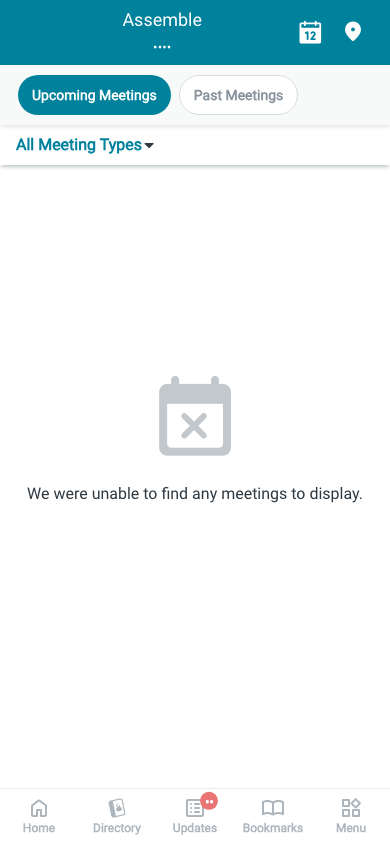 | 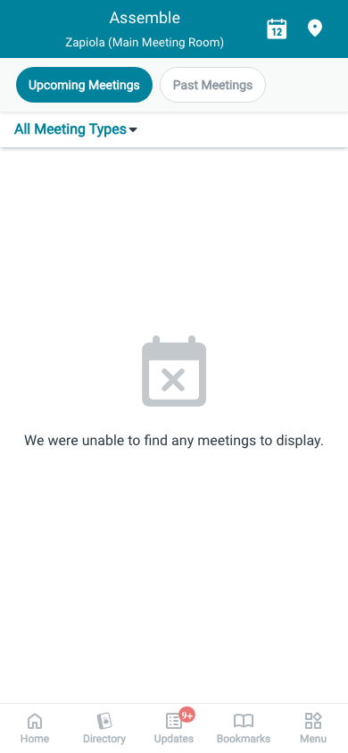 | 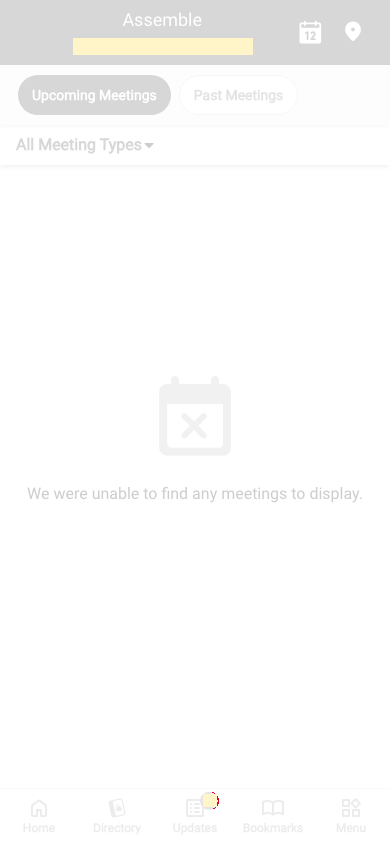 |
| `loading`<br>390x844, mock `loading`<br>2026-10-29<br>pixel difference 0.0% |  | 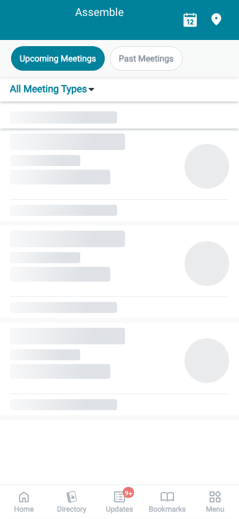 |  |
| `offline`<br>390x844, mock `error`<br>2026-10-29<br>pixel difference 0.0% |  |  | 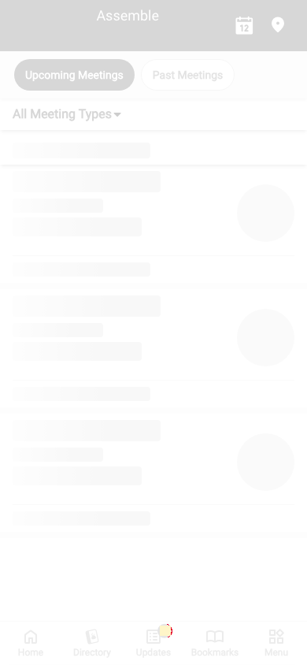 |

## 4. Diagram

- A box on the left is the block or module of the action that calls the server (TST code).
- A line connects each call to the React action that makes the same call.
- The right column shows the React components that use each React action.
- A red box is a call that React does not make.

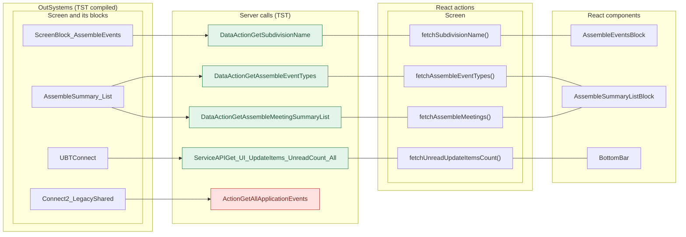

## 5. User actions

The two lists are independent: the OutSystems list comes from the TST compiled code, the React list from the React code. The tool does not map one list to the other.

- **OutSystems:** each event binding of the compiled views (`<event>$Action: function` of a child block or widget, `on<Event>: function` of an HTML element) with its handler.
- **React:** each JSX attribute `on<Event>={handler}` with its handler.
- Both lists keep only the bindings whose handler has an effect: a server call, a navigation, an external link, a message or a confirm dialog. The tool follows the called functions 3 levels deep.
- When the handler has branches in the code (`switch` case, `if` with `===`), each branch has its own diagram. The branch name is the constant of the condition. `other` is the last `else` or `default`.
- An arrow to the server gives the inputs of the call, the return arrow its outputs (contract `app/src/api/openapi.yaml`).

### 5.1 OutSystems (TST)

| # | Block (OutSystems) | Event (TST view) | Handler | Branch | Effects |
|---|---|---|---|---|---|
| [1](#511-assemblesummary_list-horizontaltagsonclicktag) | `AssembleSummary_List` | `onClickTag of HorizontalTags` | `horizontalTagsOnClickTag` | – | calls GetAssembleMeetingSummaryList |
| [2](#512-assemblesummary_list-handler_clearfilters) | `AssembleSummary_List` | `clear of Header` | `handler_ClearFilters` | – | calls GetAssembleMeetingSummaryList |
| [3](#513-assemblesummary_list-list_assemblesummarycardsonscrollending) | `AssembleSummary_List` | `onScrollEnding (HTML element)` | `list_AssembleSummaryCardsOnScrollEnding` | – | calls GetAssembleMeetingSummaryList |
| [4](#514-assemblesummary_list-handler_applyfilters) | `AssembleSummary_List` | `applyFilters of FilterDrawer` | `handler_ApplyFilters` | – | calls GetAssembleMeetingSummaryList |
| [5](#515-assemble_filtersheet-handler_gotobrowsecountry) | `Assemble_FilterSheet` | `onClick_GoToBrowseCountry of LocalityListDetail` | `handler_GoToBrowseCountry` | – | calls GetAllApplicationEvents, AppManager_SynchAppContext |
| [6](#516-assemble_filtersheet-handler_freesubscriptionalert) | `Assemble_FilterSheet` | `freeSubscriptionAlert of FilterLocalityByCountry` | `handler_FreeSubscriptionAlert` | – | asks for a confirmation |
| [7](#517-menuicon__updatedosui-onback) | `MenuIcon__UpdatedOSUI` | `onClick (HTML element)` | `onBack` | – | goes to previous screen |
| [8](#518-bottombarmenu-event_bottombar_clicked-home) | `BottomBarMenu` | `onClick (HTML element)`<br>`onClick of IconBadge` | `event_BottomBar_Clicked` | `home` | goes to HomeFeed |
| [9](#519-bottombarmenu-event_bottombar_clicked-directory) | `BottomBarMenu` | `onClick (HTML element)`<br>`onClick of IconBadge` | `event_BottomBar_Clicked` | `directory` | goes to CountryList, Locality_Details |
| [10](#5110-bottombarmenu-event_bottombar_clicked-updates) | `BottomBarMenu` | `onClick (HTML element)`<br>`onClick of IconBadge` | `event_BottomBar_Clicked` | `updates` | goes to Updates_SingleList |
| [11](#5111-bottombarmenu-event_bottombar_clicked-bookmarks) | `BottomBarMenu` | `onClick (HTML element)`<br>`onClick of IconBadge` | `event_BottomBar_Clicked` | `bookmarks` | goes to Bookmarks |
| [12](#5112-bottombarmenu-event_bottombar_clicked-menu) | `BottomBarMenu` | `onClick (HTML element)`<br>`onClick of IconBadge` | `event_BottomBar_Clicked` | `menu` | goes to Menu |
| [13](#5113-assembleevents-handler_navigateto_assemblelocationfilters) | `AssembleEvents` | `navigateTo_AssembleLocationFilters of AssembleEvents` | `handler_NavigateTo_AssembleLocationFilters` | – | goes to Assemble_BrowseByCountry |
| [14](#5114-assembleevents-handler_navigateto_assembledetail) | `AssembleEvents` | `navigateTo_AssembleDetail of AssembleEvents` | `handler_NavigateTo_AssembleDetail` | – | goes to AssembleDetail |
| [15](#5115-assembleevents-handler_navigateto_mycalendar) | `AssembleEvents` | `navigateTo_MyCalendarAssemble of AssembleEvents` | `handler_NavigateTo_MyCalendar` | – | goes to MyEntertaining |

#### 5.1.1 AssembleSummary_List: horizontalTagsOnClickTag

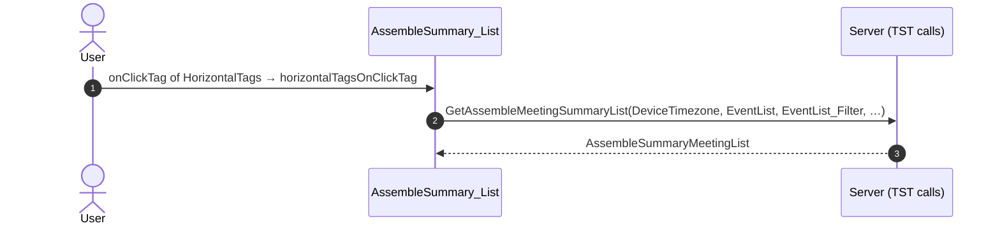

#### 5.1.2 AssembleSummary_List: handler_ClearFilters

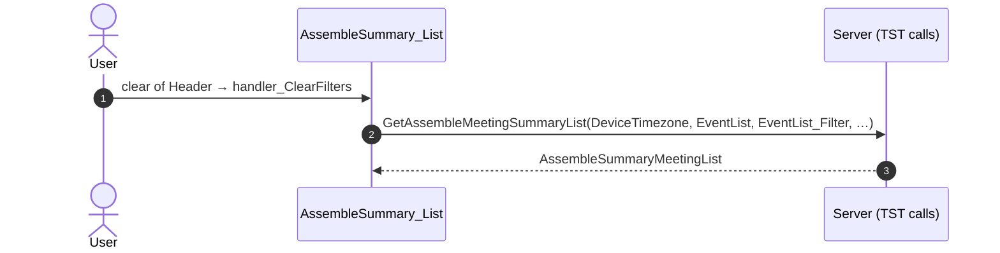

#### 5.1.3 AssembleSummary_List: list_AssembleSummaryCardsOnScrollEnding

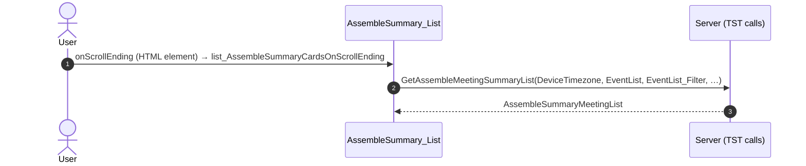

#### 5.1.4 AssembleSummary_List: handler_ApplyFilters

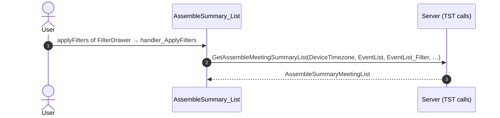

#### 5.1.5 Assemble_FilterSheet: handler_GoToBrowseCountry

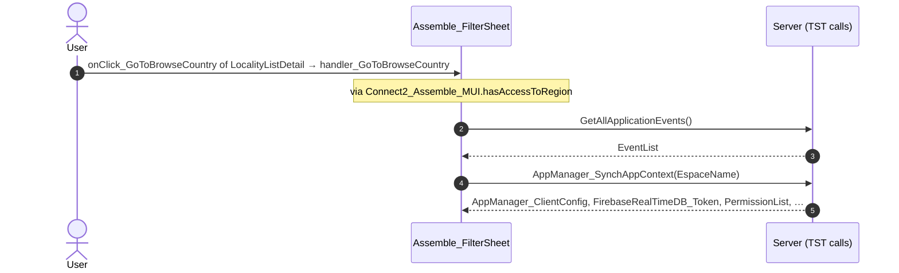

#### 5.1.6 Assemble_FilterSheet: handler_FreeSubscriptionAlert

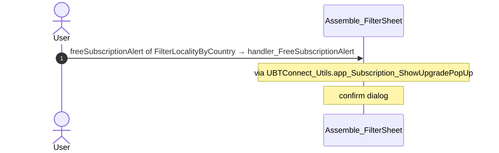

#### 5.1.7 MenuIcon__UpdatedOSUI: onBack

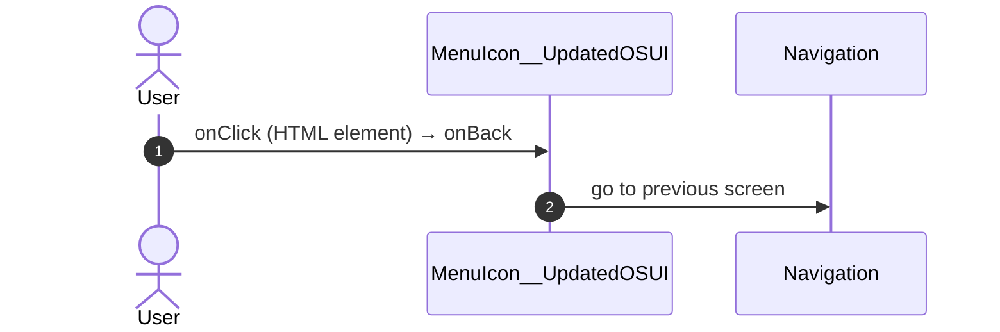

#### 5.1.8 BottomBarMenu: event_BottomBar_Clicked (home)

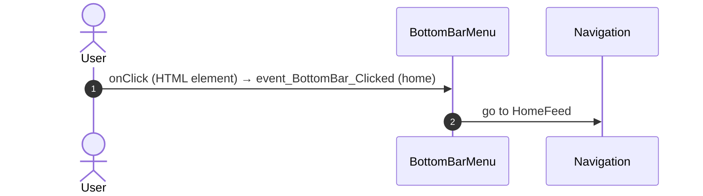

#### 5.1.9 BottomBarMenu: event_BottomBar_Clicked (directory)

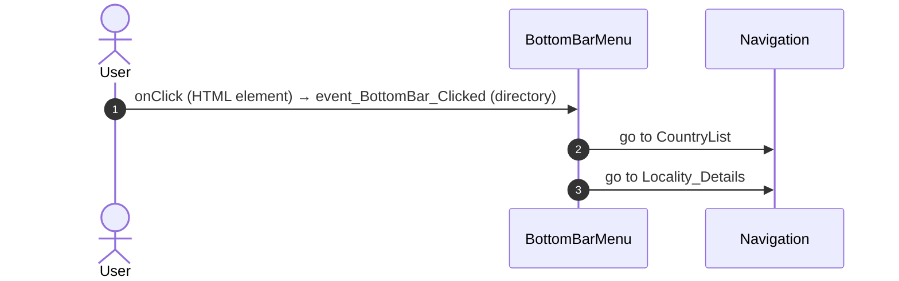

#### 5.1.10 BottomBarMenu: event_BottomBar_Clicked (updates)

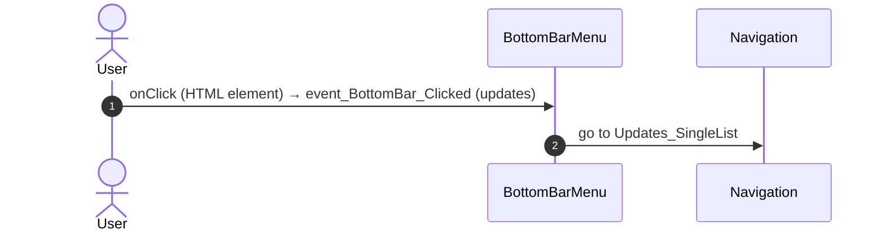

#### 5.1.11 BottomBarMenu: event_BottomBar_Clicked (bookmarks)

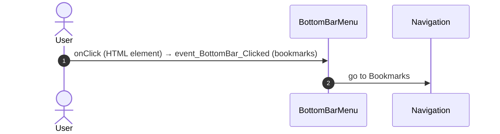

#### 5.1.12 BottomBarMenu: event_BottomBar_Clicked (menu)

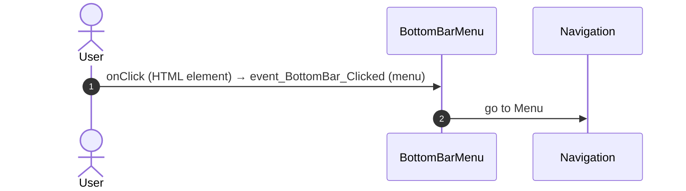

#### 5.1.13 AssembleEvents: handler_NavigateTo_AssembleLocationFilters

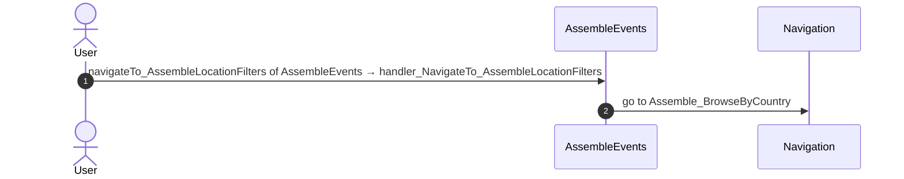

#### 5.1.14 AssembleEvents: handler_NavigateTo_AssembleDetail

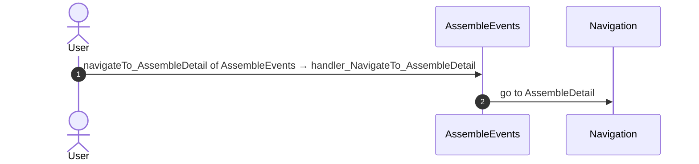

#### 5.1.15 AssembleEvents: handler_NavigateTo_MyCalendar

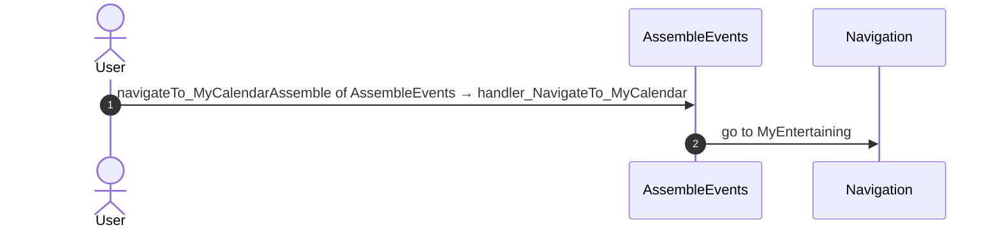

### 5.2 React

| # | File | Element | Event prop | Handler | Branch | Effects |
|---|---|---|---|---|---|---|
| [1](#521-assembleeventsblock-onnavigatetoassemblelocationfilters) | [`pages/AssembleEvents/AssembleEventsPage.tsx:104`](../../app/src/pages/AssembleEvents/AssembleEventsPage.tsx#L104) | `<AssembleEventsBlock>` | `onNavigateToAssembleLocationFilters` | `inline` | – | goes to Assemble_BrowseByCountry |
| [2](#522-assembleeventsblock-onnavigatetomycalendarassemble) | [`pages/AssembleEvents/AssembleEventsPage.tsx:109`](../../app/src/pages/AssembleEvents/AssembleEventsPage.tsx#L109) | `<AssembleEventsBlock>` | `onNavigateToMyCalendarAssemble` | `inline` | – | goes to MyEntertaining |
| [3](#523-assembleeventsblock-onnavigatetoassembledetail) | [`pages/AssembleEvents/AssembleEventsPage.tsx:112`](../../app/src/pages/AssembleEvents/AssembleEventsPage.tsx#L112) | `<AssembleEventsBlock>` | `onNavigateToAssembleDetail` | `inline` | – | goes to AssembleDetail |
| [4](#524-assemblesummary_list-onscrollending) | [`pages/AssembleEvents/AssembleEventsPage.tsx:69`](../../app/src/pages/AssembleEvents/AssembleEventsPage.tsx#L69) | `<AssembleSummary_List>` | `onScrollEnding` | `list.onScrollEnding` | – | calls DataActionGetAssembleMeetingSummaryList |
| [5](#525-assemblesummary_list-onclicktag) | [`pages/AssembleEvents/AssembleEventsPage.tsx:69`](../../app/src/pages/AssembleEvents/AssembleEventsPage.tsx#L69) | `<AssembleSummary_List>` | `onClickTag` | `list.onClickTag` | – | calls DataActionGetAssembleMeetingSummaryList |
| [6](#526-assemblesummary_list-onclearfilters) | [`pages/AssembleEvents/AssembleEventsPage.tsx:69`](../../app/src/pages/AssembleEvents/AssembleEventsPage.tsx#L69) | `<AssembleSummary_List>` | `onClearFilters` | `list.onClearFilters` | – | calls DataActionGetAssembleMeetingSummaryList |
| [7](#527-assemblesummary_list-onapplyfilters) | [`pages/AssembleEvents/AssembleEventsPage.tsx:69`](../../app/src/pages/AssembleEvents/AssembleEventsPage.tsx#L69) | `<AssembleSummary_List>` | `onApplyFilters` | `list.onApplyFilters` | – | calls DataActionGetAssembleMeetingSummaryList |
| [8](#528-assemble_filtersheet-oncountryclicked) | [`pages/AssembleEvents/AssembleEventsPage.tsx:75`](../../app/src/pages/AssembleEvents/AssembleEventsPage.tsx#L75) | `<Assemble_FilterSheet>` | `onCountryClicked` | `sheet.onCountryClicked` | – | calls ActionGetUserInformation; asks for a confirmation |
| [9](#529-assemble_filtersheet-onfreesubscriptionalert) | [`pages/AssembleEvents/AssembleEventsPage.tsx:75`](../../app/src/pages/AssembleEvents/AssembleEventsPage.tsx#L75) | `<Assemble_FilterSheet>` | `onFreeSubscriptionAlert` | `sheet.onFreeSubscriptionAlert` | – | asks for a confirmation |
| [10](#5210-oslistitem-onclick) | [`components/assemble/AssembleLocalityFilter/AssembleLocalityFilter.tsx:159`](../../app/src/components/assemble/AssembleLocalityFilter/AssembleLocalityFilter.tsx#L159) | `<OSListItem>` | `onClick` | `inline` | – | calls ActionGetUserInformation; calls the prop onFreeSubscriptionAlert(); calls the prop onSelectedSubdivision() |
| [11](#5211-oslink-onclick-home) | [`components/layout/BottomBar/BottomBar.tsx:130`](../../app/src/components/layout/BottomBar/BottomBar.tsx#L130) | `<OSLink>` | `onClick` | `click` | `Home` | goes to HomeFeed |
| [12](#5212-oslink-onclick-directory) | [`components/layout/BottomBar/BottomBar.tsx:130`](../../app/src/components/layout/BottomBar/BottomBar.tsx#L130) | `<OSLink>` | `onClick` | `click` | `Directory` | goes to CountryList, Locality_Details |
| [13](#5213-oslink-onclick-updates) | [`components/layout/BottomBar/BottomBar.tsx:130`](../../app/src/components/layout/BottomBar/BottomBar.tsx#L130) | `<OSLink>` | `onClick` | `click` | `Updates` | goes to Updates_SingleList |
| [14](#5214-oslink-onclick-bookmarks) | [`components/layout/BottomBar/BottomBar.tsx:130`](../../app/src/components/layout/BottomBar/BottomBar.tsx#L130) | `<OSLink>` | `onClick` | `click` | `Bookmarks` | goes to Bookmarks |
| [15](#5215-oslink-onclick-menu) | [`components/layout/BottomBar/BottomBar.tsx:130`](../../app/src/components/layout/BottomBar/BottomBar.tsx#L130) | `<OSLink>` | `onClick` | `click` | `Menu` | goes to Menu |
| [16](#5216-oslink-onclick-other) | [`components/layout/BottomBar/BottomBar.tsx:130`](../../app/src/components/layout/BottomBar/BottomBar.tsx#L130) | `<OSLink>` | `onClick` | `click` | `other` | calls the prop onBottomBarClicked() |
| [17](#5217-bottombariconbadge-ononclick-home) | [`components/layout/BottomBar/BottomBar.tsx:140`](../../app/src/components/layout/BottomBar/BottomBar.tsx#L140) | `<BottomBarIconBadge>` | `onOnClick` | `click` | `Home` | goes to HomeFeed |
| [18](#5218-bottombariconbadge-ononclick-directory) | [`components/layout/BottomBar/BottomBar.tsx:140`](../../app/src/components/layout/BottomBar/BottomBar.tsx#L140) | `<BottomBarIconBadge>` | `onOnClick` | `click` | `Directory` | goes to CountryList, Locality_Details |
| [19](#5219-bottombariconbadge-ononclick-updates) | [`components/layout/BottomBar/BottomBar.tsx:140`](../../app/src/components/layout/BottomBar/BottomBar.tsx#L140) | `<BottomBarIconBadge>` | `onOnClick` | `click` | `Updates` | goes to Updates_SingleList |
| [20](#5220-bottombariconbadge-ononclick-bookmarks) | [`components/layout/BottomBar/BottomBar.tsx:140`](../../app/src/components/layout/BottomBar/BottomBar.tsx#L140) | `<BottomBarIconBadge>` | `onOnClick` | `click` | `Bookmarks` | goes to Bookmarks |
| [21](#5221-bottombariconbadge-ononclick-menu) | [`components/layout/BottomBar/BottomBar.tsx:140`](../../app/src/components/layout/BottomBar/BottomBar.tsx#L140) | `<BottomBarIconBadge>` | `onOnClick` | `click` | `Menu` | goes to Menu |
| [22](#5222-bottombariconbadge-ononclick-other) | [`components/layout/BottomBar/BottomBar.tsx:140`](../../app/src/components/layout/BottomBar/BottomBar.tsx#L140) | `<BottomBarIconBadge>` | `onOnClick` | `click` | `other` | calls the prop onBottomBarClicked() |
| [23](#5223-assemblesummarycard-onaddressclick) | [`containers/AssembleSummaryCard/AssembleSummaryCardContainer.tsx:77`](../../app/src/containers/AssembleSummaryCard/AssembleSummaryCardContainer.tsx#L77) | `<AssembleSummaryCard>` | `onAddressClick` | `linkAddressOnClick` | – | shows a message |
| [24](#5224-assemblesummarycard-onmeetinginfotoggle) | [`containers/AssembleSummaryCard/AssembleSummaryCardContainer.tsx:78`](../../app/src/containers/AssembleSummaryCard/AssembleSummaryCardContainer.tsx#L78) | `<AssembleSummaryCard>` | `onMeetingInfoToggle` | `meetingInfoToggle` | – | asks for a confirmation |
| [25](#5225-div-onclick) | [`components/layout/MenuIcon/MenuIcon.tsx:34`](../../app/src/components/layout/MenuIcon/MenuIcon.tsx#L34) | `<div>` | `onClick` | `inline` | – | goes to previous screen |
| [26](#5226-preventbacknavigation-onbacknavigationprevented) | [`components/layout/CommonUiLayout/CommonUiLayout.tsx:80`](../../app/src/components/layout/CommonUiLayout/CommonUiLayout.tsx#L80) | `<PreventBackNavigation>` | `onBackNavigationPrevented` | `redirectHome` | – | goes to HomeFeed |
| [27](#5227-backnavigationhandler-onbacknavigation) | [`components/layout/CommonUiLayout/CommonUiLayout.tsx:82`](../../app/src/components/layout/CommonUiLayout/CommonUiLayout.tsx#L82) | `<BackNavigationHandler>` | `onBackNavigation` | `maybeRedirectHome` | – | goes to HomeFeed |

#### 5.2.1 AssembleEventsBlock: onNavigateToAssembleLocationFilters

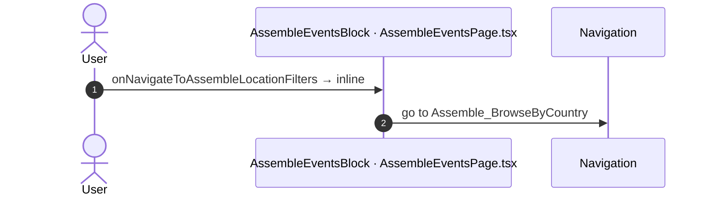

#### 5.2.2 AssembleEventsBlock: onNavigateToMyCalendarAssemble

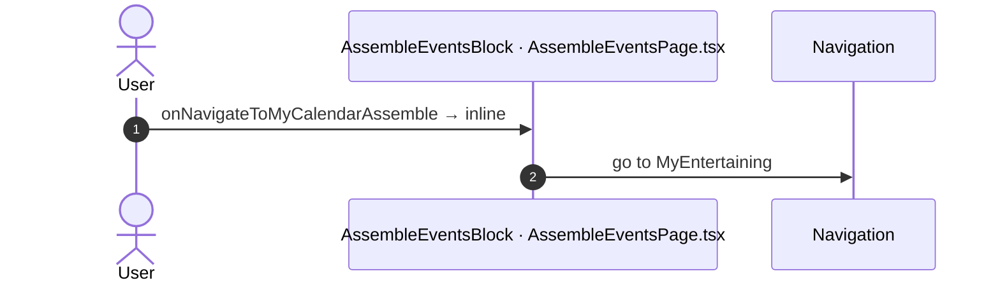

#### 5.2.3 AssembleEventsBlock: onNavigateToAssembleDetail

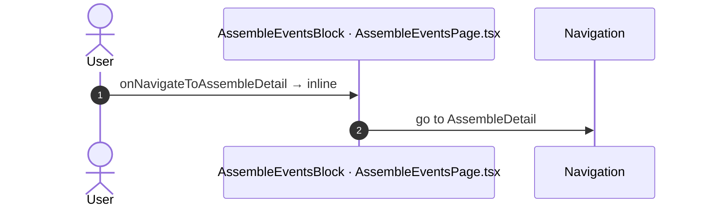

#### 5.2.4 AssembleSummary_List: onScrollEnding

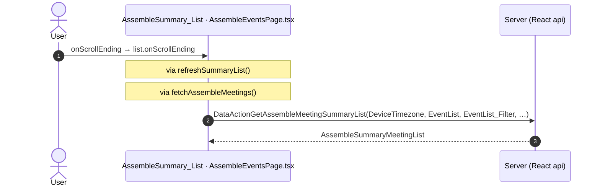

#### 5.2.5 AssembleSummary_List: onClickTag

```mermaid
sequenceDiagram
  autonumber
  actor U as User
  participant H as AssembleSummary_List · AssembleEventsPage.tsx
  participant A as Server (React api)
  U->>H: onClickTag → list.onClickTag
  Note over H: via applyFilters()
  Note over H: via refreshEventList()
  Note over H: via refreshSummaryList()
  Note over H: via fetchAssembleMeetings()
  H->>A: DataActionGetAssembleMeetingSummaryList(DeviceTimezone, EventList, EventList_Filter, …)
  A-->>H: AssembleSummaryMeetingList
```

#### 5.2.6 AssembleSummary_List: onClearFilters

```mermaid
sequenceDiagram
  autonumber
  actor U as User
  participant H as AssembleSummary_List · AssembleEventsPage.tsx
  participant A as Server (React api)
  U->>H: onClearFilters → list.onClearFilters
  Note over H: via refreshEventList()
  Note over H: via refreshSummaryList()
  Note over H: via fetchAssembleMeetings()
  H->>A: DataActionGetAssembleMeetingSummaryList(DeviceTimezone, EventList, EventList_Filter, …)
  A-->>H: AssembleSummaryMeetingList
```

#### 5.2.7 AssembleSummary_List: onApplyFilters

```mermaid
sequenceDiagram
  autonumber
  actor U as User
  participant H as AssembleSummary_List · AssembleEventsPage.tsx
  participant A as Server (React api)
  U->>H: onApplyFilters → list.onApplyFilters
  Note over H: via refreshEventList()
  Note over H: via refreshSummaryList()
  Note over H: via fetchAssembleMeetings()
  H->>A: DataActionGetAssembleMeetingSummaryList(DeviceTimezone, EventList, EventList_Filter, …)
  A-->>H: AssembleSummaryMeetingList
```

#### 5.2.8 Assemble_FilterSheet: onCountryClicked

```mermaid
sequenceDiagram
  autonumber
  actor U as User
  participant H as Assemble_FilterSheet · AssembleEventsPage.tsx
  participant A as Server (React api)
  U->>H: onCountryClicked → sheet.onCountryClicked
  Note over H: via goToBrowseCountry()
  Note over H: via hasAccessToRegion()
  Note over H: via getCacheableUserInfo()
  H->>A: ActionGetUserInformation()
  A-->>H: UserInformation
  Note over H: confirm dialog ${scope}-FreeSubscriptionAlert
```

#### 5.2.9 Assemble_FilterSheet: onFreeSubscriptionAlert

```mermaid
sequenceDiagram
  autonumber
  actor U as User
  participant H as Assemble_FilterSheet · AssembleEventsPage.tsx
  U->>H: onFreeSubscriptionAlert → sheet.onFreeSubscriptionAlert
  Note over H: via showUpgradePopUp()
  Note over H: confirm dialog dialogId
```

#### 5.2.10 OSListItem: onClick

```mermaid
sequenceDiagram
  autonumber
  actor U as User
  participant H as OSListItem · AssembleLocalityFilter.tsx
  participant A as Server (React api)
  U->>H: onClick → inline
  Note over H: via onClickLocality()
  Note over H: via hasAccessToRegion()
  Note over H: via getCacheableUserInfo()
  H->>A: ActionGetUserInformation()
  A-->>H: UserInformation
  Note over H: calls the prop onFreeSubscriptionAlert()
  Note over H: calls the prop onSelectedSubdivision()
```

#### 5.2.11 OSLink: onClick (Home)

```mermaid
sequenceDiagram
  autonumber
  actor U as User
  participant H as OSLink · BottomBar.tsx
  participant N as Navigation
  U->>H: onClick → click (Home)
  Note over H: via event_BottomBar_Clicked()
  H->>N: go to HomeFeed
```

#### 5.2.12 OSLink: onClick (Directory)

```mermaid
sequenceDiagram
  autonumber
  actor U as User
  participant H as OSLink · BottomBar.tsx
  participant N as Navigation
  U->>H: onClick → click (Directory)
  Note over H: via event_BottomBar_Clicked()
  H->>N: go to CountryList
  H->>N: go to Locality_Details
```

#### 5.2.13 OSLink: onClick (Updates)

```mermaid
sequenceDiagram
  autonumber
  actor U as User
  participant H as OSLink · BottomBar.tsx
  participant N as Navigation
  U->>H: onClick → click (Updates)
  Note over H: via event_BottomBar_Clicked()
  H->>N: go to Updates_SingleList
```

#### 5.2.14 OSLink: onClick (Bookmarks)

```mermaid
sequenceDiagram
  autonumber
  actor U as User
  participant H as OSLink · BottomBar.tsx
  participant N as Navigation
  U->>H: onClick → click (Bookmarks)
  Note over H: via event_BottomBar_Clicked()
  H->>N: go to Bookmarks
```

#### 5.2.15 OSLink: onClick (Menu)

```mermaid
sequenceDiagram
  autonumber
  actor U as User
  participant H as OSLink · BottomBar.tsx
  participant N as Navigation
  U->>H: onClick → click (Menu)
  Note over H: via event_BottomBar_Clicked()
  H->>N: go to Menu
```

#### 5.2.16 OSLink: onClick (other)

```mermaid
sequenceDiagram
  autonumber
  actor U as User
  participant H as OSLink · BottomBar.tsx
  U->>H: onClick → click (other)
  Note over H: via event_BottomBar_Clicked()
  Note over H: calls the prop onBottomBarClicked()
```

#### 5.2.17 BottomBarIconBadge: onOnClick (Home)

```mermaid
sequenceDiagram
  autonumber
  actor U as User
  participant H as BottomBarIconBadge · BottomBar.tsx
  participant N as Navigation
  U->>H: onOnClick → click (Home)
  Note over H: via event_BottomBar_Clicked()
  H->>N: go to HomeFeed
```

#### 5.2.18 BottomBarIconBadge: onOnClick (Directory)

```mermaid
sequenceDiagram
  autonumber
  actor U as User
  participant H as BottomBarIconBadge · BottomBar.tsx
  participant N as Navigation
  U->>H: onOnClick → click (Directory)
  Note over H: via event_BottomBar_Clicked()
  H->>N: go to CountryList
  H->>N: go to Locality_Details
```

#### 5.2.19 BottomBarIconBadge: onOnClick (Updates)

```mermaid
sequenceDiagram
  autonumber
  actor U as User
  participant H as BottomBarIconBadge · BottomBar.tsx
  participant N as Navigation
  U->>H: onOnClick → click (Updates)
  Note over H: via event_BottomBar_Clicked()
  H->>N: go to Updates_SingleList
```

#### 5.2.20 BottomBarIconBadge: onOnClick (Bookmarks)

```mermaid
sequenceDiagram
  autonumber
  actor U as User
  participant H as BottomBarIconBadge · BottomBar.tsx
  participant N as Navigation
  U->>H: onOnClick → click (Bookmarks)
  Note over H: via event_BottomBar_Clicked()
  H->>N: go to Bookmarks
```

#### 5.2.21 BottomBarIconBadge: onOnClick (Menu)

```mermaid
sequenceDiagram
  autonumber
  actor U as User
  participant H as BottomBarIconBadge · BottomBar.tsx
  participant N as Navigation
  U->>H: onOnClick → click (Menu)
  Note over H: via event_BottomBar_Clicked()
  H->>N: go to Menu
```

#### 5.2.22 BottomBarIconBadge: onOnClick (other)

```mermaid
sequenceDiagram
  autonumber
  actor U as User
  participant H as BottomBarIconBadge · BottomBar.tsx
  U->>H: onOnClick → click (other)
  Note over H: via event_BottomBar_Clicked()
  Note over H: calls the prop onBottomBarClicked()
```

#### 5.2.23 AssembleSummaryCard: onAddressClick

```mermaid
sequenceDiagram
  autonumber
  actor U as User
  participant H as AssembleSummaryCard · AssembleSummaryCardContainer.tsx
  U->>H: onAddressClick → linkAddressOnClick
  Note over H: message 'Map is not available'
  Note over H: via navigateToMaps()
  Note over H: message 'Please check your network connection and try again'
```

#### 5.2.24 AssembleSummaryCard: onMeetingInfoToggle

```mermaid
sequenceDiagram
  autonumber
  actor U as User
  participant H as AssembleSummaryCard · AssembleSummaryCardContainer.tsx
  U->>H: onMeetingInfoToggle → meetingInfoToggle
  Note over H: confirm dialog dialogId
```

#### 5.2.25 div: onClick

```mermaid
sequenceDiagram
  autonumber
  actor U as User
  participant H as div · MenuIcon.tsx
  participant N as Navigation
  U->>H: onClick → inline
  H->>N: go to previous screen
```

#### 5.2.26 PreventBackNavigation: onBackNavigationPrevented

```mermaid
sequenceDiagram
  autonumber
  actor U as User
  participant H as PreventBackNavigation · CommonUiLayout.tsx
  participant N as Navigation
  U->>H: onBackNavigationPrevented → redirectHome
  H->>N: go to HomeFeed
```

#### 5.2.27 BackNavigationHandler: onBackNavigation

```mermaid
sequenceDiagram
  autonumber
  actor U as User
  participant H as BackNavigationHandler · CommonUiLayout.tsx
  participant N as Navigation
  U->>H: onBackNavigation → maybeRedirectHome
  Note over H: via actionRedirectHome()
  H->>N: go to HomeFeed
```

## 6. Server calls

All columns come from the code, without interpretation:

- **Direct caller (TST):** the block or module of the action that calls the server (the step before the server call in the chain).
- **Chain (TST):** the chains of client actions in the TST compiled code, from their start to the call.
  A long chain shows its first 2 steps, …, and its last 2 steps.
- **Seen on TST:** `yes` when TST made the call in the capture.
- **React action:** the React function with the `callAction` of the same call (`file:line`), and the code that loads it: `shell` (from `main.tsx`), `page` (from the screen), or both.
- **Used by (React references):** the functions and components that reference the React action, up to the nearest component. A reference is not always a call.
- **Status:** `implemented` when the contract path of the React call gives the same TST URL. It does not prove the same behaviour.

| # | Call (TST) | Kind | Direct caller (TST) | Chain (TST) | Seen on TST | React action | Used by (React references) | Status |
|---|---|---|---|---|---|---|---|---|
| 1 | `Connect2_Assemble_MUI/Assemble/AssembleSummary_List/DataActionGetAssembleEventTypes` | data action | `AssembleSummary_List` | AssembleSummary_List.refresh_GetAssembleEventTypes → AssembleSummary_List.DataActionGetAssembleEventTypes<br>AssembleSummary_List fetch at start → AssembleSummary_List.DataActionGetAssembleEventTypes | yes | `fetchAssembleEventTypes()` [`api/event/repository.ts:106`](../../app/src/api/event/repository.ts#L106) (page) | `AssembleSummaryListBlock → useAssembleSummaryList → fetchAssembleEventTypes`<br>[`pages/AssembleEvents/AssembleEventsPage.tsx`](../../app/src/pages/AssembleEvents/AssembleEventsPage.tsx) | implemented |
| 2 | `Connect2_Assemble_MUI/Assemble/AssembleSummary_List/DataActionGetAssembleMeetingSummaryList` | data action | `AssembleSummary_List` | AssembleSummary_List.list_AssembleSummaryCardsOnScrollEnding → AssembleSummary_List.DataActionGetAssembleMeetingSummaryList<br>onClick in HorizontalTags → HorizontalTags.onClick → … → AssembleSummary_List.refresh_EventList → AssembleSummary_List.DataActionGetAssembleMeetingSummaryList<br>onClick in AssembleSummary_FilterDrawer → AssembleSummary_FilterDrawer.applyOnClick → … → AssembleSummary_List.refresh_EventList → AssembleSummary_List.DataActionGetAssembleMeetingSummaryList<br>(+3 more chains) | yes | `fetchAssembleMeetings()` [`api/event/repository.ts:113`](../../app/src/api/event/repository.ts#L113) (page) | `AssembleSummaryListBlock → useAssembleSummaryList → fetchAssembleMeetings`<br>[`pages/AssembleEvents/AssembleEventsPage.tsx`](../../app/src/pages/AssembleEvents/AssembleEventsPage.tsx) | implemented |
| 3 | `Connect2_LegacyShared/ActionGetAllApplicationEvents` | server action | `Connect2_LegacyShared` | onClick in LocalityListDetail → event onClick_GoToBrowseCountry of LocalityListDetail → … → Connect2_LegacyShared.cacheLocalApplicationEvents → server GetAllApplicationEvents | no | – | – | **missing** |
| 4 | `Connect2_Assemble_MUI/Assemble/ScreenBlock_AssembleEvents/DataActionGetSubdivisionName` | data action | `ScreenBlock_AssembleEvents` | ScreenBlock_AssembleEvents.OnReady → ScreenBlock_AssembleEvents.onReady → ScreenBlock_AssembleEvents.DataActionGetSubdivisionName<br>ScreenBlock_AssembleEvents fetch at start → ScreenBlock_AssembleEvents.DataActionGetSubdivisionName | no | `fetchSubdivisionName()` [`api/locality/repository.ts:59`](../../app/src/api/locality/repository.ts#L59) (page) | `AssembleEventsBlock → useAssembleEvents → fetchSubdivisionName`<br>[`pages/AssembleEvents/AssembleEventsPage.tsx`](../../app/src/pages/AssembleEvents/AssembleEventsPage.tsx) | implemented |
| 5 | `UBTConnect/ServiceAPIGet_UI_UpdateItems_UnreadCount_All` | service action | `UBTConnect` | BottomBarMenu.OnReady → BottomBarMenu.onReady → UBTConnect.directory_Updates_RefreshBottomBarCount → server Get_UI_UpdateItems_UnreadCount_All | no | `fetchUnreadUpdateItemsCount()` [`api/update/repository.ts:73`](../../app/src/api/update/repository.ts#L73) (page) | `BottomBar → directory_Updates_RefreshBottomBarCount → fetchUnreadUpdateItemsCount`<br>[`components/layout/BottomBar/BottomBar.tsx`](../../app/src/components/layout/BottomBar/BottomBar.tsx) | implemented |

## 7. Missing in React

- Call `Connect2_LegacyShared/ActionGetAllApplicationEvents`. Chain on TST: onClick in LocalityListDetail → event onClick_GoToBrowseCountry of LocalityListDetail → … → Connect2_LegacyShared.cacheLocalApplicationEvents → server GetAllApplicationEvents.
  - No React code makes this call.

## 8. Questions

1. React calls `/api/Connect2_LegacyShared/ActionGetLocalityInformation` from `fetchLocalityInformation()` [`api/locality/repository.ts:173`](../../app/src/api/locality/repository.ts#L173) (page). TST AssembleEvents has no chain to this call. Does the call belong to this route?
2. React calls `/api/Connect2_LegacyShared/ActionGetUserLocalitiesForCountryCodeWithGPS` from `fetchCountryLocalities()` [`api/country/repository.ts:74`](../../app/src/api/country/repository.ts#L74) (page). TST AssembleEvents has no chain to this call. Does the call belong to this route?
3. React calls `/api/Connect2_LegacyShared/ActionGetSignedPhotosInBulk` from `getSignedPhotosInBulk()` [`lib/legacyShared/actions.ts:49`](../../app/src/lib/legacyShared/actions.ts#L49) (page). TST AssembleEvents has no chain to this call. Does the call belong to this route?
4. React calls `/api/UBTConnect_Utils/CacheControl_Policies/DataActionGetCacheInfo` from `fetchPolicies()` [`api/app/repository.ts:54`](../../app/src/api/app/repository.ts#L54) (shell + page). TST AssembleEvents has no chain to this call. Does the call belong to this route?

## 9. Method

1. **OutSystems (TST).** The tool reads `facts.json` and the compiled code of `migration/screens/AssembleEvents/analysis/`:
   - the rendered files;
   - each server call with its chain of client actions, and the calls that TST made in the capture;
   - the effects of each user action.
2. **Route and app shell.** OutSystems: a chain belongs to the app shell when it starts in `CommonUI_InsideLayout`, one of its blocks, or a module action. React: a binding belongs to the app shell when its file is in the code that `main.tsx` loads.
3. **MCP (DEV).** The tool reads the UI flow with `getScreenNames`. TST wins when DEV is different.
4. **React.** `react_calls.mjs` reads the app shell from `app/src/main.tsx` and the screen from its `<Route>Page.tsx`. It counts only the code that the app uses.
5. **Match.** `callAction(M, A)` gives `/api/M/A`. The `x-os-paths` of `app/src/api/openapi.yaml` give the TST call. The status is `implemented` when the TST call is the same. Else the status is `missing`.

Limit: a name or a call match does not prove the same behaviour. The parity checks of the migration compare the behaviour.
