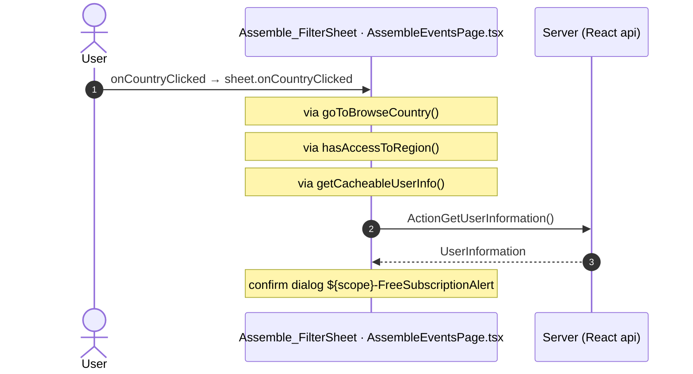

# AssembleEvents: OutSystems (TST) and React

The route `/UBTConnect/AssembleEvents`, read from the TST compiled code and from the React code by `route-actions/tools/check_route.py` on 2026-11-05. Facts only, each with its place. The method is in [README.md](../README.md).

Scope of this file: the screen and the blocks of its UI flow (OutSystems), the files of `app/src/pages/AssembleEvents/` (React). The app shell is in [APP_SHELL.md](../APP_SHELL.md). The shared blocks and components that the route uses are in the last section.

## 1. Route

| Item | Value | Source |
|---|---|---|
| Route | `/UBTConnect/AssembleEvents` | `app/src/app/routes.generated.ts` |
| OutSystems screen | `UBTConnect.Legacy_AssembleFlow.AssembleEvents` | TST compiled code |
| UI flow | `Legacy_AssembleFlow` | MCP `getScreenNames` (DEV) |
| React screen | [`pages/AssembleEvents/AssembleEventsPage.tsx`](../../app/src/pages/AssembleEvents/AssembleEventsPage.tsx) | `app/src/pages/` |
| React route rules | access `member`, lock `enforce`, flag redirect none | `app/src/app/routes.ts` |
| Screenshots | [`migration/screens/AssembleEvents/parity`](../../migration/screens/AssembleEvents/parity) | `route.py parity` |
| Code read | OutSystems: 1 files of the UI flow, 29 shared blocks, 25 app shell files. React: 214 files in the closure of the page | TST `facts.json`, `react_calls.mjs` |

## 2. Result

| Check | Result |
|---|---|
| Server calls of the route on TST | 5: React makes 4, **1 missing** |
| Differences found | **1** (see [section 3](#3-differences-found)) |
| Questions | 4 (see [section 4](#4-questions)) |
| User actions of the route (own code) | OutSystems: 3. React: 9 |
| Screen and blocks of the UI flow with a React port | 1 of 1 |
| Navigation targets found in React | 9 of 9 |
| Shared blocks and components on the route | OutSystems 29, React 5 with user actions: see the last section |
| App shell on this route | 10 calls: see [APP_SHELL.md](../APP_SHELL.md) |

## 3. Differences found

Each line is a fact of both sides: a TST call, navigation or variable, and the React code that has it or not. The tool does not judge the behaviour.

- Call `Connect2_LegacyShared/ActionGetAllApplicationEvents`. Chain on TST: onClick in LocalityListDetail → event onClick_GoToBrowseCountry of LocalityListDetail → … → Connect2_LegacyShared.cacheLocalApplicationEvents → server GetAllApplicationEvents.
  - No React code makes this call.

## 4. Questions

1. React calls `/api/Connect2_LegacyShared/ActionGetLocalityInformation` from `fetchLocalityInformation()` [`api/locality/repository.ts:173`](../../app/src/api/locality/repository.ts#L173) (page). TST AssembleEvents has no chain to this call. Does the call belong to this route?
2. React calls `/api/Connect2_LegacyShared/ActionGetUserLocalitiesForCountryCodeWithGPS` from `fetchCountryLocalities()` [`api/country/repository.ts:74`](../../app/src/api/country/repository.ts#L74) (page). TST AssembleEvents has no chain to this call. Does the call belong to this route?
3. React calls `/api/Connect2_LegacyShared/ActionGetSignedPhotosInBulk` from `getSignedPhotosInBulk()` [`lib/legacyShared/actions.ts:49`](../../app/src/lib/legacyShared/actions.ts#L49) (page). TST AssembleEvents has no chain to this call. Does the call belong to this route?
4. React calls `/api/UBTConnect_Utils/CacheControl_Policies/DataActionGetCacheInfo` from `fetchPolicies()` [`api/app/repository.ts:54`](../../app/src/api/app/repository.ts#L54) (shell + page). TST AssembleEvents has no chain to this call. Does the call belong to this route?

## 5. Server calls

All columns come from the code, without interpretation:

- **Direct caller (TST):** the block or module of the action that calls the server (the step before the server call in the chain).
- **Chain (TST):** the chains of client actions in the TST compiled code, from their start to the call.
  A long chain shows its first 2 steps, …, and its last 2 steps.
- **Seen on TST:** `yes` when TST made the call in the capture.
- **React action:** the React function with the `callAction` of the same call (`file:line`), and the code that loads it: `shell` (from `main.tsx`), `page` (from the screen), or both.
- **Used by (React references):** the functions and components that reference the React action, up to the nearest component. A reference is not always a call.
- **Status:** `implemented` when the contract path of the React call gives the same TST URL. It does not prove the same behaviour.

| # | Call (TST) | Kind | Direct caller (TST) | Chain (TST) | Seen on TST | React action | Used by (React references) | Status |
|---|---|---|---|---|---|---|---|---|
| 1 | `Connect2_Assemble_MUI/Assemble/AssembleSummary_List/DataActionGetAssembleEventTypes` | data action | `AssembleSummary_List` | AssembleSummary_List.refresh_GetAssembleEventTypes → AssembleSummary_List.DataActionGetAssembleEventTypes AssembleSummary_List fetch at start → AssembleSummary_List.DataActionGetAssembleEventTypes | yes | `fetchAssembleEventTypes()` [`api/event/repository.ts:106`](../../app/src/api/event/repository.ts#L106) (page) | `AssembleSummaryListBlock → useAssembleSummaryList → fetchAssembleEventTypes` [`pages/AssembleEvents/AssembleEventsPage.tsx`](../../app/src/pages/AssembleEvents/AssembleEventsPage.tsx) | implemented |
| 2 | `Connect2_Assemble_MUI/Assemble/AssembleSummary_List/DataActionGetAssembleMeetingSummaryList` | data action | `AssembleSummary_List` | AssembleSummary_List.list_AssembleSummaryCardsOnScrollEnding → AssembleSummary_List.DataActionGetAssembleMeetingSummaryList onClick in HorizontalTags → HorizontalTags.onClick → … → AssembleSummary_List.refresh_EventList → AssembleSummary_List.DataActionGetAssembleMeetingSummaryList onClick in AssembleSummary_FilterDrawer → AssembleSummary_FilterDrawer.applyOnClick → … → AssembleSummary_List.refresh_EventList → AssembleSummary_List.DataActionGetAssembleMeetingSummaryList (+3 more chains) | yes | `fetchAssembleMeetings()` [`api/event/repository.ts:113`](../../app/src/api/event/repository.ts#L113) (page) | `AssembleSummaryListBlock → useAssembleSummaryList → fetchAssembleMeetings` [`pages/AssembleEvents/AssembleEventsPage.tsx`](../../app/src/pages/AssembleEvents/AssembleEventsPage.tsx) | implemented |
| 3 | `Connect2_LegacyShared/ActionGetAllApplicationEvents` | server action | `Connect2_LegacyShared` | onClick in LocalityListDetail → event onClick_GoToBrowseCountry of LocalityListDetail → … → Connect2_LegacyShared.cacheLocalApplicationEvents → server GetAllApplicationEvents | no | – | – | **missing** |
| 4 | `Connect2_Assemble_MUI/Assemble/ScreenBlock_AssembleEvents/DataActionGetSubdivisionName` | data action | `ScreenBlock_AssembleEvents` | ScreenBlock_AssembleEvents.OnReady → ScreenBlock_AssembleEvents.onReady → ScreenBlock_AssembleEvents.DataActionGetSubdivisionName ScreenBlock_AssembleEvents fetch at start → ScreenBlock_AssembleEvents.DataActionGetSubdivisionName | no | `fetchSubdivisionName()` [`api/locality/repository.ts:59`](../../app/src/api/locality/repository.ts#L59) (page) | `AssembleEventsBlock → useAssembleEvents → fetchSubdivisionName` [`pages/AssembleEvents/AssembleEventsPage.tsx`](../../app/src/pages/AssembleEvents/AssembleEventsPage.tsx) | implemented |
| 5 | `UBTConnect/ServiceAPIGet_UI_UpdateItems_UnreadCount_All` | service action | `UBTConnect` | BottomBarMenu.OnReady → BottomBarMenu.onReady → UBTConnect.directory_Updates_RefreshBottomBarCount → server Get_UI_UpdateItems_UnreadCount_All | no | `fetchUnreadUpdateItemsCount()` [`api/update/repository.ts:73`](../../app/src/api/update/repository.ts#L73) (page) | `BottomBar → directory_Updates_RefreshBottomBarCount → fetchUnreadUpdateItemsCount` [`components/layout/BottomBar/BottomBar.tsx`](../../app/src/components/layout/BottomBar/BottomBar.tsx) | implemented |

## 6. User actions

Two independent lists: the event bindings of the TST views, and the JSX event bindings of the React files. The effects come from the handler and the functions it calls, 3 levels deep. No mapping.

### 6.1 OutSystems (TST)

| # | Block (OutSystems) | Event (TST view) | Handler | Branch | Effects |
|---|---|---|---|---|---|
| 1 | `AssembleEvents` | `navigateTo_AssembleLocationFilters of AssembleEvents` | `handler_NavigateTo_AssembleLocationFilters` | – | goes to Assemble_BrowseByCountry |
| 2 | `AssembleEvents` | `navigateTo_AssembleDetail of AssembleEvents` | `handler_NavigateTo_AssembleDetail` | – | goes to AssembleDetail |
| 3 | `AssembleEvents` | `navigateTo_MyCalendarAssemble of AssembleEvents` | `handler_NavigateTo_MyCalendar` | – | goes to MyEntertaining |

### 6.2 React

| # | File | Element | Event prop | Handler | Branch | Effects |
|---|---|---|---|---|---|---|
| 1 | [`pages/AssembleEvents/AssembleEventsPage.tsx:104`](../../app/src/pages/AssembleEvents/AssembleEventsPage.tsx#L104) | `<AssembleEventsBlock>` | `onNavigateToAssembleLocationFilters` | `inline` | – | goes to Assemble_BrowseByCountry |
| 2 | [`pages/AssembleEvents/AssembleEventsPage.tsx:109`](../../app/src/pages/AssembleEvents/AssembleEventsPage.tsx#L109) | `<AssembleEventsBlock>` | `onNavigateToMyCalendarAssemble` | `inline` | – | goes to MyEntertaining |
| 3 | [`pages/AssembleEvents/AssembleEventsPage.tsx:112`](../../app/src/pages/AssembleEvents/AssembleEventsPage.tsx#L112) | `<AssembleEventsBlock>` | `onNavigateToAssembleDetail` | `inline` | – | goes to AssembleDetail |
| 4 | [`pages/AssembleEvents/AssembleEventsPage.tsx:69`](../../app/src/pages/AssembleEvents/AssembleEventsPage.tsx#L69) | `<AssembleSummary_List>` | `onScrollEnding` | `list.onScrollEnding` | – | calls DataActionGetAssembleMeetingSummaryList |
| 5 | [`pages/AssembleEvents/AssembleEventsPage.tsx:69`](../../app/src/pages/AssembleEvents/AssembleEventsPage.tsx#L69) | `<AssembleSummary_List>` | `onClickTag` | `list.onClickTag` | – | calls DataActionGetAssembleMeetingSummaryList |
| 6 | [`pages/AssembleEvents/AssembleEventsPage.tsx:69`](../../app/src/pages/AssembleEvents/AssembleEventsPage.tsx#L69) | `<AssembleSummary_List>` | `onClearFilters` | `list.onClearFilters` | – | calls DataActionGetAssembleMeetingSummaryList |
| 7 | [`pages/AssembleEvents/AssembleEventsPage.tsx:69`](../../app/src/pages/AssembleEvents/AssembleEventsPage.tsx#L69) | `<AssembleSummary_List>` | `onApplyFilters` | `list.onApplyFilters` | – | calls DataActionGetAssembleMeetingSummaryList |
| [8](#628-assemble_filtersheet-oncountryclicked) | [`pages/AssembleEvents/AssembleEventsPage.tsx:75`](../../app/src/pages/AssembleEvents/AssembleEventsPage.tsx#L75) | `<Assemble_FilterSheet>` | `onCountryClicked` | `sheet.onCountryClicked` | – | calls ActionGetUserInformation; asks for a confirmation |
| 9 | [`pages/AssembleEvents/AssembleEventsPage.tsx:75`](../../app/src/pages/AssembleEvents/AssembleEventsPage.tsx#L75) | `<Assemble_FilterSheet>` | `onFreeSubscriptionAlert` | `sheet.onFreeSubscriptionAlert` | – | asks for a confirmation |

1 diagrams (handlers with two or more effects)

#### 6.2.8 Assemble_FilterSheet: onCountryClicked

## 7. Screen inputs and navigation parameters

The input parameters of the screen, the parameters that the route reads, and the parameters that the route gives when it opens another screen. A navigation without parameters is only in section 2.
The OutSystems files are in `migration/screens/AssembleEvents/analysis/sources/raw/`.

### 7.1 OutSystems (TST)

| Input | Type | Mandatory | Place |
|---|---|---|---|
| `SubdivisionId` | LongInteger | yes | [`UBTConnect.Legacy_AssembleFlow.AssembleEvents.mvc.js:77`](../../migration/screens/AssembleEvents/analysis/sources/raw/UBTConnect.Legacy_AssembleFlow.AssembleEvents.mvc.js#L77) |
| `ShowBackNavigation` | Boolean | yes | [`UBTConnect.Legacy_AssembleFlow.AssembleEvents.mvc.js:81`](../../migration/screens/AssembleEvents/analysis/sources/raw/UBTConnect.Legacy_AssembleFlow.AssembleEvents.mvc.js#L81) |
| `IsUserSubdivision` | Boolean | yes | [`UBTConnect.Legacy_AssembleFlow.AssembleEvents.mvc.js:85`](../../migration/screens/AssembleEvents/analysis/sources/raw/UBTConnect.Legacy_AssembleFlow.AssembleEvents.mvc.js#L85) |

| Block | Target | Parameters | Place |
|---|---|---|---|
| `AssembleEvents` | `MyEntertaining` | `MyCalendarEventSourceId` = `UBTConnectModel.staticEntities.type_MyCalendarEventSource.assemble` | [`UBTConnect.Legacy_AssembleFlow.AssembleEvents.mvc.js:451`](../../migration/screens/AssembleEvents/analysis/sources/raw/UBTConnect.Legacy_AssembleFlow.AssembleEvents.mvc.js#L451) |
| `AssembleEvents` | `AssembleDetail` | `Start` = `start` `EventId` = `assembleEventId` `SeriesId` = `assembleParentEventId` | [`UBTConnect.Legacy_AssembleFlow.AssembleEvents.mvc.js:571`](../../migration/screens/AssembleEvents/analysis/sources/raw/UBTConnect.Legacy_AssembleFlow.AssembleEvents.mvc.js#L571) |

### 7.2 React

Declared inputs of the route: `SubdivisionId: LongInteger`, `ShowBackNavigation: Boolean`, `IsUserSubdivision: Boolean` (`app/src/app/routes.generated.ts`).

| Hook | Keys read | Place |
|---|---|---|
| `useSearchParams` | none | [`pages/AssembleEvents/AssembleEventsPage.tsx:88`](../../app/src/pages/AssembleEvents/AssembleEventsPage.tsx#L88) |

| File | Target | Parameters | Place |
|---|---|---|---|
| `AssembleEventsPage.tsx` | `MyEntertaining` | `MyCalendarEventSourceId` = `MY_CALENDAR_EVENT_SOURCE_ASSEMBLE` | [`pages/AssembleEvents/AssembleEventsPage.tsx:110`](../../app/src/pages/AssembleEvents/AssembleEventsPage.tsx#L110) |
| `AssembleEventsPage.tsx` | `AssembleDetail` | `Start` = `dateTimeParam(start)` `EventId` = `eventId` `SeriesId` = `seriesId` | [`pages/AssembleEvents/AssembleEventsPage.tsx:114`](../../app/src/pages/AssembleEvents/AssembleEventsPage.tsx#L114) |

## 8. Lifecycle

What runs when the screen and its blocks open and close, without a user action.

### 8.1 OutSystems (TST)

Event handlers. The steps are the node comments and the conditions of the compiled action.

None.

Data actions and aggregates. The tool reads `dataFetchDependenciesOriginal`: `0` is a fetch when the block opens, `-1` is a fetch only on demand (a `Refresh Query` step). `Read by` lists the child block inputs, conditions, text widgets and actions that read the result.

None.

### 8.2 React

Effects (`useEffect`, `useLayoutEffect`) of the screen files, and the effects of shared components that make a call, a navigation or a message.

| File | Hook (function) | Dependencies | Cleanup | Effects | Place |
|---|---|---|---|---|---|
| `InBlock_ActionMenu.tsx` | `useEffect` (`InBlock_ActionMenu`) | `[isOpen]` | no | none | [`pages/AssembleEvents/components/InBlock_ActionMenu.tsx:25`](../../app/src/pages/AssembleEvents/components/InBlock_ActionMenu.tsx#L25) |

Queries. A query fetches when its component mounts and when its key changes. `Read by` lists what reads the result in the same file.

None.

## 9. Client state

Client variables and browser storage that the route reads or writes. Other screens can read this state.

### 9.1 OutSystems (TST)

None.

### 9.2 React

None.

## 10. Access

Who can open the route, and the role checks in the screen and block code.

| Side | Rule | Place |
|---|---|---|
| OutSystems (TST) | registered users (`checkRegistered()`) | [`UBTConnect.Legacy_AssembleFlow.AssembleEvents.mvc.js:659`](../../migration/screens/AssembleEvents/analysis/sources/raw/UBTConnect.Legacy_AssembleFlow.AssembleEvents.mvc.js#L659) |
| React | access `member`, lock `enforce`, flag redirect none | `app/src/app/routes.ts` |

Role checks in the TST screen and block actions (`RolesInfo`, `$roles`, `Check<Role>Role`): none.

## 11. Errors

What the route does when an action or a call fails.

### 11.1 OutSystems (TST)

The actions of the screen and its blocks have no `Handle Error` node.

An error without a handler goes to the `OnException` of the UI flow (`handleError`):

1. UI flow `Legacy_AssembleFlow` not in `migration/shell/sources/`. Handled errors: none.

### 11.2 React

| File | Kind | Function | Effects | Place |
|---|---|---|---|---|
| `useAssembleSummaryList.ts` | try/catch | `refreshSummaryList` | none | [`pages/AssembleEvents/hooks/useAssembleSummaryList.ts:94`](../../app/src/pages/AssembleEvents/hooks/useAssembleSummaryList.ts#L94) |
| `useAssembleSummaryList.ts` | try/catch | `refreshEventTypes` | none | [`pages/AssembleEvents/hooks/useAssembleSummaryList.ts:107`](../../app/src/pages/AssembleEvents/hooks/useAssembleSummaryList.ts#L107) |

`flow handler`: `raiseToFlowHandler` gives the error to the flow handler of the screen (`app/src/platform/feedback/flowErrors.ts`). The tool lists `.catch`, `try/catch` and `onError` that do not give the error to it.

## 12. Shared blocks and components on this route

Blocks of other UI flows and modules (OutSystems), and files outside `app/src/pages/` (React) that the route renders. Their facts belong to them, not to the route. This section gives their user actions once, without diagrams.

### OutSystems (TST)

| Block | Module | React port | User actions |
|---|---|---|---|
| `ScreenBlock_AssembleEvents` | `Connect2_Assemble_MUI` | [`pages/AssembleEvents/components/AssembleEventsView.tsx`](../../app/src/pages/AssembleEvents/components/AssembleEventsView.tsx), [`pages/AssembleEvents/hooks/useAssembleEvents.ts`](../../app/src/pages/AssembleEvents/hooks/useAssembleEvents.ts) | 0 |
| `Layout` | `Connect2_LegacyShared` | [`components/layout/LegacyLayout/LegacyLayout.tsx`](../../app/src/components/layout/LegacyLayout/LegacyLayout.tsx) | 0 |
| `BaseLayout_UpdatedOSUI` | `Connect2_LegacyShared` | [`components/layout/BaseLayout/BaseLayout.tsx`](../../app/src/components/layout/BaseLayout/BaseLayout.tsx) | 0 |
| `MenuIcon__UpdatedOSUI` | `Connect2_LegacyShared` | [`components/layout/MenuIcon/MenuIcon.tsx`](../../app/src/components/layout/MenuIcon/MenuIcon.tsx) | 1 |
| `NewConnectContent` | `Connect2_LegacyShared` | [`components/ui/NewConnectContent/NewConnectContent.tsx`](../../app/src/components/ui/NewConnectContent/NewConnectContent.tsx) | 0 |
| `AssembleSummary_List` | `Connect2_Assemble_MUI` | [`pages/AssembleEvents/components/AssembleSummary_List.tsx`](../../app/src/pages/AssembleEvents/components/AssembleSummary_List.tsx), [`pages/AssembleEvents/hooks/assembleSummaryListState.ts`](../../app/src/pages/AssembleEvents/hooks/assembleSummaryListState.ts), [`pages/AssembleEvents/hooks/useAssembleSummaryList.ts`](../../app/src/pages/AssembleEvents/hooks/useAssembleSummaryList.ts) | 4 |
| `StickyHeader` | `Connect2_LegacyShared` | [`pages/AssembleEvents/components/AssembleSummary_List.tsx`](../../app/src/pages/AssembleEvents/components/AssembleSummary_List.tsx) | 0 |
| `HorizontalTags` | `Connect2_LegacyShared` | [`pages/AssembleEvents/components/HorizontalTags.tsx`](../../app/src/pages/AssembleEvents/components/HorizontalTags.tsx) | 0 |
| `HorizontalScrollTiles` | `Connect2_LegacyShared` | [`pages/AssembleEvents/components/HorizontalTags.tsx`](../../app/src/pages/AssembleEvents/components/HorizontalTags.tsx) | 0 |
| `Tag` | `OutSystemsUI_2_23` | [`components/ui/Tag/Tag.tsx`](../../app/src/components/ui/Tag/Tag.tsx) | 0 |
| `AssembleSummary_List__Header` | `Connect2_Assemble_MUI` | [`pages/AssembleEvents/components/AssembleSummary_List__Header.tsx`](../../app/src/pages/AssembleEvents/components/AssembleSummary_List__Header.tsx) | 0 |
| `NC_ErrorScreen` | `Connect2_LegacyShared` | [`pages/AssembleEvents/components/NC_ErrorScreen.tsx`](../../app/src/pages/AssembleEvents/components/NC_ErrorScreen.tsx) | 0 |
| `AssembleSummary_FilterDrawer` | `Connect2_Assemble_MUI` | [`pages/AssembleEvents/components/AssembleSummary_FilterDrawer.tsx`](../../app/src/pages/AssembleEvents/components/AssembleSummary_FilterDrawer.tsx) | 0 |
| `InBlock_ActionMenu` | `Connect2_LegacyShared` | [`pages/AssembleEvents/components/InBlock_ActionMenu.tsx`](../../app/src/pages/AssembleEvents/components/InBlock_ActionMenu.tsx) | 0 |
| `Input` | `UBTConnectLibrary` | [`components/ui/Input/Input.tsx`](../../app/src/components/ui/Input/Input.tsx) | 0 |
| `InputWithIcon` | `OutSystemsUI_2_23` | [`components/ui/InputWithIcon/InputWithIcon.tsx`](../../app/src/components/ui/InputWithIcon/InputWithIcon.tsx) | 0 |
| `BottomBarMenu` | `UBTConnect` | [`components/layout/BottomBar/BottomBar.tsx`](../../app/src/components/layout/BottomBar/BottomBar.tsx) | 1 |
| `BottomBarContent` | `UBTConnect` | [`components/layout/BottomBarContent/BottomBarContent.tsx`](../../app/src/components/layout/BottomBarContent/BottomBarContent.tsx) | 0 |
| `BottomBarItem` | `OutSystemsUI_2_23` | [`components/ui/BottomBarItem/BottomBarItem.tsx`](../../app/src/components/ui/BottomBarItem/BottomBarItem.tsx) | 0 |
| `App_IconBadge` | `UBTConnect` | [`components/layout/BottomBarIconBadge/BottomBarIconBadge.tsx`](../../app/src/components/layout/BottomBarIconBadge/BottomBarIconBadge.tsx) | 0 |
| `IconBadge` | `UBTConnectLibrary` | [`components/ui/IconBadge/IconBadge.tsx`](../../app/src/components/ui/IconBadge/IconBadge.tsx) | 0 |
| `Badge` | `UBTConnectLibrary` | [`components/ui/Badge/Badge.tsx`](../../app/src/components/ui/Badge/Badge.tsx) | 0 |
| `BottomSheet` | `UBTConnectLibrary` | [`components/ui/ConnectBottomSheet/ConnectBottomSheet.tsx`](../../app/src/components/ui/ConnectBottomSheet/ConnectBottomSheet.tsx) | 0 |
| `BottomSheet` | `OutSystemsUI_2_23` | [`components/ui/BottomSheet/BottomSheet.tsx`](../../app/src/components/ui/BottomSheet/BottomSheet.tsx) | 0 |
| `Columns_Three` | `UBTConnectLibrary` | [`components/ui/ColumnsThree/ColumnsThree.tsx`](../../app/src/components/ui/ColumnsThree/ColumnsThree.tsx) | 0 |
| `Columns3` | `OutSystemsUI_2_23` | [`components/ui/Columns3/Columns3.tsx`](../../app/src/components/ui/Columns3/Columns3.tsx) | 0 |
| `Assemble_FilterSheet` | `Connect2_Assemble_MUI` | [`pages/AssembleEvents/components/Assemble_FilterSheet.tsx`](../../app/src/pages/AssembleEvents/components/Assemble_FilterSheet.tsx), [`pages/AssembleEvents/hooks/assembleFilterSheetState.ts`](../../app/src/pages/AssembleEvents/hooks/assembleFilterSheetState.ts), [`pages/AssembleEvents/hooks/useAssembleFilterSheet.ts`](../../app/src/pages/AssembleEvents/hooks/useAssembleFilterSheet.ts) | 2 |
| `LocalityListDetail` | `Connect2_LegacyShared` | [`components/assemble/LocalityListDetail/LocalityListDetail.tsx`](../../app/src/components/assemble/LocalityListDetail/LocalityListDetail.tsx) | 0 |
| `Dialog_AccessRestrictedAction_Legacy` | `UBTConnect_Utils` | [`platform/feedback/dialogs/DialogAccessRestrictedActionLegacy.tsx`](../../app/src/platform/feedback/dialogs/DialogAccessRestrictedActionLegacy.tsx) | 0 |

User actions of the shared blocks (12)

| # | Block (OutSystems) | Event (TST view) | Handler | Branch | Effects |
|---|---|---|---|---|---|
| 1 | `AssembleSummary_List` | `onClickTag of HorizontalTags` | `horizontalTagsOnClickTag` | – | calls GetAssembleMeetingSummaryList |
| 2 | `AssembleSummary_List` | `clear of Header` | `handler_ClearFilters` | – | calls GetAssembleMeetingSummaryList |
| 3 | `AssembleSummary_List` | `onScrollEnding (HTML element)` | `list_AssembleSummaryCardsOnScrollEnding` | – | calls GetAssembleMeetingSummaryList |
| 4 | `AssembleSummary_List` | `applyFilters of FilterDrawer` | `handler_ApplyFilters` | – | calls GetAssembleMeetingSummaryList |
| 5 | `Assemble_FilterSheet` | `onClick_GoToBrowseCountry of LocalityListDetail` | `handler_GoToBrowseCountry` | – | calls GetAllApplicationEvents, AppManager_SynchAppContext |
| 6 | `Assemble_FilterSheet` | `freeSubscriptionAlert of FilterLocalityByCountry` | `handler_FreeSubscriptionAlert` | – | asks for a confirmation |
| 7 | `MenuIcon__UpdatedOSUI` | `onClick (HTML element)` | `onBack` | – | goes to previous screen |
| 8 | `BottomBarMenu` | `onClick (HTML element)` `onClick of IconBadge` | `event_BottomBar_Clicked` | `home` | goes to HomeFeed |
| 9 | `BottomBarMenu` | `onClick (HTML element)` `onClick of IconBadge` | `event_BottomBar_Clicked` | `directory` | goes to CountryList, Locality_Details |
| 10 | `BottomBarMenu` | `onClick (HTML element)` `onClick of IconBadge` | `event_BottomBar_Clicked` | `updates` | goes to Updates_SingleList |
| 11 | `BottomBarMenu` | `onClick (HTML element)` `onClick of IconBadge` | `event_BottomBar_Clicked` | `bookmarks` | goes to Bookmarks |
| 12 | `BottomBarMenu` | `onClick (HTML element)` `onClick of IconBadge` | `event_BottomBar_Clicked` | `menu` | goes to Menu |

### React

| File | User actions |
|---|---|
| [`components/assemble/AssembleLocalityFilter/AssembleLocalityFilter.tsx`](../../app/src/components/assemble/AssembleLocalityFilter/AssembleLocalityFilter.tsx) | 1 |
| [`components/layout/BottomBar/BottomBar.tsx`](../../app/src/components/layout/BottomBar/BottomBar.tsx) | 2 |
| [`components/layout/CommonUiLayout/CommonUiLayout.tsx`](../../app/src/components/layout/CommonUiLayout/CommonUiLayout.tsx) | 2 |
| [`components/layout/MenuIcon/MenuIcon.tsx`](../../app/src/components/layout/MenuIcon/MenuIcon.tsx) | 1 |
| [`containers/AssembleSummaryCard/AssembleSummaryCardContainer.tsx`](../../app/src/containers/AssembleSummaryCard/AssembleSummaryCardContainer.tsx) | 2 |

User actions of the shared components (21)

| # | File | Element | Event prop | Handler | Branch | Effects |
|---|---|---|---|---|---|---|
| 1 | [`components/assemble/AssembleLocalityFilter/AssembleLocalityFilter.tsx:159`](../../app/src/components/assemble/AssembleLocalityFilter/AssembleLocalityFilter.tsx#L159) | `<OSListItem>` | `onClick` | `inline` | – | calls ActionGetUserInformation; calls the prop onFreeSubscriptionAlert(); calls the prop onSelectedSubdivision() |
| 2 | [`components/layout/BottomBar/BottomBar.tsx:130`](../../app/src/components/layout/BottomBar/BottomBar.tsx#L130) | `<OSLink>` | `onClick` | `click` | `Home` | goes to HomeFeed |
| 3 | [`components/layout/BottomBar/BottomBar.tsx:130`](../../app/src/components/layout/BottomBar/BottomBar.tsx#L130) | `<OSLink>` | `onClick` | `click` | `Directory` | goes to CountryList, Locality_Details |
| 4 | [`components/layout/BottomBar/BottomBar.tsx:130`](../../app/src/components/layout/BottomBar/BottomBar.tsx#L130) | `<OSLink>` | `onClick` | `click` | `Updates` | goes to Updates_SingleList |
| 5 | [`components/layout/BottomBar/BottomBar.tsx:130`](../../app/src/components/layout/BottomBar/BottomBar.tsx#L130) | `<OSLink>` | `onClick` | `click` | `Bookmarks` | goes to Bookmarks |
| 6 | [`components/layout/BottomBar/BottomBar.tsx:130`](../../app/src/components/layout/BottomBar/BottomBar.tsx#L130) | `<OSLink>` | `onClick` | `click` | `Menu` | goes to Menu |
| 7 | [`components/layout/BottomBar/BottomBar.tsx:130`](../../app/src/components/layout/BottomBar/BottomBar.tsx#L130) | `<OSLink>` | `onClick` | `click` | `other` | calls the prop onBottomBarClicked() |
| 8 | [`components/layout/BottomBar/BottomBar.tsx:140`](../../app/src/components/layout/BottomBar/BottomBar.tsx#L140) | `<BottomBarIconBadge>` | `onOnClick` | `click` | `Home` | goes to HomeFeed |
| 9 | [`components/layout/BottomBar/BottomBar.tsx:140`](../../app/src/components/layout/BottomBar/BottomBar.tsx#L140) | `<BottomBarIconBadge>` | `onOnClick` | `click` | `Directory` | goes to CountryList, Locality_Details |
| 10 | [`components/layout/BottomBar/BottomBar.tsx:140`](../../app/src/components/layout/BottomBar/BottomBar.tsx#L140) | `<BottomBarIconBadge>` | `onOnClick` | `click` | `Updates` | goes to Updates_SingleList |
| 11 | [`components/layout/BottomBar/BottomBar.tsx:140`](../../app/src/components/layout/BottomBar/BottomBar.tsx#L140) | `<BottomBarIconBadge>` | `onOnClick` | `click` | `Bookmarks` | goes to Bookmarks |
| 12 | [`components/layout/BottomBar/BottomBar.tsx:140`](../../app/src/components/layout/BottomBar/BottomBar.tsx#L140) | `<BottomBarIconBadge>` | `onOnClick` | `click` | `Menu` | goes to Menu |
| 13 | [`components/layout/BottomBar/BottomBar.tsx:140`](../../app/src/components/layout/BottomBar/BottomBar.tsx#L140) | `<BottomBarIconBadge>` | `onOnClick` | `click` | `other` | calls the prop onBottomBarClicked() |
| 14 | [`containers/AssembleSummaryCard/AssembleSummaryCardContainer.tsx:77`](../../app/src/containers/AssembleSummaryCard/AssembleSummaryCardContainer.tsx#L77) | `<AssembleSummaryCard>` | `onAddressClick` | `linkAddressOnClick` | – | shows a message |
| 15 | [`containers/AssembleSummaryCard/AssembleSummaryCardContainer.tsx:77`](../../app/src/containers/AssembleSummaryCard/AssembleSummaryCardContainer.tsx#L77) | `<AssembleSummaryCard>` | `onAddressClick` | `linkAddressOnClick` | `AndroidBrowser` | opens an external link; shows a message |
| 16 | [`containers/AssembleSummaryCard/AssembleSummaryCardContainer.tsx:77`](../../app/src/containers/AssembleSummaryCard/AssembleSummaryCardContainer.tsx#L77) | `<AssembleSummaryCard>` | `onAddressClick` | `linkAddressOnClick` | `IPhoneBrowser` | opens an external link; shows a message |
| 17 | [`containers/AssembleSummaryCard/AssembleSummaryCardContainer.tsx:77`](../../app/src/containers/AssembleSummaryCard/AssembleSummaryCardContainer.tsx#L77) | `<AssembleSummaryCard>` | `onAddressClick` | `linkAddressOnClick` | `other` | opens an external link; shows a message |
| 18 | [`containers/AssembleSummaryCard/AssembleSummaryCardContainer.tsx:78`](../../app/src/containers/AssembleSummaryCard/AssembleSummaryCardContainer.tsx#L78) | `<AssembleSummaryCard>` | `onMeetingInfoToggle` | `meetingInfoToggle` | – | asks for a confirmation |
| 19 | [`components/layout/MenuIcon/MenuIcon.tsx:34`](../../app/src/components/layout/MenuIcon/MenuIcon.tsx#L34) | `
` | `onClick` | `inline` | – | goes to previous screen |
| 20 | [`components/layout/CommonUiLayout/CommonUiLayout.tsx:80`](../../app/src/components/layout/CommonUiLayout/CommonUiLayout.tsx#L80) | `<PreventBackNavigation>` | `onBackNavigationPrevented` | `redirectHome` | – | goes to HomeFeed |
| 21 | [`components/layout/CommonUiLayout/CommonUiLayout.tsx:82`](../../app/src/components/layout/CommonUiLayout/CommonUiLayout.tsx#L82) | `<BackNavigationHandler>` | `onBackNavigation` | `maybeRedirectHome` | – | goes to HomeFeed |

