# Assemble_BrowseByCountry: server calls and user actions in OutSystems and React

This file compares the route `/UBTConnect/Assemble_BrowseByCountry` in OutSystems (TST) with the React app.
The tool `route-actions/tools/check_route.py` wrote this file on 2026-11-04.
The tool reads the code. It does not run the app.

The app shell is in [APP_SHELL.md](../APP_SHELL.md), not here.
- OutSystems app shell: `CommonUI_InsideLayout` with its blocks (TST survey), and the chains that start in a module action.
- React app shell: the code that `app/src/main.tsx` loads (router, `AppFrame`, app start, hosts).

## 1. Route

| Item | Value | Source |
|---|---|---|
| Route | `/UBTConnect/Assemble_BrowseByCountry` | `app/src/app/routes.generated.ts` |
| OutSystems screen | `UBTConnect.Legacy_AssembleFlow.Assemble_BrowseByCountry` | TST compiled code |
| UI flow | `Legacy_AssembleFlow` | MCP `getScreenNames` (DEV) |
| React screen | [`pages/Assemble_BrowseByCountry/Assemble_BrowseByCountryPage.tsx`](../../app/src/pages/Assemble_BrowseByCountry/Assemble_BrowseByCountryPage.tsx) | `app/src/pages/` |
| React route rules | access `member`, lock `enforce`, flag redirect none | `app/src/app/routes.ts` |
| Code read | OutSystems: 8 screen and block files of the route, 21 app shell files. React: 151 screen files | TST `facts.json`, `react_calls.mjs` |

## 2. Result

| Check | Result |
|---|---|
| Server calls of the route on TST | 1: React makes 0, **1 missing** |
| User actions of the route | OutSystems: 5 diagrams. React: 8 diagrams |
| React calls of the screen that TST does not make | 3 (see [questions](#8-questions)) |
| Screen and blocks with a React port | 8 of 8 |
| Navigation targets found in React | 1 of 1 |
| App shell on this route | 10 calls; event bindings: OutSystems 10, React 7: see [APP_SHELL.md](../APP_SHELL.md) |

## 3. Screenshots

The screenshots come from the last parity run (`route.py parity`). The TST capture hides personal text with dots. The React build shows fictional mock data.

| State | TST (expected) | React (build) | Difference |
|---|---|---|---|
| `default` 390x844, mock `real` 2026-10-29 pixel difference 0.0% | 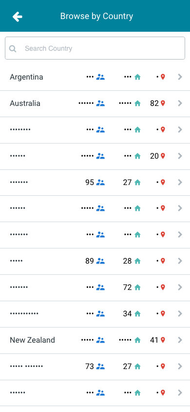 | 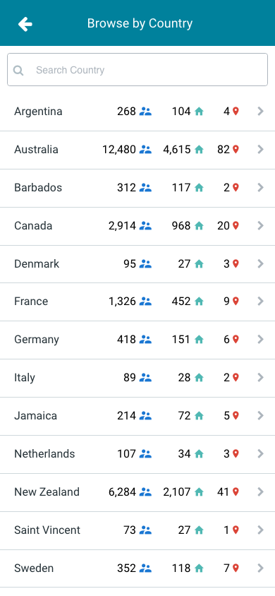 | 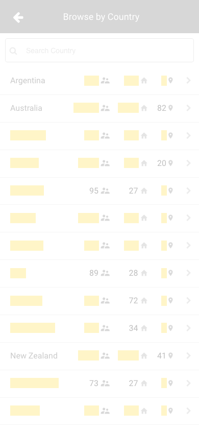 |
| `loading` 390x844, mock `loading` 2026-10-29 pixel difference 0.0% |  |  |  |
| `offline` 390x844, mock `error` 2026-10-29 pixel difference 0.0% |  | 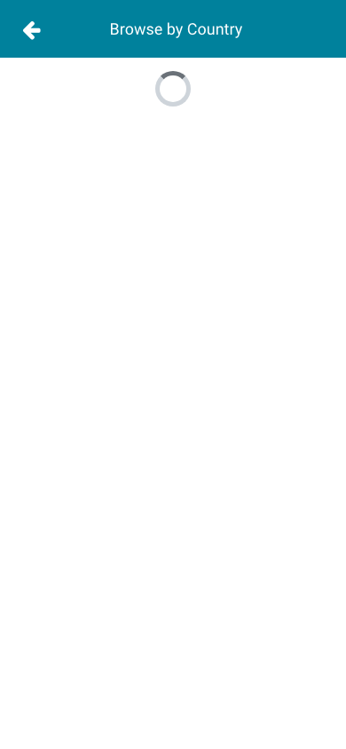 | 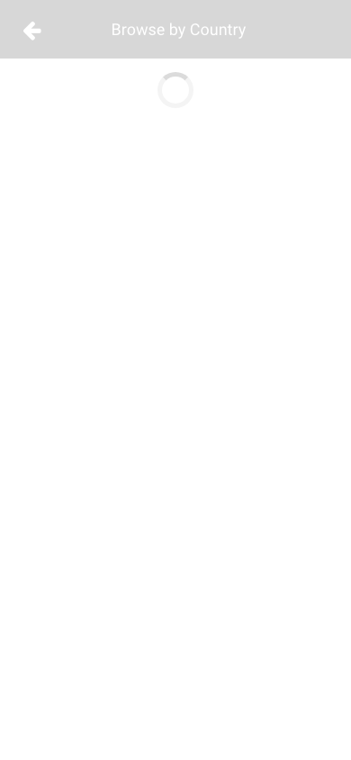 |

## 4. Diagram

- A box on the left is the block or module of the action that calls the server (TST code).
- A line connects each call to the React action that makes the same call.
- The right column shows the React components that use each React action.
- A red box is a call that React does not make.

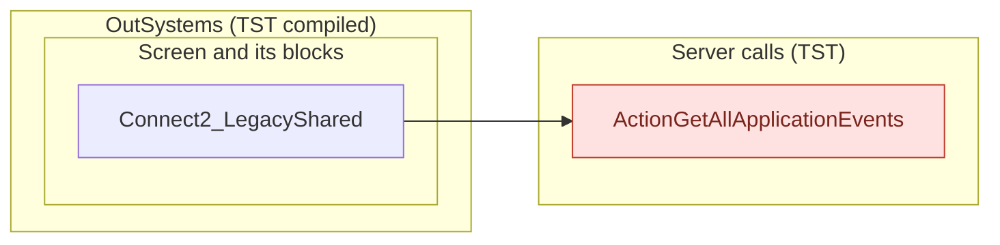

## 5. User actions

The two lists are independent: the OutSystems list comes from the TST compiled code, the React list from the React code. The tool does not map one list to the other.

- **OutSystems:** each event binding of the compiled views (`<event>$Action: function` of a child block or widget, `on<Event>: function` of an HTML element) with its handler.
- **React:** each JSX attribute `on<Event>={handler}` with its handler.
- Both lists keep only the bindings whose handler has an effect: a server call, a navigation, an external link, a message or a confirm dialog. The tool follows the called functions 3 levels deep.
- When the handler has branches in the code (`switch` case, `if` with `===`), each branch has its own diagram. The branch name is the constant of the condition. `other` is the last `else` or `default`.
- An arrow to the server gives the inputs of the call, the return arrow its outputs (contract `app/src/api/openapi.yaml`).

### 5.1 OutSystems (TST)

| # | Block (OutSystems) | Event (TST view) | Handler | Branch | Effects |
|---|---|---|---|---|---|
| [1](#511-screenblock_assemble_filter-handler_gotobrowsecountry) | `ScreenBlock_Assemble_Filter` | `onClick_GoToBrowseCountry of LocalityListDetail` | `handler_GoToBrowseCountry` | – | calls GetAllApplicationEvents, AppManager_SynchAppContext |
| [2](#512-screenblock_assemble_filter-handler_freesubscriptionalert) | `ScreenBlock_Assemble_Filter` | `freeSubscriptionAlert of FilterLocalityByCountry` | `handler_FreeSubscriptionAlert` | – | asks for a confirmation |
| [3](#513-menuicon__updatedosui-onback) | `MenuIcon__UpdatedOSUI` | `onClick (HTML element)` | `onBack` | – | goes to previous screen |
| [4](#514-assemble_browsebycountry-assemble_filtercancel) | `Assemble_BrowseByCountry` | `cancel of Filter` | `assemble_FilterCancel` | – | goes to previous screen |
| [5](#515-assemble_browsebycountry-assemble_filternavigatetolocality) | `Assemble_BrowseByCountry` | `navigateToSubdivision of Filter` | `assemble_FilterNavigateToLocality` | – | goes to AssembleEvents |

#### 5.1.1 ScreenBlock_Assemble_Filter: handler_GoToBrowseCountry

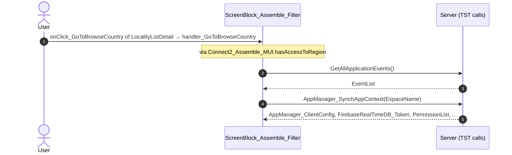

#### 5.1.2 ScreenBlock_Assemble_Filter: handler_FreeSubscriptionAlert

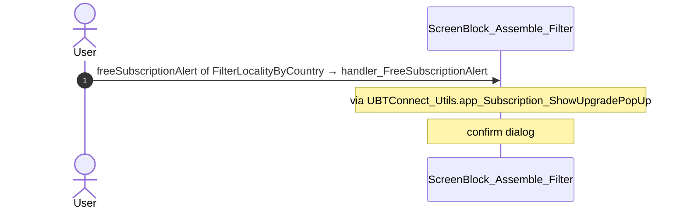

#### 5.1.3 MenuIcon__UpdatedOSUI: onBack

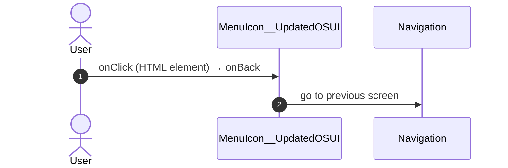

#### 5.1.4 Assemble_BrowseByCountry: assemble_FilterCancel

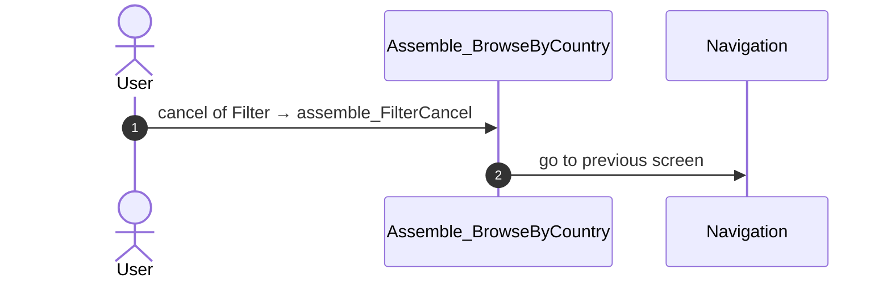

#### 5.1.5 Assemble_BrowseByCountry: assemble_FilterNavigateToLocality

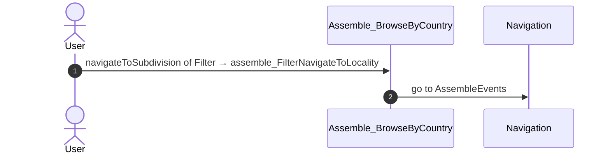

### 5.2 React

| # | File | Element | Event prop | Handler | Branch | Effects |
|---|---|---|---|---|---|---|
| [1](#521-assemblefilterview-oncountryclicked) | [`pages/Assemble_BrowseByCountry/Assemble_BrowseByCountryPage.tsx:47`](../../app/src/pages/Assemble_BrowseByCountry/Assemble_BrowseByCountryPage.tsx#L47) | `<AssembleFilterView>` | `onCountryClicked` | `handlers.onCountryClicked` | – | calls ActionGetUserInformation; asks for a confirmation |
| [2](#522-assemblefilterview-onfreesubscriptionalert) | [`pages/Assemble_BrowseByCountry/Assemble_BrowseByCountryPage.tsx:47`](../../app/src/pages/Assemble_BrowseByCountry/Assemble_BrowseByCountryPage.tsx#L47) | `<AssembleFilterView>` | `onFreeSubscriptionAlert` | `handlers.onFreeSubscriptionAlert` | – | asks for a confirmation |
| [3](#523-assemblefilterview-oncancel) | [`pages/Assemble_BrowseByCountry/Assemble_BrowseByCountryPage.tsx:47`](../../app/src/pages/Assemble_BrowseByCountry/Assemble_BrowseByCountryPage.tsx#L47) | `<AssembleFilterView>` | `onCancel` | `handlers.onCancel` | – | goes to previous screen |
| [4](#524-assemblefilterview-onapply) | [`pages/Assemble_BrowseByCountry/Assemble_BrowseByCountryPage.tsx:47`](../../app/src/pages/Assemble_BrowseByCountry/Assemble_BrowseByCountryPage.tsx#L47) | `<AssembleFilterView>` | `onApply` | `handlers.onApply` | – | goes to AssembleEvents |
| [5](#525-div-onclick) | [`components/layout/MenuIcon/MenuIcon.tsx:34`](../../app/src/components/layout/MenuIcon/MenuIcon.tsx#L34) | `
` | `onClick` | `inline` | – | goes to previous screen |
| [6](#526-oslistitem-onclick) | [`components/assemble/AssembleLocalityFilter/AssembleLocalityFilter.tsx:159`](../../app/src/components/assemble/AssembleLocalityFilter/AssembleLocalityFilter.tsx#L159) | `<OSListItem>` | `onClick` | `inline` | – | calls ActionGetUserInformation; calls the prop onFreeSubscriptionAlert(); calls the prop onSelectedSubdivision() |
| [7](#527-preventbacknavigation-onbacknavigationprevented) | [`components/layout/CommonUiLayout/CommonUiLayout.tsx:80`](../../app/src/components/layout/CommonUiLayout/CommonUiLayout.tsx#L80) | `<PreventBackNavigation>` | `onBackNavigationPrevented` | `redirectHome` | – | goes to HomeFeed |
| [8](#528-backnavigationhandler-onbacknavigation) | [`components/layout/CommonUiLayout/CommonUiLayout.tsx:82`](../../app/src/components/layout/CommonUiLayout/CommonUiLayout.tsx#L82) | `<BackNavigationHandler>` | `onBackNavigation` | `maybeRedirectHome` | – | goes to HomeFeed |

#### 5.2.1 AssembleFilterView: onCountryClicked

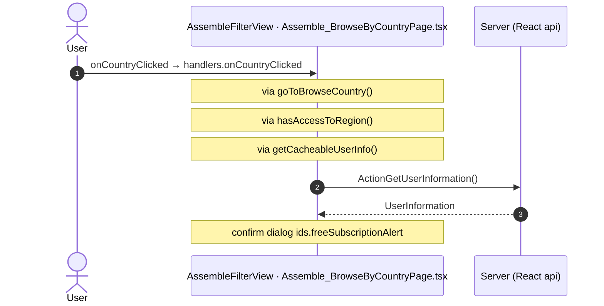

#### 5.2.2 AssembleFilterView: onFreeSubscriptionAlert

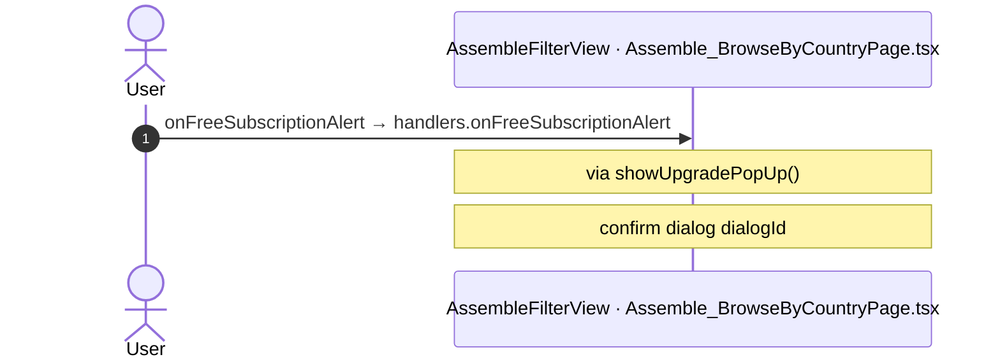

#### 5.2.3 AssembleFilterView: onCancel

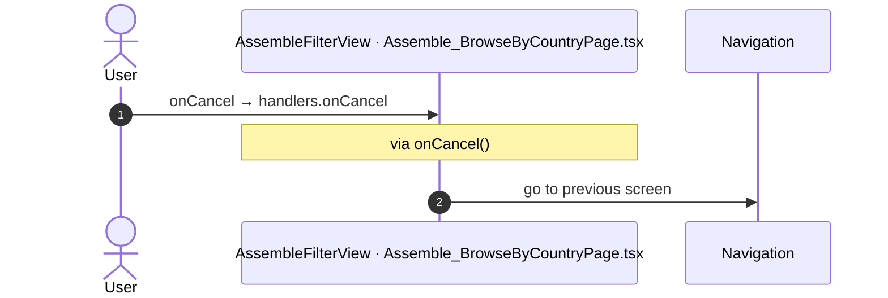

#### 5.2.4 AssembleFilterView: onApply

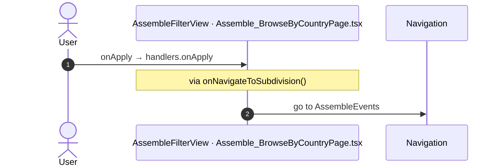

#### 5.2.5 div: onClick

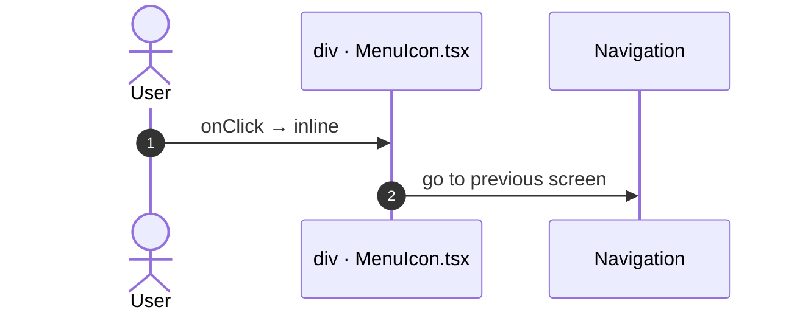

#### 5.2.6 OSListItem: onClick

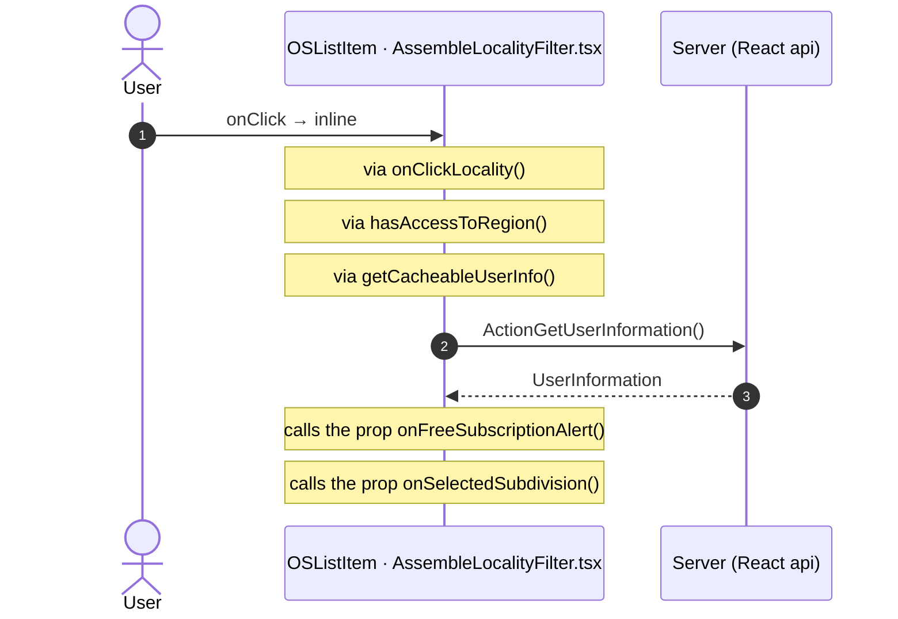

#### 5.2.7 PreventBackNavigation: onBackNavigationPrevented

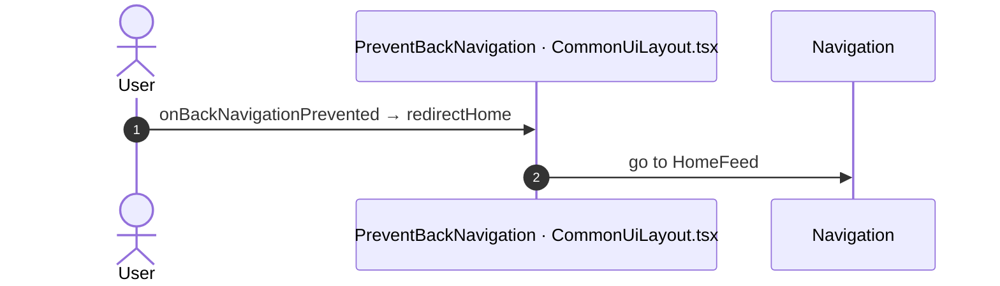

#### 5.2.8 BackNavigationHandler: onBackNavigation

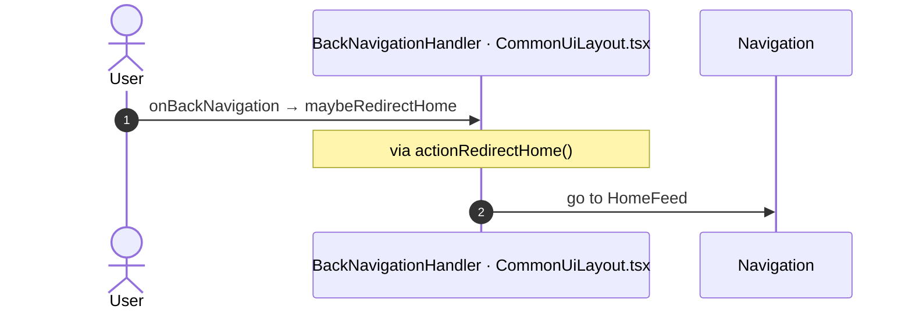

## 6. Server calls

All columns come from the code, without interpretation:

- **Direct caller (TST):** the block or module of the action that calls the server (the step before the server call in the chain).
- **Chain (TST):** the chains of client actions in the TST compiled code, from their start to the call.
  A long chain shows its first 2 steps, …, and its last 2 steps.
- **Seen on TST:** `yes` when TST made the call in the capture.
- **React action:** the React function with the `callAction` of the same call (`file:line`), and the code that loads it: `shell` (from `main.tsx`), `page` (from the screen), or both.
- **Used by (React references):** the functions and components that reference the React action, up to the nearest component. A reference is not always a call.
- **Status:** `implemented` when the contract path of the React call gives the same TST URL. It does not prove the same behaviour.

| # | Call (TST) | Kind | Direct caller (TST) | Chain (TST) | Seen on TST | React action | Used by (React references) | Status |
|---|---|---|---|---|---|---|---|---|
| 1 | `Connect2_LegacyShared/ActionGetAllApplicationEvents` | server action | `Connect2_LegacyShared` | onClick in LocalityListDetail → event onClick_GoToBrowseCountry of LocalityListDetail → … → Connect2_LegacyShared.cacheLocalApplicationEvents → server GetAllApplicationEvents | no | – | – | **missing** |

## 7. Missing in React

- Call `Connect2_LegacyShared/ActionGetAllApplicationEvents`. Chain on TST: onClick in LocalityListDetail → event onClick_GoToBrowseCountry of LocalityListDetail → … → Connect2_LegacyShared.cacheLocalApplicationEvents → server GetAllApplicationEvents.
  - No React code makes this call.

## 8. Questions

1. React calls `/api/Connect2_LegacyShared/ActionGetLocalityInformation` from `fetchLocalityInformation()` [`api/locality/repository.ts:173`](../../app/src/api/locality/repository.ts#L173) (page). TST Assemble_BrowseByCountry has no chain to this call. Does the call belong to this route?
2. React calls `/api/Connect2_LegacyShared/ActionGetUserLocalitiesForCountryCodeWithGPS` from `fetchCountryLocalities()` [`api/country/repository.ts:74`](../../app/src/api/country/repository.ts#L74) (page). TST Assemble_BrowseByCountry has no chain to this call. Does the call belong to this route?
3. React calls `/api/UBTConnect_Utils/CacheControl_Policies/DataActionGetCacheInfo` from `fetchPolicies()` [`api/app/repository.ts:54`](../../app/src/api/app/repository.ts#L54) (shell + page). TST Assemble_BrowseByCountry has no chain to this call. Does the call belong to this route?

## 9. Method

1. **OutSystems (TST).** The tool reads `facts.json` and the compiled code of `migration/screens/Assemble_BrowseByCountry/analysis/`:
   - the rendered files;
   - each server call with its chain of client actions, and the calls that TST made in the capture;
   - the effects of each user action.
2. **Route and app shell.** OutSystems: a chain belongs to the app shell when it starts in `CommonUI_InsideLayout`, one of its blocks, or a module action. React: a binding belongs to the app shell when its file is in the code that `main.tsx` loads.
3. **MCP (DEV).** The tool reads the UI flow with `getScreenNames`. TST wins when DEV is different.
4. **React.** `react_calls.mjs` reads the app shell from `app/src/main.tsx` and the screen from its `<Route>Page.tsx`. It counts only the code that the app uses.
5. **Match.** `callAction(M, A)` gives `/api/M/A`. The `x-os-paths` of `app/src/api/openapi.yaml` give the TST call. The status is `implemented` when the TST call is the same. Else the status is `missing`.

Limit: a name or a call match does not prove the same behaviour. The parity checks of the migration compare the behaviour.
