# Bookmarks: server calls and user actions in OutSystems and React

This file compares the route `/UBTConnect/Bookmarks` in OutSystems (TST) with the React app.
The tool `route-actions/tools/check_route.py` wrote this file on 2026-11-04.
The tool reads the code. It does not run the app.

The app shell is in [APP_SHELL.md](../APP_SHELL.md), not here.
- OutSystems app shell: `CommonUI_InsideLayout` with its blocks (TST survey), and the chains that start in a module action.
- React app shell: the code that `app/src/main.tsx` loads (router, `AppFrame`, app start, hosts).

## 1. Route

| Item | Value | Source |
|---|---|---|
| Route | `/UBTConnect/Bookmarks` | `app/src/app/routes.generated.ts` |
| OutSystems screen | `UBTConnect.Bookmarks.Bookmarks` | TST compiled code |
| UI flow | `Bookmarks` | MCP `getScreenNames` (DEV) |
| React screen | [`pages/Bookmarks/BookmarksPage.tsx`](../../app/src/pages/Bookmarks/BookmarksPage.tsx) | `app/src/pages/` |
| React route rules | access `member`, lock `enforce`, flag redirect none | `app/src/app/routes.ts` |
| Code read | OutSystems: 32 screen and block files of the route, 29 app shell files. React: 211 screen files | TST `facts.json`, `react_calls.mjs` |

## 2. Result

| Check | Result |
|---|---|
| Server calls of the route on TST | 5: React makes 5, **0 missing** |
| User actions of the route | OutSystems: 18 diagrams. React: 31 diagrams |
| React calls of the screen that TST does not make | 6 (see [questions](#8-questions)) |
| Screen and blocks with a React port | 32 of 32 |
| Navigation targets found in React | 11 of 11 |
| App shell on this route | 10 calls; event bindings: OutSystems 10, React 7: see [APP_SHELL.md](../APP_SHELL.md) |

## 3. Screenshots

The screenshots come from the last parity run (`route.py parity`). The TST capture hides personal text with dots. The React build shows fictional mock data.

| State | TST (expected) | React (build) | Difference |
|---|---|---|---|
| `default`<br>390x844, mock `captured`<br>2026-10-29<br>pixel difference 0.0% | 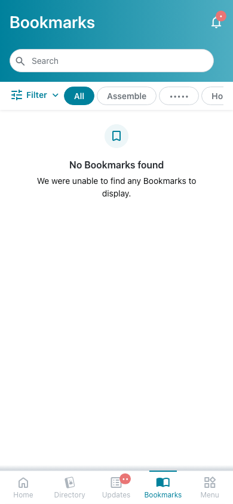 | 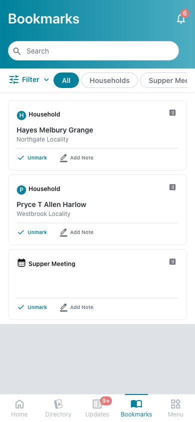 | 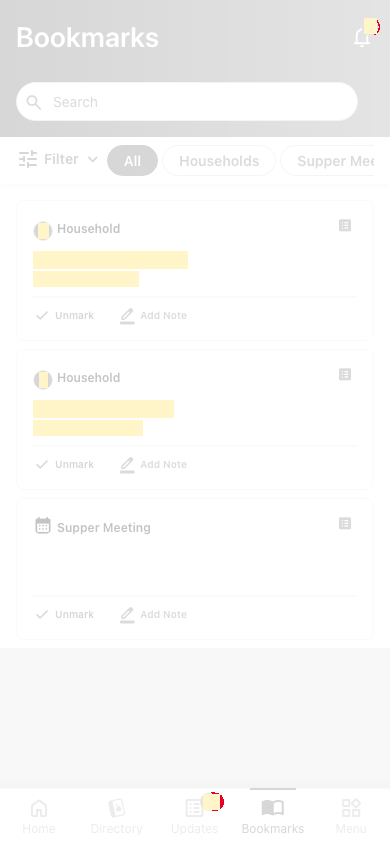 |
| `loading`<br>390x844, mock `loading`<br>2026-10-29<br>pixel difference 0.0% | 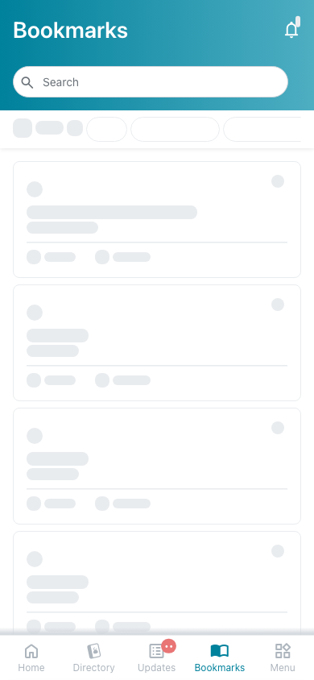 | 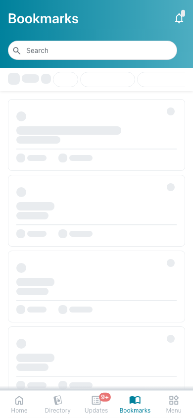 |  |
| `offline`<br>390x844, mock `error`<br>2026-10-29<br>pixel difference 0.0% | 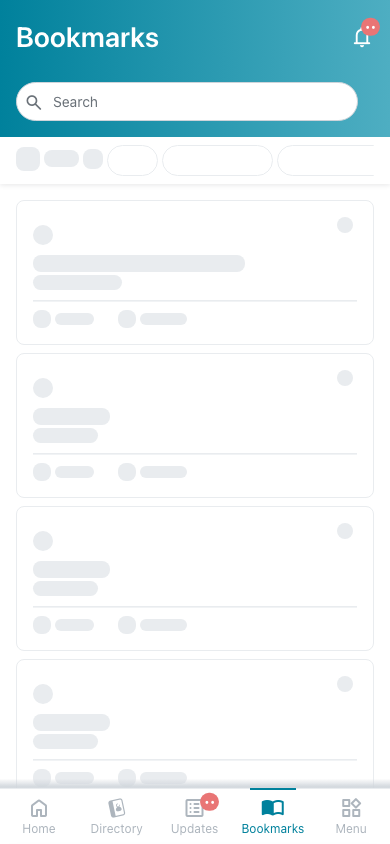 |  | 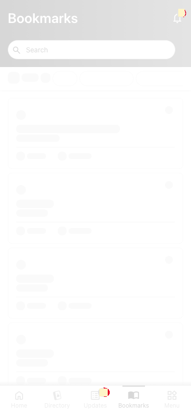 |

## 4. Diagram

- A box on the left is the block or module of the action that calls the server (TST code).
- A line connects each call to the React action that makes the same call.
- The right column shows the React components that use each React action.
- A red box is a call that React does not make.

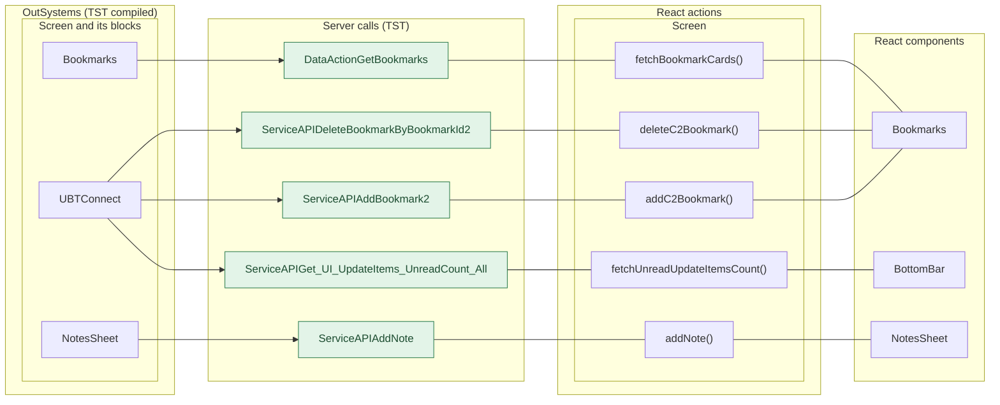

## 5. User actions

The two lists are independent: the OutSystems list comes from the TST compiled code, the React list from the React code. The tool does not map one list to the other.

- **OutSystems:** each event binding of the compiled views (`<event>$Action: function` of a child block or widget, `on<Event>: function` of an HTML element) with its handler.
- **React:** each JSX attribute `on<Event>={handler}` with its handler.
- Both lists keep only the bindings whose handler has an effect: a server call, a navigation, an external link, a message or a confirm dialog. The tool follows the called functions 3 levels deep.
- When the handler has branches in the code (`switch` case, `if` with `===`), each branch has its own diagram. The branch name is the constant of the condition. `other` is the last `else` or `default`.
- An arrow to the server gives the inputs of the call, the return arrow its outputs (contract `app/src/api/openapi.yaml`).

### 5.1 OutSystems (TST)

| # | Block (OutSystems) | Event (TST view) | Handler | Branch | Effects |
|---|---|---|---|---|---|
| [1](#511-bottombarmenu-event_bottombar_clicked-home) | `BottomBarMenu` | `onClick (HTML element)`<br>`onClick of IconBadge` | `event_BottomBar_Clicked` | `home` | goes to HomeFeed |
| [2](#512-bottombarmenu-event_bottombar_clicked-directory) | `BottomBarMenu` | `onClick (HTML element)`<br>`onClick of IconBadge` | `event_BottomBar_Clicked` | `directory` | goes to CountryList, Locality_Details |
| [3](#513-bottombarmenu-event_bottombar_clicked-updates) | `BottomBarMenu` | `onClick (HTML element)`<br>`onClick of IconBadge` | `event_BottomBar_Clicked` | `updates` | goes to Updates_SingleList |
| [4](#514-bottombarmenu-event_bottombar_clicked-bookmarks) | `BottomBarMenu` | `onClick (HTML element)`<br>`onClick of IconBadge` | `event_BottomBar_Clicked` | `bookmarks` | goes to Bookmarks |
| [5](#515-bottombarmenu-event_bottombar_clicked-menu) | `BottomBarMenu` | `onClick (HTML element)`<br>`onClick of IconBadge` | `event_BottomBar_Clicked` | `menu` | goes to Menu |
| [6](#516-filtersheet_icon_label-iconclick) | `FilterSheet_Icon_Label` | `click of Icon`<br>`clicked of CustomContainer` | `iconClick` | – | asks for a confirmation |
| [7](#517-app_notificationicon-iconclick) | `App_NotificationIcon` | `onClick of IconBadge` | `iconClick` | – | goes to Notifications, MessageList |
| [8](#518-itemcardactions-handler_onclickunmark) | `ItemCardActions` | `onClickUnbookmark of ActionBar` | `handler_OnClickUnmark` | – | calls AddBookmark2, DeleteBookmarkByBookmarkId2 |
| [9](#519-bookmarks-handler_searchonsubmit) | `Bookmarks` | `event_Submit of Input` | `handler_SearchOnSubmit` | – | calls GetBookmarks |
| [10](#5110-bookmarks-handler_searchonclear) | `Bookmarks` | `event_ClearString of Input` | `handler_SearchOnClear` | – | calls GetBookmarks |
| [11](#5111-bookmarks-handler_onclickpill) | `Bookmarks` | `changed of TagList` | `handler_OnClickPill` | – | calls GetBookmarks |
| [12](#5112-bookmarks-handler_itemunbookmarked) | `Bookmarks` | `item_Unbookmarked of List` | `handler_ItemUnbookmarked` | – | calls GetBookmarks |
| [13](#5113-bookmarks-handler_onclickbookmarkcarditem-oneschoolglobal2) | `Bookmarks` | `onClick_BookmarkCardItem of List` | `handler_OnClickBookmarkCardItem` | `oneSchoolGlobal2` | goes to OneSchoolGlobalCarousel |
| [14](#5114-bookmarks-handler_onclickbookmarkcarditem-suppermeeting) | `Bookmarks` | `onClick_BookmarkCardItem of List` | `handler_OnClickBookmarkCardItem` | `supperMeeting` | goes to SupperMeeting_Details |
| [15](#5115-bookmarks-handler_onclickbookmarkcarditem-household) | `Bookmarks` | `onClick_BookmarkCardItem of List` | `handler_OnClickBookmarkCardItem` | `household` | goes to HouseholdCarousel |
| [16](#5116-bookmarks-bookmarks_card_listonloadmore) | `Bookmarks` | `onLoadMore of List` | `bookmarks_Card_ListOnLoadMore` | – | calls GetBookmarks |
| [17](#5117-bookmarks-handler_applyfilters) | `Bookmarks` | `applyFilters of FilterSheet` | `handler_ApplyFilters` | – | calls GetBookmarks |
| [18](#5118-notessheet-handler_onsubmitnote) | `NotesSheet` | `onSubmitRequested of AddNote` | `handler_OnSubmitNote` | – | calls AddNote; shows a message |

#### 5.1.1 BottomBarMenu: event_BottomBar_Clicked (home)

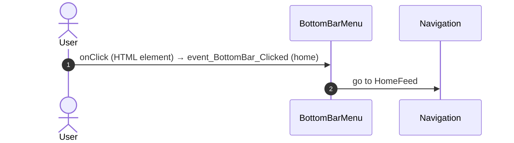

#### 5.1.2 BottomBarMenu: event_BottomBar_Clicked (directory)

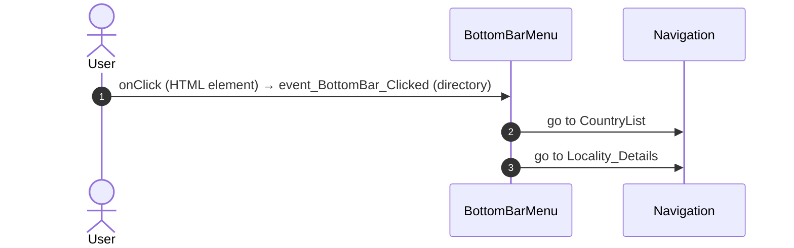

#### 5.1.3 BottomBarMenu: event_BottomBar_Clicked (updates)

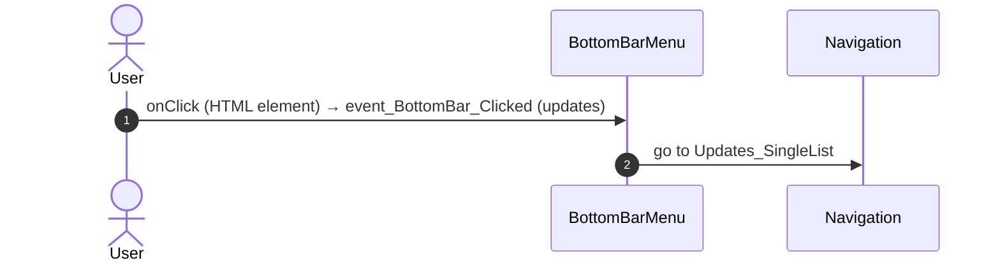

#### 5.1.4 BottomBarMenu: event_BottomBar_Clicked (bookmarks)

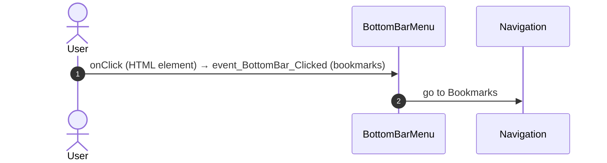

#### 5.1.5 BottomBarMenu: event_BottomBar_Clicked (menu)

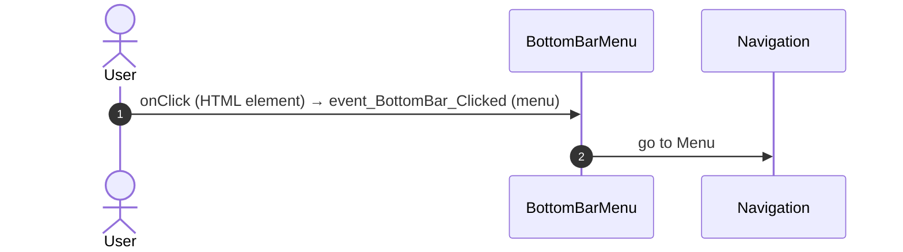

#### 5.1.6 FilterSheet_Icon_Label: iconClick

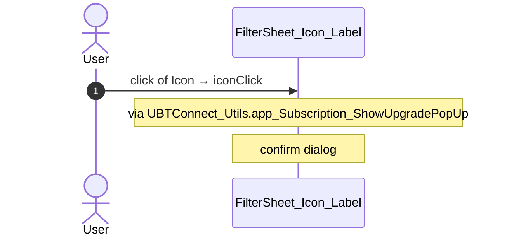

#### 5.1.7 App_NotificationIcon: iconClick

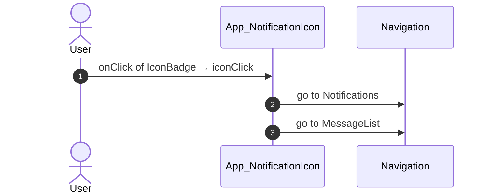

#### 5.1.8 ItemCardActions: handler_OnClickUnmark

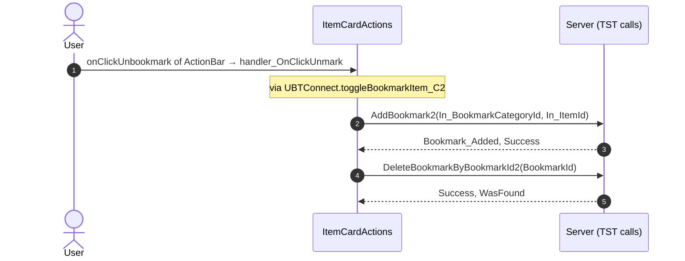

#### 5.1.9 Bookmarks: handler_SearchOnSubmit

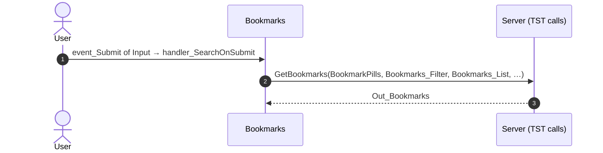

#### 5.1.10 Bookmarks: handler_SearchOnClear

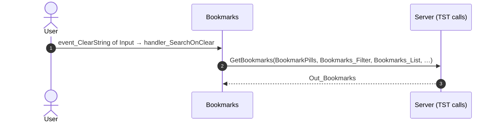

#### 5.1.11 Bookmarks: handler_OnClickPill

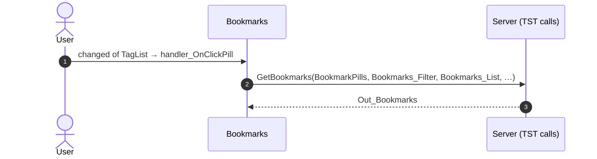

#### 5.1.12 Bookmarks: handler_ItemUnbookmarked

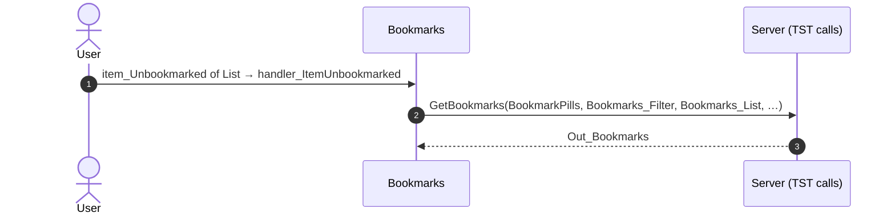

#### 5.1.13 Bookmarks: handler_OnClickBookmarkCardItem (oneSchoolGlobal2)

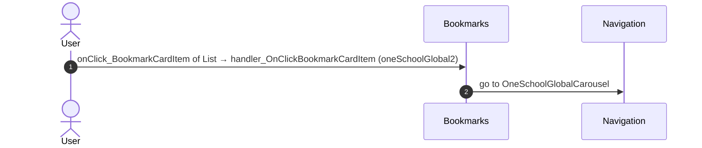

#### 5.1.14 Bookmarks: handler_OnClickBookmarkCardItem (supperMeeting)

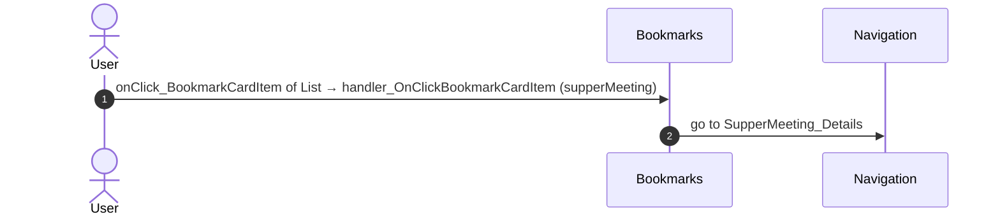

#### 5.1.15 Bookmarks: handler_OnClickBookmarkCardItem (household)

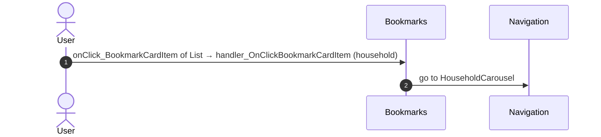

#### 5.1.16 Bookmarks: bookmarks_Card_ListOnLoadMore

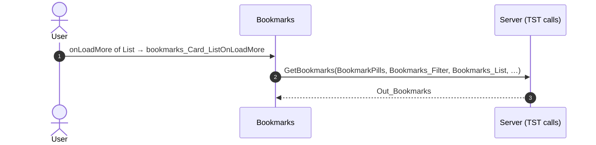

#### 5.1.17 Bookmarks: handler_ApplyFilters

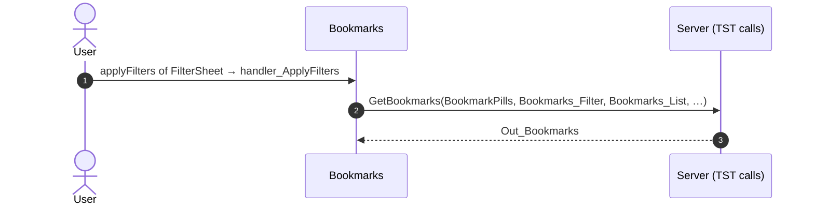

#### 5.1.18 NotesSheet: handler_OnSubmitNote

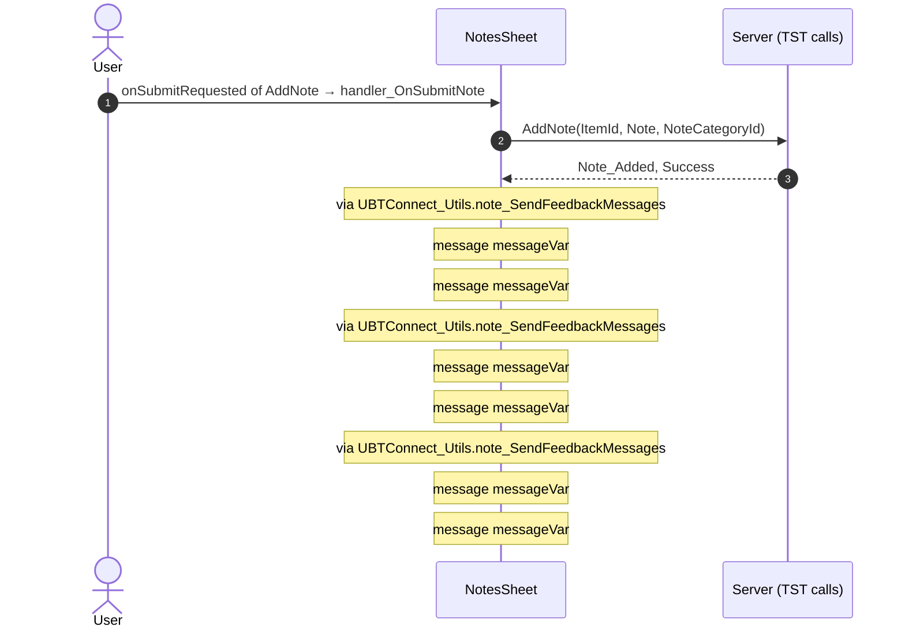

### 5.2 React

| # | File | Element | Event prop | Handler | Branch | Effects |
|---|---|---|---|---|---|---|
| [1](#521-input-oneventclearstring) | [`pages/Bookmarks/BookmarksPage.tsx:57`](../../app/src/pages/Bookmarks/BookmarksPage.tsx#L57) | `<Input>` | `onEventClearString` | `f.onSearchClear` | – | calls DataActionGetBookmarks |
| [2](#522-input-oneventsubmit) | [`pages/Bookmarks/BookmarksPage.tsx:58`](../../app/src/pages/Bookmarks/BookmarksPage.tsx#L58) | `<Input>` | `onEventSubmit` | `f.onSearchSubmit` | – | calls DataActionGetBookmarks |
| [3](#523-horizontal_filter_taglist-onchanged) | [`pages/Bookmarks/BookmarksPage.tsx:76`](../../app/src/pages/Bookmarks/BookmarksPage.tsx#L76) | `<Horizontal_Filter_TagList>` | `onChanged` | `f.onClickPill` | – | calls DataActionGetBookmarks |
| [4](#524-filtersheet_icon_label-onshowupgradepopup) | [`pages/Bookmarks/BookmarksPage.tsx:84`](../../app/src/pages/Bookmarks/BookmarksPage.tsx#L84) | `<FilterSheet_Icon_Label>` | `onShowUpgradePopUp` | `showUpgradePopUp` | – | asks for a confirmation |
| [5](#525-bookmarks_card_list-ononclickbookmarkcarditem) | [`pages/Bookmarks/BookmarksPage.tsx:96`](../../app/src/pages/Bookmarks/BookmarksPage.tsx#L96) | `<Bookmarks_Card_List>` | `onOnClickBookmarkCardItem` | `f.onClickBookmarkCardItem` | – | goes to OneSchoolGlobalCarousel, SupperMeeting_Details, HouseholdCarousel |
| [6](#526-bookmarks_card_list-onitemunbookmarked) | [`pages/Bookmarks/BookmarksPage.tsx:97`](../../app/src/pages/Bookmarks/BookmarksPage.tsx#L97) | `<Bookmarks_Card_List>` | `onItemUnbookmarked` | `f.onItemUnbookmarked` | – | calls DataActionGetBookmarks |
| [7](#527-bookmarks_card_list-ononloadmore) | [`pages/Bookmarks/BookmarksPage.tsx:99`](../../app/src/pages/Bookmarks/BookmarksPage.tsx#L99) | `<Bookmarks_Card_List>` | `onOnLoadMore` | `f.onLoadMore` | – | calls DataActionGetBookmarks, ActionGet_BookmarkPills_ByBookmarkCategoryIds |
| [8](#528-bookmarks_filtersheet-onapplyfilters) | [`pages/Bookmarks/BookmarksPage.tsx:111`](../../app/src/pages/Bookmarks/BookmarksPage.tsx#L111) | `<Bookmarks_FilterSheet>` | `onApplyFilters` | `f.onApplyFilters` | – | calls DataActionGetBookmarks |
| [9](#529-notificationicon-oniconclick) | [`pages/Bookmarks/BookmarksPage.tsx:41`](../../app/src/pages/Bookmarks/BookmarksPage.tsx#L41) | `<NotificationIcon>` | `onIconClick` | `notificationIcon.onIconClick` | – | goes to Notifications, MessageList |
| [10](#5210-filtersheet-onshowupgradepopup) | [`containers/FilterSheet/FilterSheetContainer.tsx:43`](../../app/src/containers/FilterSheet/FilterSheetContainer.tsx#L43) | `<FilterSheet>` | `onShowUpgradePopUp` | `showUpgradePopUp` | – | asks for a confirmation |
| [11](#5211-cachecontrol-onnoncachehit) | [`legacy/os/cache/UserInfoCacheControl/UserInfoCacheControl.tsx:52`](../../app/src/legacy/os/cache/UserInfoCacheControl/UserInfoCacheControl.tsx#L52) | `<CacheControl>` | `onNonCacheHit` | `onNonCacheHit` | – | calls DataActionGetCacheInfo |
| [12](#5212-cachecontrol-onnoncachehit) | [`legacy/os/cache/AllLocalitiesCacheControl/AllLocalitiesCacheControl.tsx:55`](../../app/src/legacy/os/cache/AllLocalitiesCacheControl/AllLocalitiesCacheControl.tsx#L55) | `<CacheControl>` | `onNonCacheHit` | `onNonCacheHit` | – | calls DataActionGetCacheInfo |
| [13](#5213-cachecontrol-onnoncachehit) | [`legacy/os/cache/AllCountriesCacheControl/AllCountriesCacheControl.tsx:55`](../../app/src/legacy/os/cache/AllCountriesCacheControl/AllCountriesCacheControl.tsx#L55) | `<CacheControl>` | `onNonCacheHit` | `onNonCacheHit` | – | calls DataActionGetCacheInfo |
| [14](#5214-preventbacknavigation-onbacknavigationprevented) | [`components/layout/CommonUiLayout/CommonUiLayout.tsx:80`](../../app/src/components/layout/CommonUiLayout/CommonUiLayout.tsx#L80) | `<PreventBackNavigation>` | `onBackNavigationPrevented` | `redirectHome` | – | goes to HomeFeed |
| [15](#5215-backnavigationhandler-onbacknavigation) | [`components/layout/CommonUiLayout/CommonUiLayout.tsx:82`](../../app/src/components/layout/CommonUiLayout/CommonUiLayout.tsx#L82) | `<BackNavigationHandler>` | `onBackNavigation` | `maybeRedirectHome` | – | goes to HomeFeed |
| [16](#5216-oslink-onclick-home) | [`components/layout/BottomBar/BottomBar.tsx:130`](../../app/src/components/layout/BottomBar/BottomBar.tsx#L130) | `<OSLink>` | `onClick` | `click` | `Home` | goes to HomeFeed |
| [17](#5217-oslink-onclick-directory) | [`components/layout/BottomBar/BottomBar.tsx:130`](../../app/src/components/layout/BottomBar/BottomBar.tsx#L130) | `<OSLink>` | `onClick` | `click` | `Directory` | goes to CountryList, Locality_Details |
| [18](#5218-oslink-onclick-updates) | [`components/layout/BottomBar/BottomBar.tsx:130`](../../app/src/components/layout/BottomBar/BottomBar.tsx#L130) | `<OSLink>` | `onClick` | `click` | `Updates` | goes to Updates_SingleList |
| [19](#5219-oslink-onclick-bookmarks) | [`components/layout/BottomBar/BottomBar.tsx:130`](../../app/src/components/layout/BottomBar/BottomBar.tsx#L130) | `<OSLink>` | `onClick` | `click` | `Bookmarks` | goes to Bookmarks |
| [20](#5220-oslink-onclick-menu) | [`components/layout/BottomBar/BottomBar.tsx:130`](../../app/src/components/layout/BottomBar/BottomBar.tsx#L130) | `<OSLink>` | `onClick` | `click` | `Menu` | goes to Menu |
| [21](#5221-oslink-onclick-other) | [`components/layout/BottomBar/BottomBar.tsx:130`](../../app/src/components/layout/BottomBar/BottomBar.tsx#L130) | `<OSLink>` | `onClick` | `click` | `other` | calls the prop onBottomBarClicked() |
| [22](#5222-bottombariconbadge-ononclick-home) | [`components/layout/BottomBar/BottomBar.tsx:140`](../../app/src/components/layout/BottomBar/BottomBar.tsx#L140) | `<BottomBarIconBadge>` | `onOnClick` | `click` | `Home` | goes to HomeFeed |
| [23](#5223-bottombariconbadge-ononclick-directory) | [`components/layout/BottomBar/BottomBar.tsx:140`](../../app/src/components/layout/BottomBar/BottomBar.tsx#L140) | `<BottomBarIconBadge>` | `onOnClick` | `click` | `Directory` | goes to CountryList, Locality_Details |
| [24](#5224-bottombariconbadge-ononclick-updates) | [`components/layout/BottomBar/BottomBar.tsx:140`](../../app/src/components/layout/BottomBar/BottomBar.tsx#L140) | `<BottomBarIconBadge>` | `onOnClick` | `click` | `Updates` | goes to Updates_SingleList |
| [25](#5225-bottombariconbadge-ononclick-bookmarks) | [`components/layout/BottomBar/BottomBar.tsx:140`](../../app/src/components/layout/BottomBar/BottomBar.tsx#L140) | `<BottomBarIconBadge>` | `onOnClick` | `click` | `Bookmarks` | goes to Bookmarks |
| [26](#5226-bottombariconbadge-ononclick-menu) | [`components/layout/BottomBar/BottomBar.tsx:140`](../../app/src/components/layout/BottomBar/BottomBar.tsx#L140) | `<BottomBarIconBadge>` | `onOnClick` | `click` | `Menu` | goes to Menu |
| [27](#5227-bottombariconbadge-ononclick-other) | [`components/layout/BottomBar/BottomBar.tsx:140`](../../app/src/components/layout/BottomBar/BottomBar.tsx#L140) | `<BottomBarIconBadge>` | `onOnClick` | `click` | `other` | calls the prop onBottomBarClicked() |
| [28](#5228-itemcard_actionbar-onclickunbookmark) | [`components/note/ItemCardActions/ItemCardActions.tsx:52`](../../app/src/components/note/ItemCardActions/ItemCardActions.tsx#L52) | `<ItemCard_ActionBar>` | `onClickUnbookmark` | `inline` | – | calls ServiceAPIDeleteBookmarkByBookmarkId2, ServiceAPIAddBookmark2; shows a message; calls the prop onEventItemUnbookmarked() |
| [29](#5229-addnote-ononsubmitrequested) | [`components/note/NotesSheet/NotesSheet.tsx:175`](../../app/src/components/note/NotesSheet/NotesSheet.tsx#L175) | `<AddNote>` | `onOnSubmitRequested` | `addNoteRequested` | – | calls ServiceAPIAddNote; shows a message; calls the prop onOnNotesChanged() |
| [30](#5230-notelist-onondeleterequested) | [`containers/NoteListActions/NoteListActionsContainer.tsx:157`](../../app/src/containers/NoteListActions/NoteListActionsContainer.tsx#L157) | `<NoteList>` | `onOnDeleteRequested` | `inline` | – | calls ServiceAPIDeleteNoteByNoteId; shows a message; calls the prop onOnNoteDeleted() |
| [31](#5231-notelist-ononsaveeditrequested) | [`containers/NoteListActions/NoteListActionsContainer.tsx:160`](../../app/src/containers/NoteListActions/NoteListActionsContainer.tsx#L160) | `<NoteList>` | `onOnSaveEditRequested` | `inline` | – | calls ServiceAPIUpdateNote; shows a message; calls the prop onOnSaveEditNote(); calls the prop onOnEditingStateChanged(); calls the prop onOnSaveEditNote(); calls the prop onOnEditingStateChanged() |

#### 5.2.1 Input: onEventClearString

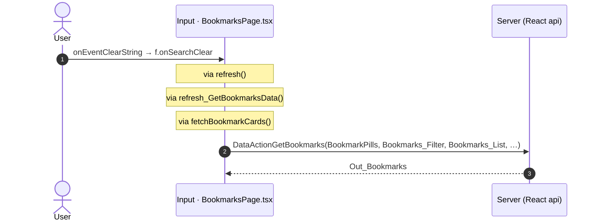

#### 5.2.2 Input: onEventSubmit

```mermaid
sequenceDiagram
  autonumber
  actor U as User
  participant H as Input · BookmarksPage.tsx
  participant A as Server (React api)
  U->>H: onEventSubmit → f.onSearchSubmit
  Note over H: via refresh_GetBookmarksData()
  Note over H: via fetchBookmarkCards()
  H->>A: DataActionGetBookmarks(BookmarkPills, Bookmarks_Filter, Bookmarks_List, …)
  A-->>H: Out_Bookmarks
```

#### 5.2.3 Horizontal_Filter_TagList: onChanged

```mermaid
sequenceDiagram
  autonumber
  actor U as User
  participant H as Horizontal_Filter_TagList · BookmarksPage.tsx
  participant A as Server (React api)
  U->>H: onChanged → f.onClickPill
  Note over H: via refresh()
  Note over H: via refresh_GetBookmarksData()
  Note over H: via fetchBookmarkCards()
  H->>A: DataActionGetBookmarks(BookmarkPills, Bookmarks_Filter, Bookmarks_List, …)
  A-->>H: Out_Bookmarks
```

#### 5.2.4 FilterSheet_Icon_Label: onShowUpgradePopUp

```mermaid
sequenceDiagram
  autonumber
  actor U as User
  participant H as FilterSheet_Icon_Label · BookmarksPage.tsx
  U->>H: onShowUpgradePopUp → showUpgradePopUp
  Note over H: confirm dialog dialogId
```

#### 5.2.5 Bookmarks_Card_List: onOnClickBookmarkCardItem

```mermaid
sequenceDiagram
  autonumber
  actor U as User
  participant H as Bookmarks_Card_List · BookmarksPage.tsx
  participant N as Navigation
  U->>H: onOnClickBookmarkCardItem → f.onClickBookmarkCardItem
  H->>N: go to OneSchoolGlobalCarousel
  H->>N: go to SupperMeeting_Details
  H->>N: go to HouseholdCarousel
```

#### 5.2.6 Bookmarks_Card_List: onItemUnbookmarked

```mermaid
sequenceDiagram
  autonumber
  actor U as User
  participant H as Bookmarks_Card_List · BookmarksPage.tsx
  participant A as Server (React api)
  U->>H: onItemUnbookmarked → f.onItemUnbookmarked
  Note over H: via refresh_GetBookmarksData()
  Note over H: via fetchBookmarkCards()
  H->>A: DataActionGetBookmarks(BookmarkPills, Bookmarks_Filter, Bookmarks_List, …)
  A-->>H: Out_Bookmarks
```

#### 5.2.7 Bookmarks_Card_List: onOnLoadMore

```mermaid
sequenceDiagram
  autonumber
  actor U as User
  participant H as Bookmarks_Card_List · BookmarksPage.tsx
  participant A as Server (React api)
  U->>H: onOnLoadMore → f.onLoadMore
  Note over H: via refresh_GetBookmarksData()
  Note over H: via fetchBookmarkCards()
  H->>A: DataActionGetBookmarks(BookmarkPills, Bookmarks_Filter, Bookmarks_List, …)
  A-->>H: Out_Bookmarks
  Note over H: via reset_PillsValues()
  Note over H: via get_LocalDynamicBookmarkPills()
  Note over H: via fetchBookmarkPills()
  H->>A: ActionGet_BookmarkPills_ByBookmarkCategoryIds(In_BookmarkCategoryIds)
  A-->>H: Out_BookmarkPills
```

#### 5.2.8 Bookmarks_FilterSheet: onApplyFilters

```mermaid
sequenceDiagram
  autonumber
  actor U as User
  participant H as Bookmarks_FilterSheet · BookmarksPage.tsx
  participant A as Server (React api)
  U->>H: onApplyFilters → f.onApplyFilters
  Note over H: via refresh()
  Note over H: via refresh_GetBookmarksData()
  Note over H: via fetchBookmarkCards()
  H->>A: DataActionGetBookmarks(BookmarkPills, Bookmarks_Filter, Bookmarks_List, …)
  A-->>H: Out_Bookmarks
```

#### 5.2.9 NotificationIcon: onIconClick

```mermaid
sequenceDiagram
  autonumber
  actor U as User
  participant H as NotificationIcon · BookmarksPage.tsx
  participant N as Navigation
  U->>H: onIconClick → notificationIcon.onIconClick
  H->>N: go to Notifications
  H->>N: go to MessageList
```

#### 5.2.10 FilterSheet: onShowUpgradePopUp

```mermaid
sequenceDiagram
  autonumber
  actor U as User
  participant H as FilterSheet · FilterSheetContainer.tsx
  U->>H: onShowUpgradePopUp → showUpgradePopUp
  Note over H: confirm dialog dialogId
```

#### 5.2.11 CacheControl: onNonCacheHit

```mermaid
sequenceDiagram
  autonumber
  actor U as User
  participant H as CacheControl · UserInfoCacheControl.tsx
  participant A as Server (React api)
  U->>H: onNonCacheHit → onNonCacheHit
  H->>A: DataActionGetCacheInfo()
  A-->>H: outputs
```

#### 5.2.12 CacheControl: onNonCacheHit

```mermaid
sequenceDiagram
  autonumber
  actor U as User
  participant H as CacheControl · AllLocalitiesCacheControl.tsx
  participant A as Server (React api)
  U->>H: onNonCacheHit → onNonCacheHit
  Note over H: via fetchAllLocalities()
  H->>A: DataActionGetCacheInfo()
  A-->>H: outputs
```

#### 5.2.13 CacheControl: onNonCacheHit

```mermaid
sequenceDiagram
  autonumber
  actor U as User
  participant H as CacheControl · AllCountriesCacheControl.tsx
  participant A as Server (React api)
  U->>H: onNonCacheHit → onNonCacheHit
  Note over H: via fetchAllCountries()
  H->>A: DataActionGetCacheInfo()
  A-->>H: outputs
```

#### 5.2.14 PreventBackNavigation: onBackNavigationPrevented

```mermaid
sequenceDiagram
  autonumber
  actor U as User
  participant H as PreventBackNavigation · CommonUiLayout.tsx
  participant N as Navigation
  U->>H: onBackNavigationPrevented → redirectHome
  H->>N: go to HomeFeed
```

#### 5.2.15 BackNavigationHandler: onBackNavigation

```mermaid
sequenceDiagram
  autonumber
  actor U as User
  participant H as BackNavigationHandler · CommonUiLayout.tsx
  participant N as Navigation
  U->>H: onBackNavigation → maybeRedirectHome
  Note over H: via actionRedirectHome()
  H->>N: go to HomeFeed
```

#### 5.2.16 OSLink: onClick (Home)

```mermaid
sequenceDiagram
  autonumber
  actor U as User
  participant H as OSLink · BottomBar.tsx
  participant N as Navigation
  U->>H: onClick → click (Home)
  Note over H: via event_BottomBar_Clicked()
  H->>N: go to HomeFeed
```

#### 5.2.17 OSLink: onClick (Directory)

```mermaid
sequenceDiagram
  autonumber
  actor U as User
  participant H as OSLink · BottomBar.tsx
  participant N as Navigation
  U->>H: onClick → click (Directory)
  Note over H: via event_BottomBar_Clicked()
  H->>N: go to CountryList
  H->>N: go to Locality_Details
```

#### 5.2.18 OSLink: onClick (Updates)

```mermaid
sequenceDiagram
  autonumber
  actor U as User
  participant H as OSLink · BottomBar.tsx
  participant N as Navigation
  U->>H: onClick → click (Updates)
  Note over H: via event_BottomBar_Clicked()
  H->>N: go to Updates_SingleList
```

#### 5.2.19 OSLink: onClick (Bookmarks)

```mermaid
sequenceDiagram
  autonumber
  actor U as User
  participant H as OSLink · BottomBar.tsx
  participant N as Navigation
  U->>H: onClick → click (Bookmarks)
  Note over H: via event_BottomBar_Clicked()
  H->>N: go to Bookmarks
```

#### 5.2.20 OSLink: onClick (Menu)

```mermaid
sequenceDiagram
  autonumber
  actor U as User
  participant H as OSLink · BottomBar.tsx
  participant N as Navigation
  U->>H: onClick → click (Menu)
  Note over H: via event_BottomBar_Clicked()
  H->>N: go to Menu
```

#### 5.2.21 OSLink: onClick (other)

```mermaid
sequenceDiagram
  autonumber
  actor U as User
  participant H as OSLink · BottomBar.tsx
  U->>H: onClick → click (other)
  Note over H: via event_BottomBar_Clicked()
  Note over H: calls the prop onBottomBarClicked()
```

#### 5.2.22 BottomBarIconBadge: onOnClick (Home)

```mermaid
sequenceDiagram
  autonumber
  actor U as User
  participant H as BottomBarIconBadge · BottomBar.tsx
  participant N as Navigation
  U->>H: onOnClick → click (Home)
  Note over H: via event_BottomBar_Clicked()
  H->>N: go to HomeFeed
```

#### 5.2.23 BottomBarIconBadge: onOnClick (Directory)

```mermaid
sequenceDiagram
  autonumber
  actor U as User
  participant H as BottomBarIconBadge · BottomBar.tsx
  participant N as Navigation
  U->>H: onOnClick → click (Directory)
  Note over H: via event_BottomBar_Clicked()
  H->>N: go to CountryList
  H->>N: go to Locality_Details
```

#### 5.2.24 BottomBarIconBadge: onOnClick (Updates)

```mermaid
sequenceDiagram
  autonumber
  actor U as User
  participant H as BottomBarIconBadge · BottomBar.tsx
  participant N as Navigation
  U->>H: onOnClick → click (Updates)
  Note over H: via event_BottomBar_Clicked()
  H->>N: go to Updates_SingleList
```

#### 5.2.25 BottomBarIconBadge: onOnClick (Bookmarks)

```mermaid
sequenceDiagram
  autonumber
  actor U as User
  participant H as BottomBarIconBadge · BottomBar.tsx
  participant N as Navigation
  U->>H: onOnClick → click (Bookmarks)
  Note over H: via event_BottomBar_Clicked()
  H->>N: go to Bookmarks
```

#### 5.2.26 BottomBarIconBadge: onOnClick (Menu)

```mermaid
sequenceDiagram
  autonumber
  actor U as User
  participant H as BottomBarIconBadge · BottomBar.tsx
  participant N as Navigation
  U->>H: onOnClick → click (Menu)
  Note over H: via event_BottomBar_Clicked()
  H->>N: go to Menu
```

#### 5.2.27 BottomBarIconBadge: onOnClick (other)

```mermaid
sequenceDiagram
  autonumber
  actor U as User
  participant H as BottomBarIconBadge · BottomBar.tsx
  U->>H: onOnClick → click (other)
  Note over H: via event_BottomBar_Clicked()
  Note over H: calls the prop onBottomBarClicked()
```

#### 5.2.28 ItemCard_ActionBar: onClickUnbookmark

```mermaid
sequenceDiagram
  autonumber
  actor U as User
  participant H as ItemCard_ActionBar · ItemCardActions.tsx
  participant A as Server (React api)
  U->>H: onClickUnbookmark → inline
  Note over H: via handler_OnClickUnmark()
  Note over H: via toggleBookmarkItem_C2()
  Note over H: via toggleBookmarkItem_C2()
  Note over H: via deleteBookmarkByBookmarkId2()
  H->>A: ServiceAPIDeleteBookmarkByBookmarkId2(BookmarkId)
  A-->>H: Success, WasFound
  Note over H: via bookmark_SendFeedbackMessage()
  Note over H: message isCreate ? 'Bookmark could not be added. Please try again later.' : 'Bookmark could not be
  Note over H: message isCreate ? 'Added to your Bookmarks' : 'Removed from your Bookmarks'
  Note over H: via bookmark_SendFeedbackMessage()
  Note over H: message isCreate ? 'Bookmark could not be added. Please try again later.' : 'Bookmark could not be
  Note over H: message isCreate ? 'Added to your Bookmarks' : 'Removed from your Bookmarks'
  Note over H: via addBookmark2()
  H->>A: ServiceAPIAddBookmark2(In_BookmarkCategoryId, In_ItemId)
  A-->>H: Bookmark_Added, Success
  Note over H: via bookmark_SendFeedbackMessage()
  Note over H: message isCreate ? 'Bookmark could not be added. Please try again later.' : 'Bookmark could not be
  Note over H: message isCreate ? 'Added to your Bookmarks' : 'Removed from your Bookmarks'
  Note over H: via bookmark_SendFeedbackMessage()
  Note over H: message isCreate ? 'Bookmark could not be added. Please try again later.' : 'Bookmark could not be
  Note over H: message isCreate ? 'Added to your Bookmarks' : 'Removed from your Bookmarks'
  Note over H: via bookmark_SendFeedbackMessage()
  Note over H: message isCreate ? 'Bookmark could not be added. Please try again later.' : 'Bookmark could not be
  Note over H: message isCreate ? 'Added to your Bookmarks' : 'Removed from your Bookmarks'
  Note over H: calls the prop onEventItemUnbookmarked()
```

#### 5.2.29 AddNote: onOnSubmitRequested

```mermaid
sequenceDiagram
  autonumber
  actor U as User
  participant H as AddNote · NotesSheet.tsx
  participant A as Server (React api)
  U->>H: onOnSubmitRequested → addNoteRequested
  Note over H: via addNote()
  H->>A: ServiceAPIAddNote(ItemId, Note, NoteCategoryId)
  A-->>H: Note_Added, Success
  Note over H: calls the prop onOnNotesChanged()
  Note over H: via note_SendFeedbackMessages()
  Note over H: message message
  Note over H: via note_SendFeedbackMessages()
  Note over H: message message
  Note over H: via note_SendFeedbackMessages()
  Note over H: message message
```

#### 5.2.30 NoteList: onOnDeleteRequested

```mermaid
sequenceDiagram
  autonumber
  actor U as User
  participant H as NoteList · NoteListActionsContainer.tsx
  participant A as Server (React api)
  U->>H: onOnDeleteRequested → inline
  Note over H: via deleteNoteRequested()
  Note over H: via deleteNoteByNoteId()
  H->>A: ServiceAPIDeleteNoteByNoteId()
  A-->>H: outputs
  Note over H: calls the prop onOnNoteDeleted()
  Note over H: via note_SendFeedbackMessages()
  Note over H: message message
  Note over H: via note_SendFeedbackMessages()
  Note over H: message message
  Note over H: via note_SendFeedbackMessages()
  Note over H: message message
```

#### 5.2.31 NoteList: onOnSaveEditRequested

```mermaid
sequenceDiagram
  autonumber
  actor U as User
  participant H as NoteList · NoteListActionsContainer.tsx
  participant A as Server (React api)
  U->>H: onOnSaveEditRequested → inline
  Note over H: via saveEditRequested()
  Note over H: via updateNote()
  H->>A: ServiceAPIUpdateNote()
  A-->>H: outputs
  Note over H: calls the prop onOnSaveEditNote()
  Note over H: calls the prop onOnEditingStateChanged()
  Note over H: via note_SendFeedbackMessages()
  Note over H: message message
  Note over H: calls the prop onOnSaveEditNote()
  Note over H: calls the prop onOnEditingStateChanged()
  Note over H: via note_SendFeedbackMessages()
  Note over H: message message
  Note over H: via note_SendFeedbackMessages()
  Note over H: message message
  Note over H: via note_SendFeedbackMessages()
  Note over H: message message
```

## 6. Server calls

All columns come from the code, without interpretation:

- **Direct caller (TST):** the block or module of the action that calls the server (the step before the server call in the chain).
- **Chain (TST):** the chains of client actions in the TST compiled code, from their start to the call.
  A long chain shows its first 2 steps, …, and its last 2 steps.
- **Seen on TST:** `yes` when TST made the call in the capture.
- **React action:** the React function with the `callAction` of the same call (`file:line`), and the code that loads it: `shell` (from `main.tsx`), `page` (from the screen), or both.
- **Used by (React references):** the functions and components that reference the React action, up to the nearest component. A reference is not always a call.
- **Status:** `implemented` when the contract path of the React call gives the same TST URL. It does not prove the same behaviour.

| # | Call (TST) | Kind | Direct caller (TST) | Chain (TST) | Seen on TST | React action | Used by (React references) | Status |
|---|---|---|---|---|---|---|---|---|
| 1 | `UBTConnect/Bookmarks/Bookmarks/DataActionGetBookmarks` | data action | `Bookmarks` | Bookmarks_Card_List.bookmarksCardList_OnScrollEnding → event onLoadMore of Bookmarks_Card_List → Bookmarks.bookmarks_Card_ListOnLoadMore → Bookmarks.refresh_GetBookmarksData → Bookmarks.DataActionGetBookmarks<br>event event_OnClick of Button → FilterSheet.onClick_ClearFilters → … → Bookmarks.refresh_GetBookmarksData → Bookmarks.DataActionGetBookmarks<br>onClick in Button → event event_OnClick of Button → … → Bookmarks.refresh_GetBookmarksData → Bookmarks.DataActionGetBookmarks<br>(+1 more chains) | yes | `fetchBookmarkCards()` [`api/bookmark/bookmarkCards.ts:114`](../../app/src/api/bookmark/bookmarkCards.ts#L114) (page) | `Bookmarks → useBookmarks → fetchBookmarkCards`<br>[`pages/Bookmarks/BookmarksPage.tsx`](../../app/src/pages/Bookmarks/BookmarksPage.tsx) | implemented |
| 2 | `UBTConnect_Utils/CW_Notes/NotesSheet/ServiceAPIAddNote` | service action | `NotesSheet` | NotesSheet.handler_OnSubmitNote → server AddNote | no | `addNote()` [`api/note/repository.ts:54`](../../app/src/api/note/repository.ts#L54) (page) | `NotesSheet → addNote`<br>[`components/note/NotesSheet/NotesSheet.tsx`](../../app/src/components/note/NotesSheet/NotesSheet.tsx) | implemented |
| 3 | `UBTConnect/ServiceAPIAddBookmark2` | service action | `UBTConnect` | onClick in IconText → event clicked of IconText → … → UBTConnect.toggleBookmarkItem_C2 → server AddBookmark2 | no | `addC2Bookmark()` [`api/bookmark/repository.ts:41`](../../app/src/api/bookmark/repository.ts#L41) (page) | `Bookmarks → useBookmarks → bookmarkServerActions → addC2Bookmark`<br>[`pages/Bookmarks/BookmarksPage.tsx`](../../app/src/pages/Bookmarks/BookmarksPage.tsx) | implemented |
| 4 | `UBTConnect/ServiceAPIDeleteBookmarkByBookmarkId2` | service action | `UBTConnect` | onClick in IconText → event clicked of IconText → … → UBTConnect.toggleBookmarkItem_C2 → server DeleteBookmarkByBookmarkId2 | no | `deleteC2Bookmark()` [`api/bookmark/repository.ts:52`](../../app/src/api/bookmark/repository.ts#L52) (page) | `Bookmarks → useBookmarks → bookmarkServerActions → deleteC2Bookmark`<br>[`pages/Bookmarks/BookmarksPage.tsx`](../../app/src/pages/Bookmarks/BookmarksPage.tsx) | implemented |
| 5 | `UBTConnect/ServiceAPIGet_UI_UpdateItems_UnreadCount_All` | service action | `UBTConnect` | BottomBarMenu.OnReady → BottomBarMenu.onReady → UBTConnect.directory_Updates_RefreshBottomBarCount → server Get_UI_UpdateItems_UnreadCount_All | no | `fetchUnreadUpdateItemsCount()` [`api/update/repository.ts:73`](../../app/src/api/update/repository.ts#L73) (page) | `BottomBar → directory_Updates_RefreshBottomBarCount → fetchUnreadUpdateItemsCount`<br>[`components/layout/BottomBar/BottomBar.tsx`](../../app/src/components/layout/BottomBar/BottomBar.tsx) | implemented |

## 7. Missing in React

None.

## 8. Questions

1. React calls `/api/UBTConnect_Utils/CacheControl_UserInfo/DataActionGetCacheInfo` from `UserInfoCacheControl()` [`legacy/os/cache/UserInfoCacheControl/UserInfoCacheControl.tsx:37`](../../app/src/legacy/os/cache/UserInfoCacheControl/UserInfoCacheControl.tsx#L37) (page). TST Bookmarks has no chain to this call. Does the call belong to this route?
2. React calls `/api/UBTConnect_Utils/CacheControl_AllLocalities/DataActionGetCacheInfo` from `fetchAllLocalities()` [`api/locality/repository.ts:157`](../../app/src/api/locality/repository.ts#L157) (page). TST Bookmarks has no chain to this call. Does the call belong to this route?
3. React calls `/api/UBTConnect_Utils/CacheControl_AllCountries/DataActionGetCacheInfo` from `fetchAllCountries()` [`api/country/repository.ts:94`](../../app/src/api/country/repository.ts#L94) (page). TST Bookmarks has no chain to this call. Does the call belong to this route?
4. React calls `/api/UBTConnect_Utils/CacheControl_Policies/DataActionGetCacheInfo` from `fetchPolicies()` [`api/app/repository.ts:54`](../../app/src/api/app/repository.ts#L54) (shell + page). TST Bookmarks has no chain to this call. Does the call belong to this route?
5. React calls `/api/UBTConnect_Utils/ServiceAPIDeleteNoteByNoteId` from `deleteNote()` [`api/note/repository.ts:73`](../../app/src/api/note/repository.ts#L73) (page). TST Bookmarks has no chain to this call. Does the call belong to this route?
6. React calls `/api/UBTConnect_Utils/ServiceAPIUpdateNote` from `updateNote()` [`api/note/repository.ts:66`](../../app/src/api/note/repository.ts#L66) (page). TST Bookmarks has no chain to this call. Does the call belong to this route?

## 9. Method

1. **OutSystems (TST).** The tool reads `facts.json` and the compiled code of `migration/screens/Bookmarks/analysis/`:
   - the rendered files;
   - each server call with its chain of client actions, and the calls that TST made in the capture;
   - the effects of each user action.
2. **Route and app shell.** OutSystems: a chain belongs to the app shell when it starts in `CommonUI_InsideLayout`, one of its blocks, or a module action. React: a binding belongs to the app shell when its file is in the code that `main.tsx` loads.
3. **MCP (DEV).** The tool reads the UI flow with `getScreenNames`. TST wins when DEV is different.
4. **React.** `react_calls.mjs` reads the app shell from `app/src/main.tsx` and the screen from its `<Route>Page.tsx`. It counts only the code that the app uses.
5. **Match.** `callAction(M, A)` gives `/api/M/A`. The `x-os-paths` of `app/src/api/openapi.yaml` give the TST call. The status is `implemented` when the TST call is the same. Else the status is `missing`.

Limit: a name or a call match does not prove the same behaviour. The parity checks of the migration compare the behaviour.
