# ContactUsDetails: server calls and user actions in OutSystems and React

This file compares the route `/UBTConnect/ContactUsDetails` in OutSystems (TST) with the React app.
The tool `route-actions/tools/check_route.py` wrote this file on 2026-11-04.
The tool reads the code. It does not run the app.

The app shell is in [APP_SHELL.md](../APP_SHELL.md), not here.
- OutSystems app shell: `CommonUI_InsideLayout` with its blocks (TST survey), and the chains that start in a module action.
- React app shell: the code that `app/src/main.tsx` loads (router, `AppFrame`, app start, hosts).

## 1. Route

| Item | Value | Source |
|---|---|---|
| Route | `/UBTConnect/ContactUsDetails` | `app/src/app/routes.generated.ts` |
| OutSystems screen | `UBTConnect.App_Menu_ContactUs.ContactUsDetails` | TST compiled code |
| UI flow | `App_Menu_ContactUs` | MCP `getScreenNames` (DEV) |
| React screen | [`pages/ContactUsDetails/ContactUsDetailsPage.tsx`](../../app/src/pages/ContactUsDetails/ContactUsDetailsPage.tsx) | `app/src/pages/` |
| React route rules | access `anonymous`, lock `enforce`, flag redirect none | `app/src/app/routes.ts` |
| Code read | OutSystems: 18 screen and block files of the route, 28 app shell files. React: 164 screen files | TST `facts.json`, `react_calls.mjs` |

## 2. Result

| Check | Result |
|---|---|
| Server calls of the route on TST | 4: React makes 4, **0 missing** |
| User actions of the route | OutSystems: 5 diagrams. React: 7 diagrams |
| React calls of the screen that TST does not make | 3 (see [questions](#8-questions)) |
| Screen and blocks with a React port | 18 of 18 |
| Navigation targets found in React | 0 of 0 |
| App shell on this route | 7 calls; event bindings: OutSystems 10, React 7: see [APP_SHELL.md](../APP_SHELL.md) |

## 3. Screenshots

The screenshots come from the last parity run (`route.py parity`). The TST capture hides personal text with dots. The React build shows fictional mock data.

| State | TST (expected) | React (build) | Difference |
|---|---|---|---|
| `default` 390x844, mock `real` 2026-10-29 pixel difference 0.0% | 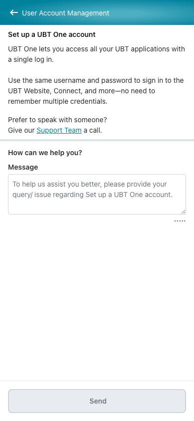 | 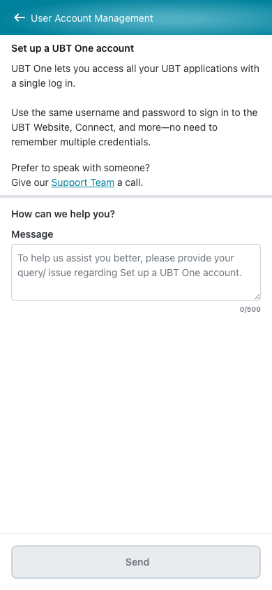 | 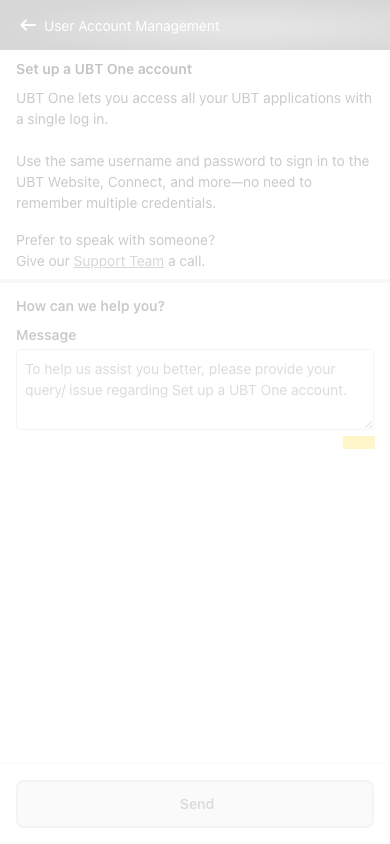 |
| `loading` 390x844, mock `loading` 2026-10-29 pixel difference 0.0% |  |  |  |
| `offline` 390x844, mock `error` 2026-10-29 pixel difference 0.0% | 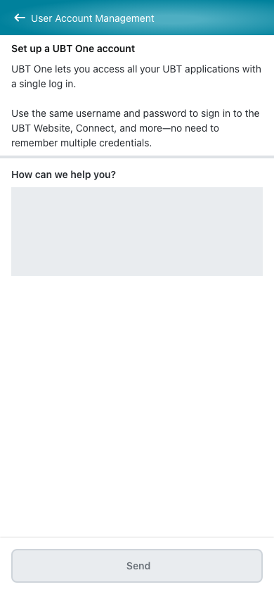 |  | 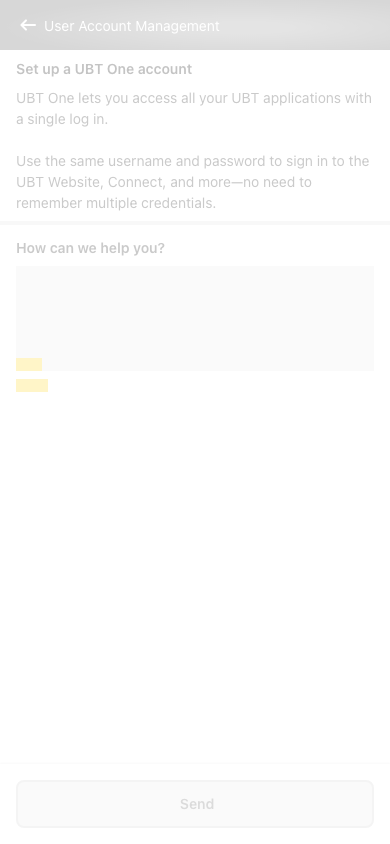 |

## 4. Diagram

- A box on the left is the block or module of the action that calls the server (TST code).
- A line connects each call to the React action that makes the same call.
- The right column shows the React components that use each React action.
- A red box is a call that React does not make.

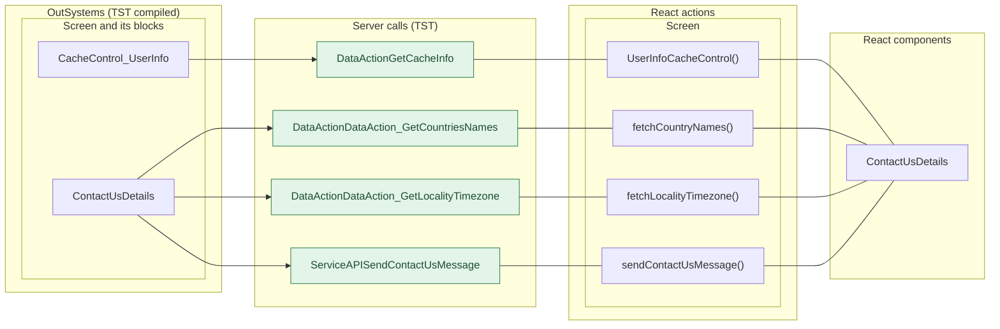

## 5. User actions

The two lists are independent: the OutSystems list comes from the TST compiled code, the React list from the React code. The tool does not map one list to the other.

- **OutSystems:** each event binding of the compiled views (`<event>$Action: function` of a child block or widget, `on<Event>: function` of an HTML element) with its handler.
- **React:** each JSX attribute `on<Event>={handler}` with its handler.
- Both lists keep only the bindings whose handler has an effect: a server call, a navigation, an external link, a message or a confirm dialog. The tool follows the called functions 3 levels deep.
- When the handler has branches in the code (`switch` case, `if` with `===`), each branch has its own diagram. The branch name is the constant of the condition. `other` is the last `else` or `default`.
- An arrow to the server gives the inputs of the call, the return arrow its outputs (contract `app/src/api/openapi.yaml`).

### 5.1 OutSystems (TST)

| # | Block (OutSystems) | Event (TST view) | Handler | Branch | Effects |
|---|---|---|---|---|---|
| [1](#511-contactusdetails-onclick_submitform) | `ContactUsDetails` | `buttonOnClick of Button` | `onClick_SubmitForm` | – | calls SendContactUsMessage; goes to previous screen; shows a message; asks for a confirmation |
| [2](#512-contactusdetails-cachecontrol_userinfo_wrapperresult) | `ContactUsDetails` | `result of Wrapper` | `cacheControl_UserInfo_WrapperResult` | – | calls DataAction_GetLocalityTimezone |
| [3](#513-layout_detailpage-onclick_backnavigation) | `Layout_DetailPage` | `click of Icon` | `onClick_BackNavigation` | – | goes to previous screen |
| [4](#514-contactpopup_byphone-onclick_callbutton) | `ContactPopup_ByPhone` | `event_Clicked of ContactPopup` | `onClick_CallButton` | – | opens an external link |
| [5](#515-cachecontrol_userinfo-cachecontrolonnoncachehit) | `CacheControl_UserInfo` | `onNonCacheHit of CacheControl` | `cacheControlOnNonCacheHit` | – | calls GetCacheInfo |

#### 5.1.1 ContactUsDetails: onClick_SubmitForm

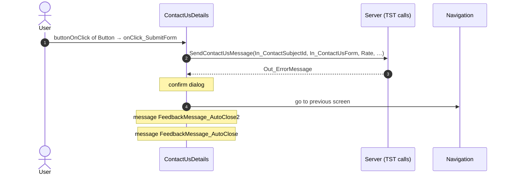

#### 5.1.2 ContactUsDetails: cacheControl_UserInfo_WrapperResult

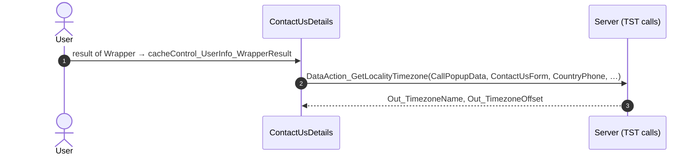

#### 5.1.3 Layout_DetailPage: onClick_BackNavigation

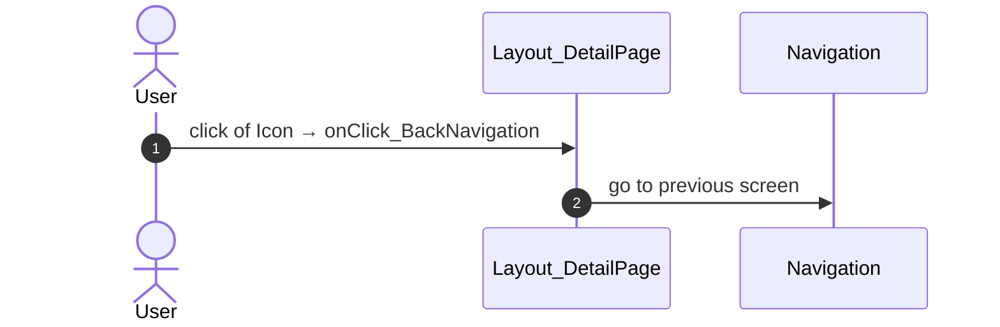

#### 5.1.4 ContactPopup_ByPhone: onClick_CallButton

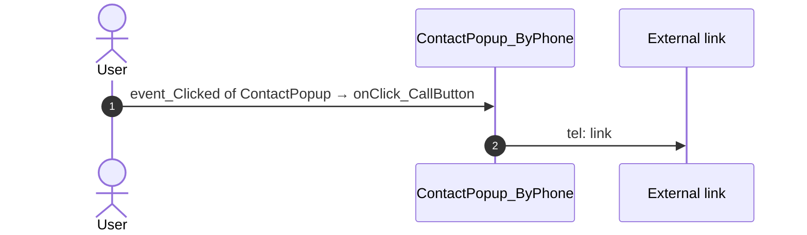

#### 5.1.5 CacheControl_UserInfo: cacheControlOnNonCacheHit

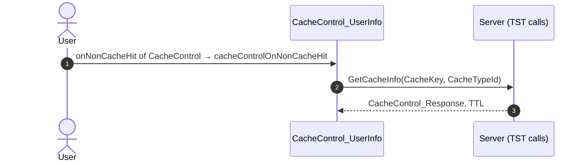

### 5.2 React

| # | File | Element | Event prop | Handler | Branch | Effects |
|---|---|---|---|---|---|---|
| [1](#521-contactusdetailsfooter-onsend) | [`pages/ContactUsDetails/ContactUsDetailsPage.tsx:82`](../../app/src/pages/ContactUsDetails/ContactUsDetailsPage.tsx#L82) | `<ContactUsDetailsFooter>` | `onSend` | `onSend` | – | calls ServiceAPISendContactUsMessage; goes to previous screen; shows a message; asks for a confirmation |
| [2](#522-detaillayout-onback) | [`pages/ContactUsDetails/ContactUsDetailsPage.tsx:112`](../../app/src/pages/ContactUsDetails/ContactUsDetailsPage.tsx#L112) | `<DetailLayout>` | `onBack` | `navigateBack` | – | goes to previous screen |
| [3](#523-userinfocache-onresult) | [`pages/ContactUsDetails/ContactUsDetailsPage.tsx:117`](../../app/src/pages/ContactUsDetails/ContactUsDetailsPage.tsx#L117) | `<UserInfoCache>` | `onResult` | `onUserInformation` | – | calls DataActionDataAction_GetLocalityTimezone |
| [4](#524-cachecontrol-onnoncachehit) | [`legacy/os/cache/UserInfoCacheControl/UserInfoCacheControl.tsx:52`](../../app/src/legacy/os/cache/UserInfoCacheControl/UserInfoCacheControl.tsx#L52) | `<CacheControl>` | `onNonCacheHit` | `onNonCacheHit` | – | calls DataActionGetCacheInfo |
| [5](#525-preventbacknavigation-onbacknavigationprevented) | [`components/layout/CommonUiLayout/CommonUiLayout.tsx:80`](../../app/src/components/layout/CommonUiLayout/CommonUiLayout.tsx#L80) | `<PreventBackNavigation>` | `onBackNavigationPrevented` | `redirectHome` | – | goes to HomeFeed |
| [6](#526-backnavigationhandler-onbacknavigation) | [`components/layout/CommonUiLayout/CommonUiLayout.tsx:82`](../../app/src/components/layout/CommonUiLayout/CommonUiLayout.tsx#L82) | `<BackNavigationHandler>` | `onBackNavigation` | `maybeRedirectHome` | – | goes to HomeFeed |
| [7](#527-contactpopup-oneventclicked) | [`components/contact/ContactPopupByPhone/ContactPopupByPhone.tsx:66`](../../app/src/components/contact/ContactPopupByPhone/ContactPopupByPhone.tsx#L66) | `<ContactPopup>` | `onEventClicked` | `inline` | – | opens an external link; calls the prop onEventCall() |

#### 5.2.1 ContactUsDetailsFooter: onSend

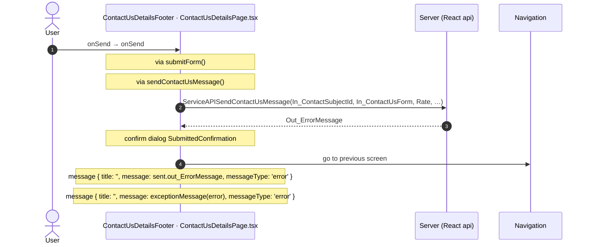

#### 5.2.2 DetailLayout: onBack

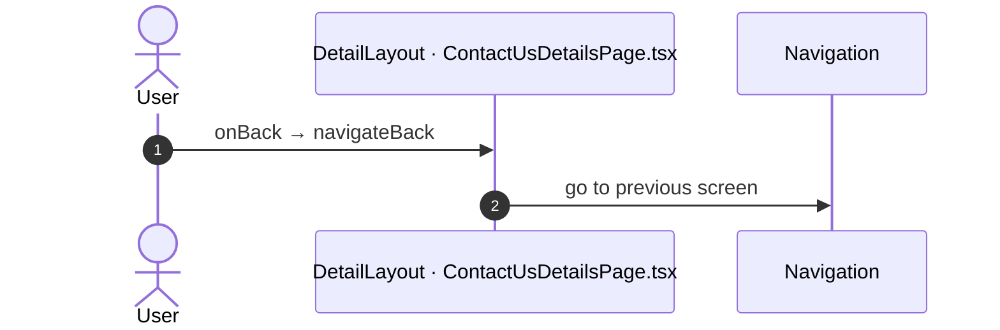

#### 5.2.3 UserInfoCache: onResult

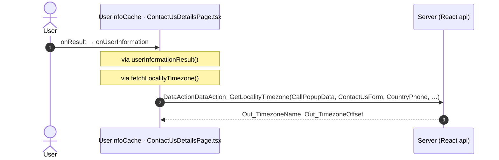

#### 5.2.4 CacheControl: onNonCacheHit

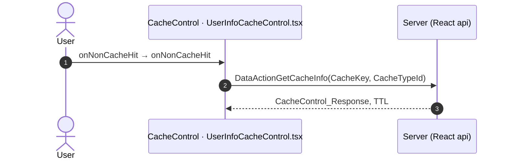

#### 5.2.5 PreventBackNavigation: onBackNavigationPrevented

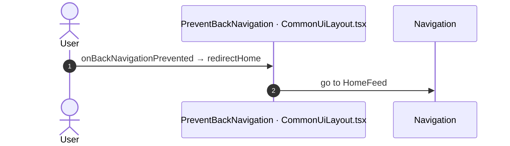

#### 5.2.6 BackNavigationHandler: onBackNavigation

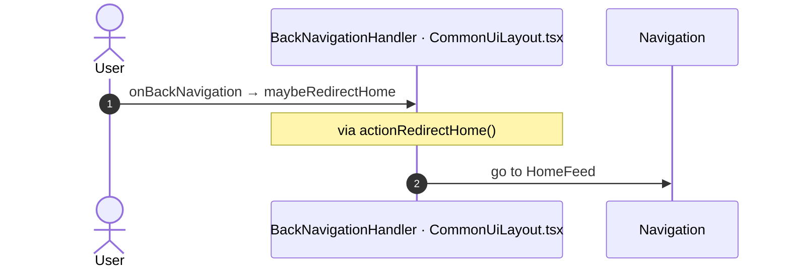

#### 5.2.7 ContactPopup: onEventClicked

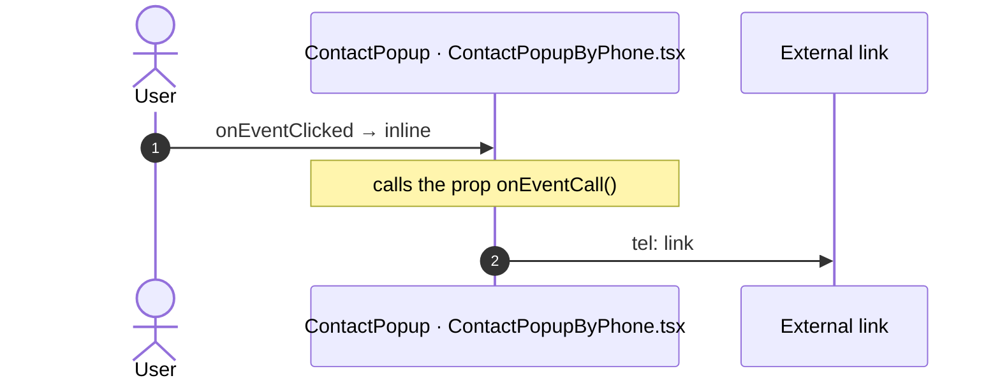

## 6. Server calls

All columns come from the code, without interpretation:

- **Direct caller (TST):** the block or module of the action that calls the server (the step before the server call in the chain).
- **Chain (TST):** the chains of client actions in the TST compiled code, from their start to the call.
  A long chain shows its first 2 steps, …, and its last 2 steps.
- **Seen on TST:** `yes` when TST made the call in the capture.
- **React action:** the React function with the `callAction` of the same call (`file:line`), and the code that loads it: `shell` (from `main.tsx`), `page` (from the screen), or both.
- **Used by (React references):** the functions and components that reference the React action, up to the nearest component. A reference is not always a call.
- **Status:** `implemented` when the contract path of the React call gives the same TST URL. It does not prove the same behaviour.

| # | Call (TST) | Kind | Direct caller (TST) | Chain (TST) | Seen on TST | React action | Used by (React references) | Status |
|---|---|---|---|---|---|---|---|---|
| 1 | `UBTConnect_Utils/CacheControl/CacheControl_UserInfo/DataActionGetCacheInfo` | data action | `CacheControl_UserInfo` | CacheControl.OnInitialize → CacheControl.onInitialize → event onNonCacheHit of CacheControl → CacheControl_UserInfo.cacheControlOnNonCacheHit → CacheControl_UserInfo.DataActionGetCacheInfo CacheControl_UserInfo fetch at start → CacheControl_UserInfo.DataActionGetCacheInfo | yes | `UserInfoCacheControl()` [`legacy/os/cache/UserInfoCacheControl/UserInfoCacheControl.tsx:37`](../../app/src/legacy/os/cache/UserInfoCacheControl/UserInfoCacheControl.tsx#L37) (page) | `ContactUsDetails → UserInfoCache → UserInfoCacheControl` [`pages/ContactUsDetails/ContactUsDetailsPage.tsx`](../../app/src/pages/ContactUsDetails/ContactUsDetailsPage.tsx) | implemented |
| 2 | `UBTConnect/App_Menu_ContactUs/ContactUsDetails/DataActionDataAction_GetCountriesNames` | data action | `ContactUsDetails` | ContactUsDetails.OnReady → ContactUsDetails.screenEvent_OnReady → ContactUsDetails.DataActionDataAction_GetCountriesNames ContactUsDetails fetch at start → ContactUsDetails.DataActionDataAction_GetCountriesNames | no | `fetchCountryNames()` [`api/message/repository.ts:111`](../../app/src/api/message/repository.ts#L111) (page) | `ContactUsDetails → useContactUsDetails → fetchCountryNames` [`pages/ContactUsDetails/ContactUsDetailsPage.tsx`](../../app/src/pages/ContactUsDetails/ContactUsDetailsPage.tsx) | implemented |
| 3 | `UBTConnect/App_Menu_ContactUs/ContactUsDetails/DataActionDataAction_GetLocalityTimezone` | data action | `ContactUsDetails` | CacheControl.OnInitialize → CacheControl.onInitialize → … → ContactUsDetails.cacheControl_UserInfo_WrapperResult → ContactUsDetails.DataActionDataAction_GetLocalityTimezone CacheControl_UserInfo.onAfterFetch → event result of CacheControl_UserInfo → … → ContactUsDetails.cacheControl_UserInfo_WrapperResult → ContactUsDetails.DataActionDataAction_GetLocalityTimezone ContactUsDetails fetch at start → ContactUsDetails.DataActionDataAction_GetLocalityTimezone | yes | `fetchLocalityTimezone()` [`api/message/repository.ts:103`](../../app/src/api/message/repository.ts#L103) (page) | `ContactUsDetails → useContactUsDetails → fetchLocalityTimezone` [`pages/ContactUsDetails/ContactUsDetailsPage.tsx`](../../app/src/pages/ContactUsDetails/ContactUsDetailsPage.tsx) | implemented |
| 4 | `UBTConnect/App_Menu_ContactUs/ContactUsDetails/ServiceAPISendContactUsMessage` | service action | `ContactUsDetails` | onClick in Button → event event_OnClick of Button → event buttonOnClick of Button → ContactUsDetails.onClick_SubmitForm → server SendContactUsMessage | no | `sendContactUsMessage()` [`api/message/repository.ts:124`](../../app/src/api/message/repository.ts#L124) (page) | `ContactUsDetails → useContactUsDetails → sendContactUsMessage` [`pages/ContactUsDetails/ContactUsDetailsPage.tsx`](../../app/src/pages/ContactUsDetails/ContactUsDetailsPage.tsx) | implemented |

## 7. Missing in React

None.

## 8. Questions

1. React calls `/api/UBTConnect_Utils/ActionGetUserInformation` from `fetchUserInformation()` [`api/member/userInformation.ts:6`](../../app/src/api/member/userInformation.ts#L6) (shell + page). TST ContactUsDetails has no chain to this call. Does the call belong to this route?
2. React calls `/api/UBTConnect_Utils/CacheControl_Policies/DataActionGetCacheInfo` from `fetchPolicies()` [`api/app/repository.ts:54`](../../app/src/api/app/repository.ts#L54) (shell + page). TST ContactUsDetails has no chain to this call. Does the call belong to this route?
3. React calls `/api/UBTConnect_Utils/ActionGetSignedImagesInBulk` from `cache_SignedImageURL_GetCallback()` [`lib/ubtConnectUtils/actions.ts:124`](../../app/src/lib/ubtConnectUtils/actions.ts#L124) (page). TST ContactUsDetails has no chain to this call. Does the call belong to this route?

## 9. Method

1. **OutSystems (TST).** The tool reads `facts.json` and the compiled code of `migration/screens/ContactUsDetails/analysis/`:
   - the rendered files;
   - each server call with its chain of client actions, and the calls that TST made in the capture;
   - the effects of each user action.
2. **Route and app shell.** OutSystems: a chain belongs to the app shell when it starts in `CommonUI_InsideLayout`, one of its blocks, or a module action. React: a binding belongs to the app shell when its file is in the code that `main.tsx` loads.
3. **MCP (DEV).** The tool reads the UI flow with `getScreenNames`. TST wins when DEV is different.
4. **React.** `react_calls.mjs` reads the app shell from `app/src/main.tsx` and the screen from its `<Route>Page.tsx`. It counts only the code that the app uses.
5. **Match.** `callAction(M, A)` gives `/api/M/A`. The `x-os-paths` of `app/src/api/openapi.yaml` give the TST call. The status is `implemented` when the TST call is the same. Else the status is `missing`.

Limit: a name or a call match does not prove the same behaviour. The parity checks of the migration compare the behaviour.
