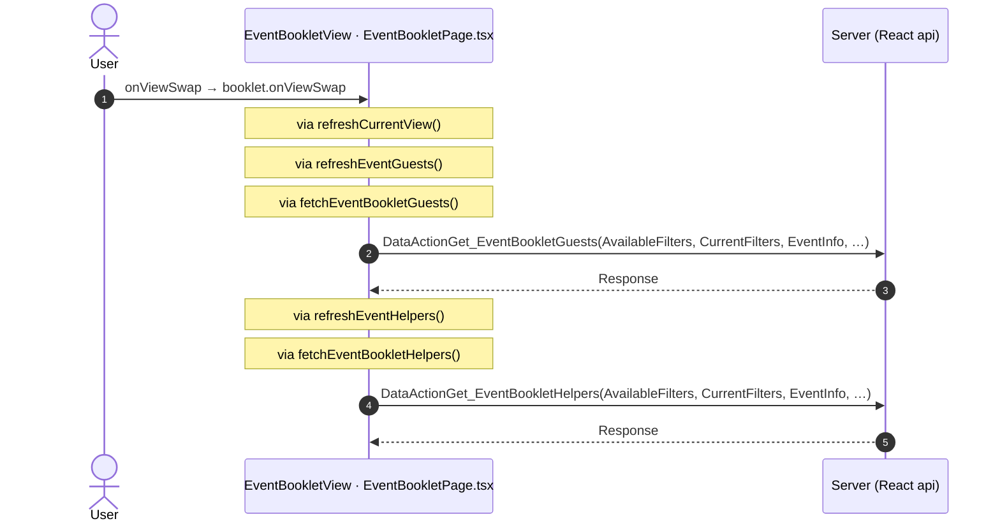
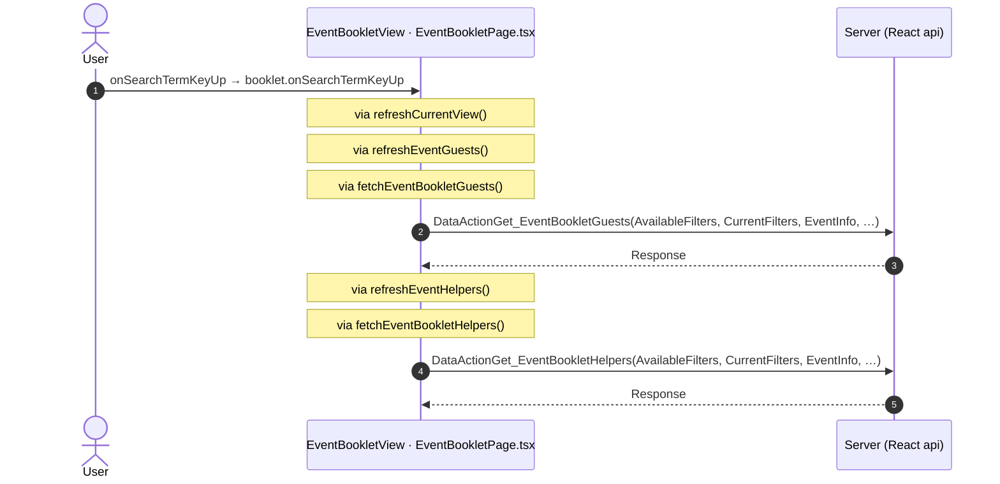
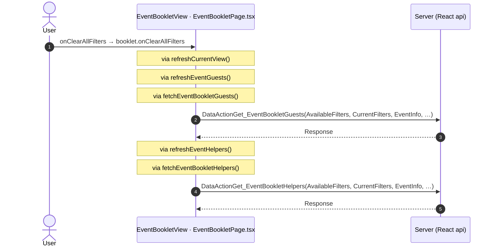
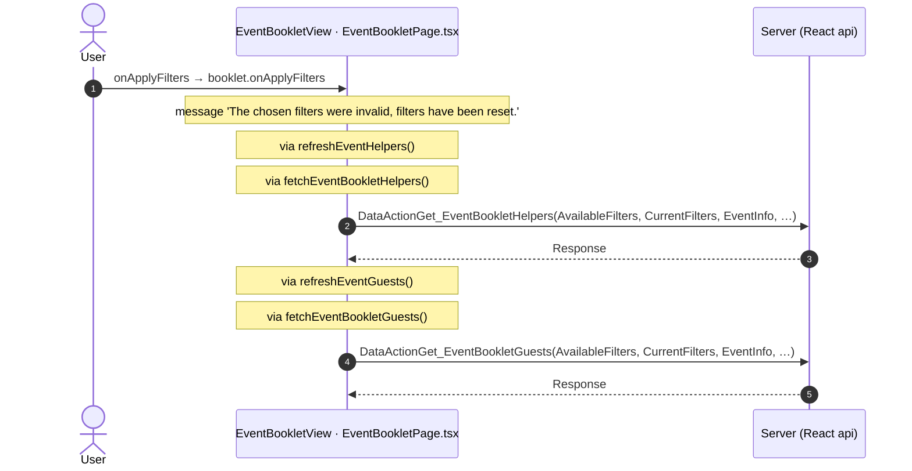
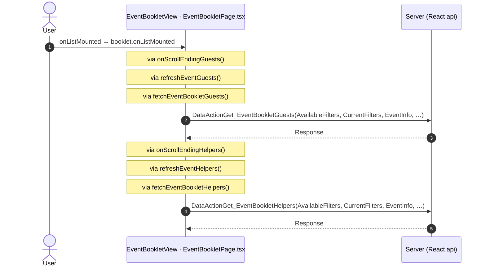
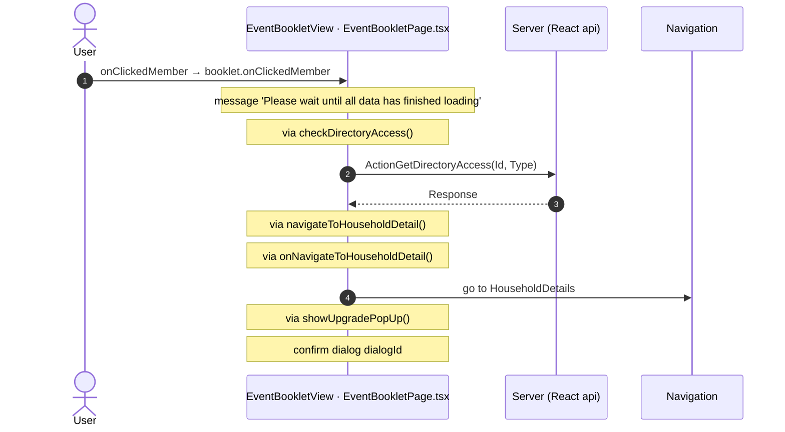

# EventBooklet: OutSystems (TST) and React

The route `/UBTConnect/EventBooklet`, read from the TST compiled code and from the React code by `route-actions/tools/check_route.py` on 2026-11-05. Facts only, each with its place. The method is in [README.md](../README.md).

Scope of this file: the screen and the blocks of its UI flow (OutSystems), the files of `app/src/pages/EventBooklet/` (React). The app shell is in [APP_SHELL.md](../APP_SHELL.md). The shared blocks and components that the route uses are in the last section.

**Static check.** This route has no TST capture (`migration/screens/EventBooklet/no-capture.json`).

- The OutSystems facts come from the compiled code of the screen and of its static closure (TST survey).
- The code is in `migration/runtime-sources/` and in the raw folders of the captured routes.
- The tool observed no call and has no screenshot.
- Closure: 62 files, 0 without compiled code.

## 1. Route

| Item | Value | Source |
|---|---|---|
| Route | `/UBTConnect/EventBooklet` | `app/src/app/routes.generated.ts` |
| OutSystems screen | `UBTConnect.Legacy_OrbitEventsFlow.EventBooklet` | TST compiled code |
| UI flow | `Legacy_OrbitEventsFlow` | MCP `getScreenNames` (DEV) |
| React screen | [`pages/EventBooklet/EventBookletPage.tsx`](../../app/src/pages/EventBooklet/EventBookletPage.tsx) | `app/src/pages/` |
| React route rules | access `member`, lock `enforce`, flag redirect none | `app/src/app/routes.ts` |
| Screenshots | no parity run | `route.py parity` |
| Code read | OutSystems: 1 files of the UI flow, 18 shared blocks, 43 app shell files. React: 163 files in the closure of the page | TST survey closure and compiled code (static), `react_calls.mjs` |

## 2. Result

| Check | Result |
|---|---|
| Server calls of the route on TST | 6: React makes 6, **0 missing** |
| Differences found | **0** (see [section 3](#3-differences-found)) |
| Questions | 0 (see [section 4](#4-questions)) |
| React calls reached only through shared code | 0: see the last section |
| User actions of the route (own code) | OutSystems: 1. React: 8 |
| Screen and blocks of the UI flow with a React port | 1 of 1 |
| Navigation targets found in React | 1 of 1 |
| Shared blocks and components on the route | OutSystems 18, React 2 with user actions: see the last section |
| App shell on this route | 3 calls: see [APP_SHELL.md](../APP_SHELL.md) |

## 3. Differences found

Each line is a fact of both sides: a TST call, navigation or variable, and the React code that has it or not. The tool does not judge the behaviour.

None.

## 4. Questions

None.

## 5. Server calls

All columns come from the code, without interpretation:

- **Direct caller (TST):** the block or module of the action that calls the server (the step before the server call in the chain).
- **Chain (TST):** the chains of client actions in the TST compiled code, from their start to the call.
  A long chain shows its first 2 steps, …, and its last 2 steps.
- **Seen on TST:** `yes` when TST made the call in the capture.
- **React action:** the React function with the `callAction` of the same call (`file:line`), and the code that loads it: `shell` (from `main.tsx`), `page` (from the screen), or both.
- **Used by (React references):** the functions and components that reference the React action, up to the nearest component. A reference is not always a call.
- **Status:** `implemented` when the contract path of the React call gives the same TST URL. It does not prove the same behaviour.

| # | Call (TST) | Kind | Direct caller (TST) | Chain (TST) | Seen on TST | React action | Used by (React references) | Status |
|---|---|---|---|---|---|---|---|---|
| 1 | `Connect2_OrbitMobile_MUI/ActionGetBookletGuestsMaxRows` | server action | `Connect2_OrbitMobile_MUI` | ScreenBlock_EventBooklet.OnReady → ScreenBlock_EventBooklet.onReady → Connect2_OrbitMobile_MUI.setBookletMaxRows → Connect2_OrbitMobile_MUI.set_BookletGuestsMaxRows → server GetBookletGuestsMaxRows | no capture | `fetchBookletGuestsMaxRows()` [`api/event/repository.ts:185`](../../app/src/api/event/repository.ts#L185) (page) | `EventBooklet → useEventBooklet → … → fetchBookletGuestsMaxRows` [`pages/EventBooklet/EventBookletPage.tsx`](../../app/src/pages/EventBooklet/EventBookletPage.tsx) | implemented |
| 2 | `Connect2_OrbitMobile_MUI/ActionGetBookletHelpersMaxRows` | server action | `Connect2_OrbitMobile_MUI` | ScreenBlock_EventBooklet.OnReady → ScreenBlock_EventBooklet.onReady → Connect2_OrbitMobile_MUI.setBookletMaxRows → Connect2_OrbitMobile_MUI.set_BookletHelpersMaxRows → server GetBookletHelpersMaxRows | no capture | `fetchBookletHelpersMaxRows()` [`api/event/repository.ts:191`](../../app/src/api/event/repository.ts#L191) (page) | `EventBooklet → useEventBooklet → … → fetchBookletHelpersMaxRows` [`pages/EventBooklet/EventBookletPage.tsx`](../../app/src/pages/EventBooklet/EventBookletPage.tsx) | implemented |
| 3 | `Connect2_OrbitMobile_MUI/ActionGetDirectoryAccess` | server action | `Connect2_OrbitMobile_MUI` | onClick in EventBooklet_MembersItem → event click_Host of EventBooklet_MembersItem → ScreenBlock_EventBooklet.onHandle_ClickedMember → Connect2_OrbitMobile_MUI.checkDirectoryAccess → server GetDirectoryAccess onClick in EventBooklet_MembersItem → event click_Member of EventBooklet_MembersItem → ScreenBlock_EventBooklet.onHandle_ClickedMember → Connect2_OrbitMobile_MUI.checkDirectoryAccess → server GetDirectoryAccess | no capture | `checkDirectoryAccess()` [`lib/orbit/actions.ts:264`](../../app/src/lib/orbit/actions.ts#L264) (page) | `EventBooklet → useEventBooklet → checkDirectoryAccess` [`pages/EventBooklet/EventBookletPage.tsx`](../../app/src/pages/EventBooklet/EventBookletPage.tsx) | implemented |
| 4 | `Connect2_OrbitMobile_MUI/Orbit_ScreenBlocks_EventBooklet/ScreenBlock_EventBooklet/DataActionGet_EventBookletFilters` | data action | `ScreenBlock_EventBooklet` | ScreenBlock_EventBooklet.refreshEventFilters → ScreenBlock_EventBooklet.DataActionGet_EventBookletFilters ScreenBlock_EventBooklet fetch at start → ScreenBlock_EventBooklet.DataActionGet_EventBookletFilters | no capture | `fetchEventBookletFilters()` [`api/event/repository.ts:164`](../../app/src/api/event/repository.ts#L164) (page) | `EventBooklet → useEventBooklet → useEventBookletDataFlows → fetchEventBookletFilters` [`pages/EventBooklet/EventBookletPage.tsx`](../../app/src/pages/EventBooklet/EventBookletPage.tsx) | implemented |
| 5 | `Connect2_OrbitMobile_MUI/Orbit_ScreenBlocks_EventBooklet/ScreenBlock_EventBooklet/DataActionGet_EventBookletGuests` | data action | `ScreenBlock_EventBooklet` | onClick in ScreenBlock_EventBooklet → ScreenBlock_EventBooklet.clearAllFilters → ScreenBlock_EventBooklet.refreshEventGuests → ScreenBlock_EventBooklet.DataActionGet_EventBookletGuests onClick in ScreenBlock_EventBooklet → ScreenBlock_EventBooklet.onClick_ViewSwap → ScreenBlock_EventBooklet.refreshEventGuests → ScreenBlock_EventBooklet.DataActionGet_EventBookletGuests onClick in Orbit_FooterWithActions → event click_PrimaryButton of Orbit_FooterWithActions → … → ScreenBlock_EventBooklet.refreshEventGuests → ScreenBlock_EventBooklet.DataActionGet_EventBookletGuests (+3 more chains) | no capture | `fetchEventBookletGuests()` [`api/event/repository.ts:171`](../../app/src/api/event/repository.ts#L171) (page) | `EventBooklet → useEventBooklet → useEventBookletDataFlows → fetchEventBookletGuests` [`pages/EventBooklet/EventBookletPage.tsx`](../../app/src/pages/EventBooklet/EventBookletPage.tsx) | implemented |
| 6 | `Connect2_OrbitMobile_MUI/Orbit_ScreenBlocks_EventBooklet/ScreenBlock_EventBooklet/DataActionGet_EventBookletHelpers` | data action | `ScreenBlock_EventBooklet` | onClick in ScreenBlock_EventBooklet → ScreenBlock_EventBooklet.clearAllFilters → ScreenBlock_EventBooklet.refreshEventHelpers → ScreenBlock_EventBooklet.DataActionGet_EventBookletHelpers onClick in ScreenBlock_EventBooklet → ScreenBlock_EventBooklet.onClick_ViewSwap → ScreenBlock_EventBooklet.refreshEventHelpers → ScreenBlock_EventBooklet.DataActionGet_EventBookletHelpers onClick in Orbit_FooterWithActions → event click_PrimaryButton of Orbit_FooterWithActions → … → ScreenBlock_EventBooklet.refreshEventHelpers → ScreenBlock_EventBooklet.DataActionGet_EventBookletHelpers (+3 more chains) | no capture | `fetchEventBookletHelpers()` [`api/event/repository.ts:178`](../../app/src/api/event/repository.ts#L178) (page) | `EventBooklet → useEventBooklet → useEventBookletDataFlows → fetchEventBookletHelpers` [`pages/EventBooklet/EventBookletPage.tsx`](../../app/src/pages/EventBooklet/EventBookletPage.tsx) | implemented |

## 6. User actions

Two independent lists: the event bindings of the TST views, and the JSX event bindings of the React files. The effects come from the handler and the functions it calls, 3 levels deep. No mapping.

### 6.1 OutSystems (TST)

| # | Block (OutSystems) | Event (TST view) | Handler | Branch | Effects |
|---|---|---|---|---|---|
| 1 | `EventBooklet` | `navigateTo_HouseholdDetail of EventBooklet` | `onHandle_NavigateToHouseholdDetail` | – | goes to HouseholdDetails |

### 6.2 React

| # | File | Element | Event prop | Handler | Branch | Effects |
|---|---|---|---|---|---|---|
| [1](#621-eventbookletview-onviewswap) | [`pages/EventBooklet/EventBookletPage.tsx:34`](../../app/src/pages/EventBooklet/EventBookletPage.tsx#L34) | `<EventBookletView>` | `onViewSwap` | `booklet.onViewSwap` | – | calls DataActionGet_EventBookletGuests, DataActionGet_EventBookletHelpers |
| [2](#622-eventbookletview-onsearchtermkeyup) | [`pages/EventBooklet/EventBookletPage.tsx:34`](../../app/src/pages/EventBooklet/EventBookletPage.tsx#L34) | `<EventBookletView>` | `onSearchTermKeyUp` | `booklet.onSearchTermKeyUp` | – | calls DataActionGet_EventBookletGuests, DataActionGet_EventBookletHelpers |
| [3](#623-eventbookletview-onclearallfilters) | [`pages/EventBooklet/EventBookletPage.tsx:34`](../../app/src/pages/EventBooklet/EventBookletPage.tsx#L34) | `<EventBookletView>` | `onClearAllFilters` | `booklet.onClearAllFilters` | – | calls DataActionGet_EventBookletGuests, DataActionGet_EventBookletHelpers |
| [4](#624-eventbookletview-onapplyfilters) | [`pages/EventBooklet/EventBookletPage.tsx:34`](../../app/src/pages/EventBooklet/EventBookletPage.tsx#L34) | `<EventBookletView>` | `onApplyFilters` | `booklet.onApplyFilters` | – | calls DataActionGet_EventBookletHelpers, DataActionGet_EventBookletGuests; shows a message |
| 5 | [`pages/EventBooklet/EventBookletPage.tsx:34`](../../app/src/pages/EventBooklet/EventBookletPage.tsx#L34) | `<EventBookletView>` | `onScrollEndingGuests` | `booklet.onScrollEndingGuests` | – | calls DataActionGet_EventBookletGuests |
| 6 | [`pages/EventBooklet/EventBookletPage.tsx:34`](../../app/src/pages/EventBooklet/EventBookletPage.tsx#L34) | `<EventBookletView>` | `onScrollEndingHelpers` | `booklet.onScrollEndingHelpers` | – | calls DataActionGet_EventBookletHelpers |
| [7](#627-eventbookletview-onlistmounted) | [`pages/EventBooklet/EventBookletPage.tsx:34`](../../app/src/pages/EventBooklet/EventBookletPage.tsx#L34) | `<EventBookletView>` | `onListMounted` | `booklet.onListMounted` | – | calls DataActionGet_EventBookletGuests, DataActionGet_EventBookletHelpers |
| [8](#628-eventbookletview-onclickedmember) | [`pages/EventBooklet/EventBookletPage.tsx:34`](../../app/src/pages/EventBooklet/EventBookletPage.tsx#L34) | `<EventBookletView>` | `onClickedMember` | `booklet.onClickedMember` | – | calls ActionGetDirectoryAccess; goes to HouseholdDetails; shows a message; asks for a confirmation |

6 diagrams (handlers with two or more effects)

#### 6.2.1 EventBookletView: onViewSwap

#### 6.2.2 EventBookletView: onSearchTermKeyUp

#### 6.2.3 EventBookletView: onClearAllFilters

#### 6.2.4 EventBookletView: onApplyFilters

#### 6.2.7 EventBookletView: onListMounted

#### 6.2.8 EventBookletView: onClickedMember

## 7. Screen inputs and navigation parameters

The input parameters of the screen, the parameters that the route reads, and the parameters that the route gives when it opens another screen. A navigation without parameters is only in section 2.
The OutSystems files are in `migration/runtime-sources/` and in the `analysis/sources/raw/` folders of the captured routes (static check).

### 7.1 OutSystems (TST)

| Input | Type | Mandatory | Place |
|---|---|---|---|
| `In_EventId` | LongInteger | yes | [`UBTConnect.Legacy_OrbitEventsFlow.EventBooklet.mvc.js:65`](../../migration/runtime-sources/UBTConnect.Legacy_OrbitEventsFlow.EventBooklet.mvc.js#L65) |
| `In_EventName` | Text | yes | [`UBTConnect.Legacy_OrbitEventsFlow.EventBooklet.mvc.js:69`](../../migration/runtime-sources/UBTConnect.Legacy_OrbitEventsFlow.EventBooklet.mvc.js#L69) |

| Block | Target | Parameters | Place |
|---|---|---|---|
| `EventBooklet` | `HouseholdDetails` | `HouseholdId` = `householdId` | [`UBTConnect.Legacy_OrbitEventsFlow.EventBooklet.mvc.js:243`](../../migration/runtime-sources/UBTConnect.Legacy_OrbitEventsFlow.EventBooklet.mvc.js#L243) |

### 7.2 React

Declared inputs of the route: `In_EventId: LongInteger`, `In_EventName: Text` (`app/src/app/routes.generated.ts`).

| Hook | Keys read | Place |
|---|---|---|
| `useSearchParams` | none | [`pages/EventBooklet/EventBookletPage.tsx:19`](../../app/src/pages/EventBooklet/EventBookletPage.tsx#L19) |

| File | Target | Parameters | Place |
|---|---|---|---|
| `EventBookletPage.tsx` | `HouseholdDetails` | `HouseholdId` = `householdId` | [`pages/EventBooklet/EventBookletPage.tsx:25`](../../app/src/pages/EventBooklet/EventBookletPage.tsx#L25) |

## 8. Lifecycle

What runs when the screen and its blocks open and close, without a user action.

### 8.1 OutSystems (TST)

Event handlers. The steps are the node comments and the conditions of the compiled action.

None.

Data actions and aggregates. The tool reads `dataFetchDependenciesOriginal`: `0` is a fetch when the block opens, `-1` is a fetch only on demand (a `Refresh Query` step). `Read by` lists the child block inputs, conditions, text widgets and actions that read the result.

None.

### 8.2 React

Effects (`useEffect`, `useLayoutEffect`) of the screen files, and the effects of shared components that make a call, a navigation or a message.

| File | Hook (function) | Dependencies | Cleanup | Effects | Place |
|---|---|---|---|---|---|
| `EventBookletListParts.tsx` | `useLayoutEffect` (`OnListMounted`) | `[]` | no | none | [`pages/EventBooklet/components/EventBookletListParts.tsx:20`](../../app/src/pages/EventBooklet/components/EventBookletListParts.tsx#L20) |
| `PopUp_OrbitBookletFilters.tsx` | `useEffect` (`PopUp_OrbitBookletFilters`) | `[]` | no | none | [`pages/EventBooklet/components/PopUp_OrbitBookletFilters.tsx:93`](../../app/src/pages/EventBooklet/components/PopUp_OrbitBookletFilters.tsx#L93) |

Queries. A query fetches when its component mounts and when its key changes. `Read by` lists what reads the result in the same file.

None.

## 9. Client state

Client variables and browser storage that the route reads or writes. Other screens can read this state.

### 9.1 OutSystems (TST)

None.

### 9.2 React

| File | Operation | Variable or key | Place |
|---|---|---|---|
| `eventBookletDataFlows.ts` | `clientVar.get` | `Connect2_OrbitMobile_MUI.BookletGuestsMaxRows` | [`pages/EventBooklet/hooks/eventBookletDataFlows.ts:60`](../../app/src/pages/EventBooklet/hooks/eventBookletDataFlows.ts#L60) |
| `eventBookletDataFlows.ts` | `clientVar.get` | `Connect2_OrbitMobile_MUI.BookletHelpersMaxRows` | [`pages/EventBooklet/hooks/eventBookletDataFlows.ts:61`](../../app/src/pages/EventBooklet/hooks/eventBookletDataFlows.ts#L61) |

## 10. Access

Who can open the route, and the role checks in the screen and block code.

| Side | Rule | Place |
|---|---|---|
| OutSystems (TST) | registered users (`checkRegistered()`) | [`UBTConnect.Legacy_OrbitEventsFlow.EventBooklet.mvc.js:288`](../../migration/runtime-sources/UBTConnect.Legacy_OrbitEventsFlow.EventBooklet.mvc.js#L288) |
| React | access `member`, lock `enforce`, flag redirect none | `app/src/app/routes.ts` |

Role checks in the TST screen and block actions (`RolesInfo`, `$roles`, `Check<Role>Role`): none.

## 11. Errors

What the route does when an action or a call fails.

### 11.1 OutSystems (TST)

The actions of the screen and its blocks have no `Handle Error` node.

An error without a handler goes to the `OnException` of the UI flow (`handleError`):

1. UI flow `Legacy_OrbitEventsFlow` not in `migration/shell/sources/`. Handled errors: none.

### 11.2 React

| File | Kind | Function | Effects | Place |
|---|---|---|---|---|
| `eventBookletDataFlows.ts` | try/catch | `refreshHelperRoles` | none | [`pages/EventBooklet/hooks/eventBookletDataFlows.ts:110`](../../app/src/pages/EventBooklet/hooks/eventBookletDataFlows.ts#L110) |
| `eventBookletDataFlows.ts` | try/catch | `refreshEventFilters` | none | [`pages/EventBooklet/hooks/eventBookletDataFlows.ts:122`](../../app/src/pages/EventBooklet/hooks/eventBookletDataFlows.ts#L122) |
| `eventBookletDataFlows.ts` | try/catch | `refreshEventGuests` | none | [`pages/EventBooklet/hooks/eventBookletDataFlows.ts:134`](../../app/src/pages/EventBooklet/hooks/eventBookletDataFlows.ts#L134) |
| `eventBookletDataFlows.ts` | try/catch | `refreshEventHelpers` | none | [`pages/EventBooklet/hooks/eventBookletDataFlows.ts:146`](../../app/src/pages/EventBooklet/hooks/eventBookletDataFlows.ts#L146) |

`flow handler`: `raiseToFlowHandler` gives the error to the flow handler of the screen (`app/src/platform/feedback/flowErrors.ts`). The tool lists `.catch`, `try/catch` and `onError` that do not give the error to it.

## 12. Shared blocks and components on this route

Blocks of other UI flows and modules (OutSystems), and files outside `app/src/pages/` (React) that the route renders. Their facts belong to them, not to the route. This section gives their user actions once, without diagrams.

### OutSystems (TST)

| Block | Module | React port | User actions |
|---|---|---|---|
| `ScreenBlock_EventBooklet` | `Connect2_OrbitMobile_MUI` | [`pages/EventBooklet/components/EventBookletGuestView.tsx`](../../app/src/pages/EventBooklet/components/EventBookletGuestView.tsx), [`pages/EventBooklet/components/EventBookletHelperView.tsx`](../../app/src/pages/EventBooklet/components/EventBookletHelperView.tsx), [`pages/EventBooklet/components/EventBookletListParts.tsx`](../../app/src/pages/EventBooklet/components/EventBookletListParts.tsx), [`pages/EventBooklet/components/EventBookletView.tsx`](../../app/src/pages/EventBooklet/components/EventBookletView.tsx), [`pages/EventBooklet/hooks/eventBookletDataFlows.ts`](../../app/src/pages/EventBooklet/hooks/eventBookletDataFlows.ts), [`pages/EventBooklet/hooks/eventBookletLists.ts`](../../app/src/pages/EventBooklet/hooks/eventBookletLists.ts), [`pages/EventBooklet/hooks/eventBookletState.ts`](../../app/src/pages/EventBooklet/hooks/eventBookletState.ts), [`pages/EventBooklet/hooks/useEventBooklet.ts`](../../app/src/pages/EventBooklet/hooks/useEventBooklet.ts) | 7 |
| `Dialog_AccessRestrictedAction_Legacy` | `UBTConnect_Utils` | [`platform/feedback/dialogs/DialogAccessRestrictedActionLegacy.tsx`](../../app/src/platform/feedback/dialogs/DialogAccessRestrictedActionLegacy.tsx) | 0 |
| `PopUp_OrbitBookletFilters` | `Connect2_OrbitMobile_MUI` | [`pages/EventBooklet/components/PopUp_OrbitBookletFilters.tsx`](../../app/src/pages/EventBooklet/components/PopUp_OrbitBookletFilters.tsx) | 0 |
| `Orbit_FooterWithActions` | `Connect2_OrbitMobile_MUI` | [`components/orbit/FooterWithActions/FooterWithActions.tsx`](../../app/src/components/orbit/FooterWithActions/FooterWithActions.tsx) | 0 |
| `DropdownTags` | `OutSystemsUI_2_23` | [`components/ui/DropdownTags/DropdownTags.tsx`](../../app/src/components/ui/DropdownTags/DropdownTags.tsx) | 0 |
| `ListOfDaySelectors` | `Connect2_OrbitMobile_MUI` | [`components/orbit/DaySelectorList/DaySelectorList.tsx`](../../app/src/components/orbit/DaySelectorList/DaySelectorList.tsx) | 0 |
| `DaySelector` | `Connect2_OrbitMobile_MUI` | [`components/orbit/DaySelector/DaySelector.tsx`](../../app/src/components/orbit/DaySelector/DaySelector.tsx) | 0 |
| `EventBooklet_MembersItem` | `Connect2_OrbitMobile_MUI` | [`pages/EventBooklet/components/EventBooklet_MembersItem.tsx`](../../app/src/pages/EventBooklet/components/EventBooklet_MembersItem.tsx) | 0 |
| `HostSurvey_PillItem` | `Connect2_OrbitMobile_MUI` | [`components/orbit/HostSurveyPill/HostSurveyPill.tsx`](../../app/src/components/orbit/HostSurveyPill/HostSurveyPill.tsx) | 0 |
| `NoResults` | `Connect2_OrbitMobile_MUI` | [`components/orbit/OrbitNoResults/OrbitNoResults.tsx`](../../app/src/components/orbit/OrbitNoResults/OrbitNoResults.tsx) | 0 |
| `Skeleton_Loading` | `Connect2_OrbitMobile_MUI` | [`components/orbit/OrbitSkeleton/OrbitSkeleton.tsx`](../../app/src/components/orbit/OrbitSkeleton/OrbitSkeleton.tsx) | 0 |
| `EventBooklet_ListHeader` | `Connect2_OrbitMobile_MUI` | [`pages/EventBooklet/components/EventBooklet_ListHeader.tsx`](../../app/src/pages/EventBooklet/components/EventBooklet_ListHeader.tsx) | 0 |
| `DoubleAction` | `Connect2_OrbitMobile_MUI` | [`pages/EventBooklet/components/DoubleAction.tsx`](../../app/src/pages/EventBooklet/components/DoubleAction.tsx) | 0 |
| `InputWithIcon` | `OutSystemsUI_2_23` | [`components/ui/InputWithIcon/InputWithIcon.tsx`](../../app/src/components/ui/InputWithIcon/InputWithIcon.tsx) | 0 |
| `MenuIcon__UpdatedOSUI` | `Connect2_LegacyShared` | [`components/layout/MenuIcon/MenuIcon.tsx`](../../app/src/components/layout/MenuIcon/MenuIcon.tsx) | 1 |
| `Layout_Orbit` | `Connect2_LegacyShared` | [`components/layout/OrbitLayout/OrbitLayout.tsx`](../../app/src/components/layout/OrbitLayout/OrbitLayout.tsx) | 0 |
| `BaseLayout_UpdatedOSUI` | `Connect2_LegacyShared` | [`components/layout/BaseLayout/BaseLayout.tsx`](../../app/src/components/layout/BaseLayout/BaseLayout.tsx) | 0 |
| `PullToRefresh` | `OutSystemsUI_2_23` | [`components/ui/PullToRefresh/PullToRefresh.tsx`](../../app/src/components/ui/PullToRefresh/PullToRefresh.tsx) | 0 |

User actions of the shared blocks (8)

| # | Block (OutSystems) | Event (TST view) | Handler | Branch | Effects |
|---|---|---|---|---|---|
| 1 | `MenuIcon__UpdatedOSUI` | `onClick (HTML element)` | `onBack` | – | goes to previous screen |
| 2 | `ScreenBlock_EventBooklet` | `onKeyUp (HTML element)` | `onKeyUp_SearchTerm` | – | calls Get_EventBookletGuests, Get_EventBookletHelpers |
| 3 | `ScreenBlock_EventBooklet` | `onClick (HTML element)` | `onClick_ViewSwap` | – | calls Get_EventBookletGuests, Get_EventBookletHelpers |
| 4 | `ScreenBlock_EventBooklet` | `onClick (HTML element)` | `clearAllFilters` | – | calls Get_EventBookletGuests, Get_EventBookletHelpers |
| 5 | `ScreenBlock_EventBooklet` | `onScrollEnding (HTML element)` | `onScrollEnding_Guests` | – | calls Get_EventBookletGuests |
| 6 | `ScreenBlock_EventBooklet` | `click_Host of MembersItem` `click_Member of MembersItem` | `onHandle_ClickedMember` | – | calls GetDirectoryAccess, GetAllApplicationEvents, AppManager_SynchAppContext; shows a message; asks for a confirmation |
| 7 | `ScreenBlock_EventBooklet` | `onScrollEnding (HTML element)` | `onScrollEnding_Helpers` | – | calls Get_EventBookletHelpers |
| 8 | `ScreenBlock_EventBooklet` | `applyFilters of OrbitBookletFilters` | `onHandle_ApplyFilters` | – | calls Get_EventBookletHelpers, Get_EventBookletGuests; shows a message |

### React

| File | User actions |
|---|---|
| [`components/layout/CommonUiLayout/CommonUiLayout.tsx`](../../app/src/components/layout/CommonUiLayout/CommonUiLayout.tsx) | 2 |
| [`components/layout/MenuIcon/MenuIcon.tsx`](../../app/src/components/layout/MenuIcon/MenuIcon.tsx) | 1 |

User actions of the shared components (3)

| # | File | Element | Event prop | Handler | Branch | Effects |
|---|---|---|---|---|---|---|
| 1 | [`components/layout/CommonUiLayout/CommonUiLayout.tsx:80`](../../app/src/components/layout/CommonUiLayout/CommonUiLayout.tsx#L80) | `<PreventBackNavigation>` | `onBackNavigationPrevented` | `redirectHome` | – | goes to HomeFeed |
| 2 | [`components/layout/CommonUiLayout/CommonUiLayout.tsx:82`](../../app/src/components/layout/CommonUiLayout/CommonUiLayout.tsx#L82) | `<BackNavigationHandler>` | `onBackNavigation` | `maybeRedirectHome` | – | goes to HomeFeed |
| 3 | [`components/layout/MenuIcon/MenuIcon.tsx:34`](../../app/src/components/layout/MenuIcon/MenuIcon.tsx#L34) | `
` | `onClick` | `inline` | – | goes to previous screen |

### React calls reached only through shared code

Calls that React can make on this route, without a TST chain on this route. Every reference chain starts in a shared container, component or app code (`containers/`, `components/`, `platform/`, `legacy/`, `lib/`), not in the screen files. TST makes these calls on a user action of the shared block, which the capture did not record, or on another screen.

None.
