# EventDetail: server calls and user actions in OutSystems and React

This file compares the route `/UBTConnect/EventDetail` in OutSystems (TST) with the React app.
The tool `route-actions/tools/check_route.py` wrote this file on 2026-11-04.
The tool reads the code. It does not run the app.

The app shell is in [APP_SHELL.md](../APP_SHELL.md), not here.
- OutSystems app shell: `CommonUI_InsideLayout` with its blocks (TST survey), and the chains that start in a module action.
- React app shell: the code that `app/src/main.tsx` loads (router, `AppFrame`, app start, hosts).

## 1. Route

| Item | Value | Source |
|---|---|---|
| Route | `/UBTConnect/EventDetail` | `app/src/app/routes.generated.ts` |
| OutSystems screen | `UBTConnect.Legacy_OrbitEventsFlow.EventDetail` | TST compiled code |
| UI flow | `Legacy_OrbitEventsFlow` | MCP `getScreenNames` (DEV) |
| React screen | [`pages/EventDetail/EventDetailPage.tsx`](../../app/src/pages/EventDetail/EventDetailPage.tsx) | `app/src/pages/` |
| React route rules | access `member`, lock `enforce`, flag redirect none | `app/src/app/routes.ts` |
| Code read | OutSystems: 22 screen and block files of the route, 27 app shell files. React: 190 screen files | TST `facts.json`, `react_calls.mjs` |

## 2. Result

| Check | Result |
|---|---|
| Server calls of the route on TST | 8: React makes 6, **2 missing** |
| User actions of the route | OutSystems: 13 diagrams. React: 15 diagrams |
| React calls of the screen that TST does not make | 4 (see [questions](#8-questions)) |
| Screen and blocks with a React port | 22 of 22 |
| Navigation targets found in React | 9 of 9 |
| App shell on this route | 2 calls; event bindings: OutSystems 10, React 7: see [APP_SHELL.md](../APP_SHELL.md) |

## 3. Screenshots

The screenshots come from the last parity run (`route.py parity`). The TST capture hides personal text with dots. The React build shows fictional mock data.

| State | TST (expected) | React (build) | Difference |
|---|---|---|---|
| `default`<br>390x844, mock `real`<br>2026-10-29<br>pixel difference 5.6% | 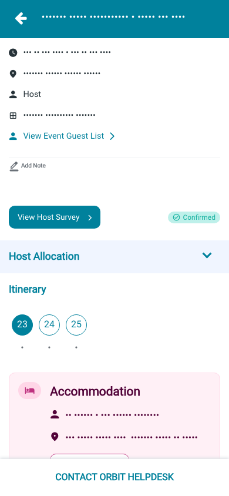 | 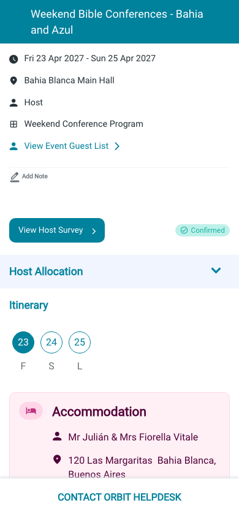 | 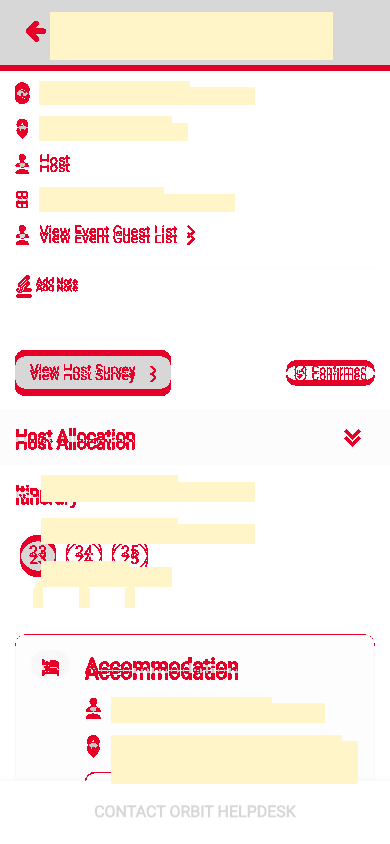 |
| `loading`<br>390x844, mock `loading`<br>2026-10-29<br>pixel difference 0.0% | 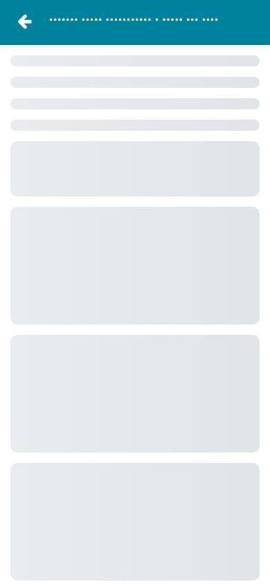 | 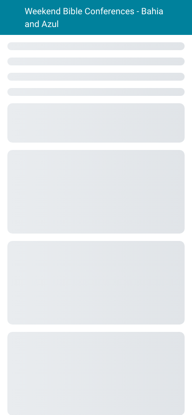 |  |
| `offline`<br>390x844, mock `error`<br>2026-10-29<br>pixel difference 2.6% |  |  | 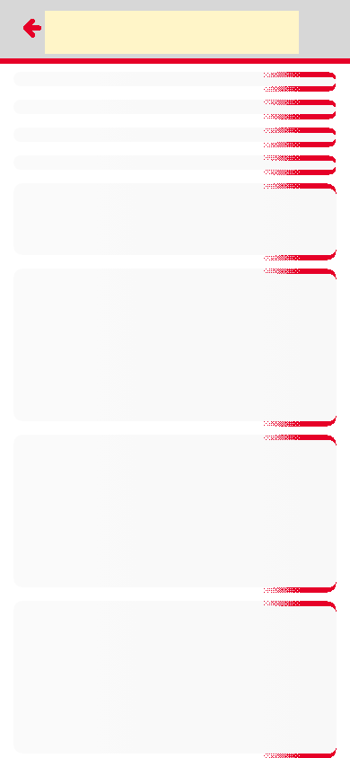 |

## 4. Diagram

- A box on the left is the block or module of the action that calls the server (TST code).
- A line connects each call to the React action that makes the same call.
- The right column shows the React components that use each React action.
- A red box is a call that React does not make.

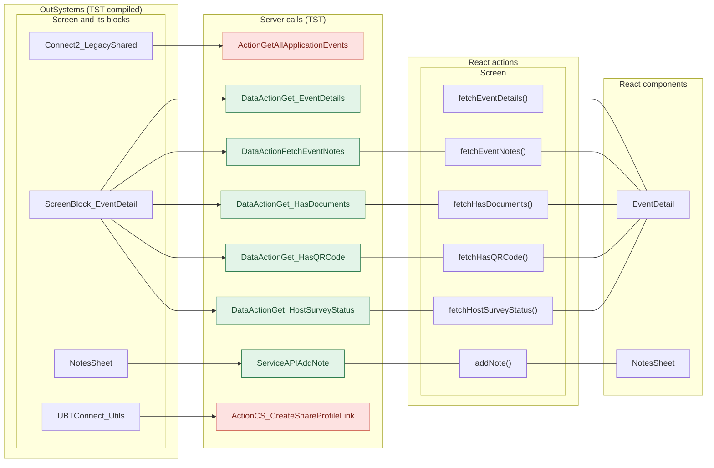

## 5. User actions

The two lists are independent: the OutSystems list comes from the TST compiled code, the React list from the React code. The tool does not map one list to the other.

- **OutSystems:** each event binding of the compiled views (`<event>$Action: function` of a child block or widget, `on<Event>: function` of an HTML element) with its handler.
- **React:** each JSX attribute `on<Event>={handler}` with its handler.
- Both lists keep only the bindings whose handler has an effect: a server call, a navigation, an external link, a message or a confirm dialog. The tool follows the called functions 3 levels deep.
- When the handler has branches in the code (`switch` case, `if` with `===`), each branch has its own diagram. The branch name is the constant of the condition. `other` is the last `else` or `default`.
- An arrow to the server gives the inputs of the call, the return arrow its outputs (contract `app/src/api/openapi.yaml`).

### 5.1 OutSystems (TST)

| # | Block (OutSystems) | Event (TST view) | Handler | Branch | Effects |
|---|---|---|---|---|---|
| [1](#511-menuicon__updatedosui-onback) | `MenuIcon__UpdatedOSUI` | `onClick (HTML element)` | `onBack` | – | goes to previous screen |
| [2](#512-screenblock_eventdetail-onclick_generateqrcode) | `ScreenBlock_EventDetail` | `onClick (HTML element)` | `onClick_GenerateQRCode` | – | calls GetAllApplicationEvents, AppManager_SynchAppContext |
| [3](#513-screenblock_eventdetail-onclick_vieweventbooklet) | `ScreenBlock_EventDetail` | `onClick (HTML element)` | `onClick_ViewEventBooklet` | – | shows a message |
| [4](#514-screenblock_eventdetail-onclick_navigatetohostsurvey) | `ScreenBlock_EventDetail` | `onClick (HTML element)` | `onClick_NavigateToHostSurvey` | – | shows a message |
| [5](#515-eventdetail-onhandle_navigatetotransportdetail) | `EventDetail` | `navigateTo_TransportDetail of EventDetail` | `onHandle_NavigateToTransportDetail` | – | goes to TransportDetail, HomeFeed; shows a message |
| [6](#516-eventdetail-onhandle_navigateto_eventbooklet) | `EventDetail` | `navigateTo_EventBooklet of EventDetail` | `onHandle_NavigateTo_EventBooklet` | – | goes to EventBooklet |
| [7](#517-eventdetail-onhandle_contacthelpdesk) | `EventDetail` | `navigateTo_ContactHelpdesk of EventDetail` | `onHandle_ContactHelpdesk` | – | goes to ContactByEmailOrbitHelpdesk, HomeFeed; shows a message |
| [8](#518-eventdetail-onhandle_navigatetogenerateqrcode) | `EventDetail` | `navigateTo_GenerateQRCode of EventDetail` | `onHandle_NavigateToGenerateQRCode` | – | goes to QRCodeGenerate, HomeFeed; shows a message |
| [9](#519-eventdetail-onhandle_navigatetohostsurvey) | `EventDetail` | `navigateTo_HostSurvey of EventDetail` | `onHandle_NavigateToHostSurvey` | – | goes to HostSurvey, HomeFeed; shows a message |
| [10](#5110-eventdetail-onhandle_navigatetomilestonedetail) | `EventDetail` | `navigateTo_MilestoneDetail of EventDetail` | `onHandle_NavigateToMilestoneDetail` | – | goes to MilestoneDetail, HomeFeed; shows a message |
| [11](#5111-eventdetail-onhandle_navigatetoviewdocuments) | `EventDetail` | `navigateTo_ViewDocuments of EventDetail` | `onHandle_NavigateToViewDocuments` | – | goes to ViewDocuments, HomeFeed; shows a message |
| [12](#5112-eventdetail-onhandle_navigatetohelpers) | `EventDetail` | `navigateTo_Helpers of EventDetail` | `onHandle_NavigateToHelpers` | – | goes to HelpersDetail, HomeFeed; shows a message |
| [13](#5113-notessheet-handler_onsubmitnote) | `NotesSheet` | `onSubmitRequested of AddNote` | `handler_OnSubmitNote` | – | calls AddNote; shows a message |

#### 5.1.1 MenuIcon__UpdatedOSUI: onBack

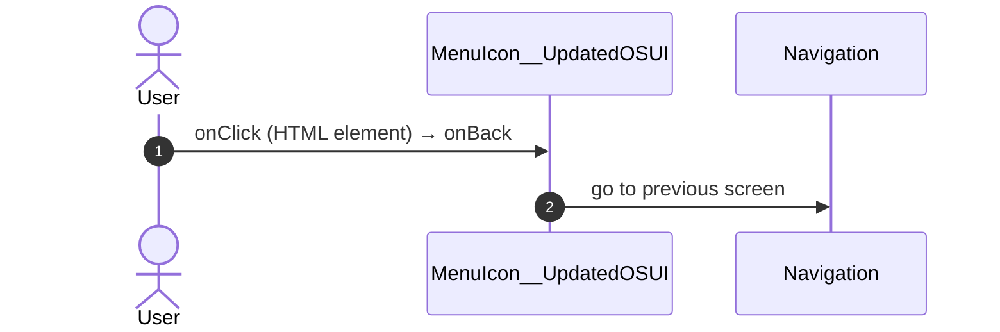

#### 5.1.2 ScreenBlock_EventDetail: onClick_GenerateQRCode

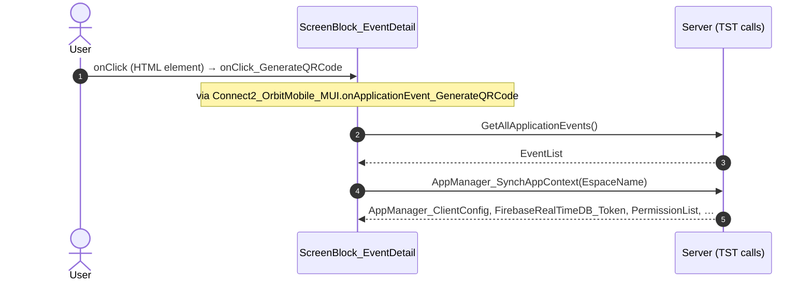

#### 5.1.3 ScreenBlock_EventDetail: onClick_ViewEventBooklet

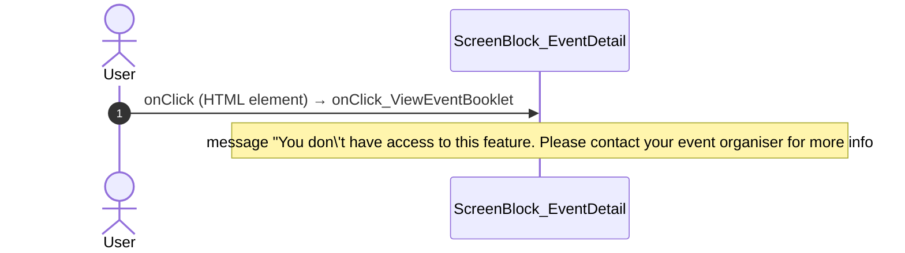

#### 5.1.4 ScreenBlock_EventDetail: onClick_NavigateToHostSurvey

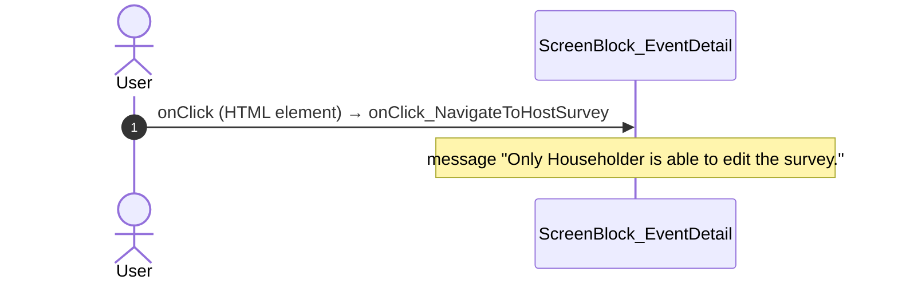

#### 5.1.5 EventDetail: onHandle_NavigateToTransportDetail

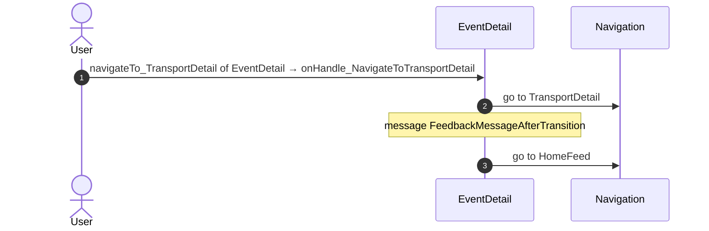

#### 5.1.6 EventDetail: onHandle_NavigateTo_EventBooklet

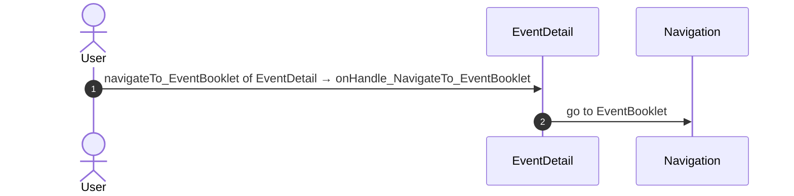

#### 5.1.7 EventDetail: onHandle_ContactHelpdesk

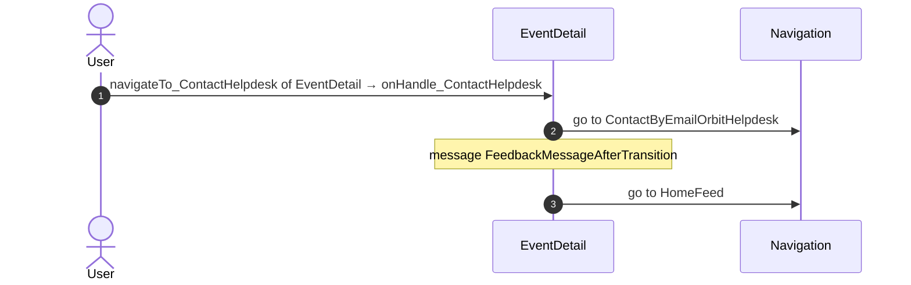

#### 5.1.8 EventDetail: onHandle_NavigateToGenerateQRCode


#### 5.1.9 EventDetail: onHandle_NavigateToHostSurvey

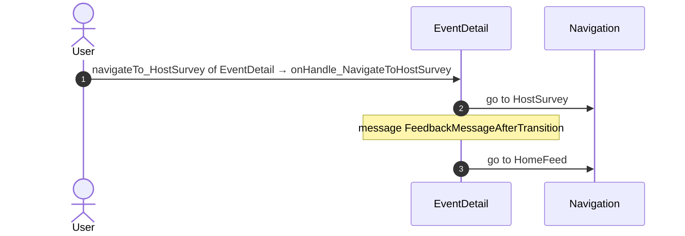

#### 5.1.10 EventDetail: onHandle_NavigateToMilestoneDetail

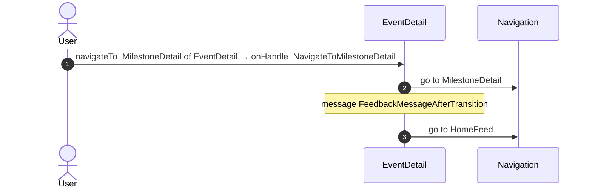

#### 5.1.11 EventDetail: onHandle_NavigateToViewDocuments

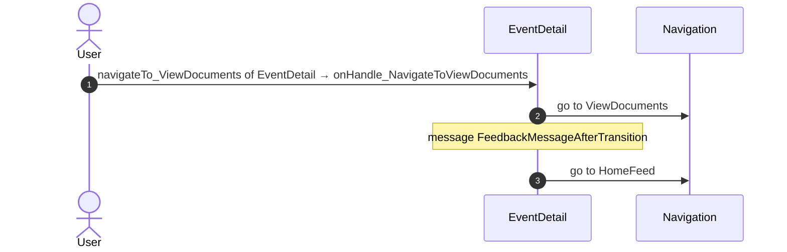

#### 5.1.12 EventDetail: onHandle_NavigateToHelpers

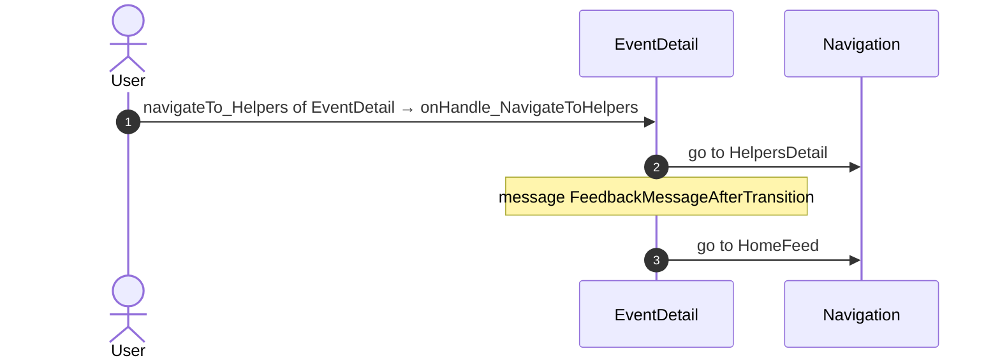

#### 5.1.13 NotesSheet: handler_OnSubmitNote

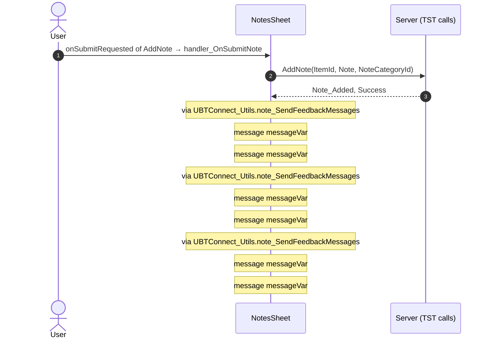

### 5.2 React

| # | File | Element | Event prop | Handler | Branch | Effects |
|---|---|---|---|---|---|---|
| [1](#521-eventdetailview-onclickgenerateqrcode) | [`pages/EventDetail/EventDetailPage.tsx:161`](../../app/src/pages/EventDetail/EventDetailPage.tsx#L161) | `<EventDetailView>` | `onClickGenerateQRCode` | `detail.handlers.onClickGenerateQRCode` | – | goes to HomeFeed, QRCodeGenerate; shows a message |
| [2](#522-eventdetailview-onclickopendocuments) | [`pages/EventDetail/EventDetailPage.tsx:161`](../../app/src/pages/EventDetail/EventDetailPage.tsx#L161) | `<EventDetailView>` | `onClickOpenDocuments` | `detail.handlers.onClickOpenDocuments` | – | goes to HomeFeed, ViewDocuments; shows a message |
| [3](#523-eventdetailview-onclickvieweventbooklet) | [`pages/EventDetail/EventDetailPage.tsx:161`](../../app/src/pages/EventDetail/EventDetailPage.tsx#L161) | `<EventDetailView>` | `onClickViewEventBooklet` | `detail.handlers.onClickViewEventBooklet` | – | goes to EventBooklet; shows a message |
| [4](#524-eventdetailview-onclicknavigatetohostsurvey) | [`pages/EventDetail/EventDetailPage.tsx:161`](../../app/src/pages/EventDetail/EventDetailPage.tsx#L161) | `<EventDetailView>` | `onClickNavigateToHostSurvey` | `detail.handlers.onClickNavigateToHostSurvey` | – | goes to HomeFeed, HostSurvey; shows a message |
| [5](#525-eventdetailview-onhandleclickedmilestone-transport) | [`pages/EventDetail/EventDetailPage.tsx:161`](../../app/src/pages/EventDetail/EventDetailPage.tsx#L161) | `<EventDetailView>` | `onHandleClickedMilestone` | `detail.handlers.onHandleClickedMilestone` | `transport` | goes to HomeFeed, TransportDetail; shows a message |
| [6](#526-eventdetailview-onhandleclickedmilestone-other) | [`pages/EventDetail/EventDetailPage.tsx:161`](../../app/src/pages/EventDetail/EventDetailPage.tsx#L161) | `<EventDetailView>` | `onHandleClickedMilestone` | `detail.handlers.onHandleClickedMilestone` | `other` | goes to HomeFeed, MilestoneDetail; shows a message |
| [7](#527-eventdetailview-onhandlehostallocationview) | [`pages/EventDetail/EventDetailPage.tsx:161`](../../app/src/pages/EventDetail/EventDetailPage.tsx#L161) | `<EventDetailView>` | `onHandleHostAllocationView` | `detail.handlers.onHandleHostAllocationView` | – | goes to HomeFeed, MilestoneDetail; shows a message |
| [8](#528-eventdetailview-onhandleviewhelpers) | [`pages/EventDetail/EventDetailPage.tsx:161`](../../app/src/pages/EventDetail/EventDetailPage.tsx#L161) | `<EventDetailView>` | `onHandleViewHelpers` | `detail.handlers.onHandleViewHelpers` | – | goes to HomeFeed, HelpersDetail; shows a message |
| [9](#529-eventdetailview-onhandlecontacthelpdesk) | [`pages/EventDetail/EventDetailPage.tsx:161`](../../app/src/pages/EventDetail/EventDetailPage.tsx#L161) | `<EventDetailView>` | `onHandleContactHelpdesk` | `detail.handlers.onHandleContactHelpdesk` | – | goes to HomeFeed, ContactByEmailOrbitHelpdesk; shows a message |
| [10](#5210-preventbacknavigation-onbacknavigationprevented) | [`components/layout/CommonUiLayout/CommonUiLayout.tsx:80`](../../app/src/components/layout/CommonUiLayout/CommonUiLayout.tsx#L80) | `<PreventBackNavigation>` | `onBackNavigationPrevented` | `redirectHome` | – | goes to HomeFeed |
| [11](#5211-backnavigationhandler-onbacknavigation) | [`components/layout/CommonUiLayout/CommonUiLayout.tsx:82`](../../app/src/components/layout/CommonUiLayout/CommonUiLayout.tsx#L82) | `<BackNavigationHandler>` | `onBackNavigation` | `maybeRedirectHome` | – | goes to HomeFeed |
| [12](#5212-div-onclick) | [`components/layout/MenuIcon/MenuIcon.tsx:34`](../../app/src/components/layout/MenuIcon/MenuIcon.tsx#L34) | `<div>` | `onClick` | `inline` | – | goes to previous screen |
| [13](#5213-addnote-ononsubmitrequested) | [`components/note/NotesSheet/NotesSheet.tsx:175`](../../app/src/components/note/NotesSheet/NotesSheet.tsx#L175) | `<AddNote>` | `onOnSubmitRequested` | `addNoteRequested` | – | calls ServiceAPIAddNote; shows a message; calls the prop onOnNotesChanged() |
| [14](#5214-notelist-onondeleterequested) | [`containers/NoteListActions/NoteListActionsContainer.tsx:157`](../../app/src/containers/NoteListActions/NoteListActionsContainer.tsx#L157) | `<NoteList>` | `onOnDeleteRequested` | `inline` | – | calls ServiceAPIDeleteNoteByNoteId; shows a message; calls the prop onOnNoteDeleted() |
| [15](#5215-notelist-ononsaveeditrequested) | [`containers/NoteListActions/NoteListActionsContainer.tsx:160`](../../app/src/containers/NoteListActions/NoteListActionsContainer.tsx#L160) | `<NoteList>` | `onOnSaveEditRequested` | `inline` | – | calls ServiceAPIUpdateNote; shows a message; calls the prop onOnSaveEditNote(); calls the prop onOnEditingStateChanged(); calls the prop onOnSaveEditNote(); calls the prop onOnEditingStateChanged() |

#### 5.2.1 EventDetailView: onClickGenerateQRCode

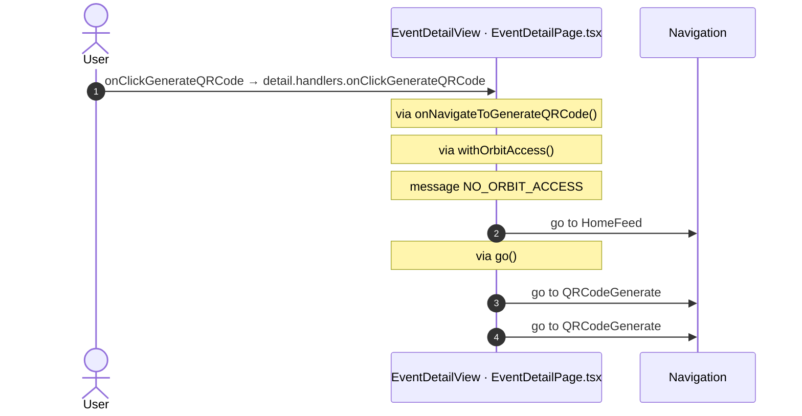

#### 5.2.2 EventDetailView: onClickOpenDocuments


#### 5.2.3 EventDetailView: onClickViewEventBooklet

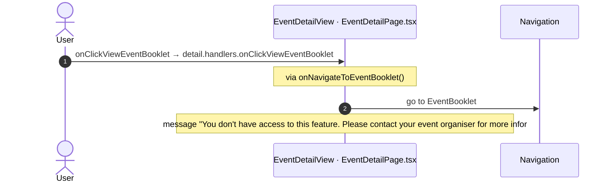

#### 5.2.4 EventDetailView: onClickNavigateToHostSurvey

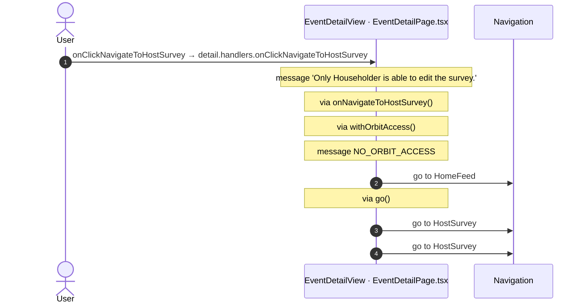

#### 5.2.5 EventDetailView: onHandleClickedMilestone (transport)

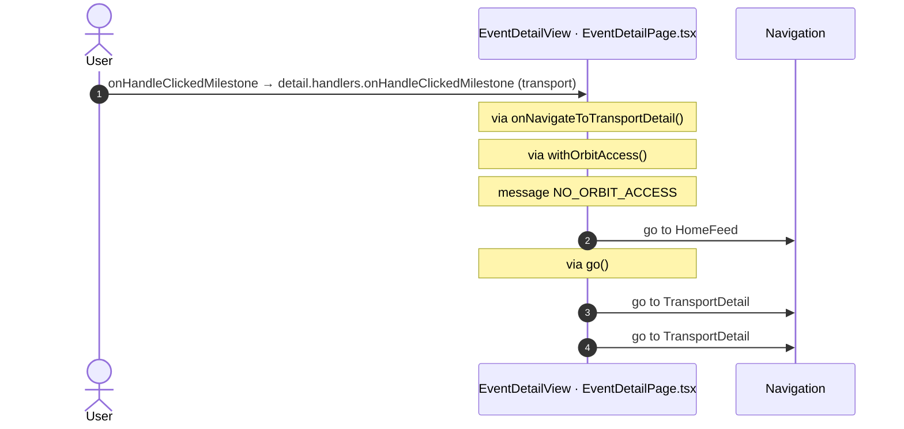

#### 5.2.6 EventDetailView: onHandleClickedMilestone (other)

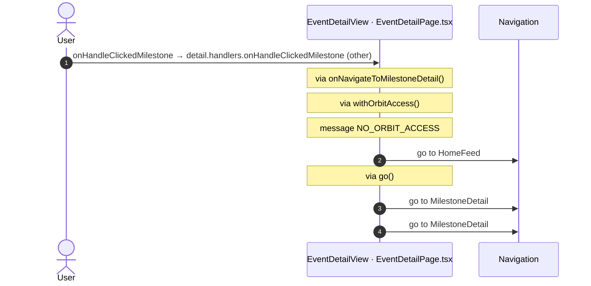

#### 5.2.7 EventDetailView: onHandleHostAllocationView

```mermaid
sequenceDiagram
  autonumber
  actor U as User
  participant H as EventDetailView · EventDetailPage.tsx
  participant N as Navigation
  U->>H: onHandleHostAllocationView → detail.handlers.onHandleHostAllocationView
  Note over H: via onNavigateToMilestoneDetail()
  Note over H: via withOrbitAccess()
  Note over H: message NO_ORBIT_ACCESS
  H->>N: go to HomeFeed
  Note over H: via go()
  H->>N: go to MilestoneDetail
  H->>N: go to MilestoneDetail
```

#### 5.2.8 EventDetailView: onHandleViewHelpers

```mermaid
sequenceDiagram
  autonumber
  actor U as User
  participant H as EventDetailView · EventDetailPage.tsx
  participant N as Navigation
  U->>H: onHandleViewHelpers → detail.handlers.onHandleViewHelpers
  Note over H: via viewHelpers()
  Note over H: via navigateToHelpers()
  Note over H: via onNavigateToHelpers()
  Note over H: via withOrbitAccess()
  Note over H: message NO_ORBIT_ACCESS
  H->>N: go to HomeFeed
  H->>N: go to HelpersDetail
```

#### 5.2.9 EventDetailView: onHandleContactHelpdesk

```mermaid
sequenceDiagram
  autonumber
  actor U as User
  participant H as EventDetailView · EventDetailPage.tsx
  participant N as Navigation
  U->>H: onHandleContactHelpdesk → detail.handlers.onHandleContactHelpdesk
  Note over H: via onNavigateToContactHelpdesk()
  Note over H: via withOrbitAccess()
  Note over H: message NO_ORBIT_ACCESS
  H->>N: go to HomeFeed
  Note over H: via go()
  H->>N: go to ContactByEmailOrbitHelpdesk
  H->>N: go to ContactByEmailOrbitHelpdesk
```

#### 5.2.10 PreventBackNavigation: onBackNavigationPrevented

```mermaid
sequenceDiagram
  autonumber
  actor U as User
  participant H as PreventBackNavigation · CommonUiLayout.tsx
  participant N as Navigation
  U->>H: onBackNavigationPrevented → redirectHome
  H->>N: go to HomeFeed
```

#### 5.2.11 BackNavigationHandler: onBackNavigation

```mermaid
sequenceDiagram
  autonumber
  actor U as User
  participant H as BackNavigationHandler · CommonUiLayout.tsx
  participant N as Navigation
  U->>H: onBackNavigation → maybeRedirectHome
  Note over H: via actionRedirectHome()
  H->>N: go to HomeFeed
```

#### 5.2.12 div: onClick

```mermaid
sequenceDiagram
  autonumber
  actor U as User
  participant H as div · MenuIcon.tsx
  participant N as Navigation
  U->>H: onClick → inline
  H->>N: go to previous screen
```

#### 5.2.13 AddNote: onOnSubmitRequested

```mermaid
sequenceDiagram
  autonumber
  actor U as User
  participant H as AddNote · NotesSheet.tsx
  participant A as Server (React api)
  U->>H: onOnSubmitRequested → addNoteRequested
  Note over H: via addNote()
  H->>A: ServiceAPIAddNote(ItemId, Note, NoteCategoryId)
  A-->>H: Note_Added, Success
  Note over H: calls the prop onOnNotesChanged()
  Note over H: via note_SendFeedbackMessages()
  Note over H: message message
  Note over H: via note_SendFeedbackMessages()
  Note over H: message message
  Note over H: via note_SendFeedbackMessages()
  Note over H: message message
```

#### 5.2.14 NoteList: onOnDeleteRequested

```mermaid
sequenceDiagram
  autonumber
  actor U as User
  participant H as NoteList · NoteListActionsContainer.tsx
  participant A as Server (React api)
  U->>H: onOnDeleteRequested → inline
  Note over H: via deleteNoteRequested()
  Note over H: via deleteNoteByNoteId()
  H->>A: ServiceAPIDeleteNoteByNoteId()
  A-->>H: outputs
  Note over H: calls the prop onOnNoteDeleted()
  Note over H: via note_SendFeedbackMessages()
  Note over H: message message
  Note over H: via note_SendFeedbackMessages()
  Note over H: message message
  Note over H: via note_SendFeedbackMessages()
  Note over H: message message
```

#### 5.2.15 NoteList: onOnSaveEditRequested

```mermaid
sequenceDiagram
  autonumber
  actor U as User
  participant H as NoteList · NoteListActionsContainer.tsx
  participant A as Server (React api)
  U->>H: onOnSaveEditRequested → inline
  Note over H: via saveEditRequested()
  Note over H: via updateNote()
  H->>A: ServiceAPIUpdateNote()
  A-->>H: outputs
  Note over H: calls the prop onOnSaveEditNote()
  Note over H: calls the prop onOnEditingStateChanged()
  Note over H: via note_SendFeedbackMessages()
  Note over H: message message
  Note over H: calls the prop onOnSaveEditNote()
  Note over H: calls the prop onOnEditingStateChanged()
  Note over H: via note_SendFeedbackMessages()
  Note over H: message message
  Note over H: via note_SendFeedbackMessages()
  Note over H: message message
  Note over H: via note_SendFeedbackMessages()
  Note over H: message message
```

## 6. Server calls

All columns come from the code, without interpretation:

- **Direct caller (TST):** the block or module of the action that calls the server (the step before the server call in the chain).
- **Chain (TST):** the chains of client actions in the TST compiled code, from their start to the call.
  A long chain shows its first 2 steps, …, and its last 2 steps.
- **Seen on TST:** `yes` when TST made the call in the capture.
- **React action:** the React function with the `callAction` of the same call (`file:line`), and the code that loads it: `shell` (from `main.tsx`), `page` (from the screen), or both.
- **Used by (React references):** the functions and components that reference the React action, up to the nearest component. A reference is not always a call.
- **Status:** `implemented` when the contract path of the React call gives the same TST URL. It does not prove the same behaviour.

| # | Call (TST) | Kind | Direct caller (TST) | Chain (TST) | Seen on TST | React action | Used by (React references) | Status |
|---|---|---|---|---|---|---|---|---|
| 1 | `Connect2_LegacyShared/ActionGetAllApplicationEvents` | server action | `Connect2_LegacyShared` | ItemNotesSection.handler_OnShareToOthers → UBTConnect_Utils.shareEntity_ByURL → … → Connect2_LegacyShared.cacheLocalApplicationEvents → server GetAllApplicationEvents | yes | – | – | **missing** |
| 2 | `UBTConnect_Utils/CW_Notes/NotesSheet/ServiceAPIAddNote` | service action | `NotesSheet` | NotesSheet.handler_OnSubmitNote → server AddNote | no | `addNote()` [`api/note/repository.ts:54`](../../app/src/api/note/repository.ts#L54) (page) | `NotesSheet → addNote`<br>[`components/note/NotesSheet/NotesSheet.tsx`](../../app/src/components/note/NotesSheet/NotesSheet.tsx) | implemented |
| 3 | `Connect2_OrbitMobile_MUI/Orbit_ScreenBlocks/ScreenBlock_EventDetail/DataActionFetchEventNotes` | data action | `ScreenBlock_EventDetail` | ScreenBlock_EventDetail fetch at start → ScreenBlock_EventDetail.DataActionFetchEventNotes | yes | `fetchEventNotes()` [`api/event/repository.ts:156`](../../app/src/api/event/repository.ts#L156) (page) | `EventDetail → useEventDetail → fetchEventNotes`<br>[`pages/EventDetail/EventDetailPage.tsx`](../../app/src/pages/EventDetail/EventDetailPage.tsx) | implemented |
| 4 | `Connect2_OrbitMobile_MUI/Orbit_ScreenBlocks/ScreenBlock_EventDetail/DataActionGet_EventDetails` | data action | `ScreenBlock_EventDetail` | ScreenBlock_EventDetail.OnReady → ScreenBlock_EventDetail.onReady → ScreenBlock_EventDetail.DataActionGet_EventDetails<br>ScreenBlock_EventDetail fetch at start → ScreenBlock_EventDetail.DataActionGet_EventDetails | yes | `fetchEventDetails()` [`api/event/repository.ts:135`](../../app/src/api/event/repository.ts#L135) (page) | `EventDetail → useEventDetail → fetchEventDetails`<br>[`pages/EventDetail/EventDetailPage.tsx`](../../app/src/pages/EventDetail/EventDetailPage.tsx) | implemented |
| 5 | `Connect2_OrbitMobile_MUI/Orbit_ScreenBlocks/ScreenBlock_EventDetail/DataActionGet_HasDocuments` | data action | `ScreenBlock_EventDetail` | ScreenBlock_EventDetail.OnReady → ScreenBlock_EventDetail.onReady → ScreenBlock_EventDetail.DataActionGet_HasDocuments<br>ScreenBlock_EventDetail fetch at start → ScreenBlock_EventDetail.DataActionGet_HasDocuments | yes | `fetchHasDocuments()` [`api/event/repository.ts:145`](../../app/src/api/event/repository.ts#L145) (page) | `EventDetail → useEventDetail → fetchHasDocuments`<br>[`pages/EventDetail/EventDetailPage.tsx`](../../app/src/pages/EventDetail/EventDetailPage.tsx) | implemented |
| 6 | `Connect2_OrbitMobile_MUI/Orbit_ScreenBlocks/ScreenBlock_EventDetail/DataActionGet_HasQRCode` | data action | `ScreenBlock_EventDetail` | ScreenBlock_EventDetail.OnReady → ScreenBlock_EventDetail.onReady → ScreenBlock_EventDetail.DataActionGet_HasQRCode<br>ScreenBlock_EventDetail fetch at start → ScreenBlock_EventDetail.DataActionGet_HasQRCode | yes | `fetchHasQRCode()` [`api/event/repository.ts:150`](../../app/src/api/event/repository.ts#L150) (page) | `EventDetail → useEventDetail → fetchHasQRCode`<br>[`pages/EventDetail/EventDetailPage.tsx`](../../app/src/pages/EventDetail/EventDetailPage.tsx) | implemented |
| 7 | `Connect2_OrbitMobile_MUI/Orbit_ScreenBlocks/ScreenBlock_EventDetail/DataActionGet_HostSurveyStatus` | data action | `ScreenBlock_EventDetail` | ScreenBlock_EventDetail.OnReady → ScreenBlock_EventDetail.onReady → ScreenBlock_EventDetail.DataActionGet_HostSurveyStatus<br>ScreenBlock_EventDetail fetch at start → ScreenBlock_EventDetail.DataActionGet_HostSurveyStatus | yes | `fetchHostSurveyStatus()` [`api/event/repository.ts:140`](../../app/src/api/event/repository.ts#L140) (page) | `EventDetail → useEventDetail → fetchHostSurveyStatus`<br>[`pages/EventDetail/EventDetailPage.tsx`](../../app/src/pages/EventDetail/EventDetailPage.tsx) | implemented |
| 8 | `UBTConnect_Utils/ActionCS_CreateShareProfileLink` | server action | `UBTConnect_Utils` | ItemNotesSection.handler_OnShareToOthers → UBTConnect_Utils.shareEntity_ByURL → server CS_CreateShareProfileLink | no | – | – | **missing** |

## 7. Missing in React

- Call `Connect2_LegacyShared/ActionGetAllApplicationEvents`. Chain on TST: ItemNotesSection.handler_OnShareToOthers → UBTConnect_Utils.shareEntity_ByURL → … → Connect2_LegacyShared.cacheLocalApplicationEvents → server GetAllApplicationEvents.
  - No React code makes this call.
- Call `UBTConnect_Utils/ActionCS_CreateShareProfileLink`. Chain on TST: ItemNotesSection.handler_OnShareToOthers → UBTConnect_Utils.shareEntity_ByURL → server CS_CreateShareProfileLink.
  - No React code makes this call.
  - Note in [`components/feed/EmbeddedFeed/README.md:65`](../../app/src/components/feed/EmbeddedFeed/README.md#L65): "- Event_ShareToOthers → Handle_Share_Others (:257, :775-807: close, then ShareEntity_ByURL(Type_ShareObject.Feed, Id))"
  - Note in [`containers/EntityDetailsActions/README.md:74`](../../app/src/containers/EntityDetailsActions/README.md#L74): "- **Share to others**: the React app does not port UBTConnect_Utils ShareEntity_ByURL. The dialog only closes."
  - Note in [`containers/ShareSheet/README.md:56`](../../app/src/containers/ShareSheet/README.md#L56): "- ActionCS_CreateShareProfileLink (`cs_CreateShareProfileLink`)."

## 8. Questions

1. React calls `/api/UBTConnect_Utils/ActionGetUserInformation` from `fetchUserInformation()` [`api/member/userInformation.ts:6`](../../app/src/api/member/userInformation.ts#L6) (shell + page). TST EventDetail has no chain to this call. Does the call belong to this route?
2. React calls `/api/UBTConnect_Utils/CacheControl_Policies/DataActionGetCacheInfo` from `fetchPolicies()` [`api/app/repository.ts:54`](../../app/src/api/app/repository.ts#L54) (shell + page). TST EventDetail has no chain to this call. Does the call belong to this route?
3. React calls `/api/UBTConnect_Utils/ServiceAPIDeleteNoteByNoteId` from `deleteNote()` [`api/note/repository.ts:73`](../../app/src/api/note/repository.ts#L73) (page). TST EventDetail has no chain to this call. Does the call belong to this route?
4. React calls `/api/UBTConnect_Utils/ServiceAPIUpdateNote` from `updateNote()` [`api/note/repository.ts:66`](../../app/src/api/note/repository.ts#L66) (page). TST EventDetail has no chain to this call. Does the call belong to this route?

## 9. Method

1. **OutSystems (TST).** The tool reads `facts.json` and the compiled code of `migration/screens/EventDetail/analysis/`:
   - the rendered files;
   - each server call with its chain of client actions, and the calls that TST made in the capture;
   - the effects of each user action.
2. **Route and app shell.** OutSystems: a chain belongs to the app shell when it starts in `CommonUI_InsideLayout`, one of its blocks, or a module action. React: a binding belongs to the app shell when its file is in the code that `main.tsx` loads.
3. **MCP (DEV).** The tool reads the UI flow with `getScreenNames`. TST wins when DEV is different.
4. **React.** `react_calls.mjs` reads the app shell from `app/src/main.tsx` and the screen from its `<Route>Page.tsx`. It counts only the code that the app uses.
5. **Match.** `callAction(M, A)` gives `/api/M/A`. The `x-os-paths` of `app/src/api/openapi.yaml` give the TST call. The status is `implemented` when the TST call is the same. Else the status is `missing`.

Limit: a name or a call match does not prove the same behaviour. The parity checks of the migration compare the behaviour.
