# HelpersDetail: server calls and user actions in OutSystems and React

This file compares the route `/UBTConnect/HelpersDetail` in OutSystems (TST) with the React app.
The tool `route-actions/tools/check_route.py` wrote this file on 2026-11-04.
The tool reads the code. It does not run the app.

The app shell is in [APP_SHELL.md](../APP_SHELL.md), not here.
- OutSystems app shell: `CommonUI_InsideLayout` with its blocks (TST survey), and the chains that start in a module action.
- React app shell: the code that `app/src/main.tsx` loads (router, `AppFrame`, app start, hosts).

## 1. Route

| Item | Value | Source |
|---|---|---|
| Route | `/UBTConnect/HelpersDetail` | `app/src/app/routes.generated.ts` |
| OutSystems screen | `UBTConnect.Legacy_OrbitEventsFlow.HelpersDetail` | TST compiled code |
| UI flow | `Legacy_OrbitEventsFlow` | MCP `getScreenNames` (DEV) |
| React screen | [`pages/HelpersDetail/HelpersDetailPage.tsx`](../../app/src/pages/HelpersDetail/HelpersDetailPage.tsx) | `app/src/pages/` |
| React route rules | access `member`, lock `enforce`, flag redirect none | `app/src/app/routes.ts` |
| Code read | OutSystems: 10 screen and block files of the route, 21 app shell files. React: 165 screen files | TST `facts.json`, `react_calls.mjs` |

## 2. Result

| Check | Result |
|---|---|
| Server calls of the route on TST | 2: React makes 2, **0 missing** |
| User actions of the route | OutSystems: 6 diagrams. React: 7 diagrams |
| React calls of the screen that TST does not make | 6 (see [questions](#8-questions)) |
| Screen and blocks with a React port | 10 of 10 |
| Navigation targets found in React | 3 of 3 |
| App shell on this route | 2 calls; event bindings: OutSystems 10, React 7: see [APP_SHELL.md](../APP_SHELL.md) |

## 3. Screenshots

The screenshots come from the last parity run (`route.py parity`). The TST capture hides personal text with dots. The React build shows fictional mock data.

| State | TST (expected) | React (build) | Difference |
|---|---|---|---|
| `default` 390x844, mock `real` 2026-10-29 pixel difference 3.2% | 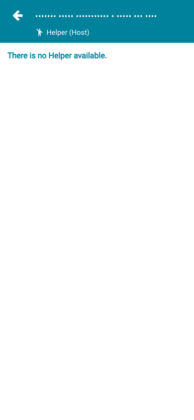 | 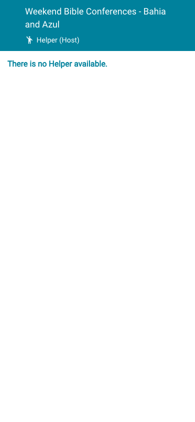 | 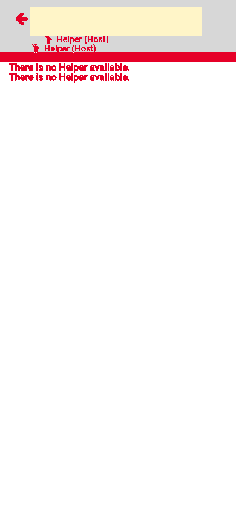 |
| `loading` 390x844, mock `loading` 2026-10-29 pixel difference 0.0% | 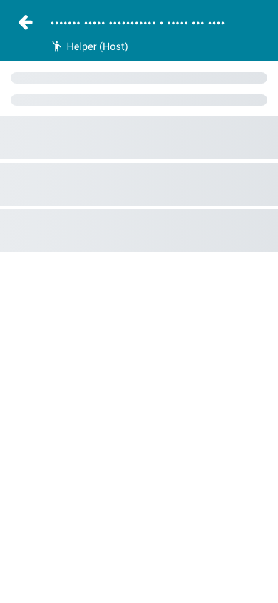 | 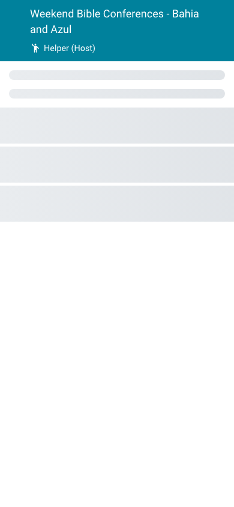 | 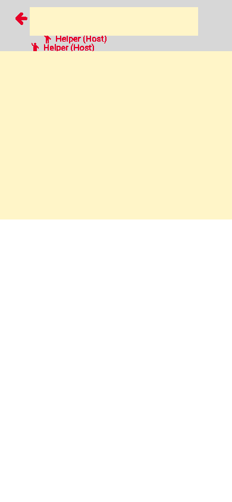 |
| `offline` 390x844, mock `error` 2026-10-29 pixel difference 4.6% |  |  | 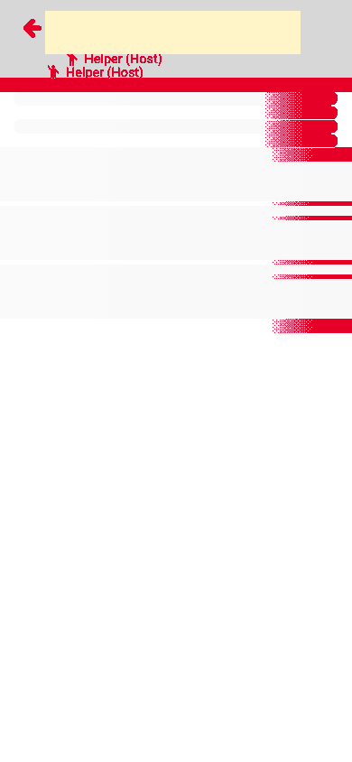 |

## 4. Diagram

- A box on the left is the block or module of the action that calls the server (TST code).
- A line connects each call to the React action that makes the same call.
- The right column shows the React components that use each React action.
- A red box is a call that React does not make.

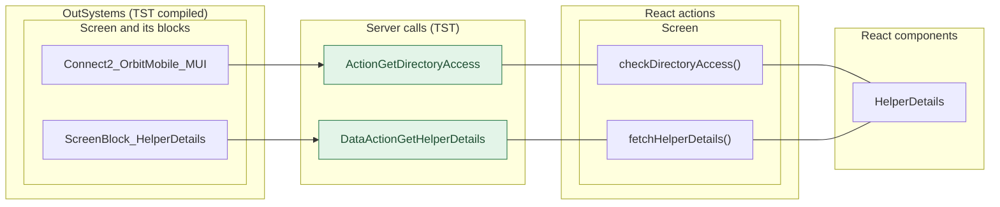

## 5. User actions

The two lists are independent: the OutSystems list comes from the TST compiled code, the React list from the React code. The tool does not map one list to the other.

- **OutSystems:** each event binding of the compiled views (`<event>$Action: function` of a child block or widget, `on<Event>: function` of an HTML element) with its handler.
- **React:** each JSX attribute `on<Event>={handler}` with its handler.
- Both lists keep only the bindings whose handler has an effect: a server call, a navigation, an external link, a message or a confirm dialog. The tool follows the called functions 3 levels deep.
- When the handler has branches in the code (`switch` case, `if` with `===`), each branch has its own diagram. The branch name is the constant of the condition. `other` is the last `else` or `default`.
- An arrow to the server gives the inputs of the call, the return arrow its outputs (contract `app/src/api/openapi.yaml`).

### 5.1 OutSystems (TST)

| # | Block (OutSystems) | Event (TST view) | Handler | Branch | Effects |
|---|---|---|---|---|---|
| [1](#511-menuicon__updatedosui-onback) | `MenuIcon__UpdatedOSUI` | `onClick (HTML element)` | `onBack` | – | goes to previous screen |
| [2](#512-screenblock_helperdetails-onhandle_clickedmember) | `ScreenBlock_HelperDetails` | `clickedMember of MemberInformation` | `onHandle_ClickedMember` | – | calls GetDirectoryAccess, GetAllApplicationEvents, AppManager_SynchAppContext; asks for a confirmation |
| [3](#513-screenblock_helperdetails-onhandle_callclicked) | `ScreenBlock_HelperDetails` | `event_Call of ByPhone` | `onHandle_CallClicked` | – | calls GetAllApplicationEvents, AppManager_SynchAppContext |
| [4](#514-helpersdetail-onhandle_navigatetohouseholddetail) | `HelpersDetail` | `navigateTo_HouseholdDetail of HelperDetails` | `onHandle_NavigateToHouseholdDetail` | – | goes to HouseholdDetails |
| [5](#515-helpersdetail-onhandle_contacthelpdesk) | `HelpersDetail` | `navigateTo_ContactHelpdesk of HelperDetails` | `onHandle_ContactHelpdesk` | – | goes to ContactByEmailOrbitHelpdesk, HomeFeed; shows a message |
| [6](#516-contactpopup_byphone-onclick_callbutton) | `ContactPopup_ByPhone` | `event_Clicked of ContactPopup` | `onClick_CallButton` | – | opens an external link |

#### 5.1.1 MenuIcon__UpdatedOSUI: onBack

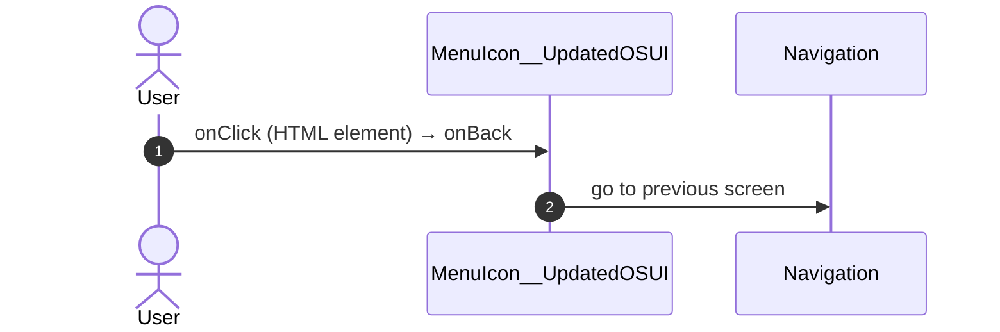

#### 5.1.2 ScreenBlock_HelperDetails: onHandle_ClickedMember

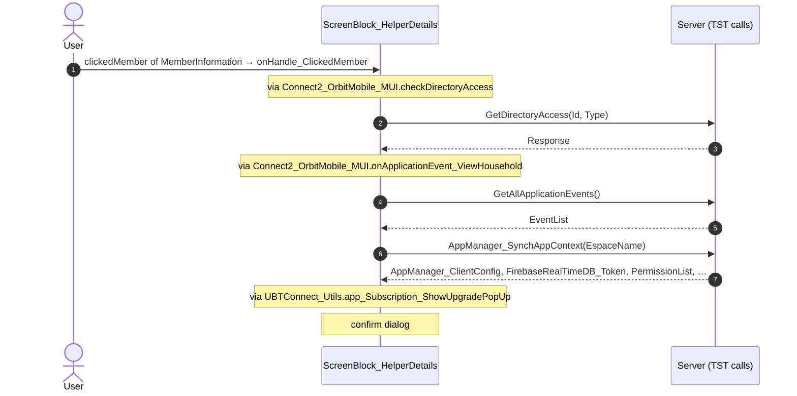

#### 5.1.3 ScreenBlock_HelperDetails: onHandle_CallClicked

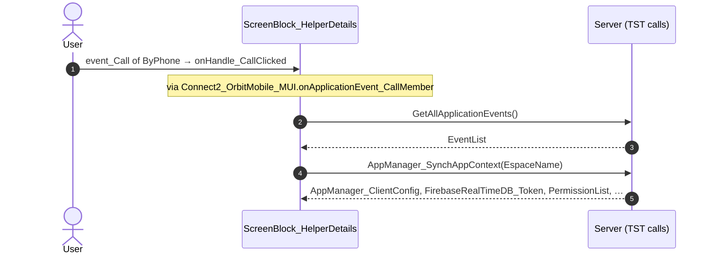

#### 5.1.4 HelpersDetail: onHandle_NavigateToHouseholdDetail

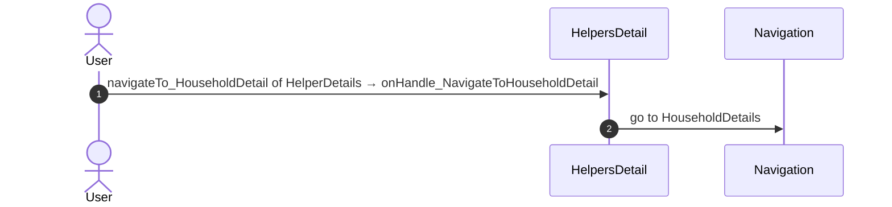

#### 5.1.5 HelpersDetail: onHandle_ContactHelpdesk

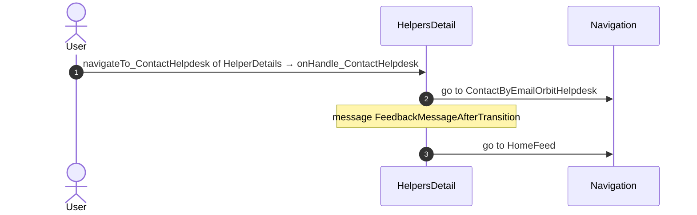

#### 5.1.6 ContactPopup_ByPhone: onClick_CallButton

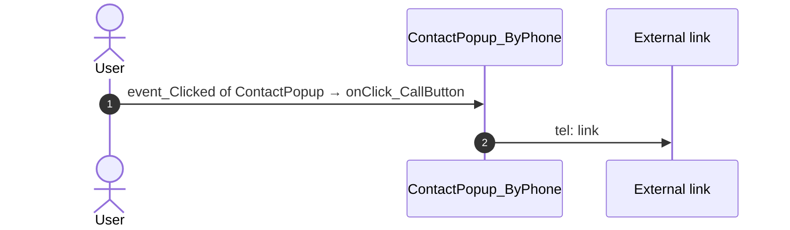

### 5.2 React

| # | File | Element | Event prop | Handler | Branch | Effects |
|---|---|---|---|---|---|---|
| [1](#521-helperdetailsview-onclickedmember) | [`pages/HelpersDetail/HelpersDetailPage.tsx:32`](../../app/src/pages/HelpersDetail/HelpersDetailPage.tsx#L32) | `<HelperDetailsView>` | `onClickedMember` | `flows.onClickedMember` | – | calls ActionGetDirectoryAccess; goes to HouseholdDetails; asks for a confirmation |
| [2](#522-helperdetailsview-onclickedmemberphone) | [`pages/HelpersDetail/HelpersDetailPage.tsx:32`](../../app/src/pages/HelpersDetail/HelpersDetailPage.tsx#L32) | `<HelperDetailsView>` | `onClickedMemberPhone` | `flows.onClickedMemberPhone` | – | calls ActionGetTimezoneInformation |
| [3](#523-helperdetailsview-oncontacthelpdesk) | [`pages/HelpersDetail/HelpersDetailPage.tsx:32`](../../app/src/pages/HelpersDetail/HelpersDetailPage.tsx#L32) | `<HelperDetailsView>` | `onContactHelpdesk` | `flows.onContactHelpdesk` | – | goes to HomeFeed, ContactByEmailOrbitHelpdesk; shows a message |
| [4](#524-preventbacknavigation-onbacknavigationprevented) | [`components/layout/CommonUiLayout/CommonUiLayout.tsx:80`](../../app/src/components/layout/CommonUiLayout/CommonUiLayout.tsx#L80) | `<PreventBackNavigation>` | `onBackNavigationPrevented` | `redirectHome` | – | goes to HomeFeed |
| [5](#525-backnavigationhandler-onbacknavigation) | [`components/layout/CommonUiLayout/CommonUiLayout.tsx:82`](../../app/src/components/layout/CommonUiLayout/CommonUiLayout.tsx#L82) | `<BackNavigationHandler>` | `onBackNavigation` | `maybeRedirectHome` | – | goes to HomeFeed |
| [6](#526-contactpopup-oneventclicked) | [`components/contact/ContactPopupByPhone/ContactPopupByPhone.tsx:66`](../../app/src/components/contact/ContactPopupByPhone/ContactPopupByPhone.tsx#L66) | `<ContactPopup>` | `onEventClicked` | `inline` | – | opens an external link; calls the prop onEventCall() |
| [7](#527-div-onclick) | [`components/layout/MenuIcon/MenuIcon.tsx:34`](../../app/src/components/layout/MenuIcon/MenuIcon.tsx#L34) | `
` | `onClick` | `inline` | – | goes to previous screen |

#### 5.2.1 HelperDetailsView: onClickedMember

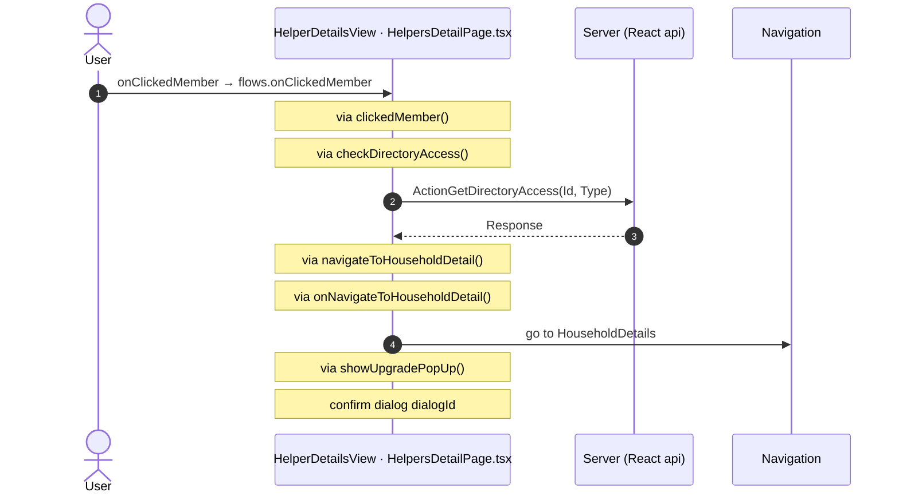

#### 5.2.2 HelperDetailsView: onClickedMemberPhone

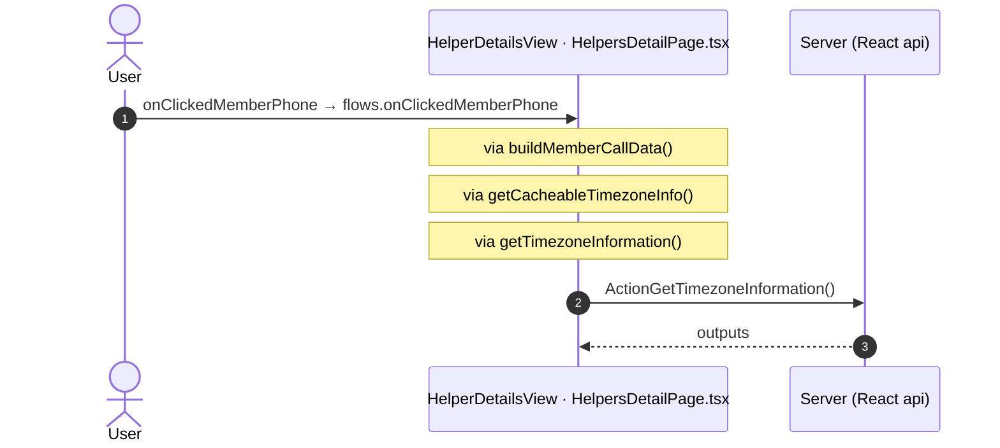

#### 5.2.3 HelperDetailsView: onContactHelpdesk

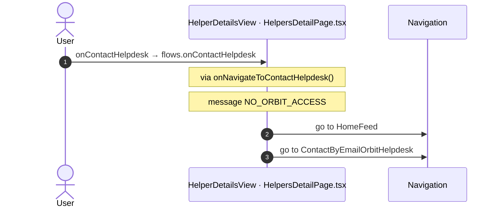

#### 5.2.4 PreventBackNavigation: onBackNavigationPrevented

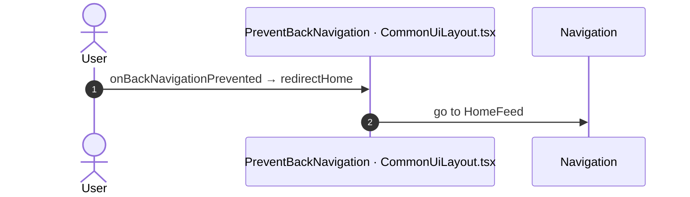

#### 5.2.5 BackNavigationHandler: onBackNavigation

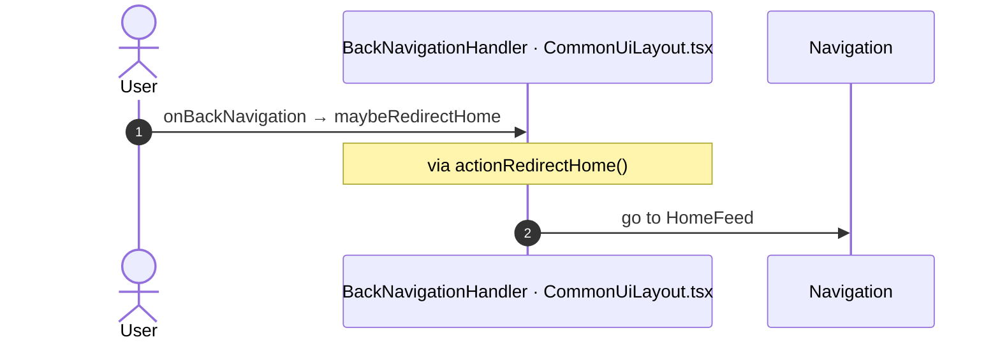

#### 5.2.6 ContactPopup: onEventClicked

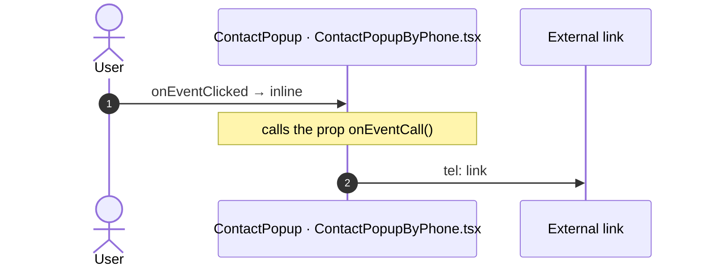

#### 5.2.7 div: onClick

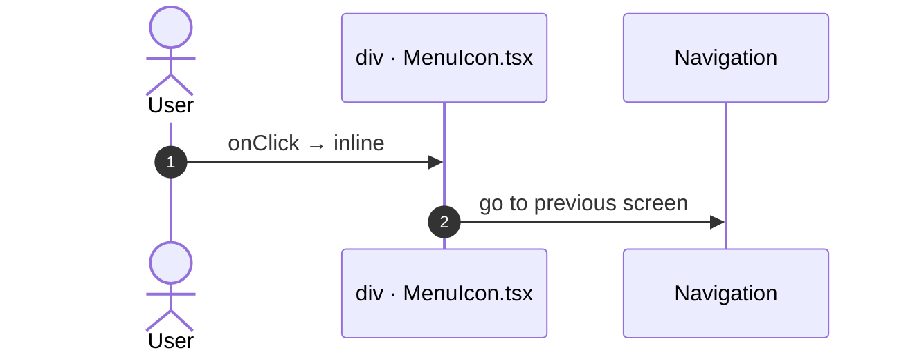

## 6. Server calls

All columns come from the code, without interpretation:

- **Direct caller (TST):** the block or module of the action that calls the server (the step before the server call in the chain).
- **Chain (TST):** the chains of client actions in the TST compiled code, from their start to the call.
  A long chain shows its first 2 steps, …, and its last 2 steps.
- **Seen on TST:** `yes` when TST made the call in the capture.
- **React action:** the React function with the `callAction` of the same call (`file:line`), and the code that loads it: `shell` (from `main.tsx`), `page` (from the screen), or both.
- **Used by (React references):** the functions and components that reference the React action, up to the nearest component. A reference is not always a call.
- **Status:** `implemented` when the contract path of the React call gives the same TST URL. It does not prove the same behaviour.

| # | Call (TST) | Kind | Direct caller (TST) | Chain (TST) | Seen on TST | React action | Used by (React references) | Status |
|---|---|---|---|---|---|---|---|---|
| 1 | `Connect2_OrbitMobile_MUI/ActionGetDirectoryAccess` | server action | `Connect2_OrbitMobile_MUI` | ScreenBlock_HelperDetails.onHandle_ClickedMember → Connect2_OrbitMobile_MUI.checkDirectoryAccess → server GetDirectoryAccess | no | `checkDirectoryAccess()` [`lib/orbit/actions.ts:264`](../../app/src/lib/orbit/actions.ts#L264) (page) | `HelperDetails → useHelperDetails → checkDirectoryAccess` [`pages/HelpersDetail/HelpersDetailPage.tsx`](../../app/src/pages/HelpersDetail/HelpersDetailPage.tsx) | implemented |
| 2 | `Connect2_OrbitMobile_MUI/Orbit_ScreenBlocks/ScreenBlock_HelperDetails/DataActionGetHelperDetails` | data action | `ScreenBlock_HelperDetails` | ScreenBlock_HelperDetails.OnReady → ScreenBlock_HelperDetails.onReady → ScreenBlock_HelperDetails.refreshData → ScreenBlock_HelperDetails.DataActionGetHelperDetails ScreenBlock_HelperDetails fetch at start → ScreenBlock_HelperDetails.DataActionGetHelperDetails | yes | `fetchHelperDetails()` [`api/event/repository.ts:205`](../../app/src/api/event/repository.ts#L205) (page) | `HelperDetails → useHelperDetails → fetchHelperDetails` [`pages/HelpersDetail/HelpersDetailPage.tsx`](../../app/src/pages/HelpersDetail/HelpersDetailPage.tsx) | implemented |

## 7. Missing in React

None.

## 8. Questions

1. React calls `/api/UBTConnect_Utils/ActionGetUserInformation` from `fetchUserInformation()` [`api/member/userInformation.ts:6`](../../app/src/api/member/userInformation.ts#L6) (shell + page). TST HelpersDetail has no chain to this call. Does the call belong to this route?
2. React calls `/api/UBTConnect_Utils/CacheControl_Policies/DataActionGetCacheInfo` from `fetchPolicies()` [`api/app/repository.ts:54`](../../app/src/api/app/repository.ts#L54) (shell + page). TST HelpersDetail has no chain to this call. Does the call belong to this route?
3. React calls `/api/UBTConnect_Utils/ActionGetSignedImagesInBulk` from `cache_SignedImageURL_GetCallback()` [`lib/ubtConnectUtils/actions.ts:124`](../../app/src/lib/ubtConnectUtils/actions.ts#L124) (page). TST HelpersDetail has no chain to this call. Does the call belong to this route?
4. React calls `/api/Connect2_LegacyShared/ActionGetSignedImagesInBulk` from `fetchLegacySignedImagesInBulk()` [`api/image/repository.ts:21`](../../app/src/api/image/repository.ts#L21) (page). TST HelpersDetail has no chain to this call. Does the call belong to this route?
5. React calls `/api/Connect2_LegacyShared/ActionGetTimezoneInformation` from `getTimezoneInformation()` [`lib/legacyShared/actions.ts:360`](../../app/src/lib/legacyShared/actions.ts#L360) (page). TST HelpersDetail has no chain to this call. Does the call belong to this route?
6. React calls `/api/Connect2_LegacyShared/ActionGetMemberContactByCacheKey` from `fetchMemberContacts()` [`api/message/repository.ts:271`](../../app/src/api/message/repository.ts#L271) (page). TST HelpersDetail has no chain to this call. Does the call belong to this route?

## 9. Method

1. **OutSystems (TST).** The tool reads `facts.json` and the compiled code of `migration/screens/HelpersDetail/analysis/`:
   - the rendered files;
   - each server call with its chain of client actions, and the calls that TST made in the capture;
   - the effects of each user action.
2. **Route and app shell.** OutSystems: a chain belongs to the app shell when it starts in `CommonUI_InsideLayout`, one of its blocks, or a module action. React: a binding belongs to the app shell when its file is in the code that `main.tsx` loads.
3. **MCP (DEV).** The tool reads the UI flow with `getScreenNames`. TST wins when DEV is different.
4. **React.** `react_calls.mjs` reads the app shell from `app/src/main.tsx` and the screen from its `<Route>Page.tsx`. It counts only the code that the app uses.
5. **Match.** `callAction(M, A)` gives `/api/M/A`. The `x-os-paths` of `app/src/api/openapi.yaml` give the TST call. The status is `implemented` when the TST call is the same. Else the status is `missing`.

Limit: a name or a call match does not prove the same behaviour. The parity checks of the migration compare the behaviour.
