# HomeFeed: server calls and user actions in OutSystems and React

This file compares the route `/UBTConnect/HomeFeed` in OutSystems (TST) with the React app.
The tool `route-actions/tools/check_route.py` wrote this file on 2026-11-05.
The tool reads the code. It does not run the app.

The app shell is in [APP_SHELL.md](../APP_SHELL.md), not here.
- OutSystems app shell: `CommonUI_InsideLayout` with its blocks (TST survey), and the chains that start in a module action.
- React app shell: the code that `app/src/main.tsx` loads (router, `AppFrame`, app start, hosts).

## 1. Route

| Item | Value | Source |
|---|---|---|
| Route | `/UBTConnect/HomeFeed` | `app/src/app/routes.generated.ts` |
| OutSystems screen | `UBTConnect.Home.HomeFeed` | TST compiled code |
| UI flow | `Home` | MCP `getScreenNames` (DEV) |
| React screen | [`pages/HomeFeed/HomeFeedPage.tsx`](../../app/src/pages/HomeFeed/HomeFeedPage.tsx) | `app/src/pages/` |
| React route rules | access `member`, lock `enforce`, flag redirect none | `app/src/app/routes.ts` |
| Code read | OutSystems: 37 screen and block files of the route, 28 app shell files. React: 229 screen files | TST `facts.json`, `react_calls.mjs` |

## 2. Result

| Check | Result |
|---|---|
| Server calls of the route on TST | 14: React makes 11, **3 missing** |
| User actions of the route | OutSystems: 34 diagrams. React: 41 diagrams |
| React calls of the screen that TST does not make | 2 (see [questions](#14-questions)) |
| Screen and blocks with a React port | 37 of 37 |
| Navigation targets found in React | 20 of 20 |
| App shell on this route | 9 calls; event bindings: OutSystems 10, React 7: see [APP_SHELL.md](../APP_SHELL.md) |

## 3. Screenshots

The screenshots come from the last parity run (`route.py parity`). The TST capture hides personal text with dots. The React build shows fictional mock data.

| State | TST (expected) | React (build) | Difference |
|---|---|---|---|
| `default`<br>390x844, mock `real`<br>2026-10-29<br>pixel difference 0.0% |  |  |  |
| `loading`<br>390x844, mock `loading`<br>2026-10-29<br>pixel difference 0.0% |  |  |  |
| `offline`<br>390x844, mock `error`<br>2026-10-29<br>pixel difference 0.0% |  |  |  |

## 4. Diagram

- A box on the left is the block or module of the action that calls the server (TST code).
- A line connects each call to the React action that makes the same call.
- The right column shows the React components that use each React action.
- A red box is a call that React does not make.

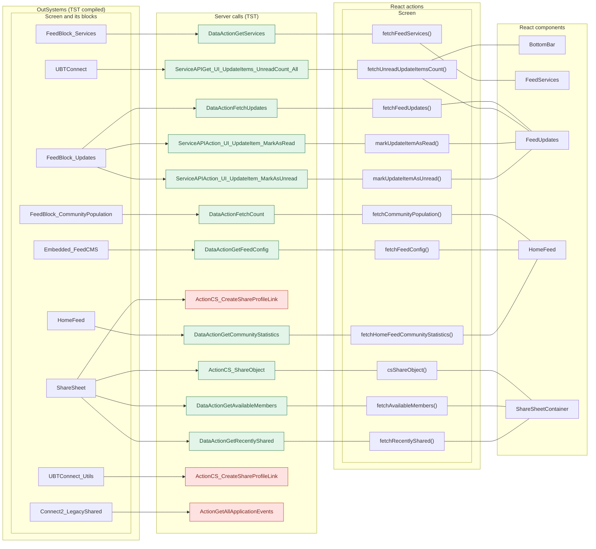

## 5. User actions

The two lists are independent: the OutSystems list comes from the TST compiled code, the React list from the React code. The tool does not map one list to the other.

- **OutSystems:** each event binding of the compiled views (`<event>$Action: function` of a child block or widget, `on<Event>: function` of an HTML element) with its handler.
- **React:** each JSX attribute `on<Event>={handler}` with its handler.
- Both lists keep only the bindings whose handler has an effect: a server call, a navigation, an external link, a message or a confirm dialog. The tool follows the called functions 3 levels deep.
- When the handler has branches in the code (`switch` case, `if` with `===`), each branch has its own diagram. The branch name is the constant of the condition. `other` is the last `else` or `default`.
- An arrow to the server gives the inputs of the call, the return arrow its outputs (contract `app/src/api/openapi.yaml`).

### 5.1 OutSystems (TST)

| # | Block (OutSystems) | Event (TST view) | Handler | Branch | Effects |
|---|---|---|---|---|---|
| [1](#511-bottombarmenu-event_bottombar_clicked-home) | `BottomBarMenu` | `onClick (HTML element)`<br>`onClick of IconBadge` | `event_BottomBar_Clicked` | `home` | goes to HomeFeed |
| [2](#512-bottombarmenu-event_bottombar_clicked-directory) | `BottomBarMenu` | `onClick (HTML element)`<br>`onClick of IconBadge` | `event_BottomBar_Clicked` | `directory` | goes to CountryList, Locality_Details |
| [3](#513-bottombarmenu-event_bottombar_clicked-updates) | `BottomBarMenu` | `onClick (HTML element)`<br>`onClick of IconBadge` | `event_BottomBar_Clicked` | `updates` | goes to Updates_SingleList |
| [4](#514-bottombarmenu-event_bottombar_clicked-bookmarks) | `BottomBarMenu` | `onClick (HTML element)`<br>`onClick of IconBadge` | `event_BottomBar_Clicked` | `bookmarks` | goes to Bookmarks |
| [5](#515-bottombarmenu-event_bottombar_clicked-menu) | `BottomBarMenu` | `onClick (HTML element)`<br>`onClick of IconBadge` | `event_BottomBar_Clicked` | `menu` | goes to Menu |
| [6](#516-app_notificationicon-iconclick) | `App_NotificationIcon` | `onClick of IconBadge` | `iconClick` | – | goes to Notifications, MessageList |
| [7](#517-feedblock_communitypopulation-onclick_block) | `FeedBlock_CommunityPopulation` | `clicked of CustomContainer` | `onClick_Block` | – | goes to Updates_SingleList |
| [8](#518-feedblock_services-onclick_servicesettings) | `FeedBlock_Services` | `onClick of CircleButton` | `onClick_ServiceSettings` | – | goes to Services |
| [9](#519-feedblock_services-onclick_service-orbit) | `FeedBlock_Services` | `onClick of WithLabel` | `onClick_Service` | `orbit` | goes to OrbitLanding |
| [10](#5110-feedblock_services-onclick_service-ldm) | `FeedBlock_Services` | `onClick of WithLabel` | `onClick_Service` | `lDM` | goes to LDM_MyEvents_V2, LDM_MyEvents |
| [11](#5111-feedblock_services-onclick_service-mycalendar) | `FeedBlock_Services` | `onClick of WithLabel` | `onClick_Service` | `myCalendar` | goes to MyEntertaining |
| [12](#5112-feedblock_services-onclick_service-assemble) | `FeedBlock_Services` | `onClick of WithLabel` | `onClick_Service` | `assemble` | goes to AssembleEvents |
| [13](#5113-feedblock_services-onclick_service-orbitadmin) | `FeedBlock_Services` | `onClick of WithLabel` | `onClick_Service` | `orbitAdmin` | goes to OrbitAdminLanding |
| [14](#5114-feedblock_services-onclick_service-mynotes) | `FeedBlock_Services` | `onClick of WithLabel` | `onClick_Service` | `myNotes` | goes to Notes |
| [15](#5115-feedblock_services-onclick_service-oneschoolglobal) | `FeedBlock_Services` | `onClick of WithLabel` | `onClick_Service` | `oneSchoolGlobal` | shows a message |
| [16](#5116-feedblock_services-onclick_service-other) | `FeedBlock_Services` | `onClick of WithLabel` | `onClick_Service` | `other` | asks for a confirmation |
| [17](#5117-feedblock_updates-handler__share) | `FeedBlock_Updates` | `event_Share of ListItem` | `handler__Share` | – | shows a message |
| [18](#5118-feedblock_updates-event_sendgift) | `FeedBlock_Updates` | `event_SendGift of ListItem` | `event_SendGift` | – | shows a message |
| [19](#5119-feedblock_updates-event_markasunread) | `FeedBlock_Updates` | `event_MarkAsUnread of ListItem` | `event_MarkAsUnread` | – | calls Action_UI_UpdateItem_MarkAsUnread, Get_UI_UpdateItems_UnreadCount_All |
| [20](#5120-feedblock_updates-event_listitemonclick) | `FeedBlock_Updates` | `onClick of ListItem` | `event_ListItemOnClick` | – | calls Action_UI_UpdateItem_MarkAsRead; goes to HouseholdCarousel, HouseholdDetails; asks for a confirmation |
| [21](#5121-feedblock_updates-event_markasread) | `FeedBlock_Updates` | `event_MarkAsRead of ListItem` | `event_MarkAsRead` | – | calls Action_UI_UpdateItem_MarkAsRead, Get_UI_UpdateItems_UnreadCount_All |
| [22](#5122-feedblock_updates-onclick_subscriptionupgrade) | `FeedBlock_Updates` | `clicked of CustomContainer` | `onClick_SubscriptionUpgrade` | – | asks for a confirmation |
| [23](#5123-feed_embeded-handle_download) | `Feed_Embeded` | `onDownloaded of FeedCMS` | `handle_Download` | – | opens an external link |
| [24](#5124-feed_embeded-handle_share_others) | `Feed_Embeded` | `event_ShareToOthers of SharePopup` | `handle_Share_Others` | – | calls GetAllApplicationEvents, CS_CreateShareProfileLink, AppManager_SynchAppContext |
| [25](#5125-feed_embeded-handle_share_connect) | `Feed_Embeded` | `event_ShareToConnect of SharePopup` | `handle_Share_Connect` | – | goes to LegacyShareObject |
| [26](#5126-feed_embeded-handledownloadondownloaderror) | `Feed_Embeded` | `onDownloadError of HandleDownload` | `handleDownloadOnDownloadError` | – | shows a message |
| [27](#5127-homefeed-onclick_search) | `HomeFeed` | `onSearchClick of HomePage` | `onClick_Search` | – | goes to Search |
| [28](#5128-homefeed-section_updatesonclick_viewall) | `HomeFeed` | `onClick_ViewAll of FeedWrapper` | `section_UpdatesOnClick_ViewAll` | – | goes to Updates_SingleList |
| [29](#5129-dialog_goexternalapp-gotoexternalapp) | `Dialog_GoExternalApp` | `confirmed of ActionConfirmationDialog` | `goToExternalApp` | – | opens an external link; shows a message |
| [30](#5130-sharesheet-handler_onclickrecentmember) | `ShareSheet` | `onClick of WithLabel` | `handler_OnClickRecentMember` | – | calls CS_ShareObject; shows a message; asks for a confirmation |
| [31](#5131-sharesheet-handler_onclickexternaloption) | `ShareSheet` | `onClick of WithLabel` | `handler_OnClickExternalOption` | – | calls CS_CreateShareProfileLink |
| [32](#5132-sharesheet-handler_inputeventsubmit) | `ShareSheet` | `event_Submit of Input` | `handler_InputEventSubmit` | – | calls GetAvailableMembers |
| [33](#5133-sharesheet-handler_searchresultitemonselect) | `ShareSheet` | `click of Icon` | `handler_SearchResultItemOnSelect` | – | shows a message |
| [34](#5134-sharesheet-handler_onclicksend) | `ShareSheet` | `buttonOnClick of Button` | `handler_OnClickSend` | – | calls CS_ShareObject; shows a message |

#### 5.1.1 BottomBarMenu: event_BottomBar_Clicked (home)

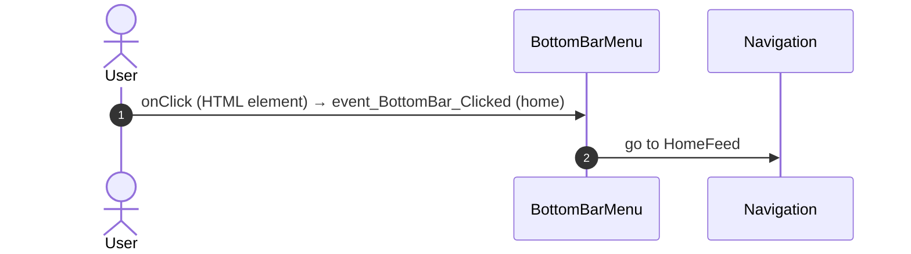

#### 5.1.2 BottomBarMenu: event_BottomBar_Clicked (directory)

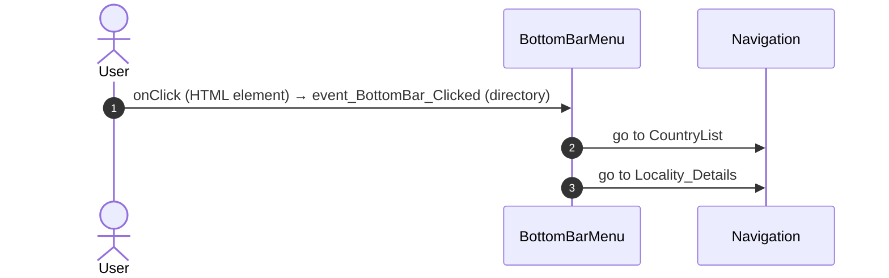

#### 5.1.3 BottomBarMenu: event_BottomBar_Clicked (updates)

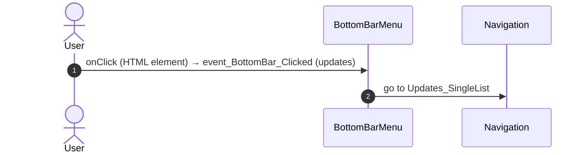

#### 5.1.4 BottomBarMenu: event_BottomBar_Clicked (bookmarks)

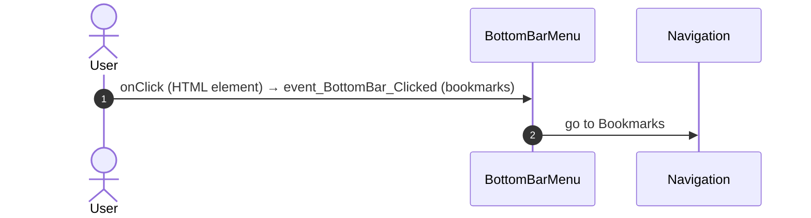

#### 5.1.5 BottomBarMenu: event_BottomBar_Clicked (menu)

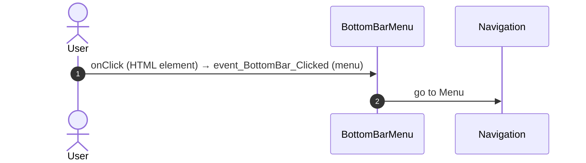

#### 5.1.6 App_NotificationIcon: iconClick

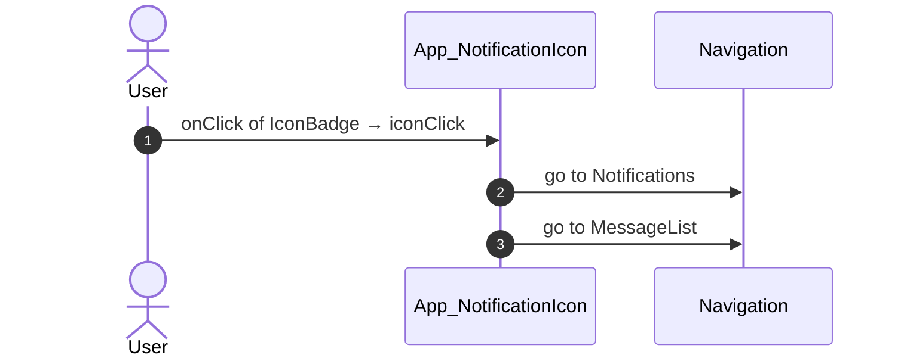

#### 5.1.7 FeedBlock_CommunityPopulation: onClick_Block

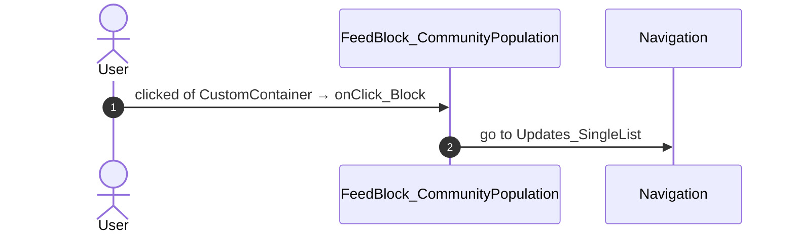

#### 5.1.8 FeedBlock_Services: onClick_ServiceSettings

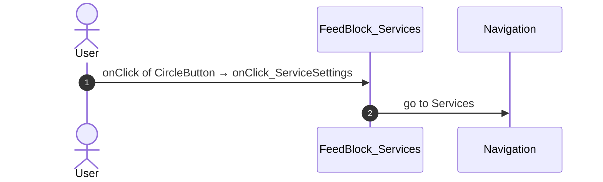

#### 5.1.9 FeedBlock_Services: onClick_Service (orbit)

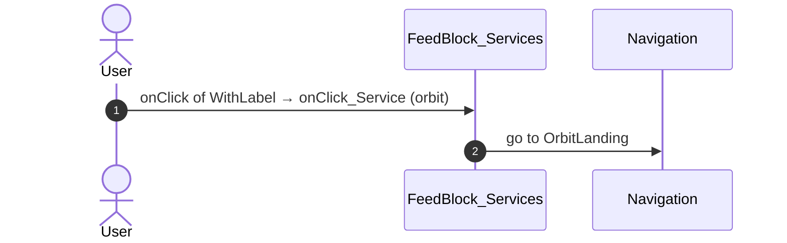

#### 5.1.10 FeedBlock_Services: onClick_Service (lDM)

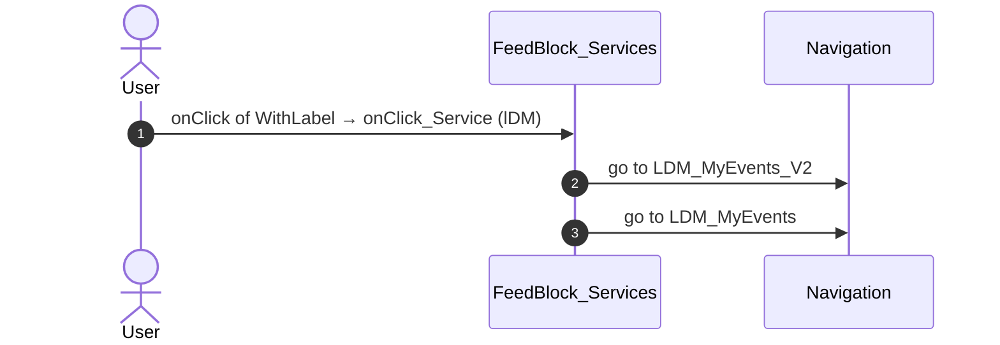

#### 5.1.11 FeedBlock_Services: onClick_Service (myCalendar)

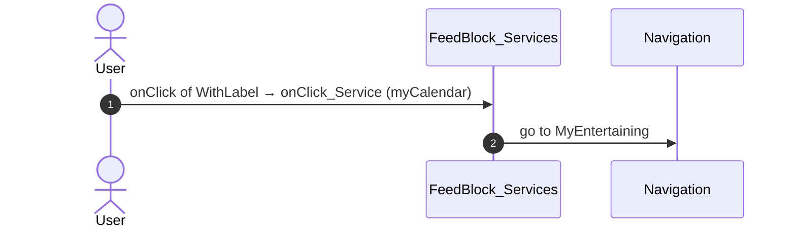

#### 5.1.12 FeedBlock_Services: onClick_Service (assemble)

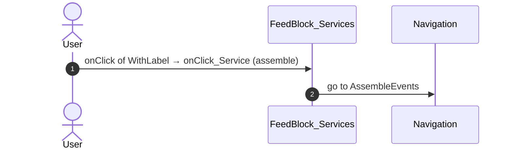

#### 5.1.13 FeedBlock_Services: onClick_Service (orbitAdmin)

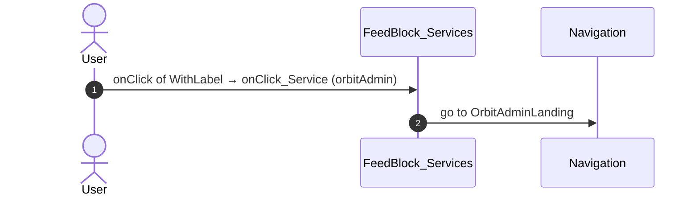

#### 5.1.14 FeedBlock_Services: onClick_Service (myNotes)

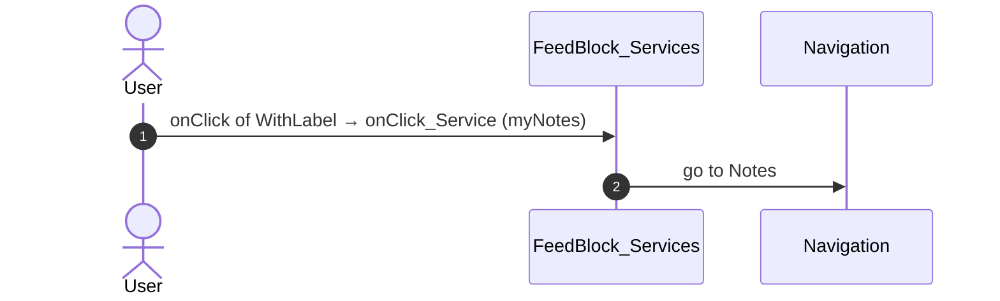

#### 5.1.15 FeedBlock_Services: onClick_Service (oneSchoolGlobal)

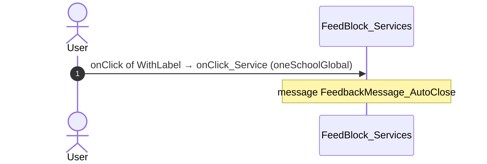

#### 5.1.16 FeedBlock_Services: onClick_Service (other)

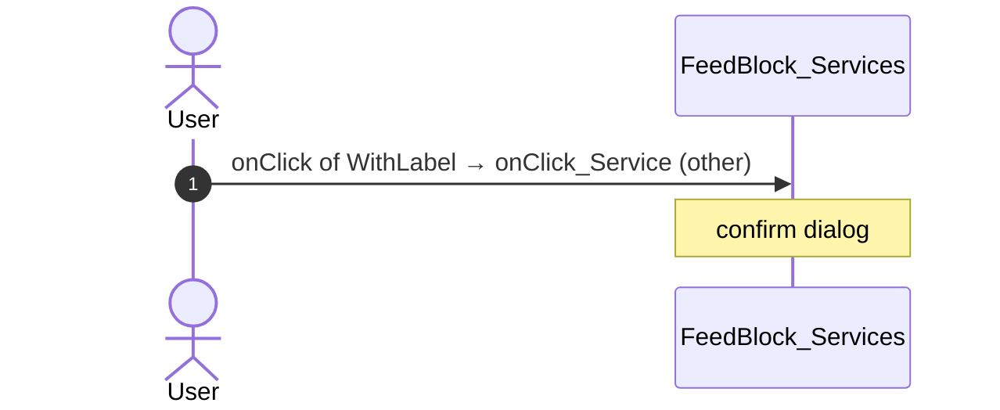

#### 5.1.17 FeedBlock_Updates: handler__Share

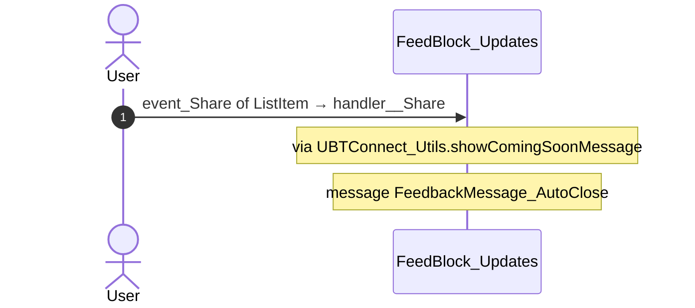

#### 5.1.18 FeedBlock_Updates: event_SendGift

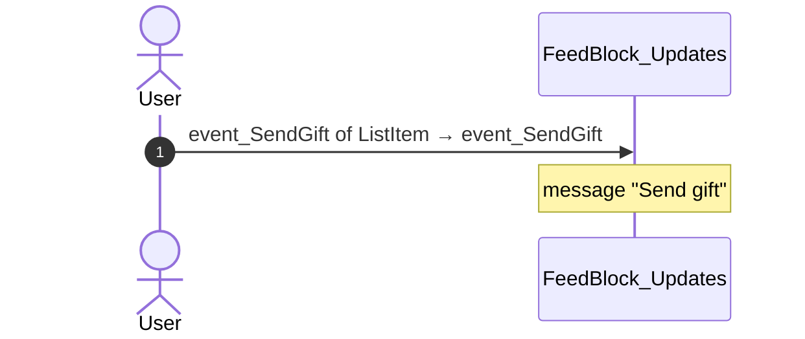

#### 5.1.19 FeedBlock_Updates: event_MarkAsUnread

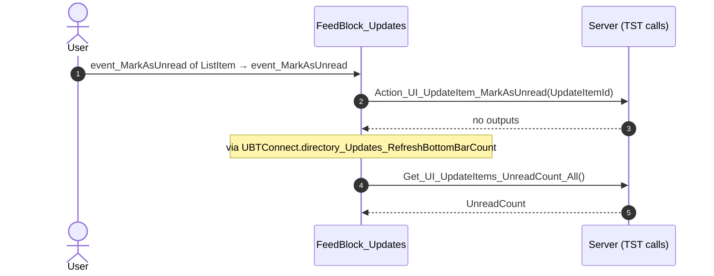

#### 5.1.20 FeedBlock_Updates: event_ListItemOnClick

```mermaid
sequenceDiagram
  autonumber
  actor U as User
  participant B as FeedBlock_Updates
  participant S as Server (TST calls)
  participant N as Navigation
  U->>B: onClick of ListItem → event_ListItemOnClick
  B->>S: Action_UI_UpdateItem_MarkAsRead(UpdateItemId)
  S-->>B: no outputs
  B->>N: go to HouseholdCarousel
  B->>N: go to HouseholdDetails
  Note over B: via UBTConnect_Utils.app_Subscription_ShowUpgradePopUp
  Note over B: confirm dialog
```

#### 5.1.21 FeedBlock_Updates: event_MarkAsRead

```mermaid
sequenceDiagram
  autonumber
  actor U as User
  participant B as FeedBlock_Updates
  participant S as Server (TST calls)
  U->>B: event_MarkAsRead of ListItem → event_MarkAsRead
  B->>S: Action_UI_UpdateItem_MarkAsRead(UpdateItemId)
  S-->>B: no outputs
  Note over B: via UBTConnect.directory_Updates_RefreshBottomBarCount
  B->>S: Get_UI_UpdateItems_UnreadCount_All()
  S-->>B: UnreadCount
```

#### 5.1.22 FeedBlock_Updates: onClick_SubscriptionUpgrade

```mermaid
sequenceDiagram
  autonumber
  actor U as User
  participant B as FeedBlock_Updates
  U->>B: clicked of CustomContainer → onClick_SubscriptionUpgrade
  Note over B: via UBTConnect_Utils.app_Subscription_ShowUpgradePopUp
  Note over B: confirm dialog
```

#### 5.1.23 Feed_Embeded: handle_Download

```mermaid
sequenceDiagram
  autonumber
  actor U as User
  participant B as Feed_Embeded
  participant X as External link
  U->>B: onDownloaded of FeedCMS → handle_Download
  B->>X: OpenInApp_TryOpenFileInApp
```

#### 5.1.24 Feed_Embeded: handle_Share_Others

```mermaid
sequenceDiagram
  autonumber
  actor U as User
  participant B as Feed_Embeded
  participant S as Server (TST calls)
  U->>B: event_ShareToOthers of SharePopup → handle_Share_Others
  Note over B: via UBTConnect_Utils.shareEntity_ByURL
  B->>S: GetAllApplicationEvents()
  S-->>B: EventList
  B->>S: CS_CreateShareProfileLink()
  S-->>B: outputs not in the contract
  B->>S: AppManager_SynchAppContext(EspaceName)
  S-->>B: AppManager_ClientConfig, FirebaseRealTimeDB_Token, PermissionList, …
```

#### 5.1.25 Feed_Embeded: handle_Share_Connect

```mermaid
sequenceDiagram
  autonumber
  actor U as User
  participant B as Feed_Embeded
  participant N as Navigation
  U->>B: event_ShareToConnect of SharePopup → handle_Share_Connect
  B->>N: go to LegacyShareObject
```

#### 5.1.26 Feed_Embeded: handleDownloadOnDownloadError

```mermaid
sequenceDiagram
  autonumber
  actor U as User
  participant B as Feed_Embeded
  U->>B: onDownloadError of HandleDownload → handleDownloadOnDownloadError
  Note over B: message FeedbackMessage_AutoClose
```

#### 5.1.27 HomeFeed: onClick_Search

```mermaid
sequenceDiagram
  autonumber
  actor U as User
  participant B as HomeFeed
  participant N as Navigation
  U->>B: onSearchClick of HomePage → onClick_Search
  B->>N: go to Search
```

#### 5.1.28 HomeFeed: section_UpdatesOnClick_ViewAll

```mermaid
sequenceDiagram
  autonumber
  actor U as User
  participant B as HomeFeed
  participant N as Navigation
  U->>B: onClick_ViewAll of FeedWrapper → section_UpdatesOnClick_ViewAll
  B->>N: go to Updates_SingleList
```

#### 5.1.29 Dialog_GoExternalApp: goToExternalApp

```mermaid
sequenceDiagram
  autonumber
  actor U as User
  participant B as Dialog_GoExternalApp
  participant X as External link
  U->>B: confirmed of ActionConfirmationDialog → goToExternalApp
  Note over B: message FeedbackMessage_AutoClose2
  B->>X: OpenInApp_OpenExternalLink
  B->>X: OpenInApp_OpenApp
```

#### 5.1.30 ShareSheet: handler_OnClickRecentMember

```mermaid
sequenceDiagram
  autonumber
  actor U as User
  participant B as ShareSheet
  participant S as Server (TST calls)
  U->>B: onClick of WithLabel → handler_OnClickRecentMember
  Note over B: via UBTConnect_Utils.app_Subscription_ShowUpgradePopUp
  Note over B: confirm dialog
  B->>S: CS_ShareObject(In_ShareObjectTypeId, In_SharedObjectId, In_SharingProfileName, …)
  S-->>B: IsAllowed, IsSuccess, Message, …
  Note over B: message submitMessageVar + " has been shared."
  Note over B: message "Share failed. Please try again."
```

#### 5.1.31 ShareSheet: handler_OnClickExternalOption

```mermaid
sequenceDiagram
  autonumber
  actor U as User
  participant B as ShareSheet
  participant S as Server (TST calls)
  U->>B: onClick of WithLabel → handler_OnClickExternalOption
  B->>S: CS_CreateShareProfileLink(In_ShareObjectTypeId, In_SharedObjectId, In_UpdateDate, …)
  S-->>B: ShareId, URL
```

#### 5.1.32 ShareSheet: handler_InputEventSubmit

```mermaid
sequenceDiagram
  autonumber
  actor U as User
  participant B as ShareSheet
  participant S as Server (TST calls)
  U->>B: event_Submit of Input → handler_InputEventSubmit
  B->>S: GetAvailableMembers(AvatarImageSize_HorizontalList, AvatarImageSize_VerticalList, AvatarSize_HorizontalList, …)
  S-->>B: Out_SearchResultItemList
```

#### 5.1.33 ShareSheet: handler_SearchResultItemOnSelect

```mermaid
sequenceDiagram
  autonumber
  actor U as User
  participant B as ShareSheet
  U->>B: click of Icon → handler_SearchResultItemOnSelect
  Note over B: message FeedbackMessage_AutoClose
```

#### 5.1.34 ShareSheet: handler_OnClickSend

```mermaid
sequenceDiagram
  autonumber
  actor U as User
  participant B as ShareSheet
  participant S as Server (TST calls)
  U->>B: buttonOnClick of Button → handler_OnClickSend
  B->>S: CS_ShareObject(In_ShareObjectTypeId, In_SharedObjectId, In_SharingProfileName, …)
  S-->>B: IsAllowed, IsSuccess, Message, …
  Note over B: message submitMessageVar + " has been shared."
  Note over B: message "Share failed. Please try again."
```

### 5.2 React

| # | File | Element | Event prop | Handler | Branch | Effects |
|---|---|---|---|---|---|---|
| [1](#521-homelayout-ononsearchclick) | [`pages/HomeFeed/HomeFeedPage.tsx:128`](../../app/src/pages/HomeFeed/HomeFeedPage.tsx#L128) | `<HomeLayout>` | `onOnSearchClick` | `inline` | – | goes to Search |
| [2](#522-communitypopulation-onclick) | [`pages/HomeFeed/HomeFeedPage.tsx:156`](../../app/src/pages/HomeFeed/HomeFeedPage.tsx#L156) | `<CommunityPopulation>` | `onClick` | `inline` | – | goes to Updates_SingleList |
| [3](#523-section_feedwrapper-ononclickviewall) | [`pages/HomeFeed/HomeFeedPage.tsx:170`](../../app/src/pages/HomeFeed/HomeFeedPage.tsx#L170) | `<Section_FeedWrapper>` | `onOnClickViewAll` | `inline` | – | goes to Updates_SingleList |
| [4](#524-feedblock_services-onclickservicesettings) | [`pages/HomeFeed/HomeFeedPage.tsx:60`](../../app/src/pages/HomeFeed/HomeFeedPage.tsx#L60) | `<FeedBlock_Services>` | `onClickServiceSettings` | `services.onClickServiceSettings` | – | goes to Services |
| [5](#525-feedblock_services-onclickservice-orbit) | [`pages/HomeFeed/HomeFeedPage.tsx:60`](../../app/src/pages/HomeFeed/HomeFeedPage.tsx#L60) | `<FeedBlock_Services>` | `onClickService` | `services.onClickService` | `Orbit` | goes to OrbitLanding |
| [6](#526-feedblock_services-onclickservice-ldm) | [`pages/HomeFeed/HomeFeedPage.tsx:60`](../../app/src/pages/HomeFeed/HomeFeedPage.tsx#L60) | `<FeedBlock_Services>` | `onClickService` | `services.onClickService` | `LDM` | goes to LDM_MyEvents_V2 |
| [7](#527-feedblock_services-onclickservice-mycalendar) | [`pages/HomeFeed/HomeFeedPage.tsx:60`](../../app/src/pages/HomeFeed/HomeFeedPage.tsx#L60) | `<FeedBlock_Services>` | `onClickService` | `services.onClickService` | `MyCalendar` | goes to MyEntertaining |
| [8](#528-feedblock_services-onclickservice-assemble) | [`pages/HomeFeed/HomeFeedPage.tsx:60`](../../app/src/pages/HomeFeed/HomeFeedPage.tsx#L60) | `<FeedBlock_Services>` | `onClickService` | `services.onClickService` | `Assemble` | goes to AssembleEvents |
| [9](#529-feedblock_services-onclickservice-orbitadmin) | [`pages/HomeFeed/HomeFeedPage.tsx:60`](../../app/src/pages/HomeFeed/HomeFeedPage.tsx#L60) | `<FeedBlock_Services>` | `onClickService` | `services.onClickService` | `OrbitAdmin` | goes to OrbitAdminLanding |
| [10](#5210-feedblock_services-onclickservice-mynotes) | [`pages/HomeFeed/HomeFeedPage.tsx:60`](../../app/src/pages/HomeFeed/HomeFeedPage.tsx#L60) | `<FeedBlock_Services>` | `onClickService` | `services.onClickService` | `MyNotes` | goes to Notes |
| [11](#5211-feedblock_services-onclickservice-elgusto) | [`pages/HomeFeed/HomeFeedPage.tsx:60`](../../app/src/pages/HomeFeed/HomeFeedPage.tsx#L60) | `<FeedBlock_Services>` | `onClickService` | `services.onClickService` | `ElGusto` | opens an external link |
| [12](#5212-feedblock_services-onclickservice-oneschoolglobal) | [`pages/HomeFeed/HomeFeedPage.tsx:60`](../../app/src/pages/HomeFeed/HomeFeedPage.tsx#L60) | `<FeedBlock_Services>` | `onClickService` | `services.onClickService` | `OneSchoolGlobal` | shows a message |
| [13](#5213-feedblock_services-onclickservice-other) | [`pages/HomeFeed/HomeFeedPage.tsx:60`](../../app/src/pages/HomeFeed/HomeFeedPage.tsx#L60) | `<FeedBlock_Services>` | `onClickService` | `services.onClickService` | `other` | asks for a confirmation |
| [14](#5214-feedblock_services-ongotoexternalapp) | [`pages/HomeFeed/HomeFeedPage.tsx:60`](../../app/src/pages/HomeFeed/HomeFeedPage.tsx#L60) | `<FeedBlock_Services>` | `onGoToExternalApp` | `services.onGoToExternalApp` | – | opens an external link; shows a message |
| [15](#5215-feedblock_updates-onitemclick) | [`pages/HomeFeed/HomeFeedPage.tsx:66`](../../app/src/pages/HomeFeed/HomeFeedPage.tsx#L66) | `<FeedBlock_Updates>` | `onItemClick` | `useFeedUpdates().onItemClick` | – | calls ServiceAPIAction_UI_UpdateItem_MarkAsRead; goes to HouseholdCarousel; asks for a confirmation |
| [16](#5216-feedblock_updates-onsendgift) | [`pages/HomeFeed/HomeFeedPage.tsx:66`](../../app/src/pages/HomeFeed/HomeFeedPage.tsx#L66) | `<FeedBlock_Updates>` | `onSendGift` | `useFeedUpdates().onSendGift` | – | shows a message |
| [17](#5217-feedblock_updates-onmarkasread) | [`pages/HomeFeed/HomeFeedPage.tsx:66`](../../app/src/pages/HomeFeed/HomeFeedPage.tsx#L66) | `<FeedBlock_Updates>` | `onMarkAsRead` | `useFeedUpdates().onMarkAsRead` | – | calls ServiceAPIAction_UI_UpdateItem_MarkAsRead, ServiceAPIAction_UI_UpdateItem_MarkAsUnread, ServiceAPIGet_UI_UpdateItems_UnreadCount_All |
| [18](#5218-feedblock_updates-onmarkasunread) | [`pages/HomeFeed/HomeFeedPage.tsx:66`](../../app/src/pages/HomeFeed/HomeFeedPage.tsx#L66) | `<FeedBlock_Updates>` | `onMarkAsUnread` | `useFeedUpdates().onMarkAsUnread` | – | calls ServiceAPIAction_UI_UpdateItem_MarkAsRead, ServiceAPIAction_UI_UpdateItem_MarkAsUnread, ServiceAPIGet_UI_UpdateItems_UnreadCount_All |
| [19](#5219-feedblock_updates-onclickupgrade) | [`pages/HomeFeed/HomeFeedPage.tsx:66`](../../app/src/pages/HomeFeed/HomeFeedPage.tsx#L66) | `<FeedBlock_Updates>` | `onClickUpgrade` | `useFeedUpdates().onClickUpgrade` | – | asks for a confirmation |
| [20](#5220-notificationicon-oniconclick) | [`pages/HomeFeed/HomeFeedPage.tsx:132`](../../app/src/pages/HomeFeed/HomeFeedPage.tsx#L132) | `<NotificationIcon>` | `onIconClick` | `notificationIcon.onIconClick` | – | goes to Notifications, MessageList |
| [21](#5221-embeddedfeed-ondownloaded) | [`pages/HomeFeed/HomeFeedPage.tsx:177`](../../app/src/pages/HomeFeed/HomeFeedPage.tsx#L177) | `<EmbeddedFeed>` | `onDownloaded` | `embeddedFeed.onDownloaded` | – | opens an external link |
| [22](#5222-embeddedfeed-onsharetoconnect) | [`pages/HomeFeed/HomeFeedPage.tsx:177`](../../app/src/pages/HomeFeed/HomeFeedPage.tsx#L177) | `<EmbeddedFeed>` | `onShareToConnect` | `embeddedFeed.onShareToConnect` | – | goes to LegacyShareObject |
| [23](#5223-sharesheetfirststep-onclickrecentmember) | [`containers/ShareSheet/ShareSheetContainer.tsx:111`](../../app/src/containers/ShareSheet/ShareSheetContainer.tsx#L111) | `<ShareSheetFirstStep>` | `onClickRecentMember` | `onClickRecentMember` | – | calls ActionCS_ShareObject; shows a message; asks for a confirmation |
| [24](#5224-sharesheetsearchstep-onsubmit) | [`containers/ShareSheet/ShareSheetContainer.tsx:127`](../../app/src/containers/ShareSheet/ShareSheetContainer.tsx#L127) | `<ShareSheetSearchStep>` | `onSubmit` | `onSubmit` | – | setSearchFetchId(): a query fetches again |
| [25](#5225-sharesheetsearchstep-onselect) | [`containers/ShareSheet/ShareSheetContainer.tsx:129`](../../app/src/containers/ShareSheet/ShareSheetContainer.tsx#L129) | `<ShareSheetSearchStep>` | `onSelect` | `onSelect` | – | shows a message |
| [26](#5226-sharesheetsearchstep-onclickupgradesubscription) | [`containers/ShareSheet/ShareSheetContainer.tsx:130`](../../app/src/containers/ShareSheet/ShareSheetContainer.tsx#L130) | `<ShareSheetSearchStep>` | `onClickUpgradeSubscription` | `onClickUpgradeSubscription` | – | opens an external link |
| [27](#5227-actionbutton-onbuttononclick) | [`containers/ShareSheet/ShareSheetContainer.tsx:148`](../../app/src/containers/ShareSheet/ShareSheetContainer.tsx#L148) | `<ActionButton>` | `onButtonOnClick` | `onClickSend` | – | calls ActionCS_ShareObject; shows a message |
| [28](#5228-preventbacknavigation-onbacknavigationprevented) | [`components/layout/CommonUiLayout/CommonUiLayout.tsx:80`](../../app/src/components/layout/CommonUiLayout/CommonUiLayout.tsx#L80) | `<PreventBackNavigation>` | `onBackNavigationPrevented` | `redirectHome` | – | goes to HomeFeed |
| [29](#5229-backnavigationhandler-onbacknavigation) | [`components/layout/CommonUiLayout/CommonUiLayout.tsx:82`](../../app/src/components/layout/CommonUiLayout/CommonUiLayout.tsx#L82) | `<BackNavigationHandler>` | `onBackNavigation` | `maybeRedirectHome` | – | goes to HomeFeed |
| [30](#5230-oslink-onclick-home) | [`components/layout/BottomBar/BottomBar.tsx:130`](../../app/src/components/layout/BottomBar/BottomBar.tsx#L130) | `<OSLink>` | `onClick` | `click` | `Home` | goes to HomeFeed |
| [31](#5231-oslink-onclick-directory) | [`components/layout/BottomBar/BottomBar.tsx:130`](../../app/src/components/layout/BottomBar/BottomBar.tsx#L130) | `<OSLink>` | `onClick` | `click` | `Directory` | goes to CountryList, Locality_Details |
| [32](#5232-oslink-onclick-updates) | [`components/layout/BottomBar/BottomBar.tsx:130`](../../app/src/components/layout/BottomBar/BottomBar.tsx#L130) | `<OSLink>` | `onClick` | `click` | `Updates` | goes to Updates_SingleList |
| [33](#5233-oslink-onclick-bookmarks) | [`components/layout/BottomBar/BottomBar.tsx:130`](../../app/src/components/layout/BottomBar/BottomBar.tsx#L130) | `<OSLink>` | `onClick` | `click` | `Bookmarks` | goes to Bookmarks |
| [34](#5234-oslink-onclick-menu) | [`components/layout/BottomBar/BottomBar.tsx:130`](../../app/src/components/layout/BottomBar/BottomBar.tsx#L130) | `<OSLink>` | `onClick` | `click` | `Menu` | goes to Menu |
| [35](#5235-oslink-onclick-other) | [`components/layout/BottomBar/BottomBar.tsx:130`](../../app/src/components/layout/BottomBar/BottomBar.tsx#L130) | `<OSLink>` | `onClick` | `click` | `other` | calls the prop onBottomBarClicked() |
| [36](#5236-bottombariconbadge-ononclick-home) | [`components/layout/BottomBar/BottomBar.tsx:140`](../../app/src/components/layout/BottomBar/BottomBar.tsx#L140) | `<BottomBarIconBadge>` | `onOnClick` | `click` | `Home` | goes to HomeFeed |
| [37](#5237-bottombariconbadge-ononclick-directory) | [`components/layout/BottomBar/BottomBar.tsx:140`](../../app/src/components/layout/BottomBar/BottomBar.tsx#L140) | `<BottomBarIconBadge>` | `onOnClick` | `click` | `Directory` | goes to CountryList, Locality_Details |
| [38](#5238-bottombariconbadge-ononclick-updates) | [`components/layout/BottomBar/BottomBar.tsx:140`](../../app/src/components/layout/BottomBar/BottomBar.tsx#L140) | `<BottomBarIconBadge>` | `onOnClick` | `click` | `Updates` | goes to Updates_SingleList |
| [39](#5239-bottombariconbadge-ononclick-bookmarks) | [`components/layout/BottomBar/BottomBar.tsx:140`](../../app/src/components/layout/BottomBar/BottomBar.tsx#L140) | `<BottomBarIconBadge>` | `onOnClick` | `click` | `Bookmarks` | goes to Bookmarks |
| [40](#5240-bottombariconbadge-ononclick-menu) | [`components/layout/BottomBar/BottomBar.tsx:140`](../../app/src/components/layout/BottomBar/BottomBar.tsx#L140) | `<BottomBarIconBadge>` | `onOnClick` | `click` | `Menu` | goes to Menu |
| [41](#5241-bottombariconbadge-ononclick-other) | [`components/layout/BottomBar/BottomBar.tsx:140`](../../app/src/components/layout/BottomBar/BottomBar.tsx#L140) | `<BottomBarIconBadge>` | `onOnClick` | `click` | `other` | calls the prop onBottomBarClicked() |

#### 5.2.1 HomeLayout: onOnSearchClick

```mermaid
sequenceDiagram
  autonumber
  actor U as User
  participant H as HomeLayout · HomeFeedPage.tsx
  participant N as Navigation
  U->>H: onOnSearchClick → inline
  H->>N: go to Search
```

#### 5.2.2 CommunityPopulation: onClick

```mermaid
sequenceDiagram
  autonumber
  actor U as User
  participant H as CommunityPopulation · HomeFeedPage.tsx
  participant N as Navigation
  U->>H: onClick → inline
  H->>N: go to Updates_SingleList
```

#### 5.2.3 Section_FeedWrapper: onOnClickViewAll

```mermaid
sequenceDiagram
  autonumber
  actor U as User
  participant H as Section_FeedWrapper · HomeFeedPage.tsx
  participant N as Navigation
  U->>H: onOnClickViewAll → inline
  H->>N: go to Updates_SingleList
```

#### 5.2.4 FeedBlock_Services: onClickServiceSettings

```mermaid
sequenceDiagram
  autonumber
  actor U as User
  participant H as FeedBlock_Services · HomeFeedPage.tsx
  participant N as Navigation
  U->>H: onClickServiceSettings → services.onClickServiceSettings
  H->>N: go to Services
```

#### 5.2.5 FeedBlock_Services: onClickService (Orbit)

```mermaid
sequenceDiagram
  autonumber
  actor U as User
  participant H as FeedBlock_Services · HomeFeedPage.tsx
  participant N as Navigation
  U->>H: onClickService → services.onClickService (Orbit)
  Note over H: via clickService()
  H->>N: go to OrbitLanding
```

#### 5.2.6 FeedBlock_Services: onClickService (LDM)

```mermaid
sequenceDiagram
  autonumber
  actor U as User
  participant H as FeedBlock_Services · HomeFeedPage.tsx
  participant N as Navigation
  U->>H: onClickService → services.onClickService (LDM)
  Note over H: via clickService()
  H->>N: go to LDM_MyEvents_V2
```

#### 5.2.7 FeedBlock_Services: onClickService (MyCalendar)

```mermaid
sequenceDiagram
  autonumber
  actor U as User
  participant H as FeedBlock_Services · HomeFeedPage.tsx
  participant N as Navigation
  U->>H: onClickService → services.onClickService (MyCalendar)
  Note over H: via clickService()
  H->>N: go to MyEntertaining
```

#### 5.2.8 FeedBlock_Services: onClickService (Assemble)

```mermaid
sequenceDiagram
  autonumber
  actor U as User
  participant H as FeedBlock_Services · HomeFeedPage.tsx
  participant N as Navigation
  U->>H: onClickService → services.onClickService (Assemble)
  Note over H: via clickService()
  H->>N: go to AssembleEvents
```

#### 5.2.9 FeedBlock_Services: onClickService (OrbitAdmin)

```mermaid
sequenceDiagram
  autonumber
  actor U as User
  participant H as FeedBlock_Services · HomeFeedPage.tsx
  participant N as Navigation
  U->>H: onClickService → services.onClickService (OrbitAdmin)
  Note over H: via clickService()
  H->>N: go to OrbitAdminLanding
```

#### 5.2.10 FeedBlock_Services: onClickService (MyNotes)

```mermaid
sequenceDiagram
  autonumber
  actor U as User
  participant H as FeedBlock_Services · HomeFeedPage.tsx
  participant N as Navigation
  U->>H: onClickService → services.onClickService (MyNotes)
  Note over H: via clickService()
  H->>N: go to Notes
```

#### 5.2.11 FeedBlock_Services: onClickService (ElGusto)

```mermaid
sequenceDiagram
  autonumber
  actor U as User
  participant H as FeedBlock_Services · HomeFeedPage.tsx
  participant X as External link
  U->>H: onClickService → services.onClickService (ElGusto)
  Note over H: via clickService()
  H->>X: openInApp_OpenExternalLink
```

#### 5.2.12 FeedBlock_Services: onClickService (OneSchoolGlobal)

```mermaid
sequenceDiagram
  autonumber
  actor U as User
  participant H as FeedBlock_Services · HomeFeedPage.tsx
  U->>H: onClickService → services.onClickService (OneSchoolGlobal)
  Note over H: via clickService()
  Note over H: message { title: 'Coming soon', message: 'This feature will be coming soon.', messageType: 'info',
```

#### 5.2.13 FeedBlock_Services: onClickService (other)

```mermaid
sequenceDiagram
  autonumber
  actor U as User
  participant H as FeedBlock_Services · HomeFeedPage.tsx
  U->>H: onClickService → services.onClickService (other)
  Note over H: via clickService()
  Note over H: confirm dialog externalAppPopUpId
```

#### 5.2.14 FeedBlock_Services: onGoToExternalApp

```mermaid
sequenceDiagram
  autonumber
  actor U as User
  participant H as FeedBlock_Services · HomeFeedPage.tsx
  participant X as External link
  U->>H: onGoToExternalApp → services.onGoToExternalApp
  Note over H: via goToExternalApp()
  Note over H: message { title: 'Not available', message: 'Sorry, this is not available in the platform you are u
  H->>X: openInApp_OpenApp
```

#### 5.2.15 FeedBlock_Updates: onItemClick

```mermaid
sequenceDiagram
  autonumber
  actor U as User
  participant H as FeedBlock_Updates · HomeFeedPage.tsx
  participant A as Server (React api)
  participant N as Navigation
  U->>H: onItemClick → useFeedUpdates().onItemClick
  Note over H: via itemClick()
  Note over H: via showUpgradePopUp()
  Note over H: confirm dialog dialogId
  Note over H: via markUpdateItemAsRead()
  H->>A: ServiceAPIAction_UI_UpdateItem_MarkAsRead(UpdateItemId)
  A-->>H: no outputs
  H->>N: go to HouseholdCarousel
```

#### 5.2.16 FeedBlock_Updates: onSendGift

```mermaid
sequenceDiagram
  autonumber
  actor U as User
  participant H as FeedBlock_Updates · HomeFeedPage.tsx
  U->>H: onSendGift → useFeedUpdates().onSendGift
  Note over H: message 'Send gift'
```

#### 5.2.17 FeedBlock_Updates: onMarkAsRead

```mermaid
sequenceDiagram
  autonumber
  actor U as User
  participant H as FeedBlock_Updates · HomeFeedPage.tsx
  participant A as Server (React api)
  U->>H: onMarkAsRead → useFeedUpdates().onMarkAsRead
  Note over H: via markAs()
  H->>A: ServiceAPIAction_UI_UpdateItem_MarkAsRead(UpdateItemId)
  A-->>H: no outputs
  H->>A: ServiceAPIAction_UI_UpdateItem_MarkAsUnread(UpdateItemId)
  A-->>H: no outputs
  Note over H: via directory_Updates_RefreshBottomBarCount()
  Note over H: via fetchUnreadUpdateItemsCount()
  H->>A: ServiceAPIGet_UI_UpdateItems_UnreadCount_All()
  A-->>H: UnreadCount
```

#### 5.2.18 FeedBlock_Updates: onMarkAsUnread

```mermaid
sequenceDiagram
  autonumber
  actor U as User
  participant H as FeedBlock_Updates · HomeFeedPage.tsx
  participant A as Server (React api)
  U->>H: onMarkAsUnread → useFeedUpdates().onMarkAsUnread
  Note over H: via markAs()
  H->>A: ServiceAPIAction_UI_UpdateItem_MarkAsRead(UpdateItemId)
  A-->>H: no outputs
  H->>A: ServiceAPIAction_UI_UpdateItem_MarkAsUnread(UpdateItemId)
  A-->>H: no outputs
  Note over H: via directory_Updates_RefreshBottomBarCount()
  Note over H: via fetchUnreadUpdateItemsCount()
  H->>A: ServiceAPIGet_UI_UpdateItems_UnreadCount_All()
  A-->>H: UnreadCount
```

#### 5.2.19 FeedBlock_Updates: onClickUpgrade

```mermaid
sequenceDiagram
  autonumber
  actor U as User
  participant H as FeedBlock_Updates · HomeFeedPage.tsx
  U->>H: onClickUpgrade → useFeedUpdates().onClickUpgrade
  Note over H: via showUpgradePopUp()
  Note over H: confirm dialog dialogId
```

#### 5.2.20 NotificationIcon: onIconClick

```mermaid
sequenceDiagram
  autonumber
  actor U as User
  participant H as NotificationIcon · HomeFeedPage.tsx
  participant N as Navigation
  U->>H: onIconClick → notificationIcon.onIconClick
  H->>N: go to Notifications
  H->>N: go to MessageList
```

#### 5.2.21 EmbeddedFeed: onDownloaded

```mermaid
sequenceDiagram
  autonumber
  actor U as User
  participant H as EmbeddedFeed · HomeFeedPage.tsx
  participant X as External link
  U->>H: onDownloaded → embeddedFeed.onDownloaded
  H->>X: openInApp_TryOpenFileInApp
```

#### 5.2.22 EmbeddedFeed: onShareToConnect

```mermaid
sequenceDiagram
  autonumber
  actor U as User
  participant H as EmbeddedFeed · HomeFeedPage.tsx
  participant N as Navigation
  U->>H: onShareToConnect → embeddedFeed.onShareToConnect
  H->>N: go to LegacyShareObject
```

#### 5.2.23 ShareSheetFirstStep: onClickRecentMember

```mermaid
sequenceDiagram
  autonumber
  actor U as User
  participant H as ShareSheetFirstStep · ShareSheetContainer.tsx
  participant A as Server (React api)
  U->>H: onClickRecentMember → onClickRecentMember
  Note over H: via showUpgradePopUp()
  Note over H: confirm dialog dialogId
  Note over H: via submitShare()
  Note over H: via csShareObject()
  H->>A: ActionCS_ShareObject(In_ShareObjectTypeId, In_SharedObjectId, In_SharingProfileName, …)
  A-->>H: IsAllowed, IsSuccess, Message, …
  Note over H: message `${submitMessage} has been shared.`
  Note over H: message 'Share failed. Please try again.'
```

#### 5.2.24 ShareSheetSearchStep: onSubmit

```mermaid
sequenceDiagram
  autonumber
  actor U as User
  participant H as ShareSheetSearchStep · ShareSheetContainer.tsx
  U->>H: onSubmit → onSubmit
  Note over H: setSearchFetchId(): a query fetches again
```

#### 5.2.25 ShareSheetSearchStep: onSelect

```mermaid
sequenceDiagram
  autonumber
  actor U as User
  participant H as ShareSheetSearchStep · ShareSheetContainer.tsx
  U->>H: onSelect → onSelect
  Note over H: message { title: '', message: 'You can select up to 50 recipients only.', messageType: 'error', en
```

#### 5.2.26 ShareSheetSearchStep: onClickUpgradeSubscription

```mermaid
sequenceDiagram
  autonumber
  actor U as User
  participant H as ShareSheetSearchStep · ShareSheetContainer.tsx
  participant X as External link
  U->>H: onClickUpgradeSubscription → onClickUpgradeSubscription
  Note over H: via navigateToUpgrade()
  H->>X: openInApp_OpenExternalLink
```

#### 5.2.27 ActionButton: onButtonOnClick

```mermaid
sequenceDiagram
  autonumber
  actor U as User
  participant H as ActionButton · ShareSheetContainer.tsx
  participant A as Server (React api)
  U->>H: onButtonOnClick → onClickSend
  Note over H: via submitShare()
  Note over H: via csShareObject()
  H->>A: ActionCS_ShareObject(In_ShareObjectTypeId, In_SharedObjectId, In_SharingProfileName, …)
  A-->>H: IsAllowed, IsSuccess, Message, …
  Note over H: message `${submitMessage} has been shared.`
  Note over H: message 'Share failed. Please try again.'
```

#### 5.2.28 PreventBackNavigation: onBackNavigationPrevented

```mermaid
sequenceDiagram
  autonumber
  actor U as User
  participant H as PreventBackNavigation · CommonUiLayout.tsx
  participant N as Navigation
  U->>H: onBackNavigationPrevented → redirectHome
  H->>N: go to HomeFeed
```

#### 5.2.29 BackNavigationHandler: onBackNavigation

```mermaid
sequenceDiagram
  autonumber
  actor U as User
  participant H as BackNavigationHandler · CommonUiLayout.tsx
  participant N as Navigation
  U->>H: onBackNavigation → maybeRedirectHome
  Note over H: via actionRedirectHome()
  H->>N: go to HomeFeed
```

#### 5.2.30 OSLink: onClick (Home)

```mermaid
sequenceDiagram
  autonumber
  actor U as User
  participant H as OSLink · BottomBar.tsx
  participant N as Navigation
  U->>H: onClick → click (Home)
  Note over H: via event_BottomBar_Clicked()
  H->>N: go to HomeFeed
```

#### 5.2.31 OSLink: onClick (Directory)

```mermaid
sequenceDiagram
  autonumber
  actor U as User
  participant H as OSLink · BottomBar.tsx
  participant N as Navigation
  U->>H: onClick → click (Directory)
  Note over H: via event_BottomBar_Clicked()
  H->>N: go to CountryList
  H->>N: go to Locality_Details
```

#### 5.2.32 OSLink: onClick (Updates)

```mermaid
sequenceDiagram
  autonumber
  actor U as User
  participant H as OSLink · BottomBar.tsx
  participant N as Navigation
  U->>H: onClick → click (Updates)
  Note over H: via event_BottomBar_Clicked()
  H->>N: go to Updates_SingleList
```

#### 5.2.33 OSLink: onClick (Bookmarks)

```mermaid
sequenceDiagram
  autonumber
  actor U as User
  participant H as OSLink · BottomBar.tsx
  participant N as Navigation
  U->>H: onClick → click (Bookmarks)
  Note over H: via event_BottomBar_Clicked()
  H->>N: go to Bookmarks
```

#### 5.2.34 OSLink: onClick (Menu)

```mermaid
sequenceDiagram
  autonumber
  actor U as User
  participant H as OSLink · BottomBar.tsx
  participant N as Navigation
  U->>H: onClick → click (Menu)
  Note over H: via event_BottomBar_Clicked()
  H->>N: go to Menu
```

#### 5.2.35 OSLink: onClick (other)

```mermaid
sequenceDiagram
  autonumber
  actor U as User
  participant H as OSLink · BottomBar.tsx
  U->>H: onClick → click (other)
  Note over H: via event_BottomBar_Clicked()
  Note over H: calls the prop onBottomBarClicked()
```

#### 5.2.36 BottomBarIconBadge: onOnClick (Home)

```mermaid
sequenceDiagram
  autonumber
  actor U as User
  participant H as BottomBarIconBadge · BottomBar.tsx
  participant N as Navigation
  U->>H: onOnClick → click (Home)
  Note over H: via event_BottomBar_Clicked()
  H->>N: go to HomeFeed
```

#### 5.2.37 BottomBarIconBadge: onOnClick (Directory)

```mermaid
sequenceDiagram
  autonumber
  actor U as User
  participant H as BottomBarIconBadge · BottomBar.tsx
  participant N as Navigation
  U->>H: onOnClick → click (Directory)
  Note over H: via event_BottomBar_Clicked()
  H->>N: go to CountryList
  H->>N: go to Locality_Details
```

#### 5.2.38 BottomBarIconBadge: onOnClick (Updates)

```mermaid
sequenceDiagram
  autonumber
  actor U as User
  participant H as BottomBarIconBadge · BottomBar.tsx
  participant N as Navigation
  U->>H: onOnClick → click (Updates)
  Note over H: via event_BottomBar_Clicked()
  H->>N: go to Updates_SingleList
```

#### 5.2.39 BottomBarIconBadge: onOnClick (Bookmarks)

```mermaid
sequenceDiagram
  autonumber
  actor U as User
  participant H as BottomBarIconBadge · BottomBar.tsx
  participant N as Navigation
  U->>H: onOnClick → click (Bookmarks)
  Note over H: via event_BottomBar_Clicked()
  H->>N: go to Bookmarks
```

#### 5.2.40 BottomBarIconBadge: onOnClick (Menu)

```mermaid
sequenceDiagram
  autonumber
  actor U as User
  participant H as BottomBarIconBadge · BottomBar.tsx
  participant N as Navigation
  U->>H: onOnClick → click (Menu)
  Note over H: via event_BottomBar_Clicked()
  H->>N: go to Menu
```

#### 5.2.41 BottomBarIconBadge: onOnClick (other)

```mermaid
sequenceDiagram
  autonumber
  actor U as User
  participant H as BottomBarIconBadge · BottomBar.tsx
  U->>H: onOnClick → click (other)
  Note over H: via event_BottomBar_Clicked()
  Note over H: calls the prop onBottomBarClicked()
```

## 6. Server calls

All columns come from the code, without interpretation:

- **Direct caller (TST):** the block or module of the action that calls the server (the step before the server call in the chain).
- **Chain (TST):** the chains of client actions in the TST compiled code, from their start to the call.
  A long chain shows its first 2 steps, …, and its last 2 steps.
- **Seen on TST:** `yes` when TST made the call in the capture.
- **React action:** the React function with the `callAction` of the same call (`file:line`), and the code that loads it: `shell` (from `main.tsx`), `page` (from the screen), or both.
- **Used by (React references):** the functions and components that reference the React action, up to the nearest component. A reference is not always a call.
- **Status:** `implemented` when the contract path of the React call gives the same TST URL. It does not prove the same behaviour.

| # | Call (TST) | Kind | Direct caller (TST) | Chain (TST) | Seen on TST | React action | Used by (React references) | Status |
|---|---|---|---|---|---|---|---|---|
| 1 | `Connect2_LegacyShared/ActionGetAllApplicationEvents` | server action | `Connect2_LegacyShared` | SharePopup.onClick_CallButton → event event_ShareToOthers of SharePopup → … → Connect2_LegacyShared.cacheLocalApplicationEvents → server GetAllApplicationEvents | no | – | – | **missing** |
| 2 | `UBTConnect_EmbedFeed/Blocks/Embedded_FeedCMS/DataActionGetFeedConfig` | data action | `Embedded_FeedCMS` | Embedded_FeedCMS fetch at start → Embedded_FeedCMS.DataActionGetFeedConfig | yes | `fetchFeedConfig()` [`api/feed/repository.ts:9`](../../app/src/api/feed/repository.ts#L9) (page) | `HomeFeed → useEmbeddedFeed → useFeedConfigQuery → fetchFeedConfig`<br>[`pages/HomeFeed/HomeFeedPage.tsx`](../../app/src/pages/HomeFeed/HomeFeedPage.tsx) | implemented |
| 3 | `UBTConnect/Home/FeedBlock_CommunityPopulation/DataActionFetchCount` | data action | `FeedBlock_CommunityPopulation` | FeedBlock_CommunityPopulation fetch at start → FeedBlock_CommunityPopulation.DataActionFetchCount | yes | `fetchCommunityPopulation()` [`api/member/repository.ts:25`](../../app/src/api/member/repository.ts#L25) (page) | `HomeFeed → useCommunityPopulationQuery → fetchCommunityPopulation`<br>[`pages/HomeFeed/HomeFeedPage.tsx`](../../app/src/pages/HomeFeed/HomeFeedPage.tsx) | implemented |
| 4 | `UBTConnect/Home/FeedBlock_Services/DataActionGetServices` | data action | `FeedBlock_Services` | FeedBlock_Services fetch at start → FeedBlock_Services.DataActionGetServices | yes | `fetchFeedServices()` [`api/service/repository.ts:34`](../../app/src/api/service/repository.ts#L34) (page) | `FeedServices → useFeedServices → useFeedServicesQuery → fetchFeedServices`<br>[`pages/HomeFeed/HomeFeedPage.tsx`](../../app/src/pages/HomeFeed/HomeFeedPage.tsx) | implemented |
| 5 | `UBTConnect/Home/FeedBlock_Updates/DataActionFetchUpdates` | data action | `FeedBlock_Updates` | FeedBlock_Updates fetch at start → FeedBlock_Updates.DataActionFetchUpdates | yes | `fetchFeedUpdates()` [`api/update/repository.ts:22`](../../app/src/api/update/repository.ts#L22) (page) | `FeedUpdates → useFeedUpdates → useFeedUpdatesQuery → fetchFeedUpdates`<br>[`pages/HomeFeed/HomeFeedPage.tsx`](../../app/src/pages/HomeFeed/HomeFeedPage.tsx) | implemented |
| 6 | `UBTConnect/Home/FeedBlock_Updates/ServiceAPIAction_UI_UpdateItem_MarkAsRead` | service action | `FeedBlock_Updates` | onClick in ContextMenu → event event_MarkAsRead of ContextMenu → event event_MarkAsRead of Update_ListItem → FeedBlock_Updates.event_MarkAsRead → server Action_UI_UpdateItem_MarkAsRead | no | `markUpdateItemAsRead()` [`api/update/repository.ts:47`](../../app/src/api/update/repository.ts#L47) (page) | `FeedUpdates → useFeedUpdates → markUpdateItemAsRead`<br>[`pages/HomeFeed/HomeFeedPage.tsx`](../../app/src/pages/HomeFeed/HomeFeedPage.tsx) | implemented |
| 7 | `UBTConnect/Home/FeedBlock_Updates/ServiceAPIAction_UI_UpdateItem_MarkAsUnread` | service action | `FeedBlock_Updates` | onClick in ContextMenu → event event_MarkAsUnread of ContextMenu → event event_MarkAsUnread of Update_ListItem → FeedBlock_Updates.event_MarkAsUnread → server Action_UI_UpdateItem_MarkAsUnread | no | `markUpdateItemAsUnread()` [`api/update/repository.ts:52`](../../app/src/api/update/repository.ts#L52) (page) | `FeedUpdates → useFeedUpdates → markUpdateItemAsUnread`<br>[`pages/HomeFeed/HomeFeedPage.tsx`](../../app/src/pages/HomeFeed/HomeFeedPage.tsx) | implemented |
| 8 | `UBTConnect/Home/HomeFeed/DataActionGetCommunityStatistics` | data action | `HomeFeed` | HomeFeed.OnReady → HomeFeed.screenEvent_OnReady → HomeFeed.DataActionGetCommunityStatistics<br>HomeFeed fetch at start → HomeFeed.DataActionGetCommunityStatistics | yes | `fetchHomeFeedCommunityStatistics()` [`api/country/repository.ts:49`](../../app/src/api/country/repository.ts#L49) (page) | `HomeFeed → useHomeFeedReady → fetchHomeFeedCommunityStatistics`<br>[`pages/HomeFeed/HomeFeedPage.tsx`](../../app/src/pages/HomeFeed/HomeFeedPage.tsx) | implemented |
| 9 | `UBTConnect_Utils/CW_Share/ShareSheet/ActionCS_CreateShareProfileLink` | server action | `ShareSheet` | onClick in CircleButton_WithLabel → CircleButton_WithLabel.action_OnClick → event onClick of CircleButton_WithLabel → ShareSheet.handler_OnClickExternalOption → server CS_CreateShareProfileLink | no | – | – | **missing** |
| 10 | `UBTConnect_Utils/CW_Share/ShareSheet/ActionCS_ShareObject` | server action | `ShareSheet` | onClick in CircleButton_WithLabel → CircleButton_WithLabel.action_OnClick → … → ShareSheet.action_SubmitShare → server CS_ShareObject<br>ShareSheet.handler_OnClickSend → ShareSheet.action_SubmitShare → server CS_ShareObject | no | `csShareObject()` [`api/share/shareSheet.ts:25`](../../app/src/api/share/shareSheet.ts#L25) (page) | `ShareSheetContainer → useShareSheet → csShareObject`<br>[`containers/ShareSheet/ShareSheetContainer.tsx`](../../app/src/containers/ShareSheet/ShareSheetContainer.tsx) | implemented |
| 11 | `UBTConnect_Utils/CW_Share/ShareSheet/DataActionGetAvailableMembers` | data action | `ShareSheet` | ShareSheet.handler_InputEventSubmit → ShareSheet.DataActionGetAvailableMembers<br>ShareSheet fetch at start → ShareSheet.DataActionGetAvailableMembers | no | `fetchAvailableMembers()` [`api/member/repository.ts:12`](../../app/src/api/member/repository.ts#L12) (page) | `ShareSheetContainer → useShareSheet → useAvailableMembersQuery → fetchAvailableMembers`<br>[`containers/ShareSheet/ShareSheetContainer.tsx`](../../app/src/containers/ShareSheet/ShareSheetContainer.tsx) | implemented |
| 12 | `UBTConnect_Utils/CW_Share/ShareSheet/DataActionGetRecentlyShared` | data action | `ShareSheet` | ShareSheet.OnParametersChanged → ShareSheet.screenEvent_OnParametersChanged → ShareSheet.DataActionGetRecentlyShared<br>ShareSheet fetch at start → ShareSheet.DataActionGetRecentlyShared | no | `fetchRecentlyShared()` [`api/share/shareSheet.ts:14`](../../app/src/api/share/shareSheet.ts#L14) (page) | `ShareSheetContainer → useShareSheet → useRecentlySharedQuery → fetchRecentlyShared`<br>[`containers/ShareSheet/ShareSheetContainer.tsx`](../../app/src/containers/ShareSheet/ShareSheetContainer.tsx) | implemented |
| 13 | `UBTConnect/ServiceAPIGet_UI_UpdateItems_UnreadCount_All` | service action | `UBTConnect` | BottomBarMenu.OnReady → BottomBarMenu.onReady → UBTConnect.directory_Updates_RefreshBottomBarCount → server Get_UI_UpdateItems_UnreadCount_All<br>onClick in ContextMenu → event event_MarkAsRead of ContextMenu → … → UBTConnect.directory_Updates_RefreshBottomBarCount → server Get_UI_UpdateItems_UnreadCount_All<br>onClick in ContextMenu → event event_MarkAsUnread of ContextMenu → … → UBTConnect.directory_Updates_RefreshBottomBarCount → server Get_UI_UpdateItems_UnreadCount_All | no | `fetchUnreadUpdateItemsCount()` [`api/update/repository.ts:73`](../../app/src/api/update/repository.ts#L73) (page) | `BottomBar → directory_Updates_RefreshBottomBarCount → fetchUnreadUpdateItemsCount`<br>[`components/layout/BottomBar/BottomBar.tsx`](../../app/src/components/layout/BottomBar/BottomBar.tsx)<br>`FeedUpdates → useFeedUpdates → directory_Updates_RefreshBottomBarCount → fetchUnreadUpdateItemsCount`<br>[`pages/HomeFeed/HomeFeedPage.tsx`](../../app/src/pages/HomeFeed/HomeFeedPage.tsx) | implemented |
| 14 | `UBTConnect_Utils/ActionCS_CreateShareProfileLink` | server action | `UBTConnect_Utils` | event event_Clicked of ContactPopup → SharePopup.onClick_CallButton → … → UBTConnect_Utils.shareEntity_ByURL → server CS_CreateShareProfileLink | no | – | – | **missing** |

## 7. Screen inputs and navigation parameters

The input parameters of the screen, the parameters that the route reads, and the parameters that the route gives when it opens another screen. A navigation without parameters is only in section 2.
The OutSystems files are in `migration/screens/HomeFeed/analysis/sources/raw/`.

### 7.1 OutSystems (TST)

Screen inputs: none. `setInputs` of `HomeFeed` reads no input.

| Block | Target | Parameters | Place |
|---|---|---|---|
| `FeedBlock_Updates` | `HouseholdCarousel` | `In_StartingHouseholdId` = `targetHouseholdId` | [`UBTConnect.Home.FeedBlock_Updates.mvc.js:700`](../../migration/screens/HomeFeed/analysis/sources/raw/UBTConnect.Home.FeedBlock_Updates.mvc.js#L700) |
| `FeedBlock_Updates` | `HouseholdDetails` | `HouseholdId` = `fetchUpdates.uI_UpdateItemList.getCurrent(iterationContext).householdId` | [`UBTConnect.Home.FeedBlock_Updates.mvc.js:706`](../../migration/screens/HomeFeed/analysis/sources/raw/UBTConnect.Home.FeedBlock_Updates.mvc.js#L706) |
| `Feed_Embeded` | `LegacyShareObject` | `In_ShareObjectTypeId` = `UBTConnectModel.staticEntities.type_ShareObject.feed`<br>`In_CustomTitle` = `shareFeedItem_Title`<br>`In_ObjectId` = `sharePopUp_Id` | [`UBTConnect.Home.Feed_Embeded.mvc.js:438`](../../migration/screens/HomeFeed/analysis/sources/raw/UBTConnect.Home.Feed_Embeded.mvc.js#L438) |

### 7.2 React

Declared inputs of the route: none (`app/src/app/routes.generated.ts`).

Parameters read (`useSearchParams`, `useParams`): none.

| File | Target | Parameters | Place |
|---|---|---|---|
| `useFeedUpdates.ts` | `HouseholdCarousel` | `In_StartingHouseholdId` = `item.householdId` | [`pages/HomeFeed/hooks/useFeedUpdates.ts:114`](../../app/src/pages/HomeFeed/hooks/useFeedUpdates.ts#L114) |

## 8. Lifecycle

What runs when the screen and its blocks open and close, without a user action.

### 8.1 OutSystems (TST)

Event handlers. The steps are the node comments and the conditions of the compiled action.

| Block | Event | Action | Steps |
|---|---|---|---|
| `HomeFeed` | OnInitialize ([`UBTConnect.Home.HomeFeed.mvc.js:1075`](../../migration/screens/HomeFeed/analysis/sources/raw/UBTConnect.Home.HomeFeed.mvc.js#L1075)) | `screenEvent_OnInitialize` | 1. IsScreenInitialized = False ([`L957`](../../migration/screens/HomeFeed/analysis/sources/raw/UBTConnect.Home.HomeFeed.mvc.js#L957)) |
| `HomeFeed` | OnReady ([`UBTConnect.Home.HomeFeed.mvc.js:1093`](../../migration/screens/HomeFeed/analysis/sources/raw/UBTConnect.Home.HomeFeed.mvc.js#L1093)) | `screenEvent_OnReady` | 1. IsScreenInitialized = True ([`L771`](../../migration/screens/HomeFeed/analysis/sources/raw/UBTConnect.Home.HomeFeed.mvc.js#L771))<br>2. JavaScript: IsRestoredFromCache ([`L774`](../../migration/screens/HomeFeed/analysis/sources/raw/UBTConnect.Home.HomeFeed.mvc.js#L774))<br>3. If isRestoredFromCache.isRestoredFromCache ([`L782`](../../migration/screens/HomeFeed/analysis/sources/raw/UBTConnect.Home.HomeFeed.mvc.js#L782))<br>4. Else ([`L784`](../../migration/screens/HomeFeed/analysis/sources/raw/UBTConnect.Home.HomeFeed.mvc.js#L784))<br>5. Refresh Query: GetCommunityStatistics ([`L786`](../../migration/screens/HomeFeed/analysis/sources/raw/UBTConnect.Home.HomeFeed.mvc.js#L786)) |
| `App_NotificationIcon` | OnReady ([`UBTConnect.App_Common_Blocks.App_NotificationIcon.mvc.js:348`](../../migration/screens/HomeFeed/analysis/sources/raw/UBTConnect.App_Common_Blocks.App_NotificationIcon.mvc.js#L348)) | `onReady` | 1. Execute Action: GetUnreadNotificationNumber ([`L281`](../../migration/screens/HomeFeed/analysis/sources/raw/UBTConnect.App_Common_Blocks.App_NotificationIcon.mvc.js#L281))<br>2. LocalNotifications = GetUnreadNotificationNumber.UnreadNotifications ([`L285`](../../migration/screens/HomeFeed/analysis/sources/raw/UBTConnect.App_Common_Blocks.App_NotificationIcon.mvc.js#L285)) |
| `App_NotificationRefresh` | OnParametersChanged ([`UBTConnect.App_Common_Blocks.App_NotificationRefresh.mvc.js:216`](../../migration/screens/HomeFeed/analysis/sources/raw/UBTConnect.App_Common_Blocks.App_NotificationRefresh.mvc.js#L216)) | `onParametersChanged` | 1. Datetime = Datetime ([`L174`](../../migration/screens/HomeFeed/analysis/sources/raw/UBTConnect.App_Common_Blocks.App_NotificationRefresh.mvc.js#L174))<br>2. Trigger Event: Updated ([`L177`](../../migration/screens/HomeFeed/analysis/sources/raw/UBTConnect.App_Common_Blocks.App_NotificationRefresh.mvc.js#L177)) |
| `FeedBlock_Services` | OnInitialize ([`UBTConnect.Home.FeedBlock_Services.mvc.js:1177`](../../migration/screens/HomeFeed/analysis/sources/raw/UBTConnect.Home.FeedBlock_Services.mvc.js#L1177)) | `onInitialize` | 1. Execute Action: ListAppend ([`L744`](../../migration/screens/HomeFeed/analysis/sources/raw/UBTConnect.Home.FeedBlock_Services.mvc.js#L744)) |
| `Dialog_GoExternalApp` | OnReady ([`UBTConnect_Utils.CW_App_Common_Blocks_PopupDialogs.Dialog_GoExternalApp.mvc.js:680`](../../migration/screens/HomeFeed/analysis/sources/raw/UBTConnect_Utils.CW_App_Common_Blocks_PopupDialogs.Dialog_GoExternalApp.mvc.js#L680)) | `onReady` | 1. Trigger Event: OnPopUpReady ([`L591`](../../migration/screens/HomeFeed/analysis/sources/raw/UBTConnect_Utils.CW_App_Common_Blocks_PopupDialogs.Dialog_GoExternalApp.mvc.js#L591)) |
| `FeedBlock_Updates` | OnInitialize ([`UBTConnect.Home.FeedBlock_Updates.mvc.js:1250`](../../migration/screens/HomeFeed/analysis/sources/raw/UBTConnect.Home.FeedBlock_Updates.mvc.js#L1250)) | `onInitialize` | 1. JavaScript: IsViewRestoredFromCache ([`L935`](../../migration/screens/HomeFeed/analysis/sources/raw/UBTConnect.Home.FeedBlock_Updates.mvc.js#L935))<br>2. Check if IsViewRestoredFromCache IsRestoredFromCache ([`L942`](../../migration/screens/HomeFeed/analysis/sources/raw/UBTConnect.Home.FeedBlock_Updates.mvc.js#L942))<br>3. If (isViewRestoredFromCache.isRestoredFromCache && fetchUpdates.isDataFetched) ([`L943`](../../migration/screens/HomeFeed/analysis/sources/raw/UBTConnect.Home.FeedBlock_Updates.mvc.js#L943))<br>4. Execute Action: GetPreloadObject ([`L945`](../../migration/screens/HomeFeed/analysis/sources/raw/UBTConnect.Home.FeedBlock_Updates.mvc.js#L945))<br>5. If ((getPreloadObject.preload) !== (nullObject())) ([`L948`](../../migration/screens/HomeFeed/analysis/sources/raw/UBTConnect.Home.FeedBlock_Updates.mvc.js#L948))<br>6. Execute Action: AssignFromObject ([`L950`](../../migration/screens/HomeFeed/analysis/sources/raw/UBTConnect.Home.FeedBlock_Updates.mvc.js#L950))<br>7. Foreach FetchUpdates.UI_UpdateItemList ([`L953`](../../migration/screens/HomeFeed/analysis/sources/raw/UBTConnect.Home.FeedBlock_Updates.mvc.js#L953))<br>8. Execute Action: ListAny ([`L960`](../../migration/screens/HomeFeed/analysis/sources/raw/UBTConnect.Home.FeedBlock_Updates.mvc.js#L960))<br>9. FetchUpdates.UI_UpdateItemList.Current.IsRead = FetchUpdates.UI_UpdateItemList.Current.IsRead or ListAny.Result ([`L966`](../../migration/screens/HomeFeed/analysis/sources/raw/UBTConnect.Home.FeedBlock_Updates.mvc.js#L966))<br>10. Else ([`L976`](../../migration/screens/HomeFeed/analysis/sources/raw/UBTConnect.Home.FeedBlock_Updates.mvc.js#L976))<br>11. Else ([`L980`](../../migration/screens/HomeFeed/analysis/sources/raw/UBTConnect.Home.FeedBlock_Updates.mvc.js#L980)) |
| `FeedBlock_Updates` | OnReady ([`UBTConnect.Home.FeedBlock_Updates.mvc.js:1268`](../../migration/screens/HomeFeed/analysis/sources/raw/UBTConnect.Home.FeedBlock_Updates.mvc.js#L1268)) | `onReady` | 1. JavaScript: CheckRestored ([`L1111`](../../migration/screens/HomeFeed/analysis/sources/raw/UBTConnect.Home.FeedBlock_Updates.mvc.js#L1111))<br>2. If (checkRestored.fromCache \|\| checkRestored.fromHistory) ([`L1120`](../../migration/screens/HomeFeed/analysis/sources/raw/UBTConnect.Home.FeedBlock_Updates.mvc.js#L1120))<br>3. Else ([`L1122`](../../migration/screens/HomeFeed/analysis/sources/raw/UBTConnect.Home.FeedBlock_Updates.mvc.js#L1122))<br>4. CurrLoadingItem = CurrLoadingItem + 1 ([`L1125`](../../migration/screens/HomeFeed/analysis/sources/raw/UBTConnect.Home.FeedBlock_Updates.mvc.js#L1125))<br>5. Execute Action: ListAppend ([`L1128`](../../migration/screens/HomeFeed/analysis/sources/raw/UBTConnect.Home.FeedBlock_Updates.mvc.js#L1128)) |
| `Embedded_FeedCMS` | OnInitialize ([`UBTConnect_EmbedFeed.Blocks.Embedded_FeedCMS.mvc.js:912`](../../migration/screens/HomeFeed/analysis/sources/raw/UBTConnect_EmbedFeed.Blocks.Embedded_FeedCMS.mvc.js#L912)) | `screenEvent_OnInitialize` | 1. If ((feedItemId) !== ("")) ([`L808`](../../migration/screens/HomeFeed/analysis/sources/raw/UBTConnect_EmbedFeed.Blocks.Embedded_FeedCMS.mvc.js#L808))<br>2. MaxLoadingItems = 1 ([`L810`](../../migration/screens/HomeFeed/analysis/sources/raw/UBTConnect_EmbedFeed.Blocks.Embedded_FeedCMS.mvc.js#L810))<br>3. If loadingList.isEmpty ([`L814`](../../migration/screens/HomeFeed/analysis/sources/raw/UBTConnect_EmbedFeed.Blocks.Embedded_FeedCMS.mvc.js#L814))<br>4. CurrLoadingItem = CurrLoadingItem + 1 ([`L817`](../../migration/screens/HomeFeed/analysis/sources/raw/UBTConnect_EmbedFeed.Blocks.Embedded_FeedCMS.mvc.js#L817))<br>5. Execute Action: ListAppend ([`L820`](../../migration/screens/HomeFeed/analysis/sources/raw/UBTConnect_EmbedFeed.Blocks.Embedded_FeedCMS.mvc.js#L820))<br>6. Else ([`L825`](../../migration/screens/HomeFeed/analysis/sources/raw/UBTConnect_EmbedFeed.Blocks.Embedded_FeedCMS.mvc.js#L825)) |
| `Embedded_FeedCMS` | OnReady ([`UBTConnect_EmbedFeed.Blocks.Embedded_FeedCMS.mvc.js:930`](../../migration/screens/HomeFeed/analysis/sources/raw/UBTConnect_EmbedFeed.Blocks.Embedded_FeedCMS.mvc.js#L930)) | `screenEvent_OnReady` | 1. isLoading = True ([`L560`](../../migration/screens/HomeFeed/analysis/sources/raw/UBTConnect_EmbedFeed.Blocks.Embedded_FeedCMS.mvc.js#L560)) |
| `Embedded_FeedCMS` | OnDestroy ([`UBTConnect_EmbedFeed.Blocks.Embedded_FeedCMS.mvc.js:949`](../../migration/screens/HomeFeed/analysis/sources/raw/UBTConnect_EmbedFeed.Blocks.Embedded_FeedCMS.mvc.js#L949)) | `screenEvent_OnDestroy` | 1. If ((scrollListerner) !== (nullObject())) ([`L737`](../../migration/screens/HomeFeed/analysis/sources/raw/UBTConnect_EmbedFeed.Blocks.Embedded_FeedCMS.mvc.js#L737))<br>2. JavaScript: RemoveScrollListener ([`L739`](../../migration/screens/HomeFeed/analysis/sources/raw/UBTConnect_EmbedFeed.Blocks.Embedded_FeedCMS.mvc.js#L739))<br>3. Else ([`L746`](../../migration/screens/HomeFeed/analysis/sources/raw/UBTConnect_EmbedFeed.Blocks.Embedded_FeedCMS.mvc.js#L746)) |
| `SharePopup` | OnInitialize ([`UBTConnect_Utils.CW_CTA_PopUps.SharePopup.mvc.js:483`](../../migration/screens/HomeFeed/analysis/sources/raw/UBTConnect_Utils.CW_CTA_PopUps.SharePopup.mvc.js#L483)) | `screenEvent_OnInitialize` | 1. If sharePopupButtons.isEmpty ([`L425`](../../migration/screens/HomeFeed/analysis/sources/raw/UBTConnect_Utils.CW_CTA_PopUps.SharePopup.mvc.js#L425))<br>2. Execute Action: Action_SetSharePopupButtons ([`L427`](../../migration/screens/HomeFeed/analysis/sources/raw/UBTConnect_Utils.CW_CTA_PopUps.SharePopup.mvc.js#L427))<br>3. Else ([`L430`](../../migration/screens/HomeFeed/analysis/sources/raw/UBTConnect_Utils.CW_CTA_PopUps.SharePopup.mvc.js#L430)) |
| `SharePopup` | OnParametersChanged ([`UBTConnect_Utils.CW_CTA_PopUps.SharePopup.mvc.js:504`](../../migration/screens/HomeFeed/analysis/sources/raw/UBTConnect_Utils.CW_CTA_PopUps.SharePopup.mvc.js#L504)) | `screeenEvent_OnParametersChanged` | 1. Execute Action: GetHasExtendedShare ([`L377`](../../migration/screens/HomeFeed/analysis/sources/raw/UBTConnect_Utils.CW_CTA_PopUps.SharePopup.mvc.js#L377))<br>2. If getHasExtendedShare.hasExtendedShare ([`L381`](../../migration/screens/HomeFeed/analysis/sources/raw/UBTConnect_Utils.CW_CTA_PopUps.SharePopup.mvc.js#L381))<br>3. Else ([`L383`](../../migration/screens/HomeFeed/analysis/sources/raw/UBTConnect_Utils.CW_CTA_PopUps.SharePopup.mvc.js#L383))<br>4. If ((((in_ContactPopupData.showPopup && ((in_ContactPopupData.entityTypeId) !== (UBTConnect_U… ([`L385`](../../migration/screens/HomeFeed/analysis/sources/raw/UBTConnect_Utils.CW_CTA_PopUps.SharePopup.mvc.js#L385))<br>5. Execute Action: ShowComingSoonMessage ([`L387`](../../migration/screens/HomeFeed/analysis/sources/raw/UBTConnect_Utils.CW_CTA_PopUps.SharePopup.mvc.js#L387))<br>6. Trigger Event: Event_Cancel ([`L390`](../../migration/screens/HomeFeed/analysis/sources/raw/UBTConnect_Utils.CW_CTA_PopUps.SharePopup.mvc.js#L390))<br>7. Else ([`L394`](../../migration/screens/HomeFeed/analysis/sources/raw/UBTConnect_Utils.CW_CTA_PopUps.SharePopup.mvc.js#L394)) |
| `ContactPopup` | OnInitialize ([`UBTConnect_Utils.CW_CTA_PopUps.ContactPopup.mvc.js:1061`](../../migration/screens/HomeFeed/analysis/sources/raw/UBTConnect_Utils.CW_CTA_PopUps.ContactPopup.mvc.js#L1061)) | `screenEvent_OnInitialize` | 1. If skeletonButtonList.isEmpty ([`L994`](../../migration/screens/HomeFeed/analysis/sources/raw/UBTConnect_Utils.CW_CTA_PopUps.ContactPopup.mvc.js#L994))<br>2. Execute Action: ListAppendAll ([`L996`](../../migration/screens/HomeFeed/analysis/sources/raw/UBTConnect_Utils.CW_CTA_PopUps.ContactPopup.mvc.js#L996))<br>3. Execute Action: Action_UpdateTargetTimeLabel ([`L1013`](../../migration/screens/HomeFeed/analysis/sources/raw/UBTConnect_Utils.CW_CTA_PopUps.ContactPopup.mvc.js#L1013))<br>4. Else ([`L1016`](../../migration/screens/HomeFeed/analysis/sources/raw/UBTConnect_Utils.CW_CTA_PopUps.ContactPopup.mvc.js#L1016)) |
| `ContactPopup` | OnParametersChanged ([`UBTConnect_Utils.CW_CTA_PopUps.ContactPopup.mvc.js:1082`](../../migration/screens/HomeFeed/analysis/sources/raw/UBTConnect_Utils.CW_CTA_PopUps.ContactPopup.mvc.js#L1082)) | `screenEvent_OnParametersChanged` | 1. Execute Action: Action_UpdateTargetTimeLabel ([`L971`](../../migration/screens/HomeFeed/analysis/sources/raw/UBTConnect_Utils.CW_CTA_PopUps.ContactPopup.mvc.js#L971)) |
| `BottomBarMenu` | OnInitialize ([`UBTConnect.App_Common.BottomBarMenu.mvc.js:712`](../../migration/screens/HomeFeed/analysis/sources/raw/UBTConnect.App_Common.BottomBarMenu.mvc.js#L712)) | `onInitialize` | 1. Execute Action: BottomBar_GetList ([`L458`](../../migration/screens/HomeFeed/analysis/sources/raw/UBTConnect.App_Common.BottomBarMenu.mvc.js#L458))<br>2. LocalBottomBar_Items = BottomBar_GetList.BottomBar_ItemsList ([`L462`](../../migration/screens/HomeFeed/analysis/sources/raw/UBTConnect.App_Common.BottomBarMenu.mvc.js#L462)) |
| `BottomBarMenu` | OnReady ([`UBTConnect.App_Common.BottomBarMenu.mvc.js:730`](../../migration/screens/HomeFeed/analysis/sources/raw/UBTConnect.App_Common.BottomBarMenu.mvc.js#L730)) | `onReady` | 1. Execute Action: Directory_Updates_RefreshBottomBarCount ([`L489`](../../migration/screens/HomeFeed/analysis/sources/raw/UBTConnect.App_Common.BottomBarMenu.mvc.js#L489))<br>2. Execute Action: SetBottomBarActiveElement ([`L493`](../../migration/screens/HomeFeed/analysis/sources/raw/UBTConnect.App_Common.BottomBarMenu.mvc.js#L493)) |
| `BottomBarMenu` | OnParametersChanged ([`UBTConnect.App_Common.BottomBarMenu.mvc.js:750`](../../migration/screens/HomeFeed/analysis/sources/raw/UBTConnect.App_Common.BottomBarMenu.mvc.js#L750)) | `onParametersChanged` | 1. Execute Action: ListIndexOf_ActiveIcon ([`L524`](../../migration/screens/HomeFeed/analysis/sources/raw/UBTConnect.App_Common.BottomBarMenu.mvc.js#L524))<br>2. If (isHouseholder && !(retried)) ([`L529`](../../migration/screens/HomeFeed/analysis/sources/raw/UBTConnect.App_Common.BottomBarMenu.mvc.js#L529))<br>3. Retried = True ([`L531`](../../migration/screens/HomeFeed/analysis/sources/raw/UBTConnect.App_Common.BottomBarMenu.mvc.js#L531))<br>4. Execute Action: OnInitialize ([`L534`](../../migration/screens/HomeFeed/analysis/sources/raw/UBTConnect.App_Common.BottomBarMenu.mvc.js#L534))<br>5. Else ([`L536`](../../migration/screens/HomeFeed/analysis/sources/raw/UBTConnect.App_Common.BottomBarMenu.mvc.js#L536))<br>6. Execute Action: BottomBarSlider_ForceRefresh ([`L538`](../../migration/screens/HomeFeed/analysis/sources/raw/UBTConnect.App_Common.BottomBarMenu.mvc.js#L538))<br>7. If !(useMapsItems) ([`L540`](../../migration/screens/HomeFeed/analysis/sources/raw/UBTConnect.App_Common.BottomBarMenu.mvc.js#L540))<br>8. JavaScript: Delayed_BottomBarSlider_ForceRefresh ([`L549`](../../migration/screens/HomeFeed/analysis/sources/raw/UBTConnect.App_Common.BottomBarMenu.mvc.js#L549)) |
| `ShareSheet` | OnInitialize ([`UBTConnect_Utils.CW_Share.ShareSheet.mvc.js:3600`](../../migration/screens/HomeFeed/analysis/sources/raw/UBTConnect_Utils.CW_Share.ShareSheet.mvc.js#L3600)) | `screenEvent_OnInitialize` | 1. Execute Action: Action_CreateSkeletonList ([`L3303`](../../migration/screens/HomeFeed/analysis/sources/raw/UBTConnect_Utils.CW_Share.ShareSheet.mvc.js#L3303))<br>2. RecentlyShared = Skeleton_SearchResultItemList ([`L3306`](../../migration/screens/HomeFeed/analysis/sources/raw/UBTConnect_Utils.CW_Share.ShareSheet.mvc.js#L3306))<br>3. HasNativeShare = AppManager_GetIsNative() ([`L3309`](../../migration/screens/HomeFeed/analysis/sources/raw/UBTConnect_Utils.CW_Share.ShareSheet.mvc.js#L3309))<br>4. Execute Action: Action_SetExternalShareOptions ([`L3314`](../../migration/screens/HomeFeed/analysis/sources/raw/UBTConnect_Utils.CW_Share.ShareSheet.mvc.js#L3314)) |
| `ShareSheet` | OnParametersChanged ([`UBTConnect_Utils.CW_Share.ShareSheet.mvc.js:3621`](../../migration/screens/HomeFeed/analysis/sources/raw/UBTConnect_Utils.CW_Share.ShareSheet.mvc.js#L3621)) | `screenEvent_OnParametersChanged` | 1. If ((isOpen) !== (in_IsOpen)) ([`L2154`](../../migration/screens/HomeFeed/analysis/sources/raw/UBTConnect_Utils.CW_Share.ShareSheet.mvc.js#L2154))<br>2. If in_IsOpen ([`L2156`](../../migration/screens/HomeFeed/analysis/sources/raw/UBTConnect_Utils.CW_Share.ShareSheet.mvc.js#L2156))<br>3. Execute Action: Action_SetLocalIsOpen ([`L2158`](../../migration/screens/HomeFeed/analysis/sources/raw/UBTConnect_Utils.CW_Share.ShareSheet.mvc.js#L2158))<br>4. Execute Action: ScreenModel_Flush ([`L2161`](../../migration/screens/HomeFeed/analysis/sources/raw/UBTConnect_Utils.CW_Share.ShareSheet.mvc.js#L2161))<br>5. Execute Action: Action_ResetLocalVariables ([`L2165`](../../migration/screens/HomeFeed/analysis/sources/raw/UBTConnect_Utils.CW_Share.ShareSheet.mvc.js#L2165))<br>6. Execute Action: BottomSheetOpen ([`L2168`](../../migration/screens/HomeFeed/analysis/sources/raw/UBTConnect_Utils.CW_Share.ShareSheet.mvc.js#L2168))<br>7. SearchResultItemList = Skeleton_SearchResultItemList ([`L2172`](../../migration/screens/HomeFeed/analysis/sources/raw/UBTConnect_Utils.CW_Share.ShareSheet.mvc.js#L2172))<br>8. Refresh Query: GetRecentlyShared ([`L2175`](../../migration/screens/HomeFeed/analysis/sources/raw/UBTConnect_Utils.CW_Share.ShareSheet.mvc.js#L2175))<br>9. Else ([`L2182`](../../migration/screens/HomeFeed/analysis/sources/raw/UBTConnect_Utils.CW_Share.ShareSheet.mvc.js#L2182))<br>10. JavaScript: DelaySetIsOpen ([`L2184`](../../migration/screens/HomeFeed/analysis/sources/raw/UBTConnect_Utils.CW_Share.ShareSheet.mvc.js#L2184))<br>11. Execute Action: BottomSheetClose ([`L2191`](../../migration/screens/HomeFeed/analysis/sources/raw/UBTConnect_Utils.CW_Share.ShareSheet.mvc.js#L2191))<br>12. Else ([`L2198`](../../migration/screens/HomeFeed/analysis/sources/raw/UBTConnect_Utils.CW_Share.ShareSheet.mvc.js#L2198)) |

The shared pattern and plugin blocks (OutSystems UI, `UBTConnectLibrary`, plugins) of the route have 20 more event handlers: `Carousel`, `ExitConfirmationDialog`, `Gallery`, `HandleDownload`, `Layout_HomePage`, `PopupMenu`.

One sequence diagram per event handler. The diagram keeps the order of the steps in the compiled action. The code does not give the order of the handlers of different blocks.

#### 8.1.1 HomeFeed: OnInitialize

```mermaid
sequenceDiagram
  autonumber
  participant R as OutSystems runtime
  participant B as HomeFeed
  R->>B: OnInitialize → screenEvent_OnInitialize
  Note over B: IsScreenInitialized = False
```

#### 8.1.2 HomeFeed: OnReady

```mermaid
sequenceDiagram
  autonumber
  participant R as OutSystems runtime
  participant B as HomeFeed
  participant S as Server (TST calls)
  R->>B: OnReady → screenEvent_OnReady
  Note over B: IsScreenInitialized = True
  B->>B: JavaScript IsRestoredFromCache
  alt isRestoredFromCache.isRestoredFromCache
    Note over B: no step
  else other
    B->>S: GetCommunityStatistics
    S-->>B: GetCommunityStatistics
  end
```

#### 8.1.3 App_NotificationIcon: OnReady

```mermaid
sequenceDiagram
  autonumber
  participant R as OutSystems runtime
  participant B as App_NotificationIcon
  R->>B: OnReady → onReady
  B->>B: action GetUnreadNotificationNumber
  Note over B: LocalNotifications = GetUnreadNotificationNumber.UnreadNotifications
```

#### 8.1.4 App_NotificationRefresh: OnParametersChanged

```mermaid
sequenceDiagram
  autonumber
  participant R as OutSystems runtime
  participant B as App_NotificationRefresh
  participant P as Parent block
  R->>B: OnParametersChanged → onParametersChanged
  Note over B: Datetime = Datetime
  B->>P: event Updated
```

#### 8.1.5 FeedBlock_Services: OnInitialize

```mermaid
sequenceDiagram
  autonumber
  participant R as OutSystems runtime
  participant B as FeedBlock_Services
  R->>B: OnInitialize → onInitialize
  B->>B: action ListAppend
```

#### 8.1.6 Dialog_GoExternalApp: OnReady

```mermaid
sequenceDiagram
  autonumber
  participant R as OutSystems runtime
  participant B as Dialog_GoExternalApp
  participant P as Parent block
  R->>B: OnReady → onReady
  B->>P: event OnPopUpReady
```

#### 8.1.7 FeedBlock_Updates: OnInitialize

```mermaid
sequenceDiagram
  autonumber
  participant R as OutSystems runtime
  participant B as FeedBlock_Updates
  R->>B: OnInitialize → onInitialize
  B->>B: JavaScript IsViewRestoredFromCache
  Note over B: Check if IsViewRestoredFromCache IsRestoredFromCache
  alt (isViewRestoredFromCache.isRestoredFromCache && fetchUpdates.isDataFetched)
    B->>B: action GetPreloadObject
    alt ((getPreloadObject.preload) !== (nullObject()))
      B->>B: action AssignFromObject
      Note over B: Foreach FetchUpdates.UI_UpdateItemList
      B->>B: action ListAny
      Note over B: FetchUpdates.UI_UpdateItemList.Current.IsRead = FetchUpdates.UI_UpdateItemList.C…
    else other
      Note over B: no step
    end
  else other
    Note over B: no step
  end
```

#### 8.1.8 FeedBlock_Updates: OnReady

```mermaid
sequenceDiagram
  autonumber
  participant R as OutSystems runtime
  participant B as FeedBlock_Updates
  R->>B: OnReady → onReady
  B->>B: JavaScript CheckRestored
  alt (checkRestored.fromCache || checkRestored.fromHistory)
    Note over B: no step
  else other
    Note over B: CurrLoadingItem = CurrLoadingItem + 1
    B->>B: action ListAppend
  end
```

#### 8.1.9 Embedded_FeedCMS: OnInitialize

```mermaid
sequenceDiagram
  autonumber
  participant R as OutSystems runtime
  participant B as Embedded_FeedCMS
  R->>B: OnInitialize → screenEvent_OnInitialize
  alt ((feedItemId) !== (""))
    Note over B: MaxLoadingItems = 1
  end
  alt loadingList.isEmpty
    Note over B: CurrLoadingItem = CurrLoadingItem + 1
    B->>B: action ListAppend
  else other
    Note over B: no step
  end
```

#### 8.1.10 Embedded_FeedCMS: OnReady

```mermaid
sequenceDiagram
  autonumber
  participant R as OutSystems runtime
  participant B as Embedded_FeedCMS
  R->>B: OnReady → screenEvent_OnReady
  Note over B: isLoading = True
```

#### 8.1.11 Embedded_FeedCMS: OnDestroy

```mermaid
sequenceDiagram
  autonumber
  participant R as OutSystems runtime
  participant B as Embedded_FeedCMS
  R->>B: OnDestroy → screenEvent_OnDestroy
  alt ((scrollListerner) !== (nullObject()))
    B->>B: JavaScript RemoveScrollListener
  else other
    Note over B: no step
  end
```

#### 8.1.12 SharePopup: OnInitialize

```mermaid
sequenceDiagram
  autonumber
  participant R as OutSystems runtime
  participant B as SharePopup
  R->>B: OnInitialize → screenEvent_OnInitialize
  alt sharePopupButtons.isEmpty
    B->>B: action Action_SetSharePopupButtons
  else other
    Note over B: no step
  end
```

#### 8.1.13 SharePopup: OnParametersChanged

```mermaid
sequenceDiagram
  autonumber
  participant R as OutSystems runtime
  participant B as SharePopup
  participant P as Parent block
  R->>B: OnParametersChanged → screeenEvent_OnParametersChanged
  B->>B: action GetHasExtendedShare
  alt getHasExtendedShare.hasExtendedShare
    Note over B: no step
  else other
    alt ((((in_ContactPopupData.showPopup && ((in_ContactPopupData.entityTypeId) !== (UB…
      B->>B: action ShowComingSoonMessage
      B->>P: event Event_Cancel
    else other
      Note over B: no step
    end
    Note over B: no step
  end
```

#### 8.1.14 ContactPopup: OnInitialize

```mermaid
sequenceDiagram
  autonumber
  participant R as OutSystems runtime
  participant B as ContactPopup
  R->>B: OnInitialize → screenEvent_OnInitialize
  alt skeletonButtonList.isEmpty
    B->>B: action ListAppendAll
    B->>B: action Action_UpdateTargetTimeLabel
  else other
    Note over B: no step
  end
```

#### 8.1.15 ContactPopup: OnParametersChanged

```mermaid
sequenceDiagram
  autonumber
  participant R as OutSystems runtime
  participant B as ContactPopup
  R->>B: OnParametersChanged → screenEvent_OnParametersChanged
  B->>B: action Action_UpdateTargetTimeLabel
```

#### 8.1.16 BottomBarMenu: OnInitialize

```mermaid
sequenceDiagram
  autonumber
  participant R as OutSystems runtime
  participant B as BottomBarMenu
  R->>B: OnInitialize → onInitialize
  B->>B: action BottomBar_GetList
  Note over B: LocalBottomBar_Items = BottomBar_GetList.BottomBar_ItemsList
```

#### 8.1.17 BottomBarMenu: OnReady

```mermaid
sequenceDiagram
  autonumber
  participant R as OutSystems runtime
  participant B as BottomBarMenu
  R->>B: OnReady → onReady
  B->>B: action Directory_Updates_RefreshBottomBarCount
  B->>B: action SetBottomBarActiveElement
```

#### 8.1.18 BottomBarMenu: OnParametersChanged

```mermaid
sequenceDiagram
  autonumber
  participant R as OutSystems runtime
  participant B as BottomBarMenu
  R->>B: OnParametersChanged → onParametersChanged
  B->>B: action ListIndexOf_ActiveIcon
  alt (isHouseholder && !(retried))
    Note over B: Retried = True
    B->>B: action OnInitialize
  else other
    B->>B: action BottomBarSlider_ForceRefresh
    alt !(useMapsItems)
      Note over B: no step
    end
  end
  B->>B: JavaScript Delayed_BottomBarSlider_ForceRefresh
```

#### 8.1.19 ShareSheet: OnInitialize

```mermaid
sequenceDiagram
  autonumber
  participant R as OutSystems runtime
  participant B as ShareSheet
  R->>B: OnInitialize → screenEvent_OnInitialize
  B->>B: action Action_CreateSkeletonList
  Note over B: RecentlyShared = Skeleton_SearchResultItemList
  Note over B: HasNativeShare = AppManager_GetIsNative()
  B->>B: action Action_SetExternalShareOptions
```

#### 8.1.20 ShareSheet: OnParametersChanged

```mermaid
sequenceDiagram
  autonumber
  participant R as OutSystems runtime
  participant B as ShareSheet
  participant S as Server (TST calls)
  R->>B: OnParametersChanged → screenEvent_OnParametersChanged
  alt ((isOpen) !== (in_IsOpen))
    alt in_IsOpen
      B->>B: action Action_SetLocalIsOpen
      B->>B: action ScreenModel_Flush
      B->>B: action Action_ResetLocalVariables
      B->>B: action BottomSheetOpen
      Note over B: SearchResultItemList = Skeleton_SearchResultItemList
      B->>S: GetRecentlyShared
      S-->>B: GetRecentlyShared
    else other
      B->>B: JavaScript DelaySetIsOpen
      B->>B: action BottomSheetClose
    end
    Note over B: no step
  else other
    Note over B: no step
  end
```

Data actions and aggregates. The tool reads `dataFetchDependenciesOriginal`: `0` is a fetch when the block opens, `-1` is a fetch only on demand (a `Refresh Query` step).

| Block | Data action | Fetch | Place |
|---|---|---|---|
| `HomeFeed` | `GetCommunityStatistics` | on demand (`-1`) | [`UBTConnect.Home.HomeFeed.mvc.js:672`](../../migration/screens/HomeFeed/analysis/sources/raw/UBTConnect.Home.HomeFeed.mvc.js#L672) |
| `FeedBlock_Services` | `GetServices` | at start (`0`) | [`UBTConnect.Home.FeedBlock_Services.mvc.js:688`](../../migration/screens/HomeFeed/analysis/sources/raw/UBTConnect.Home.FeedBlock_Services.mvc.js#L688) |
| `FeedBlock_CommunityPopulation` | `FetchCount` | at start (`0`) | [`UBTConnect.Home.FeedBlock_CommunityPopulation.mvc.js:323`](../../migration/screens/HomeFeed/analysis/sources/raw/UBTConnect.Home.FeedBlock_CommunityPopulation.mvc.js#L323) |
| `FeedBlock_Updates` | `FetchUpdates` | at start (`0`) | [`UBTConnect.Home.FeedBlock_Updates.mvc.js:575`](../../migration/screens/HomeFeed/analysis/sources/raw/UBTConnect.Home.FeedBlock_Updates.mvc.js#L575) |
| `Embedded_FeedCMS` | `GetFeedConfig` | at start (`0`) | [`UBTConnect_EmbedFeed.Blocks.Embedded_FeedCMS.mvc.js:435`](../../migration/screens/HomeFeed/analysis/sources/raw/UBTConnect_EmbedFeed.Blocks.Embedded_FeedCMS.mvc.js#L435) |
| `ShareSheet` | `GetAvailableMembers` | on demand (`-1`) | [`UBTConnect_Utils.CW_Share.ShareSheet.mvc.js:1914`](../../migration/screens/HomeFeed/analysis/sources/raw/UBTConnect_Utils.CW_Share.ShareSheet.mvc.js#L1914) |
| `ShareSheet` | `GetRecentlyShared` | on demand (`-1`) | [`UBTConnect_Utils.CW_Share.ShareSheet.mvc.js:1915`](../../migration/screens/HomeFeed/analysis/sources/raw/UBTConnect_Utils.CW_Share.ShareSheet.mvc.js#L1915) |

### 8.2 React

Effects (`useEffect`, `useLayoutEffect`) of the screen files, and the effects of shared components that make a call, a navigation or a message.

| File | Hook (function) | Dependencies | Cleanup | Effects | Place |
|---|---|---|---|---|---|
| `BottomBar.tsx` | `useEffect` (`BottomBar`) | `[]` | no | call `/api/UBTConnect/ServiceAPIGet_UI_UpdateItems_UnreadCount_All` | [`components/layout/BottomBar/BottomBar.tsx:66`](../../app/src/components/layout/BottomBar/BottomBar.tsx#L66) |
| `SharePopup.tsx` | `useEffect` (`SharePopup`) | `[parametersKey]` | no | message | [`components/share/SharePopup/SharePopup.tsx:63`](../../app/src/components/share/SharePopup/SharePopup.tsx#L63) |
| `useShareSheet.ts` | `useEffect` (`useShareSheet`) | `none (every render)` | no | none | [`containers/ShareSheet/useShareSheet.ts:49`](../../app/src/containers/ShareSheet/useShareSheet.ts#L49) |
| `useShareSheet.ts` | `useEffect` (`useShareSheet`) | `[inIsOpen]` | no | refresh `setRecentFetchId` | [`containers/ShareSheet/useShareSheet.ts:62`](../../app/src/containers/ShareSheet/useShareSheet.ts#L62) |
| `Dialog_GoExternalApp.tsx` | `useEffect` (`Dialog_GoExternalApp`) | `[widgetId, onOnPopUpReady]` | no | none | [`pages/HomeFeed/components/Dialog_GoExternalApp.tsx:49`](../../app/src/pages/HomeFeed/components/Dialog_GoExternalApp.tsx#L49) |
| `useFeedUpdates.ts` | `useEffect` (`useFeedUpdates`) | `[fetched, onEventNoUpdates]` | no | none | [`pages/HomeFeed/hooks/useFeedUpdates.ts:83`](../../app/src/pages/HomeFeed/hooks/useFeedUpdates.ts#L83) |
| `useHomeFeedReady.ts` | `useEffect` (`useHomeFeedReady`) | `[flow, restored]` | yes | call `/api/UBTConnect/HomeFeed/DataActionGetCommunityStatistics` | [`pages/HomeFeed/hooks/useHomeFeedReady.ts:17`](../../app/src/pages/HomeFeed/hooks/useHomeFeedReady.ts#L17) |

The shared components (`app/src/components/`) of the route have 34 more effects without a call, a navigation or a message: `BottomBar`, `BottomSheet`, `Carousel`, `CommonUiLayout`, `ConnectBottomSheet`, `EntityLazyImage`, `FeedCms`, `Gallery`, `HomeLayout`, `ImageLoadErrorHandler`, `Input`, `NetworkStatusChanged`, `NotificationRefresh`, `OfflineDataSyncCore`, `PopupMenu`, `SharePopup`.

One sequence diagram per effect with a call, a navigation, a message or a refresh.

#### 8.2.1 BottomBar: useEffect

```mermaid
sequenceDiagram
  autonumber
  participant R as React
  participant H as BottomBar · BottomBar.tsx
  participant A as Server (React api)
  R->>H: useEffect (after the mount)
  H->>A: ServiceAPIGet_UI_UpdateItems_UnreadCount_All
  A-->>H: ServiceAPIGet_UI_UpdateItems_UnreadCount_All
```

#### 8.2.2 SharePopup: useEffect

```mermaid
sequenceDiagram
  autonumber
  participant R as React
  participant H as SharePopup · SharePopup.tsx
  R->>H: useEffect (after the mount and when [parametersKey] changes)
  Note over H: message 
```

#### 8.2.3 useShareSheet: useEffect

```mermaid
sequenceDiagram
  autonumber
  participant R as React
  participant H as useShareSheet · useShareSheet.ts
  R->>H: useEffect (after the mount and when [inIsOpen] changes)
  Note over H: setRecentFetchId: a query fetches again
```

#### 8.2.4 useHomeFeedReady: useEffect

```mermaid
sequenceDiagram
  autonumber
  participant R as React
  participant H as useHomeFeedReady · useHomeFeedReady.ts
  participant A as Server (React api)
  R->>H: useEffect (after the mount and when [flow, restored] changes)
  H->>A: DataActionGetCommunityStatistics
  A-->>H: DataActionGetCommunityStatistics
  R->>H: cleanup (unmount or before the next run)
```

Queries. A query fetches when its component mounts and when its key changes.

| File | Hook (function) | Calls | Place |
|---|---|---|---|
| `useShareSheet.ts` | `useRecentlySharedQuery` (`useShareSheet`) | `/api/UBTConnect_Utils/ShareSheet/DataActionGetRecentlyShared` | [`containers/ShareSheet/useShareSheet.ts:125`](../../app/src/containers/ShareSheet/useShareSheet.ts#L125) |
| `useShareSheet.ts` | `useAvailableMembersQuery` (`useShareSheet`) | `/api/UBTConnect_Utils/ShareSheet/DataActionGetAvailableMembers` | [`containers/ShareSheet/useShareSheet.ts:126`](../../app/src/containers/ShareSheet/useShareSheet.ts#L126) |
| `HomeFeedPage.tsx` | `useCommunityPopulationQuery` (`HomeFeed`) | `/api/UBTConnect/FeedBlock_CommunityPopulation/DataActionFetchCount` | [`pages/HomeFeed/HomeFeedPage.tsx:80`](../../app/src/pages/HomeFeed/HomeFeedPage.tsx#L80) |
| `useFeedServices.ts` | `useFeedServicesQuery` (`useFeedServices`) | `/api/UBTConnect/FeedBlock_Services/DataActionGetServices` | [`pages/HomeFeed/hooks/useFeedServices.ts:57`](../../app/src/pages/HomeFeed/hooks/useFeedServices.ts#L57) |
| `useFeedUpdates.ts` | `useFeedUpdatesQuery` (`useFeedUpdates`) | `/api/UBTConnect/FeedBlock_Updates/DataActionFetchUpdates` | [`pages/HomeFeed/hooks/useFeedUpdates.ts:74`](../../app/src/pages/HomeFeed/hooks/useFeedUpdates.ts#L74) |

## 9. Client state

Client variables and browser storage that the route reads or writes. Other screens can read this state.

### 9.1 OutSystems (TST)

| Block | Operation | Variable | Places |
|---|---|---|---|
| `App_NotificationIcon` | get | `UBTConnect.Notifications_IsSynched` | [`UBTConnect.App_Common_Blocks.App_NotificationIcon.mvc.js:136`](../../migration/screens/HomeFeed/analysis/sources/raw/UBTConnect.App_Common_Blocks.App_NotificationIcon.mvc.js#L136) |
| `App_NotificationIcon` | get | `UBTConnect.Notifications_LastChecked` | [`UBTConnect.App_Common_Blocks.App_NotificationIcon.mvc.js:173`](../../migration/screens/HomeFeed/analysis/sources/raw/UBTConnect.App_Common_Blocks.App_NotificationIcon.mvc.js#L173) |
| `Feed_Embeded` | get | `UBTConnect.Embedd_B2CTenant` | [`UBTConnect.Home.Feed_Embeded.mvc.js:157`](../../migration/screens/HomeFeed/analysis/sources/raw/UBTConnect.Home.Feed_Embeded.mvc.js#L157) |
| `BottomBarMenu` | get | `UBTConnect.Directory_Updates_UnreadCount` | [`UBTConnect.App_Common.BottomBarMenu.mvc.js:253`](../../migration/screens/HomeFeed/analysis/sources/raw/UBTConnect.App_Common.BottomBarMenu.mvc.js#L253), [`UBTConnect.App_Common.BottomBarMenu.mvc.js:276`](../../migration/screens/HomeFeed/analysis/sources/raw/UBTConnect.App_Common.BottomBarMenu.mvc.js#L276), [`UBTConnect.App_Common.BottomBarMenu.mvc.js:409`](../../migration/screens/HomeFeed/analysis/sources/raw/UBTConnect.App_Common.BottomBarMenu.mvc.js#L409), [`UBTConnect.App_Common.BottomBarMenu.mvc.js:413`](../../migration/screens/HomeFeed/analysis/sources/raw/UBTConnect.App_Common.BottomBarMenu.mvc.js#L413), [`UBTConnect.App_Common.BottomBarMenu.mvc.js:417`](../../migration/screens/HomeFeed/analysis/sources/raw/UBTConnect.App_Common.BottomBarMenu.mvc.js#L417) |

### 9.2 React

| File | Operation | Variable or key | Place |
|---|---|---|---|
| `BottomBar.tsx` | `useClientVar` | `UBTConnect.Directory_Updates_UnreadCount` | [`components/layout/BottomBar/BottomBar.tsx:57`](../../app/src/components/layout/BottomBar/BottomBar.tsx#L57) |
| `CommonUiLayout.tsx` | `useClientVar` | `clientVar.hasPolicyToAccept` | [`components/layout/CommonUiLayout/CommonUiLayout.tsx:53`](../../app/src/components/layout/CommonUiLayout/CommonUiLayout.tsx#L53) |

## 10. Access

Who can open the route, and the role checks in the screen and block code.

| Side | Rule | Place |
|---|---|---|
| OutSystems (TST) | registered users (`checkRegistered()`) | [`UBTConnect.Home.HomeFeed.mvc.js:1117`](../../migration/screens/HomeFeed/analysis/sources/raw/UBTConnect.Home.HomeFeed.mvc.js#L1117) |
| React | access `member`, lock `enforce`, flag redirect none | `app/src/app/routes.ts` |

Role checks in the TST screen and block actions (`RolesInfo`, `$roles`, `Check<Role>Role`): none.

## 11. Errors

What the route does when an action or a call fails.

### 11.1 OutSystems (TST)

| Block | Action | Error | Steps of the handler |
|---|---|---|---|
| `ShareSheet` | `action_SubmitShare` | `NotRegistered` ([`UBTConnect_Utils.CW_Share.ShareSheet.mvc.js:3152`](../../migration/screens/HomeFeed/analysis/sources/raw/UBTConnect_Utils.CW_Share.ShareSheet.mvc.js#L3152)) | 1. IsSubmitting = False ([`L3160`](../../migration/screens/HomeFeed/analysis/sources/raw/UBTConnect_Utils.CW_Share.ShareSheet.mvc.js#L3160))<br>2. Raise Error: NotRegistered ([`L3163`](../../migration/screens/HomeFeed/analysis/sources/raw/UBTConnect_Utils.CW_Share.ShareSheet.mvc.js#L3163)) |
| `ShareSheet` | `action_SubmitShare` | `CommunicationError` ([`UBTConnect_Utils.CW_Share.ShareSheet.mvc.js:3168`](../../migration/screens/HomeFeed/analysis/sources/raw/UBTConnect_Utils.CW_Share.ShareSheet.mvc.js#L3168)) | 1. IsSubmitting = False ([`L3176`](../../migration/screens/HomeFeed/analysis/sources/raw/UBTConnect_Utils.CW_Share.ShareSheet.mvc.js#L3176))<br>2. Raise Error: CommunicationError ([`L3179`](../../migration/screens/HomeFeed/analysis/sources/raw/UBTConnect_Utils.CW_Share.ShareSheet.mvc.js#L3179)) |
| `ShareSheet` | `action_SubmitShare` | `CommunicationException` ([`UBTConnect_Utils.CW_Share.ShareSheet.mvc.js:3184`](../../migration/screens/HomeFeed/analysis/sources/raw/UBTConnect_Utils.CW_Share.ShareSheet.mvc.js#L3184)) | 1. IsSubmitting = False ([`L3192`](../../migration/screens/HomeFeed/analysis/sources/raw/UBTConnect_Utils.CW_Share.ShareSheet.mvc.js#L3192))<br>2. Raise Error: CommunicationError ([`L3195`](../../migration/screens/HomeFeed/analysis/sources/raw/UBTConnect_Utils.CW_Share.ShareSheet.mvc.js#L3195)) |
| `ShareSheet` | `action_SubmitShare` | `AllExceptions` ([`UBTConnect_Utils.CW_Share.ShareSheet.mvc.js:3200`](../../migration/screens/HomeFeed/analysis/sources/raw/UBTConnect_Utils.CW_Share.ShareSheet.mvc.js#L3200)) | 1. IsSubmitting = False ([`L3210`](../../migration/screens/HomeFeed/analysis/sources/raw/UBTConnect_Utils.CW_Share.ShareSheet.mvc.js#L3210)) |

The shared pattern and plugin blocks have 5 more `Handle Error` nodes: `HandleDownload`.

An error without a handler goes to the `OnException` of the UI flow (`handleError`):

1. UI flow `Home` [`UBTConnect.Home.controller.js:12`](../../migration/shell/sources/UBTConnect.Home.controller.js#L12). Handled errors: none, it goes to the next flow.
2. UI flow `App_Common` [`UBTConnect.App_Common.controller.js:12`](../../migration/shell/sources/UBTConnect.App_Common.controller.js#L12). Handled errors: `BubbleCommunicationException` ([`UBTConnect.App_Common.controller.js:31`](../../migration/shell/sources/UBTConnect.App_Common.controller.js#L31)), `CommunicationException` ([`UBTConnect.App_Common.controller.js:46`](../../migration/shell/sources/UBTConnect.App_Common.controller.js#L46)), `SecurityException` ([`UBTConnect.App_Common.controller.js:61`](../../migration/shell/sources/UBTConnect.App_Common.controller.js#L61)), `AllExceptions` ([`UBTConnect.App_Common.controller.js:91`](../../migration/shell/sources/UBTConnect.App_Common.controller.js#L91)).

### 11.2 React

| File | Kind | Function | Effects | Place |
|---|---|---|---|---|
| `connect2FeedIframe.ts` | try/catch | `tokenIdentity` | none | [`components/feed/FeedCms/connect2FeedIframe.ts:39`](../../app/src/components/feed/FeedCms/connect2FeedIframe.ts#L39) |
| `connect2FeedMessages.ts` | .catch | `handleMessage` | none | [`components/feed/FeedCms/connect2FeedMessages.ts:28`](../../app/src/components/feed/FeedCms/connect2FeedMessages.ts#L28) |
| `connect2FeedState.ts` | onError | `defaults` | none | [`components/feed/FeedCms/connect2FeedState.ts:60`](../../app/src/components/feed/FeedCms/connect2FeedState.ts#L60) |
| `FeedCms.tsx` | onError | `initializeFeed` | none | [`components/feed/FeedCms/FeedCms.tsx:111`](../../app/src/components/feed/FeedCms/FeedCms.tsx#L111) |
| `BottomBar.tsx` | .catch | `BottomBar` | none | [`components/layout/BottomBar/BottomBar.tsx:69`](../../app/src/components/layout/BottomBar/BottomBar.tsx#L69) |
| `EntityLazyImage.tsx` | .catch | `EntityLazyImage` | none | [`components/ui/EntityLazyImage/EntityLazyImage.tsx:84`](../../app/src/components/ui/EntityLazyImage/EntityLazyImage.tsx#L84) |
| `useShareSheet.ts` | flow handler | `submitShare` | none | [`containers/ShareSheet/useShareSheet.ts:159`](../../app/src/containers/ShareSheet/useShareSheet.ts#L159) |
| `useShareSheet.ts` | flow handler | `submitShare` | none | [`containers/ShareSheet/useShareSheet.ts:164`](../../app/src/containers/ShareSheet/useShareSheet.ts#L164) |
| `useShareSheet.ts` | flow handler | `submitShare` | none | [`containers/ShareSheet/useShareSheet.ts:168`](../../app/src/containers/ShareSheet/useShareSheet.ts#L168) |
| `useHomeFeedReady.ts` | flow handler | `useHomeFeedReady` | none | [`pages/HomeFeed/hooks/useHomeFeedReady.ts:26`](../../app/src/pages/HomeFeed/hooks/useHomeFeedReady.ts#L26) |

`flow handler`: `raiseToFlowHandler` gives the error to the flow handler of the screen (`app/src/platform/feedback/flowErrors.ts`). The tool lists `.catch`, `try/catch` and `onError` that do not give the error to it.

## 12. Data flow

Where the data of the route comes from and where it goes: one flowchart per screen or block (OutSystems) and per component or hook (React). An arrow goes from the source to the target. The label is the input, the event or the action of the arrow. The places are in the table under each diagram.

| Shape | OutSystems | React |
|---|---|---|
| `[(server: X)]` | data action, aggregate | query and its calls |
| `[X]` | variable of the screen or block | variable, `state:` state |
| `([event arg: X])` | input of an event handler | argument of a handler |
| `[[X]]` | child block (label: its input or event) | child component (label: its prop or event) |
| `{{client var: X}}` | client variable | client variable |
| `>navigate: S.P]` | parameter of a navigation | parameter of a navigation |
| `[/prop: X/]` | – | prop of the component |
| `([hook: X])` | `([action: X])`: result of an action | result of a hook |

### 12.1 OutSystems (TST)


#### 12.1.1 HomeFeed

```mermaid
flowchart LR
  n0[("server: DataActionGetCommunityStatistics")]
  n1["GetCommunityStatistics"]
  n2(["event arg: Event_ShareId"])
  n3["ShareableObjectId"]
  n4(["event arg: Event_FeedItemImageURL"])
  n5["ShareableFeedItem"]
  n6(["event arg: Event_FeedItemTitle"])
  n7(["event arg: Event_FeedItemSubtitle"])
  n8(["event arg: Event_ShareableUpdateItem"])
  n9["ShareableUpdateItem"]
  n10["HasUpdates"]
  n11[["Section_FeedWrapper"]]
  n12[["FeedBlock_Updates"]]
  n13(["event arg: Event_UpdateItemId"])
  n14[["Feed_Embeded"]]
  n15["IsScreenInitialized"]
  n16[["Dialog_ExitConfirmation"]]
  n17[["ShareSheet"]]
  n18["IsShareOpen"]
  n19["ShareObjectTypeId"]
  n20[["Update_ListItem"]]
  n21[["Generic"]]
  n0 --> n1
  n2 -->|"handler_ShareFeed"| n3
  n4 -->|"handler_ShareFeed"| n5
  n6 -->|"handler_ShareFeed"| n5
  n7 -->|"handler_ShareFeed"| n5
  n8 -->|"handler_ShareUpdate"| n3
  n8 -->|"handler_ShareUpdate"| n9
  n10 -->|"shown if"| n11
  n12 -->|"event_Share"| n13
  n12 -->|"event_Share"| n8
  n14 -->|"event_Share"| n2
  n14 -->|"event_Share"| n6
  n14 -->|"event_Share"| n7
  n14 -->|"event_Share"| n4
  n15 -->|"shown if"| n16
  n3 -->|"In_ShareableObjectId"| n17
  n18 -->|"In_IsOpen"| n17
  n19 -->|"In_ShareObjectTypeId"| n17
  n19 -->|"shown if"| n20
  n9 -->|"In_ParentsNames"| n20
  n19 -->|"shown if"| n21
  n5 -->|"In_ShareableObject"| n21
```

<details><summary>Edges and places (22)</summary>

| From | To | Label | Place |
|---|---|---|---|
| server `DataActionGetCommunityStatistics` | var `GetCommunityStatistics` | fetch | [`UBTConnect.Home.HomeFeed.mvc.js:692`](../../migration/screens/HomeFeed/analysis/sources/raw/UBTConnect.Home.HomeFeed.mvc.js#L692) |
| param `Event_ShareId` | var `ShareableObjectId` | handler_ShareFeed | [`UBTConnect.Home.HomeFeed.mvc.js:861`](../../migration/screens/HomeFeed/analysis/sources/raw/UBTConnect.Home.HomeFeed.mvc.js#L861) |
| param `Event_FeedItemImageURL` | var `ShareableFeedItem` | handler_ShareFeed | [`UBTConnect.Home.HomeFeed.mvc.js:870`](../../migration/screens/HomeFeed/analysis/sources/raw/UBTConnect.Home.HomeFeed.mvc.js#L870) |
| param `Event_FeedItemTitle` | var `ShareableFeedItem` | handler_ShareFeed | [`UBTConnect.Home.HomeFeed.mvc.js:873`](../../migration/screens/HomeFeed/analysis/sources/raw/UBTConnect.Home.HomeFeed.mvc.js#L873) |
| param `Event_FeedItemSubtitle` | var `ShareableFeedItem` | handler_ShareFeed | [`UBTConnect.Home.HomeFeed.mvc.js:876`](../../migration/screens/HomeFeed/analysis/sources/raw/UBTConnect.Home.HomeFeed.mvc.js#L876) |
| param `Event_ShareableUpdateItem` | var `ShareableObjectId` | handler_ShareUpdate | [`UBTConnect.Home.HomeFeed.mvc.js:988`](../../migration/screens/HomeFeed/analysis/sources/raw/UBTConnect.Home.HomeFeed.mvc.js#L988) |
| param `Event_ShareableUpdateItem` | var `ShareableUpdateItem` | handler_ShareUpdate | [`UBTConnect.Home.HomeFeed.mvc.js:991`](../../migration/screens/HomeFeed/analysis/sources/raw/UBTConnect.Home.HomeFeed.mvc.js#L991) |
| var `HasUpdates` | child `Section_FeedWrapper (shown if)` | view | [`UBTConnect.Home.HomeFeed.mvc.js:339`](../../migration/screens/HomeFeed/analysis/sources/raw/UBTConnect.Home.HomeFeed.mvc.js#L339) |
| child `FeedBlock_Updates event event_Share` | param `Event_UpdateItemId` | handler_ShareUpdate | [`UBTConnect.Home.HomeFeed.mvc.js:405`](../../migration/screens/HomeFeed/analysis/sources/raw/UBTConnect.Home.HomeFeed.mvc.js#L405) |
| child `FeedBlock_Updates event event_Share` | param `Event_ShareableUpdateItem` | handler_ShareUpdate | [`UBTConnect.Home.HomeFeed.mvc.js:405`](../../migration/screens/HomeFeed/analysis/sources/raw/UBTConnect.Home.HomeFeed.mvc.js#L405) |
| child `Feed_Embeded event event_Share` | param `Event_ShareId` | handler_ShareFeed | [`UBTConnect.Home.HomeFeed.mvc.js:443`](../../migration/screens/HomeFeed/analysis/sources/raw/UBTConnect.Home.HomeFeed.mvc.js#L443) |
| child `Feed_Embeded event event_Share` | param `Event_FeedItemTitle` | handler_ShareFeed | [`UBTConnect.Home.HomeFeed.mvc.js:443`](../../migration/screens/HomeFeed/analysis/sources/raw/UBTConnect.Home.HomeFeed.mvc.js#L443) |
| child `Feed_Embeded event event_Share` | param `Event_FeedItemSubtitle` | handler_ShareFeed | [`UBTConnect.Home.HomeFeed.mvc.js:443`](../../migration/screens/HomeFeed/analysis/sources/raw/UBTConnect.Home.HomeFeed.mvc.js#L443) |
| child `Feed_Embeded event event_Share` | param `Event_FeedItemImageURL` | handler_ShareFeed | [`UBTConnect.Home.HomeFeed.mvc.js:443`](../../migration/screens/HomeFeed/analysis/sources/raw/UBTConnect.Home.HomeFeed.mvc.js#L443) |
| var `IsScreenInitialized` | child `Dialog_ExitConfirmation (shown if)` | view | [`UBTConnect.Home.HomeFeed.mvc.js:461`](../../migration/screens/HomeFeed/analysis/sources/raw/UBTConnect.Home.HomeFeed.mvc.js#L461) |
| var `ShareableObjectId` | child `ShareSheet.In_ShareableObjectId` | view | [`UBTConnect.Home.HomeFeed.mvc.js:532`](../../migration/screens/HomeFeed/analysis/sources/raw/UBTConnect.Home.HomeFeed.mvc.js#L532) |
| var `IsShareOpen` | child `ShareSheet.In_IsOpen` | view | [`UBTConnect.Home.HomeFeed.mvc.js:533`](../../migration/screens/HomeFeed/analysis/sources/raw/UBTConnect.Home.HomeFeed.mvc.js#L533) |
| var `ShareObjectTypeId` | child `ShareSheet.In_ShareObjectTypeId` | view | [`UBTConnect.Home.HomeFeed.mvc.js:534`](../../migration/screens/HomeFeed/analysis/sources/raw/UBTConnect.Home.HomeFeed.mvc.js#L534) |
| var `ShareObjectTypeId` | child `Update_ListItem (shown if)` | view | [`UBTConnect.Home.HomeFeed.mvc.js:580`](../../migration/screens/HomeFeed/analysis/sources/raw/UBTConnect.Home.HomeFeed.mvc.js#L580) |
| var `ShareableUpdateItem` | child `Update_ListItem.In_ParentsNames` | view | [`UBTConnect.Home.HomeFeed.mvc.js:583`](../../migration/screens/HomeFeed/analysis/sources/raw/UBTConnect.Home.HomeFeed.mvc.js#L583) |
| var `ShareObjectTypeId` | child `Generic (shown if)` | view | [`UBTConnect.Home.HomeFeed.mvc.js:626`](../../migration/screens/HomeFeed/analysis/sources/raw/UBTConnect.Home.HomeFeed.mvc.js#L626) |
| var `ShareableFeedItem` | child `Generic.In_ShareableObject` | view | [`UBTConnect.Home.HomeFeed.mvc.js:629`](../../migration/screens/HomeFeed/analysis/sources/raw/UBTConnect.Home.HomeFeed.mvc.js#L629) |

</details>


#### 12.1.2 App_NotificationIcon

```mermaid
flowchart LR
  n0(["action: GetUnreadNotificationNumber"])
  n1["LocalNotifications"]
  n2{{"client var: UBTConnect.Notifications_IsSynched"}}
  n3[["App_IconBadge"]]
  n4{{"client var: UBTConnect.Notifications_LastChecked"}}
  n5[["App_NotificationRefresh"]]
  n0 -->|"onReady"| n1
  n2 -->|"isLoading"| n3
  n1 -->|"BadgeNumber"| n3
  n4 -->|"Datetime"| n5
```

<details><summary>Edges and places (4)</summary>

| From | To | Label | Place |
|---|---|---|---|
| action `GetUnreadNotificationNumber` | var `LocalNotifications` | onReady | [`UBTConnect.App_Common_Blocks.App_NotificationIcon.mvc.js:285`](../../migration/screens/HomeFeed/analysis/sources/raw/UBTConnect.App_Common_Blocks.App_NotificationIcon.mvc.js#L285) |
| clientvar `UBTConnect.Notifications_IsSynched` | child `App_IconBadge.isLoading` | view | [`UBTConnect.App_Common_Blocks.App_NotificationIcon.mvc.js:136`](../../migration/screens/HomeFeed/analysis/sources/raw/UBTConnect.App_Common_Blocks.App_NotificationIcon.mvc.js#L136) |
| var `LocalNotifications` | child `App_IconBadge.BadgeNumber` | view | [`UBTConnect.App_Common_Blocks.App_NotificationIcon.mvc.js:137`](../../migration/screens/HomeFeed/analysis/sources/raw/UBTConnect.App_Common_Blocks.App_NotificationIcon.mvc.js#L137) |
| clientvar `UBTConnect.Notifications_LastChecked` | child `App_NotificationRefresh.Datetime` | view | [`UBTConnect.App_Common_Blocks.App_NotificationIcon.mvc.js:173`](../../migration/screens/HomeFeed/analysis/sources/raw/UBTConnect.App_Common_Blocks.App_NotificationIcon.mvc.js#L173) |

</details>


#### 12.1.3 App_IconBadge

```mermaid
flowchart LR
  n0["isLoading"]
  n1[["SkeletonSection"]]
  n2["BadgeNumber"]
  n3[["IconBadge"]]
  n4["MaxNotifications"]
  n5["IconColor"]
  n6[["Icon"]]
  n7["IconId"]
  n0 -->|"In_IsLoading"| n1
  n2 -->|"In_IsLoading"| n1
  n2 -->|"shown if, Number"| n3
  n4 -->|"MaxNumber"| n3
  n5 -->|"In_ColorId"| n6
  n7 -->|"In_IconId"| n6
```

<details><summary>Edges and places (7)</summary>

| From | To | Label | Place |
|---|---|---|---|
| var `isLoading` | child `SkeletonSection.In_IsLoading` | view | [`UBTConnect.App_Common_Blocks.App_IconBadge.mvc.js:198`](../../migration/screens/HomeFeed/analysis/sources/raw/UBTConnect.App_Common_Blocks.App_IconBadge.mvc.js#L198) |
| var `BadgeNumber` | child `SkeletonSection.In_IsLoading` | view | [`UBTConnect.App_Common_Blocks.App_IconBadge.mvc.js:198`](../../migration/screens/HomeFeed/analysis/sources/raw/UBTConnect.App_Common_Blocks.App_IconBadge.mvc.js#L198) |
| var `BadgeNumber` | child `IconBadge (shown if)` | view | [`UBTConnect.App_Common_Blocks.App_IconBadge.mvc.js:217`](../../migration/screens/HomeFeed/analysis/sources/raw/UBTConnect.App_Common_Blocks.App_IconBadge.mvc.js#L217) |
| var `BadgeNumber` | child `IconBadge.Number` | view | [`UBTConnect.App_Common_Blocks.App_IconBadge.mvc.js:243`](../../migration/screens/HomeFeed/analysis/sources/raw/UBTConnect.App_Common_Blocks.App_IconBadge.mvc.js#L243) |
| var `MaxNotifications` | child `IconBadge.MaxNumber` | view | [`UBTConnect.App_Common_Blocks.App_IconBadge.mvc.js:245`](../../migration/screens/HomeFeed/analysis/sources/raw/UBTConnect.App_Common_Blocks.App_IconBadge.mvc.js#L245) |
| var `IconColor` | child `Icon.In_ColorId` | view | [`UBTConnect.App_Common_Blocks.App_IconBadge.mvc.js:268`](../../migration/screens/HomeFeed/analysis/sources/raw/UBTConnect.App_Common_Blocks.App_IconBadge.mvc.js#L268) |
| var `IconId` | child `Icon.In_IconId` | view | [`UBTConnect.App_Common_Blocks.App_IconBadge.mvc.js:270`](../../migration/screens/HomeFeed/analysis/sources/raw/UBTConnect.App_Common_Blocks.App_IconBadge.mvc.js#L270) |

</details>


#### 12.1.4 Section_FeedWrapper

```mermaid
flowchart LR
  n0["MarginTopSizeId"]
  n1[["Section"]]
  n2["isTransparentBackground"]
  n3["ShowHeader"]
  n4[["CustomContainer"]]
  n5["showViewAll"]
  n6[["IconText"]]
  n0 -->|"MarginTopSizeId"| n1
  n2 -->|"isTransparentBackground"| n1
  n3 -->|"shown if"| n4
  n5 -->|"shown if"| n6
```

<details><summary>Edges and places (4)</summary>

| From | To | Label | Place |
|---|---|---|---|
| var `MarginTopSizeId` | child `Section.MarginTopSizeId` | view | [`UBTConnect.Home.Section_FeedWrapper.mvc.js:198`](../../migration/screens/HomeFeed/analysis/sources/raw/UBTConnect.Home.Section_FeedWrapper.mvc.js#L198) |
| var `isTransparentBackground` | child `Section.isTransparentBackground` | view | [`UBTConnect.Home.Section_FeedWrapper.mvc.js:200`](../../migration/screens/HomeFeed/analysis/sources/raw/UBTConnect.Home.Section_FeedWrapper.mvc.js#L200) |
| var `ShowHeader` | child `CustomContainer (shown if)` | view | [`UBTConnect.Home.Section_FeedWrapper.mvc.js:219`](../../migration/screens/HomeFeed/analysis/sources/raw/UBTConnect.Home.Section_FeedWrapper.mvc.js#L219) |
| var `showViewAll` | child `IconText (shown if)` | view | [`UBTConnect.Home.Section_FeedWrapper.mvc.js:308`](../../migration/screens/HomeFeed/analysis/sources/raw/UBTConnect.Home.Section_FeedWrapper.mvc.js#L308) |

</details>


#### 12.1.5 FeedBlock_Services

```mermaid
flowchart LR
  n0[("server: DataActionGetServices")]
  n1["GetServices"]
  n2(["event arg: PopUpId"])
  n3["ExternalAppPopUp_Id"]
  n4["Empty_ServicesPage"]
  n5["Current_ServicesPage"]
  n6["CurrentPage"]
  n7["Local_ExternalApp_PopUpInfo"]
  n8["MainElementClass"]
  n9[["Carousel"]]
  n10[["Gallery"]]
  n11[["SkeletonSection"]]
  n12["Local_ServicesPerPage"]
  n13[["Icon"]]
  n14[["Dialog_GoExternalApp"]]
  n0 --> n1
  n2 -->|"handler_Dialog_ExternalAppPopUpReady"| n3
  n4 -->|"onAfterFetch_GetServices"| n5
  n6 -->|"onAfterFetch_GetServices"| n5
  n1 -->|"onClick_Service"| n7
  n8 -->|"ExtendedClass"| n9
  n8 -->|"ExtendedClass"| n10
  n1 -->|"In_IsLoading"| n11
  n12 -->|"In_IconId"| n13
  n7 -->|"ExternalApp_PopUpInfo"| n14
  n14 -->|"onPopUpReady"| n2
```

<details><summary>Edges and places (11)</summary>

| From | To | Label | Place |
|---|---|---|---|
| server `DataActionGetServices` | var `GetServices` | fetch | [`UBTConnect.Home.FeedBlock_Services.mvc.js:708`](../../migration/screens/HomeFeed/analysis/sources/raw/UBTConnect.Home.FeedBlock_Services.mvc.js#L708) |
| param `PopUpId` | var `ExternalAppPopUp_Id` | handler_Dialog_ExternalAppPopUpReady | [`UBTConnect.Home.FeedBlock_Services.mvc.js:790`](../../migration/screens/HomeFeed/analysis/sources/raw/UBTConnect.Home.FeedBlock_Services.mvc.js#L790) |
| var `Empty_ServicesPage` | var `Current_ServicesPage` | onAfterFetch_GetServices | [`UBTConnect.Home.FeedBlock_Services.mvc.js:845`](../../migration/screens/HomeFeed/analysis/sources/raw/UBTConnect.Home.FeedBlock_Services.mvc.js#L845) |
| var `CurrentPage` | var `Current_ServicesPage` | onAfterFetch_GetServices | [`UBTConnect.Home.FeedBlock_Services.mvc.js:875`](../../migration/screens/HomeFeed/analysis/sources/raw/UBTConnect.Home.FeedBlock_Services.mvc.js#L875) |
| var `GetServices` | var `Local_ExternalApp_PopUpInfo` | onClick_Service | [`UBTConnect.Home.FeedBlock_Services.mvc.js:1002`](../../migration/screens/HomeFeed/analysis/sources/raw/UBTConnect.Home.FeedBlock_Services.mvc.js#L1002) |
| var `MainElementClass` | child `Carousel.ExtendedClass` | view | [`UBTConnect.Home.FeedBlock_Services.mvc.js:411`](../../migration/screens/HomeFeed/analysis/sources/raw/UBTConnect.Home.FeedBlock_Services.mvc.js#L411) |
| var `MainElementClass` | child `Gallery.ExtendedClass` | view | [`UBTConnect.Home.FeedBlock_Services.mvc.js:472`](../../migration/screens/HomeFeed/analysis/sources/raw/UBTConnect.Home.FeedBlock_Services.mvc.js#L472) |
| var `GetServices` | child `SkeletonSection.In_IsLoading` | view | [`UBTConnect.Home.FeedBlock_Services.mvc.js:512`](../../migration/screens/HomeFeed/analysis/sources/raw/UBTConnect.Home.FeedBlock_Services.mvc.js#L512) |
| var `Local_ServicesPerPage` | child `Icon.In_IconId` | view | [`UBTConnect.Home.FeedBlock_Services.mvc.js:574`](../../migration/screens/HomeFeed/analysis/sources/raw/UBTConnect.Home.FeedBlock_Services.mvc.js#L574) |
| var `Local_ExternalApp_PopUpInfo` | child `Dialog_GoExternalApp.ExternalApp_PopUpInfo` | view | [`UBTConnect.Home.FeedBlock_Services.mvc.js:641`](../../migration/screens/HomeFeed/analysis/sources/raw/UBTConnect.Home.FeedBlock_Services.mvc.js#L641) |
| child `Dialog_GoExternalApp event onPopUpReady` | param `PopUpId` | handler_Dialog_ExternalAppPopUpReady | [`UBTConnect.Home.FeedBlock_Services.mvc.js:654`](../../migration/screens/HomeFeed/analysis/sources/raw/UBTConnect.Home.FeedBlock_Services.mvc.js#L654) |

</details>


#### 12.1.6 Dialog_GoExternalApp

```mermaid
flowchart LR
  n0["ExternalApp_PopUpInfo"]
  n1[["CustomText"]]
  n2[["Icon"]]
  n0 -->|"In_Text"| n1
  n0 -->|"shown if, In_IconId"| n2
```

<details><summary>Edges and places (3)</summary>

| From | To | Label | Place |
|---|---|---|---|
| var `ExternalApp_PopUpInfo` | child `CustomText.In_Text` | view | [`UBTConnect_Utils.CW_App_Common_Blocks_PopupDialogs.Dialog_GoExternalApp.mvc.js:210`](../../migration/screens/HomeFeed/analysis/sources/raw/UBTConnect_Utils.CW_App_Common_Blocks_PopupDialogs.Dialog_GoExternalApp.mvc.js#L210) |
| var `ExternalApp_PopUpInfo` | child `Icon (shown if)` | view | [`UBTConnect_Utils.CW_App_Common_Blocks_PopupDialogs.Dialog_GoExternalApp.mvc.js:289`](../../migration/screens/HomeFeed/analysis/sources/raw/UBTConnect_Utils.CW_App_Common_Blocks_PopupDialogs.Dialog_GoExternalApp.mvc.js#L289) |
| var `ExternalApp_PopUpInfo` | child `Icon.In_IconId` | view | [`UBTConnect_Utils.CW_App_Common_Blocks_PopupDialogs.Dialog_GoExternalApp.mvc.js:292`](../../migration/screens/HomeFeed/analysis/sources/raw/UBTConnect_Utils.CW_App_Common_Blocks_PopupDialogs.Dialog_GoExternalApp.mvc.js#L292) |

</details>


#### 12.1.7 FeedBlock_CommunityPopulation

```mermaid
flowchart LR
  n0[("server: DataActionFetchCount")]
  n1["FetchCount"]
  n2[["SkeletonSection"]]
  n0 --> n1
  n1 -->|"In_IsLoading"| n2
```

<details><summary>Edges and places (2)</summary>

| From | To | Label | Place |
|---|---|---|---|
| server `DataActionFetchCount` | var `FetchCount` | fetch | [`UBTConnect.Home.FeedBlock_CommunityPopulation.mvc.js:343`](../../migration/screens/HomeFeed/analysis/sources/raw/UBTConnect.Home.FeedBlock_CommunityPopulation.mvc.js#L343) |
| var `FetchCount` | child `SkeletonSection.In_IsLoading` | view | [`UBTConnect.Home.FeedBlock_CommunityPopulation.mvc.js:244`](../../migration/screens/HomeFeed/analysis/sources/raw/UBTConnect.Home.FeedBlock_CommunityPopulation.mvc.js#L244) |

</details>


#### 12.1.8 FeedBlock_Updates

```mermaid
flowchart LR
  n0[("server: DataActionFetchUpdates")]
  n1["FetchUpdates"]
  n2["TargetHouseholdId"]
  n3(["action: Directory_Updates_GetCarouselPreloadedHouseholds"])
  n4["CarouselPreloadedHouseholds"]
  n5(["action: ListAny"])
  n6[["SkeletonSection"]]
  n7[["Update_ListItem"]]
  n8[["CustomContainer"]]
  n9(["event arg: TargetHouseholdId"])
  n10>"navigate: HouseholdCarousel.In_StartingHouseholdId"]
  n11>"navigate: HouseholdDetails.HouseholdId"]
  n0 --> n1
  n1 -->|"event_ListItemOnClick"| n2
  n3 -->|"event_ListItemOnClick"| n4
  n5 -->|"onInitialize"| n1
  n1 -->|"In_IsLoading"| n6
  n1 -->|"In_Date, IsEnabled, In_BirthType"| n7
  n1 -->|"shown if"| n8
  n9 --> n10
  n1 --> n11
```

<details><summary>Edges and places (11)</summary>

| From | To | Label | Place |
|---|---|---|---|
| server `DataActionFetchUpdates` | var `FetchUpdates` | fetch | [`UBTConnect.Home.FeedBlock_Updates.mvc.js:615`](../../migration/screens/HomeFeed/analysis/sources/raw/UBTConnect.Home.FeedBlock_Updates.mvc.js#L615) |
| var `FetchUpdates` | var `TargetHouseholdId` | event_ListItemOnClick | [`UBTConnect.Home.FeedBlock_Updates.mvc.js:675`](../../migration/screens/HomeFeed/analysis/sources/raw/UBTConnect.Home.FeedBlock_Updates.mvc.js#L675) |
| action `Directory_Updates_GetCarouselPreloadedHouseholds` | var `CarouselPreloadedHouseholds` | event_ListItemOnClick | [`UBTConnect.Home.FeedBlock_Updates.mvc.js:693`](../../migration/screens/HomeFeed/analysis/sources/raw/UBTConnect.Home.FeedBlock_Updates.mvc.js#L693) |
| action `ListAny` | var `FetchUpdates` | onInitialize | [`UBTConnect.Home.FeedBlock_Updates.mvc.js:966`](../../migration/screens/HomeFeed/analysis/sources/raw/UBTConnect.Home.FeedBlock_Updates.mvc.js#L966) |
| var `FetchUpdates` | child `SkeletonSection.In_IsLoading` | view | [`UBTConnect.Home.FeedBlock_Updates.mvc.js:154`](../../migration/screens/HomeFeed/analysis/sources/raw/UBTConnect.Home.FeedBlock_Updates.mvc.js#L154) |
| var `FetchUpdates` | child `Update_ListItem.In_Date` | view | [`UBTConnect.Home.FeedBlock_Updates.mvc.js:251`](../../migration/screens/HomeFeed/analysis/sources/raw/UBTConnect.Home.FeedBlock_Updates.mvc.js#L251) |
| var `FetchUpdates` | child `Update_ListItem.IsEnabled` | view | [`UBTConnect.Home.FeedBlock_Updates.mvc.js:253`](../../migration/screens/HomeFeed/analysis/sources/raw/UBTConnect.Home.FeedBlock_Updates.mvc.js#L253) |
| var `FetchUpdates` | child `Update_ListItem.In_BirthType` | view | [`UBTConnect.Home.FeedBlock_Updates.mvc.js:256`](../../migration/screens/HomeFeed/analysis/sources/raw/UBTConnect.Home.FeedBlock_Updates.mvc.js#L256) |
| var `FetchUpdates` | child `CustomContainer (shown if)` | view | [`UBTConnect.Home.FeedBlock_Updates.mvc.js:387`](../../migration/screens/HomeFeed/analysis/sources/raw/UBTConnect.Home.FeedBlock_Updates.mvc.js#L387) |
| param `TargetHouseholdId` | nav `HouseholdCarousel.In_StartingHouseholdId` | navigate | [`UBTConnect.Home.FeedBlock_Updates.mvc.js:701`](../../migration/screens/HomeFeed/analysis/sources/raw/UBTConnect.Home.FeedBlock_Updates.mvc.js#L701) |
| var `FetchUpdates` | nav `HouseholdDetails.HouseholdId` | navigate | [`UBTConnect.Home.FeedBlock_Updates.mvc.js:707`](../../migration/screens/HomeFeed/analysis/sources/raw/UBTConnect.Home.FeedBlock_Updates.mvc.js#L707) |

</details>


#### 12.1.9 Feed_Embeded

```mermaid
flowchart LR
  n0(["event arg: In_isOpen"])
  n1["SharePopUp_Show"]
  n2(["event arg: ShareId"])
  n3["SharePopUp_Id"]
  n4(["event arg: FeedItemTitle"])
  n5["ShareFeedItem_Title"]
  n6{{"client var: UBTConnect.Embedd_B2CTenant"}}
  n7[["Embedded_FeedCMS"]]
  n8["FeedItemId"]
  n9(["event arg: URL"])
  n10(["event arg: Filename"])
  n11(["event arg: FeedItemSubtitle"])
  n12(["event arg: FeedItemImageURL"])
  n13[["HandleDownload"]]
  n14(["event arg: FileDownloadResult"])
  n15(["event arg: Filepath"])
  n16(["event arg: Progress"])
  n17(["event arg: FileTransferError"])
  n18>"navigate: LegacyShareObject.In_CustomTitle"]
  n19>"navigate: LegacyShareObject.In_ObjectId"]
  n0 -->|"handle_Share"| n1
  n2 -->|"embedded_FeedCMSOnShare"| n3
  n4 -->|"embedded_FeedCMSOnShare"| n5
  n6 -->|"B2CTenant"| n7
  n8 -->|"FeedItemId"| n7
  n7 -->|"onDownloaded"| n9
  n7 -->|"onDownloaded"| n10
  n7 -->|"onShare"| n2
  n7 -->|"onShare"| n4
  n7 -->|"onShare"| n11
  n7 -->|"onShare"| n12
  n13 -->|"onDownloadComplete"| n14
  n13 -->|"onDownloadComplete"| n15
  n13 -->|"onDownloadProgress"| n16
  n13 -->|"onDownloadError"| n17
  n5 --> n18
  n3 --> n19
```

<details><summary>Edges and places (17)</summary>

| From | To | Label | Place |
|---|---|---|---|
| param `In_isOpen` | var `SharePopUp_Show` | handle_Share | [`UBTConnect.Home.Feed_Embeded.mvc.js:397`](../../migration/screens/HomeFeed/analysis/sources/raw/UBTConnect.Home.Feed_Embeded.mvc.js#L397) |
| param `ShareId` | var `SharePopUp_Id` | embedded_FeedCMSOnShare | [`UBTConnect.Home.Feed_Embeded.mvc.js:488`](../../migration/screens/HomeFeed/analysis/sources/raw/UBTConnect.Home.Feed_Embeded.mvc.js#L488) |
| param `FeedItemTitle` | var `ShareFeedItem_Title` | embedded_FeedCMSOnShare | [`UBTConnect.Home.Feed_Embeded.mvc.js:494`](../../migration/screens/HomeFeed/analysis/sources/raw/UBTConnect.Home.Feed_Embeded.mvc.js#L494) |
| clientvar `UBTConnect.Embedd_B2CTenant` | child `Embedded_FeedCMS.B2CTenant` | view | [`UBTConnect.Home.Feed_Embeded.mvc.js:157`](../../migration/screens/HomeFeed/analysis/sources/raw/UBTConnect.Home.Feed_Embeded.mvc.js#L157) |
| var `FeedItemId` | child `Embedded_FeedCMS.FeedItemId` | view | [`UBTConnect.Home.Feed_Embeded.mvc.js:158`](../../migration/screens/HomeFeed/analysis/sources/raw/UBTConnect.Home.Feed_Embeded.mvc.js#L158) |
| child `Embedded_FeedCMS event onDownloaded` | param `URL` | handle_Download | [`UBTConnect.Home.Feed_Embeded.mvc.js:173`](../../migration/screens/HomeFeed/analysis/sources/raw/UBTConnect.Home.Feed_Embeded.mvc.js#L173) |
| child `Embedded_FeedCMS event onDownloaded` | param `Filename` | handle_Download | [`UBTConnect.Home.Feed_Embeded.mvc.js:173`](../../migration/screens/HomeFeed/analysis/sources/raw/UBTConnect.Home.Feed_Embeded.mvc.js#L173) |
| child `Embedded_FeedCMS event onShare` | param `ShareId` | embedded_FeedCMSOnShare | [`UBTConnect.Home.Feed_Embeded.mvc.js:188`](../../migration/screens/HomeFeed/analysis/sources/raw/UBTConnect.Home.Feed_Embeded.mvc.js#L188) |
| child `Embedded_FeedCMS event onShare` | param `FeedItemTitle` | embedded_FeedCMSOnShare | [`UBTConnect.Home.Feed_Embeded.mvc.js:188`](../../migration/screens/HomeFeed/analysis/sources/raw/UBTConnect.Home.Feed_Embeded.mvc.js#L188) |
| child `Embedded_FeedCMS event onShare` | param `FeedItemSubtitle` | embedded_FeedCMSOnShare | [`UBTConnect.Home.Feed_Embeded.mvc.js:188`](../../migration/screens/HomeFeed/analysis/sources/raw/UBTConnect.Home.Feed_Embeded.mvc.js#L188) |
| child `Embedded_FeedCMS event onShare` | param `FeedItemImageURL` | embedded_FeedCMSOnShare | [`UBTConnect.Home.Feed_Embeded.mvc.js:188`](../../migration/screens/HomeFeed/analysis/sources/raw/UBTConnect.Home.Feed_Embeded.mvc.js#L188) |
| child `HandleDownload event onDownloadComplete` | param `FileDownloadResult` | handleDownloadOnDownloadComplete | [`UBTConnect.Home.Feed_Embeded.mvc.js:310`](../../migration/screens/HomeFeed/analysis/sources/raw/UBTConnect.Home.Feed_Embeded.mvc.js#L310) |
| child `HandleDownload event onDownloadComplete` | param `Filepath` | handleDownloadOnDownloadComplete | [`UBTConnect.Home.Feed_Embeded.mvc.js:310`](../../migration/screens/HomeFeed/analysis/sources/raw/UBTConnect.Home.Feed_Embeded.mvc.js#L310) |
| child `HandleDownload event onDownloadProgress` | param `Progress` | handleDownloadOnDownloadProgress | [`UBTConnect.Home.Feed_Embeded.mvc.js:324`](../../migration/screens/HomeFeed/analysis/sources/raw/UBTConnect.Home.Feed_Embeded.mvc.js#L324) |
| child `HandleDownload event onDownloadError` | param `FileTransferError` | handleDownloadOnDownloadError | [`UBTConnect.Home.Feed_Embeded.mvc.js:338`](../../migration/screens/HomeFeed/analysis/sources/raw/UBTConnect.Home.Feed_Embeded.mvc.js#L338) |
| var `ShareFeedItem_Title` | nav `LegacyShareObject.In_CustomTitle` | navigate | [`UBTConnect.Home.Feed_Embeded.mvc.js:440`](../../migration/screens/HomeFeed/analysis/sources/raw/UBTConnect.Home.Feed_Embeded.mvc.js#L440) |
| var `SharePopUp_Id` | nav `LegacyShareObject.In_ObjectId` | navigate | [`UBTConnect.Home.Feed_Embeded.mvc.js:441`](../../migration/screens/HomeFeed/analysis/sources/raw/UBTConnect.Home.Feed_Embeded.mvc.js#L441) |

</details>


#### 12.1.10 Embedded_FeedCMS

```mermaid
flowchart LR
  n0[("server: DataActionGetFeedConfig")]
  n1["GetFeedConfig"]
  n2(["event arg: Object"])
  n3["ScrollListerner"]
  n4["isLoading"]
  n5[["SkeletonSection"]]
  n0 --> n1
  n2 -->|"action_SetListenerScroll"| n3
  n4 -->|"shown if"| n5
```

<details><summary>Edges and places (3)</summary>

| From | To | Label | Place |
|---|---|---|---|
| server `DataActionGetFeedConfig` | var `GetFeedConfig` | fetch | [`UBTConnect_EmbedFeed.Blocks.Embedded_FeedCMS.mvc.js:455`](../../migration/screens/HomeFeed/analysis/sources/raw/UBTConnect_EmbedFeed.Blocks.Embedded_FeedCMS.mvc.js#L455) |
| param `Object` | var `ScrollListerner` | action_SetListenerScroll | [`UBTConnect_EmbedFeed.Blocks.Embedded_FeedCMS.mvc.js:774`](../../migration/screens/HomeFeed/analysis/sources/raw/UBTConnect_EmbedFeed.Blocks.Embedded_FeedCMS.mvc.js#L774) |
| var `isLoading` | child `SkeletonSection (shown if)` | view | [`UBTConnect_EmbedFeed.Blocks.Embedded_FeedCMS.mvc.js:196`](../../migration/screens/HomeFeed/analysis/sources/raw/UBTConnect_EmbedFeed.Blocks.Embedded_FeedCMS.mvc.js#L196) |

</details>


#### 12.1.11 SharePopup

```mermaid
flowchart LR
  n0[["ContactPopup"]]
  n1(["event arg: Event_RowNumber"])
  n0 -->|"event_Clicked"| n1
```

<details><summary>Edges and places (1)</summary>

| From | To | Label | Place |
|---|---|---|---|
| child `ContactPopup event event_Clicked` | param `Event_RowNumber` | onClick_CallButton | [`UBTConnect_Utils.CW_CTA_PopUps.SharePopup.mvc.js:198`](../../migration/screens/HomeFeed/analysis/sources/raw/UBTConnect_Utils.CW_CTA_PopUps.SharePopup.mvc.js#L198) |

</details>


#### 12.1.12 ContactPopup

```mermaid
flowchart LR
  n0["In_ContactPopupData"]
  n1["TargetTimeLabel"]
  n2[["SkeletonSection"]]
  n3[["LazyImage"]]
  n4[["CustomContainer"]]
  n5["In_ContactPopupButtons"]
  n6[["IconText"]]
  n7[["Icon"]]
  n8[["PreventBackNavigation"]]
  n9(["event arg: BackNavigationEventInLocal"])
  n0 -->|"action_UpdateTargetTimeLabel"| n1
  n0 -->|"shown if, In_IsLoading"| n2
  n0 -->|"shown if"| n3
  n0 -->|"shown if"| n4
  n5 -->|"shown if, Text"| n6
  n5 -->|"In_IconId"| n7
  n0 -->|"shown if"| n8
  n8 -->|"backNavigationPrevented"| n9
```

<details><summary>Edges and places (10)</summary>

| From | To | Label | Place |
|---|---|---|---|
| var `In_ContactPopupData` | var `TargetTimeLabel` | action_UpdateTargetTimeLabel | [`UBTConnect_Utils.CW_CTA_PopUps.ContactPopup.mvc.js:945`](../../migration/screens/HomeFeed/analysis/sources/raw/UBTConnect_Utils.CW_CTA_PopUps.ContactPopup.mvc.js#L945) |
| var `In_ContactPopupData` | child `SkeletonSection (shown if)` | view | [`UBTConnect_Utils.CW_CTA_PopUps.ContactPopup.mvc.js:297`](../../migration/screens/HomeFeed/analysis/sources/raw/UBTConnect_Utils.CW_CTA_PopUps.ContactPopup.mvc.js#L297) |
| var `In_ContactPopupData` | child `SkeletonSection.In_IsLoading` | view | [`UBTConnect_Utils.CW_CTA_PopUps.ContactPopup.mvc.js:386`](../../migration/screens/HomeFeed/analysis/sources/raw/UBTConnect_Utils.CW_CTA_PopUps.ContactPopup.mvc.js#L386) |
| var `In_ContactPopupData` | child `LazyImage (shown if)` | view | [`UBTConnect_Utils.CW_CTA_PopUps.ContactPopup.mvc.js:405`](../../migration/screens/HomeFeed/analysis/sources/raw/UBTConnect_Utils.CW_CTA_PopUps.ContactPopup.mvc.js#L405) |
| var `In_ContactPopupData` | child `CustomContainer (shown if)` | view | [`UBTConnect_Utils.CW_CTA_PopUps.ContactPopup.mvc.js:527`](../../migration/screens/HomeFeed/analysis/sources/raw/UBTConnect_Utils.CW_CTA_PopUps.ContactPopup.mvc.js#L527) |
| var `In_ContactPopupButtons` | child `IconText (shown if)` | view | [`UBTConnect_Utils.CW_CTA_PopUps.ContactPopup.mvc.js:704`](../../migration/screens/HomeFeed/analysis/sources/raw/UBTConnect_Utils.CW_CTA_PopUps.ContactPopup.mvc.js#L704) |
| var `In_ContactPopupButtons` | child `IconText.Text` | view | [`UBTConnect_Utils.CW_CTA_PopUps.ContactPopup.mvc.js:708`](../../migration/screens/HomeFeed/analysis/sources/raw/UBTConnect_Utils.CW_CTA_PopUps.ContactPopup.mvc.js#L708) |
| var `In_ContactPopupButtons` | child `Icon.In_IconId` | view | [`UBTConnect_Utils.CW_CTA_PopUps.ContactPopup.mvc.js:736`](../../migration/screens/HomeFeed/analysis/sources/raw/UBTConnect_Utils.CW_CTA_PopUps.ContactPopup.mvc.js#L736) |
| var `In_ContactPopupData` | child `PreventBackNavigation (shown if)` | view | [`UBTConnect_Utils.CW_CTA_PopUps.ContactPopup.mvc.js:872`](../../migration/screens/HomeFeed/analysis/sources/raw/UBTConnect_Utils.CW_CTA_PopUps.ContactPopup.mvc.js#L872) |
| child `PreventBackNavigation event backNavigationPrevented` | param `BackNavigationEventInLocal` | event_Cancel | [`UBTConnect_Utils.CW_CTA_PopUps.ContactPopup.mvc.js:886`](../../migration/screens/HomeFeed/analysis/sources/raw/UBTConnect_Utils.CW_CTA_PopUps.ContactPopup.mvc.js#L886) |

</details>


#### 12.1.13 BottomBarMenu

```mermaid
flowchart LR
  n0(["action: BottomBar_GetList"])
  n1["LocalBottomBar_Items"]
  n2[["App_IconBadge"]]
  n3{{"client var: UBTConnect.Directory_Updates_UnreadCount"}}
  n0 -->|"onInitialize"| n1
  n1 -->|"shown if"| n2
  n3 -->|"BadgeNumber"| n2
```

<details><summary>Edges and places (3)</summary>

| From | To | Label | Place |
|---|---|---|---|
| action `BottomBar_GetList` | var `LocalBottomBar_Items` | onInitialize | [`UBTConnect.App_Common.BottomBarMenu.mvc.js:462`](../../migration/screens/HomeFeed/analysis/sources/raw/UBTConnect.App_Common.BottomBarMenu.mvc.js#L462) |
| var `LocalBottomBar_Items` | child `App_IconBadge (shown if)` | view | [`UBTConnect.App_Common.BottomBarMenu.mvc.js:272`](../../migration/screens/HomeFeed/analysis/sources/raw/UBTConnect.App_Common.BottomBarMenu.mvc.js#L272) |
| clientvar `UBTConnect.Directory_Updates_UnreadCount` | child `App_IconBadge.BadgeNumber` | view | [`UBTConnect.App_Common.BottomBarMenu.mvc.js:276`](../../migration/screens/HomeFeed/analysis/sources/raw/UBTConnect.App_Common.BottomBarMenu.mvc.js#L276) |

</details>


#### 12.1.14 ShareSheet

```mermaid
flowchart LR
  n0[("server: DataActionGetAvailableMembers")]
  n1["GetAvailableMembers"]
  n2[("server: DataActionGetRecentlyShared")]
  n3["GetRecentlyShared"]
  n4["Skeleton_SearchResultItemList"]
  n5["SearchResultItemList"]
  n6["ExternalShareOptions"]
  n7["CurrentExternalShareIdOption"]
  n8["RecentlyShared"]
  n9["SharingRecentMemberId"]
  n10(["event arg: In_IsSelected"])
  n11(["action: ListFilter_SelectedMembers"])
  n12["SharingRecipientsIds"]
  n13["In_ShareObjectTypeId"]
  n14["SubmitMessage"]
  n15(["event arg: Id"])
  n16["BottomSheetId"]
  n17(["event arg: In_Value"])
  n18["IsOpen"]
  n19[["BottomSheet"]]
  n20(["event arg: Event_IsOpen"])
  n21["IsSearchStep"]
  n22[["CustomContainer"]]
  n23[["SkeletonSection"]]
  n24["RecentlySharedLabel"]
  n25[["SectionTitle"]]
  n26[["LazyImage"]]
  n27[["CircleButton_WithLabel"]]
  n28[["Icon"]]
  n29[["Input"]]
  n30(["event arg: Event_SubmittedString"])
  n31["SelectedMembers"]
  n32[["Section"]]
  n33[["EmptyList"]]
  n34["IsSearching"]
  n35["SearchTerm"]
  n36[["Item"]]
  n37["AvatarImageSize_VerticalList"]
  n38[["Button"]]
  n39["IsSubmitting"]
  n40[["PreventBackNavigation"]]
  n0 --> n1
  n2 --> n3
  n4 -->|"screenEvent_OnParametersChanged"| n5
  n6 -->|"handler_OnClickExternalOption"| n7
  n8 -->|"onAfterFetch_GetRecentlyShared"| n5
  n8 -->|"handler_OnClickRecentMember"| n9
  n10 -->|"handler_SearchResultItemOnSelect"| n5
  n11 -->|"handler_OnClickSend"| n12
  n13 -->|"action_SubmitShare"| n14
  n4 -->|"screenEvent_OnInitialize"| n8
  n15 -->|"handler_BottomSheetInitialized"| n16
  n17 -->|"action_SetLocalIsOpen"| n18
  n18 -->|"shown if"| n19
  n19 -->|"initialized"| n15
  n19 -->|"onToggle"| n20
  n21 -->|"shown if"| n22
  n3 -->|"shown if, In_IsLoading"| n23
  n24 -->|"In_Label"| n25
  n8 -->|"EntityId"| n26
  n7 -->|"IsProcessing"| n27
  n6 -->|"IsProcessing"| n27
  n6 -->|"In_IconId"| n28
  n29 -->|"event_Submit"| n30
  n31 -->|"shown if"| n32
  n5 -->|"shown if"| n33
  n34 -->|"shown if"| n33
  n1 -->|"shown if"| n33
  n5 -->|"shown if"| n23
  n34 -->|"shown if, In_IsLoading"| n23
  n1 -->|"In_IsLoading"| n23
  n35 -->|"In_SearchTerm"| n36
  n5 -->|"In_SearchResult, In_ShowSubscriptionWarning"| n36
  n37 -->|"In_ImageWidthId"| n36
  n5 -->|"shown if"| n28
  n21 -->|"shown if"| n38
  n31 -->|"IsDisabled"| n38
  n39 -->|"IsDisabled"| n38
  n18 -->|"shown if"| n40
```

<details><summary>Edges and places (41)</summary>

| From | To | Label | Place |
|---|---|---|---|
| server `DataActionGetAvailableMembers` | var `GetAvailableMembers` | fetch | [`UBTConnect_Utils.CW_Share.ShareSheet.mvc.js:2024`](../../migration/screens/HomeFeed/analysis/sources/raw/UBTConnect_Utils.CW_Share.ShareSheet.mvc.js#L2024) |
| server `DataActionGetRecentlyShared` | var `GetRecentlyShared` | fetch | [`UBTConnect_Utils.CW_Share.ShareSheet.mvc.js:2052`](../../migration/screens/HomeFeed/analysis/sources/raw/UBTConnect_Utils.CW_Share.ShareSheet.mvc.js#L2052) |
| var `Skeleton_SearchResultItemList` | var `SearchResultItemList` | screenEvent_OnParametersChanged | [`UBTConnect_Utils.CW_Share.ShareSheet.mvc.js:2172`](../../migration/screens/HomeFeed/analysis/sources/raw/UBTConnect_Utils.CW_Share.ShareSheet.mvc.js#L2172) |
| var `ExternalShareOptions` | var `CurrentExternalShareIdOption` | handler_OnClickExternalOption | [`UBTConnect_Utils.CW_Share.ShareSheet.mvc.js:2269`](../../migration/screens/HomeFeed/analysis/sources/raw/UBTConnect_Utils.CW_Share.ShareSheet.mvc.js#L2269) |
| var `RecentlyShared` | var `SearchResultItemList` | onAfterFetch_GetRecentlyShared | [`UBTConnect_Utils.CW_Share.ShareSheet.mvc.js:2363`](../../migration/screens/HomeFeed/analysis/sources/raw/UBTConnect_Utils.CW_Share.ShareSheet.mvc.js#L2363) |
| var `RecentlyShared` | var `SharingRecentMemberId` | handler_OnClickRecentMember | [`UBTConnect_Utils.CW_Share.ShareSheet.mvc.js:2603`](../../migration/screens/HomeFeed/analysis/sources/raw/UBTConnect_Utils.CW_Share.ShareSheet.mvc.js#L2603) |
| param `In_IsSelected` | var `SearchResultItemList` | handler_SearchResultItemOnSelect | [`UBTConnect_Utils.CW_Share.ShareSheet.mvc.js:2942`](../../migration/screens/HomeFeed/analysis/sources/raw/UBTConnect_Utils.CW_Share.ShareSheet.mvc.js#L2942) |
| action `ListFilter_SelectedMembers` | var `SharingRecipientsIds` | handler_OnClickSend | [`UBTConnect_Utils.CW_Share.ShareSheet.mvc.js:3044`](../../migration/screens/HomeFeed/analysis/sources/raw/UBTConnect_Utils.CW_Share.ShareSheet.mvc.js#L3044) |
| var `In_ShareObjectTypeId` | var `SubmitMessage` | action_SubmitShare | [`UBTConnect_Utils.CW_Share.ShareSheet.mvc.js:3134`](../../migration/screens/HomeFeed/analysis/sources/raw/UBTConnect_Utils.CW_Share.ShareSheet.mvc.js#L3134) |
| var `Skeleton_SearchResultItemList` | var `RecentlyShared` | screenEvent_OnInitialize | [`UBTConnect_Utils.CW_Share.ShareSheet.mvc.js:3306`](../../migration/screens/HomeFeed/analysis/sources/raw/UBTConnect_Utils.CW_Share.ShareSheet.mvc.js#L3306) |
| param `Id` | var `BottomSheetId` | handler_BottomSheetInitialized | [`UBTConnect_Utils.CW_Share.ShareSheet.mvc.js:3414`](../../migration/screens/HomeFeed/analysis/sources/raw/UBTConnect_Utils.CW_Share.ShareSheet.mvc.js#L3414) |
| param `In_Value` | var `IsOpen` | action_SetLocalIsOpen | [`UBTConnect_Utils.CW_Share.ShareSheet.mvc.js:3450`](../../migration/screens/HomeFeed/analysis/sources/raw/UBTConnect_Utils.CW_Share.ShareSheet.mvc.js#L3450) |
| var `IsOpen` | child `BottomSheet (shown if)` | view | [`UBTConnect_Utils.CW_Share.ShareSheet.mvc.js:316`](../../migration/screens/HomeFeed/analysis/sources/raw/UBTConnect_Utils.CW_Share.ShareSheet.mvc.js#L316) |
| child `BottomSheet event initialized` | param `Id` | handler_BottomSheetInitialized | [`UBTConnect_Utils.CW_Share.ShareSheet.mvc.js:359`](../../migration/screens/HomeFeed/analysis/sources/raw/UBTConnect_Utils.CW_Share.ShareSheet.mvc.js#L359) |
| child `BottomSheet event onToggle` | param `Event_IsOpen` | handler_BottomSheetOnToggle | [`UBTConnect_Utils.CW_Share.ShareSheet.mvc.js:389`](../../migration/screens/HomeFeed/analysis/sources/raw/UBTConnect_Utils.CW_Share.ShareSheet.mvc.js#L389) |
| var `IsSearchStep` | child `CustomContainer (shown if)` | view | [`UBTConnect_Utils.CW_Share.ShareSheet.mvc.js:490`](../../migration/screens/HomeFeed/analysis/sources/raw/UBTConnect_Utils.CW_Share.ShareSheet.mvc.js#L490) |
| var `GetRecentlyShared` | child `SkeletonSection (shown if)` | view | [`UBTConnect_Utils.CW_Share.ShareSheet.mvc.js:692`](../../migration/screens/HomeFeed/analysis/sources/raw/UBTConnect_Utils.CW_Share.ShareSheet.mvc.js#L692) |
| var `GetRecentlyShared` | child `SkeletonSection.In_IsLoading` | view | [`UBTConnect_Utils.CW_Share.ShareSheet.mvc.js:697`](../../migration/screens/HomeFeed/analysis/sources/raw/UBTConnect_Utils.CW_Share.ShareSheet.mvc.js#L697) |
| var `RecentlySharedLabel` | child `SectionTitle.In_Label` | view | [`UBTConnect_Utils.CW_Share.ShareSheet.mvc.js:735`](../../migration/screens/HomeFeed/analysis/sources/raw/UBTConnect_Utils.CW_Share.ShareSheet.mvc.js#L735) |
| var `RecentlyShared` | child `LazyImage.EntityId` | view | [`UBTConnect_Utils.CW_Share.ShareSheet.mvc.js:838`](../../migration/screens/HomeFeed/analysis/sources/raw/UBTConnect_Utils.CW_Share.ShareSheet.mvc.js#L838) |
| var `CurrentExternalShareIdOption` | child `CircleButton_WithLabel.IsProcessing` | view | [`UBTConnect_Utils.CW_Share.ShareSheet.mvc.js:968`](../../migration/screens/HomeFeed/analysis/sources/raw/UBTConnect_Utils.CW_Share.ShareSheet.mvc.js#L968) |
| var `ExternalShareOptions` | child `CircleButton_WithLabel.IsProcessing` | view | [`UBTConnect_Utils.CW_Share.ShareSheet.mvc.js:968`](../../migration/screens/HomeFeed/analysis/sources/raw/UBTConnect_Utils.CW_Share.ShareSheet.mvc.js#L968) |
| var `ExternalShareOptions` | child `Icon.In_IconId` | view | [`UBTConnect_Utils.CW_Share.ShareSheet.mvc.js:1005`](../../migration/screens/HomeFeed/analysis/sources/raw/UBTConnect_Utils.CW_Share.ShareSheet.mvc.js#L1005) |
| child `Input event event_Submit` | param `Event_SubmittedString` | handler_InputEventSubmit | [`UBTConnect_Utils.CW_Share.ShareSheet.mvc.js:1149`](../../migration/screens/HomeFeed/analysis/sources/raw/UBTConnect_Utils.CW_Share.ShareSheet.mvc.js#L1149) |
| var `SelectedMembers` | child `Section (shown if)` | view | [`UBTConnect_Utils.CW_Share.ShareSheet.mvc.js:1167`](../../migration/screens/HomeFeed/analysis/sources/raw/UBTConnect_Utils.CW_Share.ShareSheet.mvc.js#L1167) |
| var `SearchResultItemList` | child `EmptyList (shown if)` | view | [`UBTConnect_Utils.CW_Share.ShareSheet.mvc.js:1409`](../../migration/screens/HomeFeed/analysis/sources/raw/UBTConnect_Utils.CW_Share.ShareSheet.mvc.js#L1409) |
| var `IsSearching` | child `EmptyList (shown if)` | view | [`UBTConnect_Utils.CW_Share.ShareSheet.mvc.js:1409`](../../migration/screens/HomeFeed/analysis/sources/raw/UBTConnect_Utils.CW_Share.ShareSheet.mvc.js#L1409) |
| var `GetAvailableMembers` | child `EmptyList (shown if)` | view | [`UBTConnect_Utils.CW_Share.ShareSheet.mvc.js:1409`](../../migration/screens/HomeFeed/analysis/sources/raw/UBTConnect_Utils.CW_Share.ShareSheet.mvc.js#L1409) |
| var `SearchResultItemList` | child `SkeletonSection (shown if)` | view | [`UBTConnect_Utils.CW_Share.ShareSheet.mvc.js:1462`](../../migration/screens/HomeFeed/analysis/sources/raw/UBTConnect_Utils.CW_Share.ShareSheet.mvc.js#L1462) |
| var `IsSearching` | child `SkeletonSection (shown if)` | view | [`UBTConnect_Utils.CW_Share.ShareSheet.mvc.js:1462`](../../migration/screens/HomeFeed/analysis/sources/raw/UBTConnect_Utils.CW_Share.ShareSheet.mvc.js#L1462) |
| var `IsSearching` | child `SkeletonSection.In_IsLoading` | view | [`UBTConnect_Utils.CW_Share.ShareSheet.mvc.js:1467`](../../migration/screens/HomeFeed/analysis/sources/raw/UBTConnect_Utils.CW_Share.ShareSheet.mvc.js#L1467) |
| var `GetAvailableMembers` | child `SkeletonSection.In_IsLoading` | view | [`UBTConnect_Utils.CW_Share.ShareSheet.mvc.js:1467`](../../migration/screens/HomeFeed/analysis/sources/raw/UBTConnect_Utils.CW_Share.ShareSheet.mvc.js#L1467) |
| var `SearchTerm` | child `Item.In_SearchTerm` | view | [`UBTConnect_Utils.CW_Share.ShareSheet.mvc.js:1560`](../../migration/screens/HomeFeed/analysis/sources/raw/UBTConnect_Utils.CW_Share.ShareSheet.mvc.js#L1560) |
| var `SearchResultItemList` | child `Item.In_SearchResult` | view | [`UBTConnect_Utils.CW_Share.ShareSheet.mvc.js:1561`](../../migration/screens/HomeFeed/analysis/sources/raw/UBTConnect_Utils.CW_Share.ShareSheet.mvc.js#L1561) |
| var `SearchResultItemList` | child `Item.In_ShowSubscriptionWarning` | view | [`UBTConnect_Utils.CW_Share.ShareSheet.mvc.js:1562`](../../migration/screens/HomeFeed/analysis/sources/raw/UBTConnect_Utils.CW_Share.ShareSheet.mvc.js#L1562) |
| var `AvatarImageSize_VerticalList` | child `Item.In_ImageWidthId` | view | [`UBTConnect_Utils.CW_Share.ShareSheet.mvc.js:1566`](../../migration/screens/HomeFeed/analysis/sources/raw/UBTConnect_Utils.CW_Share.ShareSheet.mvc.js#L1566) |
| var `SearchResultItemList` | child `Icon (shown if)` | view | [`UBTConnect_Utils.CW_Share.ShareSheet.mvc.js:1598`](../../migration/screens/HomeFeed/analysis/sources/raw/UBTConnect_Utils.CW_Share.ShareSheet.mvc.js#L1598) |
| var `IsSearchStep` | child `Button (shown if)` | view | [`UBTConnect_Utils.CW_Share.ShareSheet.mvc.js:1756`](../../migration/screens/HomeFeed/analysis/sources/raw/UBTConnect_Utils.CW_Share.ShareSheet.mvc.js#L1756) |
| var `SelectedMembers` | child `Button.IsDisabled` | view | [`UBTConnect_Utils.CW_Share.ShareSheet.mvc.js:1759`](../../migration/screens/HomeFeed/analysis/sources/raw/UBTConnect_Utils.CW_Share.ShareSheet.mvc.js#L1759) |
| var `IsSubmitting` | child `Button.IsDisabled` | view | [`UBTConnect_Utils.CW_Share.ShareSheet.mvc.js:1759`](../../migration/screens/HomeFeed/analysis/sources/raw/UBTConnect_Utils.CW_Share.ShareSheet.mvc.js#L1759) |
| var `IsOpen` | child `PreventBackNavigation (shown if)` | view | [`UBTConnect_Utils.CW_Share.ShareSheet.mvc.js:1853`](../../migration/screens/HomeFeed/analysis/sources/raw/UBTConnect_Utils.CW_Share.ShareSheet.mvc.js#L1853) |

</details>

The shared pattern and plugin blocks have data flows too: `Carousel`, `CircleButton_WithLabel`, `CircleButton`, `ContextMenu`, `ExitConfirmationDialog`, `Gallery`, `IconBadge`, `IconText`, `Layout_HomePage`, `PopupMenu`, `StaticInput`, `Update_ListItem`. The tool does not show them.

### 12.2 React


#### 12.2.1 ShareSheetFirstStep (ShareSheetFirstStep.tsx)

```mermaid
flowchart LR
  n0[/"prop: searchTerm"/]
  n1[["Input"]]
  n2[/"prop: recentFetched"/]
  n3[["Skeleton"]]
  n4[/"prop: recentlyShared"/]
  n5[["ShareSheetSection"]]
  n6[/"prop: sharingRecentMemberId"/]
  n7[["CircleButtonWithLabel"]]
  n0 -->|"inOptions"| n1
  n2 -->|"isLoading"| n3
  n4 -->|"placeholderContent"| n5
  n6 -->|"placeholderContent"| n5
  n6 -->|"borderColorId"| n7
```

<details><summary>Edges and places (5)</summary>

| From | To | Label | Place |
|---|---|---|---|
| prop `searchTerm` | child `Input` | inOptions | [`containers/ShareSheet/components/ShareSheetFirstStep.tsx:70`](../../app/src/containers/ShareSheet/components/ShareSheetFirstStep.tsx#L70) |
| prop `recentFetched` | child `Skeleton` | isLoading | [`containers/ShareSheet/components/ShareSheetFirstStep.tsx:82`](../../app/src/containers/ShareSheet/components/ShareSheetFirstStep.tsx#L82) |
| prop `recentlyShared` | child `ShareSheetSection` | placeholderContent | [`containers/ShareSheet/components/ShareSheetFirstStep.tsx:87`](../../app/src/containers/ShareSheet/components/ShareSheetFirstStep.tsx#L87) |
| prop `sharingRecentMemberId` | child `ShareSheetSection` | placeholderContent | [`containers/ShareSheet/components/ShareSheetFirstStep.tsx:87`](../../app/src/containers/ShareSheet/components/ShareSheetFirstStep.tsx#L87) |
| prop `sharingRecentMemberId` | child `CircleButtonWithLabel` | borderColorId | [`containers/ShareSheet/components/ShareSheetFirstStep.tsx:93`](../../app/src/containers/ShareSheet/components/ShareSheetFirstStep.tsx#L93) |

</details>


#### 12.2.2 ShareSheetSearchStep (ShareSheetSearchStep.tsx)

```mermaid
flowchart LR
  n0[/"prop: selectedMembers"/]
  n1[["ShareSheetSection"]]
  n2[["ShareSheetSectionTitle"]]
  n3[/"prop: searchTerm"/]
  n4[["EmptyState"]]
  n5[/"prop: isSearching"/]
  n6[["Skeleton"]]
  n7[/"prop: availableFetched"/]
  n8[/"prop: recentFetched"/]
  n9[["SearchResultItem"]]
  n0 -->|"placeholderTitle"| n1
  n0 -->|"inLabel"| n2
  n3 -->|"title"| n4
  n5 -->|"isLoading"| n6
  n7 -->|"isLoading"| n6
  n8 -->|"isLoading"| n6
  n5 -->|"inLabel"| n2
  n3 -->|"inSearchTerm"| n9
```

<details><summary>Edges and places (8)</summary>

| From | To | Label | Place |
|---|---|---|---|
| prop `selectedMembers` | child `ShareSheetSection` | placeholderTitle | [`containers/ShareSheet/components/ShareSheetSearchStep.tsx:81`](../../app/src/containers/ShareSheet/components/ShareSheetSearchStep.tsx#L81) |
| prop `selectedMembers` | child `ShareSheetSectionTitle` | inLabel | [`containers/ShareSheet/components/ShareSheetSearchStep.tsx:85`](../../app/src/containers/ShareSheet/components/ShareSheetSearchStep.tsx#L85) |
| prop `searchTerm` | child `EmptyState` | title | [`containers/ShareSheet/components/ShareSheetSearchStep.tsx:136`](../../app/src/containers/ShareSheet/components/ShareSheetSearchStep.tsx#L136) |
| prop `isSearching` | child `Skeleton` | isLoading | [`containers/ShareSheet/components/ShareSheetSearchStep.tsx:146`](../../app/src/containers/ShareSheet/components/ShareSheetSearchStep.tsx#L146) |
| prop `availableFetched` | child `Skeleton` | isLoading | [`containers/ShareSheet/components/ShareSheetSearchStep.tsx:146`](../../app/src/containers/ShareSheet/components/ShareSheetSearchStep.tsx#L146) |
| prop `recentFetched` | child `Skeleton` | isLoading | [`containers/ShareSheet/components/ShareSheetSearchStep.tsx:146`](../../app/src/containers/ShareSheet/components/ShareSheetSearchStep.tsx#L146) |
| prop `isSearching` | child `ShareSheetSectionTitle` | inLabel | [`containers/ShareSheet/components/ShareSheetSearchStep.tsx:148`](../../app/src/containers/ShareSheet/components/ShareSheetSearchStep.tsx#L148) |
| prop `searchTerm` | child `SearchResultItem` | inSearchTerm | [`containers/ShareSheet/components/ShareSheetSearchStep.tsx:154`](../../app/src/containers/ShareSheet/components/ShareSheetSearchStep.tsx#L154) |

</details>


#### 12.2.3 delaySetIsOpen (jsNodes.ts)

```mermaid
flowchart LR
  n0[/"prop: sheetElementId"/]
  n1["sheetElement"]
  n0 --> n1
```

<details><summary>Edges and places (1)</summary>

| From | To | Label | Place |
|---|---|---|---|
| prop `sheetElementId` | var `sheetElement` | derived | [`containers/ShareSheet/jsNodes.ts:11`](../../app/src/containers/ShareSheet/jsNodes.ts#L11) |

</details>


#### 12.2.4 scrollToTop (jsNodes.ts)

```mermaid
flowchart LR
  n0[/"prop: bottomSheetBlockId"/]
  n1["sheetContent"]
  n0 --> n1
```

<details><summary>Edges and places (1)</summary>

| From | To | Label | Place |
|---|---|---|---|
| prop `bottomSheetBlockId` | var `sheetContent` | derived | [`containers/ShareSheet/jsNodes.ts:22`](../../app/src/containers/ShareSheet/jsNodes.ts#L22) |

</details>


#### 12.2.5 ShareSheetContainer (ShareSheetContainer.tsx)

```mermaid
flowchart LR
  n0[/"prop: inIsOpen"/]
  n1(["hook: useShareSheet"])
  n2[/"prop: inShareObjectTypeId"/]
  n3[/"prop: inShareableObjectId"/]
  n4[/"prop: inUpdateType"/]
  n5[/"prop: inUpdateDate"/]
  n6["sheetBlockId"]
  n7["isOpen"]
  n8["isOpenRef"]
  n9["onClosed"]
  n10["onInitialized"]
  n11["resetAndCloseSheetState"]
  n12["onBack"]
  n13["onSearchFocus"]
  n14["onClearString"]
  n15["onSubmit"]
  n16["sharingRecentMemberId"]
  n17["isSearchStep"]
  n18["isSearching"]
  n19["searchTerm"]
  n20["selectedMembers"]
  n21["recentFetched"]
  n22["availableFetched"]
  n23["recentlyShared"]
  n24["searchResultItemList"]
  n25["isSelected"]
  n26["onClickRecentMember"]
  n27["onClickUpgradeSubscription"]
  n28["onSelect"]
  n29["onClickSelected"]
  n30["onClickSend"]
  n31["isSharing"]
  n32["isSubmitting"]
  n33[["ConnectBottomSheet"]]
  n34[/"prop: children"/]
  n35[["ShareSheetFirstStep"]]
  n36[["ShareSheetSearchStep"]]
  n37[["ActionButton"]]
  n0 -->|"argument"| n1
  n2 -->|"argument"| n1
  n3 -->|"argument"| n1
  n4 -->|"argument"| n1
  n5 -->|"argument"| n1
  n1 --> n6
  n1 --> n7
  n1 --> n8
  n1 --> n9
  n1 --> n10
  n1 --> n11
  n1 --> n12
  n1 --> n13
  n1 --> n14
  n1 --> n15
  n1 --> n16
  n1 --> n17
  n1 --> n18
  n1 --> n19
  n1 --> n20
  n1 --> n21
  n1 --> n22
  n1 --> n23
  n1 --> n24
  n1 --> n25
  n1 --> n26
  n1 --> n27
  n1 --> n28
  n1 --> n29
  n1 --> n30
  n1 --> n31
  n1 --> n32
  n18 -->|"footerHeight"| n33
  n2 -->|"title"| n33
  n17 -->|"showBackButton"| n33
  n31 -->|"content"| n33
  n19 -->|"content"| n33
  n21 -->|"content"| n33
  n23 -->|"content"| n33
  n16 -->|"content"| n33
  n34 -->|"content"| n33
  n22 -->|"content"| n33
  n20 -->|"content"| n33
  n24 -->|"content"| n33
  n25 -->|"content"| n33
  n19 -->|"searchTerm"| n35
  n21 -->|"recentFetched"| n35
  n23 -->|"recentlyShared"| n35
  n16 -->|"sharingRecentMemberId"| n35
  n19 -->|"searchTerm"| n36
  n18 -->|"isSearching"| n36
  n21 -->|"recentFetched"| n36
  n22 -->|"availableFetched"| n36
  n20 -->|"selectedMembers"| n36
  n24 -->|"searchResultItemList"| n36
  n25 -->|"isSelected"| n36
  n32 -->|"footer"| n33
  n20 -->|"isDisabled"| n37
  n32 -->|"isDisabled"| n37
```

<details><summary>Edges and places (59)</summary>

| From | To | Label | Place |
|---|---|---|---|
| prop `inIsOpen` | hook `useShareSheet` | argument | [`containers/ShareSheet/ShareSheetContainer.tsx:28`](../../app/src/containers/ShareSheet/ShareSheetContainer.tsx#L28) |
| prop `inShareObjectTypeId` | hook `useShareSheet` | argument | [`containers/ShareSheet/ShareSheetContainer.tsx:28`](../../app/src/containers/ShareSheet/ShareSheetContainer.tsx#L28) |
| prop `inShareableObjectId` | hook `useShareSheet` | argument | [`containers/ShareSheet/ShareSheetContainer.tsx:28`](../../app/src/containers/ShareSheet/ShareSheetContainer.tsx#L28) |
| prop `inUpdateType` | hook `useShareSheet` | argument | [`containers/ShareSheet/ShareSheetContainer.tsx:28`](../../app/src/containers/ShareSheet/ShareSheetContainer.tsx#L28) |
| prop `inUpdateDate` | hook `useShareSheet` | argument | [`containers/ShareSheet/ShareSheetContainer.tsx:28`](../../app/src/containers/ShareSheet/ShareSheetContainer.tsx#L28) |
| hook `useShareSheet` | var `sheetBlockId` | useShareSheet | [`containers/ShareSheet/ShareSheetContainer.tsx:28`](../../app/src/containers/ShareSheet/ShareSheetContainer.tsx#L28) |
| hook `useShareSheet` | var `isOpen` | useShareSheet | [`containers/ShareSheet/ShareSheetContainer.tsx:28`](../../app/src/containers/ShareSheet/ShareSheetContainer.tsx#L28) |
| hook `useShareSheet` | var `isOpenRef` | useShareSheet | [`containers/ShareSheet/ShareSheetContainer.tsx:28`](../../app/src/containers/ShareSheet/ShareSheetContainer.tsx#L28) |
| hook `useShareSheet` | var `onClosed` | useShareSheet | [`containers/ShareSheet/ShareSheetContainer.tsx:28`](../../app/src/containers/ShareSheet/ShareSheetContainer.tsx#L28) |
| hook `useShareSheet` | var `onInitialized` | useShareSheet | [`containers/ShareSheet/ShareSheetContainer.tsx:28`](../../app/src/containers/ShareSheet/ShareSheetContainer.tsx#L28) |
| hook `useShareSheet` | var `resetAndCloseSheetState` | useShareSheet | [`containers/ShareSheet/ShareSheetContainer.tsx:28`](../../app/src/containers/ShareSheet/ShareSheetContainer.tsx#L28) |
| hook `useShareSheet` | var `onBack` | useShareSheet | [`containers/ShareSheet/ShareSheetContainer.tsx:28`](../../app/src/containers/ShareSheet/ShareSheetContainer.tsx#L28) |
| hook `useShareSheet` | var `onSearchFocus` | useShareSheet | [`containers/ShareSheet/ShareSheetContainer.tsx:28`](../../app/src/containers/ShareSheet/ShareSheetContainer.tsx#L28) |
| hook `useShareSheet` | var `onClearString` | useShareSheet | [`containers/ShareSheet/ShareSheetContainer.tsx:28`](../../app/src/containers/ShareSheet/ShareSheetContainer.tsx#L28) |
| hook `useShareSheet` | var `onSubmit` | useShareSheet | [`containers/ShareSheet/ShareSheetContainer.tsx:28`](../../app/src/containers/ShareSheet/ShareSheetContainer.tsx#L28) |
| hook `useShareSheet` | var `sharingRecentMemberId` | useShareSheet | [`containers/ShareSheet/ShareSheetContainer.tsx:28`](../../app/src/containers/ShareSheet/ShareSheetContainer.tsx#L28) |
| hook `useShareSheet` | var `isSearchStep` | useShareSheet | [`containers/ShareSheet/ShareSheetContainer.tsx:28`](../../app/src/containers/ShareSheet/ShareSheetContainer.tsx#L28) |
| hook `useShareSheet` | var `isSearching` | useShareSheet | [`containers/ShareSheet/ShareSheetContainer.tsx:28`](../../app/src/containers/ShareSheet/ShareSheetContainer.tsx#L28) |
| hook `useShareSheet` | var `searchTerm` | useShareSheet | [`containers/ShareSheet/ShareSheetContainer.tsx:28`](../../app/src/containers/ShareSheet/ShareSheetContainer.tsx#L28) |
| hook `useShareSheet` | var `selectedMembers` | useShareSheet | [`containers/ShareSheet/ShareSheetContainer.tsx:28`](../../app/src/containers/ShareSheet/ShareSheetContainer.tsx#L28) |
| hook `useShareSheet` | var `recentFetched` | useShareSheet | [`containers/ShareSheet/ShareSheetContainer.tsx:28`](../../app/src/containers/ShareSheet/ShareSheetContainer.tsx#L28) |
| hook `useShareSheet` | var `availableFetched` | useShareSheet | [`containers/ShareSheet/ShareSheetContainer.tsx:28`](../../app/src/containers/ShareSheet/ShareSheetContainer.tsx#L28) |
| hook `useShareSheet` | var `recentlyShared` | useShareSheet | [`containers/ShareSheet/ShareSheetContainer.tsx:28`](../../app/src/containers/ShareSheet/ShareSheetContainer.tsx#L28) |
| hook `useShareSheet` | var `searchResultItemList` | useShareSheet | [`containers/ShareSheet/ShareSheetContainer.tsx:28`](../../app/src/containers/ShareSheet/ShareSheetContainer.tsx#L28) |
| hook `useShareSheet` | var `isSelected` | useShareSheet | [`containers/ShareSheet/ShareSheetContainer.tsx:28`](../../app/src/containers/ShareSheet/ShareSheetContainer.tsx#L28) |
| hook `useShareSheet` | var `onClickRecentMember` | useShareSheet | [`containers/ShareSheet/ShareSheetContainer.tsx:28`](../../app/src/containers/ShareSheet/ShareSheetContainer.tsx#L28) |
| hook `useShareSheet` | var `onClickUpgradeSubscription` | useShareSheet | [`containers/ShareSheet/ShareSheetContainer.tsx:28`](../../app/src/containers/ShareSheet/ShareSheetContainer.tsx#L28) |
| hook `useShareSheet` | var `onSelect` | useShareSheet | [`containers/ShareSheet/ShareSheetContainer.tsx:28`](../../app/src/containers/ShareSheet/ShareSheetContainer.tsx#L28) |
| hook `useShareSheet` | var `onClickSelected` | useShareSheet | [`containers/ShareSheet/ShareSheetContainer.tsx:28`](../../app/src/containers/ShareSheet/ShareSheetContainer.tsx#L28) |
| hook `useShareSheet` | var `onClickSend` | useShareSheet | [`containers/ShareSheet/ShareSheetContainer.tsx:28`](../../app/src/containers/ShareSheet/ShareSheetContainer.tsx#L28) |
| hook `useShareSheet` | var `isSharing` | useShareSheet | [`containers/ShareSheet/ShareSheetContainer.tsx:28`](../../app/src/containers/ShareSheet/ShareSheetContainer.tsx#L28) |
| hook `useShareSheet` | var `isSubmitting` | useShareSheet | [`containers/ShareSheet/ShareSheetContainer.tsx:28`](../../app/src/containers/ShareSheet/ShareSheetContainer.tsx#L28) |
| var `isSearching` | child `ConnectBottomSheet` | footerHeight | [`containers/ShareSheet/ShareSheetContainer.tsx:75`](../../app/src/containers/ShareSheet/ShareSheetContainer.tsx#L75) |
| prop `inShareObjectTypeId` | child `ConnectBottomSheet` | title | [`containers/ShareSheet/ShareSheetContainer.tsx:77`](../../app/src/containers/ShareSheet/ShareSheetContainer.tsx#L77) |
| var `isSearchStep` | child `ConnectBottomSheet` | showBackButton | [`containers/ShareSheet/ShareSheetContainer.tsx:79`](../../app/src/containers/ShareSheet/ShareSheetContainer.tsx#L79) |
| var `isSharing` | child `ConnectBottomSheet` | content | [`containers/ShareSheet/ShareSheetContainer.tsx:88`](../../app/src/containers/ShareSheet/ShareSheetContainer.tsx#L88) |
| var `searchTerm` | child `ConnectBottomSheet` | content | [`containers/ShareSheet/ShareSheetContainer.tsx:88`](../../app/src/containers/ShareSheet/ShareSheetContainer.tsx#L88) |
| var `recentFetched` | child `ConnectBottomSheet` | content | [`containers/ShareSheet/ShareSheetContainer.tsx:88`](../../app/src/containers/ShareSheet/ShareSheetContainer.tsx#L88) |
| var `recentlyShared` | child `ConnectBottomSheet` | content | [`containers/ShareSheet/ShareSheetContainer.tsx:88`](../../app/src/containers/ShareSheet/ShareSheetContainer.tsx#L88) |
| var `sharingRecentMemberId` | child `ConnectBottomSheet` | content | [`containers/ShareSheet/ShareSheetContainer.tsx:88`](../../app/src/containers/ShareSheet/ShareSheetContainer.tsx#L88) |
| prop `children` | child `ConnectBottomSheet` | content | [`containers/ShareSheet/ShareSheetContainer.tsx:88`](../../app/src/containers/ShareSheet/ShareSheetContainer.tsx#L88) |
| var `availableFetched` | child `ConnectBottomSheet` | content | [`containers/ShareSheet/ShareSheetContainer.tsx:88`](../../app/src/containers/ShareSheet/ShareSheetContainer.tsx#L88) |
| var `selectedMembers` | child `ConnectBottomSheet` | content | [`containers/ShareSheet/ShareSheetContainer.tsx:88`](../../app/src/containers/ShareSheet/ShareSheetContainer.tsx#L88) |
| var `searchResultItemList` | child `ConnectBottomSheet` | content | [`containers/ShareSheet/ShareSheetContainer.tsx:88`](../../app/src/containers/ShareSheet/ShareSheetContainer.tsx#L88) |
| var `isSelected` | child `ConnectBottomSheet` | content | [`containers/ShareSheet/ShareSheetContainer.tsx:88`](../../app/src/containers/ShareSheet/ShareSheetContainer.tsx#L88) |
| var `searchTerm` | child `ShareSheetFirstStep` | searchTerm | [`containers/ShareSheet/ShareSheetContainer.tsx:106`](../../app/src/containers/ShareSheet/ShareSheetContainer.tsx#L106) |
| var `recentFetched` | child `ShareSheetFirstStep` | recentFetched | [`containers/ShareSheet/ShareSheetContainer.tsx:107`](../../app/src/containers/ShareSheet/ShareSheetContainer.tsx#L107) |
| var `recentlyShared` | child `ShareSheetFirstStep` | recentlyShared | [`containers/ShareSheet/ShareSheetContainer.tsx:108`](../../app/src/containers/ShareSheet/ShareSheetContainer.tsx#L108) |
| var `sharingRecentMemberId` | child `ShareSheetFirstStep` | sharingRecentMemberId | [`containers/ShareSheet/ShareSheetContainer.tsx:109`](../../app/src/containers/ShareSheet/ShareSheetContainer.tsx#L109) |
| var `searchTerm` | child `ShareSheetSearchStep` | searchTerm | [`containers/ShareSheet/ShareSheetContainer.tsx:118`](../../app/src/containers/ShareSheet/ShareSheetContainer.tsx#L118) |
| var `isSearching` | child `ShareSheetSearchStep` | isSearching | [`containers/ShareSheet/ShareSheetContainer.tsx:119`](../../app/src/containers/ShareSheet/ShareSheetContainer.tsx#L119) |
| var `recentFetched` | child `ShareSheetSearchStep` | recentFetched | [`containers/ShareSheet/ShareSheetContainer.tsx:120`](../../app/src/containers/ShareSheet/ShareSheetContainer.tsx#L120) |
| var `availableFetched` | child `ShareSheetSearchStep` | availableFetched | [`containers/ShareSheet/ShareSheetContainer.tsx:121`](../../app/src/containers/ShareSheet/ShareSheetContainer.tsx#L121) |
| var `selectedMembers` | child `ShareSheetSearchStep` | selectedMembers | [`containers/ShareSheet/ShareSheetContainer.tsx:122`](../../app/src/containers/ShareSheet/ShareSheetContainer.tsx#L122) |
| var `searchResultItemList` | child `ShareSheetSearchStep` | searchResultItemList | [`containers/ShareSheet/ShareSheetContainer.tsx:123`](../../app/src/containers/ShareSheet/ShareSheetContainer.tsx#L123) |
| var `isSelected` | child `ShareSheetSearchStep` | isSelected | [`containers/ShareSheet/ShareSheetContainer.tsx:124`](../../app/src/containers/ShareSheet/ShareSheetContainer.tsx#L124) |
| var `isSubmitting` | child `ConnectBottomSheet` | footer | [`containers/ShareSheet/ShareSheetContainer.tsx:136`](../../app/src/containers/ShareSheet/ShareSheetContainer.tsx#L136) |
| var `selectedMembers` | child `ActionButton` | isDisabled | [`containers/ShareSheet/ShareSheetContainer.tsx:145`](../../app/src/containers/ShareSheet/ShareSheetContainer.tsx#L145) |
| var `isSubmitting` | child `ActionButton` | isDisabled | [`containers/ShareSheet/ShareSheetContainer.tsx:145`](../../app/src/containers/ShareSheet/ShareSheetContainer.tsx#L145) |

</details>


#### 12.2.6 useShareSheet (useShareSheet.ts)

```mermaid
flowchart LR
  n0["state: locals"]
  n1["isSearchStep"]
  n2["isSearching"]
  n3["searchTerm"]
  n4[/"prop: inShareObjectTypeId"/]
  n5["variables"]
  n6[/"prop: inShareableObjectId"/]
  n7[/"prop: inUpdateType"/]
  n8[/"prop: inUpdateDate"/]
  n9[("server: useRecentlySharedQuery: DataActionGetRecentlyShared")]
  n10["recent"]
  n11[("server: useAvailableMembersQuery: DataActionGetAvailableMemb…")]
  n12["available"]
  n13["recentFetched"]
  n14["availableFetched"]
  n15["recentlyShared"]
  n16["searchResultItemList"]
  n17["isSharing"]
  n18(["event arg: value"])
  n19["state: isOpen"]
  n20(["event arg: isSubmitting"])
  n21(["event arg: item"])
  n22["state: selectedMembers"]
  n23["sheetBlockId"]
  n24[\"useShareSheet returns"\]
  n0 --> n1
  n0 --> n2
  n0 --> n3
  n4 --> n5
  n6 --> n5
  n7 --> n5
  n8 --> n5
  n9 --> n10
  n11 --> n12
  n10 --> n13
  n12 --> n14
  n10 --> n15
  n2 --> n16
  n12 --> n16
  n13 --> n16
  n15 --> n16
  n0 --> n17
  n18 -->|"set in setLocalIsOpen"| n19
  n3 -->|"set in onSubmit"| n0
  n20 -->|"set in setIsSubmitting"| n0
  n21 -->|"set in onClickRecentMember"| n0
  n21 -->|"set in onSelect"| n22
  n23 --> n24
  n19 --> n24
  n0 --> n24
  n1 --> n24
  n2 --> n24
  n3 --> n24
  n22 --> n24
  n13 --> n24
  n14 --> n24
  n15 --> n24
  n16 --> n24
  n17 --> n24
```

<details><summary>Edges and places (34)</summary>

| From | To | Label | Place |
|---|---|---|---|
| state `locals` | var `isSearchStep` | derived | [`containers/ShareSheet/useShareSheet.ts:118`](../../app/src/containers/ShareSheet/useShareSheet.ts#L118) |
| state `locals` | var `isSearching` | derived | [`containers/ShareSheet/useShareSheet.ts:118`](../../app/src/containers/ShareSheet/useShareSheet.ts#L118) |
| state `locals` | var `searchTerm` | derived | [`containers/ShareSheet/useShareSheet.ts:118`](../../app/src/containers/ShareSheet/useShareSheet.ts#L118) |
| prop `inShareObjectTypeId` | var `variables` | derived | [`containers/ShareSheet/useShareSheet.ts:119`](../../app/src/containers/ShareSheet/useShareSheet.ts#L119) |
| prop `inShareableObjectId` | var `variables` | derived | [`containers/ShareSheet/useShareSheet.ts:119`](../../app/src/containers/ShareSheet/useShareSheet.ts#L119) |
| prop `inUpdateType` | var `variables` | derived | [`containers/ShareSheet/useShareSheet.ts:119`](../../app/src/containers/ShareSheet/useShareSheet.ts#L119) |
| prop `inUpdateDate` | var `variables` | derived | [`containers/ShareSheet/useShareSheet.ts:119`](../../app/src/containers/ShareSheet/useShareSheet.ts#L119) |
| server `useRecentlySharedQuery: DataActionGetRecentlyShared` | var `recent` | useRecentlySharedQuery | [`containers/ShareSheet/useShareSheet.ts:125`](../../app/src/containers/ShareSheet/useShareSheet.ts#L125) |
| server `useAvailableMembersQuery: DataActionGetAvailableMembers` | var `available` | useAvailableMembersQuery | [`containers/ShareSheet/useShareSheet.ts:126`](../../app/src/containers/ShareSheet/useShareSheet.ts#L126) |
| var `recent` | var `recentFetched` | derived | [`containers/ShareSheet/useShareSheet.ts:127`](../../app/src/containers/ShareSheet/useShareSheet.ts#L127) |
| var `available` | var `availableFetched` | derived | [`containers/ShareSheet/useShareSheet.ts:128`](../../app/src/containers/ShareSheet/useShareSheet.ts#L128) |
| var `recent` | var `recentlyShared` | derived | [`containers/ShareSheet/useShareSheet.ts:132`](../../app/src/containers/ShareSheet/useShareSheet.ts#L132) |
| var `isSearching` | var `searchResultItemList` | derived | [`containers/ShareSheet/useShareSheet.ts:133`](../../app/src/containers/ShareSheet/useShareSheet.ts#L133) |
| var `available` | var `searchResultItemList` | derived | [`containers/ShareSheet/useShareSheet.ts:133`](../../app/src/containers/ShareSheet/useShareSheet.ts#L133) |
| var `recentFetched` | var `searchResultItemList` | derived | [`containers/ShareSheet/useShareSheet.ts:133`](../../app/src/containers/ShareSheet/useShareSheet.ts#L133) |
| var `recentlyShared` | var `searchResultItemList` | derived | [`containers/ShareSheet/useShareSheet.ts:133`](../../app/src/containers/ShareSheet/useShareSheet.ts#L133) |
| state `locals` | var `isSharing` | derived | [`containers/ShareSheet/useShareSheet.ts:219`](../../app/src/containers/ShareSheet/useShareSheet.ts#L219) |
| param `value` | state `isOpen` | set in setLocalIsOpen | [`containers/ShareSheet/useShareSheet.ts:56`](../../app/src/containers/ShareSheet/useShareSheet.ts#L56) |
| var `searchTerm` | state `locals` | set in onSubmit | [`containers/ShareSheet/useShareSheet.ts:114`](../../app/src/containers/ShareSheet/useShareSheet.ts#L114) |
| param `isSubmitting` | state `locals` | set in setIsSubmitting | [`containers/ShareSheet/useShareSheet.ts:137`](../../app/src/containers/ShareSheet/useShareSheet.ts#L137) |
| param `item` | state `locals` | set in onClickRecentMember | [`containers/ShareSheet/useShareSheet.ts:183`](../../app/src/containers/ShareSheet/useShareSheet.ts#L183) |
| param `item` | state `selectedMembers` | set in onSelect | [`containers/ShareSheet/useShareSheet.ts:207`](../../app/src/containers/ShareSheet/useShareSheet.ts#L207) |
| var `sheetBlockId` | out `useShareSheet returns` | return | [`containers/ShareSheet/useShareSheet.ts:220`](../../app/src/containers/ShareSheet/useShareSheet.ts#L220) |
| state `isOpen` | out `useShareSheet returns` | return | [`containers/ShareSheet/useShareSheet.ts:220`](../../app/src/containers/ShareSheet/useShareSheet.ts#L220) |
| state `locals` | out `useShareSheet returns` | return | [`containers/ShareSheet/useShareSheet.ts:220`](../../app/src/containers/ShareSheet/useShareSheet.ts#L220) |
| var `isSearchStep` | out `useShareSheet returns` | return | [`containers/ShareSheet/useShareSheet.ts:220`](../../app/src/containers/ShareSheet/useShareSheet.ts#L220) |
| var `isSearching` | out `useShareSheet returns` | return | [`containers/ShareSheet/useShareSheet.ts:220`](../../app/src/containers/ShareSheet/useShareSheet.ts#L220) |
| var `searchTerm` | out `useShareSheet returns` | return | [`containers/ShareSheet/useShareSheet.ts:220`](../../app/src/containers/ShareSheet/useShareSheet.ts#L220) |
| state `selectedMembers` | out `useShareSheet returns` | return | [`containers/ShareSheet/useShareSheet.ts:220`](../../app/src/containers/ShareSheet/useShareSheet.ts#L220) |
| var `recentFetched` | out `useShareSheet returns` | return | [`containers/ShareSheet/useShareSheet.ts:220`](../../app/src/containers/ShareSheet/useShareSheet.ts#L220) |
| var `availableFetched` | out `useShareSheet returns` | return | [`containers/ShareSheet/useShareSheet.ts:220`](../../app/src/containers/ShareSheet/useShareSheet.ts#L220) |
| var `recentlyShared` | out `useShareSheet returns` | return | [`containers/ShareSheet/useShareSheet.ts:220`](../../app/src/containers/ShareSheet/useShareSheet.ts#L220) |
| var `searchResultItemList` | out `useShareSheet returns` | return | [`containers/ShareSheet/useShareSheet.ts:220`](../../app/src/containers/ShareSheet/useShareSheet.ts#L220) |
| var `isSharing` | out `useShareSheet returns` | return | [`containers/ShareSheet/useShareSheet.ts:220`](../../app/src/containers/ShareSheet/useShareSheet.ts#L220) |

</details>


#### 12.2.7 Dialog_GoExternalApp (Dialog_GoExternalApp.tsx)

```mermaid
flowchart LR
  n0[/"prop: info"/]
  n1["isSvg"]
  n2[["ConfirmDialog"]]
  n3[["CustomText"]]
  n4[["Icon"]]
  n5[["CircleButton"]]
  n0 --> n1
  n0 -->|"header"| n2
  n0 -->|"inText"| n3
  n1 -->|"body"| n2
  n0 -->|"inIconId"| n4
  n0 -->|"icon"| n5
```

<details><summary>Edges and places (6)</summary>

| From | To | Label | Place |
|---|---|---|---|
| prop `info` | var `isSvg` | derived | [`pages/HomeFeed/components/Dialog_GoExternalApp.tsx:53`](../../app/src/pages/HomeFeed/components/Dialog_GoExternalApp.tsx#L53) |
| prop `info` | child `ConfirmDialog` | header | [`pages/HomeFeed/components/Dialog_GoExternalApp.tsx:63`](../../app/src/pages/HomeFeed/components/Dialog_GoExternalApp.tsx#L63) |
| prop `info` | child `CustomText` | inText | [`pages/HomeFeed/components/Dialog_GoExternalApp.tsx:66`](../../app/src/pages/HomeFeed/components/Dialog_GoExternalApp.tsx#L66) |
| var `isSvg` | child `ConfirmDialog` | body | [`pages/HomeFeed/components/Dialog_GoExternalApp.tsx:72`](../../app/src/pages/HomeFeed/components/Dialog_GoExternalApp.tsx#L72) |
| prop `info` | child `Icon` | inIconId | [`pages/HomeFeed/components/Dialog_GoExternalApp.tsx:78`](../../app/src/pages/HomeFeed/components/Dialog_GoExternalApp.tsx#L78) |
| prop `info` | child `CircleButton` | icon | [`pages/HomeFeed/components/Dialog_GoExternalApp.tsx:83`](../../app/src/pages/HomeFeed/components/Dialog_GoExternalApp.tsx#L83) |

</details>


#### 12.2.8 FeedBlock_Services (FeedBlock_Services.tsx)

```mermaid
flowchart LR
  n0[/"prop: hasCustomEvents"/]
  n1[["ColumnsTwo"]]
  n2[/"prop: isLoading"/]
  n3[["Skeleton"]]
  n4[/"prop: externalAppPopUpInfo"/]
  n5[["Dialog_GoExternalApp"]]
  n0 -->|"right"| n1
  n2 -->|"isLoading"| n3
  n4 -->|"externalAppPopUpInfo"| n5
```

<details><summary>Edges and places (3)</summary>

| From | To | Label | Place |
|---|---|---|---|
| prop `hasCustomEvents` | child `ColumnsTwo` | right | [`pages/HomeFeed/components/FeedBlock_Services.tsx:104`](../../app/src/pages/HomeFeed/components/FeedBlock_Services.tsx#L104) |
| prop `isLoading` | child `Skeleton` | isLoading | [`pages/HomeFeed/components/FeedBlock_Services.tsx:159`](../../app/src/pages/HomeFeed/components/FeedBlock_Services.tsx#L159) |
| prop `externalAppPopUpInfo` | child `Dialog_GoExternalApp` | externalAppPopUpInfo | [`pages/HomeFeed/components/FeedBlock_Services.tsx:191`](../../app/src/pages/HomeFeed/components/FeedBlock_Services.tsx#L191) |

</details>


#### 12.2.9 FeedBlock_Updates (FeedBlock_Updates.tsx)

```mermaid
flowchart LR
  n0[/"prop: hasData"/]
  n1["listKey"]
  n2[/"prop: isLoading"/]
  n3[["Skeleton"]]
  n0 --> n1
  n2 -->|"isLoading"| n3
```

<details><summary>Edges and places (2)</summary>

| From | To | Label | Place |
|---|---|---|---|
| prop `hasData` | var `listKey` | derived | [`pages/HomeFeed/components/FeedBlock_Updates.tsx:55`](../../app/src/pages/HomeFeed/components/FeedBlock_Updates.tsx#L55) |
| prop `isLoading` | child `Skeleton` | isLoading | [`pages/HomeFeed/components/FeedBlock_Updates.tsx:58`](../../app/src/pages/HomeFeed/components/FeedBlock_Updates.tsx#L58) |

</details>


#### 12.2.10 Section_FeedWrapper (Section_FeedWrapper.tsx)

```mermaid
flowchart LR
  n0[/"prop: isTransparentBackground"/]
  n1[["Section"]]
  n2[/"prop: marginTopSizeId"/]
  n3[/"prop: showHeader"/]
  n4[/"prop: title"/]
  n5[/"prop: showViewAll"/]
  n6[["ColumnsTwo"]]
  n7[["CustomText"]]
  n8[/"prop: children"/]
  n0 -->|"isTransparentBackground"| n1
  n2 -->|"marginTopSizeId"| n1
  n3 -->|"header"| n1
  n4 -->|"header"| n1
  n5 -->|"header"| n1
  n4 -->|"left"| n6
  n4 -->|"inText"| n7
  n5 -->|"right"| n6
  n8 -->|"content"| n1
```

<details><summary>Edges and places (9)</summary>

| From | To | Label | Place |
|---|---|---|---|
| prop `isTransparentBackground` | child `Section` | isTransparentBackground | [`pages/HomeFeed/components/Section_FeedWrapper.tsx:55`](../../app/src/pages/HomeFeed/components/Section_FeedWrapper.tsx#L55) |
| prop `marginTopSizeId` | child `Section` | marginTopSizeId | [`pages/HomeFeed/components/Section_FeedWrapper.tsx:56`](../../app/src/pages/HomeFeed/components/Section_FeedWrapper.tsx#L56) |
| prop `showHeader` | child `Section` | header | [`pages/HomeFeed/components/Section_FeedWrapper.tsx:57`](../../app/src/pages/HomeFeed/components/Section_FeedWrapper.tsx#L57) |
| prop `title` | child `Section` | header | [`pages/HomeFeed/components/Section_FeedWrapper.tsx:57`](../../app/src/pages/HomeFeed/components/Section_FeedWrapper.tsx#L57) |
| prop `showViewAll` | child `Section` | header | [`pages/HomeFeed/components/Section_FeedWrapper.tsx:57`](../../app/src/pages/HomeFeed/components/Section_FeedWrapper.tsx#L57) |
| prop `title` | child `ColumnsTwo` | left | [`pages/HomeFeed/components/Section_FeedWrapper.tsx:63`](../../app/src/pages/HomeFeed/components/Section_FeedWrapper.tsx#L63) |
| prop `title` | child `CustomText` | inText | [`pages/HomeFeed/components/Section_FeedWrapper.tsx:66`](../../app/src/pages/HomeFeed/components/Section_FeedWrapper.tsx#L66) |
| prop `showViewAll` | child `ColumnsTwo` | right | [`pages/HomeFeed/components/Section_FeedWrapper.tsx:74`](../../app/src/pages/HomeFeed/components/Section_FeedWrapper.tsx#L74) |
| prop `children` | child `Section` | content | [`pages/HomeFeed/components/Section_FeedWrapper.tsx:102`](../../app/src/pages/HomeFeed/components/Section_FeedWrapper.tsx#L102) |

</details>


#### 12.2.11 Section (Section.tsx)

```mermaid
flowchart LR
  n0[/"prop: isTransparentBackground"/]
  n1[["CustomContainer"]]
  n2[/"prop: addHorizontalPadding"/]
  n3[/"prop: marginTopSizeId"/]
  n0 -->|"options"| n1
  n2 -->|"options"| n1
  n3 -->|"options"| n1
```

<details><summary>Edges and places (3)</summary>

| From | To | Label | Place |
|---|---|---|---|
| prop `isTransparentBackground` | child `CustomContainer` | options | [`pages/HomeFeed/components/Section.tsx:36`](../../app/src/pages/HomeFeed/components/Section.tsx#L36) |
| prop `addHorizontalPadding` | child `CustomContainer` | options | [`pages/HomeFeed/components/Section.tsx:36`](../../app/src/pages/HomeFeed/components/Section.tsx#L36) |
| prop `marginTopSizeId` | child `CustomContainer` | options | [`pages/HomeFeed/components/Section.tsx:36`](../../app/src/pages/HomeFeed/components/Section.tsx#L36) |

</details>


#### 12.2.12 FeedServices (HomeFeedPage.tsx)

```mermaid
flowchart LR
  n0(["hook: useFlagOn"])
  n1["hasCustomEvents"]
  n2["hasNewLDM"]
  n3(["hook: useFeedServices"])
  n4["services"]
  n5[["FeedBlock_Services"]]
  n0 --> n1
  n0 --> n2
  n2 -->|"argument"| n3
  n3 --> n4
  n1 -->|"hasCustomEvents"| n5
```

<details><summary>Edges and places (5)</summary>

| From | To | Label | Place |
|---|---|---|---|
| hook `useFlagOn` | var `hasCustomEvents` | useFlagOn | [`pages/HomeFeed/HomeFeedPage.tsx:57`](../../app/src/pages/HomeFeed/HomeFeedPage.tsx#L57) |
| hook `useFlagOn` | var `hasNewLDM` | useFlagOn | [`pages/HomeFeed/HomeFeedPage.tsx:58`](../../app/src/pages/HomeFeed/HomeFeedPage.tsx#L58) |
| var `hasNewLDM` | hook `useFeedServices` | argument | [`pages/HomeFeed/HomeFeedPage.tsx:59`](../../app/src/pages/HomeFeed/HomeFeedPage.tsx#L59) |
| hook `useFeedServices` | var `services` | useFeedServices | [`pages/HomeFeed/HomeFeedPage.tsx:59`](../../app/src/pages/HomeFeed/HomeFeedPage.tsx#L59) |
| var `hasCustomEvents` | child `FeedBlock_Services` | hasCustomEvents | [`pages/HomeFeed/HomeFeedPage.tsx:60`](../../app/src/pages/HomeFeed/HomeFeedPage.tsx#L60) |

</details>


#### 12.2.13 FeedUpdates (HomeFeedPage.tsx)

```mermaid
flowchart LR
  n0(["hook: useFlagOn"])
  n1["hasCarouselEnabled"]
  n2["hasExtendedShare"]
  n0 --> n1
  n0 --> n2
```

<details><summary>Edges and places (2)</summary>

| From | To | Label | Place |
|---|---|---|---|
| hook `useFlagOn` | var `hasCarouselEnabled` | useFlagOn | [`pages/HomeFeed/HomeFeedPage.tsx:64`](../../app/src/pages/HomeFeed/HomeFeedPage.tsx#L64) |
| hook `useFlagOn` | var `hasExtendedShare` | useFlagOn | [`pages/HomeFeed/HomeFeedPage.tsx:65`](../../app/src/pages/HomeFeed/HomeFeedPage.tsx#L65) |

</details>


#### 12.2.14 HomeFeed (HomeFeedPage.tsx)

```mermaid
flowchart LR
  n0(["hook: useOsNavigate"])
  n1["navigate"]
  n2(["hook: useNotificationIcon"])
  n3["notificationIcon"]
  n4[("server: useCommunityPopulationQuery: DataActionFetchCount")]
  n5["communityPopulation"]
  n6(["hook: useEmbeddedFeed"])
  n7["embeddedFeed"]
  n8(["hook: useHomeFeedReady"])
  n9["isScreenInitialized"]
  n10["state: shareObjectTypeId"]
  n11["isUpdate"]
  n12(["event arg: item"])
  n13["state: shareableObjectId"]
  n14["state: shareableUpdateItem"]
  n15(["event arg: shareId"])
  n16(["event arg: imageUrl"])
  n17["state: shareableFeedItem"]
  n18(["event arg: title"])
  n19(["event arg: subtitle"])
  n20[["HomeLayout"]]
  n21["state: hasUpdates"]
  n22[["CommunityPopulation"]]
  n23[["FeedUpdates"]]
  n24["state: isShareOpen"]
  n25[["EmbeddedFeed"]]
  n26[["ShareSheetContainer"]]
  n27[["UpdateListItem"]]
  n28[["ShareableObject"]]
  n0 --> n1
  n2 --> n3
  n4 --> n5
  n6 --> n7
  n8 --> n9
  n10 --> n11
  n12 -->|"set in a handler"| n13
  n12 -->|"set in a handler"| n14
  n15 -->|"set in onShareFeed"| n13
  n16 -->|"set in onShareFeed"| n17
  n18 -->|"set in onShareFeed"| n17
  n19 -->|"set in onShareFeed"| n17
  n3 -->|"placeholderHeaderRight"| n20
  n5 -->|"content"| n20
  n21 -->|"content"| n20
  n7 -->|"content"| n20
  n9 -->|"content"| n20
  n5 -->|"isLoading"| n22
  n23 -->|"onEventNoUpdates"| n21
  n23 -->|"onEventShare"| n10
  n23 -->|"onEventShare"| n13
  n23 -->|"onEventShare"| n14
  n23 -->|"onEventShare"| n24
  n25 -->|"onEventShare"| n10
  n25 -->|"onEventShare"| n13
  n25 -->|"onEventShare"| n24
  n25 -->|"onEventShare"| n17
  n10 -->|"inShareObjectTypeId"| n26
  n13 -->|"inShareableObjectId"| n26
  n11 -->|"inUpdateType"| n26
  n14 -->|"inUpdateType"| n26
  n24 -->|"inIsOpen"| n26
  n26 -->|"onEventClosedShareSheet"| n24
  n14 -->|"inDate"| n27
  n17 -->|"inShareableObject"| n28
```

<details><summary>Edges and places (35)</summary>

| From | To | Label | Place |
|---|---|---|---|
| hook `useOsNavigate` | var `navigate` | useOsNavigate | [`pages/HomeFeed/HomeFeedPage.tsx:76`](../../app/src/pages/HomeFeed/HomeFeedPage.tsx#L76) |
| hook `useNotificationIcon` | var `notificationIcon` | useNotificationIcon | [`pages/HomeFeed/HomeFeedPage.tsx:79`](../../app/src/pages/HomeFeed/HomeFeedPage.tsx#L79) |
| server `useCommunityPopulationQuery: DataActionFetchCount` | var `communityPopulation` | useCommunityPopulationQuery | [`pages/HomeFeed/HomeFeedPage.tsx:80`](../../app/src/pages/HomeFeed/HomeFeedPage.tsx#L80) |
| hook `useEmbeddedFeed` | var `embeddedFeed` | useEmbeddedFeed | [`pages/HomeFeed/HomeFeedPage.tsx:81`](../../app/src/pages/HomeFeed/HomeFeedPage.tsx#L81) |
| hook `useHomeFeedReady` | var `isScreenInitialized` | useHomeFeedReady | [`pages/HomeFeed/HomeFeedPage.tsx:90`](../../app/src/pages/HomeFeed/HomeFeedPage.tsx#L90) |
| state `shareObjectTypeId` | var `isUpdate` | derived | [`pages/HomeFeed/HomeFeedPage.tsx:119`](../../app/src/pages/HomeFeed/HomeFeedPage.tsx#L119) |
| param `item` | state `shareableObjectId` | set in a handler | [`pages/HomeFeed/HomeFeedPage.tsx:100`](../../app/src/pages/HomeFeed/HomeFeedPage.tsx#L100) |
| param `item` | state `shareableUpdateItem` | set in a handler | [`pages/HomeFeed/HomeFeedPage.tsx:101`](../../app/src/pages/HomeFeed/HomeFeedPage.tsx#L101) |
| param `shareId` | state `shareableObjectId` | set in onShareFeed | [`pages/HomeFeed/HomeFeedPage.tsx:109`](../../app/src/pages/HomeFeed/HomeFeedPage.tsx#L109) |
| param `imageUrl` | state `shareableFeedItem` | set in onShareFeed | [`pages/HomeFeed/HomeFeedPage.tsx:111`](../../app/src/pages/HomeFeed/HomeFeedPage.tsx#L111) |
| param `title` | state `shareableFeedItem` | set in onShareFeed | [`pages/HomeFeed/HomeFeedPage.tsx:111`](../../app/src/pages/HomeFeed/HomeFeedPage.tsx#L111) |
| param `subtitle` | state `shareableFeedItem` | set in onShareFeed | [`pages/HomeFeed/HomeFeedPage.tsx:111`](../../app/src/pages/HomeFeed/HomeFeedPage.tsx#L111) |
| var `notificationIcon` | child `HomeLayout` | placeholderHeaderRight | [`pages/HomeFeed/HomeFeedPage.tsx:132`](../../app/src/pages/HomeFeed/HomeFeedPage.tsx#L132) |
| var `communityPopulation` | child `HomeLayout` | content | [`pages/HomeFeed/HomeFeedPage.tsx:133`](../../app/src/pages/HomeFeed/HomeFeedPage.tsx#L133) |
| state `hasUpdates` | child `HomeLayout` | content | [`pages/HomeFeed/HomeFeedPage.tsx:133`](../../app/src/pages/HomeFeed/HomeFeedPage.tsx#L133) |
| var `embeddedFeed` | child `HomeLayout` | content | [`pages/HomeFeed/HomeFeedPage.tsx:133`](../../app/src/pages/HomeFeed/HomeFeedPage.tsx#L133) |
| var `isScreenInitialized` | child `HomeLayout` | content | [`pages/HomeFeed/HomeFeedPage.tsx:133`](../../app/src/pages/HomeFeed/HomeFeedPage.tsx#L133) |
| var `communityPopulation` | child `CommunityPopulation` | isLoading | [`pages/HomeFeed/HomeFeedPage.tsx:154`](../../app/src/pages/HomeFeed/HomeFeedPage.tsx#L154) |
| child `FeedUpdates onEventNoUpdates` | state `hasUpdates` | event | [`pages/HomeFeed/HomeFeedPage.tsx:174`](../../app/src/pages/HomeFeed/HomeFeedPage.tsx#L174) |
| child `FeedUpdates onEventShare` | state `shareObjectTypeId` | event | [`pages/HomeFeed/HomeFeedPage.tsx:174`](../../app/src/pages/HomeFeed/HomeFeedPage.tsx#L174) |
| child `FeedUpdates onEventShare` | state `shareableObjectId` | item | [`pages/HomeFeed/HomeFeedPage.tsx:174`](../../app/src/pages/HomeFeed/HomeFeedPage.tsx#L174) |
| child `FeedUpdates onEventShare` | state `shareableUpdateItem` | item | [`pages/HomeFeed/HomeFeedPage.tsx:174`](../../app/src/pages/HomeFeed/HomeFeedPage.tsx#L174) |
| child `FeedUpdates onEventShare` | state `isShareOpen` | event | [`pages/HomeFeed/HomeFeedPage.tsx:174`](../../app/src/pages/HomeFeed/HomeFeedPage.tsx#L174) |
| child `EmbeddedFeed onEventShare` | state `shareObjectTypeId` | event | [`pages/HomeFeed/HomeFeedPage.tsx:177`](../../app/src/pages/HomeFeed/HomeFeedPage.tsx#L177) |
| child `EmbeddedFeed onEventShare` | state `shareableObjectId` | shareId | [`pages/HomeFeed/HomeFeedPage.tsx:177`](../../app/src/pages/HomeFeed/HomeFeedPage.tsx#L177) |
| child `EmbeddedFeed onEventShare` | state `isShareOpen` | event | [`pages/HomeFeed/HomeFeedPage.tsx:177`](../../app/src/pages/HomeFeed/HomeFeedPage.tsx#L177) |
| child `EmbeddedFeed onEventShare` | state `shareableFeedItem` | imageUrl, title, subtitle | [`pages/HomeFeed/HomeFeedPage.tsx:177`](../../app/src/pages/HomeFeed/HomeFeedPage.tsx#L177) |
| state `shareObjectTypeId` | child `ShareSheetContainer` | inShareObjectTypeId | [`pages/HomeFeed/HomeFeedPage.tsx:186`](../../app/src/pages/HomeFeed/HomeFeedPage.tsx#L186) |
| state `shareableObjectId` | child `ShareSheetContainer` | inShareableObjectId | [`pages/HomeFeed/HomeFeedPage.tsx:187`](../../app/src/pages/HomeFeed/HomeFeedPage.tsx#L187) |
| var `isUpdate` | child `ShareSheetContainer` | inUpdateType | [`pages/HomeFeed/HomeFeedPage.tsx:188`](../../app/src/pages/HomeFeed/HomeFeedPage.tsx#L188) |
| state `shareableUpdateItem` | child `ShareSheetContainer` | inUpdateType | [`pages/HomeFeed/HomeFeedPage.tsx:188`](../../app/src/pages/HomeFeed/HomeFeedPage.tsx#L188) |
| state `isShareOpen` | child `ShareSheetContainer` | inIsOpen | [`pages/HomeFeed/HomeFeedPage.tsx:190`](../../app/src/pages/HomeFeed/HomeFeedPage.tsx#L190) |
| child `ShareSheetContainer onEventClosedShareSheet` | state `isShareOpen` | event | [`pages/HomeFeed/HomeFeedPage.tsx:191`](../../app/src/pages/HomeFeed/HomeFeedPage.tsx#L191) |
| state `shareableUpdateItem` | child `UpdateListItem` | inDate | [`pages/HomeFeed/HomeFeedPage.tsx:200`](../../app/src/pages/HomeFeed/HomeFeedPage.tsx#L200) |
| state `shareableFeedItem` | child `ShareableObject` | inShareableObject | [`pages/HomeFeed/HomeFeedPage.tsx:213`](../../app/src/pages/HomeFeed/HomeFeedPage.tsx#L213) |

</details>


#### 12.2.15 toPages (feedServicesState.ts)

```mermaid
flowchart LR
  n0[/"prop: data"/]
  n1["list"]
  n0 --> n1
```

<details><summary>Edges and places (1)</summary>

| From | To | Label | Place |
|---|---|---|---|
| prop `data` | var `list` | derived | [`pages/HomeFeed/hooks/feedServicesState.ts:22`](../../app/src/pages/HomeFeed/hooks/feedServicesState.ts#L22) |

</details>


#### 12.2.16 useFeedServices (useFeedServices.ts)

```mermaid
flowchart LR
  n0(["hook: useOsNavigate"])
  n1["navigate"]
  n2[("server: useFeedServicesQuery: DataActionGetServices")]
  n3["services"]
  n4(["hook: useMemo"])
  n5[/"prop: itemPerPage"/]
  n6[/"prop: forceAddService"/]
  n7["pages"]
  n8(["event arg: popUpId"])
  n9["state: externalAppPopUpId"]
  n10[\"useFeedServices returns"\]
  n11["state: popUpInfo"]
  n0 --> n1
  n2 --> n3
  n3 -->|"argument"| n4
  n5 -->|"argument"| n4
  n6 -->|"argument"| n4
  n4 --> n7
  n8 -->|"set in a handler"| n9
  n7 --> n10
  n3 --> n10
  n11 --> n10
```

<details><summary>Edges and places (10)</summary>

| From | To | Label | Place |
|---|---|---|---|
| hook `useOsNavigate` | var `navigate` | useOsNavigate | [`pages/HomeFeed/hooks/useFeedServices.ts:54`](../../app/src/pages/HomeFeed/hooks/useFeedServices.ts#L54) |
| server `useFeedServicesQuery: DataActionGetServices` | var `services` | useFeedServicesQuery | [`pages/HomeFeed/hooks/useFeedServices.ts:57`](../../app/src/pages/HomeFeed/hooks/useFeedServices.ts#L57) |
| var `services` | hook `useMemo` | argument | [`pages/HomeFeed/hooks/useFeedServices.ts:66`](../../app/src/pages/HomeFeed/hooks/useFeedServices.ts#L66) |
| prop `itemPerPage` | hook `useMemo` | argument | [`pages/HomeFeed/hooks/useFeedServices.ts:66`](../../app/src/pages/HomeFeed/hooks/useFeedServices.ts#L66) |
| prop `forceAddService` | hook `useMemo` | argument | [`pages/HomeFeed/hooks/useFeedServices.ts:66`](../../app/src/pages/HomeFeed/hooks/useFeedServices.ts#L66) |
| hook `useMemo` | var `pages` | useMemo | [`pages/HomeFeed/hooks/useFeedServices.ts:66`](../../app/src/pages/HomeFeed/hooks/useFeedServices.ts#L66) |
| param `popUpId` | state `externalAppPopUpId` | set in a handler | [`pages/HomeFeed/hooks/useFeedServices.ts:72`](../../app/src/pages/HomeFeed/hooks/useFeedServices.ts#L72) |
| var `pages` | out `useFeedServices returns` | return | [`pages/HomeFeed/hooks/useFeedServices.ts:143`](../../app/src/pages/HomeFeed/hooks/useFeedServices.ts#L143) |
| var `services` | out `useFeedServices returns` | return | [`pages/HomeFeed/hooks/useFeedServices.ts:143`](../../app/src/pages/HomeFeed/hooks/useFeedServices.ts#L143) |
| state `popUpInfo` | out `useFeedServices returns` | return | [`pages/HomeFeed/hooks/useFeedServices.ts:143`](../../app/src/pages/HomeFeed/hooks/useFeedServices.ts#L143) |

</details>


#### 12.2.17 useFeedUpdates (useFeedUpdates.ts)

```mermaid
flowchart LR
  n0[/"prop: events"/]
  n1["onEventNoUpdates"]
  n2["onEventShare"]
  n3(["hook: useOsNavigate"])
  n4["navigate"]
  n5(["hook: useFlowScope"])
  n6["flow"]
  n7(["hook: useWasRestoredFromCache"])
  n8["restored"]
  n9[("server: useFeedUpdatesQuery: DataActionFetchUpdates")]
  n10["updates"]
  n11["state: readOverrides"]
  n12["state: placeholders"]
  n13["fetched"]
  n14["items"]
  n15(["event arg: itemId"])
  n16(["event arg: isRead"])
  n17[\"useFeedUpdates returns"\]
  n18[/"prop: hasExtendedShare"/]
  n0 --> n1
  n0 --> n2
  n3 --> n4
  n0 -->|"argument"| n5
  n5 --> n6
  n7 --> n8
  n9 --> n10
  n8 -->|"initial value"| n11
  n8 -->|"initial value"| n12
  n10 --> n13
  n13 --> n14
  n12 --> n14
  n11 --> n14
  n15 -->|"set in setRead"| n11
  n16 -->|"set in setRead"| n11
  n14 --> n17
  n13 --> n17
  n10 --> n17
  n18 --> n17
```

<details><summary>Edges and places (19)</summary>

| From | To | Label | Place |
|---|---|---|---|
| prop `events` | var `onEventNoUpdates` | derived | [`pages/HomeFeed/hooks/useFeedUpdates.ts:70`](../../app/src/pages/HomeFeed/hooks/useFeedUpdates.ts#L70) |
| prop `events` | var `onEventShare` | derived | [`pages/HomeFeed/hooks/useFeedUpdates.ts:70`](../../app/src/pages/HomeFeed/hooks/useFeedUpdates.ts#L70) |
| hook `useOsNavigate` | var `navigate` | useOsNavigate | [`pages/HomeFeed/hooks/useFeedUpdates.ts:71`](../../app/src/pages/HomeFeed/hooks/useFeedUpdates.ts#L71) |
| prop `events` | hook `useFlowScope` | argument | [`pages/HomeFeed/hooks/useFeedUpdates.ts:72`](../../app/src/pages/HomeFeed/hooks/useFeedUpdates.ts#L72) |
| hook `useFlowScope` | var `flow` | useFlowScope | [`pages/HomeFeed/hooks/useFeedUpdates.ts:72`](../../app/src/pages/HomeFeed/hooks/useFeedUpdates.ts#L72) |
| hook `useWasRestoredFromCache` | var `restored` | useWasRestoredFromCache | [`pages/HomeFeed/hooks/useFeedUpdates.ts:73`](../../app/src/pages/HomeFeed/hooks/useFeedUpdates.ts#L73) |
| server `useFeedUpdatesQuery: DataActionFetchUpdates` | var `updates` | useFeedUpdatesQuery | [`pages/HomeFeed/hooks/useFeedUpdates.ts:74`](../../app/src/pages/HomeFeed/hooks/useFeedUpdates.ts#L74) |
| var `restored` | state `readOverrides` | initial value | [`pages/HomeFeed/hooks/useFeedUpdates.ts:76`](../../app/src/pages/HomeFeed/hooks/useFeedUpdates.ts#L76) |
| var `restored` | state `placeholders` | initial value | [`pages/HomeFeed/hooks/useFeedUpdates.ts:79`](../../app/src/pages/HomeFeed/hooks/useFeedUpdates.ts#L79) |
| var `updates` | var `fetched` | derived | [`pages/HomeFeed/hooks/useFeedUpdates.ts:82`](../../app/src/pages/HomeFeed/hooks/useFeedUpdates.ts#L82) |
| var `fetched` | var `items` | derived | [`pages/HomeFeed/hooks/useFeedUpdates.ts:87`](../../app/src/pages/HomeFeed/hooks/useFeedUpdates.ts#L87) |
| state `placeholders` | var `items` | derived | [`pages/HomeFeed/hooks/useFeedUpdates.ts:87`](../../app/src/pages/HomeFeed/hooks/useFeedUpdates.ts#L87) |
| state `readOverrides` | var `items` | derived | [`pages/HomeFeed/hooks/useFeedUpdates.ts:87`](../../app/src/pages/HomeFeed/hooks/useFeedUpdates.ts#L87) |
| param `itemId` | state `readOverrides` | set in setRead | [`pages/HomeFeed/hooks/useFeedUpdates.ts:89`](../../app/src/pages/HomeFeed/hooks/useFeedUpdates.ts#L89) |
| param `isRead` | state `readOverrides` | set in setRead | [`pages/HomeFeed/hooks/useFeedUpdates.ts:89`](../../app/src/pages/HomeFeed/hooks/useFeedUpdates.ts#L89) |
| var `items` | out `useFeedUpdates returns` | return | [`pages/HomeFeed/hooks/useFeedUpdates.ts:127`](../../app/src/pages/HomeFeed/hooks/useFeedUpdates.ts#L127) |
| var `fetched` | out `useFeedUpdates returns` | return | [`pages/HomeFeed/hooks/useFeedUpdates.ts:127`](../../app/src/pages/HomeFeed/hooks/useFeedUpdates.ts#L127) |
| var `updates` | out `useFeedUpdates returns` | return | [`pages/HomeFeed/hooks/useFeedUpdates.ts:127`](../../app/src/pages/HomeFeed/hooks/useFeedUpdates.ts#L127) |
| prop `hasExtendedShare` | out `useFeedUpdates returns` | return | [`pages/HomeFeed/hooks/useFeedUpdates.ts:127`](../../app/src/pages/HomeFeed/hooks/useFeedUpdates.ts#L127) |

</details>


#### 12.2.18 useHomeFeedReady (useHomeFeedReady.ts)

```mermaid
flowchart LR
  n0(["hook: useFlowScope"])
  n1["flow"]
  n2(["hook: useWasRestoredFromCache"])
  n3["restored"]
  n4["state: isScreenInitialized"]
  n5[\"useHomeFeedReady returns"\]
  n0 --> n1
  n2 --> n3
  n4 --> n5
```

<details><summary>Edges and places (3)</summary>

| From | To | Label | Place |
|---|---|---|---|
| hook `useFlowScope` | var `flow` | useFlowScope | [`pages/HomeFeed/hooks/useHomeFeedReady.ts:12`](../../app/src/pages/HomeFeed/hooks/useHomeFeedReady.ts#L12) |
| hook `useWasRestoredFromCache` | var `restored` | useWasRestoredFromCache | [`pages/HomeFeed/hooks/useHomeFeedReady.ts:13`](../../app/src/pages/HomeFeed/hooks/useHomeFeedReady.ts#L13) |
| state `isScreenInitialized` | out `useHomeFeedReady returns` | return | [`pages/HomeFeed/hooks/useHomeFeedReady.ts:34`](../../app/src/pages/HomeFeed/hooks/useHomeFeedReady.ts#L34) |

</details>

## 13. Missing in React

- Call `UBTConnect_Utils/CW_Share/ShareSheet/ActionCS_CreateShareProfileLink`. Chain on TST: onClick in CircleButton_WithLabel → CircleButton_WithLabel.action_OnClick → event onClick of CircleButton_WithLabel → ShareSheet.handler_OnClickExternalOption → server CS_CreateShareProfileLink.
  - React has the function, but this route does not use it: `csCreateShareProfileLink()` [`api/share/shareSheet.ts:39`](../../app/src/api/share/shareSheet.ts#L39).
  - Note in [`api/share/shareSheet.ts:35`](../../app/src/api/share/shareSheet.ts#L35): "/** CS_CreateShareProfileLink (Handler_OnClickExternalOption, ShareSheet.mvc.js:2250-2301): the share id and URL. */"
  - Note in [`components/feed/EmbeddedFeed/README.md:66`](../../app/src/components/feed/EmbeddedFeed/README.md#L66): "is not wired: ShareEntity_ByURL (UBTConnect_Utils) is not ported (SocialSharing plugin + CS_CreateShareProfileLink),"
  - Note in [`containers/ShareSheet/README.md:56`](../../app/src/containers/ShareSheet/README.md#L56): "- ActionCS_CreateShareProfileLink (`cs_CreateShareProfileLink`)."
- Call `UBTConnect_Utils/ActionCS_CreateShareProfileLink`. Chain on TST: event event_Clicked of ContactPopup → SharePopup.onClick_CallButton → … → UBTConnect_Utils.shareEntity_ByURL → server CS_CreateShareProfileLink.
  - No React code makes this call.
  - Note in [`api/share/shareSheet.ts:35`](../../app/src/api/share/shareSheet.ts#L35): "/** CS_CreateShareProfileLink (Handler_OnClickExternalOption, ShareSheet.mvc.js:2250-2301): the share id and URL. */"
  - Note in [`components/feed/EmbeddedFeed/README.md:65`](../../app/src/components/feed/EmbeddedFeed/README.md#L65): "- Event_ShareToOthers → Handle_Share_Others (:257, :775-807: close, then ShareEntity_ByURL(Type_ShareObject.Feed, Id))"
  - Note in [`containers/EntityDetailsActions/README.md:74`](../../app/src/containers/EntityDetailsActions/README.md#L74): "- **Share to others**: the React app does not port UBTConnect_Utils ShareEntity_ByURL. The dialog only closes."
- Call `Connect2_LegacyShared/ActionGetAllApplicationEvents`. Chain on TST: SharePopup.onClick_CallButton → event event_ShareToOthers of SharePopup → … → Connect2_LegacyShared.cacheLocalApplicationEvents → server GetAllApplicationEvents.
  - No React code makes this call.

## 14. Questions

1. React calls `/api/UBTConnect_Utils/ActionGetSignedImagesInBulk` from `cache_SignedImageURL_GetCallback()` [`lib/ubtConnectUtils/actions.ts:124`](../../app/src/lib/ubtConnectUtils/actions.ts#L124) (page). TST HomeFeed has no chain to this call. Does the call belong to this route?
2. React calls `/api/UBTConnect_Utils/CacheControl_Policies/DataActionGetCacheInfo` from `fetchPolicies()` [`api/app/repository.ts:54`](../../app/src/api/app/repository.ts#L54) (shell + page). TST HomeFeed has no chain to this call. Does the call belong to this route?

## 15. Method

1. **OutSystems (TST).** The tool reads `facts.json` and the compiled code of `migration/screens/HomeFeed/analysis/`:
   - the rendered files;
   - each server call with its chain of client actions, and the calls that TST made in the capture;
   - the effects of each user action.
2. **Route and app shell.** OutSystems: a chain belongs to the app shell when it starts in `CommonUI_InsideLayout`, one of its blocks, or a module action. React: a binding belongs to the app shell when its file is in the code that `main.tsx` loads.
3. **MCP (DEV).** The tool reads the UI flow with `getScreenNames`. TST wins when DEV is different.
4. **React.** `react_calls.mjs` reads the app shell from `app/src/main.tsx` and the screen from its `<Route>Page.tsx`. It counts only the code that the app uses.
5. **Match.** `callAction(M, A)` gives `/api/M/A`. The `x-os-paths` of `app/src/api/openapi.yaml` give the TST call. The status is `implemented` when the TST call is the same. Else the status is `missing`.
6. **Sections 7 to 11.** `os_extras.py` reads the TST compiled files of the screen and its blocks (not the app shell). `react_calls.mjs` reads the React screen files (not the app shell). Both lists are independent.
   A step comes from a node comment of the compiled action, or from its condition.

Limit: a name or a call match does not prove the same behaviour. The parity checks of the migration compare the behaviour.
