# HomeFeed: OutSystems (TST) and React

The route `/UBTConnect/HomeFeed`, read from the TST compiled code and from the React code by `route-actions/tools/check_route.py` on 2026-11-05. Facts only, each with its place. The method is in [README.md](../README.md).

Scope of this file: the screen and the blocks of its UI flow (OutSystems), the files of `app/src/pages/HomeFeed/` (React). The app shell is in [APP_SHELL.md](../APP_SHELL.md). The shared blocks and components that the route uses are in [section 13](#13-shared-blocks-and-components-on-this-route).

## 1. Route

| Item | Value | Source |
|---|---|---|
| Route | `/UBTConnect/HomeFeed` | `app/src/app/routes.generated.ts` |
| OutSystems screen | `UBTConnect.Home.HomeFeed` | TST compiled code |
| UI flow | `Home` | MCP `getScreenNames` (DEV) |
| React screen | [`pages/HomeFeed/HomeFeedPage.tsx`](../../app/src/pages/HomeFeed/HomeFeedPage.tsx) | `app/src/pages/` |
| React route rules | access `member`, lock `enforce`, flag redirect none | `app/src/app/routes.ts` |
| Screenshots | [`migration/screens/HomeFeed/parity`](../../migration/screens/HomeFeed/parity) | `route.py parity` |
| Code read | OutSystems: 6 files of the UI flow, 31 shared blocks, 28 app shell files. React: 229 files in the closure of the page | TST `facts.json`, `react_calls.mjs` |

## 2. Result

| Check | Result |
|---|---|
| Server calls of the route on TST | 14: React makes 11, **3 missing** |
| Differences found | **6** (see [section 3](#3-differences-found)) |
| Questions | 2 (see [section 4](#4-questions)) |
| User actions of the route (own code) | OutSystems: 15. React: 14 |
| Screen and blocks of the UI flow with a React port | 6 of 6 |
| Navigation targets found in React | 20 of 20 |
| Shared blocks and components on the route | OutSystems 31, React 3 with user actions: see [section 13](#13-shared-blocks-and-components-on-this-route) |
| App shell on this route | 9 calls: see [APP_SHELL.md](../APP_SHELL.md) |

## 3. Differences found

Each line is a fact of both sides: a TST call, navigation or variable, and the React code that has it or not. The tool does not judge the behaviour.

- Call `UBTConnect_Utils/CW_Share/ShareSheet/ActionCS_CreateShareProfileLink`. Chain on TST: onClick in CircleButton_WithLabel → CircleButton_WithLabel.action_OnClick → event onClick of CircleButton_WithLabel → ShareSheet.handler_OnClickExternalOption → server CS_CreateShareProfileLink.
  - React has the function, but this route does not use it: `csCreateShareProfileLink()` [`api/share/shareSheet.ts:39`](../../app/src/api/share/shareSheet.ts#L39).
  - Note in [`api/share/shareSheet.ts:35`](../../app/src/api/share/shareSheet.ts#L35): "/** CS_CreateShareProfileLink (Handler_OnClickExternalOption, ShareSheet.mvc.js:2250-2301): the share id and URL. */"
  - Note in [`components/feed/EmbeddedFeed/README.md:66`](../../app/src/components/feed/EmbeddedFeed/README.md#L66): "is not wired: ShareEntity_ByURL (UBTConnect_Utils) is not ported (SocialSharing plugin + CS_CreateShareProfileLink),"
  - Note in [`containers/ShareSheet/README.md:56`](../../app/src/containers/ShareSheet/README.md#L56): "- ActionCS_CreateShareProfileLink (`cs_CreateShareProfileLink`)."
- Call `UBTConnect_Utils/ActionCS_CreateShareProfileLink`. Chain on TST: event event_Clicked of ContactPopup → SharePopup.onClick_CallButton → … → UBTConnect_Utils.shareEntity_ByURL → server CS_CreateShareProfileLink.
  - No React code makes this call.
  - Note in [`api/share/shareSheet.ts:35`](../../app/src/api/share/shareSheet.ts#L35): "/** CS_CreateShareProfileLink (Handler_OnClickExternalOption, ShareSheet.mvc.js:2250-2301): the share id and URL. */"
  - Note in [`components/feed/EmbeddedFeed/README.md:65`](../../app/src/components/feed/EmbeddedFeed/README.md#L65): "- Event_ShareToOthers → Handle_Share_Others (:257, :775-807: close, then ShareEntity_ByURL(Type_ShareObject.Feed, Id))"
  - Note in [`containers/EntityDetailsActions/README.md:74`](../../app/src/containers/EntityDetailsActions/README.md#L74): "- **Share to others**: the React app does not port UBTConnect_Utils ShareEntity_ByURL. The dialog only closes."
- Call `Connect2_LegacyShared/ActionGetAllApplicationEvents`. Chain on TST: SharePopup.onClick_CallButton → event event_ShareToOthers of SharePopup → … → Connect2_LegacyShared.cacheLocalApplicationEvents → server GetAllApplicationEvents.
  - No React code makes this call.
- Navigation to `HouseholdDetails` with the parameters `HouseholdId` ([`UBTConnect.Home.FeedBlock_Updates.mvc.js:706`](../../migration/screens/HomeFeed/analysis/sources/raw/UBTConnect.Home.FeedBlock_Updates.mvc.js#L706)). No React navigation to `HouseholdDetails` gives parameters. React names `HouseholdDetails` in: [`app/routes.ts:76`](../../app/src/app/routes.ts#L76).
- Navigation to `LegacyShareObject` with the parameters `In_ShareObjectTypeId`, `In_CustomTitle`, `In_ObjectId` ([`UBTConnect.Home.Feed_Embeded.mvc.js:438`](../../migration/screens/HomeFeed/analysis/sources/raw/UBTConnect.Home.Feed_Embeded.mvc.js#L438)). No React navigation to `LegacyShareObject` gives parameters. React names `LegacyShareObject` in: [`platform/session/useEmbeddedFeed.ts:51`](../../app/src/platform/session/useEmbeddedFeed.ts#L51).
- Client variable `UBTConnect.Embedd_B2CTenant`: TST gets it ([`UBTConnect.Home.Feed_Embeded.mvc.js:157`](../../migration/screens/HomeFeed/analysis/sources/raw/UBTConnect.Home.Feed_Embeded.mvc.js#L157)). No React file of the route names it (`getClientVar`, `setClientVar`, `useClientVar`).

## 4. Questions

1. React calls `/api/UBTConnect_Utils/ActionGetSignedImagesInBulk` from `cache_SignedImageURL_GetCallback()` [`lib/ubtConnectUtils/actions.ts:124`](../../app/src/lib/ubtConnectUtils/actions.ts#L124) (page). TST HomeFeed has no chain to this call. Does the call belong to this route?
2. React calls `/api/UBTConnect_Utils/CacheControl_Policies/DataActionGetCacheInfo` from `fetchPolicies()` [`api/app/repository.ts:54`](../../app/src/api/app/repository.ts#L54) (shell + page). TST HomeFeed has no chain to this call. Does the call belong to this route?

## 5. Server calls

All columns come from the code, without interpretation:

- **Direct caller (TST):** the block or module of the action that calls the server (the step before the server call in the chain).
- **Chain (TST):** the chains of client actions in the TST compiled code, from their start to the call.
  A long chain shows its first 2 steps, …, and its last 2 steps.
- **Seen on TST:** `yes` when TST made the call in the capture.
- **React action:** the React function with the `callAction` of the same call (`file:line`), and the code that loads it: `shell` (from `main.tsx`), `page` (from the screen), or both.
- **Used by (React references):** the functions and components that reference the React action, up to the nearest component. A reference is not always a call.
- **Status:** `implemented` when the contract path of the React call gives the same TST URL. It does not prove the same behaviour.

| # | Call (TST) | Kind | Direct caller (TST) | Chain (TST) | Seen on TST | React action | Used by (React references) | Status |
|---|---|---|---|---|---|---|---|---|
| 1 | `Connect2_LegacyShared/ActionGetAllApplicationEvents` | server action | `Connect2_LegacyShared` | SharePopup.onClick_CallButton → event event_ShareToOthers of SharePopup → … → Connect2_LegacyShared.cacheLocalApplicationEvents → server GetAllApplicationEvents | no | – | – | **missing** |
| 2 | `UBTConnect_EmbedFeed/Blocks/Embedded_FeedCMS/DataActionGetFeedConfig` | data action | `Embedded_FeedCMS` | Embedded_FeedCMS fetch at start → Embedded_FeedCMS.DataActionGetFeedConfig | yes | `fetchFeedConfig()` [`api/feed/repository.ts:9`](../../app/src/api/feed/repository.ts#L9) (page) | `HomeFeed → useEmbeddedFeed → useFeedConfigQuery → fetchFeedConfig`<br>[`pages/HomeFeed/HomeFeedPage.tsx`](../../app/src/pages/HomeFeed/HomeFeedPage.tsx) | implemented |
| 3 | `UBTConnect/Home/FeedBlock_CommunityPopulation/DataActionFetchCount` | data action | `FeedBlock_CommunityPopulation` | FeedBlock_CommunityPopulation fetch at start → FeedBlock_CommunityPopulation.DataActionFetchCount | yes | `fetchCommunityPopulation()` [`api/member/repository.ts:25`](../../app/src/api/member/repository.ts#L25) (page) | `HomeFeed → useCommunityPopulationQuery → fetchCommunityPopulation`<br>[`pages/HomeFeed/HomeFeedPage.tsx`](../../app/src/pages/HomeFeed/HomeFeedPage.tsx) | implemented |
| 4 | `UBTConnect/Home/FeedBlock_Services/DataActionGetServices` | data action | `FeedBlock_Services` | FeedBlock_Services fetch at start → FeedBlock_Services.DataActionGetServices | yes | `fetchFeedServices()` [`api/service/repository.ts:34`](../../app/src/api/service/repository.ts#L34) (page) | `FeedServices → useFeedServices → useFeedServicesQuery → fetchFeedServices`<br>[`pages/HomeFeed/HomeFeedPage.tsx`](../../app/src/pages/HomeFeed/HomeFeedPage.tsx) | implemented |
| 5 | `UBTConnect/Home/FeedBlock_Updates/DataActionFetchUpdates` | data action | `FeedBlock_Updates` | FeedBlock_Updates fetch at start → FeedBlock_Updates.DataActionFetchUpdates | yes | `fetchFeedUpdates()` [`api/update/repository.ts:22`](../../app/src/api/update/repository.ts#L22) (page) | `FeedUpdates → useFeedUpdates → useFeedUpdatesQuery → fetchFeedUpdates`<br>[`pages/HomeFeed/HomeFeedPage.tsx`](../../app/src/pages/HomeFeed/HomeFeedPage.tsx) | implemented |
| 6 | `UBTConnect/Home/FeedBlock_Updates/ServiceAPIAction_UI_UpdateItem_MarkAsRead` | service action | `FeedBlock_Updates` | onClick in ContextMenu → event event_MarkAsRead of ContextMenu → event event_MarkAsRead of Update_ListItem → FeedBlock_Updates.event_MarkAsRead → server Action_UI_UpdateItem_MarkAsRead | no | `markUpdateItemAsRead()` [`api/update/repository.ts:47`](../../app/src/api/update/repository.ts#L47) (page) | `FeedUpdates → useFeedUpdates → markUpdateItemAsRead`<br>[`pages/HomeFeed/HomeFeedPage.tsx`](../../app/src/pages/HomeFeed/HomeFeedPage.tsx) | implemented |
| 7 | `UBTConnect/Home/FeedBlock_Updates/ServiceAPIAction_UI_UpdateItem_MarkAsUnread` | service action | `FeedBlock_Updates` | onClick in ContextMenu → event event_MarkAsUnread of ContextMenu → event event_MarkAsUnread of Update_ListItem → FeedBlock_Updates.event_MarkAsUnread → server Action_UI_UpdateItem_MarkAsUnread | no | `markUpdateItemAsUnread()` [`api/update/repository.ts:52`](../../app/src/api/update/repository.ts#L52) (page) | `FeedUpdates → useFeedUpdates → markUpdateItemAsUnread`<br>[`pages/HomeFeed/HomeFeedPage.tsx`](../../app/src/pages/HomeFeed/HomeFeedPage.tsx) | implemented |
| 8 | `UBTConnect/Home/HomeFeed/DataActionGetCommunityStatistics` | data action | `HomeFeed` | HomeFeed.OnReady → HomeFeed.screenEvent_OnReady → HomeFeed.DataActionGetCommunityStatistics<br>HomeFeed fetch at start → HomeFeed.DataActionGetCommunityStatistics | yes | `fetchHomeFeedCommunityStatistics()` [`api/country/repository.ts:49`](../../app/src/api/country/repository.ts#L49) (page) | `HomeFeed → useHomeFeedReady → fetchHomeFeedCommunityStatistics`<br>[`pages/HomeFeed/HomeFeedPage.tsx`](../../app/src/pages/HomeFeed/HomeFeedPage.tsx) | implemented |
| 9 | `UBTConnect_Utils/CW_Share/ShareSheet/ActionCS_CreateShareProfileLink` | server action | `ShareSheet` | onClick in CircleButton_WithLabel → CircleButton_WithLabel.action_OnClick → event onClick of CircleButton_WithLabel → ShareSheet.handler_OnClickExternalOption → server CS_CreateShareProfileLink | no | – | – | **missing** |
| 10 | `UBTConnect_Utils/CW_Share/ShareSheet/ActionCS_ShareObject` | server action | `ShareSheet` | onClick in CircleButton_WithLabel → CircleButton_WithLabel.action_OnClick → … → ShareSheet.action_SubmitShare → server CS_ShareObject<br>ShareSheet.handler_OnClickSend → ShareSheet.action_SubmitShare → server CS_ShareObject | no | `csShareObject()` [`api/share/shareSheet.ts:25`](../../app/src/api/share/shareSheet.ts#L25) (page) | `ShareSheetContainer → useShareSheet → csShareObject`<br>[`containers/ShareSheet/ShareSheetContainer.tsx`](../../app/src/containers/ShareSheet/ShareSheetContainer.tsx) | implemented |
| 11 | `UBTConnect_Utils/CW_Share/ShareSheet/DataActionGetAvailableMembers` | data action | `ShareSheet` | ShareSheet.handler_InputEventSubmit → ShareSheet.DataActionGetAvailableMembers<br>ShareSheet fetch at start → ShareSheet.DataActionGetAvailableMembers | no | `fetchAvailableMembers()` [`api/member/repository.ts:12`](../../app/src/api/member/repository.ts#L12) (page) | `ShareSheetContainer → useShareSheet → useAvailableMembersQuery → fetchAvailableMembers`<br>[`containers/ShareSheet/ShareSheetContainer.tsx`](../../app/src/containers/ShareSheet/ShareSheetContainer.tsx) | implemented |
| 12 | `UBTConnect_Utils/CW_Share/ShareSheet/DataActionGetRecentlyShared` | data action | `ShareSheet` | ShareSheet.OnParametersChanged → ShareSheet.screenEvent_OnParametersChanged → ShareSheet.DataActionGetRecentlyShared<br>ShareSheet fetch at start → ShareSheet.DataActionGetRecentlyShared | no | `fetchRecentlyShared()` [`api/share/shareSheet.ts:14`](../../app/src/api/share/shareSheet.ts#L14) (page) | `ShareSheetContainer → useShareSheet → useRecentlySharedQuery → fetchRecentlyShared`<br>[`containers/ShareSheet/ShareSheetContainer.tsx`](../../app/src/containers/ShareSheet/ShareSheetContainer.tsx) | implemented |
| 13 | `UBTConnect/ServiceAPIGet_UI_UpdateItems_UnreadCount_All` | service action | `UBTConnect` | BottomBarMenu.OnReady → BottomBarMenu.onReady → UBTConnect.directory_Updates_RefreshBottomBarCount → server Get_UI_UpdateItems_UnreadCount_All<br>onClick in ContextMenu → event event_MarkAsRead of ContextMenu → … → UBTConnect.directory_Updates_RefreshBottomBarCount → server Get_UI_UpdateItems_UnreadCount_All<br>onClick in ContextMenu → event event_MarkAsUnread of ContextMenu → … → UBTConnect.directory_Updates_RefreshBottomBarCount → server Get_UI_UpdateItems_UnreadCount_All | no | `fetchUnreadUpdateItemsCount()` [`api/update/repository.ts:73`](../../app/src/api/update/repository.ts#L73) (page) | `BottomBar → directory_Updates_RefreshBottomBarCount → fetchUnreadUpdateItemsCount`<br>[`components/layout/BottomBar/BottomBar.tsx`](../../app/src/components/layout/BottomBar/BottomBar.tsx)<br>`FeedUpdates → useFeedUpdates → directory_Updates_RefreshBottomBarCount → fetchUnreadUpdateItemsCount`<br>[`pages/HomeFeed/HomeFeedPage.tsx`](../../app/src/pages/HomeFeed/HomeFeedPage.tsx) | implemented |
| 14 | `UBTConnect_Utils/ActionCS_CreateShareProfileLink` | server action | `UBTConnect_Utils` | event event_Clicked of ContactPopup → SharePopup.onClick_CallButton → … → UBTConnect_Utils.shareEntity_ByURL → server CS_CreateShareProfileLink | no | – | – | **missing** |

## 6. User actions

Two independent lists: the event bindings of the TST views, and the JSX event bindings of the React files. The effects come from the handler and the functions it calls, 3 levels deep. No mapping.

### 6.1 OutSystems (TST)

| # | Block (OutSystems) | Event (TST view) | Handler | Branch | Effects |
|---|---|---|---|---|---|
| 1 | `FeedBlock_CommunityPopulation` | `clicked of CustomContainer` | `onClick_Block` | – | goes to Updates_SingleList |
| 2 | `FeedBlock_Services` | `onClick of CircleButton` | `onClick_ServiceSettings` | – | goes to Services |
| 3 | `FeedBlock_Services` | `onClick of WithLabel` | `onClick_Service` | `orbit` | goes to OrbitLanding |
| [4](#614-feedblock_services-onclick_service-ldm) | `FeedBlock_Services` | `onClick of WithLabel` | `onClick_Service` | `lDM` | goes to LDM_MyEvents_V2, LDM_MyEvents |
| 5 | `FeedBlock_Services` | `onClick of WithLabel` | `onClick_Service` | `myCalendar` | goes to MyEntertaining |
| 6 | `FeedBlock_Services` | `onClick of WithLabel` | `onClick_Service` | `assemble` | goes to AssembleEvents |
| 7 | `FeedBlock_Services` | `onClick of WithLabel` | `onClick_Service` | `orbitAdmin` | goes to OrbitAdminLanding |
| 8 | `FeedBlock_Services` | `onClick of WithLabel` | `onClick_Service` | `myNotes` | goes to Notes |
| 9 | `FeedBlock_Services` | `onClick of WithLabel` | `onClick_Service` | `oneSchoolGlobal` | shows a message |
| 10 | `FeedBlock_Services` | `onClick of WithLabel` | `onClick_Service` | `other` | asks for a confirmation |
| 11 | `FeedBlock_Updates` | `event_Share of ListItem` | `handler__Share` | – | shows a message |
| 12 | `FeedBlock_Updates` | `event_SendGift of ListItem` | `event_SendGift` | – | shows a message |
| [13](#6113-feedblock_updates-event_markasunread) | `FeedBlock_Updates` | `event_MarkAsUnread of ListItem` | `event_MarkAsUnread` | – | calls Action_UI_UpdateItem_MarkAsUnread, Get_UI_UpdateItems_UnreadCount_All |
| [14](#6114-feedblock_updates-event_listitemonclick) | `FeedBlock_Updates` | `onClick of ListItem` | `event_ListItemOnClick` | – | calls Action_UI_UpdateItem_MarkAsRead; goes to HouseholdCarousel, HouseholdDetails; asks for a confirmation |
| [15](#6115-feedblock_updates-event_markasread) | `FeedBlock_Updates` | `event_MarkAsRead of ListItem` | `event_MarkAsRead` | – | calls Action_UI_UpdateItem_MarkAsRead, Get_UI_UpdateItems_UnreadCount_All |
| 16 | `FeedBlock_Updates` | `clicked of CustomContainer` | `onClick_SubscriptionUpgrade` | – | asks for a confirmation |
| 17 | `Feed_Embeded` | `onDownloaded of FeedCMS` | `handle_Download` | – | opens an external link |
| [18](#6118-feed_embeded-handle_share_others) | `Feed_Embeded` | `event_ShareToOthers of SharePopup` | `handle_Share_Others` | – | calls GetAllApplicationEvents, CS_CreateShareProfileLink, AppManager_SynchAppContext |
| 19 | `Feed_Embeded` | `event_ShareToConnect of SharePopup` | `handle_Share_Connect` | – | goes to LegacyShareObject |
| 20 | `Feed_Embeded` | `onDownloadError of HandleDownload` | `handleDownloadOnDownloadError` | – | shows a message |
| 21 | `HomeFeed` | `onSearchClick of HomePage` | `onClick_Search` | – | goes to Search |
| 22 | `HomeFeed` | `onClick_ViewAll of FeedWrapper` | `section_UpdatesOnClick_ViewAll` | – | goes to Updates_SingleList |

<details><summary>5 diagrams (handlers with two or more effects)</summary>

#### 6.1.4 FeedBlock_Services: onClick_Service (lDM)

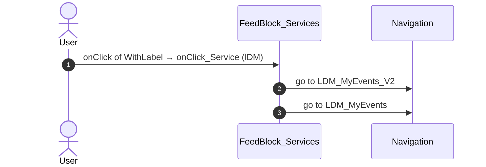

#### 6.1.13 FeedBlock_Updates: event_MarkAsUnread

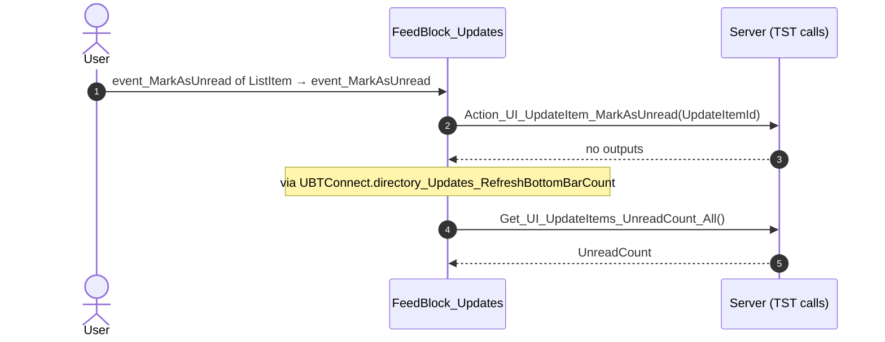

#### 6.1.14 FeedBlock_Updates: event_ListItemOnClick

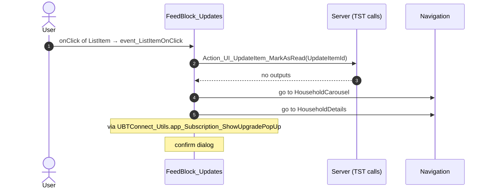

#### 6.1.15 FeedBlock_Updates: event_MarkAsRead

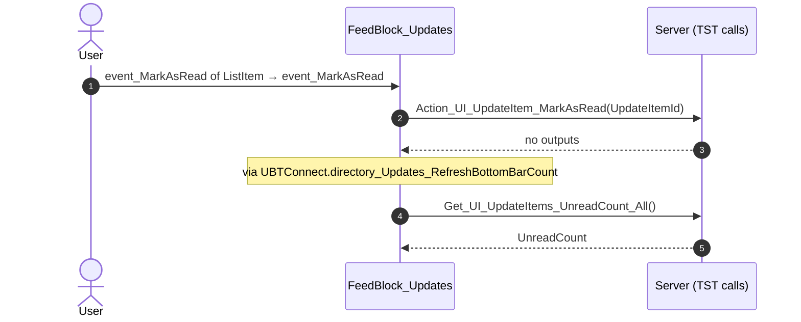

#### 6.1.18 Feed_Embeded: handle_Share_Others

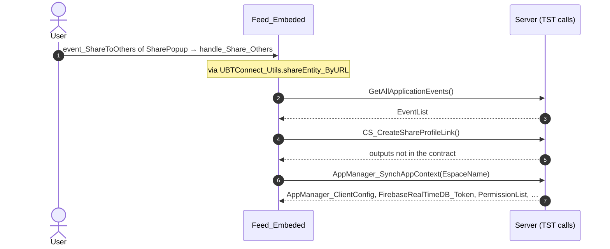


</details>


### 6.2 React

| # | File | Element | Event prop | Handler | Branch | Effects |
|---|---|---|---|---|---|---|
| 1 | [`pages/HomeFeed/HomeFeedPage.tsx:128`](../../app/src/pages/HomeFeed/HomeFeedPage.tsx#L128) | `<HomeLayout>` | `onOnSearchClick` | `inline` | – | goes to Search |
| 2 | [`pages/HomeFeed/HomeFeedPage.tsx:156`](../../app/src/pages/HomeFeed/HomeFeedPage.tsx#L156) | `<CommunityPopulation>` | `onClick` | `inline` | – | goes to Updates_SingleList |
| 3 | [`pages/HomeFeed/HomeFeedPage.tsx:170`](../../app/src/pages/HomeFeed/HomeFeedPage.tsx#L170) | `<Section_FeedWrapper>` | `onOnClickViewAll` | `inline` | – | goes to Updates_SingleList |
| 4 | [`pages/HomeFeed/HomeFeedPage.tsx:60`](../../app/src/pages/HomeFeed/HomeFeedPage.tsx#L60) | `<FeedBlock_Services>` | `onClickServiceSettings` | `services.onClickServiceSettings` | – | goes to Services |
| 5 | [`pages/HomeFeed/HomeFeedPage.tsx:60`](../../app/src/pages/HomeFeed/HomeFeedPage.tsx#L60) | `<FeedBlock_Services>` | `onClickService` | `services.onClickService` | `Orbit` | goes to OrbitLanding |
| 6 | [`pages/HomeFeed/HomeFeedPage.tsx:60`](../../app/src/pages/HomeFeed/HomeFeedPage.tsx#L60) | `<FeedBlock_Services>` | `onClickService` | `services.onClickService` | `LDM` | goes to LDM_MyEvents_V2 |
| 7 | [`pages/HomeFeed/HomeFeedPage.tsx:60`](../../app/src/pages/HomeFeed/HomeFeedPage.tsx#L60) | `<FeedBlock_Services>` | `onClickService` | `services.onClickService` | `MyCalendar` | goes to MyEntertaining |
| 8 | [`pages/HomeFeed/HomeFeedPage.tsx:60`](../../app/src/pages/HomeFeed/HomeFeedPage.tsx#L60) | `<FeedBlock_Services>` | `onClickService` | `services.onClickService` | `Assemble` | goes to AssembleEvents |
| 9 | [`pages/HomeFeed/HomeFeedPage.tsx:60`](../../app/src/pages/HomeFeed/HomeFeedPage.tsx#L60) | `<FeedBlock_Services>` | `onClickService` | `services.onClickService` | `OrbitAdmin` | goes to OrbitAdminLanding |
| 10 | [`pages/HomeFeed/HomeFeedPage.tsx:60`](../../app/src/pages/HomeFeed/HomeFeedPage.tsx#L60) | `<FeedBlock_Services>` | `onClickService` | `services.onClickService` | `MyNotes` | goes to Notes |
| 11 | [`pages/HomeFeed/HomeFeedPage.tsx:60`](../../app/src/pages/HomeFeed/HomeFeedPage.tsx#L60) | `<FeedBlock_Services>` | `onClickService` | `services.onClickService` | `ElGusto` | opens an external link |
| 12 | [`pages/HomeFeed/HomeFeedPage.tsx:60`](../../app/src/pages/HomeFeed/HomeFeedPage.tsx#L60) | `<FeedBlock_Services>` | `onClickService` | `services.onClickService` | `OneSchoolGlobal` | shows a message |
| 13 | [`pages/HomeFeed/HomeFeedPage.tsx:60`](../../app/src/pages/HomeFeed/HomeFeedPage.tsx#L60) | `<FeedBlock_Services>` | `onClickService` | `services.onClickService` | `other` | asks for a confirmation |
| [14](#6214-feedblock_services-ongotoexternalapp) | [`pages/HomeFeed/HomeFeedPage.tsx:60`](../../app/src/pages/HomeFeed/HomeFeedPage.tsx#L60) | `<FeedBlock_Services>` | `onGoToExternalApp` | `services.onGoToExternalApp` | – | opens an external link; shows a message |
| [15](#6215-feedblock_updates-onitemclick) | [`pages/HomeFeed/HomeFeedPage.tsx:66`](../../app/src/pages/HomeFeed/HomeFeedPage.tsx#L66) | `<FeedBlock_Updates>` | `onItemClick` | `useFeedUpdates().onItemClick` | – | calls ServiceAPIAction_UI_UpdateItem_MarkAsRead; goes to HouseholdCarousel; asks for a confirmation |
| 16 | [`pages/HomeFeed/HomeFeedPage.tsx:66`](../../app/src/pages/HomeFeed/HomeFeedPage.tsx#L66) | `<FeedBlock_Updates>` | `onSendGift` | `useFeedUpdates().onSendGift` | – | shows a message |
| [17](#6217-feedblock_updates-onmarkasread) | [`pages/HomeFeed/HomeFeedPage.tsx:66`](../../app/src/pages/HomeFeed/HomeFeedPage.tsx#L66) | `<FeedBlock_Updates>` | `onMarkAsRead` | `useFeedUpdates().onMarkAsRead` | – | calls ServiceAPIAction_UI_UpdateItem_MarkAsRead, ServiceAPIAction_UI_UpdateItem_MarkAsUnread, ServiceAPIGet_UI_UpdateItems_UnreadCount_All |
| [18](#6218-feedblock_updates-onmarkasunread) | [`pages/HomeFeed/HomeFeedPage.tsx:66`](../../app/src/pages/HomeFeed/HomeFeedPage.tsx#L66) | `<FeedBlock_Updates>` | `onMarkAsUnread` | `useFeedUpdates().onMarkAsUnread` | – | calls ServiceAPIAction_UI_UpdateItem_MarkAsRead, ServiceAPIAction_UI_UpdateItem_MarkAsUnread, ServiceAPIGet_UI_UpdateItems_UnreadCount_All |
| 19 | [`pages/HomeFeed/HomeFeedPage.tsx:66`](../../app/src/pages/HomeFeed/HomeFeedPage.tsx#L66) | `<FeedBlock_Updates>` | `onClickUpgrade` | `useFeedUpdates().onClickUpgrade` | – | asks for a confirmation |
| [20](#6220-notificationicon-oniconclick) | [`pages/HomeFeed/HomeFeedPage.tsx:132`](../../app/src/pages/HomeFeed/HomeFeedPage.tsx#L132) | `<NotificationIcon>` | `onIconClick` | `notificationIcon.onIconClick` | – | goes to Notifications, MessageList |
| 21 | [`pages/HomeFeed/HomeFeedPage.tsx:177`](../../app/src/pages/HomeFeed/HomeFeedPage.tsx#L177) | `<EmbeddedFeed>` | `onDownloaded` | `embeddedFeed.onDownloaded` | – | opens an external link |
| 22 | [`pages/HomeFeed/HomeFeedPage.tsx:177`](../../app/src/pages/HomeFeed/HomeFeedPage.tsx#L177) | `<EmbeddedFeed>` | `onShareToConnect` | `embeddedFeed.onShareToConnect` | – | goes to LegacyShareObject |

<details><summary>5 diagrams (handlers with two or more effects)</summary>

#### 6.2.14 FeedBlock_Services: onGoToExternalApp

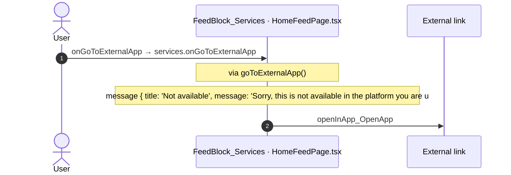

#### 6.2.15 FeedBlock_Updates: onItemClick

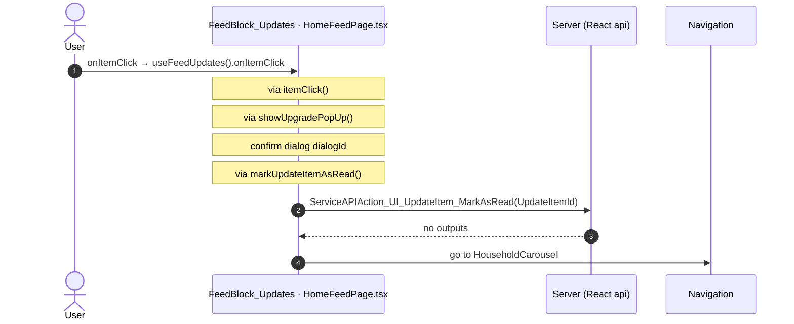

#### 6.2.17 FeedBlock_Updates: onMarkAsRead

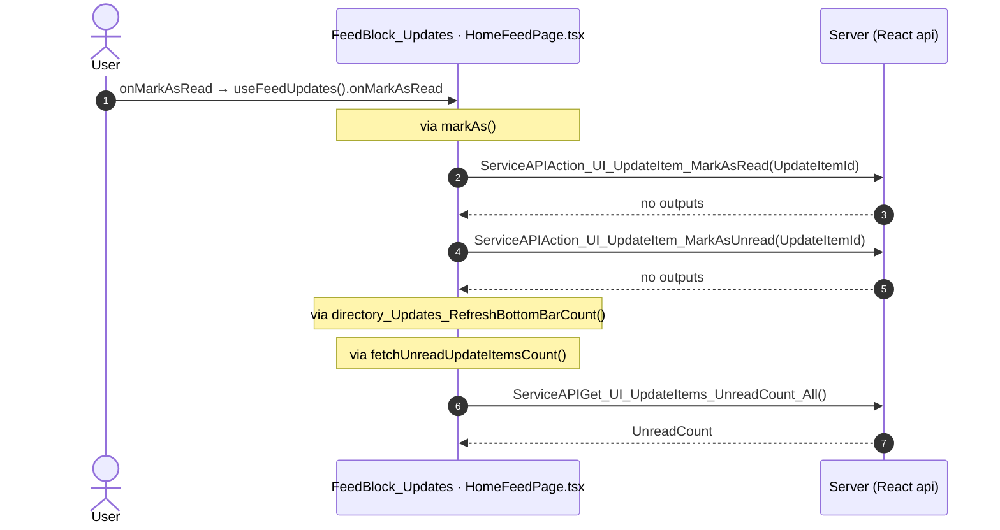

#### 6.2.18 FeedBlock_Updates: onMarkAsUnread

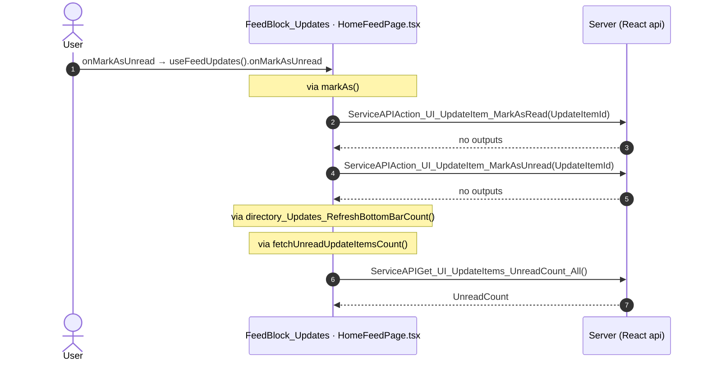

#### 6.2.20 NotificationIcon: onIconClick

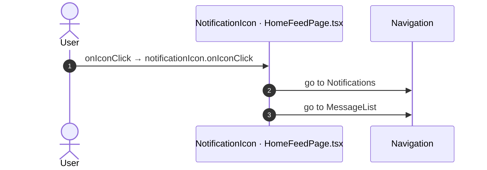


</details>


## 7. Screen inputs and navigation parameters

The input parameters of the screen, the parameters that the route reads, and the parameters that the route gives when it opens another screen. A navigation without parameters is only in section 2.
The OutSystems files are in `migration/screens/HomeFeed/analysis/sources/raw/`.

### 7.1 OutSystems (TST)

Screen inputs: none. `setInputs` of `HomeFeed` reads no input.

| Block | Target | Parameters | Place |
|---|---|---|---|
| `FeedBlock_Updates` | `HouseholdCarousel` | `In_StartingHouseholdId` = `targetHouseholdId` | [`UBTConnect.Home.FeedBlock_Updates.mvc.js:700`](../../migration/screens/HomeFeed/analysis/sources/raw/UBTConnect.Home.FeedBlock_Updates.mvc.js#L700) |
| `FeedBlock_Updates` | `HouseholdDetails` | `HouseholdId` = `fetchUpdates.uI_UpdateItemList.getCurrent(iterationContext).householdId` | [`UBTConnect.Home.FeedBlock_Updates.mvc.js:706`](../../migration/screens/HomeFeed/analysis/sources/raw/UBTConnect.Home.FeedBlock_Updates.mvc.js#L706) |
| `Feed_Embeded` | `LegacyShareObject` | `In_ShareObjectTypeId` = `UBTConnectModel.staticEntities.type_ShareObject.feed`<br>`In_CustomTitle` = `shareFeedItem_Title`<br>`In_ObjectId` = `sharePopUp_Id` | [`UBTConnect.Home.Feed_Embeded.mvc.js:438`](../../migration/screens/HomeFeed/analysis/sources/raw/UBTConnect.Home.Feed_Embeded.mvc.js#L438) |

### 7.2 React

Declared inputs of the route: none (`app/src/app/routes.generated.ts`).

Parameters read (`useSearchParams`, `useParams`): none.

| File | Target | Parameters | Place |
|---|---|---|---|
| `useFeedUpdates.ts` | `HouseholdCarousel` | `In_StartingHouseholdId` = `item.householdId` | [`pages/HomeFeed/hooks/useFeedUpdates.ts:114`](../../app/src/pages/HomeFeed/hooks/useFeedUpdates.ts#L114) |

## 8. Lifecycle

What runs when the screen and its blocks open and close, without a user action.

### 8.1 OutSystems (TST)

Event handlers. The steps are the node comments and the conditions of the compiled action.

| Block | Event | Action | Steps |
|---|---|---|---|
| `HomeFeed` | OnInitialize ([`UBTConnect.Home.HomeFeed.mvc.js:1075`](../../migration/screens/HomeFeed/analysis/sources/raw/UBTConnect.Home.HomeFeed.mvc.js#L1075)) | `screenEvent_OnInitialize` | 1. IsScreenInitialized = False ([`L957`](../../migration/screens/HomeFeed/analysis/sources/raw/UBTConnect.Home.HomeFeed.mvc.js#L957)) |
| `HomeFeed` | OnReady ([`UBTConnect.Home.HomeFeed.mvc.js:1093`](../../migration/screens/HomeFeed/analysis/sources/raw/UBTConnect.Home.HomeFeed.mvc.js#L1093)) | `screenEvent_OnReady` | 1. IsScreenInitialized = True ([`L771`](../../migration/screens/HomeFeed/analysis/sources/raw/UBTConnect.Home.HomeFeed.mvc.js#L771))<br>2. JavaScript: IsRestoredFromCache ([`L774`](../../migration/screens/HomeFeed/analysis/sources/raw/UBTConnect.Home.HomeFeed.mvc.js#L774))<br>3. If isRestoredFromCache.isRestoredFromCache ([`L782`](../../migration/screens/HomeFeed/analysis/sources/raw/UBTConnect.Home.HomeFeed.mvc.js#L782))<br>4. Else ([`L784`](../../migration/screens/HomeFeed/analysis/sources/raw/UBTConnect.Home.HomeFeed.mvc.js#L784))<br>5. Refresh Query: GetCommunityStatistics ([`L786`](../../migration/screens/HomeFeed/analysis/sources/raw/UBTConnect.Home.HomeFeed.mvc.js#L786)) |
| `FeedBlock_Services` | OnInitialize ([`UBTConnect.Home.FeedBlock_Services.mvc.js:1177`](../../migration/screens/HomeFeed/analysis/sources/raw/UBTConnect.Home.FeedBlock_Services.mvc.js#L1177)) | `onInitialize` | 1. Execute Action: ListAppend ([`L744`](../../migration/screens/HomeFeed/analysis/sources/raw/UBTConnect.Home.FeedBlock_Services.mvc.js#L744)) |
| `FeedBlock_Updates` | OnInitialize ([`UBTConnect.Home.FeedBlock_Updates.mvc.js:1250`](../../migration/screens/HomeFeed/analysis/sources/raw/UBTConnect.Home.FeedBlock_Updates.mvc.js#L1250)) | `onInitialize` | 1. JavaScript: IsViewRestoredFromCache ([`L935`](../../migration/screens/HomeFeed/analysis/sources/raw/UBTConnect.Home.FeedBlock_Updates.mvc.js#L935))<br>2. Check if IsViewRestoredFromCache IsRestoredFromCache ([`L942`](../../migration/screens/HomeFeed/analysis/sources/raw/UBTConnect.Home.FeedBlock_Updates.mvc.js#L942))<br>3. If (isViewRestoredFromCache.isRestoredFromCache && fetchUpdates.isDataFetched) ([`L943`](../../migration/screens/HomeFeed/analysis/sources/raw/UBTConnect.Home.FeedBlock_Updates.mvc.js#L943))<br>4. Execute Action: GetPreloadObject ([`L945`](../../migration/screens/HomeFeed/analysis/sources/raw/UBTConnect.Home.FeedBlock_Updates.mvc.js#L945))<br>5. If ((getPreloadObject.preload) !== (nullObject())) ([`L948`](../../migration/screens/HomeFeed/analysis/sources/raw/UBTConnect.Home.FeedBlock_Updates.mvc.js#L948))<br>6. Execute Action: AssignFromObject ([`L950`](../../migration/screens/HomeFeed/analysis/sources/raw/UBTConnect.Home.FeedBlock_Updates.mvc.js#L950))<br>7. Foreach FetchUpdates.UI_UpdateItemList ([`L953`](../../migration/screens/HomeFeed/analysis/sources/raw/UBTConnect.Home.FeedBlock_Updates.mvc.js#L953))<br>8. Execute Action: ListAny ([`L960`](../../migration/screens/HomeFeed/analysis/sources/raw/UBTConnect.Home.FeedBlock_Updates.mvc.js#L960))<br>9. FetchUpdates.UI_UpdateItemList.Current.IsRead = FetchUpdates.UI_UpdateItemList.Current.IsRead or ListAny.Result ([`L966`](../../migration/screens/HomeFeed/analysis/sources/raw/UBTConnect.Home.FeedBlock_Updates.mvc.js#L966))<br>10. Else ([`L976`](../../migration/screens/HomeFeed/analysis/sources/raw/UBTConnect.Home.FeedBlock_Updates.mvc.js#L976))<br>11. Else ([`L980`](../../migration/screens/HomeFeed/analysis/sources/raw/UBTConnect.Home.FeedBlock_Updates.mvc.js#L980)) |
| `FeedBlock_Updates` | OnReady ([`UBTConnect.Home.FeedBlock_Updates.mvc.js:1268`](../../migration/screens/HomeFeed/analysis/sources/raw/UBTConnect.Home.FeedBlock_Updates.mvc.js#L1268)) | `onReady` | 1. JavaScript: CheckRestored ([`L1111`](../../migration/screens/HomeFeed/analysis/sources/raw/UBTConnect.Home.FeedBlock_Updates.mvc.js#L1111))<br>2. If (checkRestored.fromCache \|\| checkRestored.fromHistory) ([`L1120`](../../migration/screens/HomeFeed/analysis/sources/raw/UBTConnect.Home.FeedBlock_Updates.mvc.js#L1120))<br>3. Else ([`L1122`](../../migration/screens/HomeFeed/analysis/sources/raw/UBTConnect.Home.FeedBlock_Updates.mvc.js#L1122))<br>4. CurrLoadingItem = CurrLoadingItem + 1 ([`L1125`](../../migration/screens/HomeFeed/analysis/sources/raw/UBTConnect.Home.FeedBlock_Updates.mvc.js#L1125))<br>5. Execute Action: ListAppend ([`L1128`](../../migration/screens/HomeFeed/analysis/sources/raw/UBTConnect.Home.FeedBlock_Updates.mvc.js#L1128)) |

<details><summary>Sequence diagrams of the screen event handlers (2)</summary>

The diagram keeps the order of the steps in the compiled action. The code does not give the order of the handlers of different blocks.

#### 8.1.1 HomeFeed: OnInitialize

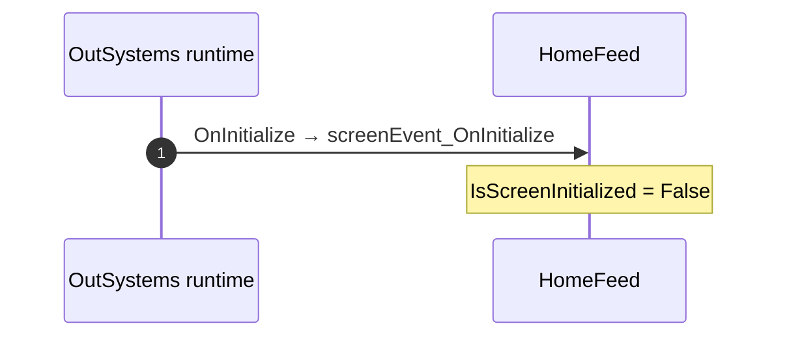

#### 8.1.2 HomeFeed: OnReady

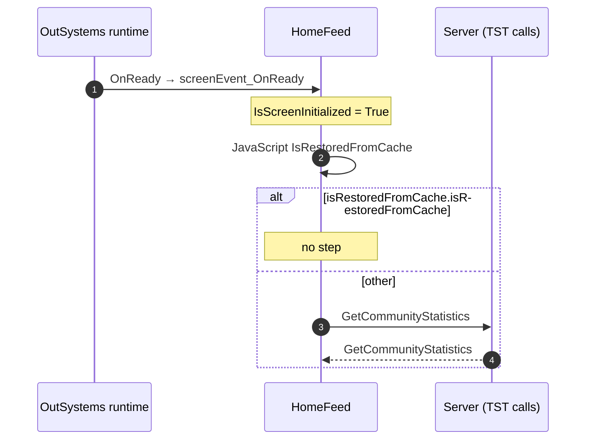

</details>

Data actions and aggregates. The tool reads `dataFetchDependenciesOriginal`: `0` is a fetch when the block opens, `-1` is a fetch only on demand (a `Refresh Query` step).

| Block | Data action | Fetch | Place |
|---|---|---|---|
| `HomeFeed` | `GetCommunityStatistics` | on demand (`-1`) | [`UBTConnect.Home.HomeFeed.mvc.js:672`](../../migration/screens/HomeFeed/analysis/sources/raw/UBTConnect.Home.HomeFeed.mvc.js#L672) |
| `FeedBlock_Services` | `GetServices` | at start (`0`) | [`UBTConnect.Home.FeedBlock_Services.mvc.js:688`](../../migration/screens/HomeFeed/analysis/sources/raw/UBTConnect.Home.FeedBlock_Services.mvc.js#L688) |
| `FeedBlock_CommunityPopulation` | `FetchCount` | at start (`0`) | [`UBTConnect.Home.FeedBlock_CommunityPopulation.mvc.js:323`](../../migration/screens/HomeFeed/analysis/sources/raw/UBTConnect.Home.FeedBlock_CommunityPopulation.mvc.js#L323) |
| `FeedBlock_Updates` | `FetchUpdates` | at start (`0`) | [`UBTConnect.Home.FeedBlock_Updates.mvc.js:575`](../../migration/screens/HomeFeed/analysis/sources/raw/UBTConnect.Home.FeedBlock_Updates.mvc.js#L575) |

### 8.2 React

Effects (`useEffect`, `useLayoutEffect`) of the screen files, and the effects of shared components that make a call, a navigation or a message.

| File | Hook (function) | Dependencies | Cleanup | Effects | Place |
|---|---|---|---|---|---|
| `Dialog_GoExternalApp.tsx` | `useEffect` (`Dialog_GoExternalApp`) | `[widgetId, onOnPopUpReady]` | no | none | [`pages/HomeFeed/components/Dialog_GoExternalApp.tsx:49`](../../app/src/pages/HomeFeed/components/Dialog_GoExternalApp.tsx#L49) |
| `useFeedUpdates.ts` | `useEffect` (`useFeedUpdates`) | `[fetched, onEventNoUpdates]` | no | none | [`pages/HomeFeed/hooks/useFeedUpdates.ts:83`](../../app/src/pages/HomeFeed/hooks/useFeedUpdates.ts#L83) |
| `useHomeFeedReady.ts` | `useEffect` (`useHomeFeedReady`) | `[flow, restored]` | yes | call `/api/UBTConnect/HomeFeed/DataActionGetCommunityStatistics` | [`pages/HomeFeed/hooks/useHomeFeedReady.ts:17`](../../app/src/pages/HomeFeed/hooks/useHomeFeedReady.ts#L17) |

<details><summary>Sequence diagrams of the effects with a call, a navigation, a message or a refresh (1)</summary>

#### 8.2.1 useHomeFeedReady: useEffect

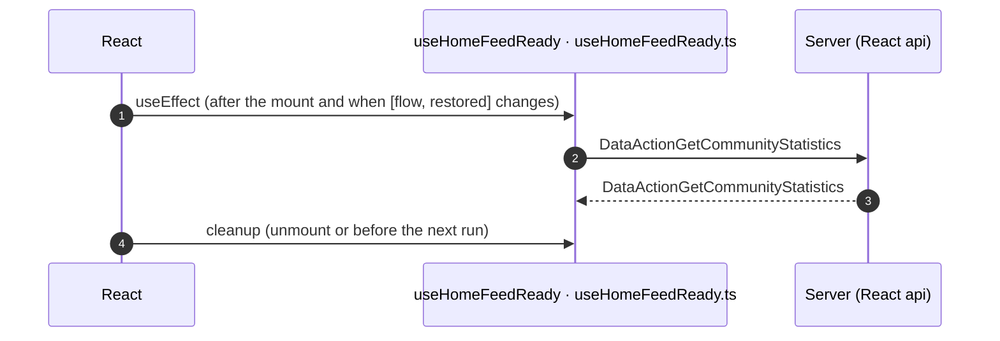

</details>

Queries. A query fetches when its component mounts and when its key changes.

| File | Hook (function) | Calls | Place |
|---|---|---|---|
| `HomeFeedPage.tsx` | `useCommunityPopulationQuery` (`HomeFeed`) | `/api/UBTConnect/FeedBlock_CommunityPopulation/DataActionFetchCount` | [`pages/HomeFeed/HomeFeedPage.tsx:80`](../../app/src/pages/HomeFeed/HomeFeedPage.tsx#L80) |
| `useFeedServices.ts` | `useFeedServicesQuery` (`useFeedServices`) | `/api/UBTConnect/FeedBlock_Services/DataActionGetServices` | [`pages/HomeFeed/hooks/useFeedServices.ts:57`](../../app/src/pages/HomeFeed/hooks/useFeedServices.ts#L57) |
| `useFeedUpdates.ts` | `useFeedUpdatesQuery` (`useFeedUpdates`) | `/api/UBTConnect/FeedBlock_Updates/DataActionFetchUpdates` | [`pages/HomeFeed/hooks/useFeedUpdates.ts:74`](../../app/src/pages/HomeFeed/hooks/useFeedUpdates.ts#L74) |

## 9. Client state

Client variables and browser storage that the route reads or writes. Other screens can read this state.

### 9.1 OutSystems (TST)

| Block | Operation | Variable | Places |
|---|---|---|---|
| `Feed_Embeded` | get | `UBTConnect.Embedd_B2CTenant` | [`UBTConnect.Home.Feed_Embeded.mvc.js:157`](../../migration/screens/HomeFeed/analysis/sources/raw/UBTConnect.Home.Feed_Embeded.mvc.js#L157) |

### 9.2 React

None.

## 10. Access

Who can open the route, and the role checks in the screen and block code.

| Side | Rule | Place |
|---|---|---|
| OutSystems (TST) | registered users (`checkRegistered()`) | [`UBTConnect.Home.HomeFeed.mvc.js:1117`](../../migration/screens/HomeFeed/analysis/sources/raw/UBTConnect.Home.HomeFeed.mvc.js#L1117) |
| React | access `member`, lock `enforce`, flag redirect none | `app/src/app/routes.ts` |

Role checks in the TST screen and block actions (`RolesInfo`, `$roles`, `Check<Role>Role`): none.

## 11. Errors

What the route does when an action or a call fails.

### 11.1 OutSystems (TST)

The actions of the screen and its blocks have no `Handle Error` node.

### 11.2 React

| File | Kind | Function | Effects | Place |
|---|---|---|---|---|
| `useHomeFeedReady.ts` | flow handler | `useHomeFeedReady` | none | [`pages/HomeFeed/hooks/useHomeFeedReady.ts:26`](../../app/src/pages/HomeFeed/hooks/useHomeFeedReady.ts#L26) |

`flow handler`: `raiseToFlowHandler` gives the error to the flow handler of the screen (`app/src/platform/feedback/flowErrors.ts`). The tool lists `.catch`, `try/catch` and `onError` that do not give the error to it.

## 12. Data flow

Where the data of the route comes from and where it goes: one flowchart per screen or block (OutSystems) and per component or hook (React). An arrow goes from the source to the target. The label is the input, the event or the action of the arrow. The places are in the table under each diagram.

| Shape | OutSystems | React |
|---|---|---|
| `[(server: X)]` | data action, aggregate | query and its calls |
| `[X]` | variable of the screen or block | variable, `state:` state |
| `([event arg: X])` | input of an event handler | argument of a handler |
| `[[X]]` | child block (label: its input or event) | child component (label: its prop or event) |
| `{{client var: X}}` | client variable | client variable |
| `>navigate: S.P]` | parameter of a navigation | parameter of a navigation |
| `[/prop: X/]` | – | prop of the component |
| `([hook: X])` | `([action: X])`: result of an action | result of a hook |

### 12.1 OutSystems (TST)

Only the screen and the blocks with a server, client variable or navigation edge. A block that only passes its inputs to its children does not appear.


<details><summary>Data flow diagrams (5)</summary>

#### 12.1.1 HomeFeed

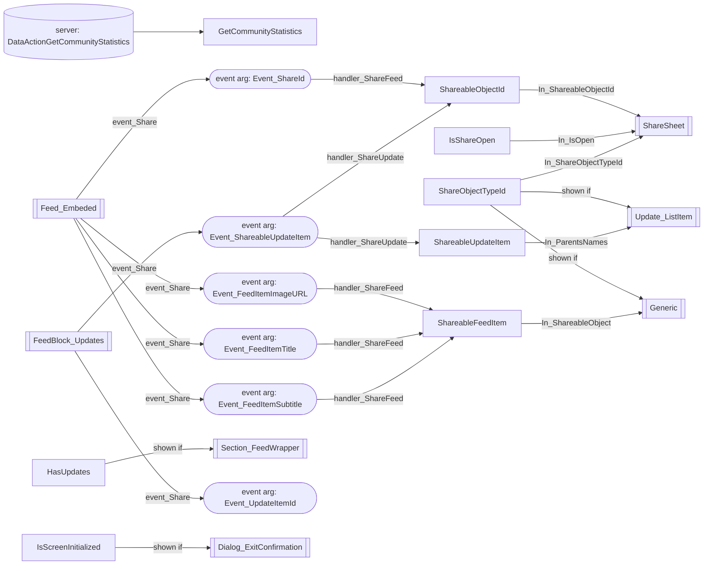

| From | To | Label | Line |
|---|---|---|---|
| server `DataActionGetCommunityStatistics` | var `GetCommunityStatistics` | fetch | [`L692`](../../migration/screens/HomeFeed/analysis/sources/raw/UBTConnect.Home.HomeFeed.mvc.js#L692) |
| param `Event_ShareId` | var `ShareableObjectId` | handler_ShareFeed | [`L861`](../../migration/screens/HomeFeed/analysis/sources/raw/UBTConnect.Home.HomeFeed.mvc.js#L861) |
| param `Event_FeedItemImageURL` | var `ShareableFeedItem` | handler_ShareFeed | [`L870`](../../migration/screens/HomeFeed/analysis/sources/raw/UBTConnect.Home.HomeFeed.mvc.js#L870) |
| param `Event_FeedItemTitle` | var `ShareableFeedItem` | handler_ShareFeed | [`L873`](../../migration/screens/HomeFeed/analysis/sources/raw/UBTConnect.Home.HomeFeed.mvc.js#L873) |
| param `Event_FeedItemSubtitle` | var `ShareableFeedItem` | handler_ShareFeed | [`L876`](../../migration/screens/HomeFeed/analysis/sources/raw/UBTConnect.Home.HomeFeed.mvc.js#L876) |
| param `Event_ShareableUpdateItem` | var `ShareableObjectId` | handler_ShareUpdate | [`L988`](../../migration/screens/HomeFeed/analysis/sources/raw/UBTConnect.Home.HomeFeed.mvc.js#L988) |
| param `Event_ShareableUpdateItem` | var `ShareableUpdateItem` | handler_ShareUpdate | [`L991`](../../migration/screens/HomeFeed/analysis/sources/raw/UBTConnect.Home.HomeFeed.mvc.js#L991) |
| var `HasUpdates` | child `Section_FeedWrapper (shown if)` | view | [`L339`](../../migration/screens/HomeFeed/analysis/sources/raw/UBTConnect.Home.HomeFeed.mvc.js#L339) |
| child `FeedBlock_Updates event event_Share` | param `Event_UpdateItemId` | handler_ShareUpdate | [`L405`](../../migration/screens/HomeFeed/analysis/sources/raw/UBTConnect.Home.HomeFeed.mvc.js#L405) |
| child `FeedBlock_Updates event event_Share` | param `Event_ShareableUpdateItem` | handler_ShareUpdate | [`L405`](../../migration/screens/HomeFeed/analysis/sources/raw/UBTConnect.Home.HomeFeed.mvc.js#L405) |
| child `Feed_Embeded event event_Share` | param `Event_ShareId` | handler_ShareFeed | [`L443`](../../migration/screens/HomeFeed/analysis/sources/raw/UBTConnect.Home.HomeFeed.mvc.js#L443) |
| child `Feed_Embeded event event_Share` | param `Event_FeedItemTitle` | handler_ShareFeed | [`L443`](../../migration/screens/HomeFeed/analysis/sources/raw/UBTConnect.Home.HomeFeed.mvc.js#L443) |
| child `Feed_Embeded event event_Share` | param `Event_FeedItemSubtitle` | handler_ShareFeed | [`L443`](../../migration/screens/HomeFeed/analysis/sources/raw/UBTConnect.Home.HomeFeed.mvc.js#L443) |
| child `Feed_Embeded event event_Share` | param `Event_FeedItemImageURL` | handler_ShareFeed | [`L443`](../../migration/screens/HomeFeed/analysis/sources/raw/UBTConnect.Home.HomeFeed.mvc.js#L443) |
| var `IsScreenInitialized` | child `Dialog_ExitConfirmation (shown if)` | view | [`L461`](../../migration/screens/HomeFeed/analysis/sources/raw/UBTConnect.Home.HomeFeed.mvc.js#L461) |
| var `ShareableObjectId` | child `ShareSheet.In_ShareableObjectId` | view | [`L532`](../../migration/screens/HomeFeed/analysis/sources/raw/UBTConnect.Home.HomeFeed.mvc.js#L532) |
| var `IsShareOpen` | child `ShareSheet.In_IsOpen` | view | [`L533`](../../migration/screens/HomeFeed/analysis/sources/raw/UBTConnect.Home.HomeFeed.mvc.js#L533) |
| var `ShareObjectTypeId` | child `ShareSheet.In_ShareObjectTypeId` | view | [`L534`](../../migration/screens/HomeFeed/analysis/sources/raw/UBTConnect.Home.HomeFeed.mvc.js#L534) |
| var `ShareObjectTypeId` | child `Update_ListItem (shown if)` | view | [`L580`](../../migration/screens/HomeFeed/analysis/sources/raw/UBTConnect.Home.HomeFeed.mvc.js#L580) |
| var `ShareableUpdateItem` | child `Update_ListItem.In_ParentsNames` | view | [`L583`](../../migration/screens/HomeFeed/analysis/sources/raw/UBTConnect.Home.HomeFeed.mvc.js#L583) |
| var `ShareObjectTypeId` | child `Generic (shown if)` | view | [`L626`](../../migration/screens/HomeFeed/analysis/sources/raw/UBTConnect.Home.HomeFeed.mvc.js#L626) |
| var `ShareableFeedItem` | child `Generic.In_ShareableObject` | view | [`L629`](../../migration/screens/HomeFeed/analysis/sources/raw/UBTConnect.Home.HomeFeed.mvc.js#L629) |


#### 12.1.2 FeedBlock_Services

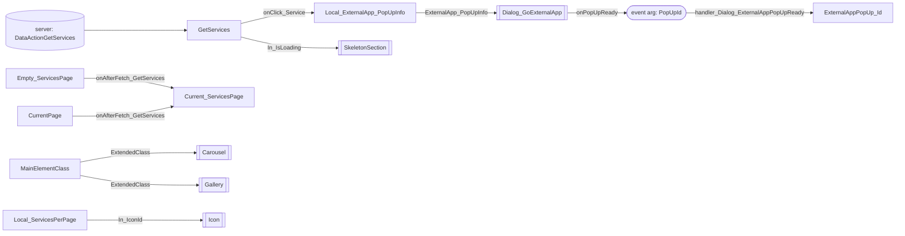

| From | To | Label | Line |
|---|---|---|---|
| server `DataActionGetServices` | var `GetServices` | fetch | [`L708`](../../migration/screens/HomeFeed/analysis/sources/raw/UBTConnect.Home.FeedBlock_Services.mvc.js#L708) |
| param `PopUpId` | var `ExternalAppPopUp_Id` | handler_Dialog_ExternalAppPopUpReady | [`L790`](../../migration/screens/HomeFeed/analysis/sources/raw/UBTConnect.Home.FeedBlock_Services.mvc.js#L790) |
| var `Empty_ServicesPage` | var `Current_ServicesPage` | onAfterFetch_GetServices | [`L845`](../../migration/screens/HomeFeed/analysis/sources/raw/UBTConnect.Home.FeedBlock_Services.mvc.js#L845) |
| var `CurrentPage` | var `Current_ServicesPage` | onAfterFetch_GetServices | [`L875`](../../migration/screens/HomeFeed/analysis/sources/raw/UBTConnect.Home.FeedBlock_Services.mvc.js#L875) |
| var `GetServices` | var `Local_ExternalApp_PopUpInfo` | onClick_Service | [`L1002`](../../migration/screens/HomeFeed/analysis/sources/raw/UBTConnect.Home.FeedBlock_Services.mvc.js#L1002) |
| var `MainElementClass` | child `Carousel.ExtendedClass` | view | [`L411`](../../migration/screens/HomeFeed/analysis/sources/raw/UBTConnect.Home.FeedBlock_Services.mvc.js#L411) |
| var `MainElementClass` | child `Gallery.ExtendedClass` | view | [`L472`](../../migration/screens/HomeFeed/analysis/sources/raw/UBTConnect.Home.FeedBlock_Services.mvc.js#L472) |
| var `GetServices` | child `SkeletonSection.In_IsLoading` | view | [`L512`](../../migration/screens/HomeFeed/analysis/sources/raw/UBTConnect.Home.FeedBlock_Services.mvc.js#L512) |
| var `Local_ServicesPerPage` | child `Icon.In_IconId` | view | [`L574`](../../migration/screens/HomeFeed/analysis/sources/raw/UBTConnect.Home.FeedBlock_Services.mvc.js#L574) |
| var `Local_ExternalApp_PopUpInfo` | child `Dialog_GoExternalApp.ExternalApp_PopUpInfo` | view | [`L641`](../../migration/screens/HomeFeed/analysis/sources/raw/UBTConnect.Home.FeedBlock_Services.mvc.js#L641) |
| child `Dialog_GoExternalApp event onPopUpReady` | param `PopUpId` | handler_Dialog_ExternalAppPopUpReady | [`L654`](../../migration/screens/HomeFeed/analysis/sources/raw/UBTConnect.Home.FeedBlock_Services.mvc.js#L654) |


#### 12.1.3 FeedBlock_CommunityPopulation

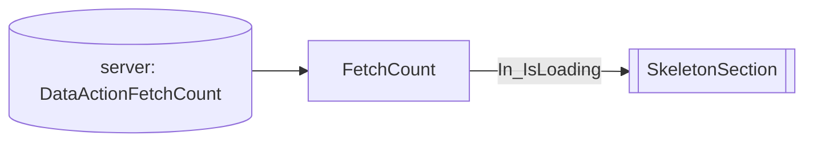

| From | To | Label | Line |
|---|---|---|---|
| server `DataActionFetchCount` | var `FetchCount` | fetch | [`L343`](../../migration/screens/HomeFeed/analysis/sources/raw/UBTConnect.Home.FeedBlock_CommunityPopulation.mvc.js#L343) |
| var `FetchCount` | child `SkeletonSection.In_IsLoading` | view | [`L244`](../../migration/screens/HomeFeed/analysis/sources/raw/UBTConnect.Home.FeedBlock_CommunityPopulation.mvc.js#L244) |


#### 12.1.4 FeedBlock_Updates

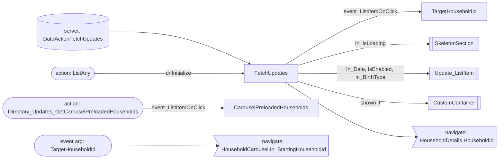

| From | To | Label | Line |
|---|---|---|---|
| server `DataActionFetchUpdates` | var `FetchUpdates` | fetch | [`L615`](../../migration/screens/HomeFeed/analysis/sources/raw/UBTConnect.Home.FeedBlock_Updates.mvc.js#L615) |
| var `FetchUpdates` | var `TargetHouseholdId` | event_ListItemOnClick | [`L675`](../../migration/screens/HomeFeed/analysis/sources/raw/UBTConnect.Home.FeedBlock_Updates.mvc.js#L675) |
| action `Directory_Updates_GetCarouselPreloadedHouseholds` | var `CarouselPreloadedHouseholds` | event_ListItemOnClick | [`L693`](../../migration/screens/HomeFeed/analysis/sources/raw/UBTConnect.Home.FeedBlock_Updates.mvc.js#L693) |
| action `ListAny` | var `FetchUpdates` | onInitialize | [`L966`](../../migration/screens/HomeFeed/analysis/sources/raw/UBTConnect.Home.FeedBlock_Updates.mvc.js#L966) |
| var `FetchUpdates` | child `SkeletonSection.In_IsLoading` | view | [`L154`](../../migration/screens/HomeFeed/analysis/sources/raw/UBTConnect.Home.FeedBlock_Updates.mvc.js#L154) |
| var `FetchUpdates` | child `Update_ListItem.In_Date` | view | [`L251`](../../migration/screens/HomeFeed/analysis/sources/raw/UBTConnect.Home.FeedBlock_Updates.mvc.js#L251) |
| var `FetchUpdates` | child `Update_ListItem.IsEnabled` | view | [`L253`](../../migration/screens/HomeFeed/analysis/sources/raw/UBTConnect.Home.FeedBlock_Updates.mvc.js#L253) |
| var `FetchUpdates` | child `Update_ListItem.In_BirthType` | view | [`L256`](../../migration/screens/HomeFeed/analysis/sources/raw/UBTConnect.Home.FeedBlock_Updates.mvc.js#L256) |
| var `FetchUpdates` | child `CustomContainer (shown if)` | view | [`L387`](../../migration/screens/HomeFeed/analysis/sources/raw/UBTConnect.Home.FeedBlock_Updates.mvc.js#L387) |
| param `TargetHouseholdId` | nav `HouseholdCarousel.In_StartingHouseholdId` | navigate | [`L701`](../../migration/screens/HomeFeed/analysis/sources/raw/UBTConnect.Home.FeedBlock_Updates.mvc.js#L701) |
| var `FetchUpdates` | nav `HouseholdDetails.HouseholdId` | navigate | [`L707`](../../migration/screens/HomeFeed/analysis/sources/raw/UBTConnect.Home.FeedBlock_Updates.mvc.js#L707) |


#### 12.1.5 Feed_Embeded

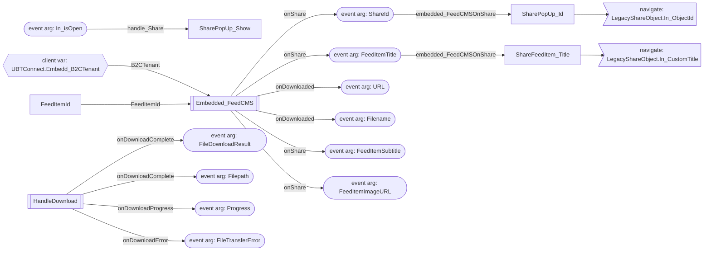

| From | To | Label | Line |
|---|---|---|---|
| param `In_isOpen` | var `SharePopUp_Show` | handle_Share | [`L397`](../../migration/screens/HomeFeed/analysis/sources/raw/UBTConnect.Home.Feed_Embeded.mvc.js#L397) |
| param `ShareId` | var `SharePopUp_Id` | embedded_FeedCMSOnShare | [`L488`](../../migration/screens/HomeFeed/analysis/sources/raw/UBTConnect.Home.Feed_Embeded.mvc.js#L488) |
| param `FeedItemTitle` | var `ShareFeedItem_Title` | embedded_FeedCMSOnShare | [`L494`](../../migration/screens/HomeFeed/analysis/sources/raw/UBTConnect.Home.Feed_Embeded.mvc.js#L494) |
| clientvar `UBTConnect.Embedd_B2CTenant` | child `Embedded_FeedCMS.B2CTenant` | view | [`L157`](../../migration/screens/HomeFeed/analysis/sources/raw/UBTConnect.Home.Feed_Embeded.mvc.js#L157) |
| var `FeedItemId` | child `Embedded_FeedCMS.FeedItemId` | view | [`L158`](../../migration/screens/HomeFeed/analysis/sources/raw/UBTConnect.Home.Feed_Embeded.mvc.js#L158) |
| child `Embedded_FeedCMS event onDownloaded` | param `URL` | handle_Download | [`L173`](../../migration/screens/HomeFeed/analysis/sources/raw/UBTConnect.Home.Feed_Embeded.mvc.js#L173) |
| child `Embedded_FeedCMS event onDownloaded` | param `Filename` | handle_Download | [`L173`](../../migration/screens/HomeFeed/analysis/sources/raw/UBTConnect.Home.Feed_Embeded.mvc.js#L173) |
| child `Embedded_FeedCMS event onShare` | param `ShareId` | embedded_FeedCMSOnShare | [`L188`](../../migration/screens/HomeFeed/analysis/sources/raw/UBTConnect.Home.Feed_Embeded.mvc.js#L188) |
| child `Embedded_FeedCMS event onShare` | param `FeedItemTitle` | embedded_FeedCMSOnShare | [`L188`](../../migration/screens/HomeFeed/analysis/sources/raw/UBTConnect.Home.Feed_Embeded.mvc.js#L188) |
| child `Embedded_FeedCMS event onShare` | param `FeedItemSubtitle` | embedded_FeedCMSOnShare | [`L188`](../../migration/screens/HomeFeed/analysis/sources/raw/UBTConnect.Home.Feed_Embeded.mvc.js#L188) |
| child `Embedded_FeedCMS event onShare` | param `FeedItemImageURL` | embedded_FeedCMSOnShare | [`L188`](../../migration/screens/HomeFeed/analysis/sources/raw/UBTConnect.Home.Feed_Embeded.mvc.js#L188) |
| child `HandleDownload event onDownloadComplete` | param `FileDownloadResult` | handleDownloadOnDownloadComplete | [`L310`](../../migration/screens/HomeFeed/analysis/sources/raw/UBTConnect.Home.Feed_Embeded.mvc.js#L310) |
| child `HandleDownload event onDownloadComplete` | param `Filepath` | handleDownloadOnDownloadComplete | [`L310`](../../migration/screens/HomeFeed/analysis/sources/raw/UBTConnect.Home.Feed_Embeded.mvc.js#L310) |
| child `HandleDownload event onDownloadProgress` | param `Progress` | handleDownloadOnDownloadProgress | [`L324`](../../migration/screens/HomeFeed/analysis/sources/raw/UBTConnect.Home.Feed_Embeded.mvc.js#L324) |
| child `HandleDownload event onDownloadError` | param `FileTransferError` | handleDownloadOnDownloadError | [`L338`](../../migration/screens/HomeFeed/analysis/sources/raw/UBTConnect.Home.Feed_Embeded.mvc.js#L338) |
| var `ShareFeedItem_Title` | nav `LegacyShareObject.In_CustomTitle` | navigate | [`L440`](../../migration/screens/HomeFeed/analysis/sources/raw/UBTConnect.Home.Feed_Embeded.mvc.js#L440) |
| var `SharePopUp_Id` | nav `LegacyShareObject.In_ObjectId` | navigate | [`L441`](../../migration/screens/HomeFeed/analysis/sources/raw/UBTConnect.Home.Feed_Embeded.mvc.js#L441) |


</details>

### 12.2 React

Only the components and hooks with a server, state, client variable or navigation edge.


<details><summary>Data flow diagrams (4)</summary>

#### 12.2.1 HomeFeed (HomeFeedPage.tsx)

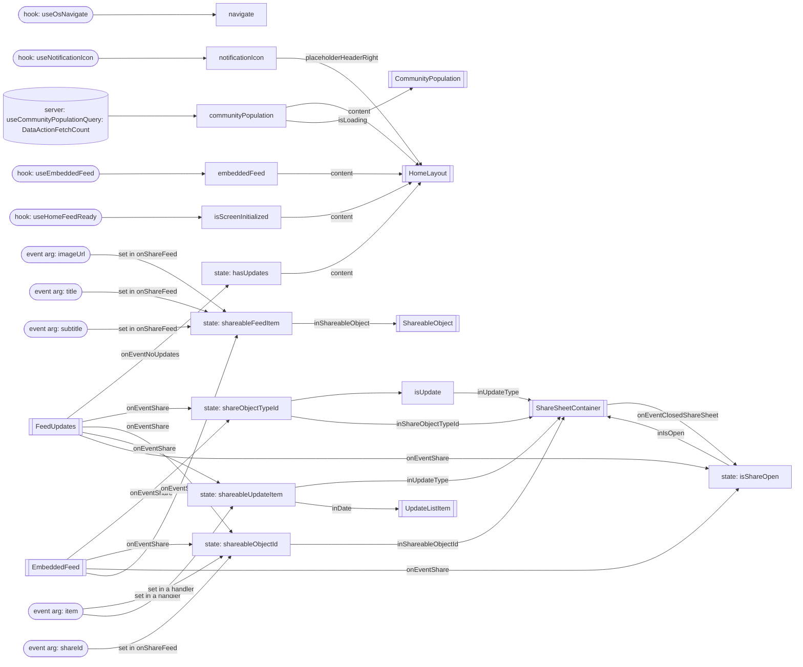

| From | To | Label | Line |
|---|---|---|---|
| hook `useOsNavigate` | var `navigate` | useOsNavigate | [`L76`](../../app/src/pages/HomeFeed/HomeFeedPage.tsx#L76) |
| hook `useNotificationIcon` | var `notificationIcon` | useNotificationIcon | [`L79`](../../app/src/pages/HomeFeed/HomeFeedPage.tsx#L79) |
| server `useCommunityPopulationQuery: DataActionFetchCount` | var `communityPopulation` | useCommunityPopulationQuery | [`L80`](../../app/src/pages/HomeFeed/HomeFeedPage.tsx#L80) |
| hook `useEmbeddedFeed` | var `embeddedFeed` | useEmbeddedFeed | [`L81`](../../app/src/pages/HomeFeed/HomeFeedPage.tsx#L81) |
| hook `useHomeFeedReady` | var `isScreenInitialized` | useHomeFeedReady | [`L90`](../../app/src/pages/HomeFeed/HomeFeedPage.tsx#L90) |
| state `shareObjectTypeId` | var `isUpdate` | derived | [`L119`](../../app/src/pages/HomeFeed/HomeFeedPage.tsx#L119) |
| param `item` | state `shareableObjectId` | set in a handler | [`L100`](../../app/src/pages/HomeFeed/HomeFeedPage.tsx#L100) |
| param `item` | state `shareableUpdateItem` | set in a handler | [`L101`](../../app/src/pages/HomeFeed/HomeFeedPage.tsx#L101) |
| param `shareId` | state `shareableObjectId` | set in onShareFeed | [`L109`](../../app/src/pages/HomeFeed/HomeFeedPage.tsx#L109) |
| param `imageUrl` | state `shareableFeedItem` | set in onShareFeed | [`L111`](../../app/src/pages/HomeFeed/HomeFeedPage.tsx#L111) |
| param `title` | state `shareableFeedItem` | set in onShareFeed | [`L111`](../../app/src/pages/HomeFeed/HomeFeedPage.tsx#L111) |
| param `subtitle` | state `shareableFeedItem` | set in onShareFeed | [`L111`](../../app/src/pages/HomeFeed/HomeFeedPage.tsx#L111) |
| var `notificationIcon` | child `HomeLayout` | placeholderHeaderRight | [`L132`](../../app/src/pages/HomeFeed/HomeFeedPage.tsx#L132) |
| var `communityPopulation` | child `HomeLayout` | content | [`L133`](../../app/src/pages/HomeFeed/HomeFeedPage.tsx#L133) |
| state `hasUpdates` | child `HomeLayout` | content | [`L133`](../../app/src/pages/HomeFeed/HomeFeedPage.tsx#L133) |
| var `embeddedFeed` | child `HomeLayout` | content | [`L133`](../../app/src/pages/HomeFeed/HomeFeedPage.tsx#L133) |
| var `isScreenInitialized` | child `HomeLayout` | content | [`L133`](../../app/src/pages/HomeFeed/HomeFeedPage.tsx#L133) |
| var `communityPopulation` | child `CommunityPopulation` | isLoading | [`L154`](../../app/src/pages/HomeFeed/HomeFeedPage.tsx#L154) |
| child `FeedUpdates onEventNoUpdates` | state `hasUpdates` | event | [`L174`](../../app/src/pages/HomeFeed/HomeFeedPage.tsx#L174) |
| child `FeedUpdates onEventShare` | state `shareObjectTypeId` | event | [`L174`](../../app/src/pages/HomeFeed/HomeFeedPage.tsx#L174) |
| child `FeedUpdates onEventShare` | state `shareableObjectId` | item | [`L174`](../../app/src/pages/HomeFeed/HomeFeedPage.tsx#L174) |
| child `FeedUpdates onEventShare` | state `shareableUpdateItem` | item | [`L174`](../../app/src/pages/HomeFeed/HomeFeedPage.tsx#L174) |
| child `FeedUpdates onEventShare` | state `isShareOpen` | event | [`L174`](../../app/src/pages/HomeFeed/HomeFeedPage.tsx#L174) |
| child `EmbeddedFeed onEventShare` | state `shareObjectTypeId` | event | [`L177`](../../app/src/pages/HomeFeed/HomeFeedPage.tsx#L177) |
| child `EmbeddedFeed onEventShare` | state `shareableObjectId` | shareId | [`L177`](../../app/src/pages/HomeFeed/HomeFeedPage.tsx#L177) |
| child `EmbeddedFeed onEventShare` | state `isShareOpen` | event | [`L177`](../../app/src/pages/HomeFeed/HomeFeedPage.tsx#L177) |
| child `EmbeddedFeed onEventShare` | state `shareableFeedItem` | imageUrl, title, subtitle | [`L177`](../../app/src/pages/HomeFeed/HomeFeedPage.tsx#L177) |
| state `shareObjectTypeId` | child `ShareSheetContainer` | inShareObjectTypeId | [`L186`](../../app/src/pages/HomeFeed/HomeFeedPage.tsx#L186) |
| state `shareableObjectId` | child `ShareSheetContainer` | inShareableObjectId | [`L187`](../../app/src/pages/HomeFeed/HomeFeedPage.tsx#L187) |
| var `isUpdate` | child `ShareSheetContainer` | inUpdateType | [`L188`](../../app/src/pages/HomeFeed/HomeFeedPage.tsx#L188) |
| state `shareableUpdateItem` | child `ShareSheetContainer` | inUpdateType | [`L188`](../../app/src/pages/HomeFeed/HomeFeedPage.tsx#L188) |
| state `isShareOpen` | child `ShareSheetContainer` | inIsOpen | [`L190`](../../app/src/pages/HomeFeed/HomeFeedPage.tsx#L190) |
| child `ShareSheetContainer onEventClosedShareSheet` | state `isShareOpen` | event | [`L191`](../../app/src/pages/HomeFeed/HomeFeedPage.tsx#L191) |
| state `shareableUpdateItem` | child `UpdateListItem` | inDate | [`L200`](../../app/src/pages/HomeFeed/HomeFeedPage.tsx#L200) |
| state `shareableFeedItem` | child `ShareableObject` | inShareableObject | [`L213`](../../app/src/pages/HomeFeed/HomeFeedPage.tsx#L213) |


#### 12.2.2 useFeedServices (useFeedServices.ts)

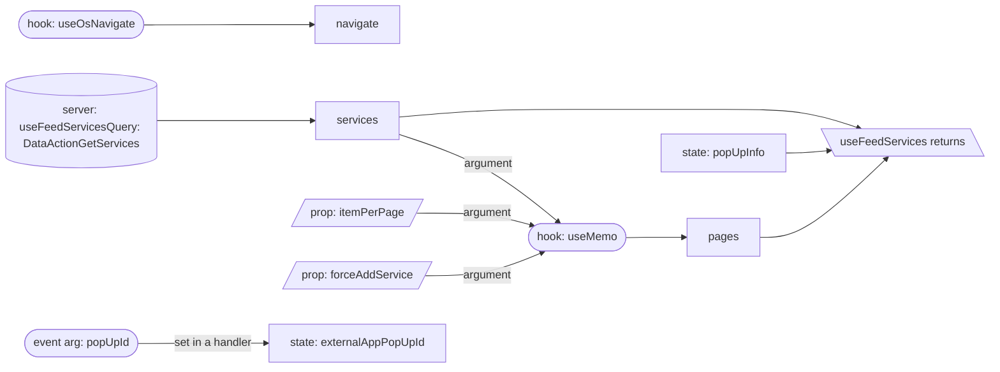

| From | To | Label | Line |
|---|---|---|---|
| hook `useOsNavigate` | var `navigate` | useOsNavigate | [`L54`](../../app/src/pages/HomeFeed/hooks/useFeedServices.ts#L54) |
| server `useFeedServicesQuery: DataActionGetServices` | var `services` | useFeedServicesQuery | [`L57`](../../app/src/pages/HomeFeed/hooks/useFeedServices.ts#L57) |
| var `services` | hook `useMemo` | argument | [`L66`](../../app/src/pages/HomeFeed/hooks/useFeedServices.ts#L66) |
| prop `itemPerPage` | hook `useMemo` | argument | [`L66`](../../app/src/pages/HomeFeed/hooks/useFeedServices.ts#L66) |
| prop `forceAddService` | hook `useMemo` | argument | [`L66`](../../app/src/pages/HomeFeed/hooks/useFeedServices.ts#L66) |
| hook `useMemo` | var `pages` | useMemo | [`L66`](../../app/src/pages/HomeFeed/hooks/useFeedServices.ts#L66) |
| param `popUpId` | state `externalAppPopUpId` | set in a handler | [`L72`](../../app/src/pages/HomeFeed/hooks/useFeedServices.ts#L72) |
| var `pages` | out `useFeedServices returns` | return | [`L143`](../../app/src/pages/HomeFeed/hooks/useFeedServices.ts#L143) |
| var `services` | out `useFeedServices returns` | return | [`L143`](../../app/src/pages/HomeFeed/hooks/useFeedServices.ts#L143) |
| state `popUpInfo` | out `useFeedServices returns` | return | [`L143`](../../app/src/pages/HomeFeed/hooks/useFeedServices.ts#L143) |


#### 12.2.3 useFeedUpdates (useFeedUpdates.ts)

```mermaid
flowchart LR
  n0[/"prop: events"/]
  n1["onEventNoUpdates"]
  n2["onEventShare"]
  n3(["hook: useOsNavigate"])
  n4["navigate"]
  n5(["hook: useFlowScope"])
  n6["flow"]
  n7(["hook: useWasRestoredFromCache"])
  n8["restored"]
  n9[("server: useFeedUpdatesQuery: DataActionFetchUpdates")]
  n10["updates"]
  n11["state: readOverrides"]
  n12["state: placeholders"]
  n13["fetched"]
  n14["items"]
  n15(["event arg: itemId"])
  n16(["event arg: isRead"])
  n17[\"useFeedUpdates returns"\]
  n18[/"prop: hasExtendedShare"/]
  n0 --> n1
  n0 --> n2
  n3 --> n4
  n0 -->|"argument"| n5
  n5 --> n6
  n7 --> n8
  n9 --> n10
  n8 -->|"initial value"| n11
  n8 -->|"initial value"| n12
  n10 --> n13
  n13 --> n14
  n12 --> n14
  n11 --> n14
  n15 -->|"set in setRead"| n11
  n16 -->|"set in setRead"| n11
  n14 --> n17
  n13 --> n17
  n10 --> n17
  n18 --> n17
```

| From | To | Label | Line |
|---|---|---|---|
| prop `events` | var `onEventNoUpdates` | derived | [`L70`](../../app/src/pages/HomeFeed/hooks/useFeedUpdates.ts#L70) |
| prop `events` | var `onEventShare` | derived | [`L70`](../../app/src/pages/HomeFeed/hooks/useFeedUpdates.ts#L70) |
| hook `useOsNavigate` | var `navigate` | useOsNavigate | [`L71`](../../app/src/pages/HomeFeed/hooks/useFeedUpdates.ts#L71) |
| prop `events` | hook `useFlowScope` | argument | [`L72`](../../app/src/pages/HomeFeed/hooks/useFeedUpdates.ts#L72) |
| hook `useFlowScope` | var `flow` | useFlowScope | [`L72`](../../app/src/pages/HomeFeed/hooks/useFeedUpdates.ts#L72) |
| hook `useWasRestoredFromCache` | var `restored` | useWasRestoredFromCache | [`L73`](../../app/src/pages/HomeFeed/hooks/useFeedUpdates.ts#L73) |
| server `useFeedUpdatesQuery: DataActionFetchUpdates` | var `updates` | useFeedUpdatesQuery | [`L74`](../../app/src/pages/HomeFeed/hooks/useFeedUpdates.ts#L74) |
| var `restored` | state `readOverrides` | initial value | [`L76`](../../app/src/pages/HomeFeed/hooks/useFeedUpdates.ts#L76) |
| var `restored` | state `placeholders` | initial value | [`L79`](../../app/src/pages/HomeFeed/hooks/useFeedUpdates.ts#L79) |
| var `updates` | var `fetched` | derived | [`L82`](../../app/src/pages/HomeFeed/hooks/useFeedUpdates.ts#L82) |
| var `fetched` | var `items` | derived | [`L87`](../../app/src/pages/HomeFeed/hooks/useFeedUpdates.ts#L87) |
| state `placeholders` | var `items` | derived | [`L87`](../../app/src/pages/HomeFeed/hooks/useFeedUpdates.ts#L87) |
| state `readOverrides` | var `items` | derived | [`L87`](../../app/src/pages/HomeFeed/hooks/useFeedUpdates.ts#L87) |
| param `itemId` | state `readOverrides` | set in setRead | [`L89`](../../app/src/pages/HomeFeed/hooks/useFeedUpdates.ts#L89) |
| param `isRead` | state `readOverrides` | set in setRead | [`L89`](../../app/src/pages/HomeFeed/hooks/useFeedUpdates.ts#L89) |
| var `items` | out `useFeedUpdates returns` | return | [`L127`](../../app/src/pages/HomeFeed/hooks/useFeedUpdates.ts#L127) |
| var `fetched` | out `useFeedUpdates returns` | return | [`L127`](../../app/src/pages/HomeFeed/hooks/useFeedUpdates.ts#L127) |
| var `updates` | out `useFeedUpdates returns` | return | [`L127`](../../app/src/pages/HomeFeed/hooks/useFeedUpdates.ts#L127) |
| prop `hasExtendedShare` | out `useFeedUpdates returns` | return | [`L127`](../../app/src/pages/HomeFeed/hooks/useFeedUpdates.ts#L127) |


#### 12.2.4 useHomeFeedReady (useHomeFeedReady.ts)

```mermaid
flowchart LR
  n0(["hook: useFlowScope"])
  n1["flow"]
  n2(["hook: useWasRestoredFromCache"])
  n3["restored"]
  n4["state: isScreenInitialized"]
  n5[\"useHomeFeedReady returns"\]
  n0 --> n1
  n2 --> n3
  n4 --> n5
```

| From | To | Label | Line |
|---|---|---|---|
| hook `useFlowScope` | var `flow` | useFlowScope | [`L12`](../../app/src/pages/HomeFeed/hooks/useHomeFeedReady.ts#L12) |
| hook `useWasRestoredFromCache` | var `restored` | useWasRestoredFromCache | [`L13`](../../app/src/pages/HomeFeed/hooks/useHomeFeedReady.ts#L13) |
| state `isScreenInitialized` | out `useHomeFeedReady returns` | return | [`L34`](../../app/src/pages/HomeFeed/hooks/useHomeFeedReady.ts#L34) |


</details>

## 13. Shared blocks and components on this route

Blocks of other UI flows and modules (OutSystems), and files outside `app/src/pages/` (React) that the route renders. Their facts belong to them, not to the route. This section gives their user actions once, without diagrams.

### OutSystems (TST)

| Block | Module | React port | User actions |
|---|---|---|---|
| `Layout_HomePage` | `UBTConnectLibrary` | [`components/layout/HomeLayout/HomeLayout.tsx`](../../app/src/components/layout/HomeLayout/HomeLayout.tsx) | 0 |
| `AppLogo_White` | `UBTConnect` | [`pages/HomeFeed/components/AppLogo_White.tsx`](../../app/src/pages/HomeFeed/components/AppLogo_White.tsx) | 0 |
| `App_NotificationIcon` | `UBTConnect` | [`components/notification/NotificationIcon/NotificationIcon.tsx`](../../app/src/components/notification/NotificationIcon/NotificationIcon.tsx), [`platform/session/useNotificationIcon.ts`](../../app/src/platform/session/useNotificationIcon.ts) | 1 |
| `App_IconBadge` | `UBTConnect` | [`components/layout/BottomBarIconBadge/BottomBarIconBadge.tsx`](../../app/src/components/layout/BottomBarIconBadge/BottomBarIconBadge.tsx) | 0 |
| `IconBadge` | `UBTConnectLibrary` | [`components/ui/IconBadge/IconBadge.tsx`](../../app/src/components/ui/IconBadge/IconBadge.tsx) | 0 |
| `Badge` | `UBTConnectLibrary` | [`components/ui/Badge/Badge.tsx`](../../app/src/components/ui/Badge/Badge.tsx) | 0 |
| `App_NotificationRefresh` | `UBTConnect` | [`components/notification/NotificationRefresh/NotificationRefresh.tsx`](../../app/src/components/notification/NotificationRefresh/NotificationRefresh.tsx) | 0 |
| `SubLayout_HomePageSearch` | `UBTConnectLibrary` | [`components/layout/HomeSearchSection/HomeSearchSection.tsx`](../../app/src/components/layout/HomeSearchSection/HomeSearchSection.tsx) | 0 |
| `StaticInput` | `UBTConnectLibrary` | [`components/ui/StaticInput/StaticInput.tsx`](../../app/src/components/ui/StaticInput/StaticInput.tsx) | 0 |
| `TextEllipsis` | `UBTConnectLibrary` | [`components/ui/TextEllipsis/TextEllipsis.tsx`](../../app/src/components/ui/TextEllipsis/TextEllipsis.tsx) | 0 |
| `Section` | `UBTConnect` | [`pages/HomeFeed/components/Section.tsx`](../../app/src/pages/HomeFeed/components/Section.tsx) | 0 |
| `CircleButton` | `UBTConnectLibrary` | [`components/ui/CircleButton/CircleButton.tsx`](../../app/src/components/ui/CircleButton/CircleButton.tsx) | 0 |
| `Carousel` | `OutSystemsUI_2_23` | [`components/ui/Carousel/Carousel.tsx`](../../app/src/components/ui/Carousel/Carousel.tsx) | 0 |
| `Gallery` | `OutSystemsUI_2_23` | [`components/ui/Gallery/Gallery.tsx`](../../app/src/components/ui/Gallery/Gallery.tsx) | 0 |
| `CircleButton_WithLabel` | `UBTConnectLibrary` | [`components/ui/CircleButtonWithLabel/CircleButtonWithLabel.tsx`](../../app/src/components/ui/CircleButtonWithLabel/CircleButtonWithLabel.tsx) | 0 |
| `Dialog_GoExternalApp` | `UBTConnect_Utils` | [`pages/HomeFeed/components/Dialog_GoExternalApp.tsx`](../../app/src/pages/HomeFeed/components/Dialog_GoExternalApp.tsx), [`pages/HomeFeed/hooks/goToExternalApp.ts`](../../app/src/pages/HomeFeed/hooks/goToExternalApp.ts) | 1 |
| `IconText` | `UBTConnectLibrary` | [`components/ui/IconText/IconText.tsx`](../../app/src/components/ui/IconText/IconText.tsx) | 0 |
| `Update_ListItem` | `UBTConnectLibrary` | [`components/feed/UpdateListItem/UpdateListItem.tsx`](../../app/src/components/feed/UpdateListItem/UpdateListItem.tsx) | 0 |
| `TagContent` | `UBTConnectLibrary` | [`components/ui/TagContent/TagContent.tsx`](../../app/src/components/ui/TagContent/TagContent.tsx) | 0 |
| `ContextMenu` | `UBTConnectLibrary` | [`components/ui/ContextMenu/ContextMenu.tsx`](../../app/src/components/ui/ContextMenu/ContextMenu.tsx) | 0 |
| `PopupMenu` | `UBTConnectLibrary` | [`components/ui/PopupMenu/PopupMenu.tsx`](../../app/src/components/ui/PopupMenu/PopupMenu.tsx) | 0 |
| `Embedded_FeedCMS` | `UBTConnect_EmbedFeed` | [`components/feed/FeedCms/FeedCms.tsx`](../../app/src/components/feed/FeedCms/FeedCms.tsx) | 0 |
| `SharePopup` | `UBTConnect_Utils` | [`components/share/SharePopup/SharePopup.tsx`](../../app/src/components/share/SharePopup/SharePopup.tsx) | 0 |
| `ContactPopup` | `UBTConnect_Utils` | [`components/contact/ContactPopup/ContactPopup.tsx`](../../app/src/components/contact/ContactPopup/ContactPopup.tsx) | 0 |
| `HandleDownload` | `FileTransferPlugin` | [`components/feed/EmbeddedFeed/EmbeddedFeed.tsx`](../../app/src/components/feed/EmbeddedFeed/EmbeddedFeed.tsx), [`lib/ubtConnectUtils/actions.ts`](../../app/src/lib/ubtConnectUtils/actions.ts) | 0 |
| `Dialog_ExitConfirmation` | `UBTConnect` | [`platform/navigation/DialogExitConfirmation.tsx`](../../app/src/platform/navigation/DialogExitConfirmation.tsx) | 0 |
| `ExitConfirmationDialog` | `NavigationHandler` | [`platform/navigation/DialogExitConfirmation.tsx`](../../app/src/platform/navigation/DialogExitConfirmation.tsx) | 0 |
| `BottomBarMenu` | `UBTConnect` | [`components/layout/BottomBar/BottomBar.tsx`](../../app/src/components/layout/BottomBar/BottomBar.tsx) | 1 |
| `BottomBarContent` | `UBTConnect` | [`components/layout/BottomBarContent/BottomBarContent.tsx`](../../app/src/components/layout/BottomBarContent/BottomBarContent.tsx) | 0 |
| `BottomBarItem` | `OutSystemsUI_2_23` | [`components/ui/BottomBarItem/BottomBarItem.tsx`](../../app/src/components/ui/BottomBarItem/BottomBarItem.tsx) | 0 |
| `ShareSheet` | `UBTConnect_Utils` | [`containers/ShareSheet/ShareSheetContainer.tsx`](../../app/src/containers/ShareSheet/ShareSheetContainer.tsx), [`containers/ShareSheet/components/ShareSheetFirstStep.tsx`](../../app/src/containers/ShareSheet/components/ShareSheetFirstStep.tsx), [`containers/ShareSheet/components/ShareSheetSearchStep.tsx`](../../app/src/containers/ShareSheet/components/ShareSheetSearchStep.tsx), [`containers/ShareSheet/shareSheetState.ts`](../../app/src/containers/ShareSheet/shareSheetState.ts), [`containers/ShareSheet/useShareSheet.ts`](../../app/src/containers/ShareSheet/useShareSheet.ts) | 5 |

<details><summary>User actions of the shared blocks (12)</summary>

| # | Block (OutSystems) | Event (TST view) | Handler | Branch | Effects |
|---|---|---|---|---|---|
| 1 | `BottomBarMenu` | `onClick (HTML element)`<br>`onClick of IconBadge` | `event_BottomBar_Clicked` | `home` | goes to HomeFeed |
| 2 | `BottomBarMenu` | `onClick (HTML element)`<br>`onClick of IconBadge` | `event_BottomBar_Clicked` | `directory` | goes to CountryList, Locality_Details |
| 3 | `BottomBarMenu` | `onClick (HTML element)`<br>`onClick of IconBadge` | `event_BottomBar_Clicked` | `updates` | goes to Updates_SingleList |
| 4 | `BottomBarMenu` | `onClick (HTML element)`<br>`onClick of IconBadge` | `event_BottomBar_Clicked` | `bookmarks` | goes to Bookmarks |
| 5 | `BottomBarMenu` | `onClick (HTML element)`<br>`onClick of IconBadge` | `event_BottomBar_Clicked` | `menu` | goes to Menu |
| 6 | `App_NotificationIcon` | `onClick of IconBadge` | `iconClick` | – | goes to Notifications, MessageList |
| 7 | `Dialog_GoExternalApp` | `confirmed of ActionConfirmationDialog` | `goToExternalApp` | – | opens an external link; shows a message |
| 8 | `ShareSheet` | `onClick of WithLabel` | `handler_OnClickRecentMember` | – | calls CS_ShareObject; shows a message; asks for a confirmation |
| 9 | `ShareSheet` | `onClick of WithLabel` | `handler_OnClickExternalOption` | – | calls CS_CreateShareProfileLink |
| 10 | `ShareSheet` | `event_Submit of Input` | `handler_InputEventSubmit` | – | calls GetAvailableMembers |
| 11 | `ShareSheet` | `click of Icon` | `handler_SearchResultItemOnSelect` | – | shows a message |
| 12 | `ShareSheet` | `buttonOnClick of Button` | `handler_OnClickSend` | – | calls CS_ShareObject; shows a message |

</details>


### React

| File | User actions |
|---|---|
| [`components/layout/BottomBar/BottomBar.tsx`](../../app/src/components/layout/BottomBar/BottomBar.tsx) | 2 |
| [`components/layout/CommonUiLayout/CommonUiLayout.tsx`](../../app/src/components/layout/CommonUiLayout/CommonUiLayout.tsx) | 2 |
| [`containers/ShareSheet/ShareSheetContainer.tsx`](../../app/src/containers/ShareSheet/ShareSheetContainer.tsx) | 5 |

<details><summary>User actions of the shared components (19)</summary>

| # | File | Element | Event prop | Handler | Branch | Effects |
|---|---|---|---|---|---|---|
| 1 | [`containers/ShareSheet/ShareSheetContainer.tsx:111`](../../app/src/containers/ShareSheet/ShareSheetContainer.tsx#L111) | `<ShareSheetFirstStep>` | `onClickRecentMember` | `onClickRecentMember` | – | calls ActionCS_ShareObject; shows a message; asks for a confirmation |
| 2 | [`containers/ShareSheet/ShareSheetContainer.tsx:127`](../../app/src/containers/ShareSheet/ShareSheetContainer.tsx#L127) | `<ShareSheetSearchStep>` | `onSubmit` | `onSubmit` | – | setSearchFetchId(): a query fetches again |
| 3 | [`containers/ShareSheet/ShareSheetContainer.tsx:129`](../../app/src/containers/ShareSheet/ShareSheetContainer.tsx#L129) | `<ShareSheetSearchStep>` | `onSelect` | `onSelect` | – | shows a message |
| 4 | [`containers/ShareSheet/ShareSheetContainer.tsx:130`](../../app/src/containers/ShareSheet/ShareSheetContainer.tsx#L130) | `<ShareSheetSearchStep>` | `onClickUpgradeSubscription` | `onClickUpgradeSubscription` | – | opens an external link |
| 5 | [`containers/ShareSheet/ShareSheetContainer.tsx:148`](../../app/src/containers/ShareSheet/ShareSheetContainer.tsx#L148) | `<ActionButton>` | `onButtonOnClick` | `onClickSend` | – | calls ActionCS_ShareObject; shows a message |
| 6 | [`components/layout/CommonUiLayout/CommonUiLayout.tsx:80`](../../app/src/components/layout/CommonUiLayout/CommonUiLayout.tsx#L80) | `<PreventBackNavigation>` | `onBackNavigationPrevented` | `redirectHome` | – | goes to HomeFeed |
| 7 | [`components/layout/CommonUiLayout/CommonUiLayout.tsx:82`](../../app/src/components/layout/CommonUiLayout/CommonUiLayout.tsx#L82) | `<BackNavigationHandler>` | `onBackNavigation` | `maybeRedirectHome` | – | goes to HomeFeed |
| 8 | [`components/layout/BottomBar/BottomBar.tsx:130`](../../app/src/components/layout/BottomBar/BottomBar.tsx#L130) | `<OSLink>` | `onClick` | `click` | `Home` | goes to HomeFeed |
| 9 | [`components/layout/BottomBar/BottomBar.tsx:130`](../../app/src/components/layout/BottomBar/BottomBar.tsx#L130) | `<OSLink>` | `onClick` | `click` | `Directory` | goes to CountryList, Locality_Details |
| 10 | [`components/layout/BottomBar/BottomBar.tsx:130`](../../app/src/components/layout/BottomBar/BottomBar.tsx#L130) | `<OSLink>` | `onClick` | `click` | `Updates` | goes to Updates_SingleList |
| 11 | [`components/layout/BottomBar/BottomBar.tsx:130`](../../app/src/components/layout/BottomBar/BottomBar.tsx#L130) | `<OSLink>` | `onClick` | `click` | `Bookmarks` | goes to Bookmarks |
| 12 | [`components/layout/BottomBar/BottomBar.tsx:130`](../../app/src/components/layout/BottomBar/BottomBar.tsx#L130) | `<OSLink>` | `onClick` | `click` | `Menu` | goes to Menu |
| 13 | [`components/layout/BottomBar/BottomBar.tsx:130`](../../app/src/components/layout/BottomBar/BottomBar.tsx#L130) | `<OSLink>` | `onClick` | `click` | `other` | calls the prop onBottomBarClicked() |
| 14 | [`components/layout/BottomBar/BottomBar.tsx:140`](../../app/src/components/layout/BottomBar/BottomBar.tsx#L140) | `<BottomBarIconBadge>` | `onOnClick` | `click` | `Home` | goes to HomeFeed |
| 15 | [`components/layout/BottomBar/BottomBar.tsx:140`](../../app/src/components/layout/BottomBar/BottomBar.tsx#L140) | `<BottomBarIconBadge>` | `onOnClick` | `click` | `Directory` | goes to CountryList, Locality_Details |
| 16 | [`components/layout/BottomBar/BottomBar.tsx:140`](../../app/src/components/layout/BottomBar/BottomBar.tsx#L140) | `<BottomBarIconBadge>` | `onOnClick` | `click` | `Updates` | goes to Updates_SingleList |
| 17 | [`components/layout/BottomBar/BottomBar.tsx:140`](../../app/src/components/layout/BottomBar/BottomBar.tsx#L140) | `<BottomBarIconBadge>` | `onOnClick` | `click` | `Bookmarks` | goes to Bookmarks |
| 18 | [`components/layout/BottomBar/BottomBar.tsx:140`](../../app/src/components/layout/BottomBar/BottomBar.tsx#L140) | `<BottomBarIconBadge>` | `onOnClick` | `click` | `Menu` | goes to Menu |
| 19 | [`components/layout/BottomBar/BottomBar.tsx:140`](../../app/src/components/layout/BottomBar/BottomBar.tsx#L140) | `<BottomBarIconBadge>` | `onOnClick` | `click` | `other` | calls the prop onBottomBarClicked() |

</details>

