# HomeFeed: server calls and user actions in OutSystems and React

This file compares the route `/UBTConnect/HomeFeed` in OutSystems (TST) with the React app.
The tool `route-actions/tools/check_route.py` wrote this file on 2026-11-04.
The tool reads the code. It does not run the app.

The app shell is in [APP_SHELL.md](../APP_SHELL.md), not here.
- OutSystems app shell: `CommonUI_InsideLayout` with its blocks (TST survey), and the chains that start in a module action.
- React app shell: the code that `app/src/main.tsx` loads (router, `AppFrame`, app start, hosts).

## 1. Route

| Item | Value | Source |
|---|---|---|
| Route | `/UBTConnect/HomeFeed` | `app/src/app/routes.generated.ts` |
| OutSystems screen | `UBTConnect.Home.HomeFeed` | TST compiled code |
| UI flow | `Home` | MCP `getScreenNames` (DEV) |
| React screen | [`pages/HomeFeed/HomeFeedPage.tsx`](../../app/src/pages/HomeFeed/HomeFeedPage.tsx) | `app/src/pages/` |
| React route rules | access `member`, lock `enforce`, flag redirect none | `app/src/app/routes.ts` |
| Code read | OutSystems: 37 screen and block files of the route, 28 app shell files. React: 228 screen files | TST `facts.json`, `react_calls.mjs` |

## 2. Result

| Check | Result |
|---|---|
| Server calls of the route on TST | 14: React makes 11, **3 missing** |
| User actions of the route | OutSystems: 34 diagrams. React: 21 diagrams |
| React calls of the screen that TST does not make | 2 (see [questions](#8-questions)) |
| Screen and blocks with a React port | 37 of 37 |
| Navigation targets found in React | 20 of 20 |
| App shell on this route | 9 calls; event bindings: OutSystems 10, React 6: see [APP_SHELL.md](../APP_SHELL.md) |

## 3. Screenshots

The screenshots come from the last parity run (`route.py parity`). The TST capture hides personal text with dots. The React build shows fictional mock data.

| State | TST (expected) | React (build) | Difference |
|---|---|---|---|
| `default`<br>390x844, mock `real`<br>2026-10-29<br>pixel difference 0.0% | 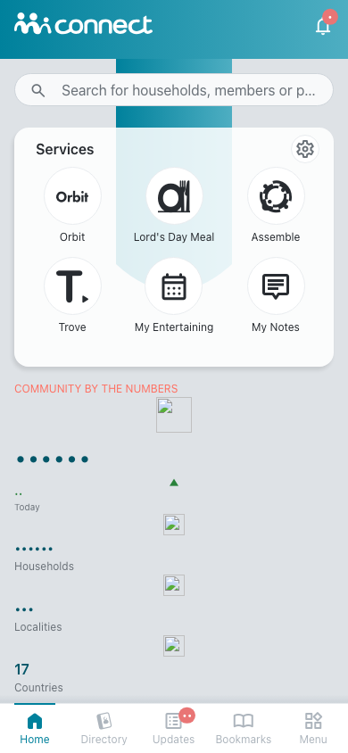 | 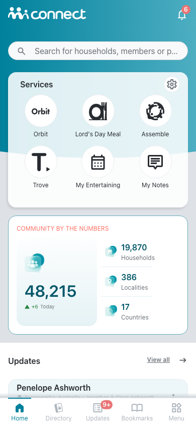 | 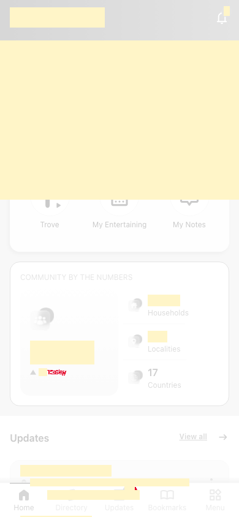 |
| `loading`<br>390x844, mock `loading`<br>2026-10-29<br>pixel difference 0.0% | 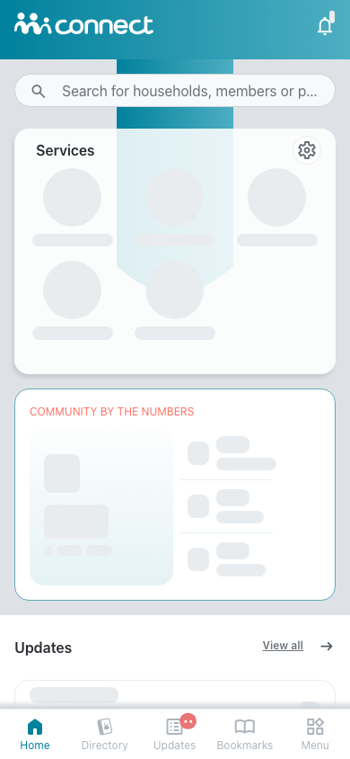 | 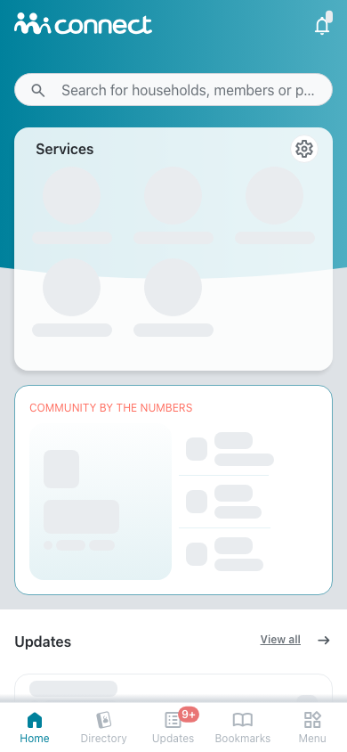 | 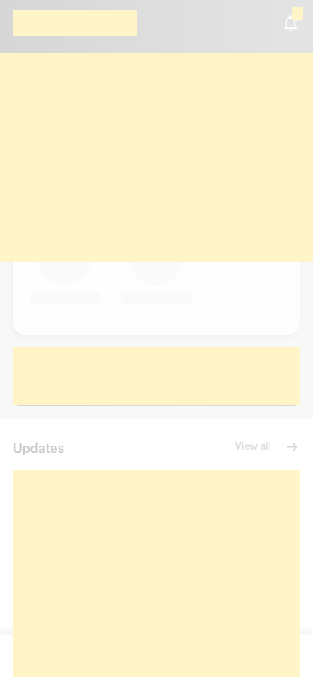 |
| `offline`<br>390x844, mock `error`<br>2026-10-29<br>pixel difference 0.0% | 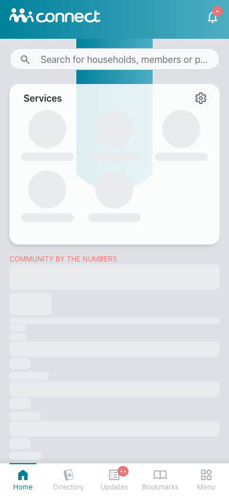 | 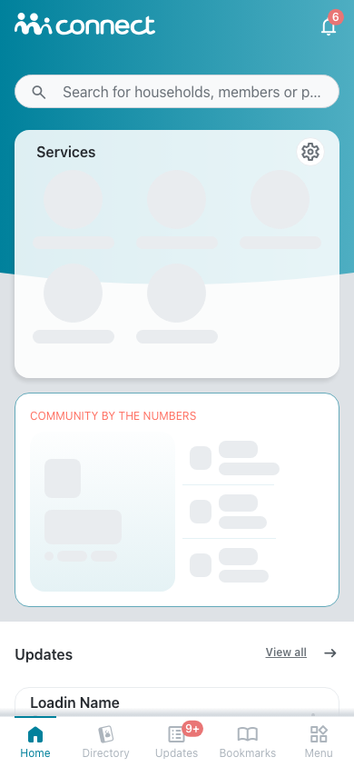 | 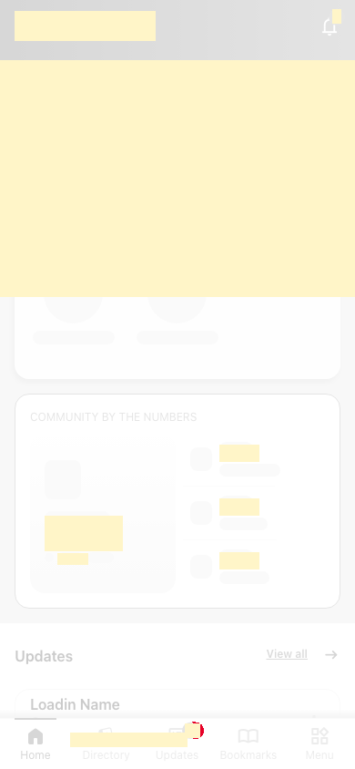 |

## 4. Diagram

- A box on the left is the block or module of the action that calls the server (TST code).
- A line connects each call to the React action that makes the same call.
- The right column shows the React components that use each React action.
- A red box is a call that React does not make.

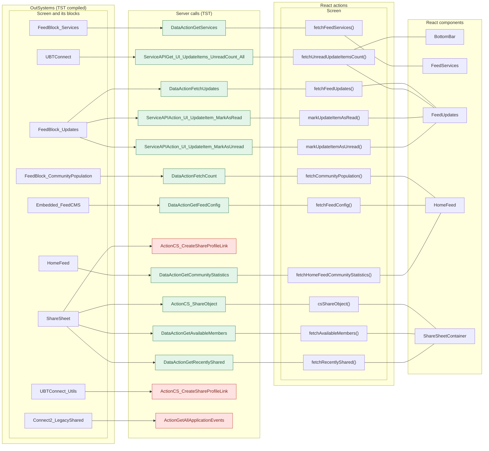

## 5. User actions

The two lists are independent: the OutSystems list comes from the TST compiled code, the React list from the React code. The tool does not map one list to the other.

- **OutSystems:** each event binding of the compiled views (`<event>$Action: function` of a child block or widget, `on<Event>: function` of an HTML element) with its handler.
- **React:** each JSX attribute `on<Event>={handler}` with its handler.
- Both lists keep only the bindings whose handler has an effect: a server call, a navigation, an external link, a message or a confirm dialog. The tool follows the called functions 3 levels deep.
- When the handler has branches in the code (`switch` case, `if` with `===`), each branch has its own diagram. The branch name is the constant of the condition. `other` is the last `else` or `default`.
- An arrow to the server gives the inputs of the call, the return arrow its outputs (contract `app/src/api/openapi.yaml`).

### 5.1 OutSystems (TST)

| # | Block (OutSystems) | Event (TST view) | Handler | Branch | Effects |
|---|---|---|---|---|---|
| [1](#511-bottombarmenu-event_bottombar_clicked-home) | `BottomBarMenu` | `onClick (HTML element)`<br>`onClick of IconBadge` | `event_BottomBar_Clicked` | `home` | goes to HomeFeed |
| [2](#512-bottombarmenu-event_bottombar_clicked-directory) | `BottomBarMenu` | `onClick (HTML element)`<br>`onClick of IconBadge` | `event_BottomBar_Clicked` | `directory` | goes to CountryList, Locality_Details |
| [3](#513-bottombarmenu-event_bottombar_clicked-updates) | `BottomBarMenu` | `onClick (HTML element)`<br>`onClick of IconBadge` | `event_BottomBar_Clicked` | `updates` | goes to Updates_SingleList |
| [4](#514-bottombarmenu-event_bottombar_clicked-bookmarks) | `BottomBarMenu` | `onClick (HTML element)`<br>`onClick of IconBadge` | `event_BottomBar_Clicked` | `bookmarks` | goes to Bookmarks |
| [5](#515-bottombarmenu-event_bottombar_clicked-menu) | `BottomBarMenu` | `onClick (HTML element)`<br>`onClick of IconBadge` | `event_BottomBar_Clicked` | `menu` | goes to Menu |
| [6](#516-app_notificationicon-iconclick) | `App_NotificationIcon` | `onClick of IconBadge` | `iconClick` | – | goes to Notifications, MessageList |
| [7](#517-feedblock_communitypopulation-onclick_block) | `FeedBlock_CommunityPopulation` | `clicked of CustomContainer` | `onClick_Block` | – | goes to Updates_SingleList |
| [8](#518-feedblock_services-onclick_servicesettings) | `FeedBlock_Services` | `onClick of CircleButton` | `onClick_ServiceSettings` | – | goes to Services |
| [9](#519-feedblock_services-onclick_service-orbit) | `FeedBlock_Services` | `onClick of WithLabel` | `onClick_Service` | `orbit` | goes to OrbitLanding |
| [10](#5110-feedblock_services-onclick_service-ldm) | `FeedBlock_Services` | `onClick of WithLabel` | `onClick_Service` | `lDM` | goes to LDM_MyEvents_V2, LDM_MyEvents |
| [11](#5111-feedblock_services-onclick_service-mycalendar) | `FeedBlock_Services` | `onClick of WithLabel` | `onClick_Service` | `myCalendar` | goes to MyEntertaining |
| [12](#5112-feedblock_services-onclick_service-assemble) | `FeedBlock_Services` | `onClick of WithLabel` | `onClick_Service` | `assemble` | goes to AssembleEvents |
| [13](#5113-feedblock_services-onclick_service-orbitadmin) | `FeedBlock_Services` | `onClick of WithLabel` | `onClick_Service` | `orbitAdmin` | goes to OrbitAdminLanding |
| [14](#5114-feedblock_services-onclick_service-mynotes) | `FeedBlock_Services` | `onClick of WithLabel` | `onClick_Service` | `myNotes` | goes to Notes |
| [15](#5115-feedblock_services-onclick_service-oneschoolglobal) | `FeedBlock_Services` | `onClick of WithLabel` | `onClick_Service` | `oneSchoolGlobal` | shows a message |
| [16](#5116-feedblock_services-onclick_service-other) | `FeedBlock_Services` | `onClick of WithLabel` | `onClick_Service` | `other` | asks for a confirmation |
| [17](#5117-feedblock_updates-handler__share) | `FeedBlock_Updates` | `event_Share of ListItem` | `handler__Share` | – | shows a message |
| [18](#5118-feedblock_updates-event_sendgift) | `FeedBlock_Updates` | `event_SendGift of ListItem` | `event_SendGift` | – | shows a message |
| [19](#5119-feedblock_updates-event_markasunread) | `FeedBlock_Updates` | `event_MarkAsUnread of ListItem` | `event_MarkAsUnread` | – | calls Action_UI_UpdateItem_MarkAsUnread, Get_UI_UpdateItems_UnreadCount_All |
| [20](#5120-feedblock_updates-event_listitemonclick) | `FeedBlock_Updates` | `onClick of ListItem` | `event_ListItemOnClick` | – | calls Action_UI_UpdateItem_MarkAsRead; goes to HouseholdCarousel, HouseholdDetails; asks for a confirmation |
| [21](#5121-feedblock_updates-event_markasread) | `FeedBlock_Updates` | `event_MarkAsRead of ListItem` | `event_MarkAsRead` | – | calls Action_UI_UpdateItem_MarkAsRead, Get_UI_UpdateItems_UnreadCount_All |
| [22](#5122-feedblock_updates-onclick_subscriptionupgrade) | `FeedBlock_Updates` | `clicked of CustomContainer` | `onClick_SubscriptionUpgrade` | – | asks for a confirmation |
| [23](#5123-feed_embeded-handle_download) | `Feed_Embeded` | `onDownloaded of FeedCMS` | `handle_Download` | – | opens an external link |
| [24](#5124-feed_embeded-handle_share_others) | `Feed_Embeded` | `event_ShareToOthers of SharePopup` | `handle_Share_Others` | – | calls GetAllApplicationEvents, CS_CreateShareProfileLink, AppManager_SynchAppContext |
| [25](#5125-feed_embeded-handle_share_connect) | `Feed_Embeded` | `event_ShareToConnect of SharePopup` | `handle_Share_Connect` | – | goes to LegacyShareObject |
| [26](#5126-feed_embeded-handledownloadondownloaderror) | `Feed_Embeded` | `onDownloadError of HandleDownload` | `handleDownloadOnDownloadError` | – | shows a message |
| [27](#5127-homefeed-onclick_search) | `HomeFeed` | `onSearchClick of HomePage` | `onClick_Search` | – | goes to Search |
| [28](#5128-homefeed-section_updatesonclick_viewall) | `HomeFeed` | `onClick_ViewAll of FeedWrapper` | `section_UpdatesOnClick_ViewAll` | – | goes to Updates_SingleList |
| [29](#5129-dialog_goexternalapp-gotoexternalapp) | `Dialog_GoExternalApp` | `confirmed of ActionConfirmationDialog` | `goToExternalApp` | – | opens an external link; shows a message |
| [30](#5130-sharesheet-handler_onclickrecentmember) | `ShareSheet` | `onClick of WithLabel` | `handler_OnClickRecentMember` | – | calls CS_ShareObject; shows a message; asks for a confirmation |
| [31](#5131-sharesheet-handler_onclickexternaloption) | `ShareSheet` | `onClick of WithLabel` | `handler_OnClickExternalOption` | – | calls CS_CreateShareProfileLink |
| [32](#5132-sharesheet-handler_inputeventsubmit) | `ShareSheet` | `event_Submit of Input` | `handler_InputEventSubmit` | – | calls GetAvailableMembers |
| [33](#5133-sharesheet-handler_searchresultitemonselect) | `ShareSheet` | `click of Icon` | `handler_SearchResultItemOnSelect` | – | shows a message |
| [34](#5134-sharesheet-handler_onclicksend) | `ShareSheet` | `buttonOnClick of Button` | `handler_OnClickSend` | – | calls CS_ShareObject; shows a message |

#### 5.1.1 BottomBarMenu: event_BottomBar_Clicked (home)

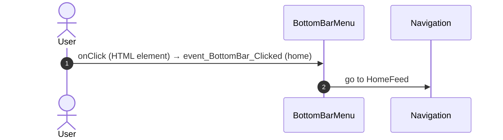

#### 5.1.2 BottomBarMenu: event_BottomBar_Clicked (directory)

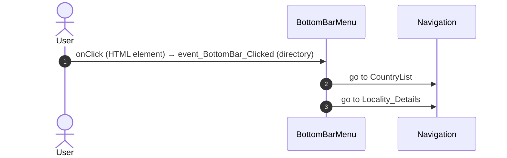

#### 5.1.3 BottomBarMenu: event_BottomBar_Clicked (updates)

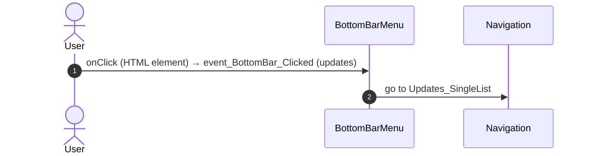

#### 5.1.4 BottomBarMenu: event_BottomBar_Clicked (bookmarks)

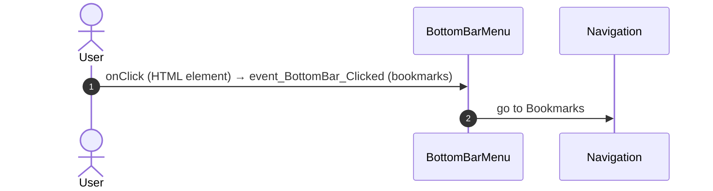

#### 5.1.5 BottomBarMenu: event_BottomBar_Clicked (menu)

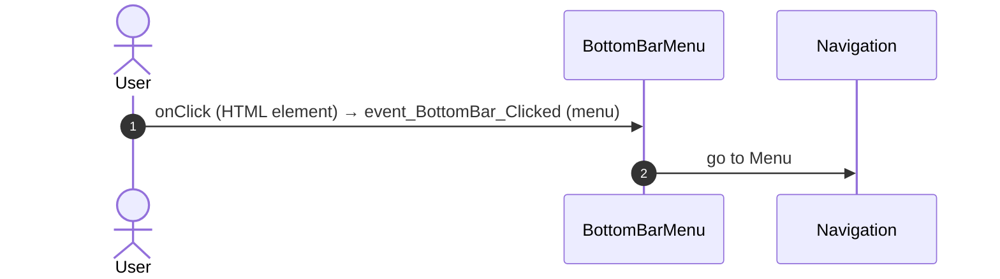

#### 5.1.6 App_NotificationIcon: iconClick

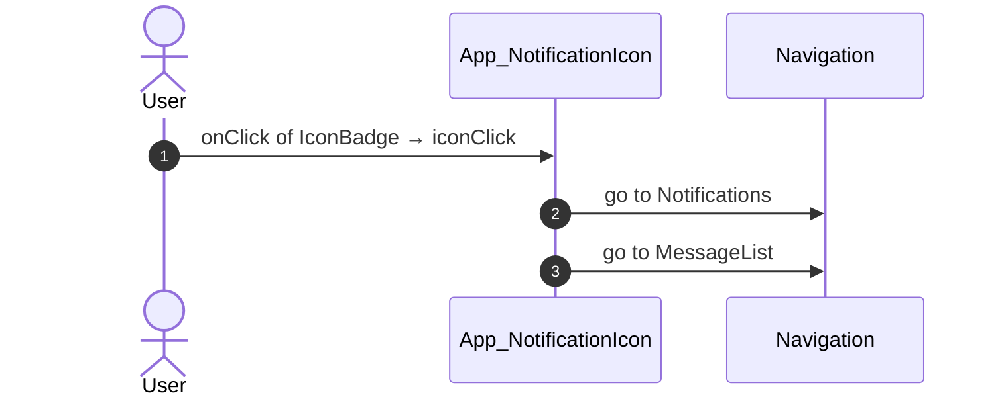

#### 5.1.7 FeedBlock_CommunityPopulation: onClick_Block

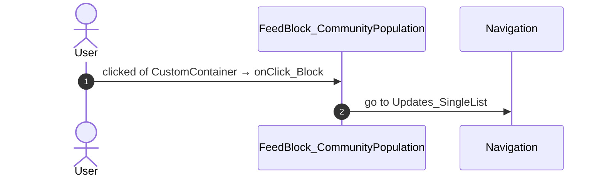

#### 5.1.8 FeedBlock_Services: onClick_ServiceSettings

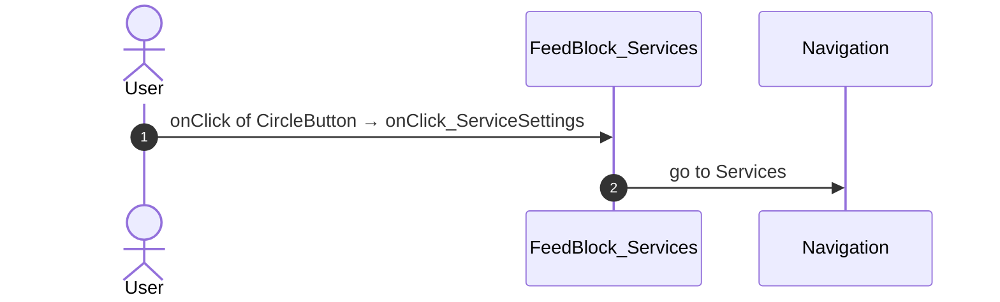

#### 5.1.9 FeedBlock_Services: onClick_Service (orbit)

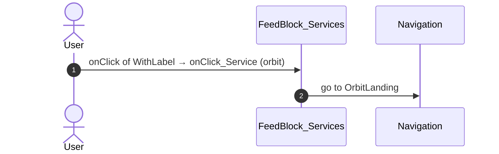

#### 5.1.10 FeedBlock_Services: onClick_Service (lDM)

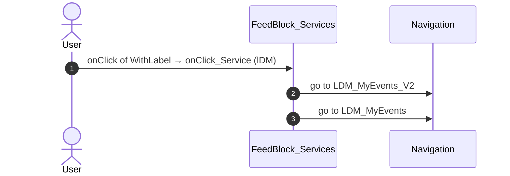

#### 5.1.11 FeedBlock_Services: onClick_Service (myCalendar)

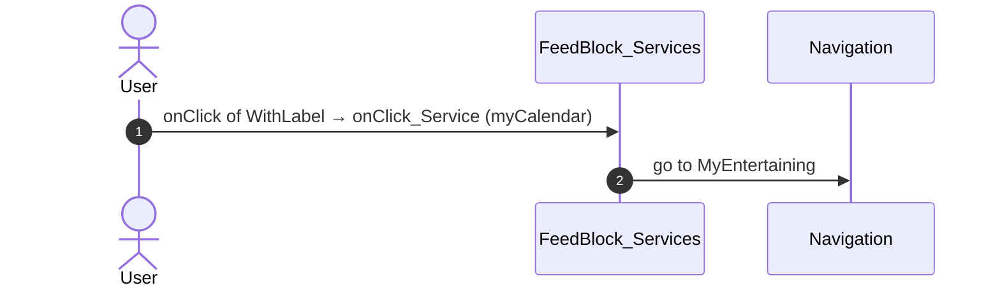

#### 5.1.12 FeedBlock_Services: onClick_Service (assemble)

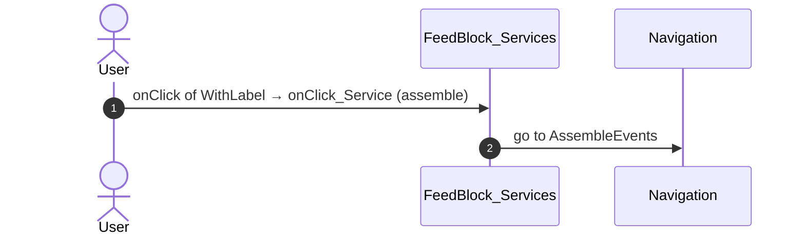

#### 5.1.13 FeedBlock_Services: onClick_Service (orbitAdmin)

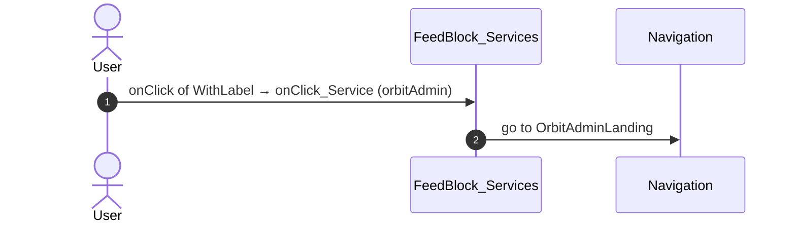

#### 5.1.14 FeedBlock_Services: onClick_Service (myNotes)

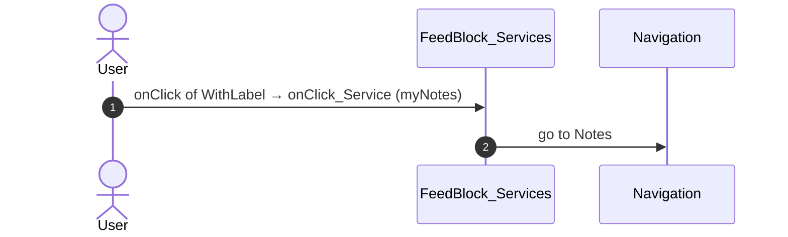

#### 5.1.15 FeedBlock_Services: onClick_Service (oneSchoolGlobal)

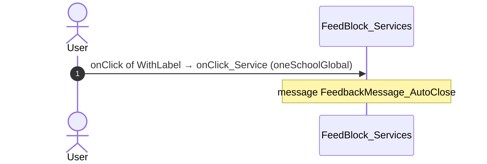

#### 5.1.16 FeedBlock_Services: onClick_Service (other)

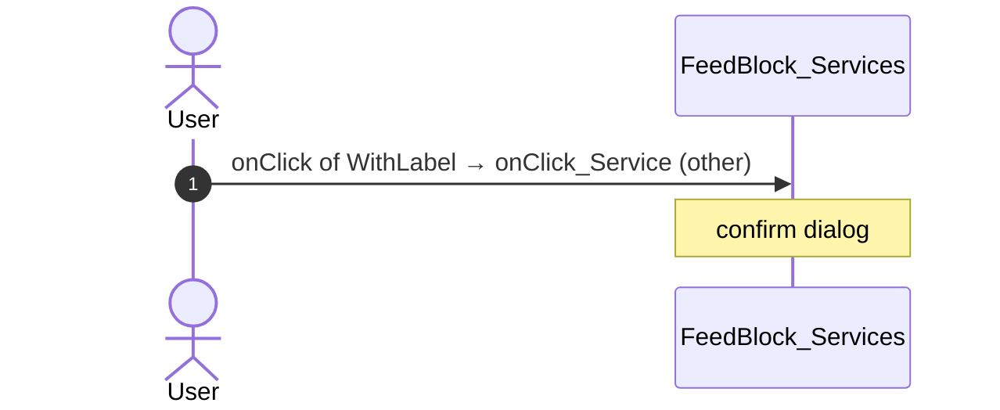

#### 5.1.17 FeedBlock_Updates: handler__Share

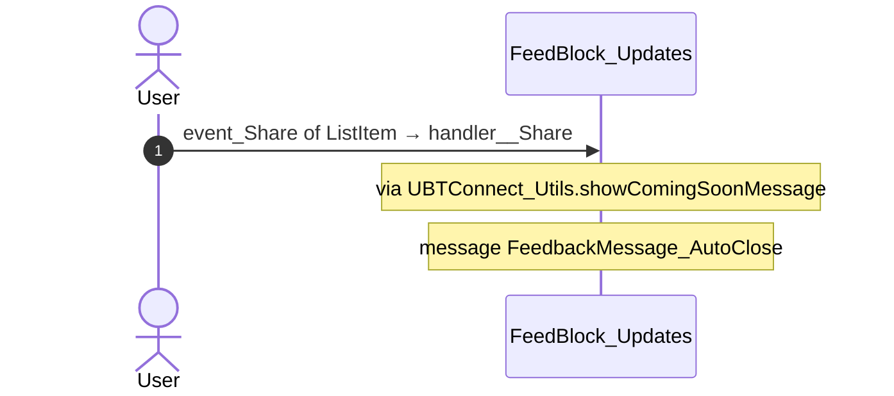

#### 5.1.18 FeedBlock_Updates: event_SendGift

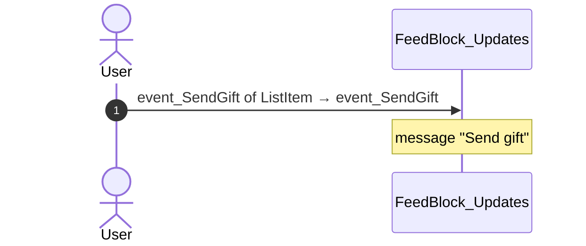

#### 5.1.19 FeedBlock_Updates: event_MarkAsUnread

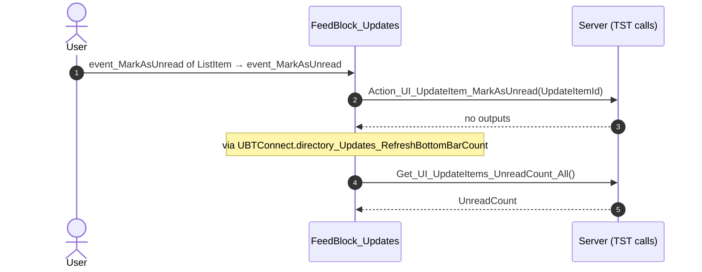

#### 5.1.20 FeedBlock_Updates: event_ListItemOnClick

```mermaid
sequenceDiagram
  autonumber
  actor U as User
  participant B as FeedBlock_Updates
  participant S as Server (TST calls)
  participant N as Navigation
  U->>B: onClick of ListItem → event_ListItemOnClick
  B->>S: Action_UI_UpdateItem_MarkAsRead(UpdateItemId)
  S-->>B: no outputs
  B->>N: go to HouseholdCarousel
  B->>N: go to HouseholdDetails
  Note over B: via UBTConnect_Utils.app_Subscription_ShowUpgradePopUp
  Note over B: confirm dialog
```

#### 5.1.21 FeedBlock_Updates: event_MarkAsRead

```mermaid
sequenceDiagram
  autonumber
  actor U as User
  participant B as FeedBlock_Updates
  participant S as Server (TST calls)
  U->>B: event_MarkAsRead of ListItem → event_MarkAsRead
  B->>S: Action_UI_UpdateItem_MarkAsRead(UpdateItemId)
  S-->>B: no outputs
  Note over B: via UBTConnect.directory_Updates_RefreshBottomBarCount
  B->>S: Get_UI_UpdateItems_UnreadCount_All()
  S-->>B: UnreadCount
```

#### 5.1.22 FeedBlock_Updates: onClick_SubscriptionUpgrade

```mermaid
sequenceDiagram
  autonumber
  actor U as User
  participant B as FeedBlock_Updates
  U->>B: clicked of CustomContainer → onClick_SubscriptionUpgrade
  Note over B: via UBTConnect_Utils.app_Subscription_ShowUpgradePopUp
  Note over B: confirm dialog
```

#### 5.1.23 Feed_Embeded: handle_Download

```mermaid
sequenceDiagram
  autonumber
  actor U as User
  participant B as Feed_Embeded
  participant X as External link
  U->>B: onDownloaded of FeedCMS → handle_Download
  B->>X: OpenInApp_TryOpenFileInApp
```

#### 5.1.24 Feed_Embeded: handle_Share_Others

```mermaid
sequenceDiagram
  autonumber
  actor U as User
  participant B as Feed_Embeded
  participant S as Server (TST calls)
  U->>B: event_ShareToOthers of SharePopup → handle_Share_Others
  Note over B: via UBTConnect_Utils.shareEntity_ByURL
  B->>S: GetAllApplicationEvents()
  S-->>B: EventList
  B->>S: CS_CreateShareProfileLink()
  S-->>B: outputs not in the contract
  B->>S: AppManager_SynchAppContext(EspaceName)
  S-->>B: AppManager_ClientConfig, FirebaseRealTimeDB_Token, PermissionList, …
```

#### 5.1.25 Feed_Embeded: handle_Share_Connect

```mermaid
sequenceDiagram
  autonumber
  actor U as User
  participant B as Feed_Embeded
  participant N as Navigation
  U->>B: event_ShareToConnect of SharePopup → handle_Share_Connect
  B->>N: go to LegacyShareObject
```

#### 5.1.26 Feed_Embeded: handleDownloadOnDownloadError

```mermaid
sequenceDiagram
  autonumber
  actor U as User
  participant B as Feed_Embeded
  U->>B: onDownloadError of HandleDownload → handleDownloadOnDownloadError
  Note over B: message FeedbackMessage_AutoClose
```

#### 5.1.27 HomeFeed: onClick_Search

```mermaid
sequenceDiagram
  autonumber
  actor U as User
  participant B as HomeFeed
  participant N as Navigation
  U->>B: onSearchClick of HomePage → onClick_Search
  B->>N: go to Search
```

#### 5.1.28 HomeFeed: section_UpdatesOnClick_ViewAll

```mermaid
sequenceDiagram
  autonumber
  actor U as User
  participant B as HomeFeed
  participant N as Navigation
  U->>B: onClick_ViewAll of FeedWrapper → section_UpdatesOnClick_ViewAll
  B->>N: go to Updates_SingleList
```

#### 5.1.29 Dialog_GoExternalApp: goToExternalApp

```mermaid
sequenceDiagram
  autonumber
  actor U as User
  participant B as Dialog_GoExternalApp
  participant X as External link
  U->>B: confirmed of ActionConfirmationDialog → goToExternalApp
  Note over B: message FeedbackMessage_AutoClose2
  B->>X: OpenInApp_OpenExternalLink
  B->>X: OpenInApp_OpenApp
```

#### 5.1.30 ShareSheet: handler_OnClickRecentMember

```mermaid
sequenceDiagram
  autonumber
  actor U as User
  participant B as ShareSheet
  participant S as Server (TST calls)
  U->>B: onClick of WithLabel → handler_OnClickRecentMember
  Note over B: via UBTConnect_Utils.app_Subscription_ShowUpgradePopUp
  Note over B: confirm dialog
  B->>S: CS_ShareObject(In_ShareObjectTypeId, In_SharedObjectId, In_SharingProfileName, …)
  S-->>B: IsAllowed, IsSuccess, Message, …
  Note over B: message submitMessageVar + " has been shared."
  Note over B: message "Share failed. Please try again."
```

#### 5.1.31 ShareSheet: handler_OnClickExternalOption

```mermaid
sequenceDiagram
  autonumber
  actor U as User
  participant B as ShareSheet
  participant S as Server (TST calls)
  U->>B: onClick of WithLabel → handler_OnClickExternalOption
  B->>S: CS_CreateShareProfileLink(In_ShareObjectTypeId, In_SharedObjectId, In_UpdateDate, …)
  S-->>B: ShareId, URL
```

#### 5.1.32 ShareSheet: handler_InputEventSubmit

```mermaid
sequenceDiagram
  autonumber
  actor U as User
  participant B as ShareSheet
  participant S as Server (TST calls)
  U->>B: event_Submit of Input → handler_InputEventSubmit
  B->>S: GetAvailableMembers(AvatarImageSize_HorizontalList, AvatarImageSize_VerticalList, AvatarSize_HorizontalList, …)
  S-->>B: Out_SearchResultItemList
```

#### 5.1.33 ShareSheet: handler_SearchResultItemOnSelect

```mermaid
sequenceDiagram
  autonumber
  actor U as User
  participant B as ShareSheet
  U->>B: click of Icon → handler_SearchResultItemOnSelect
  Note over B: message FeedbackMessage_AutoClose
```

#### 5.1.34 ShareSheet: handler_OnClickSend

```mermaid
sequenceDiagram
  autonumber
  actor U as User
  participant B as ShareSheet
  participant S as Server (TST calls)
  U->>B: buttonOnClick of Button → handler_OnClickSend
  B->>S: CS_ShareObject(In_ShareObjectTypeId, In_SharedObjectId, In_SharingProfileName, …)
  S-->>B: IsAllowed, IsSuccess, Message, …
  Note over B: message submitMessageVar + " has been shared."
  Note over B: message "Share failed. Please try again."
```

### 5.2 React

| # | File | Element | Event prop | Handler | Branch | Effects |
|---|---|---|---|---|---|---|
| [1](#521-homelayout-ononsearchclick) | [`pages/HomeFeed/HomeFeedPage.tsx:128`](../../app/src/pages/HomeFeed/HomeFeedPage.tsx#L128) | `<HomeLayout>` | `onOnSearchClick` | `inline` | – | goes to Search |
| [2](#522-communitypopulation-onclick) | [`pages/HomeFeed/HomeFeedPage.tsx:156`](../../app/src/pages/HomeFeed/HomeFeedPage.tsx#L156) | `<CommunityPopulation>` | `onClick` | `inline` | – | goes to Updates_SingleList |
| [3](#523-section_feedwrapper-ononclickviewall) | [`pages/HomeFeed/HomeFeedPage.tsx:170`](../../app/src/pages/HomeFeed/HomeFeedPage.tsx#L170) | `<Section_FeedWrapper>` | `onOnClickViewAll` | `inline` | – | goes to Updates_SingleList |
| [4](#524-sharesheetfirststep-onclickrecentmember) | [`containers/ShareSheet/ShareSheetContainer.tsx:111`](../../app/src/containers/ShareSheet/ShareSheetContainer.tsx#L111) | `<ShareSheetFirstStep>` | `onClickRecentMember` | `onClickRecentMember` | – | calls ActionCS_ShareObject; shows a message; asks for a confirmation |
| [5](#525-sharesheetsearchstep-onselect) | [`containers/ShareSheet/ShareSheetContainer.tsx:129`](../../app/src/containers/ShareSheet/ShareSheetContainer.tsx#L129) | `<ShareSheetSearchStep>` | `onSelect` | `onSelect` | – | shows a message |
| [6](#526-sharesheetsearchstep-onclickupgradesubscription) | [`containers/ShareSheet/ShareSheetContainer.tsx:130`](../../app/src/containers/ShareSheet/ShareSheetContainer.tsx#L130) | `<ShareSheetSearchStep>` | `onClickUpgradeSubscription` | `onClickUpgradeSubscription` | – | opens an external link |
| [7](#527-actionbutton-onbuttononclick) | [`containers/ShareSheet/ShareSheetContainer.tsx:148`](../../app/src/containers/ShareSheet/ShareSheetContainer.tsx#L148) | `<ActionButton>` | `onButtonOnClick` | `onClickSend` | – | calls ActionCS_ShareObject; shows a message |
| [8](#528-preventbacknavigation-onbacknavigationprevented) | [`components/layout/CommonUiLayout/CommonUiLayout.tsx:80`](../../app/src/components/layout/CommonUiLayout/CommonUiLayout.tsx#L80) | `<PreventBackNavigation>` | `onBackNavigationPrevented` | `redirectHome` | – | goes to HomeFeed |
| [9](#529-backnavigationhandler-onbacknavigation) | [`components/layout/CommonUiLayout/CommonUiLayout.tsx:82`](../../app/src/components/layout/CommonUiLayout/CommonUiLayout.tsx#L82) | `<BackNavigationHandler>` | `onBackNavigation` | `maybeRedirectHome` | – | goes to HomeFeed |
| [10](#5210-oslink-onclick-home) | [`components/layout/BottomBar/BottomBar.tsx:130`](../../app/src/components/layout/BottomBar/BottomBar.tsx#L130) | `<OSLink>` | `onClick` | `click` | `Home` | goes to HomeFeed |
| [11](#5211-oslink-onclick-directory) | [`components/layout/BottomBar/BottomBar.tsx:130`](../../app/src/components/layout/BottomBar/BottomBar.tsx#L130) | `<OSLink>` | `onClick` | `click` | `Directory` | goes to CountryList, Locality_Details |
| [12](#5212-oslink-onclick-updates) | [`components/layout/BottomBar/BottomBar.tsx:130`](../../app/src/components/layout/BottomBar/BottomBar.tsx#L130) | `<OSLink>` | `onClick` | `click` | `Updates` | goes to Updates_SingleList |
| [13](#5213-oslink-onclick-bookmarks) | [`components/layout/BottomBar/BottomBar.tsx:130`](../../app/src/components/layout/BottomBar/BottomBar.tsx#L130) | `<OSLink>` | `onClick` | `click` | `Bookmarks` | goes to Bookmarks |
| [14](#5214-oslink-onclick-menu) | [`components/layout/BottomBar/BottomBar.tsx:130`](../../app/src/components/layout/BottomBar/BottomBar.tsx#L130) | `<OSLink>` | `onClick` | `click` | `Menu` | goes to Menu |
| [15](#5215-oslink-onclick-other) | [`components/layout/BottomBar/BottomBar.tsx:130`](../../app/src/components/layout/BottomBar/BottomBar.tsx#L130) | `<OSLink>` | `onClick` | `click` | `other` | calls the prop onBottomBarClicked() |
| [16](#5216-bottombariconbadge-ononclick-home) | [`components/layout/BottomBar/BottomBar.tsx:140`](../../app/src/components/layout/BottomBar/BottomBar.tsx#L140) | `<BottomBarIconBadge>` | `onOnClick` | `click` | `Home` | goes to HomeFeed |
| [17](#5217-bottombariconbadge-ononclick-directory) | [`components/layout/BottomBar/BottomBar.tsx:140`](../../app/src/components/layout/BottomBar/BottomBar.tsx#L140) | `<BottomBarIconBadge>` | `onOnClick` | `click` | `Directory` | goes to CountryList, Locality_Details |
| [18](#5218-bottombariconbadge-ononclick-updates) | [`components/layout/BottomBar/BottomBar.tsx:140`](../../app/src/components/layout/BottomBar/BottomBar.tsx#L140) | `<BottomBarIconBadge>` | `onOnClick` | `click` | `Updates` | goes to Updates_SingleList |
| [19](#5219-bottombariconbadge-ononclick-bookmarks) | [`components/layout/BottomBar/BottomBar.tsx:140`](../../app/src/components/layout/BottomBar/BottomBar.tsx#L140) | `<BottomBarIconBadge>` | `onOnClick` | `click` | `Bookmarks` | goes to Bookmarks |
| [20](#5220-bottombariconbadge-ononclick-menu) | [`components/layout/BottomBar/BottomBar.tsx:140`](../../app/src/components/layout/BottomBar/BottomBar.tsx#L140) | `<BottomBarIconBadge>` | `onOnClick` | `click` | `Menu` | goes to Menu |
| [21](#5221-bottombariconbadge-ononclick-other) | [`components/layout/BottomBar/BottomBar.tsx:140`](../../app/src/components/layout/BottomBar/BottomBar.tsx#L140) | `<BottomBarIconBadge>` | `onOnClick` | `click` | `other` | calls the prop onBottomBarClicked() |

#### 5.2.1 HomeLayout: onOnSearchClick

```mermaid
sequenceDiagram
  autonumber
  actor U as User
  participant H as HomeLayout · HomeFeedPage.tsx
  participant N as Navigation
  U->>H: onOnSearchClick → inline
  H->>N: go to Search
```

#### 5.2.2 CommunityPopulation: onClick

```mermaid
sequenceDiagram
  autonumber
  actor U as User
  participant H as CommunityPopulation · HomeFeedPage.tsx
  participant N as Navigation
  U->>H: onClick → inline
  H->>N: go to Updates_SingleList
```

#### 5.2.3 Section_FeedWrapper: onOnClickViewAll

```mermaid
sequenceDiagram
  autonumber
  actor U as User
  participant H as Section_FeedWrapper · HomeFeedPage.tsx
  participant N as Navigation
  U->>H: onOnClickViewAll → inline
  H->>N: go to Updates_SingleList
```

#### 5.2.4 ShareSheetFirstStep: onClickRecentMember

```mermaid
sequenceDiagram
  autonumber
  actor U as User
  participant H as ShareSheetFirstStep · ShareSheetContainer.tsx
  participant A as Server (React api)
  U->>H: onClickRecentMember → onClickRecentMember
  Note over H: via showUpgradePopUp()
  Note over H: confirm dialog dialogId
  Note over H: via submitShare()
  Note over H: via csShareObject()
  H->>A: ActionCS_ShareObject(In_ShareObjectTypeId, In_SharedObjectId, In_SharingProfileName, …)
  A-->>H: IsAllowed, IsSuccess, Message, …
  Note over H: message `${submitMessage} has been shared.`
  Note over H: message 'Share failed. Please try again.'
```

#### 5.2.5 ShareSheetSearchStep: onSelect

```mermaid
sequenceDiagram
  autonumber
  actor U as User
  participant H as ShareSheetSearchStep · ShareSheetContainer.tsx
  U->>H: onSelect → onSelect
  Note over H: message { title: '', message: 'You can select up to 50 recipients only.', messageType: 'error', en
```

#### 5.2.6 ShareSheetSearchStep: onClickUpgradeSubscription

```mermaid
sequenceDiagram
  autonumber
  actor U as User
  participant H as ShareSheetSearchStep · ShareSheetContainer.tsx
  participant X as External link
  U->>H: onClickUpgradeSubscription → onClickUpgradeSubscription
  Note over H: via navigateToUpgrade()
  H->>X: openInApp_OpenExternalLink
```

#### 5.2.7 ActionButton: onButtonOnClick

```mermaid
sequenceDiagram
  autonumber
  actor U as User
  participant H as ActionButton · ShareSheetContainer.tsx
  participant A as Server (React api)
  U->>H: onButtonOnClick → onClickSend
  Note over H: via submitShare()
  Note over H: via csShareObject()
  H->>A: ActionCS_ShareObject(In_ShareObjectTypeId, In_SharedObjectId, In_SharingProfileName, …)
  A-->>H: IsAllowed, IsSuccess, Message, …
  Note over H: message `${submitMessage} has been shared.`
  Note over H: message 'Share failed. Please try again.'
```

#### 5.2.8 PreventBackNavigation: onBackNavigationPrevented

```mermaid
sequenceDiagram
  autonumber
  actor U as User
  participant H as PreventBackNavigation · CommonUiLayout.tsx
  participant N as Navigation
  U->>H: onBackNavigationPrevented → redirectHome
  H->>N: go to HomeFeed
```

#### 5.2.9 BackNavigationHandler: onBackNavigation

```mermaid
sequenceDiagram
  autonumber
  actor U as User
  participant H as BackNavigationHandler · CommonUiLayout.tsx
  participant N as Navigation
  U->>H: onBackNavigation → maybeRedirectHome
  Note over H: via actionRedirectHome()
  H->>N: go to HomeFeed
```

#### 5.2.10 OSLink: onClick (Home)

```mermaid
sequenceDiagram
  autonumber
  actor U as User
  participant H as OSLink · BottomBar.tsx
  participant N as Navigation
  U->>H: onClick → click (Home)
  Note over H: via event_BottomBar_Clicked()
  H->>N: go to HomeFeed
```

#### 5.2.11 OSLink: onClick (Directory)

```mermaid
sequenceDiagram
  autonumber
  actor U as User
  participant H as OSLink · BottomBar.tsx
  participant N as Navigation
  U->>H: onClick → click (Directory)
  Note over H: via event_BottomBar_Clicked()
  H->>N: go to CountryList
  H->>N: go to Locality_Details
```

#### 5.2.12 OSLink: onClick (Updates)

```mermaid
sequenceDiagram
  autonumber
  actor U as User
  participant H as OSLink · BottomBar.tsx
  participant N as Navigation
  U->>H: onClick → click (Updates)
  Note over H: via event_BottomBar_Clicked()
  H->>N: go to Updates_SingleList
```

#### 5.2.13 OSLink: onClick (Bookmarks)

```mermaid
sequenceDiagram
  autonumber
  actor U as User
  participant H as OSLink · BottomBar.tsx
  participant N as Navigation
  U->>H: onClick → click (Bookmarks)
  Note over H: via event_BottomBar_Clicked()
  H->>N: go to Bookmarks
```

#### 5.2.14 OSLink: onClick (Menu)

```mermaid
sequenceDiagram
  autonumber
  actor U as User
  participant H as OSLink · BottomBar.tsx
  participant N as Navigation
  U->>H: onClick → click (Menu)
  Note over H: via event_BottomBar_Clicked()
  H->>N: go to Menu
```

#### 5.2.15 OSLink: onClick (other)

```mermaid
sequenceDiagram
  autonumber
  actor U as User
  participant H as OSLink · BottomBar.tsx
  U->>H: onClick → click (other)
  Note over H: via event_BottomBar_Clicked()
  Note over H: calls the prop onBottomBarClicked()
```

#### 5.2.16 BottomBarIconBadge: onOnClick (Home)

```mermaid
sequenceDiagram
  autonumber
  actor U as User
  participant H as BottomBarIconBadge · BottomBar.tsx
  participant N as Navigation
  U->>H: onOnClick → click (Home)
  Note over H: via event_BottomBar_Clicked()
  H->>N: go to HomeFeed
```

#### 5.2.17 BottomBarIconBadge: onOnClick (Directory)

```mermaid
sequenceDiagram
  autonumber
  actor U as User
  participant H as BottomBarIconBadge · BottomBar.tsx
  participant N as Navigation
  U->>H: onOnClick → click (Directory)
  Note over H: via event_BottomBar_Clicked()
  H->>N: go to CountryList
  H->>N: go to Locality_Details
```

#### 5.2.18 BottomBarIconBadge: onOnClick (Updates)

```mermaid
sequenceDiagram
  autonumber
  actor U as User
  participant H as BottomBarIconBadge · BottomBar.tsx
  participant N as Navigation
  U->>H: onOnClick → click (Updates)
  Note over H: via event_BottomBar_Clicked()
  H->>N: go to Updates_SingleList
```

#### 5.2.19 BottomBarIconBadge: onOnClick (Bookmarks)

```mermaid
sequenceDiagram
  autonumber
  actor U as User
  participant H as BottomBarIconBadge · BottomBar.tsx
  participant N as Navigation
  U->>H: onOnClick → click (Bookmarks)
  Note over H: via event_BottomBar_Clicked()
  H->>N: go to Bookmarks
```

#### 5.2.20 BottomBarIconBadge: onOnClick (Menu)

```mermaid
sequenceDiagram
  autonumber
  actor U as User
  participant H as BottomBarIconBadge · BottomBar.tsx
  participant N as Navigation
  U->>H: onOnClick → click (Menu)
  Note over H: via event_BottomBar_Clicked()
  H->>N: go to Menu
```

#### 5.2.21 BottomBarIconBadge: onOnClick (other)

```mermaid
sequenceDiagram
  autonumber
  actor U as User
  participant H as BottomBarIconBadge · BottomBar.tsx
  U->>H: onOnClick → click (other)
  Note over H: via event_BottomBar_Clicked()
  Note over H: calls the prop onBottomBarClicked()
```

## 6. Server calls

All columns come from the code, without interpretation:

- **Direct caller (TST):** the block or module of the action that calls the server (the step before the server call in the chain).
- **Chain (TST):** the chains of client actions in the TST compiled code, from their start to the call.
  A long chain shows its first 2 steps, …, and its last 2 steps.
- **Seen on TST:** `yes` when TST made the call in the capture.
- **React action:** the React function with the `callAction` of the same call (`file:line`), and the code that loads it: `shell` (from `main.tsx`), `page` (from the screen), or both.
- **Used by (React references):** the functions and components that reference the React action, up to the nearest component. A reference is not always a call.
- **Status:** `implemented` when the contract path of the React call gives the same TST URL. It does not prove the same behaviour.

| # | Call (TST) | Kind | Direct caller (TST) | Chain (TST) | Seen on TST | React action | Used by (React references) | Status |
|---|---|---|---|---|---|---|---|---|
| 1 | `Connect2_LegacyShared/ActionGetAllApplicationEvents` | server action | `Connect2_LegacyShared` | SharePopup.onClick_CallButton → event event_ShareToOthers of SharePopup → … → Connect2_LegacyShared.cacheLocalApplicationEvents → server GetAllApplicationEvents | no | – | – | **missing** |
| 2 | `UBTConnect_EmbedFeed/Blocks/Embedded_FeedCMS/DataActionGetFeedConfig` | data action | `Embedded_FeedCMS` | Embedded_FeedCMS fetch at start → Embedded_FeedCMS.DataActionGetFeedConfig | yes | `fetchFeedConfig()` [`api/feed/repository.ts:9`](../../app/src/api/feed/repository.ts#L9) (page) | `HomeFeed → useEmbeddedFeed → useFeedConfigQuery → fetchFeedConfig`<br>[`pages/HomeFeed/HomeFeedPage.tsx`](../../app/src/pages/HomeFeed/HomeFeedPage.tsx) | implemented |
| 3 | `UBTConnect/Home/FeedBlock_CommunityPopulation/DataActionFetchCount` | data action | `FeedBlock_CommunityPopulation` | FeedBlock_CommunityPopulation fetch at start → FeedBlock_CommunityPopulation.DataActionFetchCount | yes | `fetchCommunityPopulation()` [`api/member/repository.ts:25`](../../app/src/api/member/repository.ts#L25) (page) | `HomeFeed → useCommunityPopulationQuery → fetchCommunityPopulation`<br>[`pages/HomeFeed/HomeFeedPage.tsx`](../../app/src/pages/HomeFeed/HomeFeedPage.tsx) | implemented |
| 4 | `UBTConnect/Home/FeedBlock_Services/DataActionGetServices` | data action | `FeedBlock_Services` | FeedBlock_Services fetch at start → FeedBlock_Services.DataActionGetServices | yes | `fetchFeedServices()` [`api/service/repository.ts:34`](../../app/src/api/service/repository.ts#L34) (page) | `FeedServices → useFeedServices → useFeedServicesQuery → fetchFeedServices`<br>[`pages/HomeFeed/HomeFeedPage.tsx`](../../app/src/pages/HomeFeed/HomeFeedPage.tsx) | implemented |
| 5 | `UBTConnect/Home/FeedBlock_Updates/DataActionFetchUpdates` | data action | `FeedBlock_Updates` | FeedBlock_Updates fetch at start → FeedBlock_Updates.DataActionFetchUpdates | yes | `fetchFeedUpdates()` [`api/update/repository.ts:22`](../../app/src/api/update/repository.ts#L22) (page) | `FeedUpdates → useFeedUpdates → useFeedUpdatesQuery → fetchFeedUpdates`<br>[`pages/HomeFeed/HomeFeedPage.tsx`](../../app/src/pages/HomeFeed/HomeFeedPage.tsx) | implemented |
| 6 | `UBTConnect/Home/FeedBlock_Updates/ServiceAPIAction_UI_UpdateItem_MarkAsRead` | service action | `FeedBlock_Updates` | onClick in ContextMenu → event event_MarkAsRead of ContextMenu → event event_MarkAsRead of Update_ListItem → FeedBlock_Updates.event_MarkAsRead → server Action_UI_UpdateItem_MarkAsRead | no | `markUpdateItemAsRead()` [`api/update/repository.ts:47`](../../app/src/api/update/repository.ts#L47) (page) | `FeedUpdates → useFeedUpdates → markUpdateItemAsRead`<br>[`pages/HomeFeed/HomeFeedPage.tsx`](../../app/src/pages/HomeFeed/HomeFeedPage.tsx) | implemented |
| 7 | `UBTConnect/Home/FeedBlock_Updates/ServiceAPIAction_UI_UpdateItem_MarkAsUnread` | service action | `FeedBlock_Updates` | onClick in ContextMenu → event event_MarkAsUnread of ContextMenu → event event_MarkAsUnread of Update_ListItem → FeedBlock_Updates.event_MarkAsUnread → server Action_UI_UpdateItem_MarkAsUnread | no | `markUpdateItemAsUnread()` [`api/update/repository.ts:52`](../../app/src/api/update/repository.ts#L52) (page) | `FeedUpdates → useFeedUpdates → markUpdateItemAsUnread`<br>[`pages/HomeFeed/HomeFeedPage.tsx`](../../app/src/pages/HomeFeed/HomeFeedPage.tsx) | implemented |
| 8 | `UBTConnect/Home/HomeFeed/DataActionGetCommunityStatistics` | data action | `HomeFeed` | HomeFeed.OnReady → HomeFeed.screenEvent_OnReady → HomeFeed.DataActionGetCommunityStatistics<br>HomeFeed fetch at start → HomeFeed.DataActionGetCommunityStatistics | yes | `fetchHomeFeedCommunityStatistics()` [`api/country/repository.ts:49`](../../app/src/api/country/repository.ts#L49) (page) | `HomeFeed → useHomeFeedReady → fetchHomeFeedCommunityStatistics`<br>[`pages/HomeFeed/HomeFeedPage.tsx`](../../app/src/pages/HomeFeed/HomeFeedPage.tsx) | implemented |
| 9 | `UBTConnect_Utils/CW_Share/ShareSheet/ActionCS_CreateShareProfileLink` | server action | `ShareSheet` | onClick in CircleButton_WithLabel → CircleButton_WithLabel.action_OnClick → event onClick of CircleButton_WithLabel → ShareSheet.handler_OnClickExternalOption → server CS_CreateShareProfileLink | no | – | – | **missing** |
| 10 | `UBTConnect_Utils/CW_Share/ShareSheet/ActionCS_ShareObject` | server action | `ShareSheet` | onClick in CircleButton_WithLabel → CircleButton_WithLabel.action_OnClick → … → ShareSheet.action_SubmitShare → server CS_ShareObject<br>ShareSheet.handler_OnClickSend → ShareSheet.action_SubmitShare → server CS_ShareObject | no | `csShareObject()` [`api/share/shareSheet.ts:25`](../../app/src/api/share/shareSheet.ts#L25) (page) | `ShareSheetContainer → useShareSheet → csShareObject`<br>[`containers/ShareSheet/ShareSheetContainer.tsx`](../../app/src/containers/ShareSheet/ShareSheetContainer.tsx) | implemented |
| 11 | `UBTConnect_Utils/CW_Share/ShareSheet/DataActionGetAvailableMembers` | data action | `ShareSheet` | ShareSheet.handler_InputEventSubmit → ShareSheet.DataActionGetAvailableMembers<br>ShareSheet fetch at start → ShareSheet.DataActionGetAvailableMembers | no | `fetchAvailableMembers()` [`api/member/repository.ts:12`](../../app/src/api/member/repository.ts#L12) (page) | `ShareSheetContainer → useShareSheet → useAvailableMembersQuery → fetchAvailableMembers`<br>[`containers/ShareSheet/ShareSheetContainer.tsx`](../../app/src/containers/ShareSheet/ShareSheetContainer.tsx) | implemented |
| 12 | `UBTConnect_Utils/CW_Share/ShareSheet/DataActionGetRecentlyShared` | data action | `ShareSheet` | ShareSheet.OnParametersChanged → ShareSheet.screenEvent_OnParametersChanged → ShareSheet.DataActionGetRecentlyShared<br>ShareSheet fetch at start → ShareSheet.DataActionGetRecentlyShared | no | `fetchRecentlyShared()` [`api/share/shareSheet.ts:14`](../../app/src/api/share/shareSheet.ts#L14) (page) | `ShareSheetContainer → useShareSheet → useRecentlySharedQuery → fetchRecentlyShared`<br>[`containers/ShareSheet/ShareSheetContainer.tsx`](../../app/src/containers/ShareSheet/ShareSheetContainer.tsx) | implemented |
| 13 | `UBTConnect/ServiceAPIGet_UI_UpdateItems_UnreadCount_All` | service action | `UBTConnect` | BottomBarMenu.OnReady → BottomBarMenu.onReady → UBTConnect.directory_Updates_RefreshBottomBarCount → server Get_UI_UpdateItems_UnreadCount_All<br>onClick in ContextMenu → event event_MarkAsRead of ContextMenu → … → UBTConnect.directory_Updates_RefreshBottomBarCount → server Get_UI_UpdateItems_UnreadCount_All<br>onClick in ContextMenu → event event_MarkAsUnread of ContextMenu → … → UBTConnect.directory_Updates_RefreshBottomBarCount → server Get_UI_UpdateItems_UnreadCount_All | no | `fetchUnreadUpdateItemsCount()` [`api/update/repository.ts:73`](../../app/src/api/update/repository.ts#L73) (page) | `BottomBar → directory_Updates_RefreshBottomBarCount → fetchUnreadUpdateItemsCount`<br>[`components/layout/BottomBar/BottomBar.tsx`](../../app/src/components/layout/BottomBar/BottomBar.tsx)<br>`FeedUpdates → useFeedUpdates → directory_Updates_RefreshBottomBarCount → fetchUnreadUpdateItemsCount`<br>[`pages/HomeFeed/HomeFeedPage.tsx`](../../app/src/pages/HomeFeed/HomeFeedPage.tsx) | implemented |
| 14 | `UBTConnect_Utils/ActionCS_CreateShareProfileLink` | server action | `UBTConnect_Utils` | event event_Clicked of ContactPopup → SharePopup.onClick_CallButton → … → UBTConnect_Utils.shareEntity_ByURL → server CS_CreateShareProfileLink | no | – | – | **missing** |

## 7. Missing in React

- Call `UBTConnect_Utils/CW_Share/ShareSheet/ActionCS_CreateShareProfileLink`. Chain on TST: onClick in CircleButton_WithLabel → CircleButton_WithLabel.action_OnClick → event onClick of CircleButton_WithLabel → ShareSheet.handler_OnClickExternalOption → server CS_CreateShareProfileLink.
  - React has the function, but this route does not use it: `csCreateShareProfileLink()` [`api/share/shareSheet.ts:39`](../../app/src/api/share/shareSheet.ts#L39).
  - Note in [`api/share/shareSheet.ts:35`](../../app/src/api/share/shareSheet.ts#L35): "/** CS_CreateShareProfileLink (Handler_OnClickExternalOption, ShareSheet.mvc.js:2250-2301): the share id and URL. */"
  - Note in [`components/feed/EmbeddedFeed/README.md:66`](../../app/src/components/feed/EmbeddedFeed/README.md#L66): "is not wired: ShareEntity_ByURL (UBTConnect_Utils) is not ported (SocialSharing plugin + CS_CreateShareProfileLink),"
  - Note in [`containers/ShareSheet/README.md:56`](../../app/src/containers/ShareSheet/README.md#L56): "- ActionCS_CreateShareProfileLink (`cs_CreateShareProfileLink`)."
- Call `UBTConnect_Utils/ActionCS_CreateShareProfileLink`. Chain on TST: event event_Clicked of ContactPopup → SharePopup.onClick_CallButton → event event_ShareToOthers of SharePopup → Feed_Embeded.handle_Share_Others → UBTConnect_Utils.shareEntity_ByURL → server CS_CreateShareProfileLink.
  - No React code makes this call.
  - Note in [`api/share/shareSheet.ts:35`](../../app/src/api/share/shareSheet.ts#L35): "/** CS_CreateShareProfileLink (Handler_OnClickExternalOption, ShareSheet.mvc.js:2250-2301): the share id and URL. */"
  - Note in [`components/feed/EmbeddedFeed/README.md:65`](../../app/src/components/feed/EmbeddedFeed/README.md#L65): "- Event_ShareToOthers → Handle_Share_Others (:257, :775-807: close, then ShareEntity_ByURL(Type_ShareObject.Feed, Id))"
  - Note in [`containers/EntityDetailsActions/README.md:74`](../../app/src/containers/EntityDetailsActions/README.md#L74): "- **Share to others**: the React app does not port UBTConnect_Utils ShareEntity_ByURL. The dialog only closes."
- Call `Connect2_LegacyShared/ActionGetAllApplicationEvents`. Chain on TST: SharePopup.onClick_CallButton → event event_ShareToOthers of SharePopup → Feed_Embeded.handle_Share_Others → UBTConnect_Utils.shareEntity_ByURL → Connect2_LegacyShared.auditShareEvent → Connect2_LegacyShared.zOnApplicationEvent_Wrapper → Connect2_LegacyShared.getAppEventName → Connect2_LegacyShared.cacheLocalApplicationEvents → server GetAllApplicationEvents.
  - No React code makes this call.

## 8. Questions

1. React calls `/api/UBTConnect_Utils/ActionGetSignedImagesInBulk` from `cache_SignedImageURL_GetCallback()` [`lib/ubtConnectUtils/actions.ts:124`](../../app/src/lib/ubtConnectUtils/actions.ts#L124) (page). TST HomeFeed has no chain to this call. Does the call belong to this route?
2. React calls `/api/UBTConnect_Utils/CacheControl_Policies/DataActionGetCacheInfo` from `fetchPolicies()` [`api/app/repository.ts:54`](../../app/src/api/app/repository.ts#L54) (shell + page). TST HomeFeed has no chain to this call. Does the call belong to this route?

## 9. Method

1. **OutSystems (TST).** The tool reads `facts.json` and the compiled code of `migration/screens/HomeFeed/analysis/`:
   - the rendered files;
   - each server call with its chain of client actions, and the calls that TST made in the capture;
   - the effects of each user action.
2. **Route and app shell.** OutSystems: a chain belongs to the app shell when it starts in `CommonUI_InsideLayout`, one of its blocks, or a module action. React: a binding belongs to the app shell when its file is in the code that `main.tsx` loads.
3. **MCP (DEV).** The tool reads the UI flow with `getScreenNames`. TST wins when DEV is different.
4. **React.** `react_calls.mjs` reads the app shell from `app/src/main.tsx` and the screen from its `<Route>Page.tsx`. It counts only the code that the app uses.
5. **Match.** `callAction(M, A)` gives `/api/M/A`. The `x-os-paths` of `app/src/api/openapi.yaml` give the TST call. The status is `implemented` when the TST call is the same. Else the status is `missing`.

Limit: a name or a call match does not prove the same behaviour. The parity checks of the migration compare the behaviour.
